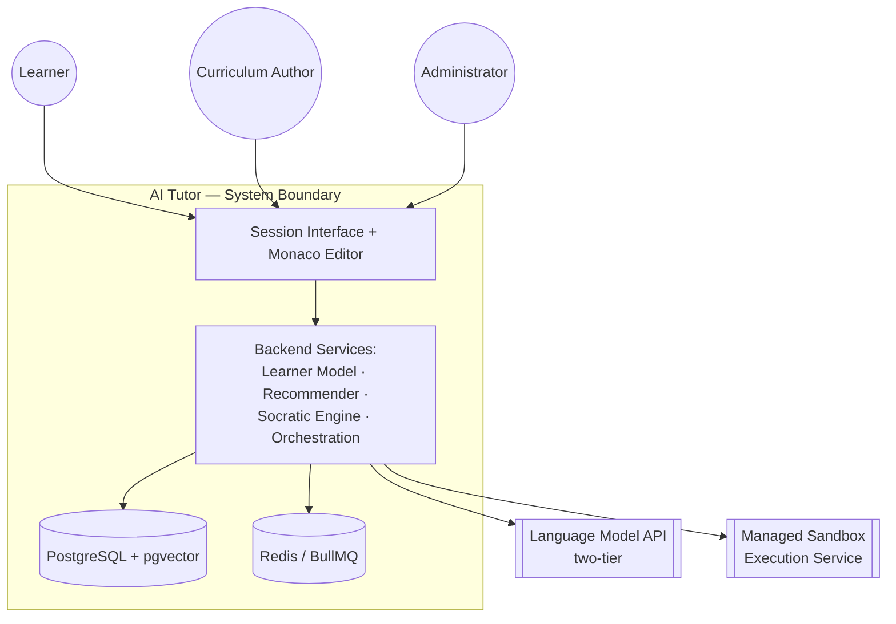

# Minor Project – III (MCA-269) — Software Requirements Specification

**Project:** AI Tutor — An Evidence-Based Adaptive Learning System with Deliberate Scaffolding Withdrawal
**Programme:** Master of Computer Applications, Semester III · Batch 2025–2027
**Institution:** Jagan Institute of Management Studies, Rohini
**Submitted by:** Ashwani Kumar Puri *(Roll No. — to be filled)*
**Guide:** *(to be filled)*
**Date:** 7 September 2026
**Review:** Review 1 — Problem Analysis, Literature Survey, Software Requirements Specification

*Structured to IEEE 830 conventions, adapted to the module table already fixed in the synopsis. Detailed DFD, ER, and UML design artefacts are Review 2 deliverables (synopsis §6.4) and are intentionally not duplicated here — this document specifies* what *the system must do, not how its data or components are structured internally.*

---

## 1. Introduction

### 1.1 Purpose

This SRS specifies the functional and non-functional requirements for version 1 of the AI Tutor system, so that design (Review 2), implementation, and testing (Review 3) proceed against a fixed, numbered contract rather than an evolving understanding. It formalises the objectives (O1–O7) fixed in `MP3-PROBLEM-ANALYSIS.md` §6 and the module table already defined in `MP3-SYNOPSIS-AI-TUTOR.md` §4.

### 1.2 Document Conventions

- Functional requirements are numbered **FR-\<Module\>-\<seq\>**, e.g. `FR-M4-03`.
- Each requirement carries a MoSCoW priority: **Must**, **Should**, or **Could**. No "Won't" requirements are listed — those are recorded instead in the Problem Analysis §7.2 out-of-scope list.
- "Shall" statements are binding; "should" statements are advisory.

### 1.3 Intended Audience

The project team (design and implementation reference), the guide and evaluation panel (Review 1 deliverable), and — per the department's stated grading criterion (§5.2 of the received guidelines) that documentation match professional SDE practice — this document is written to be usable exactly as a real team's SRS would be, not as an academic formality.

### 1.4 Project Scope

As fixed in Problem Analysis §7: a single skill domain (JavaScript → React, ~60 nodes), text/code/exercise content only, full learner-model and Socratic-engine mechanics, sandboxed execution, and basic authoring/admin interfaces. The out-of-scope list in Problem Analysis §7.2 applies unchanged.

### 1.5 References

- `MP3-SYNOPSIS-AI-TUTOR.md` — system description, module table, tools/platforms, methodology.
- `MP3-LITERATURE-SURVEY.md` — the evidence base each design decision cites.
- `MP3-PROBLEM-ANALYSIS.md` — problem definition, root-cause analysis, objectives O1–O7, feasibility, risk register.

---

## 2. Overall Description

### 2.1 Product Perspective

The system is new and self-contained; it does not replace an existing software system (Problem Analysis §3 describes a manual, multi-tool workflow, not a legacy application). It depends on two external services it does not implement: a language-model API (two-tier: small model for hints/grading, large model for exercise generation) and a managed code-execution sandbox.

### 2.2 Product Functions (summary)

Diagnose a new learner's starting ability; maintain a decaying, evidence-only mastery estimate per skill; select the next step from a prerequisite graph; generate and self-verify an exercise at the right difficulty rung; execute and grade submitted code in a sandbox; provide graduated, structurally-constrained hints; schedule review before forgetting; visualise honest progress; let an author maintain the skill graph; let an admin monitor calibration and cost. The full breakdown is §3.

### 2.3 User Classes and Characteristics

| Class | Characteristics | Frequency of use |
|---|---|---|
| **Learner** | Self-directed technical learner, JavaScript→React track; no assumed prior tutoring-system experience | Primary, daily/session-based |
| **Curriculum author** | Technically literate; authors and maintains the skill graph and exercise templates | Periodic |
| **Administrator** | Operates the platform; monitors calibration, cost, generation failures | Periodic |

Version 1 serves the Learner role fully; Author and Admin roles are operated by the project team itself (synopsis §3.7).

### 2.4 Operating Environment

Browser-based client, no installation (synopsis §3). Backend deployed to a cloud-hosted managed application platform with managed PostgreSQL and a managed sandbox service (synopsis §5.1). Development machine baseline: multi-core x86-64 (8+ threads), 16 GB RAM minimum, 512 GB SSD (synopsis §5.1) — *figures to be confirmed against the actual development machine before submission*.

### 2.5 Design and Implementation Constraints

- Next-step selection must be deterministic and computed by the system, never delegated to a language model (synopsis §3.4) — this is a correctness constraint, not a preference, since it is what keeps the recommender explainable and auditable.
- Mastery must never be updated from content marked read, watched, or completed — evidence-only, per Problem Analysis O1.
- The hint ladder's currently-permitted level must be held server-side, never trusted to a client-side or prompt-level constraint (Problem Analysis O3).
- No bespoke sandbox may be built in v1 (Problem Analysis §7.2) — a managed provider is a hard constraint, not a fallback.

### 2.6 Assumptions and Dependencies

- The language-model API and the managed sandbox service are available and their SLAs are sufficient for interactive use; both are external dependencies outside this project's control.
- At least one non-author learner will be available to complete the validation gate (Problem Analysis §7.5, R5) before final submission.
- Team composition and role split (synopsis §4.1) remain stable through implementation.

---

## 3. System Features (Functional Requirements)

Organised by the module table fixed in synopsis §4. Each module lists its function, priority, and numbered requirements.

### M1 — Authentication & Account Management *(Must)*

Registration, login, session management, and learner goal configuration.

- **FR-M1-01** (Must): The system shall allow a learner to register with a unique identifier and credential.
- **FR-M1-02** (Must): The system shall authenticate and maintain a session for each user class (Learner, Author, Admin).
- **FR-M1-03** (Must): The system shall capture the learner's stated goal at profile setup, for use by the recommender (M5).
- **FR-M1-04** (Must): The system shall enforce role-based access so Author and Admin interfaces are unreachable by the Learner role.
- **FR-M1-05** (Should): The system should support credential reset without administrator intervention.

### M2 — Skill Graph Management *(Must)*

Storage and traversal of the prerequisite DAG; authoring interface.

- **FR-M2-01** (Must): The system shall store skills as nodes in a directed acyclic graph with explicit prerequisite edges.
- **FR-M2-02** (Must): The system shall reject a graph edit that would introduce a cycle.
- **FR-M2-03** (Must): The system shall provide an authoring interface to create, edit, and deprecate skill nodes and edges.
- **FR-M2-04** (Must): The system shall tag each skill with a decay-relevant type (syntactic vs. conceptual) for use by M4.
- **FR-M2-05** (Could): The system could retain a version history of graph edits.

### M3 — Diagnostic Assessment *(Must)*

Adaptive placement establishing initial graph position.

- **FR-M3-01** (Must): The system shall run an adaptive diagnostic sequence estimating initial reading and writing scores per assessed skill.
- **FR-M3-02** (Must): The system shall seed the learner's mastery model (M4) directly from diagnostic results.
- **FR-M3-03** (Should): The system should allow a learner to retake the diagnostic.

### M4 — Learner Mastery Model *(Must)*

The system's central data model; every other module reads or writes it.

- **FR-M4-01** (Must): The system shall store, per learner and per skill, a reading score, a writing score, a timestamp of last supporting evidence, attempt/success counts, and a decay constant.
- **FR-M4-02** (Must): The system shall update a mastery score only in response to executed evidence — a passed test run, a correct behaviour prediction, or a solved exercise — and never from content marked read, watched, or completed.
- **FR-M4-03** (Must): The system shall compute effective mastery as the stored score attenuated exponentially by elapsed time since last evidence, using the skill's decay constant.
- **FR-M4-04** (Must): The system shall place a skill into the review queue (M10) when its effective mastery falls below a configured threshold.
- **FR-M4-05** (Must): The system shall weight incoming evidence by exercise difficulty rung, hints consumed, and time taken before updating the stored score.

### M5 — Next-Step Recommender *(Must)*

Deterministic selection of the learner's next step.

- **FR-M5-01** (Must): The system shall identify candidate skills whose prerequisites meet a mastery threshold.
- **FR-M5-02** (Must): The system shall include skills due for review (per M10) as candidates alongside new skills.
- **FR-M5-03** (Must): The system shall score each candidate on prerequisite readiness, relevance to the learner's stated goal, decay-derived urgency, and recency of coverage.
- **FR-M5-04** (Must): The system shall select the highest-scoring candidate deterministically, without delegating the selection itself to a language model.
- **FR-M5-05** (Must): The system shall set the exercise difficulty rung (1–5, per M6) from the learner's current writing score for the selected skill.

### M6 — Exercise Generation & Validation *(Must)*

Per-learner, per-rung content generation with mandatory self-verification.

- **FR-M6-01** (Must): The system shall generate exercise content for the selected skill and rung via the large-tier language model.
- **FR-M6-02** (Must): The system shall execute the reference solution against the generated tests before serving any exercise to a learner, and shall discard exercises that fail this check.
- **FR-M6-03** (Must): The system shall fall back to the authored template bank when generation or self-verification fails.
- **FR-M6-04** (Should): The system should log every generation failure for calibration reporting (M13).

### M7 — Sandboxed Execution & Grading *(Must)*

Isolated execution of learner-submitted code.

- **FR-M7-01** (Must): The system shall execute submitted code only inside an isolated, network-disabled, resource-capped sandbox.
- **FR-M7-02** (Must): The system shall run submitted code against the exercise's test suite and produce a pass/fail verdict per test.
- **FR-M7-03** (Must): The system shall enforce an execution timeout and memory ceiling per submission.
- **FR-M7-04** (Must): The system shall return a structured verdict to the mastery model (M4) and session orchestrator (M9).

### M8 — Socratic Response Engine *(Must)*

Structural — not prompt-level — enforcement of the refusal to supply solutions.

- **FR-M8-01** (Must): The system shall maintain the currently-permitted hint level server-side, per learner and per exercise attempt.
- **FR-M8-02** (Must): The system shall transmit to the learner only the content for the currently-permitted hint level, never the full ladder.
- **FR-M8-03** (Must): The system shall advance the hint level only on an explicit learner request, never automatically.
- **FR-M8-04** (Must): The system shall inspect every generated response for solution-shaped code matching the current exercise target and block transmission if matched.
- **FR-M8-05** (Must): The system shall record every occasion the hint ladder reaches its final level and feed this to calibration (M13).

### M9 — Session Orchestration *(Must)*

Session lifecycle and step sequencing.

- **FR-M9-01** (Must): The system shall support session start, pause, resume, and end.
- **FR-M9-02** (Must): The system shall sequence session steps according to the recommendation from M5.
- **FR-M9-03** (Must): The system shall persist progress such that an interrupted session resumes at the same step, not from the beginning.

### M10 — Spaced Repetition Scheduler *(Must)*

Review scheduling derived from the decay model.

- **FR-M10-01** (Must): The system shall derive each skill's review due-date from its decay constant and last-evidence timestamp (M4).
- **FR-M10-02** (Must): The system shall expose the review queue to M5 for candidate scoring.

### M11 — Progress & Mastery Visualisation *(Must)*

Honest, non-inflated representation of learner state.

- **FR-M11-01** (Must): The system shall render the skill graph with nodes coloured by current effective mastery.
- **FR-M11-02** (Must): The system shall display reading and writing scores separately for each skill, not as a blended figure.
- **FR-M11-03** (Must): The system shall represent weak areas without score inflation — the displayed value shall equal the stored effective mastery, unmodified.

### M12 — Scaffolding Fade Controller *(Must)*

Scheduled, not reactive, withdrawal of assistance.

- **FR-M12-01** (Must): The system shall store a configurable scaffolding-withdrawal schedule as a property of the learner's plan.
- **FR-M12-02** (Must): The system shall enforce the assistance/rung ceiling defined by the current point in that schedule for every session, independent of learner requests to raise it.

### M13 — Calibration & Analytics *(Should)*

Administrator-facing measurement of the system's own predictions.

- **FR-M13-01** (Should): The system should compare predicted mastery against outcomes on held-out challenge exercises.
- **FR-M13-02** (Should): The system should report hint-consumption trends to the administrator.
- **FR-M13-03** (Should): The system should report exercise generation success/failure rates by skill and rung.

---

## 4. External Interface Requirements

### 4.1 User Interfaces

A responsive web session interface with an embedded Monaco editor (the same editor component underlying VS Code) for the learner; a graph-authoring interface for the curriculum author; and dashboard views for the administrator (calibration, cost, generation-failure logs). No native mobile interface in v1 (Problem Analysis §7.2).

### 4.2 Hardware Interfaces

None beyond a standard client device with a modern browser. Development-machine hardware is specified in synopsis §5.1.

### 4.3 Software Interfaces

| Interface | Direction | Purpose |
|---|---|---|
| Language Model API — small tier | Backend → external | Hint content, grading assistance (high volume) |
| Language Model API — large tier | Backend → external | Exercise generation, explanation (low volume, cost-gated) |
| Managed Sandbox Execution Service | Backend → external | Isolated execution and grading of submitted code |
| PostgreSQL + pgvector | Backend ↔ internal | Relational storage for the skill graph and mastery records; vector storage for concept retrieval |
| Redis + BullMQ | Backend ↔ internal | Session state, review queue, asynchronous generation/execution jobs |

### 4.4 Communication Interfaces

HTTPS/REST with JSON payloads between the frontend and backend. Internal job messaging over the Redis-backed queue for asynchronous generation and sandbox execution requests.

---

## 5. Non-Functional Requirements

### 5.1 Performance

- **NFR-P1**: Hint responses (M8) should return within a few seconds, since they use the small-tier model and gate the learner's immediate next action. *(Target to be fixed against measured latency at Review 2 — flagged as an assumption, not a confirmed SLA.)*
- **NFR-P2**: Exercise generation and self-verification (M6) may take longer, since it runs asynchronously via the job queue and is not expected to block the session UI.

### 5.2 Security

- **NFR-S1**: The sandbox (M7) shall have no network access and shall enforce resource and time limits on every execution.
- **NFR-S2**: The hint ladder and output filter (M8) shall be enforced server-side; no client-side or prompt-only constraint shall be treated as sufficient.
- **NFR-S3**: Learner credentials shall never be stored in plaintext.
- **NFR-S4**: Role-based access (M1) shall be enforced on every Author/Admin endpoint, not only in the UI layer.

### 5.3 Reliability and Availability

- **NFR-R1**: A failed exercise generation shall always fall back to the template bank (M6) rather than surfacing an error to the learner mid-session.
- **NFR-R2**: A sandbox execution failure shall be distinguishable, in the returned verdict, from a genuine test failure.

### 5.4 Usability and Accessibility

- **NFR-U1**: The session interface shall support keyboard-only navigation of the code editor (Monaco supports this natively).
- **NFR-U2**: Progress visualisation (M11) shall be legible without relying on colour alone, for basic accessibility.

### 5.5 Maintainability and Portability

- **NFR-M1**: The recommender and mastery-model engine shall be implemented independent of any specific skill domain, so that additional domains (synopsis Future Scope §8, item 1) can be added without modifying the engine.

### 5.6 Scalability

- **NFR-SC1**: Generation and sandbox-execution requests shall be processed via the asynchronous job queue (BullMQ) rather than synchronously in the request path, so throughput can scale independently of interactive request latency.

---

## 6. Data Requirements (Conceptual — detailed ER modelling is a Review 2 deliverable)

| Entity | Represents |
|---|---|
| Learner | A registered user in the Learner role, including stated goal |
| SkillNode | One node in the prerequisite DAG, with type (syntactic/conceptual) |
| PrerequisiteEdge | A directed dependency between two SkillNodes |
| MasteryRecord | One learner × one skill: reading score, writing score, last-evidence timestamp, decay constant, attempt/success counts |
| Exercise | One generated or template instance, tagged by skill and rung |
| ExerciseAttempt | One learner's submission against one Exercise, with verdict |
| HintEvent | One hint-level advance within one attempt, including whether it bottomed out |
| Session | One learner session: lifecycle state, current step |
| ReviewQueueEntry | A skill due for review for a given learner, derived from decay |
| DiagnosticResult | Output of the initial placement assessment |
| CalibrationRecord | Predicted vs. observed outcome on a held-out challenge exercise |

---

## 7. Use Case Summary

| ID | Use case | Primary actor | Modules |
|---|---|---|---|
| UC-1 | Register / log in | Learner, Author, Admin | M1 |
| UC-2 | Take the diagnostic assessment | Learner | M3 |
| UC-3 | Receive the next recommended step | Learner | M5, M6, M9 |
| UC-4 | Submit a solution for grading | Learner | M7 |
| UC-5 | Request a hint | Learner | M8 |
| UC-6 | View progress / mastery map | Learner | M11 |
| UC-7 | Author or edit the skill graph | Curriculum Author | M2 |
| UC-8 | Configure the scaffolding-fade schedule | Admin / Author | M12 |
| UC-9 | Review calibration analytics | Admin | M13 |
| UC-10 | Resume an interrupted session | Learner | M9 |

### Worked example — UC-5: Request a Hint

- **Actor:** Learner
- **Preconditions:** An active exercise attempt exists (M9); the learner is stuck on the current step.
- **Main flow:**
  1. Learner selects "Request a hint" within the active exercise.
  2. System (M8) reads the current permitted hint level for this attempt.
  3. System checks the scaffolding-fade schedule (M12) to confirm this level is within the session's allowed ceiling.
  4. System retrieves or generates content for exactly that level (concept name → location → mechanism → worked example → answer, in escalating order) via the small-tier model.
  5. System filters the response for solution-shaped code matching the current target (FR-M8-04); if matched, regenerate or fall back to the templated hint for that level.
  6. System transmits only that level's content to the learner and increments the stored level for the next request.
- **Alternate flow:** If the requested level is the final level (the answer), the system logs a bottoming-out event (FR-M8-05) before responding.
- **Postconditions:** The attempt's hint-consumption count is updated, feeding evidence weighting in M4 (FR-M4-05) when the attempt eventually concludes.

---

## 8. Traceability Matrix

| Problem (Problem Analysis §4) | Objective (Problem Analysis §6) | Module | Sample requirement |
|---|---|---|---|
| D1 — completion measured, not capability | O1 | M4 | FR-M4-02 |
| D2 — recognition trained, not recall | O1, O5 | M4, M6 | FR-M4-02, FR-M6-02 |
| D3 — linear curricula | O2 | M5 | FR-M5-04 |
| D4 — no learner model | O1, O2 | M4, M5 | FR-M4-01 |
| D5 — unconstrained AI assistance | O3, O6 | M8, M12 | FR-M8-01, FR-M12-02 |
| D6 — nothing survives disuse | O4 | M4, M10 | FR-M4-03, FR-M10-01 |
| D7 — the blank page terminates sessions | O5, O6 | M6, M12 | FR-M5-05, FR-M12-01 |

---

## 9. Appendix

### 9.1 Glossary

- **Effective mastery** — the stored mastery score attenuated by time-based decay; what the recommender actually reads.
- **Rung** — one of the five exercise difficulty positions (Predict, Diagnose, Complete, Extend, Build).
- **Bottoming out** — the hint ladder reaching its final (answer) level within one attempt.

### 9.2 Open Items for Review 2

- Fix concrete performance targets for NFR-P1/P2 once real latency is measured against the chosen model tier.
- Confirm development-machine hardware figures in synopsis §5.1.
- Produce the DFD, ER, and UML design artefacts this SRS deliberately defers.
- Team roll numbers and guide name, currently placeholders.
