# AI Tutor: System Design (Phase 2)

**AI Tutor: An Evidence-Based Adaptive Learning System with Deliberate Scaffolding Withdrawal**

|           |                                                                                                                                                      |
| --------- | ---------------------------------------------------------------------------------------------------------------------------------------------------- |
| Course    | MCA-269 Minor Project III                                                                                                                            |
| Phase     | 2: System design (DFD, ER, UML) and partial implementation                                                                                           |
| Date      | 15 Oct 2026                                                                                                                                          |
| Team      | Ashwani Kumar Puri (04914004425): backend, architecture, database · Aman Dogra (01614004425): frontend · Aditi Tanwar (01814004425): frontend, UI/UX |
| Guide     | _to be filled_                                                                                                                                       |
| Builds on | Phase 1 SRS (`../phase-1-submitted/MP3-SRS.pdf`), API spec (`../spec/`), ADRs (`../adr/`)                                                            |

## Contents

1. [Scope of this document](#1-scope-of-this-document)
2. [Design decisions](#2-design-decisions)
3. [Architecture](#3-architecture)
4. [Data flow diagrams](#4-data-flow-diagrams)
5. [Database design and ER diagrams](#5-database-design-and-er-diagrams)
6. [UML diagrams](#6-uml-diagrams)
7. [API design](#7-api-design)
8. [Non-functional design](#8-non-functional-design)
9. [Requirement traceability](#9-requirement-traceability)
10. [Partial implementation status](#10-partial-implementation-status)
11. [Open items](#11-open-items)

---

## 1. Scope of this document

This document turns the Phase 1 SRS into a buildable design. It covers the whole system (13 modules, ~98 API operations) so nothing has to be redesigned later. It also marks what is built first: the **MVP due 10 Nov 2026**.

Core idea, unchanged from Phase 1: the system keeps a **separate reading and writing mastery score per skill**, updates it **only from executed code**, and **withdraws help on a schedule** until the learner can work alone.

---

## 2. Design decisions

| Area | Decision | Source |
| --- | --- | --- |
| First course | Data Structures & Algorithms, with a beginner C++ track. More courses (frontend, backend, full stack) follow | ADR-0001, 13 Oct |
| Languages | Engine is language-agnostic. **C++20 (clang 19)** ships first; Java and Python follow | ADR-0002, 13 Oct |
| Skill map and resources | Skills and edges authored by Ashwani. Each skill links to original resources; nothing is copied | ADR-0001, 13 Oct |
| Code execution | E2B sandbox (network off) + our own judge adapter; one sandbox reused per learner session | ADR-0003, 13 Oct |
| Verdicts | AC, WA, CE, RE, TLE, MLE, **SE** (sandbox error: not the learner's fault, no mastery effect) | ADR-0004, 13 Oct |
| Content | LLM-generated, then **verified in the sandbox and frozen**. Grading and next-step selection never use an LLM | ADR-0005 |
| Exercise delivery | Pre-generated in the background; async job with a status endpoint as fallback | 13 Oct |
| Clearing a skill | AC on a rung-5 (Build) exercise of that skill using 0 or 1 hint | 13 Oct |
| Scaffolding fade | **Per skill.** Help on a skill drops one stage each time the learner solves that skill's current rung with 0 or 1 hint | 13 Oct |
| Hint level 5 | Shows the frozen reference solution, logged as a bottom-out, no mastery credit for that attempt | 13 Oct |
| Compile errors | After the 3rd on the same exercise: **offer** a hint, never push one (FR-M8-03 stays intact) | 13 Oct |
| TLE/MLE penalty | Starts at 1/20 of the WA penalty, doubles on each consecutive TLE/MLE, capped at the WA penalty, resets on AC | ADR-0004, 13 Oct |
| Code retention | Learner code is kept until the learner clears that skill, then deleted. Verdicts and test results are kept | 13 Oct |
| Organisations | Kept. Every learner belongs to one (a personal organisation by default) so colleges can be added without schema changes | 13 Oct |
| Admin panel | Cut from the MVP: skill graph is seeded by script; analytics is one admin-only page | 13 Oct |
| Auth | Registration, then a separate first login. 15-minute JWT + 30-day rotating refresh token. httpOnly cookies for web, `Authorization: Bearer` for the planned mobile app. Web reaches the API through a Next.js proxy (same origin, so no CORS). Profile always comes from `GET /auth/me` | 13 Oct |
| Database | PostgreSQL 16 + pgvector, schema and migrations with Drizzle ORM | 13 Oct |
| LLM | Google Gemini behind one adapter (small model for hints, large model for generation) | 13 Oct |
| Queue | Redis + BullMQ, single Redis client (`ioredis`) | 13 Oct |

Each decision is recorded with its reasoning in `../adr/` (ADR-0001 to ADR-0009, updated 13 Oct).

---

## 3. Architecture

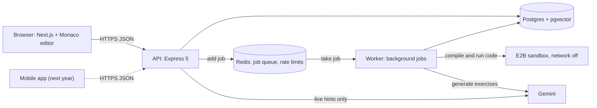

| Component | Responsibility |
| --- | --- |
| Web (`apps/web`) | Learner and admin screens, Monaco code editor. Calls `/api/*` on its own origin; Next.js forwards to the API |
| API (`apps/api`) | Auth, validation, all 13 modules, fast reads and writes |
| Worker (`apps/api`, second entry point) | Exercise generation and verification, code execution, scheduled jobs (decay scan, pre-generation, code purge) |
| PostgreSQL | Single source of truth for all data |
| Redis | Job queue (and rate-limit counters once the API runs as several processes). Holds nothing that can't be lost |
| E2B | Runs learner and reference code in isolation |
| Gemini | Generates exercise drafts and live hints. Never grades, never selects |
| `packages/types` | Shared request/response contracts between web and API |

**Rule:** the API answers fast; anything slow (running code, generating exercises) becomes a queued job handled by the worker.

---

## 4. Data flow diagrams

**Notation:** rectangle = external entity · circle = process · cylinder = data store · arrow = data in motion.

### 4.1 Level 0: context diagram

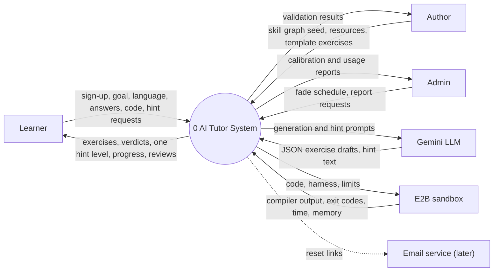

### 4.2 Level 1: the 13 processes

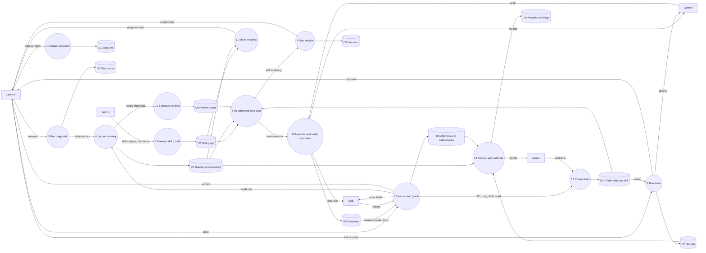

**What the diagram guarantees:**

- **Only process 4 writes mastery (D4).** Evidence comes only from the diagnostic (3) and graded code (7). Reading resources or watching never changes mastery (FR-M4-02).
- **Process 5 has no flow to Gemini.** The next step is chosen by rules (FR-M5-04).
- **Process 8 reads the ceiling from D10** before giving any hint (FR-M12-02). Process 12 moves a skill's fade stage when grading reports a solve with 0 or 1 hint.

### 4.3 Level 2: process 7, Execute and grade

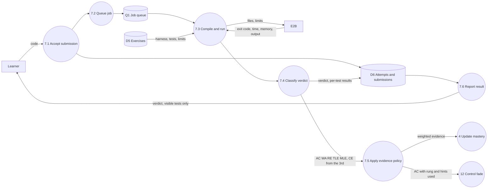

- The harness and hidden tests go to the sandbox only, never to the learner.
- A sandbox error (SE) stops at 7.4 and sends no evidence (NFR-R2).

### 4.4 Level 2: process 6, Generate and verify exercises

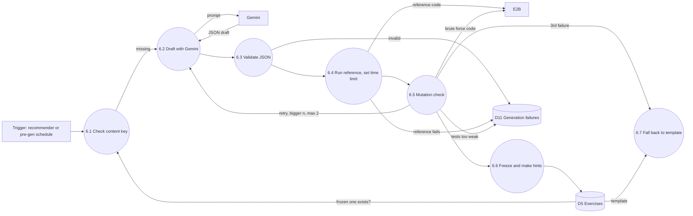

- **Time limit** = 3 × the slowest of several reference runs, never below a measured floor.
- **Mutation check:** a deliberately slow brute-force solution must **pass the small tests** and **time out on the large tests**. This proves the tests can tell an efficient solution from a slow one (FR-M7-03).
- After 3 failed tries the learner gets a hand-written template exercise, with no error shown (NFR-R1).

---

## 5. Database design and ER diagrams

### 5.1 Design rules

| Rule | Meaning | Why |
| --- | --- | --- |
| Ledger + snapshot | Every mastery change appends a row to `evidence_events` (never edited); `mastery_records` holds current values; both written in one transaction | Full history for the history API, calibration and research |
| Frozen content | A verified exercise is never edited; a change creates a new row with a new `content_version` | Determinism |
| Server-owned state | Hint level, hint ceiling, fade stage, mastery and verdicts exist only in the database | The client can't tamper with them (spec §23) |
| Compute on read | Effective mastery = `score × e^(−λ × days since evidence)` and "review is due" are calculated, not stored | They change every second |
| Idempotent writes | Unique keys stop a retried job double-counting evidence and a double-click submitting twice | Correctness under retries |
| Secrets apart | Solutions, harness and test generators live in `exercise_secrets`, a separate table that public queries never join | A careless query can't leak a solution |
| One writer per state | M4 alone writes mastery; M12 alone writes fade stages | Each rule lives in one place |
| Store each fact once | A value that can be derived (the learner of a recommendation, an evidence row's source, "passed" from a verdict) is not stored again | Duplicates can disagree |
| Scoped rows | Every user has an `org_id`; every content, mastery and fade row has a `language_code` | Institutions and multiple languages without later migrations |

**Conventions**

| Item | Choice | Why |
| --- | --- | --- |
| Names | `snake_case`, plural tables | Postgres convention |
| IDs | UUIDv7 created by the app; `bigint` identity for logs | Time-ordered (index-friendly), known before insert, don't reveal counts |
| Time | `timestamptz`, stored in UTC | One timezone in storage; convert only for display |
| Scores | `double precision`, CHECK 0–1 | Maths runs on JavaScript numbers anyway |
| Money | `numeric(10,4)` | Exact decimals |
| Nulls | NOT NULL by default; null only means "not yet" or "not applicable" | Fewer edge cases |
| User text | `text` with length CHECKs (name ≤ 80, code ≤ 64 KB) | Stops oversized input |
| Fixed sets | Postgres enums | Invalid values rejected |
| Extensions | `citext` (email), `vector` (pgvector, later) | Nothing else needed |
| Constraint names | snake_case; multi-word unique columns are named explicitly | drizzle-kit would otherwise emit camelCase names |

**Delete rules**

| Rule | Used for | Why |
| --- | --- | --- |
| Never delete, change status | users (`disabled`), skills, exercises, courses (`retired`) | Learning history must survive |
| `RESTRICT` (default) | All learning history | The database refuses to orphan history |
| `CASCADE` | Tokens, a run's test results, a course's language list | Meaningless without the parent |
| `SET NULL` | "Who did it" columns (`created_by`, `requested_by`) | Keep the record if that user goes |

### 5.2 Overview: 42 tables in 9 groups

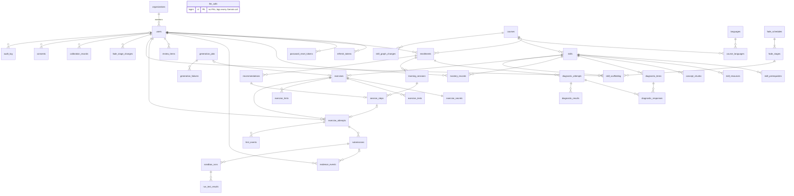

| Group | Tables | Modules | Built |
| --- | --- | --- | --- |
| Identity and access | organizations, users, refresh_tokens, password_reset_tokens | M1 | Phase 2 (first 3), later |
| Courses and skill graph | languages, courses, course_languages, skills, skill_prerequisites, skill_resources, skill_graph_changes, concept_chunks | M2 | MVP (first 6), later |
| Enrollment and diagnostic | enrollments, diagnostic_items, diagnostic_attempts, diagnostic_responses, diagnostic_results | M1, M3 | MVP |
| Mastery and reviews | mastery_records, evidence_events, review_items | M4, M10 | MVP |
| Exercises and generation | exercises, exercise_secrets, exercise_tests, exercise_hints, generation_jobs, generation_failures | M6 | MVP |
| Attempts and execution | exercise_attempts, submissions, sandbox_runs, run_test_results | M7 | MVP |
| Hints, sessions, recommendations | hint_events, learning_sessions, session_steps, recommendations | M5, M8, M9 | MVP |
| Scaffolding fade | fade_schedules, fade_stages, skill_scaffolding, fade_stage_changes | M12 | MVP |
| Analytics, research, cost | calibration_records, consents, llm_calls, audit_log | M13 | MVP (first 3), later |

### 5.3 Identity and access (M1)

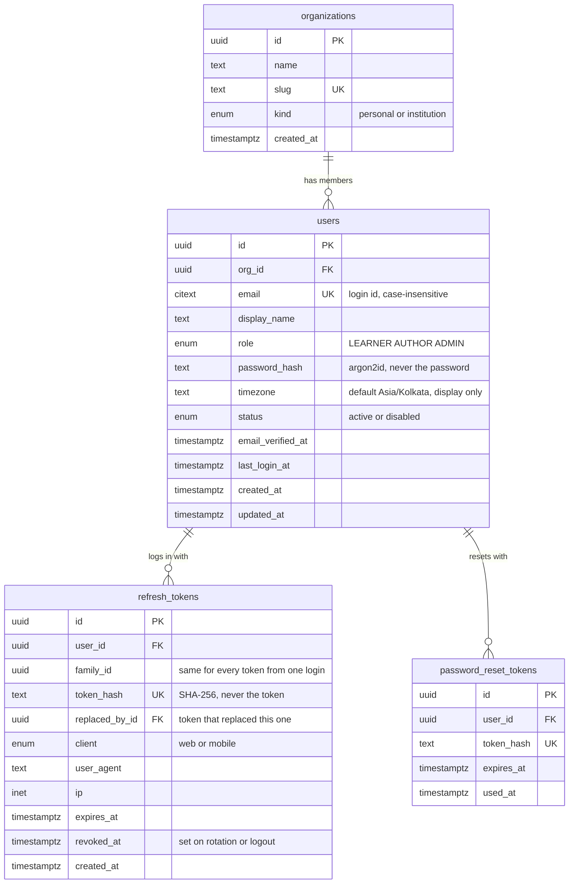

- **Organisations:** every learner belongs to one. Sign-up creates a hidden personal organisation; a college later becomes an institution organisation. Everything else links through `users`, so this one column is all that institutional licensing needs.
- **Tokens:** login issues a 15-minute JWT (not stored) and a 30-day refresh token (stored only as a hash). Each refresh replaces the token (`replaced_by_id`). If an already-replaced token is reused, every token in its `family_id` is revoked, because reuse means it was copied.
- Sign-up always creates a `LEARNER`. Authors and admins are created by a seed script.

### 5.4 Courses and skill graph (M2)

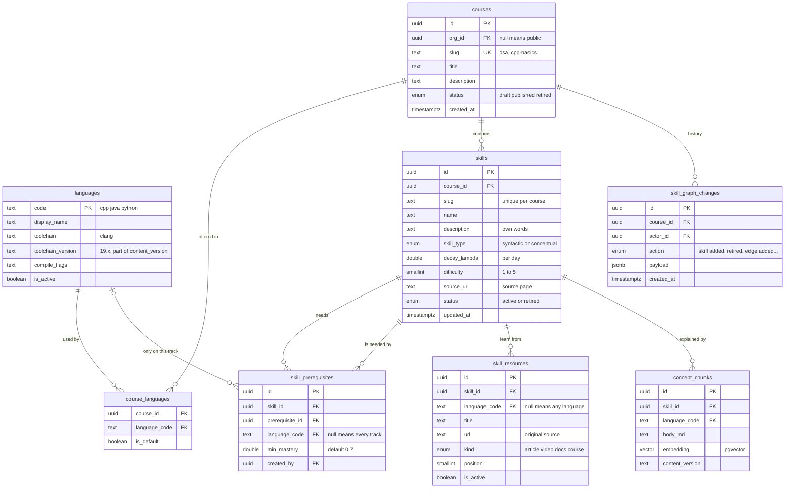

- A **course** is a subject (`dsa`); a **language** is how it is practised. The beginner C++ track is its own course (`cpp-basics`), and DSA skills on the C++ track depend on its skills.
- **The skill map is ours.** Skill names, descriptions and edges are written by us. `skill_resources` link to the original articles and docs as further reading. Reading them never changes mastery (FR-M4-02).
- Prerequisite edges can apply to one language track only (`language_code`) or to all (`null`). A unique key with `NULLS NOT DISTINCT` stops duplicate edges.
- The graph must stay acyclic (FR-M2-02): the service runs a cycle check before inserting an edge; a CHECK constraint blocks self-loops.

### 5.5 Enrollment and diagnostic (M1, M3)

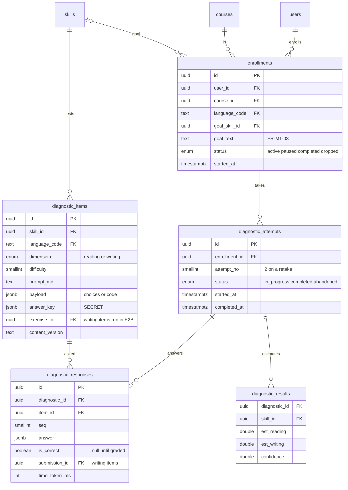

- An **enrollment** = user + course + language + goal (one per user, course and language). A composite foreign key to `course_languages` rejects a language the course doesn't offer.
- Writing items are real exercises graded in the sandbox, so starting writing scores also come from executed code. Their submissions do not create evidence directly; `diagnostic_results` seeds the first `mastery_records` once (FR-M3-02).

### 5.6 Mastery and reviews (M4, M10)

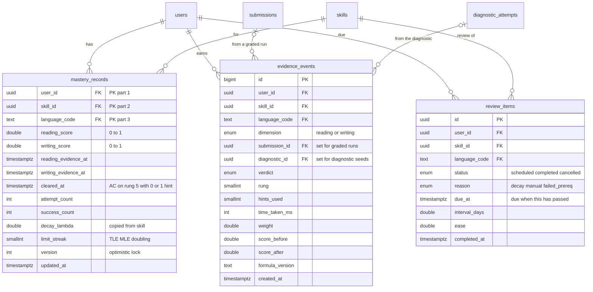

- One mastery row per user, skill and language, keyed by those three columns (nothing refers to it by ID). Reading and writing are never combined (FR-M11-02), and each decays from its own last evidence.
- `cleared_at` is set the first time the learner gets AC on a rung-5 exercise of the skill using 0 or 1 hint.
- Each evidence row points to exactly one real source (a submission or a diagnostic), enforced by a CHECK. Which key is set *is* the source, so no separate "source" column is stored. Unique keys on `(submission_id, dimension)` and `(diagnostic_id, skill_id, dimension)` stop evidence being counted twice.
- `weight` is computed from rung, hints used and time taken (FR-M4-05); `formula_version` keeps old numbers explainable if the formula changes.
- A review is created when effective mastery falls below the threshold (FR-M4-04); only one open review per skill.

### 5.7 Exercises and generation (M6)

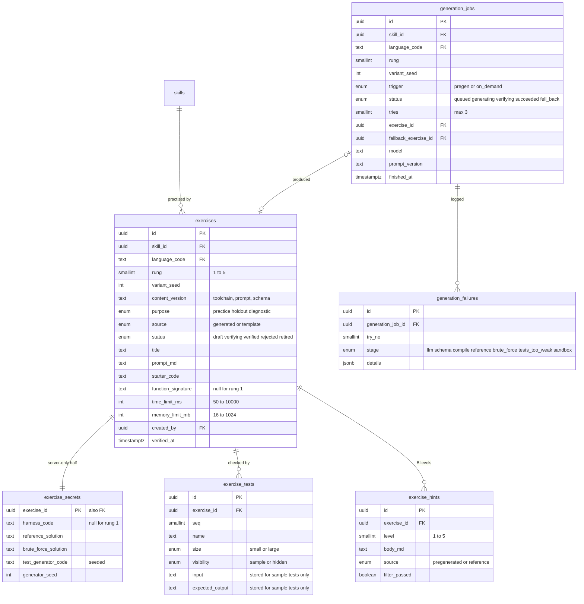

- **Content key** `(skill, language, rung, variant_seed, content_version)` is unique: the same request always gets the same frozen exercise.
- **`exercise_secrets`** holds everything a learner must never see. Only the worker and the hint engine read it; API responses are built from `exercises` alone.
- Every test runs inside the frozen harness (ADR-0002), so `exercise_tests` only names the tests; input and output are stored just for the sample tests shown to the learner.
- A generation job points to the exercise it produced; the exercise doesn't point back (one fact, stored once).
- Template exercises use the same tables (`source = template`) and pass the same verification. `purpose = holdout` exercises are never recommended; they are used only for calibration (M13).
- A partial unique key on `generation_jobs` stops two jobs generating the same exercise at once.

### 5.8 Attempts and execution (M7)

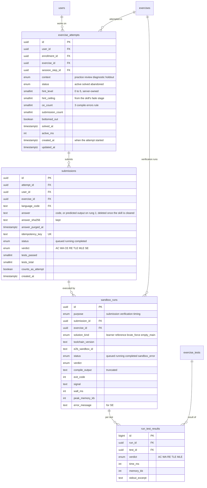

- An **attempt** is one learner on one exercise; it owns the server-side hint level (FR-M8-01). A CHECK keeps `hint_level ≤ hint_ceiling`, so the fade limit holds even if application code has a bug.
- A **submission** is one press of Submit. Its `answer` is code on rungs 2–5 and the predicted output on rung 1 (Predict).
- **`context` decides evidence:** practice and review attempts create evidence; diagnostic attempts don't (the diagnostic result seeds mastery once); holdout attempts save a calibration record first, then create evidence.
- `counts_as_attempt` is false for CE (until the 3rd on the same exercise) and for SE.
- `submissions` copies `user_id` and `exercise_id` from the attempt on purpose, for simpler analytics. The server sets them, never the client.
- `sandbox_runs` serves both learner submissions and exercise verification, giving one source for execution analytics.

### 5.9 Hints, sessions and recommendations (M5, M8, M9)

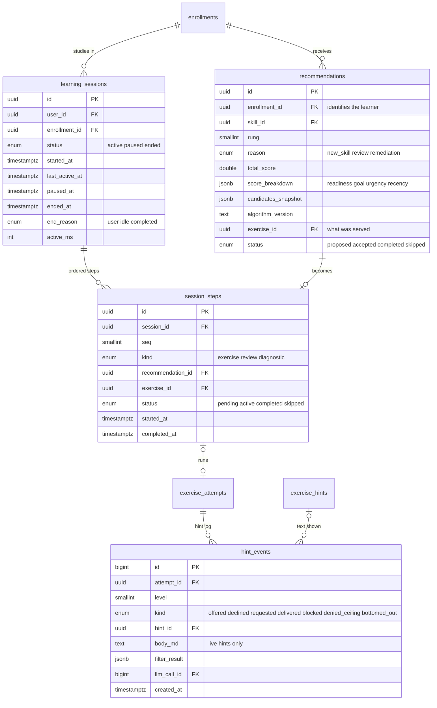

- One active session per learner (partial unique key). **The current step is the session's one `active` step** (also a partial unique key), so a paused session resumes exactly there (FR-M9-03) without storing a separate pointer.
- `hint_events` is a log; the current level lives on the attempt. `offered` records the "want a hint?" prompt after the 3rd compile error.
- Each recommendation stores its score breakdown and algorithm version, so it can always be explained.

### 5.10 Scaffolding fade (M12): per skill

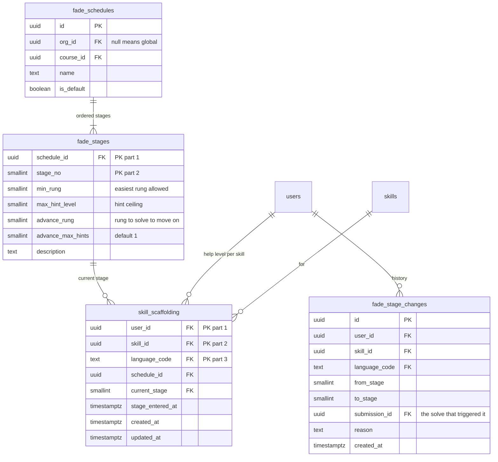

**Rule:** a skill moves to its next stage when the learner solves that stage's rung with **0 or 1 hint**. Solving rung 5 with 0 or 1 hint **clears** the skill. Help on each skill fades independently, so a brand-new skill always starts with full support.

| Stage | Easiest rung | Max hint level | Moves on when the learner solves |
| --- | --- | --- | --- |
| 1 | 1 Predict | 5 | rung 2 with ≤ 1 hint |
| 2 | 3 Complete | 4 | rung 3 with ≤ 1 hint |
| 3 | 4 Extend | 3 | rung 4 with ≤ 1 hint |
| 4 | 5 Build | 2 | rung 5 with ≤ 1 hint → **skill cleared** |

- Hint ceilings (5, 4, 3, 2) are starting values, tunable in `fade_stages` without code changes.
- The starting stage of each skill is set from the diagnostic writing estimate.
- The composite foreign key `(schedule_id, current_stage)` → `fade_stages` means a skill can never sit on a stage that doesn't exist.
- `fade_stage_changes` records every move with the submission that caused it: the evidence for whether learners need less help over time.

### 5.11 Analytics, research and cost (M13)

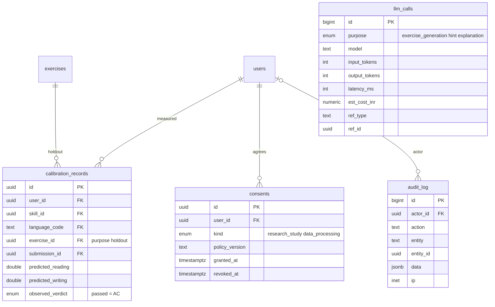

- **Calibration** compares predicted mastery with the result on a held-out exercise (FR-M13-01).
- **Consent** is recorded before any learner data is used in the college study, and is never deleted (`RESTRICT`).
- `llm_calls` tracks token use and estimated cost of every Gemini call.
- Hint trends, bottom-out rate, exercise effectiveness, generation failure rate, execution statistics and LLM cost will be **SQL views** over existing tables, not extra tables. They are written together with the analytics page, once its exact queries are known.

### 5.12 Key constraints

| Table | Constraint | Enforces |
| --- | --- | --- |
| users | UNIQUE(email) | One account per email (FR-M1-01) |
| refresh_tokens | UNIQUE(token_hash) | One row per token |
| skills | UNIQUE(course_id, slug) | No duplicate skills |
| skill_prerequisites | CHECK(skill_id ≠ prerequisite_id); UNIQUE(skill_id, prerequisite_id, language_code) NULLS NOT DISTINCT | No self-loops or duplicate edges |
| enrollments | UNIQUE(user_id, course_id, language_code); FK (course_id, language_code) → course_languages | One enrollment per track, only offered languages |
| mastery_records | PK(user_id, skill_id, language_code); CHECK scores 0–1 | One current value per skill |
| evidence_events | CHECK exactly one source; UNIQUE(submission_id, dimension); UNIQUE(diagnostic_id, skill_id, dimension) | Evidence is real and never counted twice |
| review_items | Partial UNIQUE: one scheduled review per skill | No duplicate reviews |
| exercises | UNIQUE content key; CHECK rung 1–5 | Determinism |
| generation_jobs | Partial UNIQUE content key while queued, generating or verifying | No duplicate generation |
| exercise_attempts | Partial UNIQUE(user_id, exercise_id) where active; CHECK hint_level 0–5; CHECK hint_level ≤ hint_ceiling | One live attempt; the fade limit always holds |
| submissions | UNIQUE(idempotency_key); CHECK answer ≤ 64 KB | No duplicate submissions |
| sandbox_runs | CHECK submission_id is set exactly when purpose = submission | Learner runs always link to their submission |
| learning_sessions | Partial UNIQUE(user_id) where not ended | One active session |
| session_steps | UNIQUE(session_id, seq); partial UNIQUE(session_id) where active | One current step |
| skill_scaffolding | PK(user_id, skill_id, language_code); FK (schedule_id, current_stage) → fade_stages | One fade state per skill, always a real stage |
| consents | Partial UNIQUE(user_id, kind) where not revoked | One live consent of each kind |

Every foreign key that is queried is indexed.

### 5.13 Build order

A table is created only after the tables it points to. Each step is one versioned Drizzle migration; applied migrations are never edited.

| Migration | Tables | Status |
| --- | --- | --- |
| 0000_enable_citext | `citext` extension | **Built** |
| 0001_identity | organizations, users, refresh_tokens | **Built** |
| 0002_curriculum | languages, courses, course_languages, skills, skill_prerequisites, skill_resources | **Built** |
| 0003_enrollment_and_fade | enrollments, fade_schedules, fade_stages, skill_scaffolding | **Built** |
| 0004_exercises | llm_calls, exercises, exercise_secrets, exercise_tests, exercise_hints, generation_jobs, generation_failures | **Built** |
| 0005_sessions | recommendations, learning_sessions, session_steps | **Built** |
| 0006_attempts | exercise_attempts, submissions, sandbox_runs, run_test_results, hint_events, fade_stage_changes | **Built** |
| 0007_diagnostic | diagnostic_items, diagnostic_attempts, diagnostic_responses, diagnostic_results | **Built** |
| 0008_mastery | mastery_records, evidence_events, review_items | **Built** |
| 0009_research | calibration_records, consents | **Built** |
| Later | analytics views; password_reset_tokens, skill_graph_changes, concept_chunks (+ `vector`), audit_log | With their features |

Totals: 38 tables built for the MVP, 4 later (42). Enums are created in the migration of the first table that uses them. The seed (`pnpm db:seed`) loads the C++ language, the `dsa` and `cpp-basics` courses, and the default 4-stage fade schedule; it is safe to run repeatedly.

### 5.14 Data lifecycle

| Data | Kept | Why |
| --- | --- | --- |
| Learner answers (`submissions.answer`) | Until the learner clears that skill; then a worker job empties it and sets `answer_purged_at` | Code is needed while the learner is still working on the skill; afterwards only the results matter |
| Verdicts, test results, evidence, hint logs | Always | They are the learning record and the research data |
| Refresh tokens | Until expiry, then removed by a cleanup job | No value after expiry |
| Consents | Always | Proof of agreement |

---

## 6. UML diagrams

### 6.1 Use case diagram

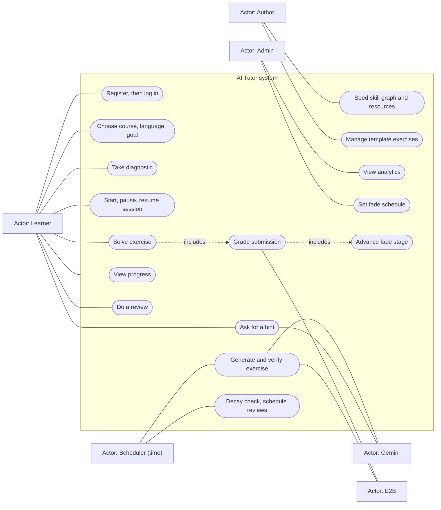

The scheduler is an actor because mastery decays with time, not only with clicks. Fade advances as part of grading.

### 6.2 Class diagram: domain model

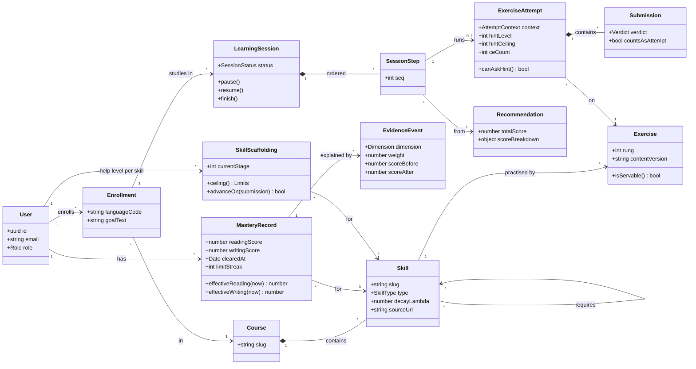

### 6.3 Class diagram: services and adapters

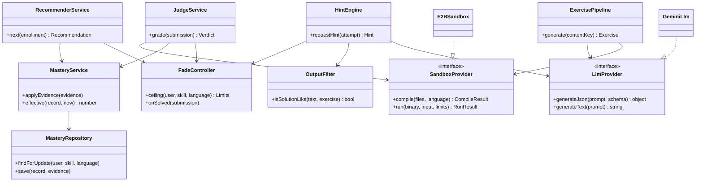

- External services sit behind interfaces (`SandboxProvider`, `LlmProvider`); replacing E2B or Gemini means writing one new class.
- Layering per request: route → controller (validate, call service) → service (rules) → repository (SQL).

### 6.4 Sequence: register, then log in

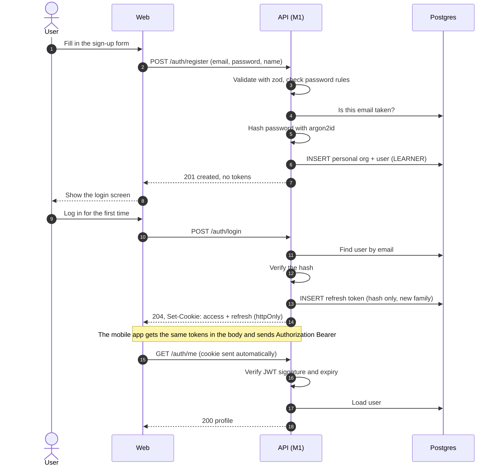

Wrong email and wrong password return the same error; login is rate-limited. When the access token expires, the web app calls `POST /auth/refresh` once and retries.

### 6.5 Sequence: submit code

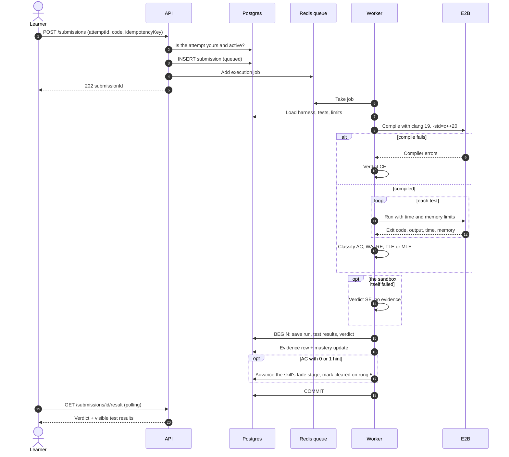

### 6.6 Sequence: request a hint

```mermaid
sequenceDiagram
  autonumber
  actor L as Learner
  participant A as API (M8 hints)
  participant F as Fade controller (M12)
  participant DB as Postgres
  participant G as Gemini (small model)
  L->>A: POST /exercises/id/hints
  A->>DB: Lock the attempt row (FOR UPDATE)
  A->>F: Ceiling for this learner on this skill?
  F-->>A: Max hint level = 3
  alt next level is above the ceiling
    A->>DB: hint_event denied_ceiling
    A-->>L: No more hints at this stage. Try one more run.
  else allowed
    A->>DB: Read the stored hint for the next level
    opt no stored hint
      A->>G: Prompt for exactly this level
      G-->>A: Hint text
      A->>A: Output filter vs the reference solution
    end
    A->>DB: attempt.hint_level + 1, hint_event delivered
    opt level is 5
      A->>DB: bottomed_out = true, no mastery credit
    end
    A-->>L: This one level only
  end
```

Hint ladder: 1 Concept · 2 Location · 3 Mechanism · 4 Worked example · 5 Answer (frozen reference solution).

### 6.7 Sequence: get the next step

```mermaid
sequenceDiagram
  autonumber
  actor L as Learner
  participant A as API (M9 session)
  participant R as Recommender (M5)
  participant DB as Postgres
  participant Q as Redis queue
  L->>A: GET /recommendations/next
  A->>R: Next step for this enrollment
  R->>DB: Mastery, prerequisites, due reviews, recent steps, fade stages
  R->>R: Build candidates, score them, pick the highest
  R->>R: Rung from writing score, clamped to the skill's fade stage
  R->>DB: Find a verified exercise the learner hasn't seen
  alt found
    R->>DB: INSERT recommendation (scores, algorithm version)
  else none ready
    R->>DB: Use a template exercise
    R->>Q: Queue generation for next time
  end
  A->>DB: Session step + attempt (hint ceiling copied)
  A-->>L: Skill, rung, exercise without secret fields
```

### 6.8 Sequence: pre-generate an exercise

```mermaid
sequenceDiagram
  autonumber
  participant Q as Redis queue
  participant K as Worker (M6)
  participant G as Gemini (large model)
  participant S as E2B
  participant DB as Postgres
  Q->>K: Job (skill, language, rung, seed)
  K->>DB: Job status generating
  loop up to 3 tries, stops early on success
    K->>G: Generate JSON: prompt, starter, signature, reference, brute force, generator
    G-->>K: Draft
    K->>K: zod schema check
    K->>S: Run reference on all tests, 3 timed runs
    S-->>K: Pass or fail, times
    K->>K: Time limit = max(3 x slowest, floor)
    K->>S: Run brute force
    S-->>K: Small tests pass? Large tests TLE?
    alt every check passes
      K->>DB: INSERT exercise + secrets (verified, frozen), tests, 5 hints
    else a check fails
      K->>DB: generation_failure (stage), bigger n next try
    end
  end
  opt still failing after 3 tries
    K->>DB: Job fell_back, template used
  end
```

### 6.9 State diagrams

**Submission**

```mermaid
stateDiagram-v2
  [*] --> queued : POST /submissions
  queued --> running : worker takes job
  running --> completed : verdict AC WA CE RE TLE MLE
  running --> sandbox_error : E2B fails
  sandbox_error --> queued : retry, max 2
  sandbox_error --> completed : give up, verdict SE
  completed --> [*]
```

**Hint ladder (per attempt)**

```mermaid
stateDiagram-v2
  [*] --> L0 : attempt starts
  L0 --> L1 : learner asks
  L1 --> L2 : learner asks
  L2 --> L3 : learner asks
  L3 --> L4 : learner asks
  L4 --> L5 : learner asks
  L5 --> [*] : bottomed out, no credit
  note right of L2 : each move only if the next level is within the skill's fade ceiling
```

**Fade stage (per skill)**

```mermaid
stateDiagram-v2
  [*] --> stage1 : set from diagnostic
  stage1 --> stage2 : solves rung 2 with 0 or 1 hint
  stage2 --> stage3 : solves rung 3 with 0 or 1 hint
  stage3 --> stage4 : solves rung 4 with 0 or 1 hint
  stage4 --> cleared : solves rung 5 with 0 or 1 hint
  cleared --> [*] : code for this skill is purged
```

**Exercise**

```mermaid
stateDiagram-v2
  [*] --> draft
  draft --> verifying : schema valid
  verifying --> verified : reference passes, mutation check passes
  verifying --> rejected : a check fails
  verified --> retired : author retires it or a new version replaces it
  rejected --> [*]
  retired --> [*]
```

**Generation job**

```mermaid
stateDiagram-v2
  [*] --> job_queued
  job_queued --> generating : worker takes job
  generating --> verifying : draft is valid JSON
  verifying --> succeeded : exercise frozen
  verifying --> generating : retry with bigger n, max 2
  verifying --> fell_back : 3 tries used, template served
  succeeded --> [*]
  fell_back --> [*]
```

**Learning session**

```mermaid
stateDiagram-v2
  [*] --> active : POST /sessions
  active --> paused : pause, or idle too long
  paused --> active : resume at the same step
  active --> ended : learner ends it
  paused --> ended : ended, or timed out
  ended --> [*]
  note right of paused : the current step is the one marked active, so resume continues there
```

### 6.10 Activity diagram: next-step selection (M5)

```mermaid
flowchart TD
  S0([Start]) --> A["Load mastery, reviews, graph, fade stages"]
  A --> B["Compute effective mastery for each skill"]
  B --> C{"Any reviews due?"}
  C -->|yes| D["Add due reviews to candidates"]
  C -->|no| E
  D --> E["Add skills whose prerequisites are all above threshold"]
  E --> F{"Any candidates?"}
  F -->|no| G(["Course complete, or diagnostic needed"])
  F -->|yes| H["Score: readiness, goal, urgency, recency"]
  H --> I["Pick the highest, ties broken by skill slug"]
  I --> J["Rung from writing score, clamped to the skill's fade stage"]
  J --> K{"Verified exercise ready?"}
  K -->|yes| M["Serve it"]
  K -->|no| N["Serve a template, queue generation"]
  M --> O(["Save recommendation with score breakdown"])
  N --> O
```

### 6.11 Component diagram

```mermaid
flowchart TB
  subgraph WEB["apps/web (Next.js)"]
    W1["Pages: auth, dashboard, admin analytics"]
    W2["Monaco editor"]
    W3["lib/api client, via Next.js proxy"]
  end
  subgraph API["apps/api (Express): HTTP entry"]
    MW["shared: auth, RBAC, validation, errors, rate limits"]
    MOD["modules m1 to m13: routes, controllers, services, repositories"]
  end
  subgraph WRK["apps/api worker entry: same code, second process"]
    J1["generation jobs"]
    J2["execution jobs"]
    J3["maintenance: decay scan, pre-gen top-up, code purge, token cleanup, sandbox cleanup"]
  end
  subgraph INF["infrastructure adapters"]
    I1["database: Drizzle"]
    I2["queue: BullMQ + ioredis"]
    I3["llm: Gemini adapter"]
    I4["sandbox: E2B judge adapter"]
  end
  TY["packages/types: shared contracts"]
  W3 -->|HTTPS JSON| MW
  MW --> MOD
  MOD --> INF
  WRK --> INF
  WRK --> MOD
  WEB -.-> TY
  API -.-> TY
```

### 6.12 Deployment diagram

```mermaid
flowchart LR
  subgraph CL["Clients"]
    B["Browser"]
    M["Mobile app (next year)"]
  end
  subgraph HO["Application hosting"]
    WH["Web: Next.js + API proxy"]
    AH["API process"]
    KH["Worker process"]
  end
  subgraph MS["Managed data"]
    PG[("Postgres + pgvector")]
    RD[("Redis")]
  end
  subgraph EX["External"]
    E2B["E2B sandboxes, network off"]
    GEM["Gemini API"]
  end
  B -->|pages and /api, cookie| WH
  WH -->|forwards /api| AH
  M -->|Bearer token| AH
  AH --> PG
  AH --> RD
  AH -->|live hints| GEM
  KH --> RD
  KH --> PG
  KH --> E2B
  KH --> GEM
```

In development, Postgres and Redis run locally through `docker compose`.

---

## 7. API design

### 7.1 Conventions

| Item | Convention |
| --- | --- |
| Base path | `/api/v1` |
| Format | JSON over HTTPS |
| Auth | httpOnly cookie (web, through the same-origin Next.js proxy) or `Authorization: Bearer` (mobile); role checked on every author/admin route |
| CSRF | `SameSite` cookies + Origin check on every state-changing request |
| Validation | zod schema per request; shared types in `packages/types` |
| Success | `{ "success": true, "data": {...}, "meta": {...} }` |
| Error | `{ "success": false, "error": { "code", "message", "details" } }` |
| Slow operations | `202 Accepted` + an ID; the client polls for the result |
| Internal operations | Called by services only, never exposed to the client (e.g. recording evidence) |

### 7.2 MVP APIs (10 Nov)

| Module | Endpoints |
| --- | --- |
| M1 Auth | `POST /auth/register` · `POST /auth/login` · `POST /auth/refresh` · `POST /auth/logout` · `GET /auth/me` |
| M3 Diagnostic | `POST /diagnostic/start` · `POST /diagnostic/:id/answers` · `POST /diagnostic/:id/complete` |
| M4 Mastery | `GET /mastery` · `GET /mastery/:skillId` · evidence recording is internal only |
| M5 Recommender | `GET /recommendations/next` |
| M6 Exercises | `GET /exercises/:id` · `POST /exercises/generate` · `GET /exercises/generation/:jobId` |
| M7 Submissions | `POST /submissions` · `GET /submissions/:id/result` |
| M8 Hints | `POST /exercises/:id/hints` |
| M9 Sessions | `POST /sessions` · `GET /sessions/active` |
| M11 Progress | `GET /progress` |
| M12 Fade | `GET /scaffolding/state` (fade stage and limits per skill) |
| M13 Analytics | `GET /analytics/overview` (admin) |

22 client-facing endpoints, plus internal evidence recording. `POST /auth/refresh` is added to M1 because short-lived access tokens need it. The full plan has ~98 operations; every one maps onto the tables in section 5:

| Module | Ops | Tables |
| --- | --- | --- |
| M1 | 9 | users, organizations, refresh_tokens, password_reset_tokens |
| M2 | 12 | skills, skill_prerequisites, skill_resources, skill_graph_changes |
| M3 | 6 | diagnostic_*, enrollments |
| M4 | 9 | mastery_records, evidence_events |
| M5 | 6 | recommendations |
| M6 | 9 | exercises, exercise_secrets, exercise_tests, exercise_hints, generation_jobs, generation_failures |
| M7 | 7 | submissions, sandbox_runs, run_test_results, exercise_attempts |
| M8 | 7 | hint_events, exercise_hints, exercise_attempts |
| M9 | 8 | learning_sessions, session_steps |
| M10 | 6 | review_items |
| M11 | 6 | reads mastery_records, evidence_events, skills |
| M12 | 6 | fade_schedules, fade_stages, skill_scaffolding, fade_stage_changes |
| M13 | 8 | calibration_records, llm_calls, analytics views |

### 7.3 Auth endpoints (built)

Base: `/api/v1/auth`. Web sends `client` as `web` (default) and works with cookies; the mobile app sends `client: "mobile"` and stores the returned tokens.

| Endpoint | Request | Success | Errors |
| --- | --- | --- | --- |
| `POST /register` | `{ email, password (8–128), displayName (1–80) }` | `201 { user }`, no tokens; the app shows the login screen | `400 VALIDATION_ERROR`, `409 EMAIL_TAKEN`, `429 RATE_LIMITED` |
| `POST /login` | `{ email, password, client? }` | Web: `204` + cookies. Mobile: `200 { accessToken, refreshToken, expiresIn }` | `401 INVALID_CREDENTIALS` (same for a wrong email or password), `429` |
| `POST /refresh` | Web: the refresh cookie. Mobile: `{ refreshToken }` | Same as login, with a new token pair | `401 UNAUTHENTICATED` (log in again) |
| `POST /logout` | Same as refresh | `204`, cookies cleared, the whole login revoked | none |
| `GET /me` | Access cookie, or `Authorization: Bearer <accessToken>` | `200 { user: { id, email, displayName, role, timezone, createdAt } }` | `401 TOKEN_EXPIRED` (refresh, then retry), `401 UNAUTHENTICATED` |

Rate limits: login 20 per IP and 5 failures per email per 15 minutes; register 5 per IP per hour; refresh 30 per IP per minute. Any cookie-carrying write from an origin other than the web app gets `403 BAD_ORIGIN`.

---

## 8. Non-functional design

| Requirement | How the design meets it |
| --- | --- |
| NFR-P1 Hint latency | Hints are pre-generated at freeze time; live generation uses the small model only when no stored hint exists |
| NFR-P2 Generation time | Generation runs as a background job; the learner is served a ready or template exercise |
| NFR-S1 Sandbox | Code runs only in E2B with network off and time and memory limits |
| NFR-S2 Hint enforcement | Hint level and ceiling are server-side columns, updated under a row lock |
| NFR-S3 Passwords | argon2id hashes only; refresh tokens also stored as hashes |
| NFR-S4 Role checks | RBAC middleware on every author/admin route, not just in the UI |
| NFR-R1 Generation failure | Automatic fallback to the template bank, no error shown |
| NFR-R2 Sandbox vs code failure | Separate SE verdict; SE never affects mastery |
| NFR-U1 / U2 Accessibility | Monaco keyboard support; progress view uses labels and values, not colour alone |
| NFR-M1 Subject independence | Mastery, recommender and fade work on generic skills; course and language are data, not code |
| NFR-SC1 Scalability | Generation and execution go through BullMQ to a separately scaled worker process |

**Determinism.** Content is generated once, verified and frozen, then served by its content key. Grading uses only sandbox execution with a fixed compiler and seeded test generators. Next-step selection is rule-based with a fixed tie-break, and every recommendation and evidence row records the algorithm or formula version used. No LLM output sits in the grading or selection path.

**Security and privacy beyond the NFRs.** Solutions, harness and hidden tests live in `exercise_secrets` and are never returned. Rate limits protect login, registration and refresh now, and will cover submissions, hints and generation; counters are kept in memory for the single API process and move to Redis when the API runs as several processes. Cookie-carrying writes must come from the web app's origin (CSRF guard). Refresh tokens rotate, and reuse of an old token revokes the whole login. Learner code reaches Gemini only inside live hint prompts, covered by recorded consent, and is deleted once the learner clears the skill.

---

## 9. Requirement traceability

| SRS requirement | Design element |
| --- | --- |
| FR-M1-01 Register with unique ID | `users.email` UNIQUE, sequence 6.4 |
| FR-M1-02 Sessions per user type | JWT + rotating `refresh_tokens`, `users.role` |
| FR-M1-03 Record goal | `enrollments.goal_skill_id`, `goal_text` |
| FR-M1-04 Role-based access | RBAC middleware, route groups in web |
| FR-M1-05 Password reset (Should) | `password_reset_tokens` (after MVP) |
| FR-M2-01 Skills as DAG | `skills`, `skill_prerequisites` |
| FR-M2-02 Reject cycles | Cycle check in M2 service + self-loop CHECK |
| FR-M2-03 Editing screen | **MVP: seeded by script.** Screen after MVP; APIs designed (M2, 12 ops) |
| FR-M2-04 Syntax vs concept type | `skills.skill_type`, `decay_lambda` |
| FR-M2-05 Graph history (Could) | `skill_graph_changes` |
| FR-M3-01 Adaptive test | `diagnostic_items` by difficulty and dimension |
| FR-M3-02 Seed mastery | `diagnostic_results` → `mastery_records`, `evidence_events` (source diagnostic) |
| FR-M3-03 Retake | `diagnostic_attempts.attempt_no` |
| FR-M4-01 Mastery fields | `mastery_records` |
| FR-M4-02 Evidence only | DFD level 1: only process 4 writes D4; `evidence_events` with real source keys; resources never create evidence |
| FR-M4-03 Exponential decay | Effective mastery computed on read, per dimension |
| FR-M4-04 Revision queue | `review_items` created below threshold |
| FR-M4-05 Weighted evidence | `evidence_events.weight` from rung, hints, time |
| FR-M5-01 to 05 Recommender | Activity diagram 6.10, `recommendations.score_breakdown`, no LLM in the flow |
| FR-M6-01 Generate | Generation pipeline, DFD 4.4, sequence 6.8 |
| FR-M6-02 Verify before use | Reference run + mutation check, exercise state diagram |
| FR-M6-03 Template fallback | `exercises.source = template`, process 6.7 |
| FR-M6-04 Log failures | `generation_failures` |
| FR-M7-01 Isolated sandbox | E2B, network off |
| FR-M7-02 Per-test results | `run_test_results` |
| FR-M7-03 Limits reported separately | TLE and MLE verdicts, mutation check |
| FR-M7-04 Structured result to M4, M9 | Sequence 6.5: evidence, fade and session step update |
| FR-M8-01 Hint level on server | `exercise_attempts.hint_level` |
| FR-M8-02 Only current level sent | Sequence 6.6 |
| FR-M8-03 Advance only on request | Hint ladder state diagram; CE ×3 only *offers* |
| FR-M8-04 Output filter | `OutputFilter`, `hint_events.filter_result` |
| FR-M8-05 Log bottom-out | `hint_events` kind `bottomed_out`, `exercise_attempts.bottomed_out` |
| FR-M9-01 Start, pause, resume, end | Session state diagram |
| FR-M9-02 Steps from recommender | `session_steps.recommendation_id` |
| FR-M9-03 Resume at same step | The session's single `active` step |
| FR-M10-01 Revision date from decay | `review_items.due_at`, scheduled decay scan |
| FR-M10-02 Queue visible to M5 | Recommender reads `review_items` |
| FR-M11-01 to 03 Honest progress view | Reads stored mastery, reading and writing kept separate |
| FR-M12-01 Configurable schedule | `fade_schedules`, `fade_stages` (rungs, hint ceilings, advance rule as data) |
| FR-M12-02 Enforce limits | `skill_scaffolding` stage → `hint_ceiling` on each attempt, rung clamp in M5 |
| FR-M13-01 Calibration | `calibration_records`, holdout exercises |
| FR-M13-02 Hint trends | Views over `hint_events` |
| FR-M13-03 Generation rates | Views over `generation_jobs`, `generation_failures` |

---

## 10. Partial implementation status

**Done (in the repository):**

- pnpm monorepo: `apps/api` (Express 5 + TypeScript 6), `apps/web` (Next.js 16, React 19), `packages/types`, `packages/config`. Exact pinned versions, Node 22.
- Local infrastructure via `docker compose`: PostgreSQL 16 with pgvector, Redis 7, with secrets in `.env`; settings validated with zod at startup.
- **Database:** all 38 MVP tables (section 5) as Drizzle schema files with 10 versioned migrations, plus an idempotent seed.
- **Auth (M1):** register, login, refresh, logout and me (section 7.3): argon2id passwords, 15-minute JWT, rotating refresh tokens with theft detection, httpOnly cookies for web and Bearer tokens for mobile, rate limits and a CSRF origin check.
- **Shared layer:** one error type, one response envelope, one error handler.
- **Tests:** 24 automated tests on a separate test database: 16 check the database rules (uniqueness, ranges, fade ceiling, evidence sources) and 8 check the auth flows (including stolen-token reuse and throttling).

**Next (Phase 3, 23 Oct):** skill graph and resources seed, enrollment and diagnostic, mastery engine, first E2B judge run (AC/WA/CE/TLE end to end), API contract frozen for the frontend.

---

## 11. Open items

| Item | Needed by |
| --- | --- |
| DSA and C++ skill list and edges, with further-reading links | Seed data (Phase 3) |
| M4 update formula: size of AC gain and WA penalty | Mastery engine (Phase 3) |
| Prerequisite threshold (0.7 is a placeholder) | Recommender |
| Whether a skill's fade stage can step back after repeated bottom-outs | M12 |
| Template exercises per skill and rung | M6 fallback |
| Session idle and timeout values | M9 |
| Hosting provider within budget | Deployment |
| First ADMIN account (seed from environment variables) | Analytics page |
