# AI Tutor: An Evidence-Based Adaptive Learning System with Deliberate Scaffolding Withdrawal

> **Draft report for Review 3 (Implementation, Testing and Draft Report), 23 October 2026.** Status as of 23 October 2026: all 33 endpoints live, 248 automated tests passing, 483 exercises and 207 lessons proven in the real sandbox, and the deployment files checked locally. Hosting updated on 26 October (ADR-0024): the pilot runs on Vercel, Render and Supabase.
> Prepared to the MCA-269 "Format of Project Report" and the Annexure-IV chapter scheme. Typesetting rules (Times New Roman 12, 1.5 spacing, margins 3.0/2.0/2.54/2.54 cm, blank page before each chapter) are applied in the final printed copy.

---

## Cover Page (Annexure-I)

**AI Tutor: An Evidence-Based Adaptive Learning System with Deliberate Scaffolding Withdrawal**

Submitted in partial fulfillment of the requirements for the award of the degree of
**Master of Computer Applications**
to
**Guru Gobind Singh Indraprastha University, Delhi**

| Guide | Submitted by |
|---|---|
| Dr. Chetna Laroia | Ashwani Kumar Puri (04914004425) |
| | Aman Dogra (01614004425) |
| | Aditi Tanwar (01814004425) |

**JAGAN INSTITUTE OF MANAGEMENT STUDIES**
3, Institutional Area, Sector-5, Rohini
Batch (2025–2027)

---

## Certificate (Annexure-II)

We, 1. Ashwani Kumar Puri (04914004425), 2. Aman Dogra (01614004425) and 3. Aditi Tanwar (01814004425), certify that the Minor-III Project Report (MCA-269) entitled "AI Tutor: An Evidence-Based Adaptive Learning System with Deliberate Scaffolding Withdrawal" is done by us and it is an authentic work carried out by us at Jagan Institute of Management Studies, Rohini. The matter embodied in this project work has not been submitted earlier for the award of any degree or diploma to the best of our knowledge and belief.

Signature of the Students: ____________________   Date: __________

Certified that the Minor-III Project Report (MCA-269) entitled "AI Tutor: An Evidence-Based Adaptive Learning System with Deliberate Scaffolding Withdrawal" done by the above students is completed under my guidance.

Signature of the Guide: ____________________   Date: __________
Name of the Guide: Dr. Chetna Laroia
Designation: ____________________

Countersigned: Principal/Director ____________________

---

## Acknowledgement

We are grateful to our guide, **Dr. Chetna Laroia**, for her guidance and feedback at every review of this project. We thank the faculty of the MCA department of Jagan Institute of Management Studies for the knowledge of databases, software engineering and web development this project is built on, and the institute for the facilities and the opportunity. We also thank the authors of the research papers listed in the references, whose findings on learning shaped the design of this system.

Ashwani Kumar Puri · Aman Dogra · Aditi Tanwar

---

## Table of Contents

| | Topic | Page |
|---|---|---|
| | Certificate · Acknowledgement · List of Tables/Figures/Symbols · Synopsis | 2 |
| **1** | **Problem Formulation**: 1.1 Introduction about the organisation · 1.2 Introduction about the problem · 1.3 Present state of the art · 1.4 Need of computerization · 1.5 Proposed software · 1.6 Importance of the work | 10 |
| **2** | **System Analysis**: 2.1 Feasibility study · 2.2 Analysis methodology and system planning (PERT) · 2.3 Choice of the platforms | 15 |
| **3** | **System Design**: 3.1 Design methodology · 3.2 UML modelling · 3.3 Database design (ERD, DFD) · 3.4 Input design · 3.5 Output design · 3.6 Code design and development | 25 |
| **4** | **Testing and Implementation**: 4.1 Testing methodology · 4.2 Test data and test cases · 4.3 Test reports and debugging · 4.4 Implementation manual · 4.5 Implementation · 4.6 Users training · 4.7 Post-implementation maintenance | 59 |
| **5** | **Conclusion and References**: 5.1 Conclusion · 5.2 System specifications · 5.3 Limitations · 5.4 Future scope · 5.5 References | 78 |
| **6** | **Annexures**: A-1 Menu flow · A-2 Structure chart · A-6 Decision tables · A-7 Data dictionary · A-8 Test reports · A-9 Sample inputs · A-10 Sample outputs · A-11 Coding | 84 |

## List of Tables

| No | Title |
|---|---|
| 1 | Problems with the existing (manual) way of learning |
| 2 | Functional modules and their users |
| 3 | Feasibility summary with measured costs |
| 4 | Software and hardware used |
| 5 | Verdicts and how each one is decided |
| 6 | Mastery formula factors |
| 7 | Fade stages |
| 8 | Automated test suites and results |
| 9 | Defects found and fixed during testing |
| 10 | Data dictionary (key tables) |
| 11 | Placement test rules |
| 12 | Hint ladder and where each hint comes from |
| 13 | Exercise generation: how a job runs |
| 14 | Data rights: what each request does, and what erasure keeps |
| 15 | Lessons: what each one holds and the gates it passes |
| 16 | Speed tests in the DSA exercise bank |

## List of Figures

| No | Title |
|---|---|
| 1 | System architecture |
| 2 | Use case diagram |
| 3 | Class diagram: domain model |
| 4 | Class diagrams: services and adapters (running code and mastery; the AI and the placement test) |
| 5 | Sequence diagram: register, then log in |
| 6 | Sequence diagram: submit code |
| 7 | State diagram: submission |
| 8 | Activity diagram: next-step selection |
| 9 | Table groups (overview); ER diagrams: attempts and submissions, and execution |
| 10 | DFD level 0, level 1 (in two parts), and level 2 (execute and grade) |
| 11 | System planning (PERT/Gantt) |
| 12 | Deployment diagram |
| 13 | Menu flow diagram |
| 14 | Sequence diagram: request a hint |
| 15 | Activity diagram: placement test |
| 16 | Sequence diagram: forgot and reset password |
| 17 | Sequence diagram: delete an account |
| 18 | Sequence diagram: open a lesson |
| 19 | Activity diagram: verify an exercise with generated speed tests |

## List of Symbols and Abbreviations

| Symbol | Meaning |
|---|---|
| AC, WA, CE, RE, TLE, MLE, SE | Verdicts: accepted, wrong answer, compile error, runtime error, time limit exceeded, memory limit exceeded, sandbox error |
| λ (lambda) | Decay rate of a skill per day |
| e | Euler's number; effective mastery = score × e^(−λ × days) |
| Rung | Exercise difficulty level 1–5 (Predict → Build) |
| API, JWT, ORM | Application programming interface, JSON Web Token, object-relational mapper |
| DPDP | Digital Personal Data Protection Act, 2023 (India) |
| E2B | Cloud sandbox service that runs learner code in isolated micro-VMs |
| Brevo | Email delivery service that sends the password-reset and account-deletion emails |
| SHA-256 | One-way hash; the database stores only this fingerprint of each token |
| LLM | Large language model (Google Gemini in this project) |

---

## Synopsis

**1. Title of Project.** AI Tutor: An Evidence-Based Adaptive Learning System with Deliberate Scaffolding Withdrawal. In one line: a tutor whose objective is to make itself unnecessary.

**2. Problems with the Existing System.** Today a self-taught programmer learns "manually": they pick a video course, watch it in order, copy the instructor's code, tick lessons as complete and, when stuck, ask an AI assistant for the answer. Nothing records what they can actually *write*. Completion is measured instead of capability, the order is the same for everyone, help is unlimited and never withdrawn, and nothing schedules revision before a skill is forgotten.

**3. Description of the Proposed System.** A web-based, online system that keeps a separate **reading** and **writing** mastery score for every skill, updates them **only from code that was actually executed and graded**, chooses the next step from a prerequisite graph, teaches each skill with a short lesson written for the learner's level, and **withdraws help on a schedule** until the learner can work alone. Learner code runs in an isolated cloud sandbox. Every lesson and exercise is proven in that sandbox and frozen before any learner sees it. An LLM writes hints and can add content, but never grades and never decides what comes next. Two courses are built: C++ basics (20 skills) and Data Structures and Algorithms (49 skills, from the basics to advanced).

**4. Functional Modules and Users.** Users: **Learner**, **Author** (maintains the skill graph and templates), **Admin** (analytics). Thirteen modules: M1 Accounts, consent and data rights, M2 Skill graph, M3 Diagnostic, M4 Mastery model, M5 Recommender, M6 Exercises and lessons, M7 Execution and grading, M8 Hint ladder, M9 Sessions, M10 Revision, M11 Progress, M12 Scaffolding fade, M13 Analytics.

**5. Tools/Platforms.**
- **5.1 Hardware:** development on a laptop with a 4-core or better processor, 8–16 GB RAM, 256 GB SSD. Production for the pilot: Vercel for the web app, Render (Singapore) for the API and its queue, and Supabase (Mumbai) for PostgreSQL, all on free plans, plus managed sandboxes; an older laptop takes the nightly backups.
- **5.2 Software:** Windows 11 / Ubuntu 24.04; front end Next.js 16, React 19, TypeScript, Monaco editor; back end Node.js 22, Express 5, TypeScript; database PostgreSQL (16 locally, 17 on Supabase) with Drizzle ORM; Redis 7 with BullMQ; E2B sandboxes with clang 19 (C++20); Google Gemini API; Brevo email API; Docker, pnpm, Git/GitHub, Vitest.

**6. Methodology.** 6.1 Incremental and iterative development. 6.2 It suits a system whose correctness is partly statistical: each increment produces a working system whose predictions can be checked against real learner performance, and the design decisions are recorded as they are made (architecture decision records), so later increments build on settled ground.

**7. Future Scope.** More courses (Java, Python, frontend, backend), a mobile app, colleges as institutional customers, live calibration of the mastery model from real learners, and spoken explanation assessment.

---

# CHAPTER 1: PROBLEM FORMULATION

## 1.1 Introduction about the Organisation

The project is carried out at **Jagan Institute of Management Studies (JIMS), Rohini**, as the MCA-269 Minor Project of the 2025–2027 batch, under the guidance of Dr. Chetna Laroia. It is not built for an outside company. The team (Ashwani Kumar Puri: backend, architecture and database; Aman Dogra: frontend; Aditi Tanwar: frontend and UI/UX) intends to continue it as a product under the name **Nidanos** after the course, which is why commercial concerns (licensing, data protection law, running cost) were treated as real requirements from the start.

## 1.2 Introduction about the Problem

Learning to program has become easy to *start* and hard to *finish*. A learner can watch hours of video and follow along successfully, yet face a blank editor and be unable to write a working function. The problem was first observed by a team member while learning a web stack under time pressure, and later measured on a pilot learner (Learner A, anonymised): **10 of 11** on reading code, **0 of 4** on writing it. A single "progress" number would have averaged these into about 65% and hidden the real situation completely.

Three causes stand out:
1. **Completion is measured instead of capability.** Platforms record what was watched or ticked, not what the learner can produce.
2. **Help is unlimited and never withdrawn.** An AI assistant asked for code gives code; productivity rises, capability does not.
3. **Nobody keeps a model of the learner.** Without one, the next step is chosen by playlist order, not by what this learner needs.

## 1.3 Present State of the Art

| Kind of system | Examples | What it does well | What it lacks for our problem |
|---|---|---|---|
| Video course platforms | Coursera, Udemy, free video courses | Wide content, low cost | No learner model; completion measured, not capability |
| Interactive coding platforms | Codecademy, Scrimba | Learner types code | Fixed sequence, heavy scaffolding that never fades |
| Practice and assessment | LeetCode, HackerRank, Exercism | Real graded code | No teaching, no learner model, no adaptive path |
| Spaced repetition | Anki, Quizlet | Schedules revision | Recall of facts, not writing code |
| General AI assistants | ChatGPT, GitHub Copilot | Explain anything | Give answers freely; no memory of what the learner can do |
| AI tutoring products | Khanmigo, Duolingo Max | Guided hints | Not focused on writing code; no separate reading/writing model |

The research behind our design:
- **Bloom (1984)**: one-to-one tutoring with mastery learning lifts the average student about two standard deviations, so we aim at mastery-based progression.
- **Roediger & Karpicke (2006)**: recall builds memory and re-reading builds false confidence, so mastery moves only on produced evidence.
- **Bjork & Bjork**: desirable difficulties, so help is limited on purpose.
- **Cepeda et al. (2006)**: the spacing effect, so mastery decays and revision is scheduled.
- **Sweller**: worked examples help beginners, but the effect reverses with expertise, so support fades rung by rung.
- **Corbett & Anderson (1994)**: knowledge tracing. We keep its idea of estimating hidden skill from noisy evidence, but use two scores and add forgetting.
- **VanLehn (2011)**: step-level tutoring works best, so hints respond to the current attempt.
- **Bastani et al. (2025)**: unrestricted AI help made students score 17% lower once the AI was removed; restricted, hint-only help did not.

## 1.4 Need of Computerization

The "manual" way (a learner, a playlist and an unrestricted AI chat) cannot do what the problem needs:
- **Grading real code** needs a compiler, hidden tests and time and memory limits, applied identically every time. Done by hand, it is slow and inconsistent.
- **Keeping two mastery scores per skill**, decaying them daily and adjusting them after every submission, is arithmetic over hundreds of events per learner.
- **Choosing the next step** from a prerequisite graph and current mastery is a query, not a guess.
- **Enforcing limits on help** (hint ceilings that fade) only works if the server, not the learner, holds the rules.

## 1.5 Proposed Software / Project

A web application in which the learner:
1. takes a short adaptive placement test, so that skills they already know are fast-tracked;
2. is given the next step (skill, level and exercise) by fixed rules, in study sessions they can pause and resume;
3. reads that skill's lesson, written for their level (new, building or strong): an explanation, a diagram, a worked example with its exact output, common mistakes and a predict-the-output check;
4. opens an exercise matched to their level (five rungs, from *predict the output* to *build from a blank page*);
5. writes code in an in-browser editor and submits it;
6. has it compiled and run in an isolated sandbox against hidden tests, getting one of seven verdicts; in the DSA course, large hidden tests also check that the solution is fast enough;
7. sees their reading and writing mastery change from that evidence;
8. asks for hints one level at a time, and gets less help over time as they succeed with few hints;
9. can correct, download or delete their own data at any time, and switch the optional AI-training and research uses on and off.

Two courses are seeded: **C++ basics** (20 skills, from a first program to the standard library) and **Data Structures and Algorithms** (49 skills in 8 groups, from complexity analysis to network flow and advanced dynamic programming, building on the C++ course).

The system is **deterministic where it matters**: grading, mastery, placement and next-step choice are fixed rules in code. Content is proven before use: lessons and exercises are run in the sandbox and frozen, stored hints are verified, and live hints about the learner's own code pass a filter that blocks anything resembling the solution.

## 1.6 Importance of the Work

- **For learners**, especially students preparing Data Structures and Algorithms in C++ for placements: an honest picture of what they can write, and practice that builds independence instead of dependence.
- **For institutions**: a measure of real coding ability rather than course completion.
- **Technically**, the project combines several areas from the semester: database design (a 44-table schema with integrity constraints), software engineering (layered modules, ADRs, automated tests), security (authentication, sandboxing, India's DPDP Act 2023) and AI (LLM content under strict guardrails).


---

# CHAPTER 2: SYSTEM ANALYSIS

## 2.1 Feasibility Study

### 2.1.1 Technical Feasibility

The hard technical parts were proven early by building them, not just by planning them.

| Risk | How it was settled | Evidence |
|---|---|---|
| Running untrusted C++ safely | E2B cloud sandboxes (Firecracker micro-VMs), **one fresh offline sandbox per submission**, killed after use | All six verdict types reproduced on the real service (section 4.3) |
| Judging memory and time limits | Our own judge: `timeout` for time, `prlimit` for address space, GNU `time` for peak memory | MLE, TLE and RE detected correctly |
| Speed | Measured each step and cut the network round trips from 2 per test to 3 per submission | 5–15 s down to about 6 s per submission |
| Data integrity | PostgreSQL constraints: CHECK ranges, partial unique indexes, foreign keys | 16 database-rule tests |
| Placing learners fairly | A placement walk over the skill graph with a check question after a possible slip | All 711 possible C++ knowledge states, and 300 random DSA learners, placed exactly in simulation (section 4.2) |
| Keeping the AI from giving answers | A filter compares every hint with the reference solution; caps per learner and per month | Unit tests with real leak attempts (section 4.2) |
| Trusting AI-written exercises | Stored only after the sandbox proves them: the reference passes, the starter fails, and 3 wrong answers fail | Tests with a fake model and sandbox, including weak tests being rejected (section 4.2) |
| Account recovery without revealing accounts | The same reply for every email, with all the work done after it; a one-use, 30-minute link stored only as a hash; at most one email per account every 5 minutes | 9 tests and an independent security review (section 4.3) |
| Deleting an account without losing what the law keeps | Each module erases its own rows, children first; consent proof and a year of sign-in records stay under an anonymous ID; a test lists every table that points at a learner and fails on a new one | 19 tests, a run on the real database and a second security review (section 4.3) |
| Lessons that are correct | Both programs of every lesson run in the real sandbox and must print exactly the output the lesson states; a leak filter stops a lesson from solving its skill's exercises; a generated lesson also passes a claim-by-claim fact check | 207 lessons frozen this way; the sandbox caught every wrong stated output before freezing (section 4.3) |
| Speed tests that tell fast from slow | Large tests built from a seed, with the expected output taken from the reference; a brute-force solution must agree on a medium test and time out on a large one | All 245 DSA exercises and the 98 DSA placement items verified on the real sandbox (section 4.2) |
| Team skills | The stack (TypeScript, React, Node, SQL) matches the semester courses | Working code in the repository |

### 2.1.2 Economic Feasibility

The budget is a student budget, so every running cost was measured or quoted, not assumed.

| Item | Choice | Cost |
|---|---|---|
| Hosting (API, worker, queue) | Render free web service and Key Value, Singapore. Oracle Cloud Always Free was the plan, but Mumbai had no capacity in 63 tries (ADR-0024) | ₹0 per month |
| Database | Supabase free plan, Mumbai: 500 MB | ₹0 per month |
| Web hosting | Vercel free plan during the college phase, at tutor.nidanos.com | ₹0 |
| Backups | An older laptop we own, as a home server: nightly encrypted dump, 14 days kept | ₹0 |
| Code execution | E2B, billed per second while a sandbox runs; $100 starting credit | about ₹0.01 per submission |
| Exercise generation | Gemini 3.8 Flash (3.1 Pro on a third try), once per exercise, then frozen; its own cap of ₹300 per month | about ₹1.5 per exercise; skills 6–20 were hand-written instead, saving about ₹110–150 |
| Lessons | 207 hand-written for both courses and frozen; generation with a fact check is ready for later courses, with its own cap of ₹300 per month | ₹0 so far; about ₹0.6 per generated lesson plus ₹0.15 for its check |
| Live tutor hints and lesson notes | Gemini 3.5 Flash Lite, capped at 20 per learner per day and ₹500 per month in total | about ₹0.08 per hint (₹0.01 measured on short test prompts) |
| Account emails (password reset, deletion notice) | Brevo free plan: 300 emails a day | ₹0 |

One cost was found only when paying: a new Google Cloud billing account in India must prepay **₹3,000** in total before the paid Gemini tier activates (₹500 paid on 18 October, ₹2,500 due on 7 November). Until then the key stays on the free tier, where prompts may be used by Google, so live hints are switched off by a setting until billing is active (7 November 2026, section 4.5). The free tier also turned out to allow only 20 Flash calls a day and no Pro calls, about 9 lessons a day. So all the lessons were written by hand, which also kept them in the repository, reviewable and identical in every environment (ADR-0019).

One design decision is a direct result of this study. The first design kept one sandbox alive for a whole learner session. Because E2B bills every second a sandbox is alive, that would cost about **₹4.60** for a 30-minute session. Creating a fresh sandbox per submission costs about **₹0.25** for the same session, roughly 18 times less, so the design was changed (ADR-0003).

### 2.1.3 Operational Feasibility

- **Learners** need only a browser. There's no installation; the code editor and compiler run online.
- **The team** can run the whole system locally with three commands (section 4.4). The server is the same Docker Compose setup, so operating it needs no special skills.
- **Authors** add skills, lessons and exercises as data (seed files), not code changes. A lesson is a Markdown file, and an exercise a short C++ template.

### 2.1.4 Other Feasibility Dimensions

- **Legal.** The system stores personal data, so it is designed for India's **Digital Personal Data Protection Act, 2023**:
  - consent at sign-up, recorded with the policy version;
  - separate opt-ins for AI training and research, adults only;
  - during the pilot, sign-up is for adults only, because a child's account needs a parent's approval and that flow comes later;
  - learner code is never sent to the AI with a name or email, and is deleted once the learner clears that skill;
  - account emails (password reset, deletion notice) go through Brevo (EU), which receives only the email address;
  - learners can correct, download or delete their data, and switch the opt-ins on and off; a deletion waits 7 days (logging in cancels it), then keeps anonymous numbers only for learners who opted in;
  - the Terms of Service and Privacy Policy are published at `/terms` and `/privacy`, built from the same texts learners accept;
  - data is stored in India (Supabase, Mumbai), and processed in Singapore while the API handles a request (ADR-0024).
- **Licensing.** No third-party course content is copied. Skill names, descriptions, lessons and exercises are our own, and external references appear only as links. The source code is published under the PolyForm Noncommercial License 1.0.0: anyone may study and run it, but commercial use needs the team's permission.
- **Schedule.** All 33 endpoints (the 23 planned, plus forgot and reset password, six for data rights and two for lessons) were live by Review 3 (section 4.5). The DSA exercise bank and placement test were finished on 21–22 October, ahead of plan. On 23 October calibration was added, and the deployment files, the pilot data export and the pilot survey were written; the frontend, running the deployment, the first live AI runs (once billing is active on 7 November) and the pilot are planned up to 10 November 2026.

## 2.2 Analysis Methodology

**Model: incremental and iterative.** Each increment adds one working, tested capability on top of the previous one:

1. Schema and authentication.
2. Consent and data protection.
3. Sandbox and judge.
4. Submissions and queue.
5. Mastery engine.
6. Exercises and attempts.
7. Help fading.
8. Template exercise bank, verified in the sandbox.
9. Next-step recommender.
10. Placement test.
11. Study sessions and the progress view.
12. Admin analytics.
13. LLM adapter and hints.
14. Exercise generation.
15. Password reset by email, and per-IP limits that trust only our own proxy.
16. Data rights (correct, download, delete), skill details with each exercise, and the Terms and Privacy pages.
17. The DSA course's skill graph, with prerequisites that reach into the C++ course.
18. Personalised lessons: three frozen levels per skill and a short live note, with all 207 lessons written and proven in the sandbox.
19. The DSA exercise bank: generated speed tests and a brute-force check (all 245 exercises).
20. The DSA placement test: a reading item and a code task for each of the 49 skills (98 items), under the C++ test's rules.
21. Calibration from each first try (ADR-0021); the review queue recorded as worked out on read (ADR-0022); generation kept to C++ basics for the pilot (ADR-0023).
22. Deployment files checked locally, the pilot data export and the pilot survey.
23. Pilot hosting on Vercel, Render and Supabase after Oracle had no capacity, with nightly backups to the home server (ADR-0024).

Every increment ended with automated tests and a real end-to-end run before the next one began. Larger designs (the placement test, hints, generation) were also reviewed by adversarial checks that tried to break them, and the holes they found were fixed before the code was committed (Table 9).

**Analysis tools used:**
- **Requirements:** the SRS from Phase 1, numbered as FR-Mx-yy and NFR-xx.
- **Decisions:** each one recorded as an Architecture Decision Record (ADR-0001 to ADR-0024), with the options compared and the reason for the choice. For example, ADR-0003 compares Judge0, Piston and E2B on compiler version, memory-limit support, network isolation and cost.
- **Measurement before optimisation:** timings were measured step by step before anything was changed.

**Pilot baseline.** The planned "Phase 0" (running the whole loop on paper with a learner before coding) was **not carried out**. It was replaced by a measured baseline of one anonymised pilot learner (Learner A: reading 10/11, writing 0/4), which confirmed the central design choice of separate reading and writing scores. A pilot with real learners on the finished system is planned before the final report.

### System Planning (PERT)

| Activity | Depends on | Dates | Status |
|---|---|---|---|
| A. Synopsis, problem analysis, literature survey, SRS | – | 7–24 Sep | Done (Review 1) |
| B. System design: DFD, ER, UML, ADRs | A | 25 Sep–15 Oct | Done (Review 2) |
| C. Database schema and migrations | B | 13 Oct | Done |
| D. Authentication and DPDP consent | C | 13–14 Oct | Done |
| E. Sandbox and judge | C | 15 Oct | Done |
| F. Submissions, queue, mastery | D, E | 15 Oct | Done |
| G. Exercises, attempts, help fading | F | 16 Oct | Done |
| H. Frontend screens | D | 16–31 Oct | In progress (team; due 31 Oct) |
| J. Template bank, recommender, placement test | G | 17–18 Oct | Done |
| L. Sessions, progress, analytics | J | 19 Oct | Done |
| I1. LLM adapter and hints | G | 19 Oct | Done (live calls wait for billing) |
| I2. Exercise generation | I1 | 19 Oct | Done (live runs wait for billing) |
| N. Password reset by email | D | 19 Oct | Done (real emails once the Brevo account is set up) |
| O. Data rights, skill details, Terms and Privacy pages | D | 19 Oct | Done (the Settings screens are part of H) |
| P. CI, code purge, adults-only pilot sign-up, guided demo walk | O | 20 Oct | Done |
| Q. DSA course: skill graph of 49 skills | J | 20 Oct | Done |
| R. Personalised lessons: 3 levels per skill, live note, 207 hand-written lessons | Q, I1 | 20 Oct | Done (live notes wait for billing) |
| S. DSA exercise bank: 245 exercises with speed tests | R | 20–21 Oct | Done (planned to 2 Nov) |
| T. DSA placement test: 98 items | S | 22 Oct | Done (planned for 3–5 Nov) |
| U. Calibration; review-queue and generation-scope decisions | T | 23 Oct | Done |
| V. Deployment files, pilot data export, pilot survey | U | 23 Oct | Done (deployed with K, on Vercel, Render and Supabase: ADR-0024) |
| M. Gemini billing activation | – | 7 Nov | Planned (₹2,500 of the ₹3,000 prepayment left) |
| I3. First live AI runs: frozen hints, live notes, extra generated exercise variants | I2, R, M | 7–8 Nov | Planned |
| K. Deployment, pilot, final report | H, I3, L, V | 5–10 Nov | Planned |

**Critical path:** A → B → C → E → F → G → J → Q → R → S → T → K. The sandbox and grading chain was the riskiest part, so it was built first. With the DSA content written, the frontend (H) is now the longest chain, and the billing activation (M) the one outside dependency.

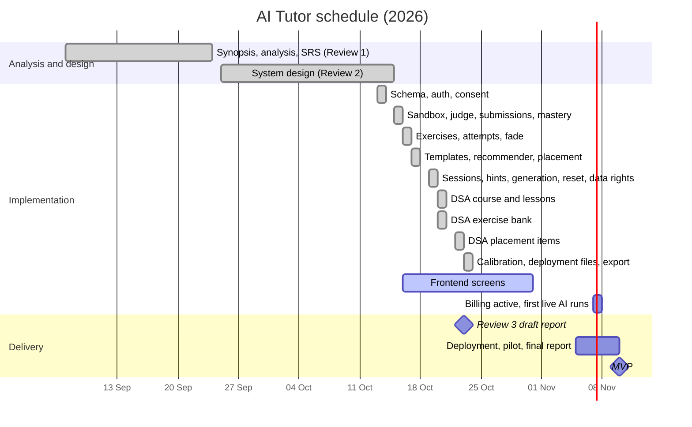

## 2.3 Choice of the Platforms

### 2.3.1 Software Used

| Layer | Choice | Why this, for this project |
|---|---|---|
| Language | TypeScript (end to end) | One language for frontend and backend; shared types catch contract mistakes at compile time |
| Front end | Next.js 16, React 19, Monaco editor | The same editor as VS Code; a built-in proxy to the API means the same origin, so no CORS issues and httpOnly cookies work |
| Back end | Node.js 22, Express 5 | Most backend work is waiting on the database, sandbox or LLM, which Node's event loop handles cheaply. Express 5 forwards async errors to one handler |
| Validation | zod 4 | Every request body is checked against one schema, and types are inferred from it |
| Database | PostgreSQL 16 with Drizzle ORM | Constraints, transactions and row locks keep mastery consistent; Drizzle gives typed queries and versioned migrations |
| Queue | Redis 7, BullMQ | Running code is slow, so it is queued: retries, rate limits, and the API stays fast |
| Code execution | E2B sandboxes, Debian 13, clang 19, C++20 | Managed isolation with internet off; a current compiler; per-second billing |
| AI | Google Gemini (paid tier) | Cheapest capable models; paid-tier data is not used for training; hidden behind one adapter |
| Email | Brevo transactional email API (plain `fetch`, no SDK) | The free plan covers the pilot (300 emails a day); EU-hosted, with a data processing agreement in its terms |
| Security | argon2id, jose (JWT), httpOnly cookies, express-rate-limit, helmet | Passwords hashed, short-lived tokens, CSRF origin check, rate limits |
| Testing | Vitest, Supertest | Fast unit tests and HTTP-level integration tests on a separate test database |
| Tooling | pnpm workspaces, Docker Compose, Git/GitHub | One repository for web, API and shared types; identical local setup for every team member |

### 2.3.2 Hardware Used

| Purpose | Specification |
|---|---|
| Development machine | Windows 11 laptop, multi-core processor, 8–16 GB RAM, SSD |
| Backup server | Older laptop running Ubuntu Server 24.04 LTS (AMD Ryzen 5 4600H, 8 GB RAM): nightly encrypted backups of the pilot database |
| Production (pilot) | Render free web service (512 MB, 0.1 CPU, Singapore) for the API and queue; Supabase free PostgreSQL (500 MB, Mumbai); Vercel for the web app |
| Sandboxes | E2B micro-VMs: 2 vCPU, 512 MiB RAM each, created per submission |
| Learner's device | Any modern browser; no installation |


---

# CHAPTER 3: SYSTEM DESIGN

## 3.1 Design Methodology

The system is a **modular monolith**: one backend, divided into 13 modules (M1–M13). Each module has the same four layers:

```
routes → controllers → services → repositories → database
(URL)    (HTTP in/out)  (rules)    (SQL only)
```

Five rules hold the design together:
1. **Modules talk through services, never through each other's tables.** For example, the execution module (M7) asks the exercises module (M6) for an exercise through `getRunnableExercise()`; it never reads M6's tables.
2. **One writer per state.** Only M4 writes mastery, and only M12 writes fade stages.
3. **Deterministic core, LLM at the edge.** Grading, mastery and next-step choice are fixed code. The LLM only produces content, which is verified and frozen first.
4. **Server-owned state.** Hint level, hint ceiling, fade stage, mastery and verdicts live only in the database, so the client can't tamper with them.
5. **Slow work is queued.** The API answers in milliseconds; running code happens in a background worker.

**Figure 1: System architecture**

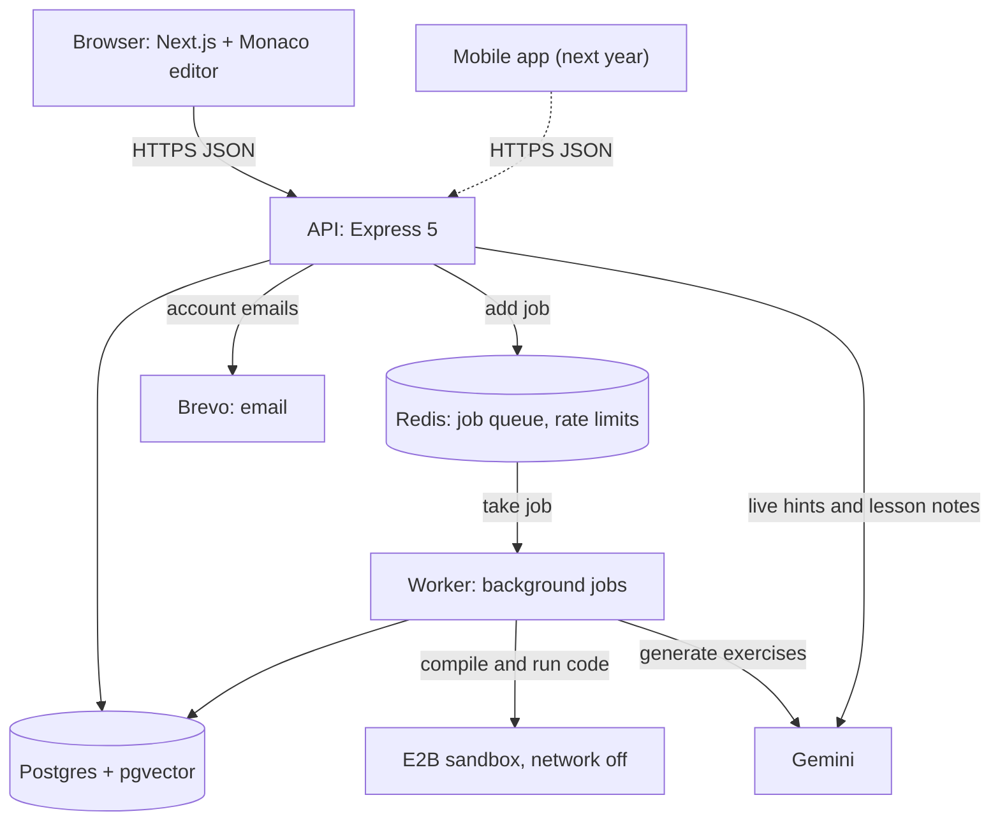

## 3.2 UML Modelling

### 3.2.1 Use Case

The learner registers, takes a diagnostic, reads the lesson for their level, solves exercises, asks for hints, views progress, can reset a forgotten password by email, and can correct, download or delete their own data. The author maintains the skill graph, the lessons and the template exercises; the admin views analytics. Two non-human actors matter: the **scheduler** (mastery decays with time, not only with clicks, and a deleted account is erased once its 7 days are over) and the **sandbox, LLM and email services**.

**Figure 2: Use case diagram**

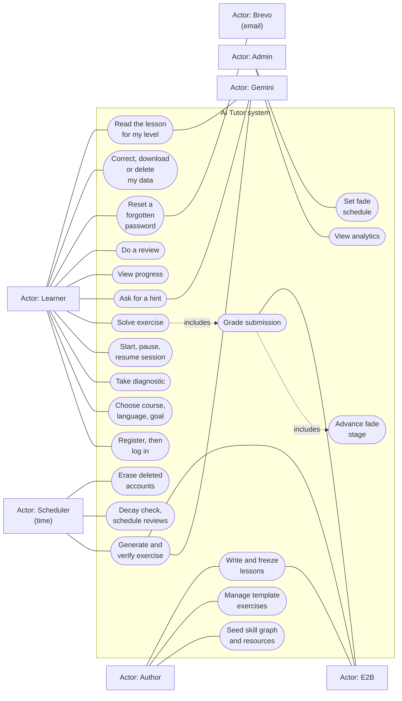

### 3.2.2 Sequence Diagrams

**Figure 5: Register, then log in.** Registration does not log the user in. The user logs in separately and receives a 15-minute access token plus a rotating 30-day refresh token.

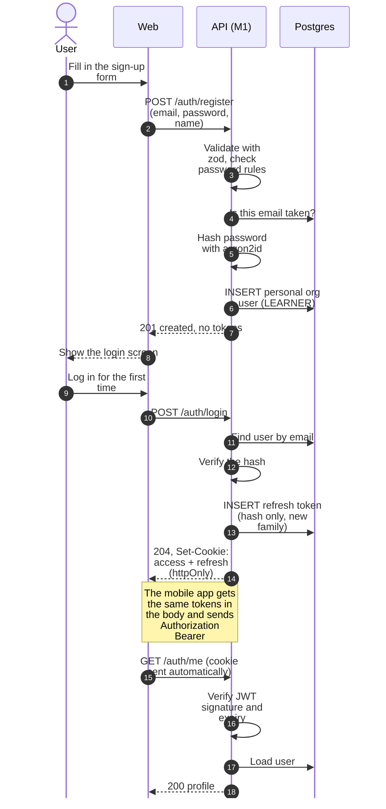

**Figure 16: Forgot and reset password, as built (ADR-0017).** The reply is the same for every email and all the work happens after it, so neither the reply nor its timing shows who has an account. The token travels in the link's `#fragment`, which browsers never send to a server, and only its SHA-256 hash is stored. The reset is one transaction: it marks the link used (only if it is still unused), ends the account's other links, saves the new argon2id hash and revokes every session.

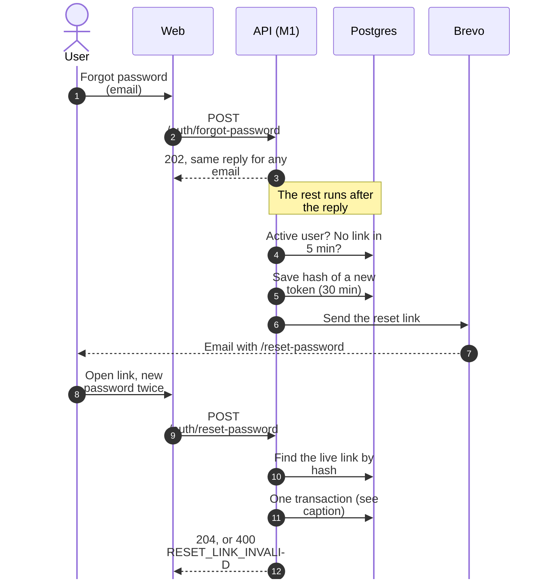

**Figure 17: Delete an account, as built (ADR-0018).** The password is asked again, so a stolen session alone can't delete the account. Every login ends at once, and nothing is erased for 7 days: logging in again cancels the request. Then the hourly job closes the account, so no name, email, password or date of birth is left, and each module erases its own rows, children first. With an opt-in to research or AI training only anonymous numbers stay; without one every learning row goes. Consent records, and a year of sign-in records, stay under the anonymous ID, as the law asks.

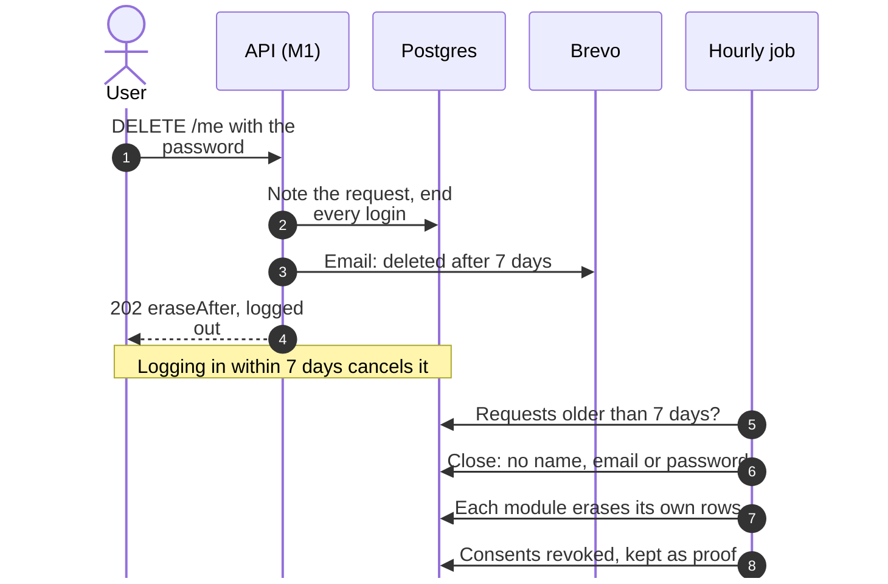

**Figure 6: Submit code.** This is the central flow of the system. The API saves the submission and answers `202` at once; a worker grades it in a fresh sandbox and saves the verdict, the mastery evidence and any fade advance in **one database transaction**.

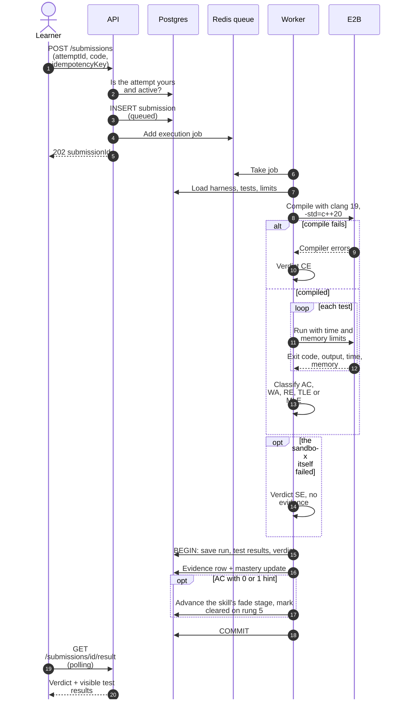

### 3.2.3 Activity and State Diagrams

**Figure 7: State of a submission.** A sandbox failure is retried with a fresh sandbox; after the last try the verdict is SE, which never counts against the learner.

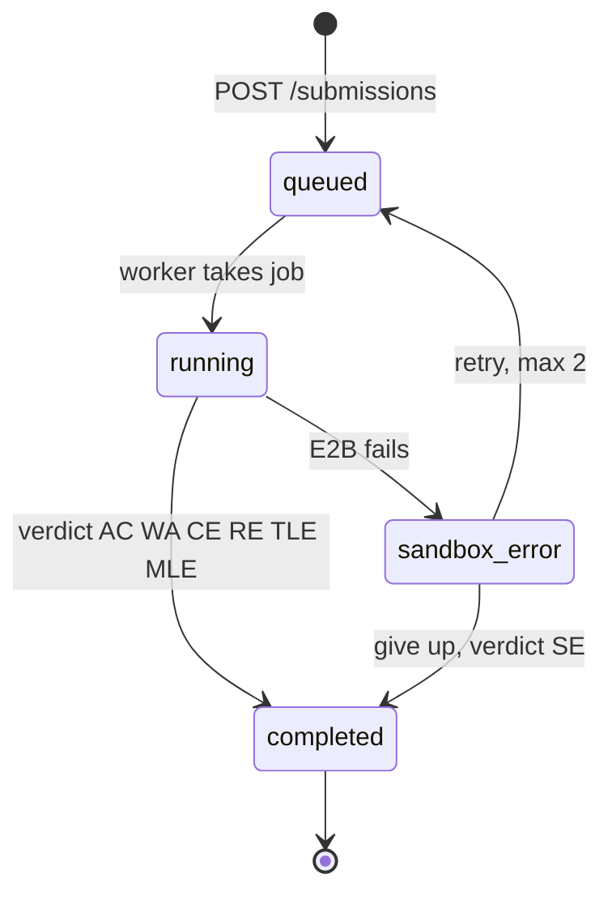

**Figure 8: Activity diagram, next-step selection, as built (recommender m5-v1, ADR-0011).** No LLM is involved; every pick is saved with its reasons.

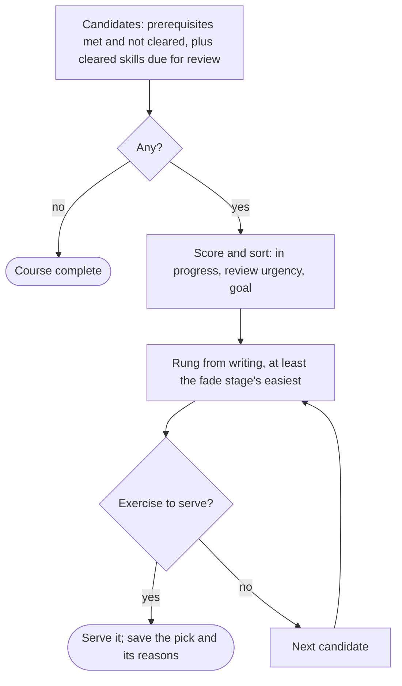

**Figure 14: Request a hint, as built (ADR-0015).** One level per request, never above the fade stage's ceiling. The live tutor comes first; the frozen hint is the fallback.

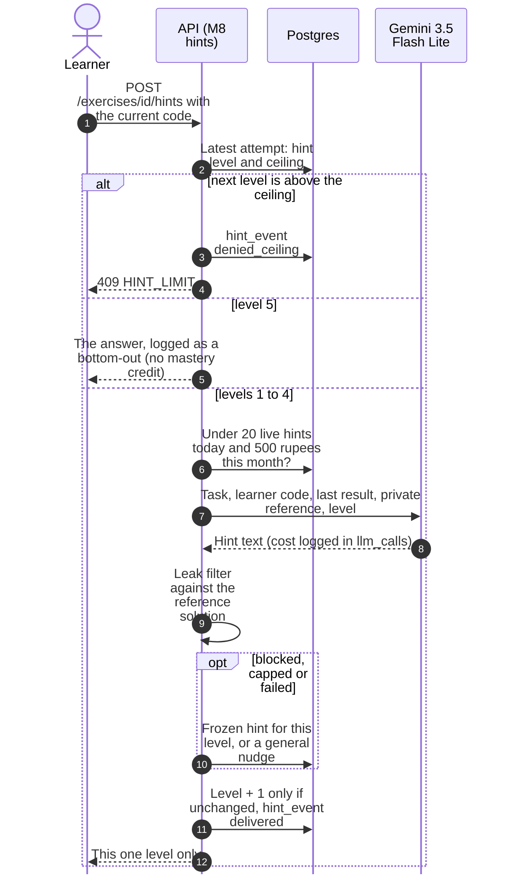

**Figure 15: Placement test, as built (ADR-0012).** Reading questions walk the skill graph easiest-first; code tasks are asked only on the frontier of what was read correctly.

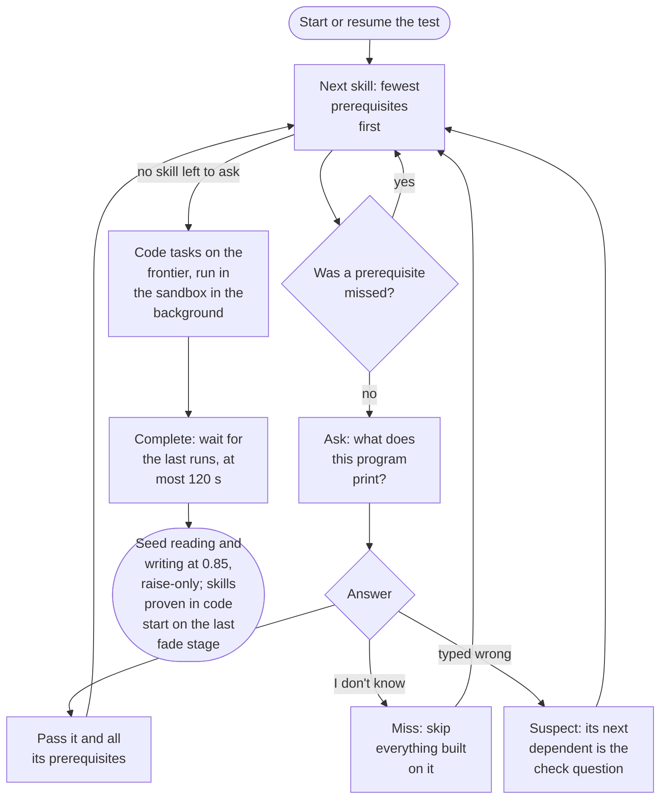

**Figure 18: Open a lesson, as built (ADR-0019).** The lesson is frozen and chosen by the learner's level today. The short live note over it uses the learner's results, never their code, and is reused until they practise the skill again.

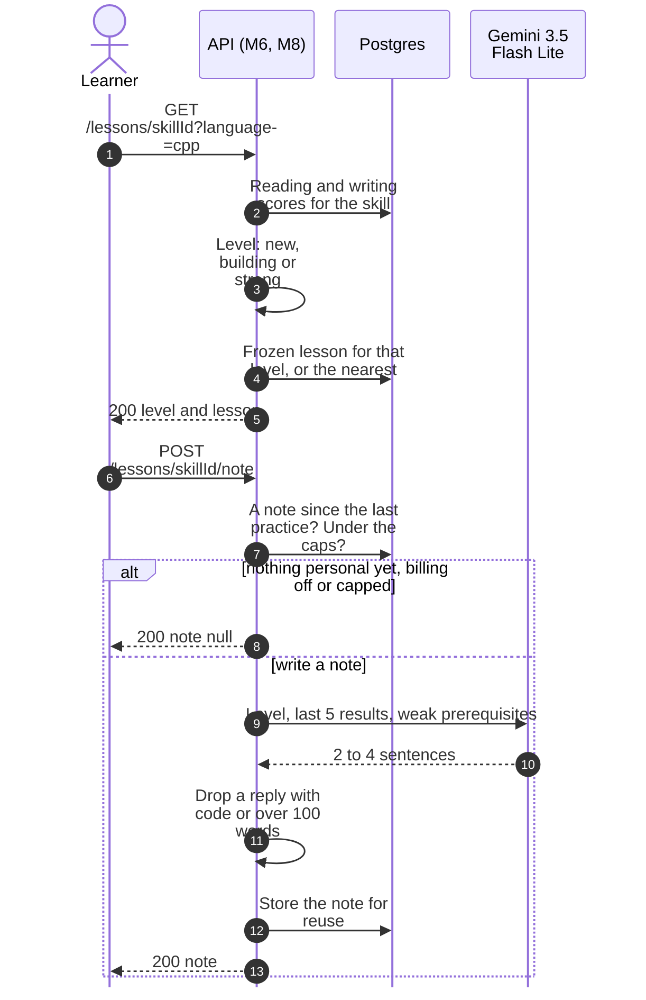

**Figure 19: Verify an exercise with generated speed tests, as built (ADR-0020).** Large tests are built from a seed in the harness, so nobody writes their answers by hand: the reference supplies them, and a slow but correct brute force checks the reference.

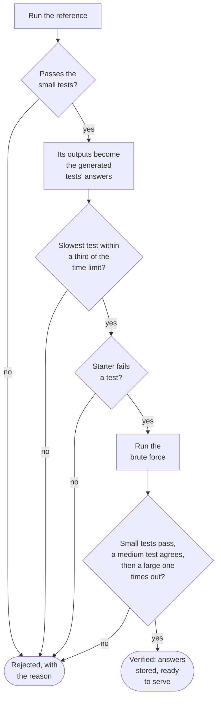

### 3.2.4 Class Diagrams

**Figure 3: Domain model** (attribute names only; their types are in the ER diagrams and the data dictionary, A-7)

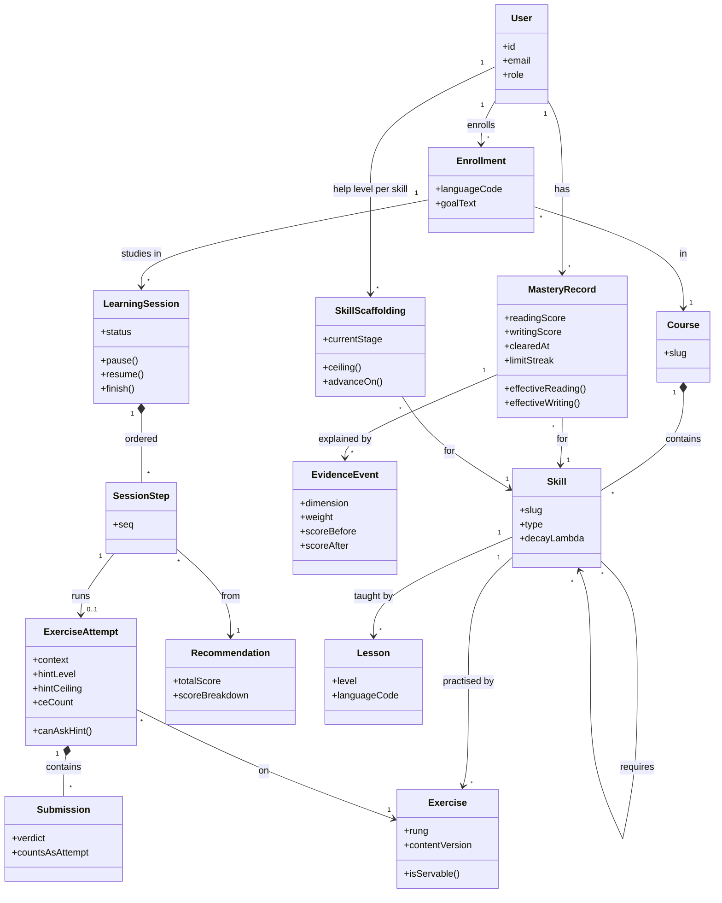

**Figure 4: Services and adapters, as built (method parameters left out for space), in two parts.** Two interfaces keep the outside services replaceable: `SandboxProvider` (only one class knows about E2B) and `LlmProvider` (only one class knows about Gemini). Tests replace both with fakes. Modules call each other's services, never each other's tables.

**Figure 4a: Running code and moving mastery.** The submission flow and the content verifier both reach the sandbox only through `SandboxProvider`.

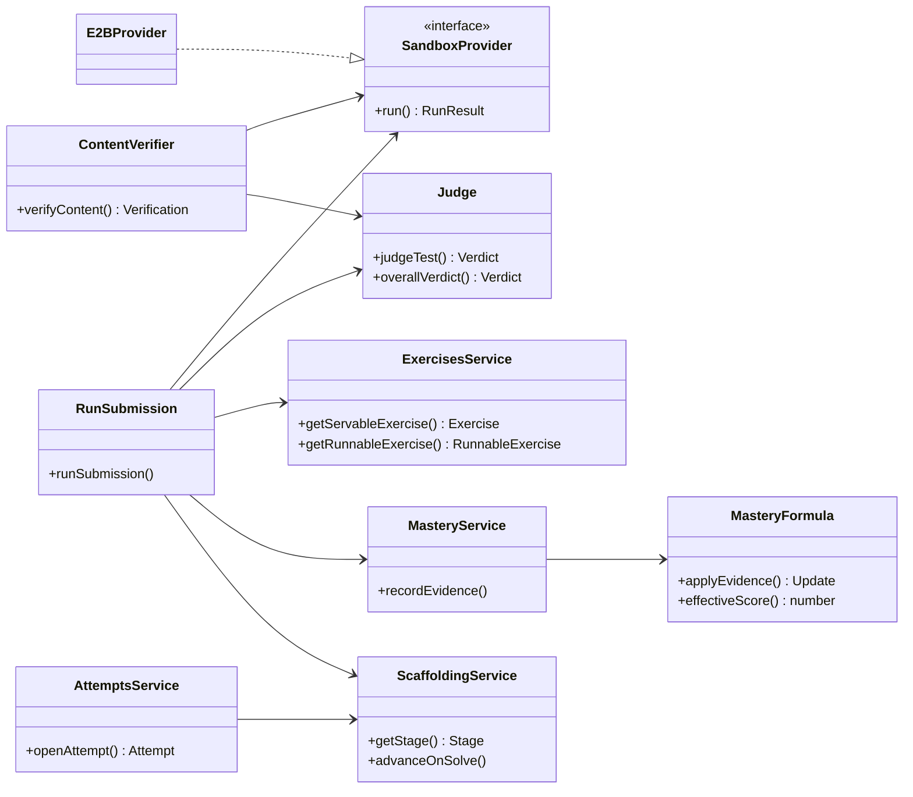

**Figure 4b: The AI and the placement test.** Hints and lesson notes reach Gemini only through `LlmProvider`; the placement test writes its results through the same mastery and fade services as practice.

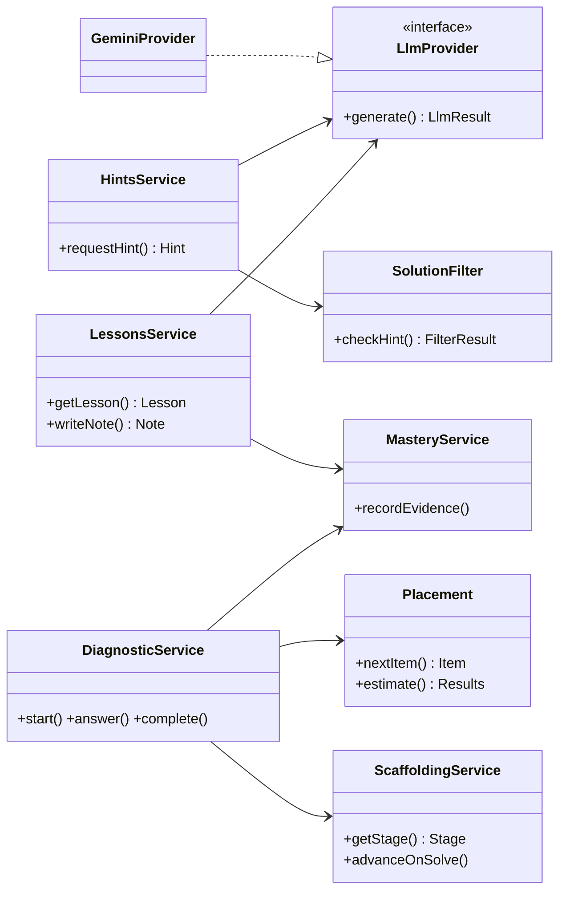

## 3.3 Database Design

**Design rules applied:**
- **Ledger plus snapshot.** Every mastery change appends an `evidence_events` row that is never edited; `mastery_records` holds today's value. Both are written in one transaction, so the history always explains the number.
- **Compute on read.** Effective mastery (after forgetting) and "review is due" are calculated when read, never stored, because they change every second.
- **Frozen content.** An exercise is identified by its content key (skill, language, rung, variant, content version). Its secret parts (harness, reference solution) live in a separate table, `exercise_secrets`, that no learner-facing query touches.
- **Normalisation.** Tables are in third normal form: each non-key column depends only on its table's key. There are two deliberate, documented exceptions. `submissions.user_id` is copied from the attempt to make per-learner queries simple. `mastery_records` is a snapshot of the ledger, kept consistent by always writing both in one transaction.

**Validations enforced by the database itself:**

| Rule | How it is enforced |
|---|---|
| Scores between 0 and 1; rungs 1–5; hint level 0–5 | CHECK constraints (`inRange` helper) |
| A hint level never above the attempt's ceiling | CHECK `hint_level <= hint_ceiling` |
| One active attempt per learner and exercise | Partial unique index `WHERE status = 'active'` |
| A submission never runs twice | UNIQUE `idempotency_key` |
| Evidence never counted twice | UNIQUE `(submission_id, dimension)` |
| One live consent of each kind | Partial unique index `WHERE revoked_at IS NULL` |
| Email unique in any letter case | `citext` column type |
| A skill can only sit on a stage its schedule has | Composite foreign key |
| Each reset link is unique, stored only as its hash, and used once | UNIQUE `token_hash`; the reset marks it used only `WHERE used_at IS NULL` |
| An erased account keeps its consent proof | `consents` has no cascade: the user row is anonymised (status `deleted`), never deleted |

The schema has **44 tables in 9 groups**: 41 are built (16 migrations), and 3 come later with their features. The two newest, `lessons` and `lesson_notes`, came with the personalised lessons (ADR-0019). `lessons` holds no personal data. A lesson note is written about one learner, so it is personal data: it is in the learner's download and is always erased with the account.

### 3.3.1 ERD

**Figure 9a: Overview of the table groups.** Each box is one group of tables and the module that owns it; an arrow points from a group to the groups that refer to it. The full ERD is in the Phase 2 design document (section 5).

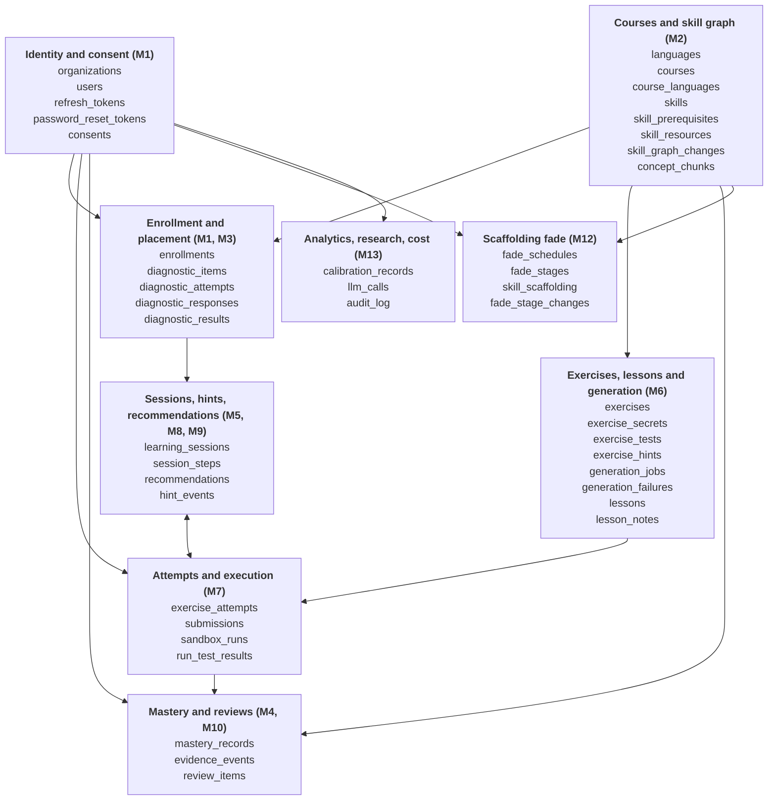

**Figure 9b: Attempts and submissions**, the tables the submit flow writes first

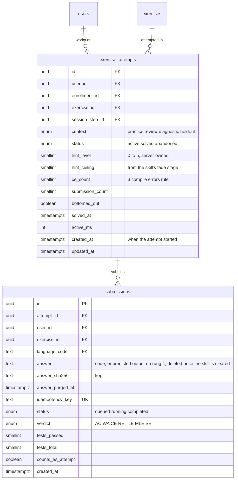

**Figure 9c: Execution**, one sandbox run per submission (or verification) and one result per test

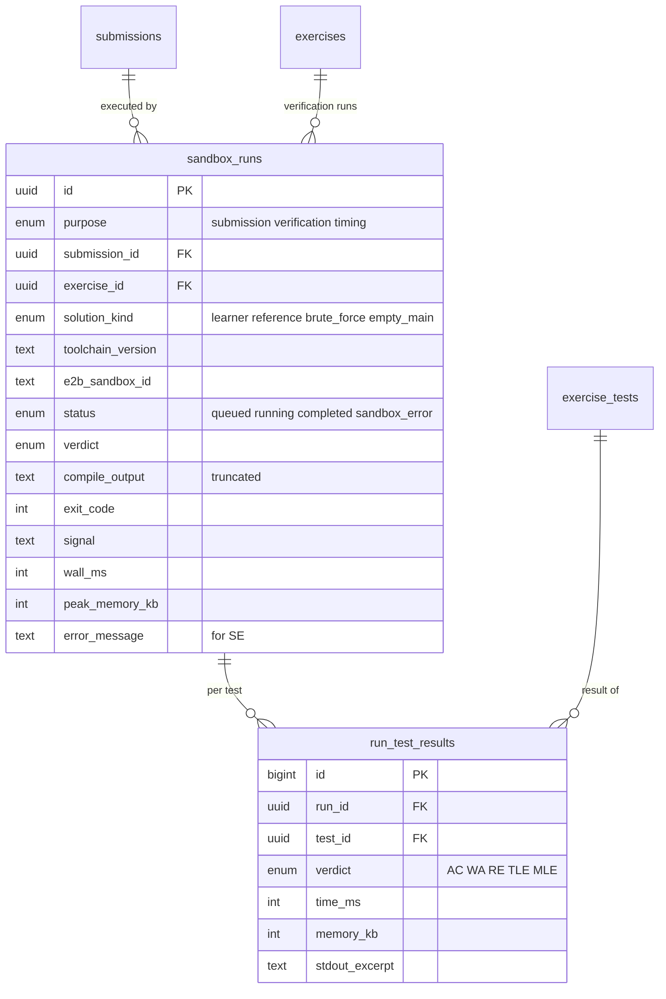

### 3.3.2 DFD

**Figure 10a: Level 0 (context)**

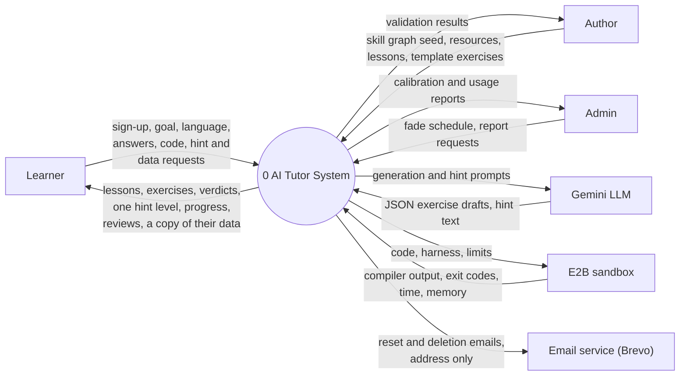

**Figure 10b: Level 1, part 1 of 2: the learning loop** (processes 3, 4, 5, 6, 7, 9, 10 and 12)

```mermaid
---
config:
  flowchart:
    nodeSpacing: 20
    rankSpacing: 30
---
flowchart TB
  L["Learner"]
  AD["Admin"]
  GEM["Gemini"]
  SBX["E2B"]
  P3(("3 Run<br/>diagnostic"))
  P4(("4 Update<br/>mastery"))
  P5(("5 Recommend<br/>next step"))
  P6(("6 Verify and<br/>freeze exercises<br/>and lessons"))
  P7(("7 Execute<br/>and grade"))
  P9(("9 Run<br/>session"))
  P10(("10 Schedule<br/>reviews"))
  P12(("12 Control<br/>fade"))
  D2[("D2 Skill<br/>graph")]
  D3[("D3<br/>Diagnostics")]
  D4[("D4 Mastery<br/>and evidence")]
  D5[("D5 Exercises")]
  D6[("D6 Attempts<br/>and<br/>submissions")]
  D8[("D8 Sessions")]
  D9[("D9 Review<br/>queue")]
  D10[("D10 Fade<br/>state per<br/>skill")]
  L -->|answers| P3
  P3 --> D3
  P3 -->|initial scores| P4
  P4 --> D4
  P4 -->|below threshold| P10
  P10 --> D9
  D2 --> P5
  D4 --> P5
  D9 --> P5
  D10 --> P5
  P5 -->|skill and rung| P9
  P9 --> D8
  P9 -->|current step| L
  P5 -->|need exercise| P6
  P6 -->|prompt| GEM
  GEM -->|draft| P6
  P6 -->|test runs| SBX
  P6 --> D5
  L -->|code| P7
  D5 -->|harness, tests, limits| P7
  P7 -->|code, limits| SBX
  SBX -->|results| P7
  P7 --> D6
  P7 -->|evidence| P4
  P7 -->|verdict| L
  P7 -->|AC, rung, hints used| P12
  AD -->|schedule| P12
  P12 --> D10
```

**Figure 10b: Level 1, part 2 of 2: accounts, content, hints and reports** (processes 1, 2, 8, 11 and 13). A data store shown in both parts is the same store. Dashed lines: process 1 erases a deleted account's rows (each module erases its own).

```mermaid
---
config:
  flowchart:
    nodeSpacing: 20
    rankSpacing: 30
---
flowchart TB
  L["Learner"]
  AU["Author"]
  AD["Admin"]
  GEM["Gemini"]
  EM["Brevo"]
  P1(("1 Manage<br/>accounts"))
  P2(("2 Manage<br/>skill graph"))
  P8(("8 Give hints"))
  P11(("11 Show<br/>progress"))
  P13(("13 Analyse<br/>and<br/>calibrate"))
  D1[("D1 Accounts")]
  D2[("D2 Skill<br/>graph")]
  D4[("D4 Mastery<br/>and evidence")]
  D6[("D6 Attempts<br/>and<br/>submissions")]
  D7[("D7 Hint log")]
  D10[("D10 Fade<br/>state per<br/>skill")]
  D11[("D11<br/>Analytics<br/>and logs")]
  L -->|sign-up, login, password<br/>reset, data requests| P1
  P1 --> D1
  P1 -->|their data file| L
  P1 -->|account emails| EM
  P1 -.-> D4 & D6 & D7 & D10
  AU -->|skills, edges, resources| P2
  P2 --> D2
  L -->|hint request| P8
  D10 -->|ceiling| P8
  P8 -->|prompt| GEM
  P8 --> D7
  P8 -->|one level| L
  D2 --> P11
  D4 --> P11
  P11 -->|progress view| L
  D4 --> P13
  D6 --> P13
  D7 --> P13
  P13 --> D11
  P13 -->|reports| AD
```

**Figure 10c: Level 2, process 7 (execute and grade)**

```mermaid
---
config:
  flowchart:
    nodeSpacing: 20
    rankSpacing: 30
---
flowchart TB
  L["Learner"]
  SBX["E2B"]
  P71(("7.1 Accept<br/>submission"))
  P72(("7.2 Queue<br/>job"))
  P73(("7.3 Compile<br/>and run"))
  P74(("7.4 Classify<br/>verdict"))
  P75(("7.5 Apply<br/>evidence<br/>policy"))
  P76(("7.6 Report<br/>result"))
  P4(("4 Update<br/>mastery"))
  P12(("12 Control<br/>fade"))
  Q[("Q1 Job queue")]
  D5[("D5 Exercises")]
  D6[("D6 Attempts<br/>and<br/>submissions")]
  L -->|code| P71
  P71 --> D6
  P71 --> P72
  P72 --> Q
  Q --> P73
  D5 -->|harness, tests, limits| P73
  P73 -->|files, limits| SBX
  SBX -->|exit code, time, memory, output| P73
  P73 --> P74
  P74 -->|verdict, per-test results| D6
  P74 -->|AC WA RE TLE MLE, CE from the 3rd| P75
  P75 -->|weighted evidence| P4
  P75 -->|AC with rung and hints used| P12
  D6 --> P76
  P76 -->|verdict, visible tests only| L
```

## 3.4 Input Design

All input enters through the REST API, and **every request body is validated by a zod schema before any logic runs**. Invalid input returns `400 VALIDATION_ERROR` with a message per field.

| Input | Fields | Validation |
|---|---|---|
| Register | email, password, displayName, dateOfBirth, acceptTerms, acceptPrivacy, aiTraining?, research? | Email ≤ 254 characters, case-insensitive; password 8–128 characters (NIST: no forced symbols); name 1–80; date of birth a real date, not in the future; both acceptances must be `true`; under-18s refused during the pilot (shown next to the date of birth); `.invalid` addresses refused (erased accounts use them); unknown fields such as `role` are stripped |
| Login | email, password, client (web or mobile) | Same email rules; failed logins throttled per email and per IP |
| Forgot password | email | Same email rules; the same reply whether or not the account exists; 5 requests per IP per 15 minutes, and at most one email per account every 5 minutes |
| Reset password | token, password | Token 20–200 characters; password as for sign-up; a used, expired or replaced link gives `400 RESET_LINK_INVALID`; 10 per IP per 15 minutes |
| Correct profile | displayName?, timezone? | At least one; name 1–80 after trimming; a real IANA time zone; email and date of birth can't be changed here |
| Opt in or out | kind, in the path | Only `ai_training` or `research_study` (the required consents end with the account); opting in for adults only (`403 ADULTS_ONLY`); 30 changes an hour |
| Delete account | password | The account's own password again (`403 WRONG_PASSWORD`); 5 tries per 15 minutes |
| Submit code | attemptId, answer, idempotencyKey | attemptId must be a UUID of *your own* active attempt; answer ≤ 64 KB; key 8–100 characters; 10 submits per minute per learner |
| Read mastery / fade state / progress | `language` (and `course`) query parameters | Optional, 1–20 (60) characters; the course must be offered in that language |
| Placement answer | itemId, then answer or dontKnow | Only the current question is accepted (`409 ITEM_NOT_CURRENT` otherwise); answer ≤ 64 KB with no NUL character; 30 calls per minute |
| Session change | status: active, paused or ended | An ended session refuses changes |
| Hint request | code (optional) | ≤ 64 KB; the level is decided by the server, never the client; 10 per minute |
| Lesson and its note | skill id in the path, `language` query parameter | The skill must exist (`404 SKILL_NOT_FOUND`); the level comes from the server's scores, never the client; a note request shares the hint limit (10 a minute) and the 20 live calls a day |
| Analytics | days (1–365), course, language | Admin role only (`403 FORBIDDEN` otherwise) |

**Screen input (frontend, in progress):** sign-up form with a date picker and two separate required tick boxes, with the optional opt-ins shown only when the date of birth makes the user 18+; login form; forgot-password and set-new-password forms; Settings (to build): profile, privacy switches, download and delete; lesson page, where the check's answer stays hidden until the learner has typed a guess; exercise page with the Monaco editor (a plain text box for rung-1 "predict the output"). The same rules are applied in the browser to show errors before submitting, but the server is always the authority.

## 3.5 Output Design

Every response has **one envelope**:

```json
{ "success": true,  "data": { } }
{ "success": false, "error": { "code": "ATTEMPT_CLOSED", "message": "This attempt is already finished" } }
```

The client branches on `error.code` and shows `error.message`.

**The submission result** shows a sample test in full, and a hidden test as its verdict only:

```json
{ "verdict": "WA", "testsPassed": 1, "testsTotal": 4,
  "tests": [
    { "seq": 1, "name": "Example", "visibility": "sample", "verdict": "WA",
      "input": "123", "expectedOutput": "6", "output": "3\n" },
    { "seq": 2, "name": "Zero", "visibility": "hidden", "verdict": "AC", "timeMs": 0 } ] }
```

**A placement question** carries the program or the task, never its answer key, its tests or whether earlier answers were right:

```json
{ "itemId": "…", "dimension": "reading", "skill": { "slug": "operators", "name": "Operators" },
  "promptMd": "Read the program carefully. **What does it print?**", "code": "#include <iostream>\n…" }
```

**A hint** is one level only, with where it came from:

```json
{ "level": 2, "ceiling": 5, "source": "live", "bodyMd": "Look at the line that returns the result: which variable does it use?" }
```

**A lesson** is the frozen one for the learner's level today, or the nearest level written. Its live note comes from a separate request and is `null` when there's nothing personal to say yet:

```json
{ "level": "building",
  "lesson": { "level": "building", "explanationMd": "### A quick recap…", "diagramMermaid": "flowchart TB…",
              "example": { "code": "#include <iostream>…", "output": "…", "walkthroughMd": "1. …" },
              "mistakesMd": "- **Forgetting the end mark.** …",
              "check": { "code": "…", "output": "9 1 0", "explanationMd": "…" } } }
```

**The password-reset email** has a subject, a button and the plain link (`/reset-password#token=…`), and no name: the email provider may receive only the address (privacy policy §5).

**The account-deletion email** gives the date in the learner's own time zone and says that logging in before then cancels the deletion. It has no name either.

**The data download** (`GET /me/data`) is a file to keep, so it is the one reply without the envelope: `ai-tutor-my-data.json`, never cached. It starts with a summary, the purposes and the five named providers (what each one receives), then holds every row each module keeps about the learner. It never contains a password or token hash, or a hidden test.

**Skill details** come with every exercise and in the progress view: the skill's own one-line description and its further-reading links, in the learner's language.

**The Terms and Privacy pages** (`/terms`, `/privacy`) are built from the same text files the learner accepts; the build fails if a draft line or an unfilled blank is left.

**Mastery output** always shows reading and writing **separately**, each as a stored `score` and an `effective` score after forgetting. They are never blended into one number, because a 10/11 versus 0/4 profile averages into a misleading 65%.

## 3.6 Code Design and Development

```
apps/api/src/
  config/env.ts                 settings, validated at startup
  infrastructure/
    database/  schema/ seed/    Drizzle tables, migrations, seed data (both courses' skills, lessons
                                as Markdown, exercises as C++ templates)
    sandbox/                    SandboxProvider interface, E2B adapter, template
    llm/                        LlmProvider interface, Gemini adapter, cost log
    queue/                      BullMQ queues and workers: submissions, generation, hourly erasure
    mail/                       Brevo email (printed locally when no key is set)
  shared/                       errors, response envelope, auth helpers, middlewares, India time
  modules/                      each: routes → controllers → services → repositories
    m1_auth  m2_skills  m3_diagnostic  m4_mastery  m5_recommender  m6_exercises
    m7_execution  m8_socratic  m9_sessions  m11_progress  m12_scaffolding  m13_analytics
  scripts/                      sandbox build and smoke test, exercise verification, lesson seeding and
                                generation, hint generation, make-admin, the guided demo walk
```

**Key pieces of logic are pure functions**, which means no database and no network, so they are fully unit-tested:
- `judge.ts`: turns sandbox readings into a verdict (Table 5).
- `mastery-formula.ts`: the M4 formula and decay (Table 6).
- `age.ts`: whole-year age, used for the under-18 rule.
- `recommend.ts`: the next-step rules (Figure 8).
- `placement.ts`: the placement walk and estimates (Table 11, Figure 15).
- `session-clock.ts`: idle pause after 15 minutes, end after 24 hours paused, study time.
- `solution-filter.ts`: blocks hints that resemble the solution (Table 12).
- `exercise-draft.ts`: what the model must write for a new exercise, the prompt, and the conversion into the hand-written bank's format (Table 13).
- `verify-exercise.ts`: the proof every exercise passes in the sandbox, including generated speed tests and the brute-force check (Table 16, Figure 19). It talks to the sandbox only through `SandboxProvider`, so its rules are unit-tested with a fake.
- `freeze-lesson.ts`: the gates every lesson passes before it is stored (Table 15).

**Table 5: Verdict rules.** These are checked in this order for each test; the first failing test decides.

| Verdict | Rule |
|---|---|
| CE | The compiler exits non-zero, or takes longer than 10 s |
| TLE | The test was killed by the time limit (2 s by default) |
| MLE | Peak memory above the limit (256 MB), or a `std::bad_alloc` crash |
| RE | Any other non-zero exit (crash, divide by zero) |
| WA | Output differs from the expected output (trailing spaces and line endings ignored) |
| AC | All tests pass |
| SE | The sandbox itself failed; retried, never counted |

**Table 6: Mastery formula v1.** Rung 1 moves reading; rungs 2–5 move writing.

| Event | Update |
|---|---|
| AC | new = old + 0.40 × weight × (1 − old); weight = rung/5 × (1 − 0.15 per hint; 0 if the solution was shown) × time factor (0.7–1) |
| WA or RE | new = old × (1 − 0.15 × (6 − rung)/5); **only the first failure in an attempt** is penalised |
| TLE or MLE | Penalty starts at 1/20 of a WA, doubles on each consecutive one, capped at a WA; only an AC resets it |
| Compile error, sandbox error | No change |
| Decay (on read) | effective = score × e^(−λ × days since evidence) |

About five good solves (rungs 2 → 5) take a new skill from 0 to 0.72, just past the 0.7 prerequisite threshold.

**Table 7: Fade stages.** Help is withdrawn per skill.

| Stage | Easiest rung | Max hints | Moves on after solving |
|---|---|---|---|
| 1 | 1 | 5 | rung 2 (or harder) with ≤ 1 hint |
| 2 | 3 | 4 | rung 3 with ≤ 1 hint |
| 3 | 4 | 3 | rung 4 with ≤ 1 hint |
| 4 | 5 | 2 | rung 5 with ≤ 1 hint → skill cleared |

**Table 11: Placement test rules (ADR-0012).** All 20 C++ skills are covered by 40 frozen, sandbox-verified items: one predict-the-output reading item and one small function per skill. The 49 DSA skills have 98 more under the same rules (22 October), none of them a copy of a practice exercise; DSA code tasks carry speed tests (Table 16).

| Rule | Detail |
|---|---|
| Order | Fewest transitive prerequisites first, then difficulty, then name |
| Reading walk | A skill is asked only if no prerequisite was missed. A right answer passes the skill and all its prerequisites |
| Slip check | "I don't know" is a miss. A typed wrong answer is only *suspect* until its first dependent is answered: right rescues it, wrong confirms both |
| Code tasks | Only on the frontier (passed skills nothing else passed builds on); an AC vouches for everything below. Run in the background |
| Estimate | Passed → 0.85 for reading; proven in code → 0.85 for writing; confidence 0, 0.5 or 1 by what was observed |
| Seeding | One transaction: mastery raised only if higher than today's value; skills proven in code start on the last fade stage; skills cleared in practice untouched |
| Length | C++: 1 question for a novice, 6 for a beginner, 18 for a mid learner, 26 (about 28 minutes) for an expert, instead of 40. DSA: 17 for a learner who knows 4 skills; 49 reading and 20 code tasks for an expert (about 2½ hours, with pause and resume) |
| Retakes | Up to 3 per course; a retake can lift a placement but never lowers it |

**Table 12: Hint ladder and where each hint comes from (ADR-0015).**

| Level | Content | Source |
|---|---|---|
| 1 Concept | The idea or C++ feature needed, in words | Live tutor first; frozen hint if capped, failed or blocked |
| 2 Location | Where in the learner's own code the problem is | Same |
| 3 Mechanism | How to fix it, in words | Same |
| 4 Worked example | A different, smaller problem using the same technique | Same |
| 5 Answer | The reference solution, or the program's output for rung 1 | Always frozen; logged as a bottom-out; the attempt earns no credit |

**Table 13: Exercise generation: how a job runs (ADR-0016).** Started by an admin or author, or queued automatically by the recommender when a learner's best next skill has no exercise.

| Step | Rule |
|---|---|
| Queue | One active job per skill and rung; a second request gets the same job. Run one at a time in the background |
| Tries | Up to 3: Gemini 3.8 Flash, Flash, then Gemini 3.1 Pro. Each retry is told why the last draft was rejected |
| Draft | JSON checked against a schema: title, prompt, function signature, the call each test makes, starter, reference, 3–6 test cases, and 3 wrong solutions (rung 1: a program and its claimed output) |
| Prompt | The skill, the only other skills it may use (its prerequisites), the rung's rule, the frozen harness, an example from the hand-written bank, and the titles to avoid |
| Proof | In the real sandbox: the reference passes every test, the starter compiles but fails one, and each wrong solution compiles but fails one. A rung-1 program must print exactly the output it claims |
| Store | Only proven content is stored, ready to serve; its frozen hints follow |
| Failure | Every failed try is logged with its stage. After 3 tries, or when this month's ₹300 is spent, the job falls back to the hand-written exercise for that skill and rung |

A live hint is blocked if it holds 25 % or more of the code only the solution has (5-token fingerprints, not counting the starter or the learner's own code), shows a code block longer than 6 lines, or gives away a rung-1 output.

**Table 14: Data rights: what each request does, and what erasure keeps (ADR-0018).** Every request needs a login and acts only on the learner's own data.

| Request | Endpoint | Rule |
|---|---|---|
| Correct | `PATCH /me` | Name and time zone; the hidden personal organisation, named after the learner, is renamed too |
| Opt in or out | `PUT` / `DELETE /me/consents/:kind` | AI training and research only, adults only; a withdrawn consent is kept, revoked, as proof |
| Download | `GET /me/data` | One JSON file: summary, purposes, the 5 named providers, then each module's rows; 5 an hour |
| Delete | `DELETE /me` | The password again; every login ends; an email gives the date; logging in within 7 days cancels |
| Erase | hourly job | Name, email, password, date of birth and all code go. With an opt-in to research or AI training, the anonymous numbers stay (verdicts, scores, timings); without one, every learning row goes. Consents, and a year of sign-in records, stay under the anonymous ID |

**Table 15: Lessons: what each one holds and the gates it passes (ADR-0019).** Each skill has three frozen lessons, one per level: **new** (no score yet), **building** (some score) and **strong** (cleared, or writing ≥ 0.7). The learner gets the lesson for today's level, or the nearest level written, and a short live note over it.

| Part | Rule |
|---|---|
| Contents | An explanation (300–700 words), one Mermaid diagram, a worked example with its exact output and a walkthrough, 3–5 common mistakes, and a check: a short program whose output the learner predicts |
| Shape | Checked against a schema: example program at most 45 lines, check at most 20, a diagram type the web app can draw |
| Exercises kept safe | The hint leak filter compares the whole lesson with each verified exercise of the skill, so a lesson never solves one |
| Programs proven | Both programs run in the real sandbox and must print exactly the output the lesson states |
| Written by | Hand for both courses (207 lessons). Generation is ready for later courses: Gemini drafts, then the same model checks **each technical claim one by one**; asked only for "errors" in general, it missed a wrong claim that the claim-by-claim check caught |
| Live note | 2–4 sentences from the learner's level, last 5 results and weak prerequisites, never their code; reused until they practise again; counts against the hint caps; a reply with code or over 100 words is dropped |

**Table 16: Speed tests in the DSA exercise bank (ADR-0020).** Five hand-written exercises per skill (245 in all). A task with a slow but correct solution gets large tests; a task without one keeps small tests that wrong answers fail.

| Part | Rule |
|---|---|
| Generated tests | A test without an expected output calls a seeded generator in the harness, such as a million random 0s and 1s. The reference's output becomes its answer, stored at verification |
| Order | The hand-written tests first (the first is the sample), then a medium generated test, then a large one: the sandbox stops at the first failing test |
| Reference | Passes every hand-written test, and its slowest test takes at most a third of the 2-second limit |
| Brute force | Required with generated tests: it passes the hand-written tests, **agrees** on at least one generated test and then **times out**. Disagreeing or crashing rejects the exercise, and finishing every test in time means the tests can't tell fast from slow |
| Starter | Must fail a test. A slow starter fails by timing out, which makes "make it fast enough" a natural rung-2 task |

**Figure 12: Deployment**, as decided for the pilot (ADR-0024; ADR-0010's own VM comes later)

```mermaid
---
config:
  flowchart:
    nodeSpacing: 20
    rankSpacing: 30
    subGraphTitleMargin:
      top: 4
      bottom: 14
---
flowchart TB
  B["Browser"] -->|HTTPS| V["Vercel: tutor.nidanos.com<br/>Next.js web + /api proxy"]
  M["Mobile app (later)"] -->|Bearer token| API
  V -->|/api + origin secret| API
  subgraph R["Render, Singapore (free)"]
    API["API + queue worker<br/>(Node 22, one process)"]
    RD[("Key Value<br/>queue")]
  end
  PG[("Supabase, Mumbai<br/>PostgreSQL 17")]
  subgraph EXT["Outside services"]
    E2B["E2B sandboxes, internet off<br/>code + tests, no identity"]
    G["Google Gemini API<br/>content and hints"]
    BR["Brevo email (EU)<br/>account emails, address only"]
  end
  P["Pinger<br/>/health every 10 min"] -.-> API
  API --> RD
  API -->|session pooler| PG
  API --> EXT
  PG -.->|nightly encrypted backup| L["Home server laptop<br/>(Ubuntu 24.04)"]
```


---

# CHAPTER 4: TESTING AND IMPLEMENTATION

## 4.1 Testing Methodology

Tests are automated with **Vitest** and **Supertest** and run against a **separate test database** (`ai_tutor_test`), which is rebuilt from the migrations on every run. That way the tests prove the real migrations, not a hand-made copy. Each test creates its own users and data with random names, so tests never depend on each other. **GitHub Actions** runs the type checks, all these tests on a fresh database and the web build on every push and pull request (`.github/workflows/ci.yml`), so nothing that breaks them reaches `main` unnoticed.

### 4.1.1 Unit Testing
Pure functions are tested with constructed inputs:
- **judge:** each verdict rule, rule order (TLE wins over a crash exit code), output normalisation, and an empty test list giving SE, never AC;
- **mastery formula:** the approved learner journey to the exact numbers, the hint and solution-shown rules, TLE doubling and its cap, and decay to half after ln 2 / λ days;
- **age:** turning 18 exactly on the birthday;
- **skill graph:** cycle detection, plus checks that both seeded courses have unique names, only known prerequisites and no cycles, and that every DSA skill builds on C++ basics and is never easier than what it builds on;
- **recommender:** candidates, review urgency, rung bands clamped to the fade stage, and the journey from rung 1 to rung 5;
- **placement:** every one of the **711 knowledge states** the 20-skill graph allows, answered with "I don't know" and with wrong guesses, is placed exactly, in at most 20 reading and 7 code questions; on the real DSA graph, an expert gets 49 reading and 20 code questions, and 300 random learners are each placed exactly, with one code task per skill on their frontier; slips, missing items and cleared skills;
- **session clock:** the idle pause, the 24-hour end, and study time that never counts idle gaps;
- **leak filter:** prose and fragments pass; the solution, whole or in its key lines, fenced or not, is blocked; the learner's own code is not counted; a rung-1 output is never given away;
- **exercise drafts:** the schema's rules (the test call must take the test's arguments; exactly 3 wrong solutions), the conversion into the bank's format, and what the prompt contains;
- **exercise banks:** both courses have rungs 1–5 once per skill; every DSA exercise shows a sample with its output, and one with generated tests has at least two, last, and a brute force; the DSA placement bank has one reading item and one code task per skill, none reusing a practice exercise's title or function;
- **lessons:** the level rule (new, building, strong), the lesson schema, and all 207 hand-written lessons covering every skill of both courses at all three levels.

### 4.1.2 Module Testing
**Database-rule tests**, one per schema group, try to break each constraint on purpose and expect the database to refuse. Examples: a duplicate email in different letter case, a hint level above the ceiling, a second active attempt, a second open session, a duplicate idempotency key, evidence with no source.

### 4.1.3 Integration Testing
HTTP-level tests call the real Express app with real requests:
- **auth:** register, login, refresh, logout, theft detection, throttling, CSRF, consent, and per-IP limits that trust only our own proxy;
- **submissions:** submit, idempotency, ownership, judging, retries, and deleting a cleared skill's code (privacy policy §2);
- **exercises:** secrets never leak; attempts, enrollment and fade start; the skill's description and reading links;
- **exercise verification:** a reference that fails or a starter that passes is rejected; generated tests take their outputs from the reference only when the brute force agrees and then times out; a brute force that never times out or disagrees, and a reference slower than a third of the limit, are rejected;
- **lessons:** the lesson for the learner's level or the nearest one; a generated lesson proven and frozen, or refused when the fact check finds it false, when it gives an exercise away, or when its programs don't print what it states; the ₹300 monthly stop; hand-written lessons through the same gates;
- **lesson notes:** a note from the learner's recent results and weak prerequisite, reused until they practise again; nothing without live AI, past the daily limit or when the reply has code;
- **mastery and fade:** read views, the decay maths, stage advance;
- **recommender:** first step, moving up rungs, skipping skills without content, naming the other course's skills a learner must finish first, course complete;
- **placement test:** no answer key in any response, only the current question accepted, replays, code tasks queued once, the 202 grading wait, seeding, fast-track to the last stage, retakes, and a cheat attempt with a borrowed idempotency key;
- **sessions and progress:** steps from the recommender, pause/resume at the same step, idle and timeout, statuses that match the recommender's unlock rule;
- **analytics:** admin only, counts only, never a learner's email;
- **hints:** live hint, a leaky reply replaced by the frozen hint, a failed call, the fade ceiling, the answer at level 5, the daily and monthly caps;
- **exercise generation:** a proven draft stored ready to serve; a retry after a bad reply; tests a wrong answer passes, rejected three times, ending on the Pro model and the hand-written fallback; a rung-1 program's claimed output checked; the budget stop; admin-only endpoints; automatic queueing by the recommender;
- **password reset:** the same reply for unknown and inactive accounts, and an email, without the name, only for real ones; the token stored only as a hash; at most one email per account every 5 minutes; one use, even with two resets at once; expiry; only the newest link works; every login ended; the per-IP limit;
- **data rights:** correction and its limits; opt-ins on and off, adults only, 30 an hour; the download holds every module's rows and no secrets; deletion needs the password, ends every login (even one refreshed seconds before), emails the date and is cancelled by logging in; erased accounts' addresses can't be taken;
- **account erasure:** without an opt-in every learning row goes, with one only anonymous numbers stay; accounts still in their grace period, or cancelled, are left alone; every table that points at a learner is accounted for.

The sandbox, Gemini and the email service are replaced by **fake providers** in these tests: same interfaces, fixed results. That makes them fast, free and repeatable.

### 4.1.4 System Testing
1. **Sandbox smoke test** (`pnpm sandbox:smoke`): six real C++ programs run on the real E2B service, and each must produce its intended verdict (AC, WA, CE, RE, TLE, MLE).
2. **Content verification** (`pnpm exercises:verify`): every seeded exercise runs in the real sandbox; the reference must pass and the starter must fail. **483 of 483 verified** (100 C++ practice exercises, 40 C++ placement items, 245 DSA exercises, 98 DSA placement items). The 74 hand-written for C++ skills 6–20 were also each run against a common wrong answer first, which had to fail. The 245 DSA exercises cover all 49 skills, five rungs each; their **speed tests**, and those of the DSA placement code tasks, were proven too: on each, the reference took at most a third of the 2-second limit and the slow brute force agreed and then timed out (Table 16).
3. **Lesson verification** (`pnpm lessons:seed`): every hand-written lesson passes the gates of Table 15, with both its programs run in the real sandbox. **207 of 207 frozen** (60 for C++ basics, 147 for DSA).
4. **End-to-end learner loop** on a running server: register → log in → open exercise → submit → poll → read mastery → reopen the exercise.
5. **End-to-end placement test** on real E2B, then the first recommendation and the fade stages; **sessions** (start, pause, resume, end); **progress**; **hints** (the whole ladder); **analytics** with a promoted admin; **generation** refused correctly while billing is off.
6. **Password reset in a real browser:** the forgot-password form, the emailed link (printed locally), a new password, then logging in with it; the old password and the used link are refused.
7. **Data rights on the running server:** correct, opt in, download, then delete with the password (the email printed locally), and the erasure of that account as the hourly job does it (A-10). The server registers the hourly job once, and its first run completes.
8. **Guided walk** (`pnpm demo:walk`): one new learner through sign-up, the placement test, an exercise on the real sandbox (a wrong then a right answer), a hint, progress, the data download and deletion (A-10). It is also the smoke test after a deploy.
9. **Manual API tests** with curl, for authentication and consent, by a team member.
10. **Load check** (23 October, real E2B): 20 learners submit code at the same moment, half of it DSA with speed tests, plus 5 predict-the-output answers. All 25 came back AC, with no sandbox error. The last code verdict arrived after 27–30 s (median 17 s) and the predict answers within about 1 s, after the two changes in defect 43; the rest of the wait is E2B Hobby's limit of one new sandbox per second.

### 4.1.5 White-Box and Black-Box Testing
- **White box:** unit tests cover every branch of the judge and formula, and database-rule tests target specific constraints.
- **Black box:** integration and system tests use only the public API and check visible behaviour. For example, "a hidden test's input never appears in any response" is checked by searching the whole response body.

### 4.1.6 Acceptance Testing
The acceptance criteria are the SRS requirements, traced in the Phase 2 design document (section 9). For example:
- **FR-M4-02**, "mastery changes only from executed evidence": tested by "records no evidence for SE or an early compile error".
- **FR-M12-02**, "the help limit is enforced on the server": tested by "never lets the hint level pass the fade ceiling" and "refuses a level above the fade stage's ceiling, and logs it".
- **FR-M8-04**, "block any reply that looks like the solution": tested by "blocks a reply that gives the solution away and serves the frozen hint instead".
- **FR-M3-01**, "an adaptive test estimates reading and writing": tested by "places all 711 possible learners exactly".
- **FR-M13-01**, "compare predicted mastery with results": tested by "saves a calibration record for a learner's first counted try at an exercise only".
- **FR-M1-05**, "reset a forgotten password": tested by "sets the new password, ends every login, and works only once".
- **DPDP Act s.11**, the right of access: tested by "downloads everything held about the learner, from every module, with who it was shared with".
- **DPDP Act s.12**, erasure: tested by "anonymises the person and deletes every learning row, keeping the consents as proof".

Learner acceptance testing is planned for the pilot before the final report, with an anonymous survey (`DOCS/phase-3/pilot-survey.md`): the System Usability Scale and ten statements, each paired with a number from the pilot's logs.

## 4.2 Test Data and Test Cases

**Table 8: Automated test suites (248 tests in 43 files, all passing on 23 Oct 2026)**

| Level | Suite | Tests | What it proves |
|---|---|---|---|
| Unit | judge | 7 | Each verdict rule, order, normalisation, excerpts |
| Unit | mastery formula v1 | 8 | Approved journey 0 → 0.16 → 0.33 → 0.53 → 0.72; hints; TLE doubling; decay |
| Unit | skill graph | 7 | Cycle detection; both seeded graphs valid; DSA builds on C++ basics and is never easier than its prerequisites |
| Unit | recommender rules | 7 | Candidates, reviews, rung bands, journey from rung 1 to 5 |
| Unit | placement rules | 13 | All 711 C++ knowledge states and 300 random DSA learners placed exactly; slip check; frontier code tasks |
| Unit | session clock | 5 | Idle pause, timeout end, study time |
| Unit | leak filter | 5 | Solution-like hints blocked, learner's own code ignored |
| Unit | exercise banks | 11 | Practice and placement banks of both courses complete and well-formed; DSA generated tests last, with a brute force; no placement item reuses a practice exercise |
| Unit | exercise drafts | 5 | Draft rules, conversion to the bank's format, prompt contents |
| Unit | lesson drafts, lesson files | 7 | Level rule; lesson schema; all 207 hand-written lessons cover both courses at three levels and fit the schema |
| Module | 9 schema suites | 17 | Every key constraint refuses bad data; a prerequisite from another course must already be seeded |
| Integration | auth + consent | 17 | Login flows, token theft, throttling, CSRF; DPDP consent; under-18s refused during the pilot; client IP only from our own proxy |
| Integration | password reset | 10 | Same reply for every email; token stored as a hash; one email per 5 minutes; one use, even at once; expiry; newest link only; every login ended, even one under way during the reset; per-IP limit |
| Integration | data rights | 15 | Correction; opt-ins on and off, adults only; the download from every module, no secrets; deletion with the password, every login ended, cancelled by logging in; limits |
| Integration | account erasure | 4 | Every learning row erased, or only anonymous numbers kept with an opt-in; grace period respected; every table pointing at a learner accounted for |
| Integration | submissions | 15 | 202 + polling, idempotency tied to its attempt, hidden tests private, CE/SE rules, predict-the-output graded at once, a cleared skill's code deleted; a calibration record on the first counted try only, even with two graded at once |
| Integration | exercises API + verification | 16 | No secrets or rung-1 answers in responses; skill details; bad content rejected; wrong solutions must fail; generated tests' outputs from the reference; brute force must agree then time out; reference within a third of the limit |
| Integration | mastery API, scaffolding fade | 7 | Reading and writing apart; decay on read; stage advance |
| Integration | recommendations API | 5 | First step, rung up, skip skills without content, the other course's skills first, course done |
| Integration | placement test API | 19 | No answer key, current question only, background grading, seeding, retakes, cheat refused, a prerequisite from another course |
| Integration | sessions, progress | 9 | Steps advance, pause/resume, idle, statuses |
| Integration | analytics | 6 | Admin only, counts only; Brier score and reliability table |
| Integration | pilot data export | 1 | Research opt-ins only, under aliases; no name, email, birth date, code or free text in any file |
| Integration | hints, budget, frozen hints | 10 | Live, blocked, failed, ceiling, answer, daily and monthly caps |
| Integration | exercise generation, budget, API | 11 | Proven drafts stored; retries; weak tests rejected; Pro then fallback; budget stop; admin only; automatic queueing; DSA left hand-written |
| Integration | lessons API, lesson notes | 11 | Lesson for the level or the nearest; generated lessons proven or refused (false claim, exercise given away, wrong output); ₹300 stop; notes reused, capped, dropped with code |
| System | sandbox smoke (real E2B) | 6 | All six execution verdicts on real infrastructure |
| System | content verification (real E2B) | 483 | Every seeded exercise: reference passes, starter fails; DSA speed tests tell fast from slow |
| System | lesson verification (real E2B) | 207 | Every lesson's programs print exactly what it states; no exercise given away |

**Sample test case: a generated exercise whose tests can't catch a mistake is rejected**

| Field | Value |
|---|---|
| Input | The (fake) model writes a correct exercise, but one of its 3 "wrong" solutions is actually correct, so it passes every test; it does this on all 3 tries |
| Expected | Each try is rejected at stage `tests_too_weak`; the third uses the Pro model; the job ends `fell_back`, pointing at the hand-written exercise of the same skill and rung; nothing is stored |
| Result | Pass |

**Sample test case: a hint never gives the solution away**

| Field | Value |
|---|---|
| Input | A learner at hint level 1 asks for level 2; the (fake) tutor replies with the whole reference solution in a code block |
| Expected | The reply is blocked and logged as `blocked`; the learner gets the frozen level-2 hint instead (`source: "frozen"`); the level moves to 2 |
| Result | Pass |

**Sample test case: judging hides hidden tests**

| Field | Value |
|---|---|
| Input | Exercise with 1 sample test (input `123`, expected `6`) and 1 hidden test; the learner's run outputs `6` and `27` |
| Expected | Verdict AC, 2 of 2 passed; the sample test shows input, expected and actual output; **the hidden test shows only `{ seq, name, visibility, verdict, timeMs }`** |
| Result | Pass |

**Sample test case: a reset link works only once, even when used twice at the same moment**

| Field | Value |
|---|---|
| Input | One reset link; two "set new password" requests are sent with it at the same moment |
| Expected | Exactly one gets `204` and the other `400 RESET_LINK_INVALID`: the reset marks the link used only if it is still unused, in one transaction |
| Result | Pass |

**Sample test case: a deleted account keeps only what the law asks**

| Field | Value |
|---|---|
| Input | A learner with rows in all 16 tables of learning data, and no opt-in, asked to delete the account 8 days ago; the hourly job runs |
| Expected | Email `deleted-<id>@deleted.invalid`, name "Deleted learner", no date of birth, status `deleted`; all 16 tables empty for that learner; both consents revoked but kept; the sign-in record ended but kept; an old access token gets `401` |
| Result | Pass |

**Test data for the starter exercise "Sum of digits" (`int sumOfDigits(int n)`):

| Test | Visibility | Input | Expected |
|---|---|---|---|
| Example | sample | 123 | 6 |
| Zero | hidden | 0 | 0 |
| All nines | hidden | 999999999 | 81 |
| Largest input | hidden | 1000000000 | 1 |

## 4.3 Test Reports and Debugging

**Results:** 248 of 248 automated tests pass, the 6 of 6 real-sandbox verdicts are correct, 483 of 483 seeded exercises and 207 of 207 lessons verify on the real sandbox, and the end-to-end runs pass (A-8, A-10).

Debugging followed one rule: **measure, find the cause, fix the cause, add a test.** These are the defects found:

**Table 9: Defects found and fixed**

| # | Symptom | Cause found | Fix |
|---|---|---|---|
| 1 | The memory-hog test program got **AC** instead of MLE | The C++ optimiser legally removed an allocation that was never used | Test program now writes to the memory (`volatile`), so it can't be removed. Judge unchanged |
| 2 | A submission took **5–15 s** | Timing each step showed compiling took only 0.5 s; each network round trip to the sandbox cost 1–2 s | Compile + all tests in **one** command; template pre-warms the compiler; sandbox killed in the background. Now about 6 s |
| 3 | Any non-zero exit **crashed the runner** | The SDK throws an exception on a non-zero exit | The script always exits 0 and reports each exit code as data |
| 4 | Learner output could **break or forge** the result format | Results were read from text the program could also print | Each result line is written by our script *after* the program ends, with output base64-encoded |
| 5 | **Cheating hole:** printing "PASS" could pass | The first design let the harness inside the sandbox decide pass or fail | Expected outputs never enter the sandbox; the judge compares outside it |
| 6 | Migration 0011 **failed** on existing data | Shrinking an enum fails while rows still use a removed value | The migration deletes those rows first (it had never been applied anywhere, so editing it was safe) |
| 7 | Register returned **400** in manual tests | The JSON was quoted for PowerShell but run in Git Bash; one field was called `name` instead of `displayName` | Shell-specific commands in the guide; field names checked against the API |
| 8 | New tests failed with "`expect` is not a function" | An `async` helper returning a Supertest request was awaited automatically | The helper now takes the expected status itself |
| 9 | **Cheating hole:** a learner could be placed without writing code | A practice submission sent under the placement task's predictable idempotency key was returned as the placement answer | A key now returns only a submission made on the same attempt, otherwise `409` (this also protects practice) |
| 10 | A learner who had practised **once** lost their placement, and the skills built on it stayed locked | Seeding skipped any skill with a counted attempt | Only cleared skills are skipped; seeding is raise-only, so practice gains are never lowered |
| 11 | Risk of the API **freezing** under load | Inside the completion transaction, a skill lookup asked the pool for a second connection; with 10 such transactions at once, all would wait forever | The lookup now runs on the transaction's own connection (also fixed in grading) |
| 12 | The answer to a **rung-1** exercise was visible | Its only test was marked "sample", and sample tests are shown with the exercise | Rung-1 exercises never show sample tests |
| 13 | Git showed a source file as **binary** | A script wrote a raw NUL byte instead of the `\0` escape | Replaced with the escape; every changed file is now scanned for NUL bytes |
| 14 | Live hints would have sent learner code to Google's **free tier** | The Gemini key's project had not activated billing | A `GEMINI_PAID` setting must be `true` before any live call; until then hints fall back to frozen ones |
| 15 | The set-new-password page said the link was **missing**, though it had one | In development React runs a page's effects twice; the first run had removed the token from the address bar, so the second found none | The token stays in the address bar. That is safe: the `#fragment` never reaches a server, and the link works once, for 30 minutes |
| 16 | The reply could reveal, by its **timing**, whether an account exists | The new link was saved before replying, and only for real accounts | All the work now happens after the reply |
| 17 | The reset email included the learner's **name** | The privacy policy lets the email provider receive only the address | The email now starts with "Hi,"; a test checks that the name never appears |
| 18 | Anyone could **block** someone's password reset (security review) | Three requests an hour for a victim's email filled a per-email limit, so the victim's own request got `429` | No per-email limit: each account gets at most one email every 5 minutes, and asking sooner sends nothing while the link already sent still works |
| 19 | Two requests at the same moment could leave **two working links** (security review) | Both deleted the old links before either saved its own | A reset now ends every unused link of the account |
| 20 | In production, a missing email key would have **silently** stopped all reset emails (security review) | The key was optional everywhere | The API now refuses to start in production without it |
| 21 | A caller could choose their own **IP address** for the per-IP limits (security review) | The API trusted one proxy hop, so a request reaching it directly, or through the local web proxy that passes the header on, could set `X-Forwarded-For` | Only our own proxy (this machine or its private network) is trusted; local development trusts nobody. The per-email login limit also checks the email's type and caps its length |
| 22 | The full placement check **timed out** when the whole suite ran | Its 1,422 runs take about 3 s alone, over the 5 s default once 35 other files run beside it | That one test has a 30 s limit |
| 23 | A login at the moment of erasure could open a **session on an erased account** (security review) | The login checked the account, the job then closed it, and the login went on | The login now fails unless its own update still finds the account active |
| 24 | After a deletion request, a token refreshed **seconds before** could start a new 30-day session (security review) | A just-replaced token has a 20-second grace and was already marked revoked, so ending every login skipped it | A refresh is refused while a deletion is pending |
| 25 | Erasure deleted the **sign-in records** the privacy policy keeps for a year (security review) | The internal DPDP checklist said "delete tokens", unlike its own retention rule | The records are ended and kept under the anonymous ID; the security-log job will delete them after a year |
| 26 | Switching an opt-in on and off in a loop added **proof rows without end** (security review) | Each switch keeps a row, and nothing limited them | 30 switches an hour per learner |
| 27 | Generating the 207 lessons would have taken **over three weeks** | Until billing activates, the free tier allows 20 Flash calls a day and no Pro calls; each lesson needs a draft and a fact check | All lessons hand-written, through the same gates as a generated one; generation kept for later courses |
| 28 | The fact check **passed a wrong lesson** | Asked for "any errors", the model missed that an inner `int i` hid the outer one, so the stated output was wrong | The check now lists each technical claim and judges them one by one; it caught the same error |
| 29 | The leak filter **flagged correct lessons** as giving exercises away | Matching lines were generic C++ (`std::cout`, `(v.begin(), v.end())`, `[](int x)`) and shared variable names | Lessons reworded with their own names; the filter stays strict, since a missed leak costs more than a rewrite |
| 30 | **Five lessons stated a wrong output** | Outputs worked out by hand | Caught by the sandbox gate or review and fixed before freezing. This is why no lesson is stored without its programs being run |
| 31 | A slow brute force **finished in time**, so a speed test could not tell slow from fast | The tests were too small, or the slow version not slow enough (saddle points, factor counts, a tree rebuild) | Larger generated tests, or a brute force that is really quadratic; `tests_too_weak` now catches this before an exercise is stored |
| 32 | A correct **reference was too slow** for its own speed test | `std::set` and `std::map` at a million items took over a third of the 2-second limit | Those tests use 300,000 items; the rule stays, so a learner's good solution has room to spare |
| 33 | Some DSA tests **didn't compile** | A braced list such as `{{1, 5}}` was ambiguous between a list of pairs and a list of numbers, and a variadic helper can't take braced lists | Overloads for braced lists; tests with pairs use at least two |
| 34 | Generated tests that **said nothing**: every answer of a test was -1 | At 30% walls or more, a random grid usually walls in its start; a sparse random graph usually leaves a town cut off | Densities and seeds chosen by printing the generated answers first, and a generator that always builds a connected graph; each speed test now keeps one "impossible" case on purpose |
| 35 | A brute force passed the timing check **on one run and failed it on the next** | It finished in about 2 s, right at the limit, and the compiler vectorised some simple loops | Brute forces made clearly slower (at least 10 times over the limit), for example scanning every pile instead of shifting a sorted list |
| 36 | Six DSA placement items were **too close to practice exercises** | Written for the same skills, four code tasks and one reading program repeated a practice task, and one shared a practice exercise's title: practice would have taught the test's answers | Replaced or renamed; a unit test now fails if a placement item shares a title or a function with any practice exercise, and it found the last two |
| 37 | Verification **stopped part-way** on a network timeout | One failed connection to the sandbox service ends `pnpm exercises:verify` | Verified items are saved as they pass, so a rerun finishes the rest (73 then 25 here). Since 23 October each item is tried 3 times, then skipped and left for the next run |
| 38 | The web framework had **two critical security advisories** (remote code execution) | A dependency audit before deployment: Next.js 16.4.0, and an old DOMPurify inside the code editor | Next.js 16.4.2, and DOMPurify 3.4.17 pinned; the audit fell from 12 advisories to 1 moderate one, in a development-only tool |
| 39 | The calibration summary **failed** in Postgres | The same bin expression was sent twice with separate parameters, so Postgres couldn't match the SELECT to the GROUP BY | Grouped by column position; a test checks the Brier score and every bin exactly |
| 40 | A scripted edit **emptied a test file** | Python on Windows used the local code page and stopped at a character it couldn't encode, after opening the file for writing | Restored from Git; scripted edits now read and write UTF-8 explicitly |
| 41 | The export test **timed out**, but only in the full suite | It starts a second Node process, which took over 5 s while 42 other files ran | That test has a 30 s limit, as in defect 22 |
| 42 | In the server image, `pnpm` **downloaded itself** on every command | It had been fetched at build time into the root user's folder, and the container runs as an unprivileged user | pnpm is stored in a shared folder at build time, so commands work offline |
| 43 | Under load, a **predict-the-output answer waited over a minute**, and the queue ran below its limit (load check) | Rung-1 answers need no sandbox but queued behind code runs; 5 workers left E2B's one-start-a-second unused, since a run takes 5–10 s | A rung-1 answer is graded in the request (about 1 s); up to 10 runs at once, of the 20 E2B allows; a retry whose answer just solved the attempt gets its submission back instead of `409` |
| 44 | A login or refresh **under way during a password reset** could keep its session (security review, 19 October) | It checked the account just before the reset, then saved its new token just after the reset had ended every login | A reset raises the user's session version; a refresh token from an older version is refused and its login ended |

The password reset and the data rights each had an independent security review (19 October), with no critical or high issues in either: defects 18–21 came from the first, and 23–26 from the second. The second also led to a test that fails when a new table points at a learner's data without being exported and erased. One smaller finding, a login already in progress at the moment of a password reset, was closed on 23 October (defect 44). Defects 27–37 came from the lessons, the DSA bank and the DSA placement test (20–22 October): each was caught by a gate or a test before any learner saw the content, which is the gates' purpose. Defects 38–43 came from the 23 October work: the dependency audit, calibration, the export, the local deployment run and the load check. Defect 44 closes the last finding of the 19 October review.

## 4.4 Implementation Manual

**Run the system locally:**
```bash
docker compose up -d                  # PostgreSQL 16 + Redis 7
pnpm install
cd apps/api && cp .env.example .env   # fill DATABASE_URL, JWT_SECRET, WEB_ORIGIN, E2B_API_KEY, GEMINI_API_KEY, BREVO_API_KEY
pnpm db:migrate && pnpm db:seed       # 18 migrations; C++ basics (20 skills) and DSA (49 skills); 345 practice exercises, 138 placement items
pnpm exercises:verify                 # runs every new exercise in the real sandbox before it can be served
pnpm lessons:seed                     # freezes the 207 hand-written lessons through their gates (real sandbox)
pnpm dev                              # API + queue worker on http://localhost:3001
pnpm test                             # 248 automated tests (CI runs them on every push)
pnpm demo:walk                        # one learner through the whole loop on a running API
pnpm sandbox:smoke                    # real-sandbox check of all six verdicts
pnpm user:admin <email>               # make the first admin (for analytics)
pnpm pilot:export --since=… --until=… # de-identified pilot data for the report (research opt-ins only)
pnpm hints:generate                   # once billing is active (GEMINI_PAID=true): freeze hints 1–4
```
**Build the sandbox template once:** `pnpm sandbox:build` creates the `ai-tutor-cpp` machine (Debian 13, clang 19) on E2B.

**Deploy:** `deploy/README.md` is the runbook: Supabase, the Render Blueprint (`render.yaml`), Vercel with the tutor.nidanos.com domain, the checks after deploying, and the nightly encrypted backup on the home server. The Compose file (Caddy, API, Postgres, Redis) for an own VM is kept for later (ADR-0010).

## 4.5 Implementation

**Status at Review 3 (23 October 2026):**

| Module | Built | Endpoints live |
|---|---|---|
| M1 Accounts, consent and data rights | Register, login, refresh, logout, me; forgot and reset password by email; date of birth; consent kinds; adults only during the pilot; correct, opt in and out, download, delete (7-day grace, hourly erasure) | 13 |
| M2 Skill graph | C++ basics: 20 skills, 23 prerequisites. DSA: 49 skills in 8 groups, 97 prerequisites (19 of them C++ basics skills). Further-reading links; each skill's description and links shown with its exercises and progress | – |
| M3 Placement test | Adaptive reading walk with a slip check, frontier code tasks, seeding, retakes; 40 verified C++ items and 98 DSA items | 3 |
| M4 Mastery | Formula v1 inside the grading transaction; read views with decay; raise-only seeding; the prediction before each first try kept for calibration | 2 |
| M5 Recommender | Next skill, rung and exercise by fixed rules, saved with reasons; names the other course's skills a learner must finish first | 1 |
| M6 Exercises and lessons | Learner view; 100 verified C++ practice exercises (20 skills × 5 rungs) and 245 verified DSA exercises with speed tests (all 49 skills × 5 rungs), all hand-written; generation proven in the sandbox, by admins and automatically (C++ basics only for the pilot, ADR-0023); 207 frozen lessons (3 levels per skill, both courses) and the live note | 5 |
| M7 Execution | Fresh offline sandbox per submission, judge, queue, retries, polling; a cleared skill's code deleted | 2 |
| M8 Hints | Five-level ladder, live tutor with leak filter and caps, frozen fallback | 1 |
| M9 Sessions | Start or resume, pause, resume, end; steps from the recommender; idle rules | 3 |
| M10 Reviews | Due when a cleared skill's writing decays below 0.5, worked out on read and served by the recommender (ADR-0022) | – |
| M11 Progress | Every skill, reading and writing apart, fade stage, status | 1 |
| M12 Fade | Stage start, advance on solve, fast-track from the placement test, state endpoint | 1 |
| M13 Analytics | Admin overview: learners, code runs, outcomes, content coverage, hardest exercises, hints, AI spend, and calibration (Brier score and reliability table, ADR-0021); the de-identified pilot export | 1 |
| **Total** | | **all 33 endpoints** |

**Real runs at this stage:** a placement test on real E2B placed a learner who knew 3 skills with 6 questions (5 reading, 1 code), graded the code in about 6 seconds and fast-tracked those 3 skills to the last fade stage; the first recommendation was then the next new skill. Sessions, progress, hints, analytics and generation were each run against the development database, the password reset was walked through in a real browser, and the data rights on the running server, including the erasure of that test account (A-10). A DSA placement test through the running API placed a learner who knew 4 skills exactly, with 17 questions: 14 reading, and 3 code tasks run on real E2B with their speed tests (A-8). The 207 lessons and 483 exercises were each proven on real E2B. On the web, the sign-in pages (with the password reset) and the Terms and Privacy pages are built. The production stack ran locally on 23 October: the image builds, migrations and the seed run inside it, HTTPS works through Caddy, a made-up `X-Forwarded-For` is ignored unless it comes with Vercel's secret header, and an encrypted backup restores into a scratch database.

**Planned for the MVP (10 November):** Gemini billing activation (7 November), then the first live AI runs: live hints, lesson notes, the frozen hints, and extra generated exercise variants; frontend screens (in progress, due 31 October), including the Settings screens for data rights; the Brevo account and sending domain for real account emails; running the deployment on Vercel, Render and Supabase (ADR-0024; its files are written and checked locally); and a pilot with real learners, with the data export and the survey ready.

## 4.6 Users Training

- **Learners** need no training beyond the interface. Every verdict has a plain-language message ("Too slow on test 3: limit 2 s"), and the fade state tells the learner what unlocks the next stage.
- **The frontend team** works from a written API guide (`DOCS/api/FRONTEND-GUIDE.md`) with exact request and response types, error codes, and what to show for each verdict.
- **Authors** add skills, exercises and lessons as seed data; a test checks the skill graph for cycles on every run, `pnpm exercises:verify` checks every new exercise in the real sandbox, and `pnpm lessons:seed` freezes a lesson only after its gates pass.
- **Admins** are created with `pnpm user:admin <email>` and see one overview page; it shows counts only, never who.

## 4.7 Post-Implementation Maintenance

- **Schema changes** always go into a new migration; applied migrations are never edited.
- **Decisions** are recorded as ADRs, so the reason for each choice survives the people who made it.
- **The mastery formula is versioned** (`m4-v1` is stored on every evidence row), so it can be tuned later from calibration data without making old numbers unexplainable.
- **Costs are watched:** every LLM call is logged with its estimated cost, with hard monthly caps; sandboxes are billed per second and killed after each run.
- **Data protection:** account erasure runs every hour, and a learner's code is deleted once they clear its skill (both built); the other retention jobs come next (3 years inactive with a 48-hour warning, deleting sign-in records after a year). A test fails if a new table points at a learner without being exported and erased. A breach-response plan sets the 6-hour CERT-In and 72-hour Board deadlines, and an encrypted backup runs nightly (`deploy/backup.sh`, restored in a test).
- **Every push and pull request** runs the type checks, the tests on a fresh database and the web build (GitHub Actions).
- **Dependencies** are pinned to exact versions; upgrades are deliberate and tested. A dependency audit runs before each deployment (on 23 October it led to the Next.js and DOMPurify upgrades, defect 38).

---

# CHAPTER 5: CONCLUSION AND REFERENCES

## 5.1 Conclusion

The project set out to measure what a learner can *write*, not what they have watched, and to withdraw help as they improve. At Review 3, the core of that idea works end to end on real infrastructure:
1. A learner opens an exercise, and an attempt starts with a help limit taken from the skill's fade stage.
2. The learner's C++ code is compiled and tested in a fresh, offline sandbox.
3. A deterministic judge gives the verdict.
4. In the same transaction, the writing score moves by the approved formula and the skill moves to less help when solved with at most one hint.

In a real run, a correct submission was judged **AC (4 of 4 tests) in about 6 seconds**, and the learner's writing mastery for that skill moved from **0 to 0.24**, exactly as the formula predicts.

Around that core, the rest of the learner's journey now works too: an adaptive **placement test** that asks an expert 26 questions instead of 40 and fast-tracks what they prove, a **recommender** that chooses the next skill, rung and exercise by explainable rules, **study sessions** that resume at the same step, an honest **progress** view, an **admin overview**, a **hint ladder** whose live tutor can never hand over the solution, **exercise generation** that stores nothing the sandbox hasn't proven, a **password reset** that never reveals who has an account, and **data rights**: learners can correct, download and delete their own data, and only those who opted in leave anonymous numbers behind. Each learner's first try at an exercise also records what the mastery model predicted beforehand (**calibration**), so the pilot measures how far the scores can be trusted.

The platform now teaches two courses. **C++ basics** (20 skills) is complete, and **Data Structures and Algorithms** (49 skills) builds on it. Every skill of both has **three frozen lessons**, one per level, each with a diagram, a worked example and a check, all **207** proven in the sandbox before storing. In the DSA course, **speed tests** tell a fast solution from a slow one: all 245 exercises, each proven so that its reference finishes well inside the limit and a slow but correct solution times out. Both courses have a **placement test**, 138 items in all.

All 33 endpoints are live, backed by 248 automated tests run on every push, 483 exercises verified in the real sandbox (100 C++ and 245 DSA practice exercises covering every skill and rung of both courses, and 138 placement items), 207 verified lessons, and a written decision record (ADR-0001 to ADR-0023) for every major choice. The deployment files are written and were checked locally.

## 5.2 System Specifications

### 5.2.1 H/W Requirement
- **Server:** none of our own for the pilot: Render's free service gives the API 512 MB and 0.1 CPU, and Supabase's free plan 500 MB of database. An own VM later needs 2+ CPU cores, 4 GB+ RAM and 20 GB disk.
- **Client:** any device with a modern browser.

### 5.2.2 S/W Requirement
- **Server:** Render runs the API's Docker image (Node.js 22), with Key Value for the queue; PostgreSQL 17 on Supabase. An own VM later: Ubuntu 24.04, Docker, PostgreSQL 16, Redis 7.
- **Accounts:** an E2B account (sandboxes), a Gemini API key, and a Brevo account (account emails) with the sending domain authenticated.
- **Client:** Chrome, Edge, Firefox or Safari (current versions).

## 5.3 Limitations of the System

- **No web interface yet.** The frontend is in progress (due 31 October); this draft's sample outputs are API responses, and screen snapshots will be added in the final report.
- **One practice exercise per rung.** Every skill has five hand-written exercises, one per rung, so a learner who needs more practice at a rung retries the same task or moves up; generated variants add more for C++ basics once billing is active. DSA stays hand-written for the pilot, because its speed tests and brute forces aren't in the generation prompt yet (ADR-0023). The placement tests cover every skill of both courses.
- **The DSA placement test is long for an expert.** It follows the C++ rules, so an expert answers all 49 reading questions and 20 code tasks, about 2½ hours with pause and resume; a beginner is done in a few questions. A walk that tries the hardest skills first would be shorter for experts and longer for beginners.
- **Lessons are fixed per level.** The 207 lessons are hand-written, so a lesson does not change for one learner; the live note that personalises it waits for billing. A lesson's correctness rests on its gates and on review: the sandbox proves its programs' outputs, not every sentence.
- **Live AI waits for billing.** Live hints and exercise generation are built and tested with a fake model, but stay off until the ₹3,000 prepayment is complete and activates the paid tier (the remaining ₹2,500 on 7 November); until then learners get frozen hints or a general nudge, and lessons come without their live note.
- **Account emails wait for setup.** Real reset and deletion emails need the Brevo key and the sending domain; until then they are printed in the API terminal (in development only: production refuses to start without the key).
- **Client IP.** The per-IP limits trust only our own proxy; the API takes the visitor's real address from Vercel only with the origin secret Vercel adds (ADR-0024). It was checked locally and is checked again on the live servers.
- **Data rights screens and the rest of retention.** The data-rights API is built, but not yet the Settings screens. The email address and date of birth are changed by email, not in the app. The 3-year inactivity job and the yearly clean-up of sign-in records are still to build. After a deletion request, an access token still works on the learning endpoints until it expires (at most 15 minutes).
- **Adults only during the pilot.** Under-18s can't sign up until the parent-approval flow is built.
- **Legal pages carry working values.** The company name, the domain and the Grievance Officer's postal address are placeholders until Nidanos is registered, and a lawyer-reviewed version replaces both texts before public launch.
- **The judge sees only output.** A determined learner can sometimes avoid a prerequisite (for example by rewriting a struct to use a vector); the tasks are designed so the natural solution uses it.
- **Placement length.** An expert answers 26 questions (about 28 minutes); a placement seed unlocks the next skills for about 4 days (syntactic skills) before one Build per skill confirms them.
- **Latency:** about 6 s per submission, mostly network round trips to the sandbox provider, whose servers are outside India. When 20 learners submit at the same moment the last waits about 30 s, because E2B's Hobby plan starts one sandbox a second; the Pro plan starts five.
- **Sandbox trust:** learner code runs as the same user as our runner script, so a determined learner could tamper with result lines. That's acceptable for practice; the fix is a separate run user.
- **Formula constants are starting values.** Each first try now records the model's prediction (ADR-0021), so the pilot shows how well they predict, but tuning them needs more learners than a three-day pilot. The recommender picks exercises near the learner's level, so predictions bunch in the middle.
- **Reviews are simple.** A cleared skill is due for review when its writing decays below 0.5; nothing is stored, and the interval doesn't grow after a good review (ADR-0022). The first review comes about a week after clearing, so the pilot will see few.
- **Pilot:** the planned manual "Phase 0" validation was replaced by a single-learner baseline.

## 5.4 Future Scope for Modification

- More languages (Java, Python) on the same language-independent engine, and more courses (frontend, backend), whose lessons the generator with its fact check can write.
- Generated variants of the DSA exercises, with their own speed tests; and a shorter DSA placement walk for experts.
- The parent-approval flow for under-18 learners, with identity verification as the DPDP Rules require, and a parent acting on a child's data rights.
- The remaining retention jobs: 3 years inactive, and a year's sign-in records.
- Changing the password, email address or date of birth while logged in, and verifying the email address at sign-up.
- Tuning the mastery formula from the calibration records, a held-out exercise bank for a cleaner measure, and spaced-revision intervals (M10, ADR-0022).
- A mobile app (the API already supports Bearer tokens), and colleges as institutional customers.
- Spoken explanation assessment, and a portable learner profile.

## 5.5 References / Bibliography

1. Bloom, B. S. (1984). The 2 Sigma Problem. *Educational Researcher*, 13(6), 4–16.
2. Roediger, H. L., & Karpicke, J. D. (2006). The Power of Testing Memory. *Perspectives on Psychological Science*, 1(3), 181–210.
3. Bjork, E. L., & Bjork, R. A. (2011). Making Things Hard on Yourself, But in a Good Way. In *Psychology and the Real World*, 56–64.
4. Cepeda, N. J., Pashler, H., Vul, E., Wixted, J. T., & Rohrer, D. (2006). Distributed Practice in Verbal Recall Tasks. *Psychological Bulletin*, 132(3), 354–380.
5. Sweller, J., & Cooper, G. A. (1985). The Use of Worked Examples as a Substitute for Problem Solving in Learning Algebra. *Cognition and Instruction*, 2(1), 59–89.
6. Corbett, A. T., & Anderson, J. R. (1994). Knowledge Tracing. *User Modeling and User-Adapted Interaction*, 4(4), 253–278.
7. VanLehn, K. (2011). The Relative Effectiveness of Human Tutoring, Intelligent Tutoring Systems, and Other Tutoring Systems. *Educational Psychologist*, 46(4), 197–221.
8. Bastani, H., et al. (2025). Generative AI Without Guardrails Can Harm Learning. *Proceedings of the National Academy of Sciences*.
9. Government of India (2023). *The Digital Personal Data Protection Act, 2023*; and (2025) *Digital Personal Data Protection Rules, 2025*.
10. Technical documentation: Node.js, Express 5, PostgreSQL 16, Drizzle ORM, BullMQ, E2B, Google Gemini API, Next.js, Brevo (official documentation, accessed October 2026).
11. Project documents: Phase 1 synopsis, problem analysis, literature survey and SRS (24 Sep 2026); Phase 2 system design (15 Oct 2026, updated 20 Oct); ADR-0001 to ADR-0023; frontend API guide; deployment runbook (`deploy/README.md`); pilot survey; Terms of Service, Privacy Policy and DPDP checklist (draft v0.1).

---

# CHAPTER 6: ANNEXURES

## A-1 Menu Flow Diagram

**Figure 13: Planned screen flow**

```mermaid
---
config:
  flowchart:
    nodeSpacing: 12
    rankSpacing: 30
---
flowchart TD
  L["Landing<br/>(links to Terms<br/>and Privacy)"] --> R["Sign up: name,<br/>email,<br/>password, date<br/>of birth, 2<br/>consents"]
  L --> LI["Log in"]
  LI --> FP["Forgot<br/>password"]
  FP --> RP["New password"]
  RP --> LI
  R -->|18 or over| LI
  R -->|under 18| P["Refused for now:<br/>the pilot is<br/>adults only"]
  LI --> D["Dashboard:<br/>next step,<br/>progress"]
  D --> DG["Placement test<br/>(first visit)"]
  DG --> D
  D --> SS["Start<br/>studying:<br/>session steps"]
  SS --> EX
  D --> EX["Exercise:<br/>prompt,<br/>editor,<br/>Submit, Hint"]
  EX --> RS["Result:<br/>verdict,<br/>sample test<br/>details"]
  RS --> EX
  RS --> D
  D --> PR["Progress:<br/>reading and<br/>writing per<br/>skill, fade<br/>stage"]
  D --> RV["Reviews due"]
  D --> AD["Admin:<br/>analytics<br/>(admins only)"]
  D --> ST["Settings:<br/>profile,<br/>privacy,<br/>download,<br/>delete"]
  PR ~~~ RV
  AD ~~~ ST
```

## A-2 Structure Chart

The chart is in two parts: what handles a request, and what runs in the background. A module used by several callers is drawn under each of them.

**Part 1: handling a request**

```mermaid
---
config:
  flowchart:
    nodeSpacing: 10
    rankSpacing: 30
---
flowchart LR
  APP["Express app"]
  APP --> AUTH["M1 auth and<br/>account routes"] --> ML["Mail (Brevo)"]
  AUTH --> MOD["M3–M12 services<br/>(data download)"]
  APP --> DIA["M3 placement<br/>routes"] --> DS["M3 diagnostic<br/>service"]
  DS --> PL["Placement rules<br/>(pure)"]
  DS --> MS1["M4 mastery<br/>service"]
  DS --> FS1["M12 scaffolding<br/>service"]
  APP --> MAS["M4 mastery<br/>routes"]
  APP --> REC["M5<br/>recommendation<br/>routes"] --> RS["M5 recommender<br/>service"]
  RS --> RR["Recommend rules<br/>(pure)"]
  RS --> GEN2["M6 generation<br/>(automatic)"]
  APP --> EXR["M6 exercises<br/>routes"]
  EXR --> EXS["M6 exercises<br/>service"] --> SK["M2 skills<br/>service"]
  EXR --> ATS["M7 attempts<br/>service"]
  ATS --> EN["M3 enrollments<br/>service"]
  ATS --> FS2["M12 scaffolding<br/>service"]
  EXR --> GEN["M6 generation<br/>(admin)"] --> GQ[["Generation queue"]]
  APP --> SUB["M7 submissions<br/>routes"] --> SS["M7 submissions<br/>service"] --> Q[["Submission queue"]]
  APP --> HIN["M8 hint routes"] --> HS["M8 hints service"]
  HS --> LF["Leak filter<br/>(pure)"]
  HS --> LLM["LLM provider<br/>(Gemini)"]
  APP --> SES["M9 session<br/>routes"] --> SV["M9 sessions<br/>service"] --> RS2["M5 recommender<br/>service"]
  APP --> PRG["M11 progress<br/>routes"] --> RR2["Recommend rules<br/>(pure)"]
  APP --> FAD["M12 scaffolding<br/>routes"] --> FS3["M12 scaffolding<br/>service"]
  APP --> ANA["M13 analytics<br/>routes (admin)"]
```

**Part 2: background jobs**

```mermaid
---
config:
  flowchart:
    nodeSpacing: 12
    rankSpacing: 30
---
flowchart LR
  Q[["Submission queue"]] --> W["Worker: runSubmission"]
  W --> SP["Sandbox provider (E2B)"]
  W --> J["Judge (pure)"]
  W --> MS["M4 mastery service"] --> F["Formula (pure)"]
  W --> FS["M12 scaffolding service"]
  GQ[["Generation queue"]] --> GW["Worker: runGeneration"]
  GW --> LLM["LLM provider (Gemini)"]
  GW --> SP
  EQ[["Erasure schedule (hourly)"]] --> EW["Worker: eraseDueAccounts"]
  EW --> MOD["M3–M12 services, each<br/>erasing its own rows"]
```

## A-6 Decision Tables

**Sign-up consent**

| Age ≥ 18? | Accepted Terms and Privacy? | Opt-in ticked? | Result |
|---|---|---|---|
| any | No | any | 400, sign-up refused |
| Yes | Yes | No | Active account; consents: data processing, terms |
| Yes | Yes | Yes | Active account; also the chosen opt-ins |
| No | any | any | 400 next to the date of birth: the pilot is adults only, and **nothing is saved** |

**Does a submission count, and what does it do?**

| Verdict | Counts as attempt | Mastery | Fade |
|---|---|---|---|
| AC | Yes | Gain (weighted) | Advances if the rung and hints qualify |
| WA / RE | Yes | Penalty, only the first in the attempt | – |
| TLE / MLE | Yes | Small penalty, doubling | – |
| CE (1st, 2nd) | No | – | – |
| CE (3rd+) | Yes | No change | – |
| SE | No | – | – |

**Which hint does the learner get?** (levels 1–4; level 5 is always the answer)

| Above the ceiling? | Under the daily and monthly caps, billing on? | Gemini answered? | Filter passed? | Result |
|---|---|---|---|---|
| Yes | any | – | – | `409 HINT_LIMIT`, logged `denied_ceiling` |
| No | Yes | Yes | Yes | Live hint, logged `delivered` with its cost |
| No | Yes | Yes | No | Logged `blocked`; frozen hint (or general nudge) |
| No | Yes | No (error) | – | Frozen hint (or general nudge) |
| No | No | – | – | Frozen hint (or general nudge), no call made |

**Is a generated draft stored?**

| Valid JSON matching the schema? | Reference passes every test? | Starter compiles and fails? | Every wrong solution compiles and fails? | Result |
|---|---|---|---|---|
| No | – | – | – | Logged `schema`; next try |
| Yes | No | – | – | Logged `compile` or `reference`; next try |
| Yes | Yes | No | – | Logged `compile` or `tests_too_weak`; next try |
| Yes | Yes | Yes | No | Logged `compile` or `tests_too_weak`; next try |
| Yes | Yes | Yes | Yes | **Stored, ready to serve**; frozen hints follow |

After the third failed try (or when the month's budget is spent), the job falls back to the hand-written exercise.

**What happens to a deleted account?**

| Logged in within 7 days? | Live opt-in to research or AI training? | Result |
|---|---|---|
| Yes | any | Request cancelled; nothing erased |
| No | Yes | Person erased; code and the learner's own words emptied; anonymous numbers kept; consents revoked and kept |
| No | No | Person erased; every learning row deleted; consents revoked and kept |

## A-7 Data Dictionary

**Table 10: Key tables** (all 42 are described in the Phase 2 design document)

| Table | Key columns | Constraints |
|---|---|---|
| users | id (UUIDv7), org_id, email (citext), display_name, password_hash (argon2id), role, status (active, disabled, pending_parent, deleted), date_of_birth, deletion_requested_at, session_version (raised by a password reset) | email unique in any case; name 1–80 characters; an erased row stays, anonymous |
| consents | user_id, kind (data_processing, terms, parental, ai_training, research_study), policy_version, granted_at, revoked_at | one live consent per kind; revoked, never deleted |
| password_reset_tokens | user_id, token_hash (SHA-256 of the emailed token), expires_at, used_at, created_at | token hash unique; a link works once; kept a year as a security record |
| exercises | id, skill_id, language_code, rung, variant_seed, content_version, status, title, prompt_md, starter_code, time_limit_ms, memory_limit_mb | content key unique; rung 1–5; limits in range |
| exercise_secrets | exercise_id, harness_code, reference_solution | never read by learner-facing queries |
| exercise_attempts | id, user_id, exercise_id, status, hint_level, hint_ceiling, ce_count, submission_count | one active per learner and exercise; hint_level ≤ hint_ceiling |
| submissions | id, attempt_id, answer (≤ 64 KB, deleted once the skill is cleared), answer_sha256, idempotency_key, status, verdict, tests_passed, counts_as_attempt | idempotency key unique |
| sandbox_runs / run_test_results | run status, verdict, compile output, wall time, peak memory; per-test verdict, time, memory, output excerpt | one result per run and test |
| mastery_records | (user_id, skill_id, language_code), reading_score, writing_score, evidence times, cleared_at, limit_streak, decay_lambda | scores 0–1; row locked while updated |
| evidence_events | user, skill, dimension, submission_id, verdict, rung, hints_used, weight, score_before, score_after, formula_version | exactly one source; never counted twice |
| skill_scaffolding / fade_stage_changes | current stage per learner and skill; every move with its cause (solved, or the placement test) | stage must exist in its schedule |
| diagnostic_items / attempts / responses / results | item (skill, reading or writing, verified exercise); attempt number and status; each answer; one estimate per skill | one test in progress per enrollment; one answer per item |
| recommendations | skill, rung, reason, score breakdown, top-5 snapshot, algorithm version, exercise served | rung 1–5 |
| learning_sessions / session_steps | status, last activity, study time; ordered steps from recommendations | one open session per learner; one active step per session |
| generation_jobs / generation_failures | skill, rung, variant, trigger (admin or automatic), status, tries, model, the exercise made or the fallback; each failed try with its stage and reason | one active job per skill and rung; tries 0–3 |
| hint_events / llm_calls | each hint request (delivered, blocked, refused, bottomed out) with its text or stored hint; each Gemini call with tokens and estimated cost | hint level 1–5 |

## A-8 Test Reports

Full test run of 23 October 2026: **43 test files, 248 tests, 248 passed.**

- ✓ account-api.test.ts > PATCH /me > corrects the name and time zone, and renames the hidden personal organisation with the name
- ✓ account-api.test.ts > PATCH /me > rejects an unknown time zone, a blank name, an empty body and other fields
- ✓ account-api.test.ts > PATCH /me > needs a login, and an account that can still log in
- ✓ account-api.test.ts > opt-ins > turns AI training and research on and off, keeping every grant as proof
- ✓ account-api.test.ts > opt-ins > is for adults only
- ✓ account-api.test.ts > opt-ins > allows 30 switches an hour
- ✓ account-api.test.ts > opt-ins > won't switch off a consent the account needs, or a kind that doesn't exist
- ✓ account-api.test.ts > GET /me/data > downloads everything held about the learner, from every module, with who it was shared with
- ✓ account-api.test.ts > GET /me/data > lists sign-ins and consents, and allows 5 downloads an hour
- ✓ account-api.test.ts > GET /me/data > needs a login
- ✓ account-api.test.ts > DELETE /me > needs the password again, then ends every login and emails when the account goes
- ✓ account-api.test.ts > DELETE /me > ends even a login refreshed seconds before, and every token until the next login
- ✓ account-api.test.ts > DELETE /me > is cancelled by logging in again
- ✓ account-api.test.ts > DELETE /me > keeps the address erased accounts get for them alone
- ✓ account-api.test.ts > DELETE /me > allows 5 password tries in 15 minutes
- ✓ analytics-api.test.ts > GET /analytics/overview > is for admins only
- ✓ analytics-api.test.ts > GET /analytics/overview > counts new learners, opt-ins, code runs, sessions and clears in the window
- ✓ analytics-api.test.ts > GET /analytics/overview > reports one course's content coverage and per-skill averages exactly
- ✓ analytics-api.test.ts > GET /analytics/overview > scores calibration per dimension: the Brier score and predicted against observed, in fifths
- ✓ analytics-api.test.ts > GET /analytics/overview > lists the hardest practice exercises, lowest solve rate first
- ✓ analytics-api.test.ts > GET /analytics/overview > accepts a window of 1 to 365 days
- ✓ attempts.test.ts > attempts schema > rejects a double-submit with the same idempotency key
- ✓ attempts.test.ts > attempts schema > never lets the hint level pass the fade ceiling
- ✓ auth.test.ts > auth > registers, logs in with cookies, and returns the profile without secrets
- ✓ auth.test.ts > auth > ignores a role sent at sign-up
- ✓ auth.test.ts > auth > rejects the same email in any letter case with 409
- ✓ auth.test.ts > auth > answers a wrong password and an unknown email identically
- ✓ auth.test.ts > auth > rotates refresh tokens, and revokes the whole login when an old one is reused
- ✓ auth.test.ts > auth > ends the session on logout
- ✓ auth.test.ts > auth > blocks cookie-carrying writes from another site
- ✓ auth.test.ts > auth > throttles the 6th failed login for one email
- ✓ auth.test.ts > auth > counts a too-long email by its first 254 characters, so junk can't grow the limiter's memory
- ✓ auth.test.ts > auth > answers 400, not 500, when the email isn't a string
- ✓ auth.test.ts > client IP for the per-IP limits > comes from our own proxy, never from a caller on the internet
- ✓ auth.test.ts > consent at sign-up > records the required consents plus only the opt-ins chosen
- ✓ auth.test.ts > consent at sign-up > refuses sign-up without accepting the Terms
- ✓ auth.test.ts > consent at sign-up > refuses a date of birth in the future
- ✓ auth.test.ts > consent at sign-up > refuses under-18s during the pilot, next to the date of birth, and saves nothing
- ✓ auth.test.ts > consent at sign-up > still keeps an account waiting for a parent from logging in
- ✓ auth.test.ts > consent at sign-up > counts age in whole years, turning 18 on the birthday
- ✓ curriculum.test.ts > curriculum schema > rejects a skill that requires itself
- ✓ curriculum.test.ts > curriculum schema > rejects a duplicate edge even when it applies to every language (null)
- ✓ curriculum.test.ts > curriculum schema > seeds a prerequisite from another course, and refuses one that isn't seeded yet
- ✓ diagnostic-api.test.ts > POST /diagnostic/start > asks a skill whose prerequisite comes from another course
- ✓ diagnostic-api.test.ts > POST /diagnostic/start > starts with the first skill's program to read, never its answer, and resumes the same test
- ✓ diagnostic-api.test.ts > POST /diagnostic/start > is unavailable until items are verified, and 404 for an unknown course
- ✓ diagnostic-api.test.ts > POST /diagnostic/:id/answers > grades reading on the spot without saying so, and accepts only the current question
- ✓ diagnostic-api.test.ts > POST /diagnostic/:id/answers > rejects an answer Postgres can't store as a 400, not a 500
- ✓ diagnostic-api.test.ts > POST /diagnostic/:id/answers > re-queues a code task whose first queueing failed when the answer is retried
- ✓ diagnostic-api.test.ts > POST /diagnostic/:id/answers > ends after an "I don't know" on the first skill, with nothing asked on top of it
- ✓ diagnostic-api.test.ts > POST /diagnostic/:id/answers > queues a code task once, in a diagnostic attempt with no hints and no fade stage
- ✓ diagnostic-api.test.ts > POST /diagnostic/:id/complete > waits for the code task, then seeds mastery and fast-tracks the skills it proves
- ✓ diagnostic-api.test.ts > POST /diagnostic/:id/complete > starts a skill only read correctly at rung 2: Predict is skipped, writing still starts at 0
- ✓ diagnostic-api.test.ts > POST /diagnostic/:id/complete > raises a practised skill without lowering it, so the skills built on it unlock
- ✓ diagnostic-api.test.ts > POST /diagnostic/:id/complete > leaves a skill cleared in practice alone, and doesn't ask it
- ✓ diagnostic-api.test.ts > POST /diagnostic/:id/complete > won't let a practice submission stand in for the code task
- ✓ diagnostic-api.test.ts > POST /diagnostic/:id/complete > moves a skill opened before the test (stage 1, never submitted) up to the last stage
- ✓ diagnostic-api.test.ts > POST /diagnostic/:id/complete > stops waiting for a code task the sandbox never ran, and counts it as unobserved
- ✓ diagnostic-api.test.ts > retake > starts a new test only when asked, up to three, never lowering earlier results
- ✓ diagnostic-api.test.ts > retake > lifts a placement on a retake after a failed code task, reusing the open attempt
- ✓ diagnostic-api.test.ts > retake > finishes cleanly for a learner who has already cleared every skill
- ✓ diagnostic-api.test.ts > retake > refreshes only a seed that has faded below the new estimate
- ✓ diagnostic.test.ts > diagnostic schema > allows only one diagnostic in progress per enrollment
- ✓ enrollment-fade.test.ts > enrollment and fade schema > rejects an enrollment in a language the course doesn't offer
- ✓ enrollment-fade.test.ts > enrollment and fade schema > rejects a skill sitting on a fade stage its schedule doesn't have
- ✓ erasure.test.ts > account erasure (DPDP doc §4) > knows every table that points at a learner: a new one must join the export and erasure first
- ✓ erasure.test.ts > account erasure (DPDP doc §4) > anonymises the person and deletes every learning row, keeping the consents as proof
- ✓ erasure.test.ts > account erasure (DPDP doc §4) > keeps the anonymous numbers of a learner who opted in to research, but never their code or words
- ✓ erasure.test.ts > account erasure (DPDP doc §4) > leaves accounts still in their grace period, and requests cancelled by logging in
- ✓ exercise-draft.test.ts > exercise drafts > become templates the bank's harness can run, with the standard closing instruction
- ✓ exercise-draft.test.ts > exercise drafts > turn a predict draft into a rung-1 template whose program is its own reference
- ✓ exercise-draft.test.ts > exercise drafts > refuse a call statement that doesn't take the test's arguments
- ✓ exercise-draft.test.ts > exercise drafts > prompt with the skill, what it may use, the existing titles and the last failure
- ✓ exercise-draft.test.ts > exercise drafts > give Gemini a schema without the dialect tag
- ✓ exercise-templates.test.ts > cpp-basics template bank > covers rungs 1–5 for every course skill, once each
- ✓ exercise-templates.test.ts > cpp-basics template bank > only uses skills that exist in the course
- ✓ exercise-templates.test.ts > cpp-basics template bank > gives rung 1 a program to read and no harness; rungs 2–5 a function to write
- ✓ exercise-templates.test.ts > DSA practice bank > has rungs 1–5 once each for every skill it covers, all of them DSA skills
- ✓ exercise-templates.test.ts > DSA practice bank > shows a sample with its output; generated tests come last, at least two, with a brute force
- ✓ exercise-templates.test.ts > cpp-basics placement test bank > has exactly one reading item and one code task per course skill
- ✓ exercise-templates.test.ts > cpp-basics placement test bank > asks reading as a program to read, showing only the code
- ✓ exercise-templates.test.ts > cpp-basics placement test bank > asks code tasks as a rung-5 function with hidden tests beyond the shown example
- ✓ exercise-templates.test.ts > DSA placement test bank > has exactly one reading item and one code task per course skill
- ✓ exercise-templates.test.ts > DSA placement test bank > asks reading as a program to read, and code as a rung-5 function with a shown example
- ✓ exercise-templates.test.ts > DSA placement test bank > never reuses a practice exercise, so practice can't teach the test's answers
- ✓ exercise-verification.test.ts > exercise verification > verifies when the reference passes and the starter fails
- ✓ exercise-verification.test.ts > exercise verification > rejects an exercise whose reference doesn't pass
- ✓ exercise-verification.test.ts > exercise verification > rejects an exercise whose tests can't tell the starter from a solution
- ✓ exercise-verification.test.ts > exercise verification > runs only the program itself for rung 1 (there is no starter to try)
- ✓ exercise-verification.test.ts > exercise verification > checks content before it is stored: a starter that won't compile, and wrong solutions that slip through
- ✓ exercise-verification.test.ts > generated tests and the brute force > takes generated tests' outputs from the reference when the brute force agrees and then times out
- ✓ exercise-verification.test.ts > generated tests and the brute force > rejects a brute force that is missing, never times out, disagrees, never agrees or fails a small test
- ✓ exercise-verification.test.ts > generated tests and the brute force > rejects a reference that takes more than a third of the time limit
- ✓ exercise-verification.test.ts > generated tests and the brute force > stores the generated outputs when a draft is verified
- ✓ exercises-api.test.ts > GET /exercises/:id > shows the exercise and its sample test, never secrets or hidden tests
- ✓ exercises-api.test.ts > GET /exercises/:id > shows what the skill is about and its active reading links for the exercise's language, in order
- ✓ exercises-api.test.ts > GET /exercises/:id > starts one attempt, enrolling the learner and starting the skill at fade stage 1
- ✓ exercises-api.test.ts > GET /exercises/:id > returns a solved attempt as solved instead of starting a new one
- ✓ exercises-api.test.ts > GET /exercises/:id > hides exercises that aren't verified
- ✓ exercises-api.test.ts > GET /exercises/:id > never shows a predict-the-output exercise's answer
- ✓ exercises-api.test.ts > GET /exercises/:id > never opens a placement-test exercise as practice
- ✓ exercises.test.ts > exercises schema > rejects a second exercise with the same content key
- ✓ exercises.test.ts > exercises schema > rejects a rung outside 1 to 5
- ✓ export-pilot.test.ts > pilot data export (pnpm pilot:export) > exports an opted-in learner's activity under an alias, and nothing that identifies anyone
- ✓ freeze-hints.test.ts > frozen hints > stores levels 1–4 once, and leaves an exercise that already has hints alone
- ✓ freeze-hints.test.ts > frozen hints > asks again when a hint gives the solution away, and skips the exercise if it happens twice
- ✓ generate-exercise.test.ts > exercise generation > stores a draft the sandbox proves, verified and ready to serve
- ✓ generate-exercise.test.ts > exercise generation > tries again after a bad reply, telling the model what was wrong
- ✓ generate-exercise.test.ts > exercise generation > rejects tests a wrong solution passes, tries Pro last, then falls back to the hand-written exercise
- ✓ generate-exercise.test.ts > exercise generation > checks a predict-the-output draft's claimed output by running the program
- ✓ generate-exercise.test.ts > exercise generation > does nothing for a job that has already finished
- ✓ generation-api.test.ts > POST /exercises/generate > queues one job per skill and rung for an author, and returns the same job while it runs
- ✓ generation-api.test.ts > POST /exercises/generate > is for admins and authors only, and refuses while billing is off
- ✓ generation-api.test.ts > POST /exercises/generate > leaves DSA hand-written: no job on request or for a skill with nothing to serve (ADR-0023)
- ✓ generation-api.test.ts > POST /exercises/generate > 404s for an unknown skill or job
- ✓ generation-api.test.ts > automatic generation > queues an exercise when the learner's next skill has none, once
- ✓ generation-budget.test.ts > generation budget > stops before calling the model once ₹300 is spent this month, and falls back
- ✓ hints-api.test.ts > POST /exercises/:id/hints > gives the live tutor's hint for the next level only, and moves the level
- ✓ hints-api.test.ts > POST /exercises/:id/hints > blocks a reply that gives the solution away and serves the frozen hint instead
- ✓ hints-api.test.ts > POST /exercises/:id/hints > falls back to a general nudge when the tutor fails and nothing is stored
- ✓ hints-api.test.ts > POST /exercises/:id/hints > refuses a level above the fade stage's ceiling, and logs it
- ✓ hints-api.test.ts > POST /exercises/:id/hints > shows the answer at level 5 without the tutor, and marks the bottom-out
- ✓ hints-api.test.ts > POST /exercises/:id/hints > stops calling the tutor after 20 live hints in a day
- ✓ hints-api.test.ts > POST /exercises/:id/hints > needs an open attempt on a practice exercise
- ✓ hints-budget.test.ts > hint budget > serves frozen hints without calling the tutor once ₹500 is spent this month
- ✓ identity.test.ts > identity schema > treats email as unique and case-insensitive
- ✓ identity.test.ts > identity schema > deletes a user's refresh tokens with the user
- ✓ judge.test.ts > judge > accepts the right output, ignoring line endings and trailing spaces
- ✓ judge.test.ts > judge > gives WA for different output, including an early exit that prints nothing
- ✓ judge.test.ts > judge > gives RE for a crash or a non-zero exit
- ✓ judge.test.ts > judge > gives MLE above the memory limit or on std::bad_alloc
- ✓ judge.test.ts > judge > gives TLE when the time limit killed the test, whatever else happened
- ✓ judge.test.ts > judge > lets the first failing test decide, and calls an empty test list a setup error
- ✓ judge.test.ts > judge > cuts long output to a readable excerpt
- ✓ lesson-draft.test.ts > lesson level > is new before any evidence, building with some, and strong once the skill is written well or cleared
- ✓ lesson-draft.test.ts > lesson draft > accepts a complete lesson, and refuses a diagram the web can't draw or a program without main
- ✓ lesson-draft.test.ts > lesson draft > asks for the learner's level, builds on what they know, and avoids the skill's exercises
- ✓ lesson-files.test.ts > cpp-basics hand-written lessons > cover every skill of the course, with all three levels each
- ✓ lesson-files.test.ts > cpp-basics hand-written lessons > fit the lesson schema, as a generated one must
- ✓ lesson-files.test.ts > dsa hand-written lessons > cover every skill of the course, with all three levels each
- ✓ lesson-files.test.ts > dsa hand-written lessons > fit the lesson schema, as a generated one must
- ✓ lesson-notes-api.test.ts > POST /lessons/:skillId/note > writes a note from the learner's recent results and weak prerequisite, then reuses it until they practise again
- ✓ lesson-notes-api.test.ts > POST /lessons/:skillId/note > says nothing without live AI, past the daily limit, or when the reply has code
- ✓ lesson-notes-api.test.ts > POST /lessons/:skillId/note > makes no call when there's nothing personal to say yet
- ✓ lessons-api.test.ts > lesson generation > writes, proves and freezes a lesson for one level
- ✓ lessons-api.test.ts > lesson generation > refuses a lesson the fact-check finds false, and tells the next try what is true
- ✓ lessons-api.test.ts > lesson generation > refuses a lesson that gives a practice exercise away, and tells the next try why
- ✓ lessons-api.test.ts > lesson generation > refuses programs that don't print what the lesson states, and gives up after three tries
- ✓ lessons-api.test.ts > lesson generation > stops before calling the model once this month's ₹300 is spent
- ✓ lessons-api.test.ts > hand-written lessons > pass the same gates, are frozen as hand-written, and fill their level for the generator
- ✓ lessons-api.test.ts > GET /lessons/:skillId > serves the lesson for the learner's level, or the nearest one written so far
- ✓ lessons-api.test.ts > GET /lessons/:skillId > is null until a lesson is written, 404 for an unknown skill, and needs a login
- ✓ mastery-api.test.ts > mastery API > lists skills with reading and writing apart, decayed on read
- ✓ mastery-api.test.ts > mastery API > shows one skill in detail, and zeros for a skill never practised
- ✓ mastery-api.test.ts > mastery API > answers 404 for a skill that doesn't exist
- ✓ mastery-formula.test.ts > mastery formula v1 > follows the approved journey: about five good solves pass 0.7
- ✓ mastery-formula.test.ts > mastery formula v1 > gives no credit for an AC after the solution was shown
- ✓ mastery-formula.test.ts > mastery formula v1 > penalises only the first WA or RE of an attempt, more on easy rungs
- ✓ mastery-formula.test.ts > mastery formula v1 > starts TLE/MLE tiny, doubles each time, caps at a WA, and lets only AC reset the streak
- ✓ mastery-formula.test.ts > mastery formula v1 > leaves a counted compile error's score alone
- ✓ mastery-formula.test.ts > mastery formula v1 > gives less credit when much slower than usual, but never below 70%
- ✓ mastery-formula.test.ts > mastery formula v1 > counts rung 1 as reading and rungs 2–5 as writing
- ✓ mastery-formula.test.ts > mastery formula v1 > halves effective mastery after ln 2 / λ days, and never decays without evidence
- ✓ mastery.test.ts > mastery schema > rejects evidence that has no source
- ✓ mastery.test.ts > mastery schema > never counts the same evidence twice
- ✓ password-reset-api.test.ts > forgot password > emails a 30-minute link with the token in the #fragment, storing only its hash
- ✓ password-reset-api.test.ts > forgot password > answers unknown and inactive accounts exactly like a real one, and mails only the real one
- ✓ password-reset-api.test.ts > forgot password > sends one email per account every 5 minutes; asking sooner keeps the link already sent
- ✓ password-reset-api.test.ts > forgot password > limits each IP to 5 requests per 15 minutes
- ✓ password-reset-api.test.ts > reset password > sets the new password, ends every login, and works only once
- ✓ password-reset-api.test.ts > reset password > ends a login or refresh that was under way during the reset, even one saved just after it
- ✓ password-reset-api.test.ts > reset password > lets only one of two simultaneous resets through
- ✓ password-reset-api.test.ts > reset password > refuses an expired link, and an older link once a newer one was sent
- ✓ password-reset-api.test.ts > reset password > ends the account's other links too (two requests at once can each make one)
- ✓ password-reset-api.test.ts > reset password > asks for a password of 8 to 128 characters
- ✓ placement.test.ts > placement order > puts every prerequisite before the skills built on it, easiest first
- ✓ placement.test.ts > placement walk > ends after one item for a novice who doesn't know, and after the check for one who guesses
- ✓ placement.test.ts > placement walk > asks writing only on the frontier of what was read correctly
- ✓ placement.test.ts > placement walk > places all 711 possible learners exactly, within 20 reading and 7 writing items
- ✓ placement.test.ts > placement walk > rescues a typed slip when the next skill is right, and confirms it when that is wrong too
- ✓ placement.test.ts > placement walk > checks a suspect skill once: its other dependents wait for that check
- ✓ placement.test.ts > placement walk > never lets a writing verdict change which item comes next
- ✓ placement.test.ts > placement walk > infers a skill with no reading item from its dependents, and moves the frontier below a missing writing item
- ✓ placement.test.ts > placement walk > never asks or estimates skills already cleared in practice, but builds on them
- ✓ placement.test.ts > placement estimate > lets one frontier AC vouch for every skill below it, at lower confidence
- ✓ placement.test.ts > placement estimate > treats a pending or failed-to-run task as unobserved, and gives unreached skills nothing
- ✓ placement.test.ts > placement walk, DSA course > asks an expert all 49 reading items and the 20 skills nothing else in the course builds on
- ✓ placement.test.ts > placement walk, DSA course > places 300 random learners exactly, with one code task per skill on their frontier
- ✓ progress-api.test.ts > GET /progress > shows every skill's reading and writing apart, as they are today, with a status
- ✓ progress-api.test.ts > GET /progress > names prerequisites from another course, and holds a skill back until they are met
- ✓ progress-api.test.ts > GET /progress > 404s for a course that doesn't exist in that language
- ✓ recommendations-api.test.ts > GET /recommendations/next > starts a new learner on the first skill at rung 1, enrolls them, and saves the reasons
- ✓ recommendations-api.test.ts > GET /recommendations/next > moves to rung 2 after the rung-1 exercise is solved
- ✓ recommendations-api.test.ts > GET /recommendations/next > names the next skill without an exercise when it has no content yet
- ✓ recommendations-api.test.ts > GET /recommendations/next > names the other course's skills a learner must finish first, instead of saying the course is done
- ✓ recommendations-api.test.ts > GET /recommendations/next > returns null when every skill is cleared and fresh, and 404 for an unknown course
- ✓ recommender.test.ts > recommender rules v1 > starts a new learner on the first skill only
- ✓ recommender.test.ts > recommender rules v1 > unlocks the next skill once a prerequisite is cleared, even if it has decayed a little
- ✓ recommender.test.ts > recommender rules v1 > finishes the skill in progress before a due review, and does due reviews before new skills
- ✓ recommender.test.ts > recommender rules v1 > prefers the learner's goal skill among equals, and reports nothing when the course is done
- ✓ recommender.test.ts > recommender rules v1 > follows the approved journey: rung 1 → 2 → 3 → 4 → 5 in five good solves
- ✓ recommender.test.ts > recommender rules v1 > never goes below the fade stage's easiest rung
- ✓ recommender.test.ts > recommender rules v1 > picks the unfinished attempt first, then unseen at the rung, then harder, then easier
- ✓ research.test.ts > research schema > allows one live consent of each kind, and a new one after revoking
- ✓ scaffolding-api.test.ts > scaffolding fade > moves a skill on when the stage's rung is solved with at most 1 hint, and logs why
- ✓ scaffolding-api.test.ts > scaffolding fade > stays put with too many hints or on an easier rung, and moves one stage at a time
- ✓ scaffolding-api.test.ts > scaffolding fade > never moves past the last stage
- ✓ scaffolding-api.test.ts > scaffolding fade > shows each skill's stage and limits
- ✓ session-clock.test.ts > session clock > leaves a recently active session alone
- ✓ session-clock.test.ts > session clock > pauses after 15 idle minutes, from the moment it went idle
- ✓ session-clock.test.ts > session clock > ends a session paused for over 24 hours, whether paused by hand or by going idle
- ✓ session-clock.test.ts > session clock > counts time between activities as study, but never while paused
- ✓ session-clock.test.ts > session clock > pauses, resumes and ends on request, and does nothing for the same state
- ✓ sessions-api.test.ts > POST /sessions > starts a session on the recommender's first step, and resumes it on the next call
- ✓ sessions-api.test.ts > POST /sessions > ends as completed when the course is done, and 404s for an unknown course
- ✓ sessions-api.test.ts > GET /sessions/active > moves to the next step once the current exercise is solved
- ✓ sessions-api.test.ts > GET /sessions/active > pauses a session idle for 15 minutes without counting the gap, and ends one paused for a day
- ✓ sessions-api.test.ts > PATCH /sessions/:id > pauses, resumes at the same step, and ends for good
- ✓ sessions-api.test.ts > PATCH /sessions/:id > hides other learners' sessions and rejects unknown states
- ✓ sessions.test.ts > sessions schema > allows only one open session per learner
- ✓ sessions.test.ts > sessions schema > allows only one active step per session
- ✓ skill-graph.test.ts > skill graph > finds a cycle
- ✓ skill-graph.test.ts > skill graph > accepts a graph where skills share prerequisites
- ✓ skill-graph.test.ts > skill graph > cpp-basics seed data > has unique slugs and only known prerequisites
- ✓ skill-graph.test.ts > skill graph > cpp-basics seed data > has no cycles
- ✓ skill-graph.test.ts > skill graph > dsa seed data > has unique slugs and names, and only known prerequisites, its own or C++ basics'
- ✓ skill-graph.test.ts > skill graph > dsa seed data > has no cycles, even counting C++ basics, and builds on C++ basics from every root
- ✓ skill-graph.test.ts > skill graph > dsa seed data > is never easier than what it builds on
- ✓ solution-filter.test.ts > solution filter > passes a hint in words, and a small fragment of a different idea
- ✓ solution-filter.test.ts > solution filter > blocks the solution, whole or in its key lines, fenced or not
- ✓ solution-filter.test.ts > solution filter > doesn't count code the learner already has
- ✓ solution-filter.test.ts > solution filter > blocks more than a fragment of code, even unrelated code
- ✓ solution-filter.test.ts > solution filter > blocks a predict-the-output hint that gives the output away
- ✓ submissions.test.ts > submissions > saves and queues a submission, answering 202
- ✓ submissions.test.ts > submissions > grades a predict-the-output answer at once, without the queue, and a repeat gives the same result
- ✓ submissions.test.ts > submissions > returns the same submission for a repeated idempotency key, counted once
- ✓ submissions.test.ts > submissions > refuses a key already used on another attempt, so no attempt can borrow another's verdict
- ✓ submissions.test.ts > submissions > hides other learners' attempts and submissions
- ✓ submissions.test.ts > submissions > judges a run, shows the sample test in full and the hidden test as a verdict only
- ✓ submissions.test.ts > submissions > shows compiler output for CE, and doesn't count it before the third
- ✓ submissions.test.ts > submissions > retries a sandbox failure, then gives SE without counting it
- ✓ submissions.test.ts > submissions > turns an AC into writing mastery, saved with its ledger row
- ✓ submissions.test.ts > submissions > penalises only the first wrong answer of an attempt
- ✓ submissions.test.ts > submissions > records no evidence for SE or an early compile error
- ✓ submissions.test.ts > submissions > saves a calibration record for a learner's first counted try at an exercise only (ADR-0021)
- ✓ submissions.test.ts > submissions > calibrates only one of two first tries graded at the same time
- ✓ submissions.test.ts > submissions > predicts from today's scores, decayed since their last evidence
- ✓ submissions.test.ts > submissions > deletes the learner's code for a skill once it is cleared, keeping every verdict (privacy policy §2)

**Real-sandbox smoke test:**
```
ok   AC  → AC   5866 ms
ok   WA  → WA   5341 ms
ok   CE  → CE   3565 ms
ok   RE  → RE   5118 ms
ok   TLE → TLE  6965 ms
ok   MLE → MLE  5424 ms
All six verdicts correct.
```

**Content verification on the real sandbox (18 October 2026), placement items:**
```
Verifying 40 draft exercise(s)…
ok       rung 1 · What does it print? Comments and line breaks
ok       rung 1 · What does it print? Implicit conversions
…        (36 more)
ok       rung 5 · Sort by distance, split near from far
ok       rung 5 · Own a heap array inside a struct
40 verified, 0 rejected.
```

**Content verification on the real sandbox (20 October 2026), the five DSA exercises of one skill (prefix sums).** Each line shows the reference's time per test in ms; the last two tests of rungs 2–5 are generated, so their outputs are printed as a size and a hash and stored as the expected output:
```
rung 1 ok   What does it print? Reading sums off a prefix array        ref ms: 10
rung 2 ok   Fix the range sums                                         ref ms: 20,0,0,0,0,10
            out: 9 -2 4 13 | 5 |  | 3000000000 | size 2000, hash 12174026465321784153 | size 500000, hash 14448745048033150881
rung 3 ok   Complete the balance point                                 ref ms: 30,0,0,0,0,0,0
rung 4 ok   Extend coverage to weights and a threshold                 ref ms: 10,0,0,0,0,0,40
rung 5 ok   The longest stretch with equal 0s and 1s                   ref ms: 10,0,0,0,0,0,10
```

**The development database after seeding and verification (22 October 2026):**
```
pnpm exercises:verify   → Verifying 0 draft exercise(s)… 0 verified, 0 rejected.   (every exercise already proven)
pnpm lessons:seed       → 0 added, 207 already there, 0 failed.
exercises: cpp-basics 140 verified, dsa 343 verified   (483; none rejected or waiting)
placement items: cpp-basics 20 reading + 20 code, dsa 49 reading + 49 code   (all verified)
lessons:   207   (C++ basics 20 × 3 levels, DSA 49 × 3 levels)
```

**A DSA placement test through the running API (22 October 2026, real E2B).** A learner who knows complexity, binary search, prefix sums and two pointers answers those reading items with the right output, says "I don't know" to the rest, and submits each frontier code task's reference solution (R: reading, W: code task):
```
asked 17: R:complexity R:recursion R:binary-search R:elementary-sorts R:graph-basics R:hashing R:matrices
          R:prefix-sums R:queues R:stacks R:two-pointers R:bit-manipulation R:linked-lists
          R:binary-search-on-answer W:binary-search W:prefix-sums W:two-pointers
status completed, 49 skills
  complexity: reading 0.85, writing 0.85, confidence 0.5     (vouched for by the code tasks above it)
  binary-search: reading 0.85, writing 0.85, confidence 1
  prefix-sums: reading 0.85, writing 0.85, confidence 1
  two-pointers: reading 0.85, writing 0.85, confidence 1
  (the other 45 skills: 0)
```

## A-9 Sample Inputs

```bash
# Register (adult)
curl -X POST http://localhost:3001/api/v1/auth/register -H "Content-Type: application/json" \
  -d '{"email":"adult@test.com","password":"password123","displayName":"Adult","dateOfBirth":"2000-05-01","acceptTerms":true,"acceptPrivacy":true,"aiTraining":true}'

# Submit code for an attempt
curl -X POST http://localhost:3001/api/v1/submissions -H "Authorization: Bearer <token>" -H "Content-Type: application/json" \
  -d '{"attemptId":"<attempt id>","answer":"int sumOfDigits(int n) { int s = 0; for (; n > 0; n /= 10) s += n % 10; return s; }","idempotencyKey":"try-001"}'

# Placement test: start, then answer the current question (or say "I don't know")
curl -X POST http://localhost:3001/api/v1/diagnostic/start -H "Authorization: Bearer <token>" -H "Content-Type: application/json" -d '{}'
curl -X POST http://localhost:3001/api/v1/diagnostic/<id>/answers -H "Authorization: Bearer <token>" -H "Content-Type: application/json" \
  -d '{"itemId":"<item id>","dontKnow":true}'

# Ask for the next hint, sending the current code
curl -X POST http://localhost:3001/api/v1/exercises/<exercise id>/hints -H "Authorization: Bearer <token>" -H "Content-Type: application/json" \
  -d '{"code":"int sumOfDigits(int n) { return n % 10; }"}'

# Forgot password, then set a new one with the token from the emailed link
curl -X POST http://localhost:3001/api/v1/auth/forgot-password -H "Content-Type: application/json" -d '{"email":"adult@test.com"}'
curl -X POST http://localhost:3001/api/v1/auth/reset-password -H "Content-Type: application/json" \
  -d '{"token":"<token from the link>","password":"a brand new passphrase"}'

# Correct the profile, switch research on, download the data
curl -X PATCH http://localhost:3001/api/v1/me -H "Authorization: Bearer <token>" -H "Content-Type: application/json" \
  -d '{"displayName":"Asha K","timezone":"Europe/London"}'
curl -X PUT http://localhost:3001/api/v1/me/consents/research_study -H "Authorization: Bearer <token>"
curl -OJ http://localhost:3001/api/v1/me/data -H "Authorization: Bearer <token>"

# Delete the account (the password again)
curl -X DELETE http://localhost:3001/api/v1/me -H "Authorization: Bearer <token>" -H "Content-Type: application/json" \
  -d '{"password":"correct horse battery"}'
```

## A-10 Sample Outputs

Real responses captured during testing (IDs shortened):

```json
// Register (adult)
{"success":true,"data":{"user":{"email":"adult@test.com","displayName":"Adult","role":"LEARNER",
 "dateOfBirth":"2000-05-01","status":"active"}}}

// Register (15 years old) during the pilot: refused, next to the date of birth, and nothing saved
{"success":false,"error":{"code":"VALIDATION_ERROR","message":"Invalid request",
 "details":[{"code":"custom","path":["dateOfBirth"],"message":"AI-Tutor is open to adults (18 and over) for now"}]}}

// Submission result: wrong answer (return n % 10)
{"verdict":"WA","testsPassed":1,"testsTotal":4,"tests":[
 {"seq":1,"name":"Example","visibility":"sample","verdict":"WA","input":"123","expectedOutput":"6","output":"3\n"},
 {"seq":2,"name":"Zero","visibility":"hidden","verdict":"AC","timeMs":0},
 {"seq":3,"name":"All nines","visibility":"hidden","verdict":"WA","timeMs":0},
 {"seq":4,"name":"Largest input","visibility":"hidden","verdict":"WA","timeMs":0}]}

// Submission result: correct answer
{"verdict":"AC","testsPassed":4,"testsTotal":4}

// An exercise's skill details (reading-link titles and addresses shortened)
{"skill":{"name":"Arrays","slug":"arrays",
 "description":"Fixed-size sequences of values, indexing them, and what happens when an index goes out of bounds.",
 "resources":[{"kind":"article","title":"…","url":"…"},{"kind":"docs","title":"…","url":"…"}]}}
```

```
End-to-end learner loop (16 Oct 2026)
GET exercise:   Sum of digits | rung 3 | skill Functions | sampleTests 1 | attempt active, ceiling 5
verdict:        AC 4/4
GET mastery:    Functions | writing 0.240 effective 0.240 | attempts 1
reopen attempt: solved
```

```
Placement test on real E2B (18 Oct 2026): a learner who knows the first 3 skills
start: attempt 1, first question: reading program-structure   (the answer is not in the response)
  reading program-structure      → answers
  reading variables-and-types    → answers
  reading operators              → answers
  reading conditionals           → I don't know
  reading bitwise-operators      → I don't know
  writing operators              → answers (code, run in the background)
answered 6 in 621 ms; complete → 202 grading, retry in 5000 ms → completed after 5676 ms
  program-structure      reading 0.85 writing 0.85 confidence 0.5
  variables-and-types    reading 0.85 writing 0.85 confidence 0.5
  operators              reading 0.85 writing 0.85 confidence 1
next step: conditionals, rung 1
fade: program-structure = stage 4, variables-and-types = stage 4, operators = stage 4
```

```
Session and progress (19 Oct 2026)
start:  active | step 1 Your first program, rung 1
pause:  paused | resume: active, same step
progress summary: total 20, locked 19, ready 1, in progress 0, cleared 0, review due 0
end:    user | active session after end: none
```

```
Hint ladder with live AI switched off (19 Oct 2026), a rung-1 exercise
200 level 1/5 generic: Re-read the task and list what goes in and what must come out…
200 level 2/5 generic: Run the example by hand, line by line…
200 level 3/5 generic: Change one thing at a time and run again…
200 level 4/5 generic: Solve a tiny version of the task first…
200 level 5/5 answer:  It prints: Hello World / 3. Trace it again line by line…
409 HINT_LIMIT
```

```
Admin overview, last 30 days (19 Oct 2026, development database, before the full practice bank was seeded)
learners: total 9, joined 9, ran code 4, waiting for a parent 1, AI-training opt-ins 1
runs:     5 submissions (AC 4, WA 1), median run 50 ms, sandbox error rate 0
content:  14 of 20 skills have no practice exercises yet; Your first program has one per rung
```

```
Exercise generation with live AI switched off (19 Oct 2026), as an admin
POST /exercises/generate { skill: "vectors", rung: 2 } → 503 GENERATION_UNAVAILABLE
```

```
Password reset in a real browser (19 Oct 2026; development, so the email is printed instead of sent)
POST /auth/forgot-password → 202 "If an account uses that email, a reset link is on its way. It works for 30 minutes."
[mail not sent: no BREVO_API_KEY] to reset-check-…@test.dev: Reset your AI-Tutor password
  link: http://localhost:3000/reset-password#token=…
POST /auth/reset-password → 204; log in with the new password → dashboard; old password → 401
same link again → 400 RESET_LINK_INVALID "This reset link is invalid or has expired. Ask for a new one."
```

```
Guided walk on the running server, real E2B (20 Oct 2026; pnpm demo:walk)
▶ Sign up: 15 years old → 400 "AI-Tutor is open to adults (18 and over) for now"; adult → 201 active; log in → 200
▶ Placement test: question 1 reading, Your first program; "I don't know" → completed, all 20 skills from the beginning
▶ What next: Your first program, rung 1 of 5 (new_skill)
▶ Open "Sum of digits" (Functions, rung 3): 1 sample test shown, hidden tests stay on the server, up to 5 hints
▶ Wrong answer: WA, 1 of 4 tests; sample "Example" expected "6", got "0"; hidden "Zero" AC, "All nines" WA, "Largest input" WA
▶ Hint: level 1 of 5 (generic): Re-read the task and list what goes in and what must come out…
▶ Right answer: AC, 4 of 4 tests; Functions reading 0.00, writing 0.20 (one hint used, so less credit)
▶ Progress: total 20, locked 19, ready 1, in progress 0, cleared 0, review due 0
▶ Download my data: 200, attachment; filename=ai-tutor-my-data.json, 11 sections, 5 named providers
▶ Delete my account: 202, erased after 7 days; the same token now → 401
```

```
Data rights on the running server (19 Oct 2026; development, so the email is printed instead of sent)
PATCH /me → 200 Asha K, Europe/London; time zone "Mars/Olympus" → 400 VALIDATION_ERROR "Unknown time zone"
PUT /me/consents/research_study → 204; GET /me/consents → data_processing, terms, research_study (v0.1)
DELETE /me/consents/terms → 400 (the required consents end only with the account)
GET /me/data → 200, Content-Disposition: attachment; filename=ai-tutor-my-data.json, Cache-Control: no-store
  sections: exportedAt, about, account, courses, placementTests, mastery, recommendations,
            practice, hints, sessions, scaffolding
  shared with: Oracle Cloud (India region); Vercel; E2B; Google Gemini (paid, no-training terms); Brevo
  a password or token hash anywhere in it: no
DELETE /me, wrong password → 403 WRONG_PASSWORD; right password → 202 {"eraseAfter":"2026-10-26T18:05:47.799Z"}
[mail not sent: no BREVO_API_KEY] to rights-check-…@test.dev: Your AI-Tutor account will be deleted
  "It will be deleted after 26 October 2026 at 6:05 pm GMT. … Log in before then and nothing is deleted"
GET /auth/me with the same token → 401

The same account erased as the hourly job does it, 8 days later:
  user:     deleted-<id>@deleted.invalid | Deleted learner | no date of birth | Asia/Kolkata | deleted
  consents: research_study, data_processing, terms: all revoked, kept as proof
  logins:   mobile, ended, kept a year as a security record
  log in with the old email and password → 401
```

The provider list above is from 19 October. Since ADR-0024 the download names Supabase (India region), Render (Singapore) and Vercel in place of Oracle Cloud.

Screen snapshots of the web interface will be added here in the final report.

## A-11 Coding (selected)

**The verdict judge** (`apps/api/src/modules/m7_execution/services/judge.ts`)

```ts
import type { verdict } from "../../../infrastructure/database/schema/index.js";
import type { Limits, TestRun } from "../../../infrastructure/sandbox/sandbox-provider.js";

// Turns raw sandbox readings into verdicts (ADR-0003, "Verdict mapping"). Pure: no sandbox, no database.
export type Verdict = (typeof verdict.enumValues)[number];

const EXCERPT_CHARS = 4000;

// Same output once line endings, trailing spaces and blank lines at the end are ignored.
const normalise = (text: string) =>
  text
    .replace(/\r\n/g, "\n")
    .split("\n")
    .map((line) => line.trimEnd())
    .join("\n")
    .trimEnd();

export const sameOutput = (actual: string, expected: string) => normalise(actual) === normalise(expected);

export function judgeTest(run: TestRun, expected: string, limits: Limits): Verdict {
  if (run.timedOut) return "TLE";
  if (run.peakMemoryKb > limits.memoryLimitMb * 1024 || run.stderr.includes("std::bad_alloc")) return "MLE";
  if (run.exitCode !== 0) return "RE";
  return sameOutput(run.stdout, expected) ? "AC" : "WA";
}

// The first failing test decides. No tests means a broken setup, never the learner's fault.
export const overallVerdict = (testVerdicts: Verdict[]): Verdict =>
  testVerdicts.length ? (testVerdicts.find((v) => v !== "AC") ?? "AC") : "SE";

// Compiler output and test output are stored and shown cut to a readable size.
export const excerpt = (text: string) =>
  text.length > EXCERPT_CHARS ? `${text.slice(0, EXCERPT_CHARS)}\n… (truncated)` : text;
```

**The mastery formula** (`apps/api/src/modules/m4_mastery/services/mastery-formula.ts`)

```ts
import type { Verdict } from "../../m7_execution/services/judge.js";

// The M4 formula, v1 (ADR-0004, approved 15 Oct). Pure: no database. Every evidence row stores
// FORMULA_VERSION, so old numbers stay explainable when these constants are tuned.
export const FORMULA_VERSION = "m4-v1";
const GAIN = 0.4; // AC moves the score 40% of the way to 1, scaled by weight
const PENALTY = 0.15; // WA/RE take 15% of the score, scaled by failWeight
const HINT_COST = 0.15; // each hint used cuts the AC credit by 15%
const BOTTOM_OUT_LEVEL = 5; // hint 5 shows the solution: no credit
const LIMIT_START = PENALTY / 20; // TLE/MLE start at 1/20 of a WA, doubling, capped at a WA
const USUAL_MINUTES = [5, 8, 12, 15, 20]; // per rung; placeholders until real timings exist
const SLOWEST_TIME_FACTOR = 0.7;

export type Evidence = {
  verdict: Verdict;
  rung: number;
  hintsUsed: number;
  activeMs: number; // 0 until sessions track active time; then time counts
  isRepeatFailure: boolean; // an earlier WA/RE in the same attempt was already penalised
};

export type Update = { score: number; weight: number; limitStreak: number };

// Rung 1 is "predict the output", so it's evidence about reading code; rungs 2–5 about writing it.
export const dimensionOf = (rung: number) => (rung === 1 ? "reading" : "writing");

export function applyEvidence(before: number, limitStreak: number, e: Evidence): Update {
  const unchanged = { score: before, weight: 0, limitStreak };
  const failWeight = (6 - e.rung) / 5; // failing an easy exercise says more than failing a hard one

  switch (e.verdict) {
    case "AC": {
      const hints = e.hintsUsed >= BOTTOM_OUT_LEVEL ? 0 : 1 - HINT_COST * e.hintsUsed;
      const weight = (e.rung / 5) * hints * timeFactor(e);
      return { score: before + GAIN * weight * (1 - before), weight, limitStreak: 0 };
    }
    case "WA":
    case "RE":
      return e.isRepeatFailure ? unchanged : { score: before * (1 - PENALTY * failWeight), weight: failWeight, limitStreak };
    case "TLE":
    case "MLE": {
      const penalty = Math.min(LIMIT_START * 2 ** limitStreak, PENALTY) * failWeight;
      return { score: before * (1 - penalty), weight: failWeight, limitStreak: limitStreak + 1 };
    }
    default:
      return unchanged; // a counted CE: it shows in attempt totals but doesn't move the score
  }
}

// Slower than the rung's usual time lowers credit, never below 0.7. No time tracked = full credit.
function timeFactor({ rung, activeMs }: Evidence) {
  if (!activeMs) return 1;
  const usualMs = USUAL_MINUTES[rung - 1] * 60_000;
  return Math.min(1, Math.max(SLOWEST_TIME_FACTOR, usualMs / activeMs));
}

const DAY_MS = 86_400_000;

// FR-M4-03: what the learner can still do today. Stored scores never decay; this is computed on read.
export const effectiveScore = (score: number, decayLambda: number, evidenceAt: Date | null, now = new Date()) =>
  evidenceAt ? score * Math.exp((-decayLambda * (now.getTime() - evidenceAt.getTime())) / DAY_MS) : score;
```

**The hint leak filter** (`apps/api/src/modules/m8_socratic/services/solution-filter.ts`)

```ts
// FR-M8-04: every generated hint is checked before a learner sees it. Pure, so it is unit-tested.
// Code is compared as overlapping runs of 5 tokens ("fingerprints"). A hint is blocked when it
// carries too many of the fingerprints only the solution has (not the starter, not the learner's
// own code), when it shows more than a fragment of code, or when it gives away a rung-1 output.
const RUN = 5;
const MAX_SHARED = 0.25; // share of the solution's own fingerprints a hint may contain
const MAX_CODE_LINES = 6; // a hint may show a fragment, never a program
const MIN_OUTPUT_CHARS = 4; // shorter outputs ("3") appear in prose by chance

export type FilterContext = { reference: string; starter: string; learnerCode?: string; output?: string };
export type FilterResult = { passed: boolean; shared: number; longestCode: number; givesOutput: boolean };

const TOKEN = /[A-Za-z_]\w*|\d+|"(?:\\.|[^"\\])*"|'(?:\\.|[^'\\])*'|\S/g;
const tokens = (code: string) => code.replace(/\/\/.*$/gm, "").replace(/\/\*[\s\S]*?\*\//g, "").match(TOKEN) ?? [];
const fingerprints = (text: string) => {
  const t = tokens(text);
  return new Set(Array.from({ length: Math.max(0, t.length - RUN + 1) }, (_, i) => t.slice(i, i + RUN).join(" ")));
};
const codeBlocks = (reply: string) => [...reply.matchAll(/```[^\n]*\n([\s\S]*?)```/g)].map((m) => m[1]);
const squash = (text: string) => text.replace(/\s+/g, " ").trim();

export function checkHint(reply: string, { reference, starter, learnerCode = "", output }: FilterContext): FilterResult {
  const known = new Set([...fingerprints(starter), ...fingerprints(learnerCode)]);
  const own = [...fingerprints(reference)].filter((f) => !known.has(f));
  const inReply = fingerprints(reply);
  const shared = own.length ? own.filter((f) => inReply.has(f)).length / own.length : 0;
  const longestCode = Math.max(0, ...codeBlocks(reply).map((c) => c.trim().split("\n").length));
  const answer = output ? squash(output) : "";
  const givesOutput = answer.length >= MIN_OUTPUT_CHARS && squash(reply).includes(answer);
  return { passed: shared < MAX_SHARED && longestCode <= MAX_CODE_LINES && !givesOutput, shared, longestCode, givesOutput };
}
```

**The password reset transaction** (`apps/api/src/modules/m1_auth/repositories/auth.repository.ts`)

```ts
// The new password, the spent link and the end of every login, together: a session stolen with the
// old password dies with it. Other unused links go too (two requests at once can each make one).
// False if the link was just used (a double click: the first one won).
export const resetPassword = (tokenId: string, userId: string, passwordHash: string) =>
  db.transaction(async (tx) => {
    const [spent] = await tx
      .update(passwordResetTokens)
      .set({ usedAt: new Date() })
      .where(and(eq(passwordResetTokens.id, tokenId), isNull(passwordResetTokens.usedAt)))
      .returning({ id: passwordResetTokens.id });
    if (!spent) return false;
    await tx.delete(passwordResetTokens).where(and(eq(passwordResetTokens.userId, userId), isNull(passwordResetTokens.usedAt)));
    await tx.update(users).set({ passwordHash }).where(eq(users.id, userId));
    await tx.update(refreshTokens).set({ revokedAt: new Date() }).where(and(eq(refreshTokens.userId, userId), isNull(refreshTokens.revokedAt)));
    return true;
  });
```

**Account erasure, step by step** (`apps/api/src/modules/m1_auth/services/erasure.service.ts`)

```ts
export const DELETION_GRACE_DAYS = 7;

const graceStart = () => new Date(Date.now() - DELETION_GRACE_DAYS * 86_400_000);

// DPDP doc §4. Code and the learner's own words always go. With an opt-in to research or AI training,
// the anonymous numbers (verdicts, scores, timings) stay; without one, every learning row goes.
export async function eraseAccount(userId: string) {
  const keepNumbers = await repo.hasOptIn(userId);
  // A hash of a password nobody knows: the account can never be logged in to again.
  if (!(await repo.closeAccount(userId, graceStart(), await hashPassword(randomToken())))) return; // logged in again: cancelled
  const enrollmentIds = (await learnerEnrollments(userId)).map((e) => e.id);
  // Rows that point at other modules' rows go first. review_items has no writer yet: M10 adds its
  // step here when it gets one.
  await eraseCalibration(userId, keepNumbers);
  await eraseMastery(userId, keepNumbers);
  await eraseScaffolding(userId, keepNumbers);
  await erasePlacements(userId, keepNumbers);
  await eraseHints(userId, keepNumbers);
  await erasePractice(userId, keepNumbers);
  await eraseSessions(userId, keepNumbers);
  await eraseRecommendations(enrollmentIds, keepNumbers);
  await eraseEnrollments(userId, keepNumbers);
  await repo.finishErasure(userId);
}

// The hourly job. Every step can run twice, so an account that fails is simply tried again next hour,
// and doesn't hold up the others.
export async function eraseDueAccounts() {
  for (const { id } of await repo.dueForErasure(graceStart())) {
    await eraseAccount(id).catch((err) => console.error(`Erasing account ${id} failed`, err));
  }
}
```

**The speed-test check** (`apps/api/src/modules/m6_exercises/services/verify-exercise.ts`, ADR-0020)

```ts
// The brute force must pass the small tests, agree with the reference on at least one generated test,
// and then time out: proof that the reference is right on generated data and that the large tests need speed.
async function bruteForceProblem(content: Content, expected: string[], provider: SandboxProvider) {
  if (!content.bruteForceSolution) return fail("brute_force", "generated tests need a brute force to check the reference against");
  const result = await run(content, content.bruteForceSolution, provider);
  if (!result.compile.ok) return fail("compile", "the brute force doesn't compile");
  let agreed = 0;
  for (const [i, testRun] of result.tests.entries()) {
    const verdict = judgeTest(testRun, expected[i], content.limits);
    const { seq, expectedOutput } = content.tests[i];
    if (expectedOutput !== null && verdict !== "AC") return fail("brute_force", `the brute force gets ${verdict} on test ${seq}`);
    if (expectedOutput === null && verdict === "TLE")
      return agreed ? undefined : fail("brute_force", "the brute force times out on every generated test, so none checks the reference");
    if (expectedOutput === null && verdict !== "AC") return fail("brute_force", `the brute force gets ${verdict} on generated test ${seq}`);
    if (expectedOutput === null) agreed++;
  }
  return fail("tests_too_weak", "the brute force finishes every generated test in time, so the tests can't tell fast from slow");
}
```
