# AI Tutor: An Evidence-Based Adaptive Learning System with Deliberate Scaffolding Withdrawal

> **Draft report for Review 3 (Implementation, Testing and Draft Report), 23 October 2026.**
> Prepared to the MCA-269 "Format of Project Report" and the Annexure-IV chapter scheme. Typesetting rules (Times New Roman 12, 1.5 spacing, margins 3.0/2.0/2.54/2.54 cm, blank page before each chapter) are applied in the final printed copy.

---

## Cover Page (Annexure-I)

**AI Tutor: An Evidence-Based Adaptive Learning System with Deliberate Scaffolding Withdrawal**

Submitted in partial fulfillment of the requirements for the award of the degree of
**Master of Computer Applications**
to
**Guru Gobind Singh Indraprastha University, Delhi**

| Guide | Submitted by |
|---|---|
| Dr. Chetna Laroia | Ashwani Kumar Puri (04914004425) |
| | Aman Dogra (01614004425) |
| | Aditi Tanwar (01814004425) |

**JAGAN INSTITUTE OF MANAGEMENT STUDIES**
3, Institutional Area, Sector-5, Rohini
Batch (2025–2027)

---

## Certificate (Annexure-II)

We, 1. Ashwani Kumar Puri (04914004425), 2. Aman Dogra (01614004425) and 3. Aditi Tanwar (01814004425), certify that the Minor-III Project Report (MCA-269) entitled "AI Tutor: An Evidence-Based Adaptive Learning System with Deliberate Scaffolding Withdrawal" is done by us and it is an authentic work carried out by us at Jagan Institute of Management Studies, Rohini. The matter embodied in this project work has not been submitted earlier for the award of any degree or diploma to the best of our knowledge and belief.

Signature of the Students: ____________________   Date: __________

Certified that the Minor-III Project Report (MCA-269) entitled "AI Tutor: An Evidence-Based Adaptive Learning System with Deliberate Scaffolding Withdrawal" done by the above students is completed under my guidance.

Signature of the Guide: ____________________   Date: __________
Name of the Guide: Dr. Chetna Laroia
Designation: ____________________

Countersigned: Principal/Director ____________________

---

## Acknowledgement

We are grateful to our guide, **Dr. Chetna Laroia**, for her guidance and feedback at every review of this project. We thank the faculty of the MCA department of Jagan Institute of Management Studies for the knowledge of databases, software engineering and web development this project is built on, and the institute for the facilities and the opportunity. We also thank the authors of the research papers listed in the references, whose findings on learning shaped the design of this system.

Ashwani Kumar Puri · Aman Dogra · Aditi Tanwar

---

## Table of Contents

| | Topic | |
|---|---|---|
| | Certificate · Acknowledgement · List of Tables/Figures/Symbols · Synopsis | |
| **1** | **Problem Formulation**: 1.1 Introduction about the organisation · 1.2 Introduction about the problem · 1.3 Present state of the art · 1.4 Need of computerization · 1.5 Proposed software · 1.6 Importance of the work | |
| **2** | **System Analysis**: 2.1 Feasibility study · 2.2 Analysis methodology and system planning (PERT) · 2.3 Choice of the platforms | |
| **3** | **System Design**: 3.1 Design methodology · 3.2 UML modelling · 3.3 Database design (ERD, DFD) · 3.4 Input design · 3.5 Output design · 3.6 Code design and development | |
| **4** | **Testing and Implementation**: 4.1 Testing methodology · 4.2 Test data and test cases · 4.3 Test reports and debugging · 4.4 Implementation manual · 4.5 Implementation · 4.6 Users training · 4.7 Post-implementation maintenance | |
| **5** | **Conclusion and References**: 5.1 Conclusion · 5.2 System specifications · 5.3 Limitations · 5.4 Future scope · 5.5 References | |
| **6** | **Annexures**: A-1 Menu flow · A-2 Structure chart · A-6 Decision tables · A-7 Data dictionary · A-8 Test reports · A-9 Sample inputs · A-10 Sample outputs · A-11 Coding | |

Page numbers are added in the printed copy.

## List of Tables

| No | Title |
|---|---|
| 1 | Problems with the existing (manual) way of learning |
| 2 | Functional modules and their users |
| 3 | Feasibility summary with measured costs |
| 4 | Software and hardware used |
| 5 | Verdicts and how each one is decided |
| 6 | Mastery formula factors |
| 7 | Fade stages |
| 8 | Automated test suites and results |
| 9 | Defects found and fixed during testing |
| 10 | Data dictionary (key tables) |

## List of Figures

| No | Title |
|---|---|
| 1 | System architecture |
| 2 | Use case diagram |
| 3 | Class diagram: domain model |
| 4 | Class diagram: services and adapters |
| 5 | Sequence diagram: register, then log in |
| 6 | Sequence diagram: submit code |
| 7 | State diagram: submission |
| 8 | Activity diagram: next-step selection |
| 9 | ER diagram: overview, and attempts and execution |
| 10 | DFD level 0, level 1, and level 2 (execute and grade) |
| 11 | System planning (PERT/Gantt) |
| 12 | Deployment diagram |
| 13 | Menu flow diagram |

## List of Symbols and Abbreviations

| Symbol | Meaning |
|---|---|
| AC, WA, CE, RE, TLE, MLE, SE | Verdicts: accepted, wrong answer, compile error, runtime error, time limit exceeded, memory limit exceeded, sandbox error |
| λ (lambda) | Decay rate of a skill per day |
| e | Euler's number; effective mastery = score × e^(−λ × days) |
| Rung | Exercise difficulty level 1–5 (Predict → Build) |
| API, JWT, ORM | Application programming interface, JSON Web Token, object-relational mapper |
| DPDP | Digital Personal Data Protection Act, 2023 (India) |
| E2B | Cloud sandbox service that runs learner code in isolated micro-VMs |
| LLM | Large language model (Google Gemini in this project) |

---

## Synopsis

**1. Title of Project.** AI Tutor: An Evidence-Based Adaptive Learning System with Deliberate Scaffolding Withdrawal. In one line: a tutor whose objective is to make itself unnecessary.

**2. Problems with the Existing System.** Today a self-taught programmer learns "manually": they pick a video course, watch it in order, copy the instructor's code, tick lessons as complete and, when stuck, ask an AI assistant for the answer. Nothing records what they can actually *write*. Completion is measured instead of capability, the order is the same for everyone, help is unlimited and never withdrawn, and nothing schedules revision before a skill is forgotten.

**3. Description of the Proposed System.** A web-based, online system that keeps a separate **reading** and **writing** mastery score for every skill, updates them **only from code that was actually executed and graded**, chooses the next step from a prerequisite graph, and **withdraws help on a schedule** until the learner can work alone. Learner code runs in an isolated cloud sandbox; an LLM writes lessons, exercises and hints, but never grades and never decides what comes next.

**4. Functional Modules and Users.** Users: **Learner**, **Author** (maintains the skill graph and templates), **Admin** (analytics). Thirteen modules: M1 Accounts and consent, M2 Skill graph, M3 Diagnostic, M4 Mastery model, M5 Recommender, M6 Exercises, M7 Execution and grading, M8 Hint ladder, M9 Sessions, M10 Revision, M11 Progress, M12 Scaffolding fade, M13 Analytics.

**5. Tools/Platforms.**
- **5.1 Hardware:** development on a laptop with a 4-core or better processor, 8–16 GB RAM, 256 GB SSD. Production: one cloud VM (4 ARM cores, 24 GB RAM, Oracle Cloud Always Free) plus managed sandboxes.
- **5.2 Software:** Windows 11 / Ubuntu 24.04; front end Next.js 16, React 19, TypeScript, Monaco editor; back end Node.js 22, Express 5, TypeScript; database PostgreSQL 16 with Drizzle ORM; Redis 7 with BullMQ; E2B sandboxes with clang 19 (C++20); Google Gemini API; Docker, pnpm, Git/GitHub, Vitest.

**6. Methodology.** 6.1 Incremental and iterative development. 6.2 It suits a system whose correctness is partly statistical: each increment produces a working system whose predictions can be checked against real learner performance, and the design decisions are recorded as they are made (architecture decision records), so later increments build on settled ground.

**7. Future Scope.** More courses (Java, Python, frontend, backend), a mobile app, colleges as institutional customers, live calibration of the mastery model from real learners, and spoken explanation assessment.

---

# CHAPTER 1: PROBLEM FORMULATION

## 1.1 Introduction about the Organisation

The project is carried out at **Jagan Institute of Management Studies (JIMS), Rohini**, as the MCA-269 Minor Project of the 2025–2027 batch, under the guidance of Dr. Chetna Laroia. It is not built for an outside company. The team (Ashwani Kumar Puri: backend, architecture and database; Aman Dogra: frontend; Aditi Tanwar: frontend and UI/UX) intends to continue it as a product under the name **Nidanos** after the course, which is why commercial concerns (licensing, data protection law, running cost) were treated as real requirements from the start.

## 1.2 Introduction about the Problem

Learning to program has become easy to *start* and hard to *finish*. A learner can watch hours of video and follow along successfully, yet face a blank editor and be unable to write a working function. The problem was first observed by a team member while learning a web stack under time pressure, and later measured on a pilot learner (Learner A, anonymised): **10 of 11** on reading code, **0 of 4** on writing it. A single "progress" number would have averaged these into about 65% and hidden the real situation completely.

Three causes stand out:
1. **Completion is measured instead of capability.** Platforms record what was watched or ticked, not what the learner can produce.
2. **Help is unlimited and never withdrawn.** An AI assistant asked for code gives code; productivity rises, capability does not.
3. **Nobody keeps a model of the learner.** Without one, the next step is chosen by playlist order, not by what this learner needs.

## 1.3 Present State of the Art

| Kind of system | Examples | What it does well | What it lacks for our problem |
|---|---|---|---|
| Video course platforms | Coursera, Udemy, free video courses | Wide content, low cost | No learner model; completion measured, not capability |
| Interactive coding platforms | Codecademy, Scrimba | Learner types code | Fixed sequence, heavy scaffolding that never fades |
| Practice and assessment | LeetCode, HackerRank, Exercism | Real graded code | No teaching, no learner model, no adaptive path |
| Spaced repetition | Anki, Quizlet | Schedules revision | Recall of facts, not writing code |
| General AI assistants | ChatGPT, GitHub Copilot | Explain anything | Give answers freely; no memory of what the learner can do |
| AI tutoring products | Khanmigo, Duolingo Max | Guided hints | Not focused on writing code; no separate reading/writing model |

The research behind our design:
- **Bloom (1984)**: one-to-one tutoring with mastery learning lifts the average student about two standard deviations, so we aim at mastery-based progression.
- **Roediger & Karpicke (2006)**: recall builds memory and re-reading builds false confidence, so mastery moves only on produced evidence.
- **Bjork & Bjork**: desirable difficulties, so help is limited on purpose.
- **Cepeda et al. (2006)**: the spacing effect, so mastery decays and revision is scheduled.
- **Sweller**: worked examples help beginners, but the effect reverses with expertise, so support fades rung by rung.
- **Corbett & Anderson (1994)**: knowledge tracing. We keep its idea of estimating hidden skill from noisy evidence, but use two scores and add forgetting.
- **VanLehn (2011)**: step-level tutoring works best, so hints respond to the current attempt.
- **Bastani et al. (2025)**: unrestricted AI help made students score 17% lower once the AI was removed; restricted, hint-only help did not.

## 1.4 Need of Computerization

The "manual" way (a learner, a playlist and an unrestricted AI chat) cannot do what the problem needs:
- **Grading real code** needs a compiler, hidden tests and time and memory limits, applied identically every time. Done by hand, it is slow and inconsistent.
- **Keeping two mastery scores per skill**, decaying them daily and adjusting them after every submission, is arithmetic over hundreds of events per learner.
- **Choosing the next step** from a prerequisite graph and current mastery is a query, not a guess.
- **Enforcing limits on help** (hint ceilings that fade) only works if the server, not the learner, holds the rules.

## 1.5 Proposed Software / Project

A web application in which the learner:
1. opens an exercise matched to their level (five rungs, from *predict the output* to *build from a blank page*);
2. writes code in an in-browser editor and submits it;
3. has it compiled and run in an isolated sandbox against hidden tests, getting one of seven verdicts;
4. sees their reading and writing mastery change from that evidence;
5. gets less help over time as they succeed with few hints.

The system is **deterministic where it matters**: grading, mastery and next-step choice are fixed rules in code, while the LLM is used only to produce content (lessons, exercises, hints), which is verified in the sandbox and frozen before any learner sees it.

## 1.6 Importance of the Work

- **For learners**, especially students preparing Data Structures and Algorithms in C++ for placements: an honest picture of what they can write, and practice that builds independence instead of dependence.
- **For institutions**: a measure of real coding ability rather than course completion.
- **Technically**, the project combines several areas from the semester: database design (42-table schema with integrity constraints), software engineering (layered modules, ADRs, automated tests), security (authentication, sandboxing, India's DPDP Act 2023) and AI (LLM content under strict guardrails).


---

# CHAPTER 2: SYSTEM ANALYSIS

## 2.1 Feasibility Study

### 2.1.1 Technical Feasibility

The hard technical parts were proven early by building them, not just by planning them.

| Risk | How it was settled | Evidence |
|---|---|---|
| Running untrusted C++ safely | E2B cloud sandboxes (Firecracker micro-VMs), **one fresh offline sandbox per submission**, killed after use | All six verdict types reproduced on the real service (section 4.3) |
| Judging memory and time limits | Our own judge: `timeout` for time, `prlimit` for address space, GNU `time` for peak memory | MLE, TLE and RE detected correctly |
| Speed | Measured each step and cut the network round trips from 2 per test to 3 per submission | 5–15 s down to about 6 s per submission |
| Data integrity | PostgreSQL constraints: CHECK ranges, partial unique indexes, foreign keys | 18 database-rule tests |
| Team skills | The stack (TypeScript, React, Node, SQL) matches the semester courses | Working code in the repository |

### 2.1.2 Economic Feasibility

The budget is a student budget, so every running cost was measured or quoted, not assumed.

| Item | Choice | Cost |
|---|---|---|
| Hosting (API, worker, database, Redis) | Oracle Cloud Always Free VM in an India region; fallback Azure for Students credit | ₹0 per month |
| Web hosting | Vercel free plan during the college phase | ₹0 |
| Code execution | E2B, billed per second while a sandbox runs; $100 starting credit | about ₹0.01 per submission |
| Content generation (lessons, exercises) | Gemini Flash through the Batch API, once per item, then frozen | about ₹300–400 per 300-exercise course |
| Live tutor hints | Gemini Flash-Lite, capped at 20 per learner per day and ₹500 per month in total | about ₹0.03 per hint |

One decision is a direct result of this study. The first design kept one sandbox alive for a whole learner session. Because E2B bills every second a sandbox is alive, that would cost about **₹4.60** for a 30-minute session. Creating a fresh sandbox per submission costs about **₹0.25** for the same session, roughly 18 times less, so the design was changed (ADR-0003).

### 2.1.3 Operational Feasibility

- **Learners** need only a browser. There's no installation; the code editor and compiler run online.
- **The team** can run the whole system locally with three commands (section 4.4). The server is the same Docker Compose setup, so operating it needs no special skills.
- **Authors** add skills and exercises as data (seed files), not code changes.

### 2.1.4 Other Feasibility Dimensions

- **Legal.** The system stores personal data, so it is designed for India's **Digital Personal Data Protection Act, 2023**:
  - consent at sign-up, recorded with the policy version;
  - separate opt-ins for AI training and research, adults only;
  - learners under 18 are held until a parent approves;
  - learner code is never sent to the AI with a name or email;
  - data is stored in India.
- **Licensing.** No third-party course content is copied. Skill names and descriptions are our own, and external tutorials appear only as links.
- **Schedule.** The backend core was ready by Review 3 (section 4.5); the remaining MVP work is planned up to 10 November 2026.

## 2.2 Analysis Methodology

**Model: incremental and iterative.** Each increment adds one working, tested capability on top of the previous one:

1. Schema and authentication.
2. Consent and data protection.
3. Sandbox and judge.
4. Submissions and queue.
5. Mastery engine.
6. Exercises and attempts.
7. Help fading.

Every increment ended with automated tests and a real end-to-end run before the next one began.

**Analysis tools used:**
- **Requirements:** the SRS from Phase 1, numbered as FR-Mx-yy and NFR-xx.
- **Decisions:** each one recorded as an Architecture Decision Record (ADR-0001 to ADR-0010), with the options compared and the reason for the choice. For example, ADR-0003 compares Judge0, Piston and E2B on compiler version, memory-limit support, network isolation and cost.
- **Measurement before optimisation:** timings were measured step by step before anything was changed.

**Pilot baseline.** The planned "Phase 0" (running the whole loop on paper with a learner before coding) was **not carried out**. It was replaced by a measured baseline of one anonymised pilot learner (Learner A: reading 10/11, writing 0/4), which confirmed the central design choice of separate reading and writing scores. A pilot with real learners on the finished system is planned before the final report.

### System Planning (PERT)

| Activity | Depends on | Dates | Status |
|---|---|---|---|
| A. Synopsis, problem analysis, literature survey, SRS | – | 7–24 Sep | Done (Review 1) |
| B. System design: DFD, ER, UML, ADRs | A | 25 Sep–15 Oct | Done (Review 2) |
| C. Database schema and migrations | B | 13 Oct | Done |
| D. Authentication and DPDP consent | C | 13–14 Oct | Done |
| E. Sandbox and judge | C | 15 Oct | Done |
| F. Submissions, queue, mastery | D, E | 15 Oct | Done |
| G. Exercises, attempts, help fading | F | 16 Oct | Done |
| H. Frontend screens | D | 16 Oct–5 Nov | In progress |
| I. LLM adapter, hints, lesson and exercise generation | G | 24 Oct–3 Nov | Planned |
| J. Recommender, diagnostic, progress | G | 24 Oct–5 Nov | Planned |
| K. Deployment, pilot, final report | H, I, J | 5–10 Nov | Planned |

**Critical path:** A → B → C → E → F → G → I → K. The sandbox and grading chain was the riskiest part, so it was built first.

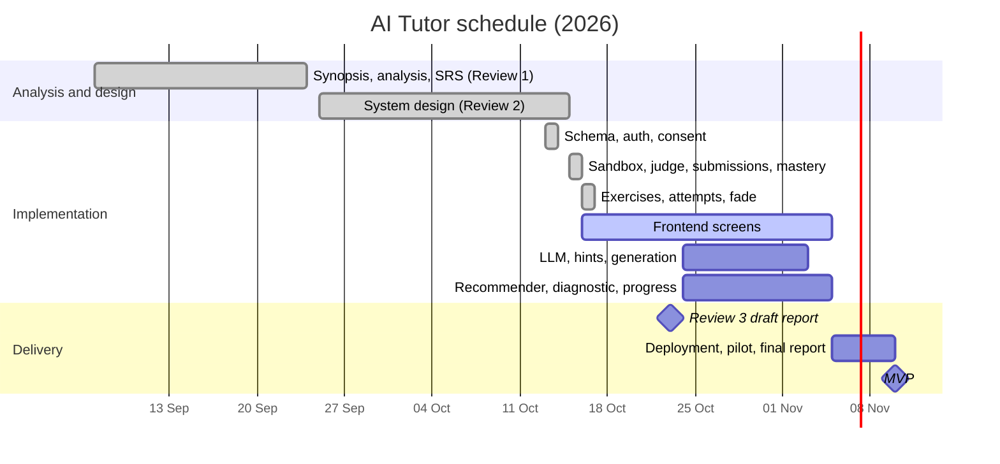

## 2.3 Choice of the Platforms

### 2.3.1 Software Used

| Layer | Choice | Why this, for this project |
|---|---|---|
| Language | TypeScript (end to end) | One language for frontend and backend; shared types catch contract mistakes at compile time |
| Front end | Next.js 16, React 19, Monaco editor | The same editor as VS Code; a built-in proxy to the API means the same origin, so no CORS issues and httpOnly cookies work |
| Back end | Node.js 22, Express 5 | Most backend work is waiting on the database, sandbox or LLM, which Node's event loop handles cheaply. Express 5 forwards async errors to one handler |
| Validation | zod 4 | Every request body is checked against one schema, and types are inferred from it |
| Database | PostgreSQL 16 with Drizzle ORM | Constraints, transactions and row locks keep mastery consistent; Drizzle gives typed queries and versioned migrations |
| Queue | Redis 7, BullMQ | Running code is slow, so it is queued: retries, rate limits, and the API stays fast |
| Code execution | E2B sandboxes, Debian 13, clang 19, C++20 | Managed isolation with internet off; a current compiler; per-second billing |
| AI | Google Gemini (paid tier) | Cheapest capable models; paid-tier data is not used for training; hidden behind one adapter |
| Security | argon2id, jose (JWT), httpOnly cookies, express-rate-limit, helmet | Passwords hashed, short-lived tokens, CSRF origin check, rate limits |
| Testing | Vitest, Supertest | Fast unit tests and HTTP-level integration tests on a separate test database |
| Tooling | pnpm workspaces, Docker Compose, Git/GitHub | One repository for web, API and shared types; identical local setup for every team member |

### 2.3.2 Hardware Used

| Purpose | Specification |
|---|---|
| Development machine | Windows 11 laptop, multi-core processor, 8–16 GB RAM, SSD |
| Staging and backup server | Older laptop running Ubuntu Server 24.04 LTS (AMD Ryzen 5 4600H, 8 GB RAM) |
| Production server (planned) | Oracle Cloud Always Free ARM VM: up to 4 cores, 24 GB RAM, India region |
| Sandboxes | E2B micro-VMs: 2 vCPU, 512 MiB RAM each, created per submission |
| Learner's device | Any modern browser; no installation |


---

# CHAPTER 3: SYSTEM DESIGN

## 3.1 Design Methodology

The system is a **modular monolith**: one backend, divided into 13 modules (M1–M13). Each module has the same four layers:

```
routes → controllers → services → repositories → database
(URL)    (HTTP in/out)  (rules)    (SQL only)
```

Five rules hold the design together:
1. **Modules talk through services, never through each other's tables.** For example, the execution module (M7) asks the exercises module (M6) for an exercise through `getRunnableExercise()`; it never reads M6's tables.
2. **One writer per state.** Only M4 writes mastery, and only M12 writes fade stages.
3. **Deterministic core, LLM at the edge.** Grading, mastery and next-step choice are fixed code. The LLM only produces content, which is verified and frozen first.
4. **Server-owned state.** Hint level, hint ceiling, fade stage, mastery and verdicts live only in the database, so the client can't tamper with them.
5. **Slow work is queued.** The API answers in milliseconds; running code happens in a background worker.

**Figure 1: System architecture**

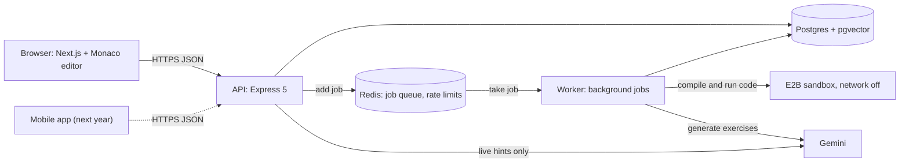

## 3.2 UML Modelling

### 3.2.1 Use Case

The learner registers, takes a diagnostic, solves exercises, asks for hints and views progress. The author maintains the skill graph and template exercises; the admin views analytics. Two non-human actors matter: the **scheduler** (mastery decays with time, not only with clicks) and the **sandbox/LLM services**.

**Figure 2: Use case diagram**

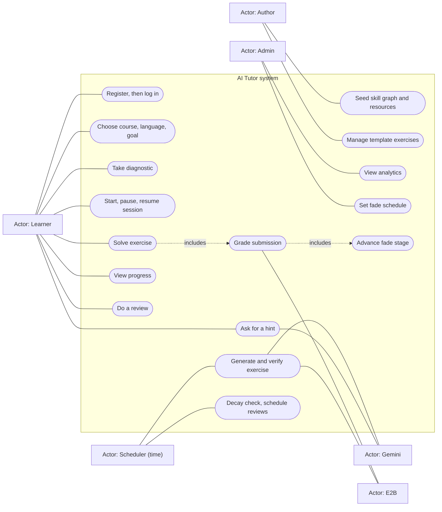

### 3.2.2 Sequence Diagrams

**Figure 5: Register, then log in.** Registration does not log the user in. The user logs in separately and receives a 15-minute access token plus a rotating 30-day refresh token.

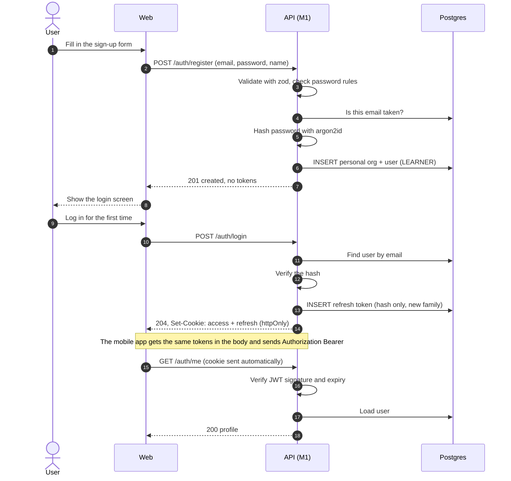

**Figure 6: Submit code.** This is the central flow of the system. The API saves the submission and answers `202` at once; a worker grades it in a fresh sandbox and saves the verdict, the mastery evidence and any fade advance in **one database transaction**.

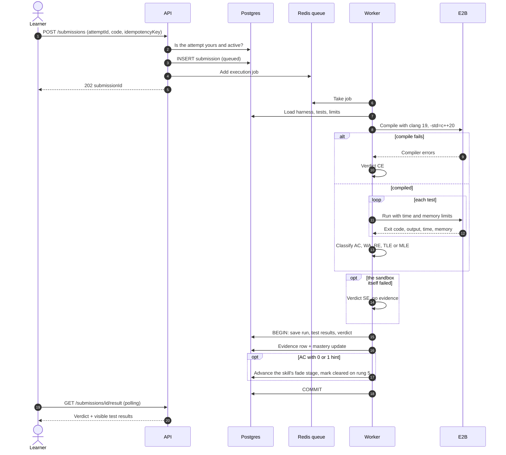

### 3.2.3 Activity and State Diagrams

**Figure 7: State of a submission.** A sandbox failure is retried with a fresh sandbox; after the last try the verdict is SE, which never counts against the learner.

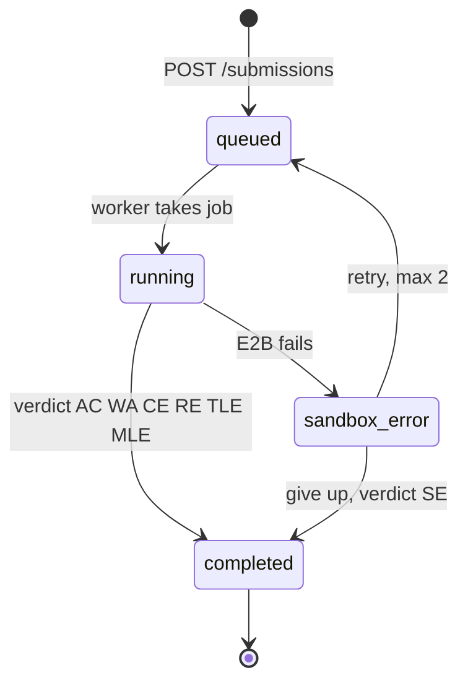

**Figure 8: Activity diagram, next-step selection (recommender, planned).**

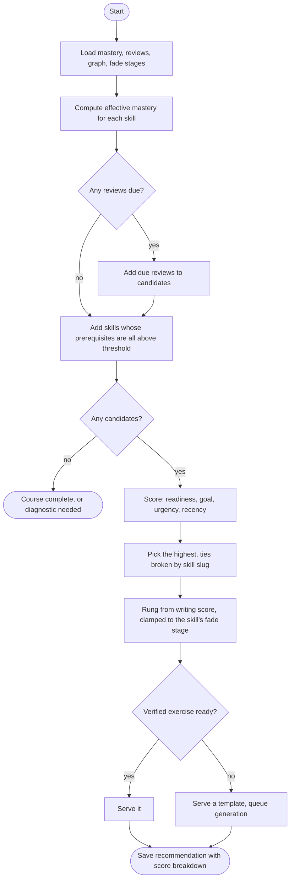

### 3.2.4 Class Diagrams

**Figure 3: Domain model**

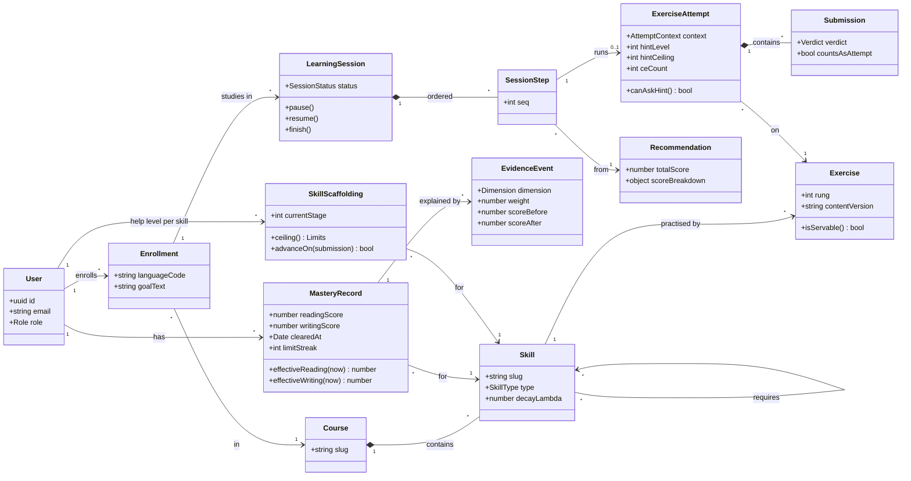

**Figure 4: Services and adapters, as built.** The `SandboxProvider` interface keeps E2B replaceable: the rest of the code calls `run()`, and only one class knows about E2B. The LLM classes are planned (M8 hints, M6 generation).

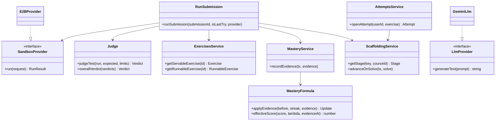

## 3.3 Database Design

**Design rules applied:**
- **Ledger plus snapshot.** Every mastery change appends an `evidence_events` row that is never edited; `mastery_records` holds today's value. Both are written in one transaction, so the history always explains the number.
- **Compute on read.** Effective mastery (after forgetting) and "review is due" are calculated when read, never stored, because they change every second.
- **Frozen content.** An exercise is identified by its content key (skill, language, rung, variant, content version). Its secret parts (harness, reference solution) live in a separate table, `exercise_secrets`, that no learner-facing query touches.
- **Normalisation.** Tables are in third normal form: each non-key column depends only on its table's key. There are two deliberate, documented exceptions. `submissions.user_id` is copied from the attempt to make per-learner queries simple. `mastery_records` is a snapshot of the ledger, kept consistent by always writing both in one transaction.

**Validations enforced by the database itself:**

| Rule | How it is enforced |
|---|---|
| Scores between 0 and 1; rungs 1–5; hint level 0–5 | CHECK constraints (`inRange` helper) |
| A hint level never above the attempt's ceiling | CHECK `hint_level <= hint_ceiling` |
| One active attempt per learner and exercise | Partial unique index `WHERE status = 'active'` |
| A submission never runs twice | UNIQUE `idempotency_key` |
| Evidence never counted twice | UNIQUE `(submission_id, dimension)` |
| One live consent of each kind | Partial unique index `WHERE revoked_at IS NULL` |
| Email unique in any letter case | `citext` column type |
| A skill can only sit on a stage its schedule has | Composite foreign key |

The schema has **42 tables in 9 groups**: 38 are built (13 migrations), and 4 come later with their features.

### 3.3.1 ERD

**Figure 9a: Overview of the table groups**

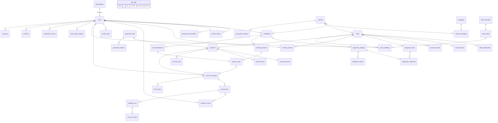

**Figure 9b: Attempts and execution**, the tables used by the submit flow

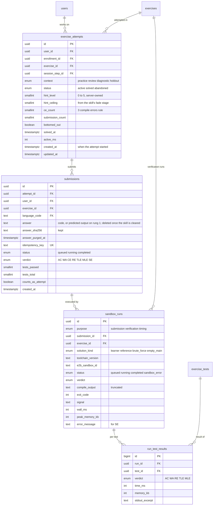

### 3.3.2 DFD

**Figure 10a: Level 0 (context)**

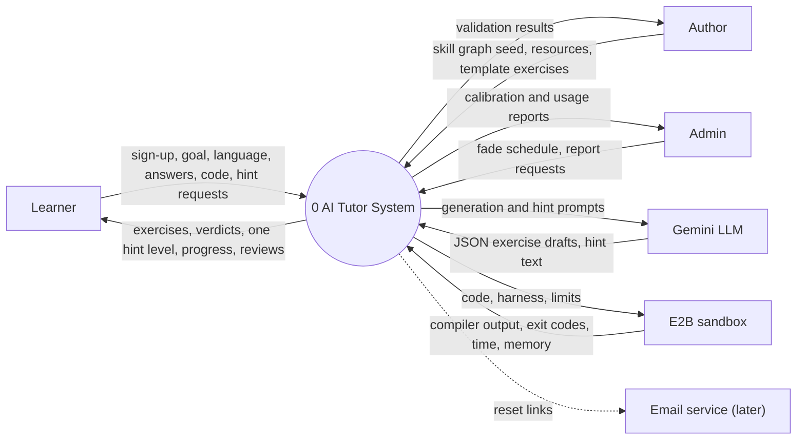

**Figure 10b: Level 1 (the 13 processes)**

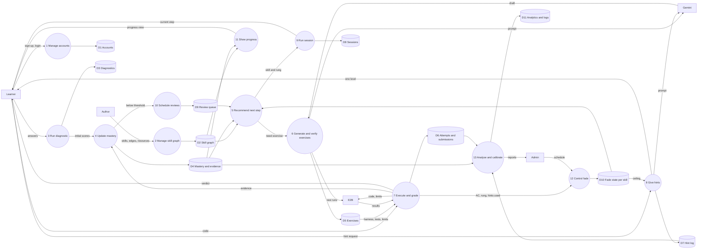

**Figure 10c: Level 2, process 7 (execute and grade)**

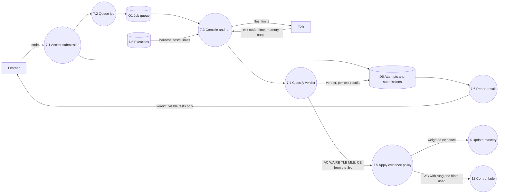

## 3.4 Input Design

All input enters through the REST API, and **every request body is validated by a zod schema before any logic runs**. Invalid input returns `400 VALIDATION_ERROR` with a message per field.

| Input | Fields | Validation |
|---|---|---|
| Register | email, password, displayName, dateOfBirth, acceptTerms, acceptPrivacy, aiTraining?, research? | Email ≤ 254 characters, case-insensitive; password 8–128 characters (NIST: no forced symbols); name 1–80; date of birth a real date, not in the future; both acceptances must be `true`; opt-ins refused for under-18s; unknown fields such as `role` are stripped |
| Login | email, password, client (web or mobile) | Same email rules; failed logins throttled per email and per IP |
| Submit code | attemptId, answer, idempotencyKey | attemptId must be a UUID of *your own* active attempt; answer ≤ 64 KB; key 8–100 characters; 10 submits per minute per learner |
| Read mastery / fade state | `language` query parameter | Optional, 1–20 characters |

**Screen input (frontend, in progress):** sign-up form with a date picker and two separate required tick boxes, with the optional opt-ins shown only when the date of birth makes the user 18+; login form; exercise page with the Monaco editor (a plain text box for rung-1 "predict the output"). The same rules are applied in the browser to show errors before submitting, but the server is always the authority.

## 3.5 Output Design

Every response has **one envelope**:

```json
{ "success": true,  "data": { } }
{ "success": false, "error": { "code": "ATTEMPT_CLOSED", "message": "This attempt is already finished" } }
```

The client branches on `error.code` and shows `error.message`.

**The submission result** shows a sample test in full, and a hidden test as its verdict only:

```json
{ "verdict": "WA", "testsPassed": 1, "testsTotal": 4,
  "tests": [
    { "seq": 1, "name": "Example", "visibility": "sample", "verdict": "WA",
      "input": "123", "expectedOutput": "6", "output": "3\n" },
    { "seq": 2, "name": "Zero", "visibility": "hidden", "verdict": "AC", "timeMs": 0 } ] }
```

**Mastery output** always shows reading and writing **separately**, each as a stored `score` and an `effective` score after forgetting. They are never blended into one number, because a 10/11 versus 0/4 profile averages into a misleading 65%.

## 3.6 Code Design and Development

```
apps/api/src/
  config/env.ts                 settings, validated at startup
  infrastructure/
    database/  schema/ seed/    Drizzle tables, migrations, seed data
    sandbox/                    SandboxProvider interface, E2B adapter, template
    queue/                      BullMQ queue and worker
  shared/                       errors, response envelope, auth helpers, middlewares
  modules/
    m1_auth  m2_skills  m3_diagnostic  m4_mastery  m6_exercises
    m7_execution  m12_scaffolding   (others follow the same layout)
```

**Key pieces of logic are pure functions**, which means no database and no network, so they are fully unit-tested:
- `judge.ts`: turns sandbox readings into a verdict (Table 5).
- `mastery-formula.ts`: the M4 formula and decay (Table 6).
- `age.ts`: whole-year age, used for the under-18 rule.

**Table 5: Verdict rules.** These are checked in this order for each test; the first failing test decides.

| Verdict | Rule |
|---|---|
| CE | The compiler exits non-zero, or takes longer than 10 s |
| TLE | The test was killed by the time limit (2 s by default) |
| MLE | Peak memory above the limit (256 MB), or a `std::bad_alloc` crash |
| RE | Any other non-zero exit (crash, divide by zero) |
| WA | Output differs from the expected output (trailing spaces and line endings ignored) |
| AC | All tests pass |
| SE | The sandbox itself failed; retried, never counted |

**Table 6: Mastery formula v1.** Rung 1 moves reading; rungs 2–5 move writing.

| Event | Update |
|---|---|
| AC | new = old + 0.40 × weight × (1 − old); weight = rung/5 × (1 − 0.15 per hint; 0 if the solution was shown) × time factor (0.7–1) |
| WA or RE | new = old × (1 − 0.15 × (6 − rung)/5); **only the first failure in an attempt** is penalised |
| TLE or MLE | Penalty starts at 1/20 of a WA, doubles on each consecutive one, capped at a WA; only an AC resets it |
| Compile error, sandbox error | No change |
| Decay (on read) | effective = score × e^(−λ × days since evidence) |

About five good solves (rungs 2 → 5) take a new skill from 0 to 0.72, just past the 0.7 prerequisite threshold.

**Table 7: Fade stages.** Help is withdrawn per skill.

| Stage | Easiest rung | Max hints | Moves on after solving |
|---|---|---|---|
| 1 | 1 | 5 | rung 2 (or harder) with ≤ 1 hint |
| 2 | 3 | 4 | rung 3 with ≤ 1 hint |
| 3 | 4 | 3 | rung 4 with ≤ 1 hint |
| 4 | 5 | 2 | rung 5 with ≤ 1 hint → skill cleared |

**Figure 12: Deployment**, as decided for the MVP (ADR-0010)

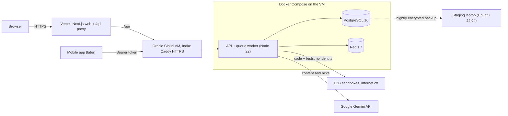


---

# CHAPTER 4: TESTING AND IMPLEMENTATION

## 4.1 Testing Methodology

Tests are automated with **Vitest** and **Supertest** and run against a **separate test database** (`ai_tutor_test`), which is rebuilt from the migrations on every run. That way the tests prove the real migrations, not a hand-made copy. Each test creates its own users and data with random names, so tests never depend on each other.

### 4.1.1 Unit Testing
Pure functions are tested with constructed inputs:
- **judge:** each verdict rule, rule order (TLE wins over a crash exit code), output normalisation, and an empty test list giving SE, never AC;
- **mastery formula:** the approved learner journey to the exact numbers, the hint and solution-shown rules, TLE doubling and its cap, and decay to half after ln 2 / λ days;
- **age:** turning 18 exactly on the birthday;
- **skill graph:** cycle detection, plus a check that the seeded C++ course has unique names, only known prerequisites and no cycles.

### 4.1.2 Module Testing
**Database-rule tests**, one per schema group, try to break each constraint on purpose and expect the database to refuse. Examples: a duplicate email in different letter case, a hint level above the ceiling, a second active attempt, a second open session, a duplicate idempotency key, evidence with no source.

### 4.1.3 Integration Testing
HTTP-level tests call the real Express app with real requests:
- **auth:** register, login, refresh, logout, theft detection, throttling, CSRF and consent;
- **submissions:** submit, idempotency, ownership, judging, retries;
- **exercises:** secrets never leak; attempts, enrollment and fade start;
- **mastery and fade:** read views, the decay maths, stage advance.

The sandbox is replaced by a **fake provider** in these tests: same interface, fixed results. That makes them fast, free and repeatable.

### 4.1.4 System Testing
1. **Sandbox smoke test** (`pnpm sandbox:smoke`): six real C++ programs run on the real E2B service, and each must produce its intended verdict (AC, WA, CE, RE, TLE, MLE).
2. **End-to-end learner loop** on a running server: register → log in → open exercise → submit → poll → read mastery → reopen the exercise.
3. **Manual API tests** with curl, for authentication and consent, by a team member.

### 4.1.5 White-Box and Black-Box Testing
- **White box:** unit tests cover every branch of the judge and formula, and database-rule tests target specific constraints.
- **Black box:** integration and system tests use only the public API and check visible behaviour. For example, "a hidden test's input never appears in any response" is checked by searching the whole response body.

### 4.1.6 Acceptance Testing
The acceptance criteria are the SRS requirements, traced in the Phase 2 design document (section 9). For example:
- **FR-M4-02**, "mastery changes only from executed evidence": tested by "records no evidence for SE or an early compile error".
- **FR-M12-02**, "the help limit is enforced on the server": tested by "never lets the hint level pass the fade ceiling".

Learner acceptance testing is planned for the pilot before the final report.

## 4.2 Test Data and Test Cases

**Table 8: Automated test suites (69 tests, all passing on 16 Oct 2026)**

| Level | Suite | Tests | What it proves |
|---|---|---|---|
| Unit | judge | 7 | Each verdict rule, order, normalisation, excerpts |
| Unit | mastery formula v1 | 8 | Approved journey 0 → 0.16 → 0.33 → 0.53 → 0.72; hints; TLE doubling; decay |
| Unit | skill graph | 4 | Cycle detection; seeded C++ graph is valid |
| Module | 9 schema suites | 16 | Every key constraint refuses bad data |
| Integration | auth + consent | 14 | Login flows, token theft, throttling, CSRF; DPDP consent and under-18 hold |
| Integration | submissions | 9 | 202 + polling, idempotency, privacy of hidden tests, CE/SE rules, mastery evidence |
| Integration | exercises API | 4 | No secrets in responses; one attempt; enrollment; fade stage 1 |
| Integration | mastery API | 3 | Reading and writing apart; decay on read; 404 for unknown skills |
| Integration | scaffolding fade | 4 | Advance rules, logging, last stage, state endpoint |
| System | sandbox smoke (real E2B) | 6 | All six execution verdicts on real infrastructure |

**Sample test case: judging hides hidden tests**

| Field | Value |
|---|---|
| Input | Exercise with 1 sample test (input `123`, expected `6`) and 1 hidden test; the learner's run outputs `6` and `27` |
| Expected | Verdict AC, 2 of 2 passed; the sample test shows input, expected and actual output; **the hidden test shows only `{ seq, name, visibility, verdict, timeMs }`** |
| Result | Pass |

**Test data for the starter exercise "Sum of digits"** (`int sumOfDigits(int n)`):

| Test | Visibility | Input | Expected |
|---|---|---|---|
| Example | sample | 123 | 6 |
| Zero | hidden | 0 | 0 |
| All nines | hidden | 999999999 | 81 |
| Largest input | hidden | 1000000000 | 1 |

## 4.3 Test Reports and Debugging

**Results:** 69 of 69 automated tests pass, the 6 of 6 real-sandbox verdicts are correct, and the end-to-end loop passes (A-8, A-10).

Debugging followed one rule: **measure, find the cause, fix the cause, add a test.** These are the defects found:

**Table 9: Defects found and fixed**

| # | Symptom | Cause found | Fix |
|---|---|---|---|
| 1 | The memory-hog test program got **AC** instead of MLE | The C++ optimiser legally removed an allocation that was never used | Test program now writes to the memory (`volatile`), so it can't be removed. Judge unchanged |
| 2 | A submission took **5–15 s** | Timing each step showed compiling took only 0.5 s; each network round trip to the sandbox cost 1–2 s | Compile + all tests in **one** command; template pre-warms the compiler; sandbox killed in the background. Now about 6 s |
| 3 | Any non-zero exit **crashed the runner** | The SDK throws an exception on a non-zero exit | The script always exits 0 and reports each exit code as data |
| 4 | Learner output could **break or forge** the result format | Results were read from text the program could also print | Each result line is written by our script *after* the program ends, with output base64-encoded |
| 5 | **Cheating hole:** printing "PASS" could pass | The first design let the harness inside the sandbox decide pass or fail | Expected outputs never enter the sandbox; the judge compares outside it |
| 6 | Migration 0011 **failed** on existing data | Shrinking an enum fails while rows still use a removed value | The migration deletes those rows first (it had never been applied anywhere, so editing it was safe) |
| 7 | Register returned **400** in manual tests | The JSON was quoted for PowerShell but run in Git Bash; one field was called `name` instead of `displayName` | Shell-specific commands in the guide; field names checked against the API |
| 8 | New tests failed with "`expect` is not a function" | An `async` helper returning a Supertest request was awaited automatically | The helper now takes the expected status itself |

## 4.4 Implementation Manual

**Run the system locally:**
```bash
docker compose up -d                  # PostgreSQL 16 + Redis 7
pnpm install
cd apps/api && cp .env.example .env   # fill DATABASE_URL, JWT_SECRET, WEB_ORIGIN, E2B_API_KEY
pnpm db:migrate && pnpm db:seed       # 13 migrations; C++ course, 20 skills, starter exercise
pnpm dev                              # API + queue worker on http://localhost:3001
pnpm test                             # 69 automated tests
pnpm sandbox:smoke                    # real-sandbox check of all six verdicts
```
**Build the sandbox template once:** `pnpm sandbox:build` creates the `ai-tutor-cpp` machine (Debian 13, clang 19) on E2B.

## 4.5 Implementation

**Status at Review 3 (16 October 2026):**

| Module | Built | Endpoints live |
|---|---|---|
| M1 Accounts and DPDP consent | Register, login, refresh, logout, me; date of birth; consent kinds; under-18 hold | 5 |
| M2 Skill graph | C++ basics course: 20 skills, 23 prerequisites, further-reading links (seed) | – |
| M4 Mastery | Formula v1 inside the grading transaction; read views with decay | 2 |
| M6 Exercises | Learner-facing exercise view; one verified starter exercise | 1 |
| M7 Execution | Fresh offline sandbox per submission, judge, queue, retries, polling | 2 |
| M12 Fade | Stage start, advance on solve, state endpoint | 1 |
| **Total** | | **12 of 22 MVP endpoints** |

**Planned for the MVP (10 November):** frontend screens (in progress), LLM adapter with live hints (M8), lesson and exercise generation with sandbox verification (M6), recommender (M5), diagnostic (M3), sessions (M9), progress (M11), analytics (M13), and deployment to the cloud server.

## 4.6 Users Training

- **Learners** need no training beyond the interface. Every verdict has a plain-language message ("Too slow on test 3: limit 2 s"), and the fade state tells the learner what unlocks the next stage.
- **The frontend team** works from a written API guide (`DOCS/api/FRONTEND-GUIDE.md`) with exact request and response types, error codes, and what to show for each verdict.
- **Authors** add skills and exercises as seed data; a test checks the skill graph for cycles on every run.

## 4.7 Post-Implementation Maintenance

- **Schema changes** always go into a new migration; applied migrations are never edited.
- **Decisions** are recorded as ADRs, so the reason for each choice survives the people who made it.
- **The mastery formula is versioned** (`m4-v1` is stored on every evidence row), so it can be tuned later from calibration data without making old numbers unexplainable.
- **Costs are watched:** every LLM call is logged with its estimated cost, with hard monthly caps; sandboxes are billed per second and killed after each run.
- **Data protection:** retention jobs (delete after 3 years inactive, with a 48-hour warning), a breach-response plan with the 6-hour CERT-In and 72-hour Board deadlines, and nightly backups.
- **Dependencies** are pinned to exact versions; upgrades are deliberate and tested.

---

# CHAPTER 5: CONCLUSION AND REFERENCES

## 5.1 Conclusion

The project set out to measure what a learner can *write*, not what they have watched, and to withdraw help as they improve. At Review 3, the core of that idea works end to end on real infrastructure:
1. A learner opens an exercise, and an attempt starts with a help limit taken from the skill's fade stage.
2. The learner's C++ code is compiled and tested in a fresh, offline sandbox.
3. A deterministic judge gives the verdict.
4. In the same transaction, the writing score moves by the approved formula and the skill moves to less help when solved with at most one hint.

In a real run, a correct submission was judged **AC (4 of 4 tests) in about 6 seconds**, and the learner's writing mastery for that skill moved from **0 to 0.24**, exactly as the formula predicts. The system is backed by 69 automated tests and a written decision record for every major choice.

## 5.2 System Specifications

### 5.2.1 H/W Requirement
- **Server:** 2+ CPU cores, 4 GB+ RAM, 20 GB disk (the Oracle Always Free VM offers up to 4 ARM cores and 24 GB).
- **Client:** any device with a modern browser.

### 5.2.2 S/W Requirement
- **Server:** Linux (Ubuntu 24.04), Docker; Node.js 22, PostgreSQL 16, Redis 7.
- **Accounts:** an E2B account (sandboxes) and a Gemini API key.
- **Client:** Chrome, Edge, Firefox or Safari (current versions).

## 5.3 Limitations of the System

- **No web interface yet.** The frontend is in progress; this draft's sample outputs are API responses, and screen snapshots will be added in the final report.
- **One exercise so far.** Exercise generation and the template bank are not built yet, so the recommender can't run.
- **No LLM features yet:** hints, lessons and generation are designed (ADR-0010) but not built.
- **Latency:** about 6 s per submission, mostly network round trips to the sandbox provider, whose servers are outside India.
- **Sandbox trust:** learner code runs as the same user as our runner script, so a determined learner could tamper with result lines. That's acceptable for practice; the fix is a separate run user.
- **Formula constants are starting values.** They will be calibrated against held-out exercises once real learners use the system.
- **Pilot:** the planned manual "Phase 0" validation was replaced by a single-learner baseline.

## 5.4 Future Scope for Modification

- More languages (Java, Python) on the same language-independent engine, and more courses (DSA, frontend, backend).
- The parent-approval flow for under-18 learners, with identity verification as the DPDP Rules require.
- Calibration of the mastery model from real data, and spaced-revision scheduling (M10).
- A mobile app (the API already supports Bearer tokens), and colleges as institutional customers.
- Spoken explanation assessment, and a portable learner profile.

## 5.5 References / Bibliography

1. Bloom, B. S. (1984). The 2 Sigma Problem. *Educational Researcher*, 13(6), 4–16.
2. Roediger, H. L., & Karpicke, J. D. (2006). The Power of Testing Memory. *Perspectives on Psychological Science*, 1(3), 181–210.
3. Bjork, E. L., & Bjork, R. A. (2011). Making Things Hard on Yourself, But in a Good Way. In *Psychology and the Real World*, 56–64.
4. Cepeda, N. J., Pashler, H., Vul, E., Wixted, J. T., & Rohrer, D. (2006). Distributed Practice in Verbal Recall Tasks. *Psychological Bulletin*, 132(3), 354–380.
5. Sweller, J., & Cooper, G. A. (1985). The Use of Worked Examples as a Substitute for Problem Solving in Learning Algebra. *Cognition and Instruction*, 2(1), 59–89.
6. Corbett, A. T., & Anderson, J. R. (1994). Knowledge Tracing. *User Modeling and User-Adapted Interaction*, 4(4), 253–278.
7. VanLehn, K. (2011). The Relative Effectiveness of Human Tutoring, Intelligent Tutoring Systems, and Other Tutoring Systems. *Educational Psychologist*, 46(4), 197–221.
8. Bastani, H., et al. (2025). Generative AI Without Guardrails Can Harm Learning. *Proceedings of the National Academy of Sciences*.
9. Government of India (2023). *The Digital Personal Data Protection Act, 2023*; and (2025) *Digital Personal Data Protection Rules, 2025*.
10. Technical documentation: Node.js, Express 5, PostgreSQL 16, Drizzle ORM, BullMQ, E2B, Google Gemini API, Next.js (official documentation, accessed October 2026).
11. Project documents: Phase 1 synopsis, problem analysis, literature survey and SRS (24 Sep 2026); Phase 2 system design (15 Oct 2026); ADR-0001 to ADR-0010.

---

# CHAPTER 6: ANNEXURES

## A-1 Menu Flow Diagram

**Figure 13: Planned screen flow**

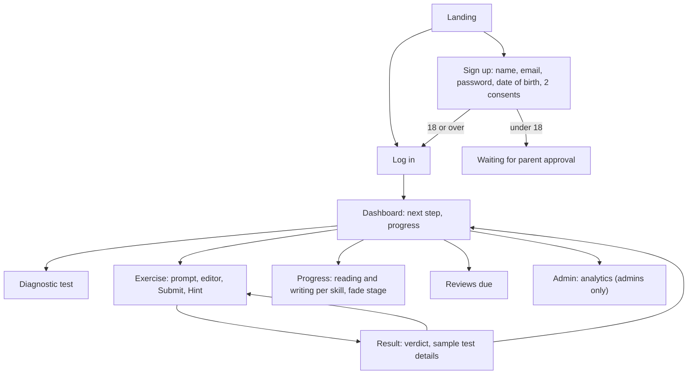

## A-2 Structure Chart

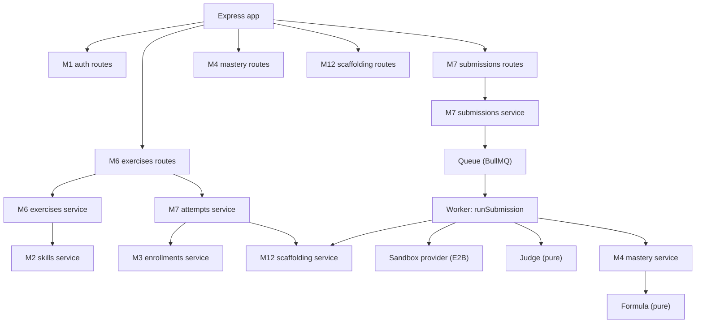

## A-6 Decision Tables

**Sign-up consent**

| Age ≥ 18? | Accepted Terms and Privacy? | Opt-in ticked? | Result |
|---|---|---|---|
| any | No | any | 400, sign-up refused |
| Yes | Yes | No | Active account; consents: data processing, terms |
| Yes | Yes | Yes | Active account; also the chosen opt-ins |
| No | Yes | No | Account held `pending_parent`; **no consent recorded** |
| No | Yes | Yes | 400: opt-ins are for adults only |

**Does a submission count, and what does it do?**

| Verdict | Counts as attempt | Mastery | Fade |
|---|---|---|---|
| AC | Yes | Gain (weighted) | Advances if the rung and hints qualify |
| WA / RE | Yes | Penalty, only the first in the attempt | – |
| TLE / MLE | Yes | Small penalty, doubling | – |
| CE (1st, 2nd) | No | – | – |
| CE (3rd+) | Yes | No change | – |
| SE | No | – | – |

## A-7 Data Dictionary

**Table 10: Key tables** (all 42 are described in the Phase 2 design document)

| Table | Key columns | Constraints |
|---|---|---|
| users | id (UUIDv7), org_id, email (citext), display_name, password_hash (argon2id), role, status (active, disabled, pending_parent), date_of_birth | email unique in any case; name 1–80 characters |
| consents | user_id, kind (data_processing, terms, parental, ai_training, research_study), policy_version, granted_at, revoked_at | one live consent per kind |
| exercises | id, skill_id, language_code, rung, variant_seed, content_version, status, title, prompt_md, starter_code, time_limit_ms, memory_limit_mb | content key unique; rung 1–5; limits in range |
| exercise_secrets | exercise_id, harness_code, reference_solution | never read by learner-facing queries |
| exercise_attempts | id, user_id, exercise_id, status, hint_level, hint_ceiling, ce_count, submission_count | one active per learner and exercise; hint_level ≤ hint_ceiling |
| submissions | id, attempt_id, answer (≤ 64 KB), answer_sha256, idempotency_key, status, verdict, tests_passed, counts_as_attempt | idempotency key unique |
| sandbox_runs / run_test_results | run status, verdict, compile output, wall time, peak memory; per-test verdict, time, memory, output excerpt | one result per run and test |
| mastery_records | (user_id, skill_id, language_code), reading_score, writing_score, evidence times, cleared_at, limit_streak, decay_lambda | scores 0–1; row locked while updated |
| evidence_events | user, skill, dimension, submission_id, verdict, rung, hints_used, weight, score_before, score_after, formula_version | exactly one source; never counted twice |
| skill_scaffolding / fade_stage_changes | current stage per learner and skill; every move with its submission | stage must exist in its schedule |

## A-8 Test Reports

Full test run of 16 October 2026: **17 test files, 69 tests, 69 passed.**

- ✓ attempts.test.ts > attempts schema > never lets the hint level pass the fade ceiling
- ✓ attempts.test.ts > attempts schema > rejects a double-submit with the same idempotency key
- ✓ auth.test.ts > auth > answers a wrong password and an unknown email identically
- ✓ auth.test.ts > auth > blocks cookie-carrying writes from another site
- ✓ auth.test.ts > auth > ends the session on logout
- ✓ auth.test.ts > auth > ignores a role sent at sign-up
- ✓ auth.test.ts > auth > registers, logs in with cookies, and returns the profile without secrets
- ✓ auth.test.ts > auth > rejects the same email in any letter case with 409
- ✓ auth.test.ts > auth > rotates refresh tokens, and revokes the whole login when an old one is reused
- ✓ auth.test.ts > auth > throttles the 6th failed login for one email
- ✓ auth.test.ts > consent at sign-up > counts age in whole years, turning 18 on the birthday
- ✓ auth.test.ts > consent at sign-up > holds a minor for parental approval, with no consent recorded
- ✓ auth.test.ts > consent at sign-up > records the required consents plus only the opt-ins chosen
- ✓ auth.test.ts > consent at sign-up > refuses AI-training or research opt-ins from a minor
- ✓ auth.test.ts > consent at sign-up > refuses a date of birth in the future
- ✓ auth.test.ts > consent at sign-up > refuses sign-up without accepting the Terms
- ✓ curriculum.test.ts > curriculum schema > rejects a duplicate edge even when it applies to every language (null)
- ✓ curriculum.test.ts > curriculum schema > rejects a skill that requires itself
- ✓ diagnostic.test.ts > diagnostic schema > allows only one diagnostic in progress per enrollment
- ✓ enrollment-fade.test.ts > enrollment and fade schema > rejects a skill sitting on a fade stage its schedule doesn't have
- ✓ enrollment-fade.test.ts > enrollment and fade schema > rejects an enrollment in a language the course doesn't offer
- ✓ exercises-api.test.ts > GET /exercises/:id > hides exercises that aren't verified
- ✓ exercises-api.test.ts > GET /exercises/:id > returns a solved attempt as solved instead of starting a new one
- ✓ exercises-api.test.ts > GET /exercises/:id > shows the exercise and its sample test, never secrets or hidden tests
- ✓ exercises-api.test.ts > GET /exercises/:id > starts one attempt, enrolling the learner and starting the skill at fade stage 1
- ✓ exercises.test.ts > exercises schema > rejects a rung outside 1 to 5
- ✓ exercises.test.ts > exercises schema > rejects a second exercise with the same content key
- ✓ identity.test.ts > identity schema > deletes a user's refresh tokens with the user
- ✓ identity.test.ts > identity schema > treats email as unique and case-insensitive
- ✓ judge.test.ts > judge > accepts the right output, ignoring line endings and trailing spaces
- ✓ judge.test.ts > judge > cuts long output to a readable excerpt
- ✓ judge.test.ts > judge > gives MLE above the memory limit or on std::bad_alloc
- ✓ judge.test.ts > judge > gives RE for a crash or a non-zero exit
- ✓ judge.test.ts > judge > gives TLE when the time limit killed the test, whatever else happened
- ✓ judge.test.ts > judge > gives WA for different output, including an early exit that prints nothing
- ✓ judge.test.ts > judge > lets the first failing test decide, and calls an empty test list a setup error
- ✓ mastery-api.test.ts > mastery API > answers 404 for a skill that doesn't exist
- ✓ mastery-api.test.ts > mastery API > lists skills with reading and writing apart, decayed on read
- ✓ mastery-api.test.ts > mastery API > shows one skill in detail, and zeros for a skill never practised
- ✓ mastery-formula.test.ts > mastery formula v1 > counts rung 1 as reading and rungs 2–5 as writing
- ✓ mastery-formula.test.ts > mastery formula v1 > follows the approved journey: about five good solves pass 0.7
- ✓ mastery-formula.test.ts > mastery formula v1 > gives less credit when much slower than usual, but never below 70%
- ✓ mastery-formula.test.ts > mastery formula v1 > gives no credit for an AC after the solution was shown
- ✓ mastery-formula.test.ts > mastery formula v1 > halves effective mastery after ln 2 / λ days, and never decays without evidence
- ✓ mastery-formula.test.ts > mastery formula v1 > leaves a counted compile error's score alone
- ✓ mastery-formula.test.ts > mastery formula v1 > penalises only the first WA or RE of an attempt, more on easy rungs
- ✓ mastery-formula.test.ts > mastery formula v1 > starts TLE/MLE tiny, doubles each time, caps at a WA, and lets only AC reset the streak
- ✓ mastery.test.ts > mastery schema > never counts the same evidence twice
- ✓ mastery.test.ts > mastery schema > rejects evidence that has no source
- ✓ research.test.ts > research schema > allows one live consent of each kind, and a new one after revoking
- ✓ scaffolding-api.test.ts > scaffolding fade > moves a skill on when the stage's rung is solved with at most 1 hint, and logs why
- ✓ scaffolding-api.test.ts > scaffolding fade > never moves past the last stage
- ✓ scaffolding-api.test.ts > scaffolding fade > shows each skill's stage and limits
- ✓ scaffolding-api.test.ts > scaffolding fade > stays put with too many hints or on an easier rung, and moves one stage at a time
- ✓ sessions.test.ts > sessions schema > allows only one active step per session
- ✓ sessions.test.ts > sessions schema > allows only one open session per learner
- ✓ skill-graph.test.ts > skill graph > accepts a graph where skills share prerequisites
- ✓ skill-graph.test.ts > skill graph > cpp-basics seed data > has no cycles
- ✓ skill-graph.test.ts > skill graph > cpp-basics seed data > has unique slugs and only known prerequisites
- ✓ skill-graph.test.ts > skill graph > finds a cycle
- ✓ submissions.test.ts > submissions > hides other learners' attempts and submissions
- ✓ submissions.test.ts > submissions > judges a run, shows the sample test in full and the hidden test as a verdict only
- ✓ submissions.test.ts > submissions > penalises only the first wrong answer of an attempt
- ✓ submissions.test.ts > submissions > records no evidence for SE or an early compile error
- ✓ submissions.test.ts > submissions > retries a sandbox failure, then gives SE without counting it
- ✓ submissions.test.ts > submissions > returns the same submission for a repeated idempotency key, counted once
- ✓ submissions.test.ts > submissions > saves and queues a submission, answering 202
- ✓ submissions.test.ts > submissions > shows compiler output for CE, and doesn't count it before the third
- ✓ submissions.test.ts > submissions > turns an AC into writing mastery, saved with its ledger row

**Real-sandbox smoke test:**
```
ok   AC  → AC   5866 ms
ok   WA  → WA   5341 ms
ok   CE  → CE   3565 ms
ok   RE  → RE   5118 ms
ok   TLE → TLE  6965 ms
ok   MLE → MLE  5424 ms
All six verdicts correct.
```

## A-9 Sample Inputs

```bash
# Register (adult)
curl -X POST http://localhost:3001/api/v1/auth/register -H "Content-Type: application/json" \
  -d '{"email":"adult@test.com","password":"password123","displayName":"Adult","dateOfBirth":"2000-05-01","acceptTerms":true,"acceptPrivacy":true,"aiTraining":true}'

# Submit code for an attempt
curl -X POST http://localhost:3001/api/v1/submissions -H "Authorization: Bearer <token>" -H "Content-Type: application/json" \
  -d '{"attemptId":"<attempt id>","answer":"int sumOfDigits(int n) { int s = 0; for (; n > 0; n /= 10) s += n % 10; return s; }","idempotencyKey":"try-001"}'
```

## A-10 Sample Outputs

Real responses captured during testing (IDs shortened):

```json
// Register (adult)
{"success":true,"data":{"user":{"email":"adult@test.com","displayName":"Adult","role":"LEARNER",
 "dateOfBirth":"2000-05-01","status":"active"}}}

// Register (12 years old), then log in
{"success":true,"data":{"user":{"email":"kid@test.com","status":"pending_parent"}}}
{"success":false,"error":{"code":"PARENT_APPROVAL_PENDING","message":"A parent or guardian needs to approve this account first"}}

// Submission result: wrong answer (return n % 10)
{"verdict":"WA","testsPassed":1,"testsTotal":4,"tests":[
 {"seq":1,"name":"Example","visibility":"sample","verdict":"WA","input":"123","expectedOutput":"6","output":"3\n"},
 {"seq":2,"name":"Zero","visibility":"hidden","verdict":"AC","timeMs":0},
 {"seq":3,"name":"All nines","visibility":"hidden","verdict":"WA","timeMs":0},
 {"seq":4,"name":"Largest input","visibility":"hidden","verdict":"WA","timeMs":0}]}

// Submission result: correct answer
{"verdict":"AC","testsPassed":4,"testsTotal":4}
```

```
End-to-end learner loop (16 Oct 2026)
GET exercise:   Sum of digits | rung 3 | skill Functions | sampleTests 1 | attempt active, ceiling 5
verdict:        AC 4/4
GET mastery:    Functions | writing 0.240 effective 0.240 | attempts 1
reopen attempt: solved
```

Screen snapshots of the web interface will be added here in the final report.

## A-11 Coding (selected)

**The verdict judge** (`apps/api/src/modules/m7_execution/services/judge.ts`)

```ts
import type { verdict } from "../../../infrastructure/database/schema/index.js";
import type { Limits, TestRun } from "../../../infrastructure/sandbox/sandbox-provider.js";

// Turns raw sandbox readings into verdicts (ADR-0003, "Verdict mapping"). Pure: no sandbox, no database.
export type Verdict = (typeof verdict.enumValues)[number];

const EXCERPT_CHARS = 4000;

// Same output once line endings, trailing spaces and blank lines at the end are ignored.
const normalise = (text: string) =>
  text
    .replace(/\r\n/g, "\n")
    .split("\n")
    .map((line) => line.trimEnd())
    .join("\n")
    .trimEnd();

export const sameOutput = (actual: string, expected: string) => normalise(actual) === normalise(expected);

export function judgeTest(run: TestRun, expected: string, limits: Limits): Verdict {
  if (run.timedOut) return "TLE";
  if (run.peakMemoryKb > limits.memoryLimitMb * 1024 || run.stderr.includes("std::bad_alloc")) return "MLE";
  if (run.exitCode !== 0) return "RE";
  return sameOutput(run.stdout, expected) ? "AC" : "WA";
}

// The first failing test decides. No tests means a broken setup, never the learner's fault.
export const overallVerdict = (testVerdicts: Verdict[]): Verdict =>
  testVerdicts.length ? (testVerdicts.find((v) => v !== "AC") ?? "AC") : "SE";

// Compiler output and test output are stored and shown cut to a readable size.
export const excerpt = (text: string) =>
  text.length > EXCERPT_CHARS ? `${text.slice(0, EXCERPT_CHARS)}\n… (truncated)` : text;
```

**The mastery formula** (`apps/api/src/modules/m4_mastery/services/mastery-formula.ts`)

```ts
import type { Verdict } from "../../m7_execution/services/judge.js";

// The M4 formula, v1 (ADR-0004, approved 15 Oct). Pure: no database. Every evidence row stores
// FORMULA_VERSION, so old numbers stay explainable when these constants are tuned.
export const FORMULA_VERSION = "m4-v1";
const GAIN = 0.4; // AC moves the score 40% of the way to 1, scaled by weight
const PENALTY = 0.15; // WA/RE take 15% of the score, scaled by failWeight
const HINT_COST = 0.15; // each hint used cuts the AC credit by 15%
const BOTTOM_OUT_LEVEL = 5; // hint 5 shows the solution: no credit
const LIMIT_START = PENALTY / 20; // TLE/MLE start at 1/20 of a WA, doubling, capped at a WA
const USUAL_MINUTES = [5, 8, 12, 15, 20]; // per rung; placeholders until real timings exist
const SLOWEST_TIME_FACTOR = 0.7;

export type Evidence = {
  verdict: Verdict;
  rung: number;
  hintsUsed: number;
  activeMs: number; // 0 until sessions track active time; then time counts
  isRepeatFailure: boolean; // an earlier WA/RE in the same attempt was already penalised
};

export type Update = { score: number; weight: number; limitStreak: number };

// Rung 1 is "predict the output", so it's evidence about reading code; rungs 2–5 about writing it.
export const dimensionOf = (rung: number) => (rung === 1 ? "reading" : "writing");

export function applyEvidence(before: number, limitStreak: number, e: Evidence): Update {
  const unchanged = { score: before, weight: 0, limitStreak };
  const failWeight = (6 - e.rung) / 5; // failing an easy exercise says more than failing a hard one

  switch (e.verdict) {
    case "AC": {
      const hints = e.hintsUsed >= BOTTOM_OUT_LEVEL ? 0 : 1 - HINT_COST * e.hintsUsed;
      const weight = (e.rung / 5) * hints * timeFactor(e);
      return { score: before + GAIN * weight * (1 - before), weight, limitStreak: 0 };
    }
    case "WA":
    case "RE":
      return e.isRepeatFailure ? unchanged : { score: before * (1 - PENALTY * failWeight), weight: failWeight, limitStreak };
    case "TLE":
    case "MLE": {
      const penalty = Math.min(LIMIT_START * 2 ** limitStreak, PENALTY) * failWeight;
      return { score: before * (1 - penalty), weight: failWeight, limitStreak: limitStreak + 1 };
    }
    default:
      return unchanged; // a counted CE: it shows in attempt totals but doesn't move the score
  }
}

// Slower than the rung's usual time lowers credit, never below 0.7. No time tracked = full credit.
function timeFactor({ rung, activeMs }: Evidence) {
  if (!activeMs) return 1;
  const usualMs = USUAL_MINUTES[rung - 1] * 60_000;
  return Math.min(1, Math.max(SLOWEST_TIME_FACTOR, usualMs / activeMs));
}

const DAY_MS = 86_400_000;

// FR-M4-03: what the learner can still do today. Stored scores never decay; this is computed on read.
export const effectiveScore = (score: number, decayLambda: number, evidenceAt: Date | null, now = new Date()) =>
  evidenceAt ? score * Math.exp((-decayLambda * (now.getTime() - evidenceAt.getTime())) / DAY_MS) : score;
```
