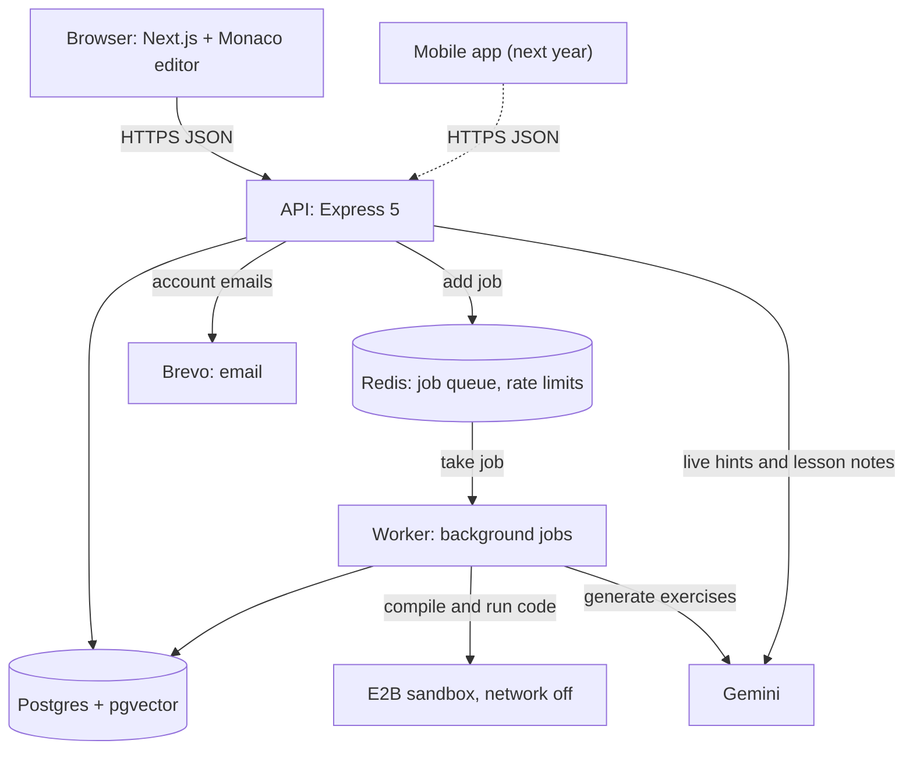
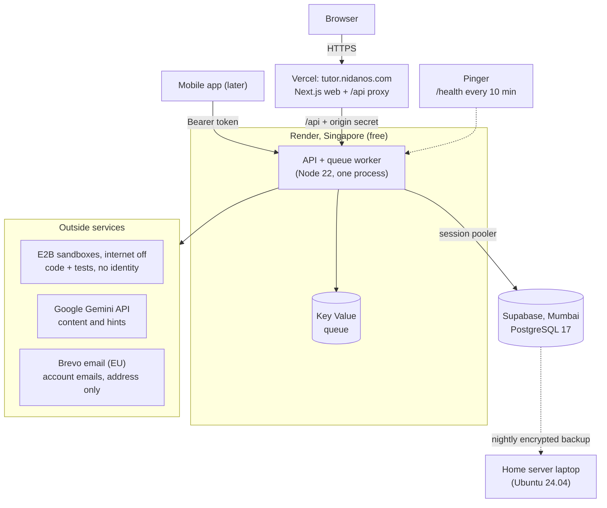
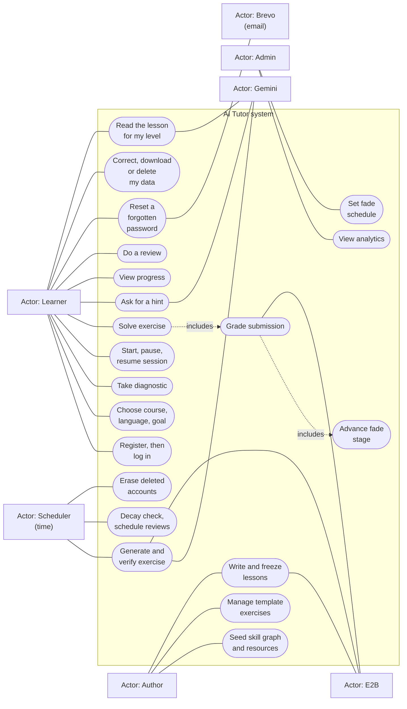
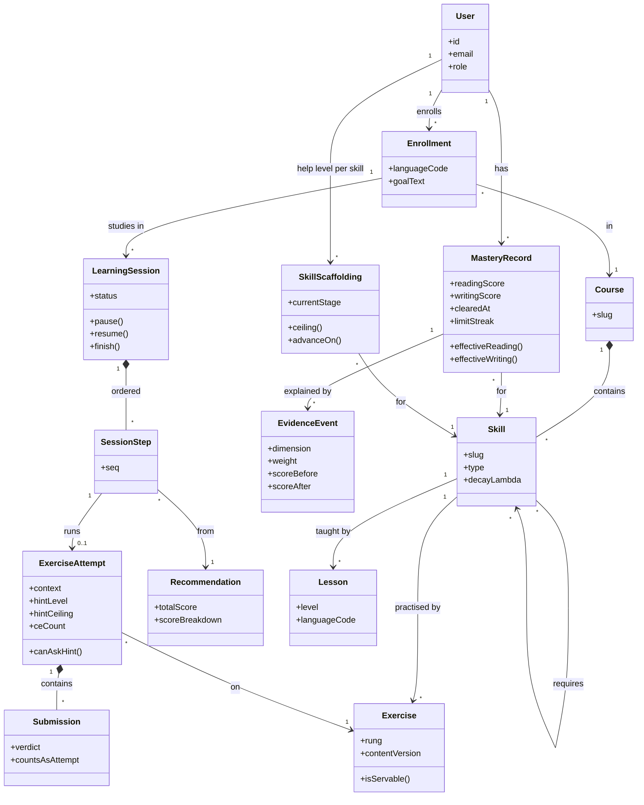
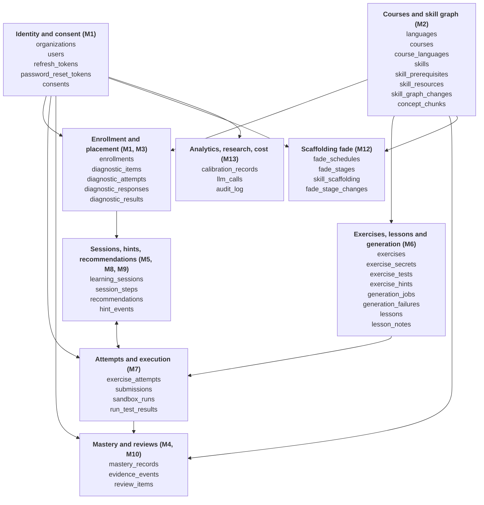
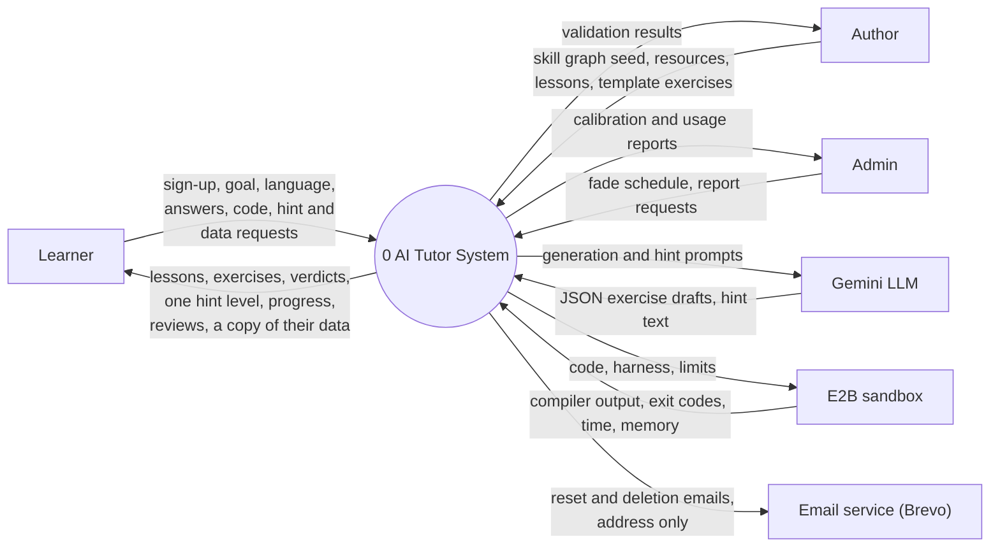
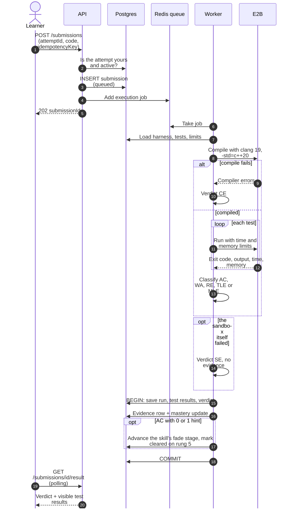
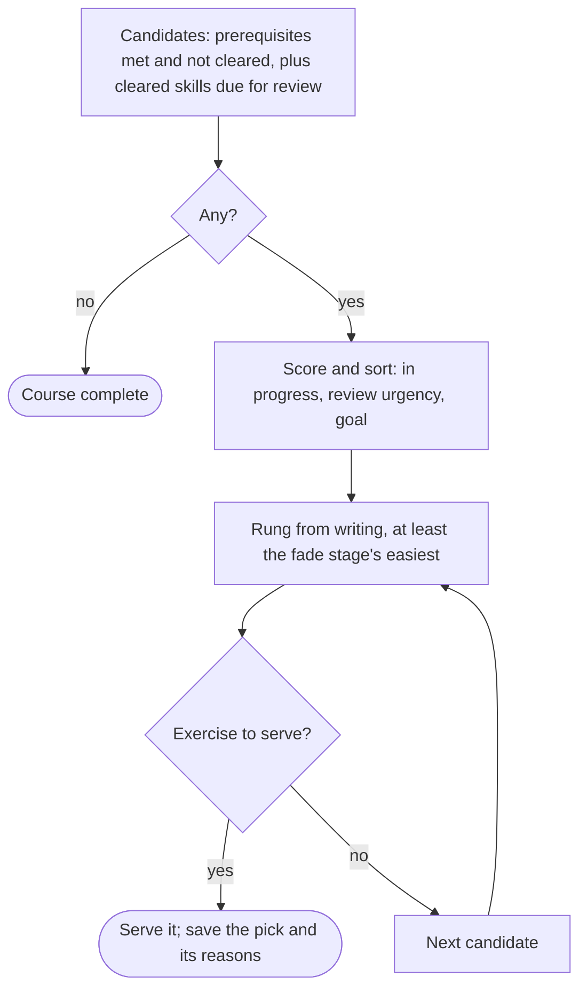

# AI Tutor: System Design Diagrams

**An Evidence-Based Adaptive Learning System with Deliberate Scaffolding Withdrawal**

MCA-269 Minor Project, Jagan Institute of Management Studies, Rohini · Guide: Dr. Chetna Laroia

Ashwani Kumar Puri (04914004425) · Aman Dogra (01614004425) · Aditi Tanwar (01814004425)

Taken from the Phase 3 report (Chapter 3, System Design), 21 October 2026.

## 1. System Architecture

**Figure 1: System architecture**

## 2. Deployment Diagram

**Figure 12: Deployment**

## 3. Use Case Diagram

**Figure 2: Use case diagram**

## 4. Class Diagram (Domain Model)

**Figure 3: Domain model**

## 5. ER Diagram (Table Groups)

**Figure 9a: Overview of the table groups.**

## 6. Data Flow Diagram, Level 0

**Figure 10a: Level 0 (context)**

## 7. Sequence Diagram: Submitting Code

**Figure 6: Submit code.**

## 8. Activity Diagram: Choosing the Next Step

**Figure 8: Activity diagram, next-step selection, as built (recommender m5-v1, ADR-0011).**

