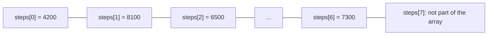
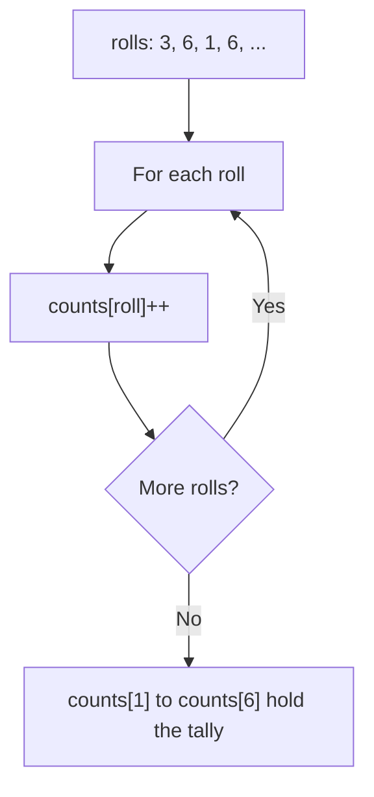
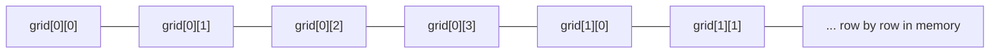

# new

## explanation

### Many values under one name

Storing a week of step counts in seven separate variables, `mon`, `tue`, and so on, quickly gets clumsy. An **array** holds a fixed number of values of the same type, side by side, under one name:

```cpp
int steps[7] = {4200, 8100, 6500, 10200, 3900, 12000, 7300};
```

`int` is the type of every element, `steps` is the name, and `[7]` is how many elements it holds. The size is fixed: an array can't grow or shrink.

### Indexes start at 0

Each element has a position number, its **index**. The first element is at index 0, so a 7-element array has indexes 0 to 6:

- `steps[0]` is the first element, 4200.
- `steps[6]` is the last one, 7300.

You read an element with `steps[i]`, and change it the same way: `steps[4] = 5000;`.

### Looping over an array

Arrays and `for` loops go together. A loop from `0` while `i < 7` visits every index exactly once:

```cpp
for (int day = 0; day < 7; day++) {
    total += steps[day];
}
```

Notice `<`, not `<=`: index 7 doesn't exist.

### Starting values

- `int a[5] = {3, 1, 4};` sets the first three elements and fills the rest with 0.
- `int a[5] = {};` makes all five 0.
- `int a[5];` inside a function gives five unknown, garbage values. Always give a starting value.

### Out of bounds

C++ does not check indexes for you. `steps[7]` or `steps[-1]` reads memory that isn't part of the array. The program might print nonsense, change another variable, or crash, and it might seem to work today and fail tomorrow. Keeping every index between 0 and size − 1 is your job.

### What you can't do

You can't copy a whole array with `=`, or print it with one `std::cout`. Work element by element, with a loop.

## diagram



## example

```cpp
#include <iostream>

int main() {
    int steps[7] = {4200, 8100, 6500, 10200, 3900, 12000, 7300};

    std::cout << "Monday: " << steps[0] << '\n';
    std::cout << "Sunday: " << steps[6] << '\n';

    steps[4] = 5000;  // correct Friday's count

    int total = 0;
    for (int day = 0; day < 7; day++) {
        total += steps[day];
    }
    std::cout << "Week total: " << total << '\n';

    int busyDays = 0;
    for (int day = 0; day < 7; day++) {
        if (steps[day] >= 8000) {
            busyDays++;
        }
    }
    std::cout << "Days with 8000+ steps: " << busyDays << '\n';
}
```

```text
Monday: 4200
Sunday: 7300
Week total: 53300
Days with 8000+ steps: 3
```

1. The array holds seven counts. `steps[0]` is the first and `steps[6]` the last.
2. `steps[4] = 5000;` replaces the fifth element, 3900, with 5000.
3. The first loop visits indexes 0 to 6 and adds each element to `total`, including the corrected 5000.
4. The second loop counts the elements of at least 8000: 8100, 10200 and 12000, which makes 3.

## mistakes

- **Counting from 1.** The first element is `a[0]`, not `a[1]`. In an array of 7, the last is `a[6]`.
- **`<=` in the loop.** `for (int i = 0; i <= 7; i++)` on a 7-element array also visits `a[7]`, which is out of bounds. Use `i < 7`.
- **Expecting an error for a bad index.** C++ doesn't stop you from reading `a[10]`. The program carries on with garbage, or crashes later. Check your bounds.
- **No starting values.** `int counts[6];` holds garbage. Write `int counts[6] = {};` to start every element at 0.
- **Copying with `=`.** `b = a;` doesn't compile for arrays. Copy element by element in a loop.

## check

```cpp
#include <iostream>

int main() {
    int a[5] = {3, 1, 4};
    a[1] = a[0] + a[2];
    for (int i = 0; i < 5; i++) {
        std::cout << a[i] << ' ';
    }
    std::cout << '\n' << a[4 - 2] << '\n';
}
```

```text
3 7 4 0 0
4
```

Only three starting values are given, so the last two elements are 0. `a[1]` becomes `a[0] + a[2]`, which is `3 + 4 = 7`. The loop prints all five elements. `a[4 - 2]` is `a[2]`: an index can be any whole-number expression, and this one is `4`.

# building

## explanation

### A quick recap

An array holds a fixed number of same-type values, with indexes from 0 to size − 1. A `for` loop with `i < size` visits each one. C++ never checks indexes, so staying in bounds is up to you.

### Name the size

Write the size once, as a constant, and use the name everywhere: `const int DAYS = 7;`, then `int steps[DAYS]` and `i < DAYS`. If the size changes, you change one line.

### Three patterns you'll use constantly

1. **Accumulate:** walk the array once and build a total, a count or a flag.
2. **Search:** walk until you find what you want, and return its index. Return `-1` when it's missing, because 0 is a real index.
3. **Tally:** use one array to count values from another. If the values are small numbers, like dice faces 1 to 6, they can be the indexes: `counts[face]++`. Size the tally array as the largest value plus one.

### Arrays in functions

When you pass an array to a function, the function receives only the location of the first element, not the size. So pass the size as a separate parameter:

```cpp
int findFirst(const int values[], int size, int target)
```

`const` promises the function won't change the elements. Because the function works on the original array, not a copy, a function **without** `const` can change the caller's elements.

### Two-dimensional arrays

`int seats[2][3]` is 2 rows of 3. `seats[r][c]` is row `r`, column `c`. Walk it with two nested loops: rows on the outside, columns inside.

### Staying in bounds

Before using a computed index, ask what its smallest and largest values can be. A tally `counts[rolls[i]]` is only safe if every roll is between 0 and the tally's size − 1.

## diagram



## example

```cpp
#include <iostream>

const int FACES = 6;

// Arrays are passed to functions without their size, so pass it too.
int findFirst(const int values[], int size, int target) {
    for (int i = 0; i < size; i++) {
        if (values[i] == target) return i;
    }
    return -1;  // not found
}

int main() {
    int rolls[10] = {3, 6, 1, 6, 2, 6, 4, 3, 5, 6};

    // A tally: index 0 is unused, so faces 1 to 6 index directly.
    int counts[FACES + 1] = {};
    for (int i = 0; i < 10; i++) {
        counts[rolls[i]]++;
    }
    for (int face = 1; face <= FACES; face++) {
        std::cout << face << ": " << counts[face] << '\n';
    }

    std::cout << "first 6 at index " << findFirst(rolls, 10, 6) << '\n';
    std::cout << "first 9 at index " << findFirst(rolls, 10, 9) << '\n';

    // A 2D array: rows, then columns.
    int seats[2][3] = {{1, 0, 1}, {0, 0, 1}};
    int taken = 0;
    for (int r = 0; r < 2; r++)
        for (int c = 0; c < 3; c++)
            taken += seats[r][c];
    std::cout << "seats taken: " << taken << '\n';
}
```

```text
1: 1
2: 1
3: 2
4: 1
5: 1
6: 4
first 6 at index 1
first 9 at index -1
seats taken: 3
```

1. `counts` has 7 elements, so faces 1 to 6 can be used as indexes directly. Every roll adds one to its face's counter.
2. The second loop prints the tally. The four 6s show as `6: 4`.
3. `findFirst` walks the array and returns at the first match: the first 6 is at index 1. 9 never appears, so it returns `-1`.
4. The nested loops visit all 2 × 3 seats and add up the 1s: three seats are taken.

## mistakes

- **A tally one element too small.** `int counts[6]` for faces 1 to 6 has no `counts[6]`. Size it as the largest value plus one.
- **Returning 0 for "not found".** 0 is the first index, so the caller can't tell the difference. Return `-1`.
- **Working out the size inside a function.** Inside `findFirst`, `values` is only a location, so tricks that measure the array give the wrong answer there. Pass the size in.
- **Swapping row and column.** `seats[c][r]` instead of `seats[r][c]` reads the wrong elements, and goes out of bounds when the array isn't square.
- **Trusting a computed index.** `counts[value]` writes outside the array if `value` is ever bigger than planned. Check the range first.

## check

```cpp
#include <iostream>

int main() {
    int v[6] = {2, 0, 2, 1, 2, 0};
    int count[3] = {};
    for (int i = 0; i < 6; i++) count[v[i]]++;
    int g[2][2] = {{1, 2}, {3, 4}};
    int diag = g[0][0] + g[1][1];
    std::cout << count[0] << count[1] << count[2] << ' ' << diag << '\n';
}
```

```text
213 5
```

The tally counts each value of `v`: two 0s, one 1 and three 2s. The three counts print with no spaces between them, `213`. `g[0][0]` is 1 and `g[1][1]` is 4, so the diagonal sums to `5`.

# strong

## explanation

### How an array sits in memory

An array's elements sit next to each other in memory. Element `i` is at the start address plus `i` times the element's size, so reaching any element takes the same tiny amount of time, however big the array. That constant-time indexing is what makes arrays the base of almost every other data structure.

A 2D array is stored **row by row** (row-major): all of row 0, then all of row 1. Walking it with the row loop outside and the column loop inside reads memory in order, which the processor's cache handles well. Swapping the loops jumps around in memory and can be several times slower on large arrays.

### What "out of bounds" really means

An out-of-bounds access is **undefined behaviour**. It might read a neighbouring variable, overwrite it, crash, or appear to work. The optimiser may even assume it never happens and reorganise code around that. Tools such as AddressSanitizer (`-fsanitize=address`) catch these accesses while testing.

### Arrays decay

When a plain array is passed to a function, or used in most expressions, it **decays** to a pointer to its first element and loses its size. That's why C-style arrays can't be copied with `=`, compared with `==`, or returned from functions.

### `std::array`

`std::array<int, 5>` from `<array>` is a fixed-size array that keeps its size: `.size()` works anywhere, `=` copies it, `==` compares every element, and it can be returned from functions. It is just as fast as a plain array. `.at(i)` checks the index and throws `std::out_of_range` instead of reading stray memory, while `[i]` stays unchecked and fast.

### Prefix sums

If you need many sums of ranges, `prefix[i]` = the sum of the first `i` elements turns each range sum into one subtraction: elements `l` to `r` sum to `prefix[r + 1] - prefix[l]`. The prefix array needs `n + 1` elements, with `prefix[0] = 0`.

### Size limits

Local arrays live on the stack, usually about 8 MB on Linux. `int big[10'000'000];` inside a function needs 40 MB and will crash. Use a `std::vector`, which keeps its elements elsewhere, for large or variable sizes.

## diagram



## example

```cpp
#include <array>
#include <iostream>
#include <stdexcept>

int main() {
    // std::array: a fixed-size array that knows its size and can be copied.
    std::array<int, 5> marks = {40, 75, 62, 88, 51};
    std::array<int, 5> backup = marks;  // a real copy
    marks[0] = 45;
    std::cout << "size " << marks.size() << ", backup[0] " << backup[0] << '\n';

    // .at() checks the index and throws instead of reading stray memory.
    try {
        std::cout << marks.at(5) << '\n';
    } catch (const std::out_of_range&) {
        std::cout << "index 5 is out of range\n";
    }

    // Prefix sums: prefix[i] is the sum of the first i marks.
    std::array<int, 6> prefix = {};
    for (std::size_t i = 0; i < marks.size(); i++) {
        prefix[i + 1] = prefix[i] + marks[i];
    }
    std::cout << "marks 1..3 sum to " << prefix[4] - prefix[1] << '\n';

    // Row-major: walk a 2D array row by row, the order it sits in memory.
    int grid[3][4] = {};
    int next = 1;
    for (int r = 0; r < 3; r++)
        for (int c = 0; c < 4; c++)
            grid[r][c] = next++;
    std::cout << "grid[2][1] = " << grid[2][1] << ", last = " << grid[2][3] << '\n';
}
```

```text
size 5, backup[0] 40
index 5 is out of range
marks 1..3 sum to 225
grid[2][1] = 10, last = 12
```

1. `backup = marks` copies all five elements, so changing `marks[0]` afterwards leaves `backup[0]` at 40. A plain array couldn't be copied like this.
2. `marks.at(5)` is one past the end. It throws `std::out_of_range` before anything prints, and the `catch` handles it.
3. `prefix` ends up as 0, 45, 120, 182, 270, 321. Elements 1 to 3 sum to `prefix[4] - prefix[1]` = 270 − 45 = 225, which is 75 + 62 + 88.
4. The grid is filled row by row with 1 to 12. Row 2 holds 9 to 12, so `grid[2][1]` is 10 and the last element is 12.

## mistakes

- **Assuming a bad index will crash.** Often it silently changes another variable instead, and the bug shows up far away. Test with `-fsanitize=address`, or use `.at()` while debugging.
- **Walking a large 2D array column by column.** It jumps through memory and can be several times slower. Put the row loop outside.
- **A prefix array of size `n`.** It needs `n + 1` elements: `prefix[0]` is the empty sum. One short, and the last range sum reads out of bounds.
- **Huge local arrays.** Tens of megabytes on the stack overflow it. Use `std::vector` for big data.
- **Expecting `==` to compare plain arrays.** For C-style arrays it compares addresses, not contents. `std::array` compares element by element.

## check

```cpp
#include <array>
#include <iostream>

int main() {
    std::array<int, 4> a = {5, 1, 4, 2};
    std::array<int, 4> b = a;
    b[1] = 9;
    int p[5] = {};
    for (int i = 0; i < 4; i++) p[i + 1] = p[i] + a[i];
    std::cout << (a == b) << ' ' << a[1] << ' ' << p[4] - p[2] << '\n';
}
```

```text
0 1 6
```

`b` is a real copy, so changing `b[1]` leaves `a[1]` at 1, and the arrays now differ: `a == b` is false, `0`. The prefix sums are 0, 5, 6, 10, 12, so `p[4] - p[2]` is 12 − 6 = 6, the sum of the last two elements, 4 + 2.
