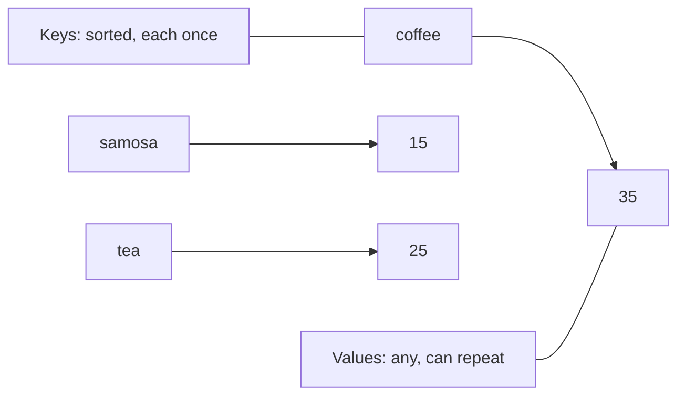
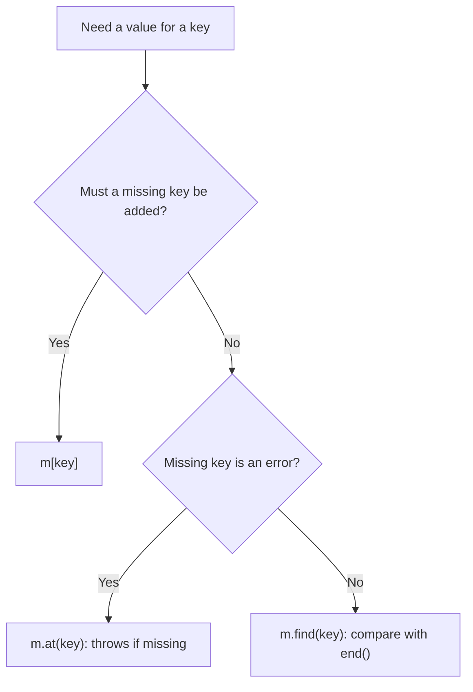
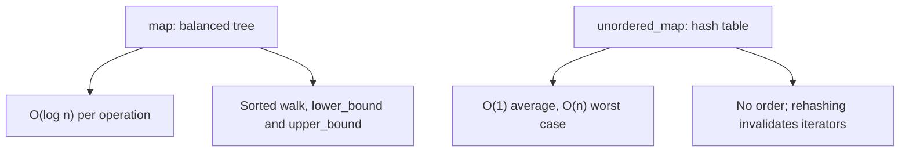

# new

## explanation

### Looking things up by a name

A vector finds elements by position: `v[3]`. Often you want to find things by something meaningful instead: the price of "tea", the phone number for "Ria". A **map** stores pairs of a **key** and a **value**, and finds the value from its key.

### `std::map`

From `<map>`. The angle brackets give the key type, then the value type:

```cpp
std::map<std::string, int> menu;
menu["tea"] = 20;
```

- `menu["tea"] = 25;` sets the value for a key. Each key appears **once**: setting it again replaces the value.
- `menu["tea"]` reads the value.
- `menu.contains("juice")` (C++20) says whether a key is there, without changing anything.
- `menu.size()` is the number of keys.

### Careful with `[]`

Reading `menu["juice"]` when there's no juice **adds** the key, with a default value (0 for numbers, empty for strings). That's handy when you mean to add, but a surprise when you only wanted to look. To check, use `contains`.

### Walking a map

A map keeps its keys in **sorted order**, so a range-for visits them alphabetically or from smallest to largest:

```cpp
for (const auto& [item, price] : menu) { ... }
```

Each entry is a pair. `[item, price]` gives names to its two parts, the key and the value.

### `std::set`

From `<set>`. A set holds values with **no repeats**, kept sorted. `insert(x)` adds `x` if it isn't there already, `contains(x)` checks for it, and `size()` counts the distinct values.

### Unordered versions

`std::unordered_map` and `std::unordered_set` do the same jobs using a **hash table**. Lookups are usually faster, but there is no order: walking one visits entries in an unpredictable sequence. Use them when you only look things up and don't need sorted output.

## diagram



## example

```cpp
#include <iostream>
#include <map>
#include <set>
#include <string>

int main() {
    // map: look up a value by its key.
    std::map<std::string, int> menu;
    menu["tea"] = 20;
    menu["samosa"] = 15;
    menu["coffee"] = 35;
    menu["tea"] = 25;  // same key: the value is replaced

    std::cout << "tea costs " << menu["tea"] << '\n';
    std::cout << "items: " << menu.size() << '\n';

    if (menu.contains("juice")) {
        std::cout << "juice is on the menu\n";
    } else {
        std::cout << "no juice\n";
    }

    // A map keeps its keys in sorted order.
    for (const auto& [item, price] : menu) {
        std::cout << item << ": " << price << '\n';
    }

    // set: each value at most once, kept sorted.
    std::set<int> tables = {4, 1, 7, 4, 1};
    tables.insert(3);
    std::cout << "tables in use: " << tables.size() << ", first " << *tables.begin() << '\n';
}
```

```text
tea costs 25
items: 3
no juice
coffee: 35
samosa: 15
tea: 25
tables in use: 4, first 1
```

1. Four assignments but only three keys: the second `"tea"` replaces the first value, so tea costs 25.
2. `contains("juice")` checks without adding anything, so the menu still has 3 items.
3. The loop visits the keys in alphabetical order, not the order they were added: coffee, samosa, tea.
4. The set ignores the repeated 4 and 1, then gains 3: four distinct tables, and `begin()` is the smallest, 1.

## mistakes

- **Using `[]` just to check.** `if (menu["juice"] > 0)` adds "juice" with price 0. Use `menu.contains("juice")`.
- **Expecting insertion order.** A `std::map` is always sorted by key, and an `unordered_map` has no useful order at all.
- **Expecting a set to keep repeats.** Inserting a value that's already there does nothing.
- **Trying to change a key.** Keys are fixed once inserted. Erase the old entry and insert a new one.
- **Forgetting the include.** `std::map` needs `<map>` and `std::set` needs `<set>`.

## check

```cpp
#include <iostream>
#include <map>
#include <set>
#include <string>

int main() {
    std::map<std::string, int> stock = {{"pens", 4}, {"ink", 2}};
    stock["pens"] += 3;
    int glue = stock["glue"];
    std::set<char> letters = {'b', 'a', 'b'};
    std::cout << stock["pens"] << ' ' << glue << ' ' << stock.size() << ' ' << letters.size() << '\n';
}
```

```text
7 0 3 2
```

`stock["pens"] += 3` changes the existing value from 4 to 7. Reading `stock["glue"]` adds a new key with the default value 0, so the map now has 3 keys. The set keeps only one `'b'`, so it has 2 letters.

# building

## explanation

### A quick recap

A map stores key-value pairs with each key once; a set stores distinct values. `std::map` and `std::set` keep keys sorted; the unordered versions are hash-based and unordered. `[]` creates missing keys, while `contains` only checks.

### Looking up without side effects

- `m.find(key)` returns an iterator to the entry, or `m.end()` if there is none. Through the iterator, `it->first` is the key and `it->second` the value.
- `m.count(key)` is 1 or 0 for a map or set.
- `m.at(key)` returns the value but throws `std::out_of_range` if the key is missing.

Use these whenever you only want to read. They also work on a `const` map, where `[]` doesn't compile.

### Values can be containers

A map's value can be anything, including a vector. `std::map<char, std::vector<std::string>>` groups names by section. Because `[]` creates a missing key with an empty vector, `sections[s].push_back(name)` works the first time and every time after.

### Removing entries

`m.erase(key)` removes an entry by key. While walking a map, use the iterator form: `it = m.erase(it)`, then don't advance on that pass, as with any container.

### Choosing between ordered and unordered

- Need the keys in order, or "the first key above 500"? Use `std::map` or `std::set`.
- Only exact lookups, and lots of them? `std::unordered_map` or `std::unordered_set` is usually faster.

Both need something extra for your own types as keys: `std::map` needs `<` to order them, and the unordered ones need `==` and a hash.

### Step by step

1. Decide what you look up by: that's the key type.
2. Decide what you get back: that's the value type, possibly a container.
3. Choose ordered or unordered.
4. Add with `[]` or `insert`, read with `find`, `contains` or `at`.

## diagram



## example

```cpp
#include <iostream>
#include <map>
#include <string>
#include <unordered_map>
#include <vector>

int main() {
    // Group values under a key: map from section to the names in it.
    std::map<char, std::vector<std::string>> sections;
    std::vector<std::pair<std::string, char>> students = {{"Ria", 'B'}, {"Om", 'A'}, {"Tara", 'B'}, {"Ayaan", 'A'}, {"Neel", 'C'}};
    for (const auto& [name, section] : students) {
        sections[section].push_back(name);  // [] creates an empty vector the first time
    }
    for (const auto& [section, names] : sections) {
        std::cout << section << ':';
        for (const auto& n : names) std::cout << ' ' << n;
        std::cout << '\n';
    }

    // find looks up without creating anything.
    auto it = sections.find('D');
    std::cout << "section D " << (it == sections.end() ? "missing" : "found") << '\n';
    sections.erase('C');
    std::cout << sections.size() << " sections left\n";

    // unordered_map: hash-based, fast lookups, no particular order.
    std::unordered_map<std::string, std::string> phone = {{"Ria", "98100"}, {"Om", "99220"}};
    auto found = phone.find("Om");
    if (found != phone.end()) std::cout << found->first << " -> " << found->second << '\n';
    std::cout << "Tara listed? " << phone.count("Tara") << '\n';
}
```

```text
A: Om Ayaan
B: Ria Tara
C: Neel
section D missing
2 sections left
Om -> 99220
Tara listed? 0
```

1. Each student is added to their section's vector. The first student of a section makes `[]` create that section's empty vector.
2. The sections print in sorted key order, A, B, C, and each vector keeps its names in the order they were added.
3. `find('D')` returns `end()`, and no section D is created. `erase('C')` removes a whole entry.
4. In the `unordered_map`, `find` gives an iterator whose `first` and `second` are the name and number. `count("Tara")` is 0, and nothing is added.

## mistakes

- **Checking with `[]`.** Every check for a missing key adds it. Use `find`, `contains` or `count` to look.
- **`at()` on a missing key.** It throws `std::out_of_range`, which stops the program unless handled. Use `find` when absence is normal.
- **Erasing in a loop with `m.erase(it); ++it;`.** The erased iterator is dead. Write `it = m.erase(it);` instead.
- **Expecting sorted output from an `unordered_map`.** Its order can differ between runs and compilers. Copy the keys into a vector and sort them, or use `std::map`.
- **Your own type as a key without the extras.** A `std::map<Point, int>` needs `operator<` for `Point`; an `unordered_map` needs `==` and a hash.

## check

```cpp
#include <iostream>
#include <map>
#include <string>
#include <vector>

int main() {
    std::map<int, std::vector<std::string>> byLength;
    for (std::string w : {"sun", "moon", "sky", "cloud"}) byLength[static_cast<int>(w.size())].push_back(w);
    auto it = byLength.find(3);
    std::string firstKey = std::to_string(byLength.begin()->first);
    std::cout << it->second.size() << ' ' << it->second.back() << ' ' << byLength.size() << ' ' << firstKey << '\n';
}
```

```text
2 sky 3 3
```

Words are grouped by length: 3 has "sun" and "sky", 4 has "moon", 5 has "cloud". `find(3)` reaches the group of two, whose last word is "sky". There are 3 groups, and since a map is sorted, `begin()` is the smallest key, 3.

# strong

## explanation

### How they are built

`std::map` and `std::set` are **balanced binary search trees**, usually red-black trees. Lookup, insert and erase take O(log n), and walking them visits keys in order. Each element is a separately allocated node, so inserts never invalidate iterators to other elements, but walking the tree jumps around memory.

`std::unordered_map` and `std::unordered_set` are **hash tables**: the hash of a key picks a bucket. Operations are O(1) on average but O(n) in the worst case, when many keys land in the same bucket, through a poor hash or deliberately chosen inputs. When the table grows past its load factor it **rehashes**, which invalidates all iterators. `reserve(n)` sizes it up front.

### Range queries need order

Only ordered containers can answer "which key is just above or below x?". `lower_bound(x)` gives the first key **not less than** x, and `upper_bound(x)` the first key **greater than** x. The entry for the last key at most x is `std::prev(m.upper_bound(x))`, as long as such a key exists. Always use the member functions: the free `std::lower_bound` on a set walks it linearly.

### Duplicates: `multimap` and `multiset`

These allow repeated keys, still sorted. `count(k)` can exceed 1, and `erase(k)` removes **all** copies of `k`; to remove one, erase an iterator: `ms.erase(ms.find(k))`.

### Inserting precisely

- `m[k] = v`: creates or overwrites, and needs a default-constructible value.
- `m.try_emplace(k, args...)`: inserts only if `k` is missing, and doesn't construct anything otherwise.
- `m.insert_or_assign(k, v)`: always ends with `m[k] == v`.
- `insert` returns a pair of an iterator and a `bool` saying whether it inserted.

### Custom keys

An ordered container needs a strict weak ordering, `operator<` or a comparator type. An unordered container needs `operator==` and a hash function object returning `std::size_t`. Equal keys must produce equal hashes; a good hash spreads different keys across buckets.

### Changing a key

Keys are `const` inside the container, because changing one would break the ordering or the bucket. C++17's `extract` takes a node out, lets you change its key, and `insert` puts it back without reallocating.

## diagram



## example

```cpp
#include <iostream>
#include <iterator>
#include <map>
#include <set>
#include <string>
#include <unordered_map>

struct Point {
    int x, y;
    bool operator==(const Point&) const = default;
};

// unordered containers need a hash for custom keys.
struct PointHash {
    std::size_t operator()(const Point& p) const {
        return std::hash<long long>{}(static_cast<long long>(p.x) << 32 ^ static_cast<unsigned>(p.y));
    }
};

int main() {
    // Ordered maps answer range questions: the last key <= income.
    std::map<int, std::string> slabs = {{0, "nil"}, {250000, "5%"}, {500000, "20%"}, {1000000, "30%"}};
    int income = 720000;
    auto above = slabs.upper_bound(income);  // first key > income
    auto slab = std::prev(above);            // the last key <= income
    std::cout << income << " falls in the " << slab->second << " slab starting at " << slab->first << '\n';
    // multiset keeps duplicates, still sorted.
    std::multiset<int> rolls = {3, 6, 3, 1, 6, 6};
    std::cout << "sixes: " << rolls.count(6) << ", smallest: " << *rolls.begin() << '\n';
    // try_emplace inserts only if the key is missing; insert_or_assign always writes.
    std::map<std::string, int> best;
    best.try_emplace("ana", 40);
    best.try_emplace("ana", 99);  // ignored: ana exists
    best.insert_or_assign("raj", 55);
    best.insert_or_assign("raj", 60);  // replaced
    std::cout << best["ana"] << ' ' << best["raj"] << '\n';
    // A custom key in an unordered_map: equality plus a hash.
    std::unordered_map<Point, std::string, PointHash> grid;
    grid[{2, 3}] = "tree";
    std::cout << grid.count({2, 3}) << ' ' << grid.count({3, 2}) << '\n';
}
```

```text
720000 falls in the 20% slab starting at 500000
sixes: 3, smallest: 1
40 60
1 0
```

1. `upper_bound(720000)` finds the first key above it, 1,000,000; the entry before that, 500,000, is the slab the income falls in. A hash map couldn't answer this without checking every key.
2. The multiset keeps all three sixes and stays sorted, so `begin()` is 1.
3. The second `try_emplace` sees "ana" already there and does nothing; `insert_or_assign` overwrites raj's 55 with 60.
4. `Point` gets `==` from the defaulted operator, and `PointHash` combines both coordinates into one hash. `{3, 2}` is a different key, so its count is 0.

## mistakes

- **A weak hash.** If many keys share a bucket, lookups degrade to O(n). Combine every field into the hash, and consider adversarial inputs for public-facing code.
- **Iterators across inserts into an unordered container.** A rehash invalidates all of them. Re-find after inserting, or `reserve` first.
- **`std::prev` on `begin()`.** If no key is at most x, `upper_bound(x)` is `begin()`, and stepping back from it is undefined. Check first.
- **`std::lower_bound` on a set or map.** The free algorithm can't jump in a tree, so it walks linearly. Use `s.lower_bound(x)`.
- **`erase(k)` on a multiset to remove one copy.** It removes every copy. Erase the iterator from `find(k)` instead.

## check

```cpp
#include <iostream>
#include <map>
#include <set>

int main() {
    std::map<int, char> m = {{10, 'a'}, {20, 'b'}, {30, 'c'}};
    auto lo = m.lower_bound(20);
    auto hi = m.upper_bound(20);
    std::multiset<int> ms = {5, 5, 7};
    ms.erase(ms.find(5));
    m.try_emplace(20, 'z');
    std::cout << lo->second << hi->second << ' ' << ms.count(5) << ms.size() << ' ' << m[20] << '\n';
}
```

```text
bc 12 b
```

`lower_bound(20)` is the first key not less than 20, which is 20 itself, `'b'`; `upper_bound(20)` is the first key greater, 30, `'c'`. Erasing the iterator from `find(5)` removes one 5, leaving one 5 and the 7. `try_emplace(20, 'z')` finds 20 already present and changes nothing, so `m[20]` is still `'b'`.
