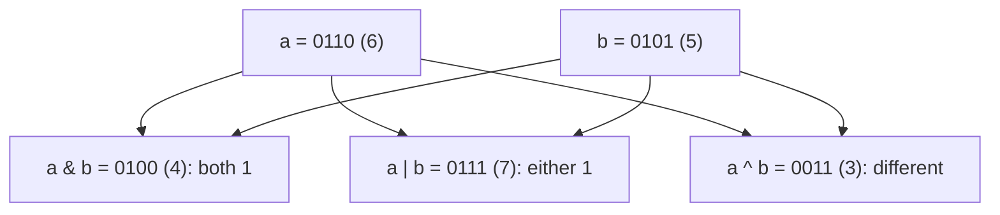
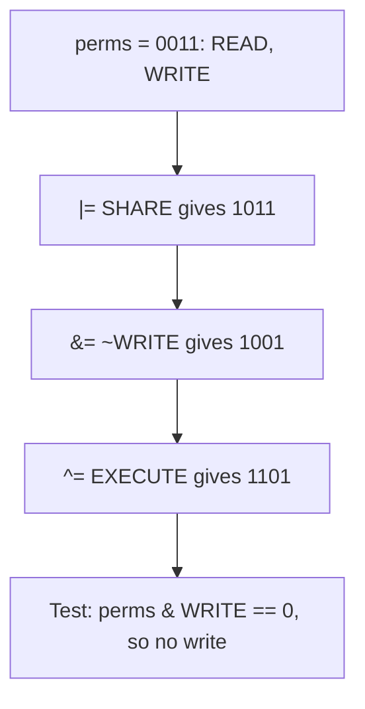
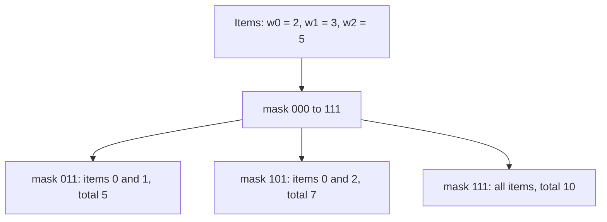

# new

## explanation

### Numbers are made of bits

Inside the computer, every whole number is stored in **binary**: a row of bits, each 0 or 1. Reading from the right, the bits are worth 1, 2, 4, 8, 16 and so on. So 6 is `0110` (4 + 2) and 5 is `0101` (4 + 1). The rightmost bit is **bit 0**.

`std::bitset<4>(6)` from `<bitset>` prints a number's lowest 4 bits, which helps you see what's happening.

### Operators that work bit by bit

These compare two numbers one bit position at a time:

- `a & b` (**and**): a bit is 1 only where **both** have a 1. `0110 & 0101` is `0100`, which is 4.
- `a | b` (**or**): a bit is 1 where **either** has a 1. `0110 | 0101` is `0111`, which is 7.
- `a ^ b` (**xor**, "exclusive or"): a bit is 1 where they **differ**. `0110 ^ 0101` is `0011`, which is 3.
- `~a` (**not**): flips every bit.

### Shifts

- `a << n` moves every bit `n` places to the left, filling with 0s. Each place doubles the number: `1 << 3` is 8.
- `a >> n` moves every bit `n` places to the right, dropping the bits that fall off. Each place halves the number, rounding down for positive numbers: `40 >> 2` is 10.

### Bits as switches

One `int` can hold many on/off settings, one per bit. `1 << 2` is a number with only bit 2 on. To switch bit 2 on in a variable, `days |= 1 << 2;`. To read bit 2, shift it down to position 0 and keep only that bit: `(days >> 2) & 1` is 1 if it's on, 0 if it's off.

### Don't confuse them with the logical operators

`&` and `|` work on each bit of numbers. `&&` and `||` work on true/false values. Using the wrong one compiles but gives wrong answers.

## diagram



## example

```cpp
#include <bitset>
#include <iostream>

int main() {
    int a = 6;  // binary 0110
    int b = 5;  // binary 0101
    std::cout << std::bitset<4>(a) << " & " << std::bitset<4>(b) << " = " << std::bitset<4>(a & b) << " (" << (a & b) << ")\n";
    std::cout << std::bitset<4>(a) << " | " << std::bitset<4>(b) << " = " << std::bitset<4>(a | b) << " (" << (a | b) << ")\n";
    std::cout << std::bitset<4>(a) << " ^ " << std::bitset<4>(b) << " = " << std::bitset<4>(a ^ b) << " (" << (a ^ b) << ")\n";

    std::cout << "1 << 3 = " << (1 << 3) << '\n';    // left: doubles three times
    std::cout << "40 >> 2 = " << (40 >> 2) << '\n';  // right: halves twice

    // Bits as on/off switches: one bit per day, Monday is bit 0.
    int gymDays = 0;
    gymDays |= 1 << 0;  // Monday
    gymDays |= 1 << 2;  // Wednesday
    gymDays |= 1 << 4;  // Friday
    std::cout << "plan " << std::bitset<7>(gymDays) << '\n';
    std::cout << "Wednesday? " << ((gymDays >> 2) & 1) << ", Tuesday? " << ((gymDays >> 1) & 1) << '\n';
}
```

```text
0110 & 0101 = 0100 (4)
0110 | 0101 = 0111 (7)
0110 ^ 0101 = 0011 (3)
1 << 3 = 8
40 >> 2 = 10
plan 0010101
Wednesday? 1, Tuesday? 0
```

1. Only bit 2 is 1 in both numbers, so `&` gives `0100`. `|` keeps every bit that's 1 in either. `^` keeps the bits where they differ.
2. Shifting 1 left by 3 places gives 8; shifting 40 right by 2 places gives 10.
3. Each `|=` switches on one day's bit without touching the others: bits 0, 2 and 4.
4. `(gymDays >> 2) & 1` moves Wednesday's bit to position 0 and keeps only it: 1. Tuesday's bit is 0.

## mistakes

- **`&` and `&&` mixed up.** `if (days && 4)` is true whenever `days` isn't 0. To test a bit, use `&`: `if ((days & 4) != 0)`.
- **Missing parentheses.** `x & 1 == 0` means `x & (1 == 0)`, because `==` binds tighter than `&`. Write `(x & 1) == 0`.
- **Counting bits from 1.** The rightmost bit is bit 0, so `1 << 1` is bit 1, the second bit.
- **Shifting too far.** Shifting an `int` by 32 or more places has no defined result. Stay below the number of bits in the type.
- **Being surprised by `~`.** `~0` is all ones, which an `int` shows as `-1`. Bit flipping is clearer with `unsigned` types.

## check

```cpp
#include <iostream>

int main() {
    int x = 9;  // 1001
    int y = 3;  // 0011
    std::cout << (x & y) << ' ' << (x | y) << ' ' << (x ^ y) << '\n';
    std::cout << (y << 2) << ' ' << (x >> 1) << '\n';
}
```

```text
1 11 10
12 4
```

`1001 & 0011` shares only bit 0, so it's 1. `|` gives `1011`, which is 11, and `^` gives `1010`, which is 10. `y << 2` is 3 doubled twice, 12. `x >> 1` halves 9 and rounds down, giving 4.

# building

## explanation

### A quick recap

`&`, `|` and `^` combine numbers bit by bit; `~` flips bits; `<<` and `>>` move them. One number can hold many on/off flags, one per bit.

### Masks

A **mask** is a number whose 1 bits select the positions you care about. Give each flag a named mask, one bit each:

```cpp
const unsigned READ = 1u << 0;
const unsigned WRITE = 1u << 1;
```

Then every flag operation is one line:

- Turn a flag on: `perms |= WRITE;`
- Turn a flag off: `perms &= ~WRITE;`
- Flip a flag: `perms ^= WRITE;`
- Is it on? `(perms & WRITE) != 0`

Turning off needs `~`: `~WRITE` has every bit on **except** WRITE's, so `&` keeps everything else and clears just that one.

### Several flags at once

`READ | WRITE` is a mask with both bits. Two different questions:

- **Any** of them on: `(perms & mask) != 0`.
- **All** of them on: `(perms & mask) == mask`.

### Use unsigned types

For bit work, use `unsigned` (and the `u` suffix on literals). `~` and shifts then behave like plain bit patterns, with no negative numbers appearing.

### Counting the bits that are on

Look at the lowest bit with `& 1`, add it to a count, and shift right by one; repeat until the number is 0.

### Why bother?

Flags in one number take little space, can be stored and compared in one go, and combine with one operator. They're common in settings, file permissions, and anywhere many yes/no values travel together.

## diagram



## example

```cpp
#include <bitset>
#include <iostream>

// Each permission is one bit; names make the code readable.
const unsigned READ = 1u << 0;
const unsigned WRITE = 1u << 1;
const unsigned EXECUTE = 1u << 2;
const unsigned SHARE = 1u << 3;

int main() {
    unsigned perms = READ | WRITE;  // start with two bits on
    perms |= SHARE;                 // turn a bit on
    perms &= ~WRITE;                // turn a bit off
    perms ^= EXECUTE;               // flip a bit
    std::cout << "bits " << std::bitset<4>(perms) << '\n';

    bool canWrite = (perms & WRITE) != 0;
    bool canRunAndShare = (perms & (EXECUTE | SHARE)) == (EXECUTE | SHARE);
    std::cout << "write " << canWrite << ", run+share " << canRunAndShare << '\n';

    // Count the bits that are on: look at the lowest bit, then shift.
    int on = 0;
    for (unsigned rest = perms; rest != 0; rest >>= 1) {
        on += rest & 1u;
    }
    std::cout << on << " permissions on\n";
}
```

```text
bits 1101
write 0, run+share 1
3 permissions on
```

1. `READ | WRITE` is `0011`. Adding SHARE gives `1011`, clearing WRITE gives `1001`, and flipping EXECUTE, which was off, gives `1101`.
2. WRITE's bit is now 0, so `canWrite` is false.
3. Both EXECUTE and SHARE are on, so masking with both gives the whole mask back: an "all of" test.
4. The loop adds the lowest bit and shifts right until nothing is left: three bits were on.

## mistakes

- **Clearing with `&= WRITE`.** That keeps **only** WRITE and clears everything else. Clear with `&= ~WRITE`.
- **Testing "all" with `!= 0`.** `(perms & mask) != 0` is true if **any** of the bits is on. For "all", compare with `== mask`.
- **Precedence again.** `perms & WRITE != 0` means `perms & (WRITE != 0)`. Always wrap the `&` in parentheses.
- **Signed numbers for flags.** `~` on an `int` gives negative numbers and shifts can surprise. Use `unsigned`.
- **Magic numbers.** `perms |= 8;` says nothing about what 8 means. Name every mask.

## check

```cpp
#include <iostream>

int main() {
    const unsigned A = 1u, B = 2u, C = 4u, D = 8u;
    unsigned s = A | C | D;
    s &= ~C;
    s ^= B | D;
    bool any = (s & (C | D)) != 0;
    bool all = (s & (A | B)) == (A | B);
    std::cout << s << ' ' << any << ' ' << all << '\n';
}
```

```text
3 0 1
```

`A | C | D` is `1101`, 13. Clearing C leaves `1001`. Flipping B and D (`1010`) turns B on and D off: `0011`, which is 3. Neither C nor D is on, so `any` is false; A and B are both on, so `all` is true.

# strong

## explanation

### Two's complement

Signed integers are stored in **two's complement**, which C++20 guarantees: the top bit carries the sign, and `-x` equals `~x + 1`. So `-6` in 8 bits is `11111010`. Right-shifting a negative number copies the sign bit in from the left (an arithmetic shift), so `-1 >> 1` stays `-1`.

### Shift rules

Shifting by a negative amount, or by at least the width of the (promoted) type, is undefined: `1 << 32` on a 32-bit `int` is invalid. For bigger masks, start from a wider type: `1ull << 40`. `<<` binds more loosely than `+`, so `1 << n + 1` means `1 << (n + 1)`.

### C++20 `<bit>`

`std::popcount(x)` counts the 1 bits, `std::countr_zero(x)` counts the 0 bits below the lowest 1, and `std::bit_width(x)` is the number of bits needed to hold `x`. They take unsigned types and compile to single instructions on most processors, so prefer them to hand-written loops.

### Subsets as numbers

With `n` items, each number from 0 to 2ⁿ − 1 describes one subset: bit `i` set means "item `i` is in". A loop over `mask` from 0 to `(1u << n) - 1` visits every subset once, and `(mask >> i) & 1` asks about item `i`. This is a standard way to try every combination, but 2ⁿ grows fast: about a million subsets for 20 items, and far too many beyond about 25.

### XOR properties

`a ^ a == 0`, `a ^ 0 == a`, and the order doesn't matter. So XOR-ing a list where every value appears twice except one leaves exactly that one. XOR is also how checksums and simple parity checks combine bits.

### `std::bitset`

`std::bitset<N>` is a fixed-size row of `N` bits with `set`, `reset`, `flip`, `test`, `count` and `&`/`|`/`^` between bitsets. It's handy when you need more flags than fit in 64 bits, and it prints in binary.

## diagram



## example

```cpp
#include <bit>
#include <bitset>
#include <iostream>
#include <vector>

int main() {
    // Two's complement: -x is ~x + 1, so the sign lives in the top bit.
    int x = 6;
    std::cout << (~x + 1) << ' ' << std::bitset<8>(static_cast<unsigned char>(-x)) << '\n';

    // C++20 <bit> helpers work on unsigned types.
    unsigned flags = 0b1011'0000u;
    std::cout << std::popcount(flags) << ' ' << std::countr_zero(flags) << ' ' << std::bit_width(flags) << '\n';

    // Every subset of 3 items is a number from 0 to 7: bit i says "item i is in".
    std::vector<int> weights = {2, 3, 5};
    int fits = 0;
    for (unsigned mask = 0; mask < (1u << weights.size()); mask++) {
        int total = 0;
        for (std::size_t i = 0; i < weights.size(); i++) {
            if (mask >> i & 1u) total += weights[i];
        }
        if (total <= 6) fits++;
    }
    std::cout << fits << " of 8 subsets weigh at most 6\n";

    // XOR cancels pairs: a ^ a == 0, so the unpaired value survives.
    std::vector<int> tickets = {41, 17, 23, 41, 23};
    int odd = 0;
    for (int t : tickets) odd ^= t;
    std::cout << "unpaired ticket " << odd << '\n';
}
```

```text
-6 11111010
3 4 8
5 of 8 subsets weigh at most 6
unpaired ticket 17
```

1. `~6 + 1` is -6, and the low 8 bits of -6 are `11111010`: the bits of 6 flipped, plus one.
2. `10110000` has three 1 bits, four zeros below the lowest 1, and needs 8 bits in all.
3. The masks 0 to 7 list all subsets of the three weights. Five of them stay at or under 6: the empty set, each single item, and 2 + 3.
4. The pairs of 41 and 23 cancel themselves out under XOR, leaving 17.

## mistakes

- **Shifting by the full width or more.** `1 << 32` with a 32-bit `int` is undefined. Use a wider starting value, like `1ull << 40`, and keep the shift below the width.
- **Precedence between `<<` and arithmetic.** `1 << n + 1` is `1 << (n + 1)`, and `mask >> i & 1` works only because `>>` binds tighter than `&`. Add parentheses when in doubt.
- **`<bit>` functions on signed types.** `std::popcount(-1)` doesn't compile. Convert to an unsigned type first.
- **Enumerating subsets of too many items.** 30 items means about a billion masks. Bitmask enumeration suits small `n`.
- **Clever bit tricks without names.** `x & 0x1F0` is hard to review. Give masks names and keep the operations simple.

## check

```cpp
#include <bit>
#include <iostream>

int main() {
    unsigned v = 0b0110'1000u;
    int a = std::popcount(v);
    int b = std::countr_zero(v);
    int n = 4;
    unsigned all = (1u << n) - 1;
    int c = -1 >> 1;
    std::cout << a << ' ' << b << ' ' << all << ' ' << c << ' ' << (5 ^ 5 ^ 9) << '\n';
}
```

```text
3 3 15 -1 9
```

`01101000` has three 1 bits, and three 0 bits below the lowest one. `(1u << 4) - 1` is `1111`, a mask of the four lowest bits: 15. Right-shifting -1 copies the sign bit back in, so it stays -1. `5 ^ 5` cancels to 0, leaving 9.
