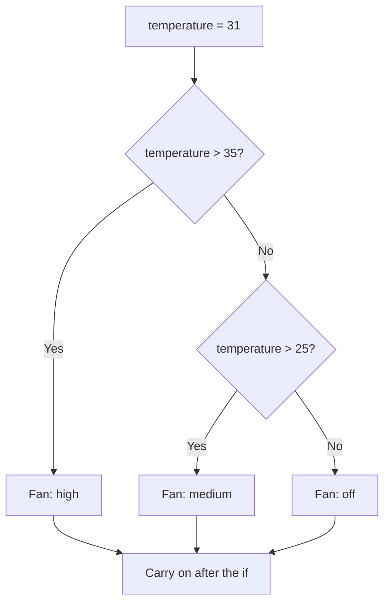
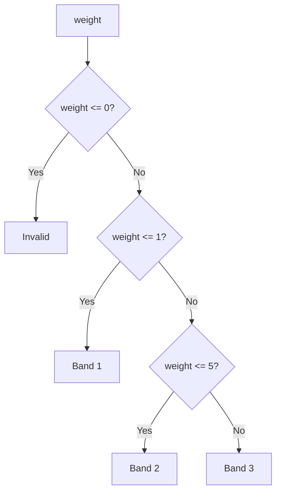
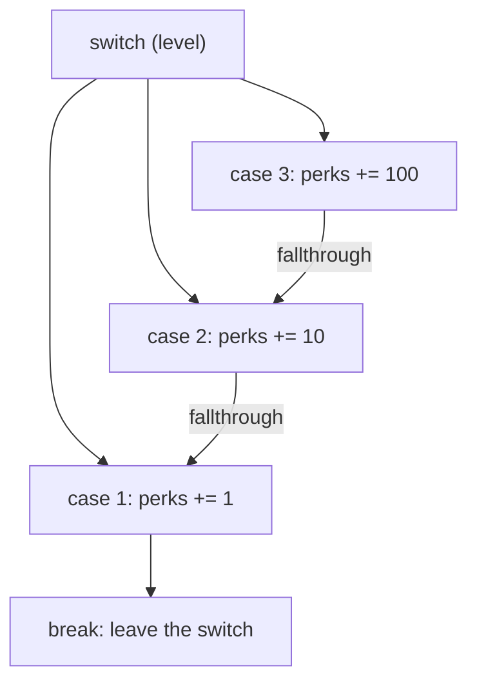

# new

## explanation

### Choosing what runs

So far every statement has run, top to bottom. Real programs need to choose: show "Battery low" only when the battery is low, or pick a different message for each day. That's what **conditionals** do.

### `if`

```cpp
if (battery < 20) {
    std::cout << "Battery low\n";
}
```

The condition goes in parentheses. If it is true, the statements in the braces run. If it is false, they are skipped and the program carries on after the closing brace.

### `else` and `else if`

`else` gives the "otherwise" path. `else if` adds more choices, checked one by one from the top:

```cpp
if (temperature > 35) {
    std::cout << "high\n";
} else if (temperature > 25) {
    std::cout << "medium\n";
} else {
    std::cout << "off\n";
}
```

Only **one** path runs: the first one whose condition is true. If none is true, the `else` runs. The final `else` is optional.

### Conditions

A condition is anything that is true or false, usually a comparison like `age >= 18`, maybe combined with `&&` (and) or `||` (or). Remember that comparing uses `==`, two equals signs.

### Braces

Braces group the statements that belong to a path. Without braces, only the **one** statement right after the `if` belongs to it. Always using braces avoids a whole class of bugs.

### `switch`: one value, many fixed cases

When you compare one whole number or character against several fixed values, a `switch` is tidier:

```cpp
switch (day) {
    case 6:
        std::cout << "Saturday\n";
        break;
    default:
        std::cout << "Another day\n";
}
```

The program jumps to the matching `case`. `break` ends the switch. Without it, the program keeps running into the next case's statements. `default` runs when no case matches.

### The conditional operator `? :`

`condition ? a : b` gives `a` when the condition is true, and `b` otherwise. It picks a **value**, so it fits inside other statements: `items == 1 ? " item" : " items"`.

## diagram



## example

```cpp
#include <iostream>

int main() {
    int temperature = 31;
    if (temperature > 35) {
        std::cout << "Fan: high\n";
    } else if (temperature > 25) {
        std::cout << "Fan: medium\n";
    } else {
        std::cout << "Fan: off\n";
    }

    int battery = 15;
    if (battery < 20) {
        std::cout << "Battery low\n";
    }

    int day = 6;
    switch (day) {
        case 6:
            std::cout << "Saturday\n";
            break;
        case 7:
            std::cout << "Sunday\n";
            break;
        default:
            std::cout << "A weekday\n";
    }

    int items = 1;
    std::cout << items << (items == 1 ? " item\n" : " items\n");
}
```

```text
Fan: medium
Battery low
Saturday
1 item
```

1. `31 > 35` is false, so the first path is skipped. `31 > 25` is true, so `Fan: medium` prints and the rest of the chain is skipped.
2. `15 < 20` is true, so `Battery low` prints. This `if` has no `else`: when it's false, nothing happens.
3. The `switch` jumps to `case 6`, prints `Saturday`, and `break` leaves the switch.
4. `items == 1` is true, so `? :` picks `" item\n"`, and the line reads `1 item`.

## mistakes

- **`=` instead of `==`.** `if (battery = 0)` stores 0 in `battery` and the condition counts as false. Compare with `==`.
- **A semicolon after the condition.** `if (battery < 20);` ends the `if` right there, with an empty statement. The block after it then runs every time.
- **Two statements without braces.** In `if (x > 0) std::cout << "a"; std::cout << "b";` only the first print belongs to the `if`. Use braces.
- **Checking in the wrong order.** In an `else if` chain, the first true condition wins. Checking `> 25` before `> 35` means the `> 35` path can never run. Put the strictest check first.
- **Forgetting `break` in a `switch`.** Without it, the program falls into the next case and runs its statements too.

## check

```cpp
#include <iostream>

int main() {
    int n = 12;
    if (n > 10) {
        std::cout << "big\n";
    } else if (n > 5) {
        std::cout << "medium\n";
    }
    if (n % 2 == 0) std::cout << "even\n";
    else std::cout << "odd\n";
    std::cout << (n < 0 ? "negative" : "not negative") << '\n';
}
```

```text
big
even
not negative
```

`12 > 10` is true, so `big` prints and the `else if` is skipped, even though `12 > 5` is also true. `12 % 2` is `0`, so `even` prints. `12 < 0` is false, so `? :` picks `"not negative"`.

# building

## explanation

### A quick recap

`if` runs a block when its condition is true, `else if` adds more choices, and `else` catches the rest. Only the first true path runs. `switch` jumps to a matching `case` and needs `break`. `? :` picks between two values.

### Designing an `else if` ladder

Most decision tasks sort a value into ranges: a weight into postage bands, a score into levels. To get them right:

1. **List the ranges on paper first**, with exact boundaries: up to 1 kg, over 1 up to 5 kg, over 5 kg.
2. **Handle invalid input first.** A weight of 0 or less isn't a parcel; deal with it before the normal ranges.
3. **Order the checks** so each one only has to test one boundary. If you go upwards, `<= 1`, then `<= 5`, each `else if` already knows the earlier checks were false.
4. **End with `else`** so every value lands somewhere.
5. **Test the boundaries**: exactly 1, just above 1, exactly 5, just above 5.

### Combine instead of nesting

`if (isMember) { if (cost > 0) { ... } }` works, but `if (isMember && cost > 0)` says the same thing in one line. Use `&&` and `||` to keep code flat and readable.

### Using `switch` well

`switch` works on whole numbers, characters and enums (named values you'll meet later), not on text or decimals. Several cases can share one block, by listing them one after another:

```cpp
case 'a': case 'e': case 'i': case 'o': case 'u':
    std::cout << "vowel\n";
    break;
```

Here the fall-through between cases is intended. Everywhere else, end each case with `break`.

### `? :` for values, `if` for actions

`? :` is great for choosing a word or a number in the middle of a print. When each path does several things, use `if`: a long `? :` is hard to read.

### Braces and the "dangling else"

An `else` always belongs to the nearest `if` without one. In `if (a) if (b) x(); else y();`, the `else` belongs to `if (b)`, whatever the indentation suggests. Braces remove the doubt.

## diagram



## example

```cpp
#include <iostream>

int main() {
    double weightKg = 2.5;
    bool isMember = true;

    int cost = 0;
    if (weightKg <= 0) {
        cost = -1;  // not a real parcel
    } else if (weightKg <= 1) {
        cost = 40;
    } else if (weightKg <= 5) {
        cost = 90;
    } else {
        cost = 150;
    }
    if (isMember && cost > 0) {
        cost -= 20;
    }
    std::cout << "Shipping: " << cost << '\n';

    char key = 'e';
    switch (key) {
        case 'a': case 'e': case 'i': case 'o': case 'u':
            std::cout << key << " is a vowel\n";
            break;
        default:
            std::cout << key << " is not a vowel\n";
    }

    int hour = 14;
    std::cout << "Good " << (hour < 12 ? "morning" : "afternoon") << '\n';
}
```

```text
Shipping: 70
e is a vowel
Good afternoon
```

1. `2.5 <= 0` and `2.5 <= 1` are false, `2.5 <= 5` is true, so `cost` becomes `90`. Each check only tests one boundary, because the earlier ones were false.
2. `isMember && cost > 0` is true, so 20 comes off: `70`. The `cost > 0` part stops the discount from applying to an invalid parcel.
3. `'e'` matches the shared vowel cases, which print and `break`.
4. `14 < 12` is false, so `? :` picks `"afternoon"`. The parentheses are needed, because `<<` would otherwise grab `hour` first.

## mistakes

- **Ranges in the wrong order.** `if (w <= 5) ... else if (w <= 1)`: every weight up to 5 takes the first path, so the second can never run. Go upwards from the smallest boundary, or downwards from the largest.
- **Gaps at the boundaries.** `if (w < 1) ... else if (w > 1)` handles nothing at exactly 1. Make each range's end the next one's start: `<= 1`, then `<= 5`.
- **The dangling else.** Indentation doesn't decide which `if` an `else` belongs to; the nearest unmatched `if` does. Use braces.
- **`switch` on text or decimals.** `switch` only takes whole numbers, characters and enums. For text, use `if`/`else if` with `==`.
- **Missing `break` where you didn't want fall-through.** Only list cases back to back when they really share one block.

## check

```cpp
#include <iostream>

int main() {
    int x = 7;
    if (x > 3)
        if (x > 10)
            std::cout << "A\n";
        else
            std::cout << "B\n";
    switch (x % 3) {
        case 0: std::cout << "zero\n";
        case 1: std::cout << "one\n";
        case 2: std::cout << "two\n";
    }
    std::cout << (x >= 7 ? "yes" : "no") << '\n';
}
```

```text
B
one
two
yes
```

The `else` belongs to the nearest `if`, which is `if (x > 10)`. `7 > 3` is true and `7 > 10` is false, so `B` prints. `7 % 3` is `1`, so the switch jumps to `case 1`; there is no `break`, so it falls through and also prints `two`. `7 >= 7` is true, so `? :` picks `yes`.

# strong

## explanation

### `if` and `switch` with an initialiser

Since C++17 you can declare a variable inside the condition's parentheses: `if (int r = n % 5; r == 0) { ... } else { ... }`. `r` exists in both branches and nowhere else, which keeps helper values from leaking into the rest of the function. `switch (char c = next(); c)` works the same way.

### Fall-through on purpose

Sometimes running into the next case is exactly right, for example adding up perks for each level and all levels below it. Mark it with `[[fallthrough]];` just before the next `case`. It tells readers it's intended, and compilers that warn about fall-through (`-Wimplicit-fallthrough`) stay quiet.

### Declarations inside a `switch`

All cases share one scope, and a jump to a later `case` may not skip over a variable's initialisation. So `case 1: int x = 10; break; case 2: ...` fails to compile. Wrap the case's statements in braces to give the variable its own scope.

### Any number is a condition

A condition converts to `bool`: zero is false and anything else is true. So `if (flags)` means `if (flags != 0)`. But comparing with `true` is a trap: in `v == true`, `true` turns into `1`, so it's only true when `v` is exactly 1.

### What branches cost

Processors guess which way a branch will go and start working ahead. A correct guess is almost free; a wrong one throws that work away, often costing around 10–20 cycles. Branches that follow a pattern, such as "almost always true", are cheap. Branches on random data are the expensive ones. For a long chain over many fixed values, a `switch` lets the compiler build a **jump table**, or you can replace the chain with a lookup in an array. C++20's `[[likely]]` and `[[unlikely]]` attributes give the compiler a hint about which path is common, but measure before relying on them.

### Choosing values without branching

`? :` often compiles to a select instruction with no branch at all, for example in `int best = a > b ? a : b;`. That's one reason it suits small value choices.

## diagram



## example

```cpp
#include <iostream>

int main() {
    // if with an initialiser: r exists only inside this if/else.
    int n = 42;
    if (int r = n % 5; r == 0) {
        std::cout << n << " is a multiple of 5\n";
    } else {
        std::cout << n << " leaves " << r << '\n';
    }

    // Deliberate fall-through, marked so readers and the compiler know.
    int level = 2;
    int perks = 0;
    switch (level) {
        case 3:
            perks += 100;
            [[fallthrough]];
        case 2:
            perks += 10;
            [[fallthrough]];
        case 1:
            perks += 1;
            break;
    }
    std::cout << "perks: " << perks << '\n';

    // A declaration inside a case needs its own braces.
    switch (char c = 'x'; c) {
        case 'x': {
            int code = c;
            std::cout << "code " << code << '\n';
            break;
        }
        default:
            std::cout << "other\n";
    }

    int flags = 4;
    if (flags) std::cout << "some flag set\n";
    std::cout << (flags > 3 ? flags * 2 : flags) << '\n';
}
```

```text
42 leaves 2
perks: 11
code 120
some flag set
8
```

1. `42 % 5` is `2`, stored in `r`, which the `else` branch can still use. After the `if`, `r` no longer exists.
2. `level` is 2, so the switch starts at `case 2`: it adds 10, falls through on purpose, adds 1, and breaks. Level 3 would have collected all three.
3. `c` is declared in the switch's initialiser. `code` is declared inside braces, so no other case can jump past its initialisation. `'x'` has the code `120`.
4. `flags` is 4, which isn't zero, so it counts as true. `4 > 3`, so `? :` gives `4 * 2`.

## mistakes

- **Using an initialiser's variable after the `if`.** It only exists inside the `if` and its `else`. If you need it later, declare it before the `if`.
- **Silent fall-through.** A missing `break` looks the same as an intended fall-through. Mark intended ones with `[[fallthrough]];` and turn on the compiler warning.
- **Declaring a variable in a case without braces.** Jumping to a later case would skip its initialisation, so the compiler refuses. Add braces around the case.
- **Comparing with `true`.** `if (count == true)` is false for `count == 2`. Write `if (count != 0)`, or just `if (count)`.
- **Long chains of equality checks.** Twenty `else if (x == ...)` lines are slow to read and may be slow to run. Use a `switch`, or look the answer up in an array.

## check

```cpp
#include <iostream>

int main() {
    int v = 2;
    if (int w = v * 3; w > 5) v = w;
    else v = -w;
    int bonus = 0;
    switch (v) {
        case 6: bonus = 1; [[fallthrough]];
        case 7: bonus += 2; break;
        case 8: bonus += 4;
    }
    std::cout << v << ' ' << bonus << ' ' << (v == true) << ' ' << (v ? "t" : "f") << '\n';
}
```

```text
6 3 0 t
```

`w` is `6`, which is greater than 5, so `v` becomes `6`. The switch starts at `case 6`, sets `bonus` to 1, falls through on purpose to `case 7`, adds 2 and breaks, leaving `3`. In `v == true`, `true` becomes `1`, and `6 == 1` is false: `0`. As a condition, `6` is not zero, so `? :` picks `"t"`.
