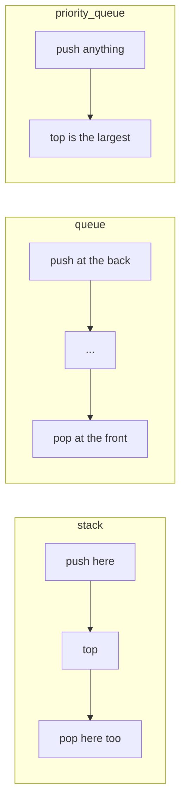
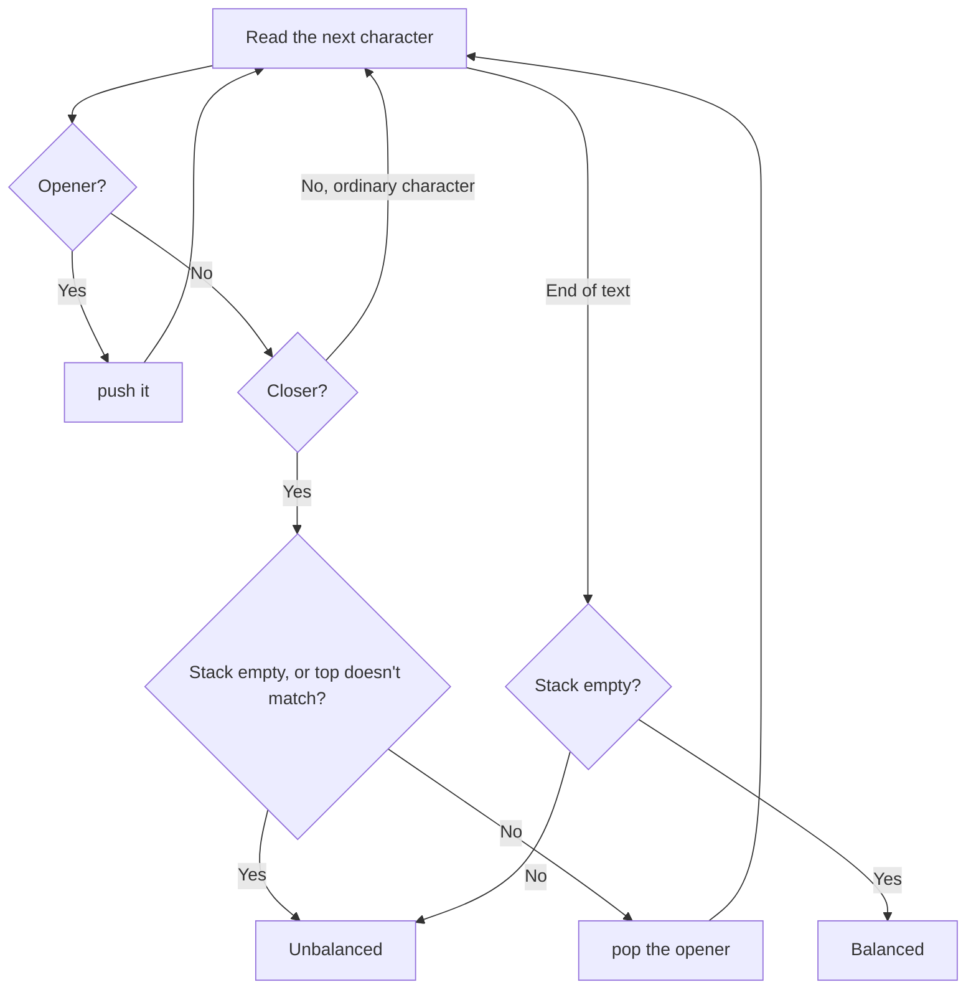
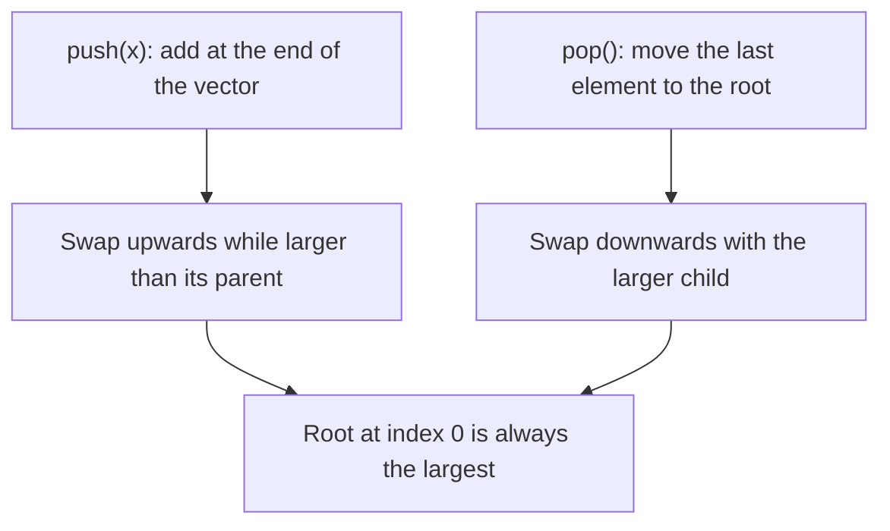

# new

## explanation

### Containers with one door

A vector lets you reach any element. Sometimes you want the opposite: a container that only lets you add and remove in one fixed way. That makes the code's intent obvious and prevents mistakes. C++ has three such containers.

### `std::stack`: last in, first out

Think of a pile of plates: you put plates on top, and you take the top one off. From `<stack>`:

- `push(x)` puts `x` on top.
- `top()` reads the top element.
- `pop()` removes the top element.

An undo history is a stack: the most recent action is undone first.

### `std::queue`: first in, first out

Think of a line at a counter: people join at the back and are served from the front. From `<queue>`:

- `push(x)` joins `x` at the back.
- `front()` reads the first in line, and `back()` the last.
- `pop()` removes the front element.

### `std::priority_queue`: the biggest first

Also from `<queue>`. Elements go in any order, but `top()` is always the **largest** one, and `pop()` removes it. Think of a hospital emergency room: the most urgent case is seen first, not the earliest.

### Things they all share

- `size()` and `empty()` tell you how many elements there are.
- `pop()` returns nothing. Read the element with `top()` or `front()` first, then `pop()`.
- You can't loop over them or use `[i]`. You only see one end.
- Calling `top()`, `front()` or `pop()` on an empty one is an error with no defined result. Check `empty()` first.

## diagram



## example

```cpp
#include <iostream>
#include <queue>
#include <stack>
#include <string>

int main() {
    // stack: last in, first out (like a pile of plates).
    std::stack<std::string> undo;
    undo.push("type A");
    undo.push("type B");
    undo.push("delete line");
    std::cout << "undo: " << undo.top() << '\n';
    undo.pop();
    std::cout << "then: " << undo.top() << ", left " << undo.size() << '\n';

    // queue: first in, first out (like a line at a counter).
    std::queue<std::string> line;
    line.push("Anu");
    line.push("Bilal");
    line.push("Chen");
    std::cout << "serving " << line.front() << ", last is " << line.back() << '\n';
    line.pop();
    std::cout << "next " << line.front() << '\n';

    // priority_queue: the largest is always on top.
    std::priority_queue<int> urgent;
    urgent.push(3);
    urgent.push(9);
    urgent.push(5);
    std::cout << "most urgent " << urgent.top() << '\n';
    urgent.pop();
    std::cout << "then " << urgent.top() << '\n';
}
```

```text
undo: delete line
then: type B, left 2
serving Anu, last is Chen
next Bilal
most urgent 9
then 5
```

1. The last action pushed, "delete line", is on top of the stack, so it's undone first. After `pop()`, "type B" is on top.
2. In the queue, "Anu" joined first, so she is at the front; "Chen" joined last and is at the back. `pop()` serves Anu, and Bilal moves to the front.
3. The priority queue keeps the largest on top whatever the order of `push`: 9 first, and after `pop()`, 5.

## mistakes

- **Expecting `pop()` to give back the element.** It returns nothing. Read `top()` or `front()` first, then call `pop()`.
- **Reading an empty container.** `top()` on an empty stack has no defined result and may crash. Check `empty()` first.
- **Trying to loop over one.** `for (auto x : undo)` doesn't compile: these containers only show one end. Use a vector if you need to see everything.
- **Thinking the priority queue gives the smallest.** By default `top()` is the **largest**. The building lesson shows how to flip it.
- **Mixing up `front()` and `back()`.** In a queue, `front()` is the next one out and `back()` the one that just joined.

## check

```cpp
#include <iostream>
#include <queue>
#include <stack>

int main() {
    std::stack<int> s;
    std::queue<int> q;
    for (int i = 1; i <= 3; i++) {
        s.push(i * 10);
        q.push(i * 10);
    }
    s.pop();
    q.pop();
    std::cout << s.top() << ' ' << q.front() << ' ' << s.size() + q.size() << '\n';
}
```

```text
20 20 4
```

Both receive 10, 20 and 30. The stack's `pop()` removes the newest, 30, so its top is 20. The queue's `pop()` removes the oldest, 10, so its front is also 20. Each has two elements left.

# building

## explanation

### A quick recap

A stack gives back the newest element first, a queue the oldest, and a priority queue the largest. All three add with `push`, remove with `pop` (which returns nothing), and must be checked with `empty()` before reading.

### Choosing one

Ask in which order things must come out:

- **Most recent first**: a stack. Undo, matching brackets, going back the way you came.
- **In arrival order**: a queue. Jobs waiting for a printer, customers, events to process in order.
- **Best first**: a priority queue. The most urgent task, the earliest deadline, the cheapest option.

### Draining a container

The standard loop reads the next element, removes it, then handles it, until nothing is left:

```cpp
while (!jobs.empty()) {
    int job = jobs.front();
    jobs.pop();
    // handle job; it may push more work
}
```

Copy the element before `pop()`, because after `pop()` it's gone.

### Matching with a stack

To check brackets, push each opener. On each closer, the stack's top must be the matching opener; pop it. If a closer finds the stack empty or the wrong opener, the text is unbalanced. At the end the stack must be empty, or some opener was never closed.

### Smallest first

To make `top()` the **smallest**, give the priority queue two more type arguments, the storage and `std::greater` from `<functional>`:

```cpp
std::priority_queue<int, std::vector<int>, std::greater<int>> small;
```

### Pairs as priorities

A priority queue of `std::pair` compares the first members, then the second ones for ties. So `(deadline, task)` pairs come out ordered by deadline, which avoids writing your own comparison.

## diagram



## example

```cpp
#include <functional>
#include <iostream>
#include <queue>
#include <stack>
#include <string>
#include <utility>
#include <vector>

// A stack matches brackets: each closer must match the most recent opener.
bool balanced(const std::string& text) {
    std::stack<char> open;
    for (char c : text) {
        if (c == '(' || c == '[' || c == '{') {
            open.push(c);
        } else if (c == ')' || c == ']' || c == '}') {
            if (open.empty()) return false;
            char want = c == ')' ? '(' : c == ']' ? '[' : '{';
            if (open.top() != want) return false;
            open.pop();
        }
    }
    return open.empty();
}
int main() {
    std::cout << balanced("f(a[1], {b})") << ' ' << balanced("(]") << ' ' << balanced("((") << '\n';
    std::queue<int> jobs;
    for (int id : {101, 102, 103}) jobs.push(id);
    while (!jobs.empty()) {
        int job = jobs.front();
        jobs.pop();
        std::cout << "job " << job << ' ';
    }
    std::cout << '\n';
    // Smallest first: a min-heap with std::greater, here (deadline, task) pairs.
    std::priority_queue<std::pair<int, std::string>, std::vector<std::pair<int, std::string>>, std::greater<>> due;
    due.push({17, "report"});
    due.push({9, "email"});
    due.push({12, "review"});
    while (!due.empty()) {
        std::cout << due.top().first << ':' << due.top().second << ' ';
        due.pop();
    }
    std::cout << '\n';
}
```

```text
1 0 0
job 101 job 102 job 103
9:email 12:review 17:report
```

1. In the first text, every closer meets its own opener on top, and the stack ends empty. `"(]"` fails because `]` finds `(` on top. `"(("` fails at the end, with two openers never closed.
2. The queue loop reads the front, pops it, then prints it, in arrival order, until the queue is empty.
3. With `std::greater`, the priority queue puts the smallest pair on top. Pairs compare by their first member, the deadline, so the tasks come out earliest first.

## mistakes

- **Reading after `pop()`.** `jobs.pop(); int job = jobs.front();` reads the next job, not the one you removed. Copy first, then pop.
- **Forgetting the final check.** A bracket checker that doesn't test `empty()` at the end accepts `"(("`.
- **Expecting a min-heap by default.** `std::priority_queue<int>` puts the largest on top. Use `std::greater<int>` for smallest first.
- **Needing to see more than the top.** A priority queue isn't sorted inside; you can only see the top. If you need everything in order, sort a vector instead.
- **Calling `top()` in a loop condition without checking.** `while (s.top() != 0)` crashes once the stack is empty. Test `!s.empty()` first.

## check

```cpp
#include <functional>
#include <iostream>
#include <queue>
#include <stack>
#include <vector>

int main() {
    std::priority_queue<int> big;
    std::priority_queue<int, std::vector<int>, std::greater<int>> small;
    for (int x : {6, 2, 8, 4}) { big.push(x); small.push(x); }
    big.pop();
    small.pop();
    std::stack<int> st;
    for (int x : {1, 2, 3}) st.push(x);
    int sum = st.top();
    st.pop();
    sum += st.top();
    std::cout << big.top() << ' ' << small.top() << ' ' << sum << '\n';
}
```

```text
6 4 5
```

`big` has the largest on top, so `pop()` removes 8 and leaves 6. `small` has the smallest on top, so `pop()` removes 2 and leaves 4. The stack's top is 3; after popping it, the top is 2, so `sum` is 5.

# strong

## explanation

### Adaptors, not containers

`stack`, `queue` and `priority_queue` are **adaptors**: thin wrappers that restrict another container. By default `stack` and `queue` sit on a `std::deque`, and `priority_queue` on a `std::vector`. You can choose: `std::stack<int, std::vector<int>>` works, because a stack only needs `push_back`, `pop_back` and `back`.

### What each operation costs

- `stack` and `queue`: `push`, `pop`, `top`/`front` are all constant time.
- `priority_queue`: `top` is constant, while `push` and `pop` take O(log n). Inside, it's a **binary heap** stored in the vector: each element is at least as large as its children, so the largest is always at index 0. Building one from `n` elements at once, by passing them to the constructor, takes O(n), faster than `n` pushes.

### The comparator runs backwards

`priority_queue<T, C, Cmp>` treats `Cmp(a, b) == true` as "`a` ranks **below** `b`". With the default `std::less`, smaller ranks below, so the largest is on top. That's why `std::greater` gives a min-heap. For your own types, write the comparator as "does `a` rank below `b`?".

### Ties and stability

A heap does not keep equal elements in insertion order. If equal priorities must come out first-come first-served, store an arrival counter and use it to break ties.

### No updates inside the heap

You can't change an element's priority or remove one from the middle. The usual workaround is **lazy deletion**: push a new entry instead, and when an outdated or cancelled entry reaches the top, skip it. The heap grows a little, but each operation stays O(log n).

### When to drop the adaptor

If you need to look at the middle, iterate, or remove from both ends, use `std::deque` (both ends) or a sorted structure like `std::set` (ordered, with removals). The adaptors exist to say "only this access pattern", nothing more.

## diagram



## example

```cpp
#include <iostream>
#include <queue>
#include <stack>
#include <string>
#include <vector>

struct Task {
    std::string name;
    int priority;
    int order;  // arrival order breaks ties
};

// The comparator answers "does a rank below b?"; the highest-ranked ends up on top.
struct RanksBelow {
    bool operator()(const Task& a, const Task& b) const {
        if (a.priority != b.priority) return a.priority < b.priority;
        return a.order > b.order;  // equal priority: the earlier arrival ranks higher
    }
};

int main() {
    std::priority_queue<Task, std::vector<Task>, RanksBelow> tasks;
    tasks.push({"backup", 2, 0});
    tasks.push({"deploy", 5, 1});
    tasks.push({"lint", 2, 2});
    tasks.push({"alert", 5, 3});

    // Entries can't be changed or removed inside the heap; skip stale ones as they surface.
    std::string cancelled = "lint";
    while (!tasks.empty()) {
        Task t = tasks.top();
        tasks.pop();
        if (t.name == cancelled) continue;
        std::cout << t.name << ' ';
    }
    std::cout << '\n';

    // A stack can sit on a vector instead of the default deque.
    std::stack<int, std::vector<int>> history;
    for (int page = 1; page <= 4; page++) history.push(page * 100);
    history.pop();
    std::cout << history.top() << ' ' << history.size() << '\n';
}
```

```text
deploy alert backup
300 3
```

1. `RanksBelow` puts higher priorities on top, and among equal priorities the smaller arrival number. So the priority-5 tasks come first, deploy before alert, then backup.
2. `lint` was cancelled after being pushed. It can't be removed from inside the heap, so it's skipped when it reaches the top.
3. `t` copies the top before `pop()`, because `top()` returns a reference to an element that `pop()` destroys.
4. `history` is a stack stored in a vector: pages 100 to 400, minus the last one popped.

## mistakes

- **Writing the comparator the wrong way round.** It means "ranks below", not "comes first". If the order comes out reversed, flip the comparison.
- **Assuming equal priorities keep their order.** A heap reorders equal elements. Add an arrival counter as a tie-breaker.
- **Trying to change a priority in place.** There is no way to reach an element below the top. Push a new entry and skip stale ones, or use a `std::set`.
- **Keeping a reference to `top()` across `pop()`.** `const Task& t = tasks.top(); tasks.pop();` leaves `t` pointing at a destroyed element. Copy it first.
- **Pushing `n` elements one by one when you already have them.** Building from a whole range in the constructor takes O(n) instead of O(n log n).

## check

```cpp
#include <iostream>
#include <queue>
#include <utility>
#include <vector>

struct ByCost {
    bool operator()(const std::pair<int, char>& a, const std::pair<int, char>& b) const {
        return a.first > b.first;
    }
};
int main() {
    std::priority_queue<std::pair<int, char>, std::vector<std::pair<int, char>>, ByCost> pq;
    pq.push({4, 'a'});
    pq.push({1, 'b'});
    pq.push({7, 'c'});
    pq.push({3, 'd'});
    pq.pop();
    std::cout << pq.top().first << pq.top().second << ' ' << pq.size() << '\n';
}
```

```text
3d 3
```

`ByCost` says `a` ranks below `b` when `a` costs **more**, so the cheapest pair is on top: a min-heap by cost. `pop()` removes the cheapest, `(1, 'b')`, leaving `(3, 'd')` on top and three entries.
