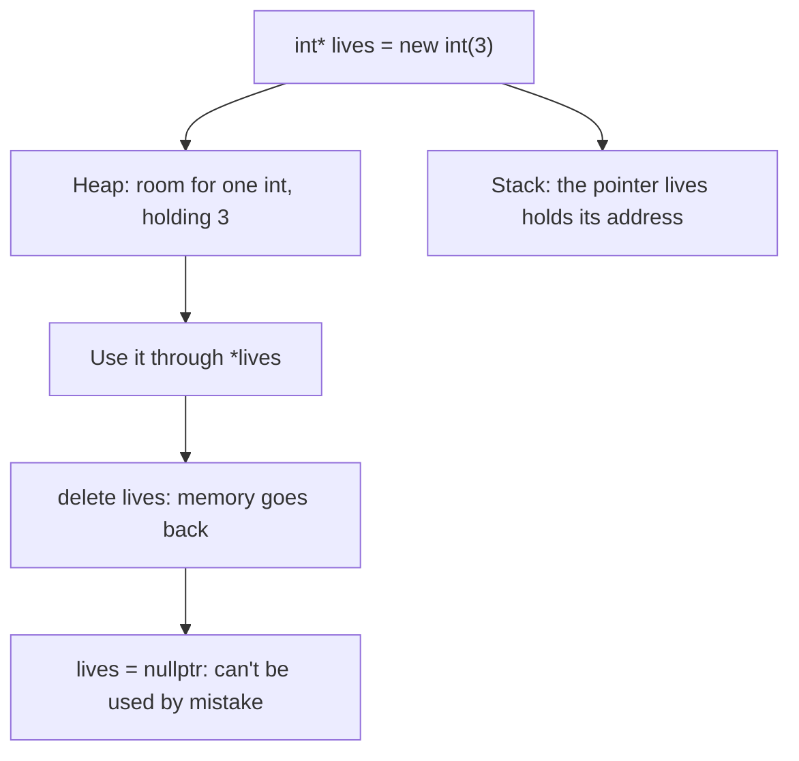
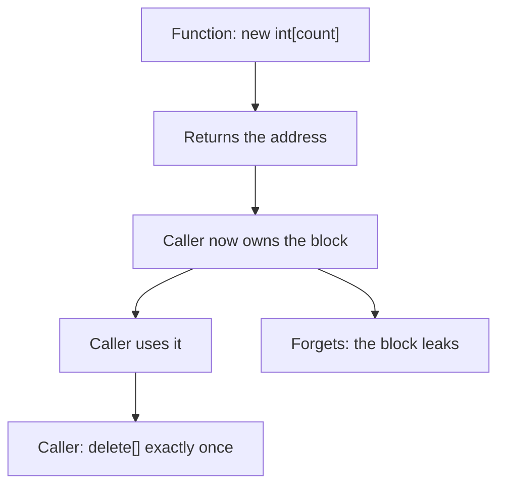
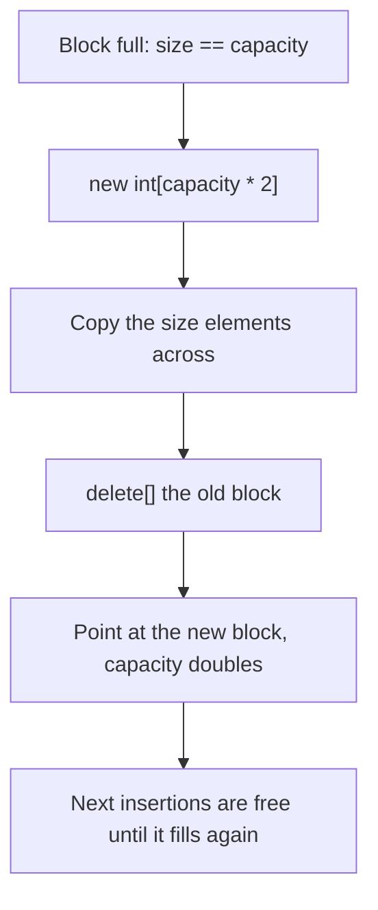

# new

## explanation

### Two places for variables

So far every variable has lived on the **stack**: it is created when its block starts and destroyed automatically when the block ends. That's simple and fast, but it has two limits:

- its size must be known when you write the program, and
- it can't outlive the function that made it.

The **heap** is a big pool of memory you manage yourself. You ask for some while the program runs, and you give it back when you're done.

### `new` and `delete`

```cpp
int* lives = new int(3);
```

`new int(3)` finds room for one `int` on the heap, puts 3 in it, and gives back its **address**, which you keep in a pointer. You use it through the pointer, `*lives`. When you're finished, give it back:

```cpp
delete lives;
lives = nullptr;
```

Setting the pointer to `nullptr` afterwards stops you from using the freed memory by mistake.

### Arrays on the heap

`new double[days]` makes an array whose size is only known while the program runs, here the value of `days`. Use it like any array: `temps[i]`. Free it with `delete[]`, with the square brackets:

```cpp
double* temps = new double[days];
delete[] temps;
```

Note the difference: `new int(5)` is **one** `int` holding 5, while `new int[5]` is **five** `int`s.

### Memory leaks

Heap memory is never given back by itself. If you lose the last pointer to it without calling `delete`, the memory stays taken until the program ends. That's a **memory leak**. In a program that runs for a long time, leaks pile up.

### The easy way

`std::vector` does all of this for you: it asks for heap memory, grows it and frees it automatically. Use a vector in everyday code. Understanding `new` and `delete` shows you what it does inside, and helps you read older code.

## diagram



## example

```cpp
#include <iostream>

int main() {
    // One int on the heap: new gives back its address.
    int* lives = new int(3);
    *lives -= 1;
    std::cout << "lives: " << *lives << '\n';
    delete lives;     // give the memory back
    lives = nullptr;  // so we can't use it by mistake

    // An array on the heap, sized while the program runs.
    int days = 5;
    double* temps = new double[days];
    for (int i = 0; i < days; i++) {
        temps[i] = 20.5 + i;
    }
    std::cout << "day 1: " << temps[0] << ", day 5: " << temps[days - 1] << '\n';
    delete[] temps;  // arrays made with new[] need delete[]

    std::cout << "lives is null: " << (lives == nullptr) << '\n';
}
```

```text
lives: 2
day 1: 20.5, day 5: 24.5
lives is null: 1
```

1. `new int(3)` makes one heap `int` holding 3. Through the pointer, it goes down to 2.
2. `delete lives` gives the memory back, and setting `lives` to `nullptr` marks the pointer as empty.
3. `new double[days]` makes an array of 5, a size only known while the program runs. The loop fills it with 20.5 to 24.5.
4. `delete[] temps` frees the whole array. Every `new` has exactly one matching `delete`.

## mistakes

- **Forgetting `delete`.** The memory stays taken: a leak. For every `new`, make sure exactly one `delete` runs.
- **`delete` for an array.** Memory from `new[]` must be freed with `delete[]`, and memory from `new` with plain `delete`. Mixing them up is an error with no defined result.
- **Using memory after `delete`.** The pointer still holds the old address, but the memory isn't yours any more. Reading or writing it may seem to work and then break later. Set the pointer to `nullptr`.
- **Deleting twice.** A second `delete` of the same memory can crash the program. `delete` of a `nullptr` does nothing, which is another reason to reset pointers.
- **Mixing up `new int(5)` and `new int[5]`.** The first is one `int` set to 5; the second is five `int`s with no particular values. Write `new int[5]()` to start them all at 0.

## check

```cpp
#include <iostream>

int main() {
    int* a = new int(4);
    int* b = a;
    *b = *b * 5;
    int* c = new int[3]{1, 2, 3};
    c[2] += *a;
    std::cout << *a << ' ' << c[2] << '\n';
    delete a;
    delete[] c;
}
```

```text
20 23
```

`b` holds the same address as `a`, so both point to one heap `int`; multiplying through `b` makes it 20. `c` is a heap array starting 1, 2, 3, and `c[2] += *a` makes the last element 23. `a` and `b` share one `int`, so it is deleted once, through `a`.

# building

## explanation

### A quick recap

`new` makes a value on the heap and returns its address; `delete` gives it back. `new T[n]` makes an array sized at run time, freed with `delete[]`. Memory that is never freed leaks.

### Ownership

The key question for heap memory is: **who deletes it?** The part of the program responsible for calling `delete` **owns** the memory. Each block must have exactly one owner, and the owner must free it exactly once.

When a function returns a pointer to memory it made with `new`, ownership passes to the caller. Say so in a comment, because nothing in the code forces the caller to remember.

### Heap memory outlives its function

A local variable is destroyed when its function returns, so returning its address is a bug. Memory from `new` stays until it is deleted, so a function can create something on the heap and return it.

### `->` for members through a pointer

When a pointer points to an object with members, like a `std::string`, `p->size()` is short for `(*p).size()`.

### Re-pointing without freeing

```cpp
int* box = new int(1);
box = new int(2);  // the first block is now lost: a leak
```

Before you re-point an owning pointer, delete what it points to.

### Step by step

1. Decide who owns each block, and write it down.
2. Pair every `new` with a `delete` (and `new[]` with `delete[]`) on every path out, including early returns.
3. After freeing, set the pointer to `nullptr` if it stays in use.
4. Ask whether a `std::vector` or a plain local variable would do, and use that if so.

## diagram



## example

```cpp
#include <iostream>
#include <string>

// The caller owns what this returns and must delete[] it.
int* evensUpTo(int limit, int& count) {
    count = limit / 2;
    int* evens = new int[count];
    for (int k = 0; k < count; k++) {
        evens[k] = 2 * (k + 1);
    }
    return evens;
}

std::string* makeName(const std::string& first) {
    return new std::string(first + " (guest)");
}

int main() {
    int count = 0;
    int* evens = evensUpTo(9, count);
    std::cout << count << " evens, last " << evens[count - 1] << '\n';
    delete[] evens;  // one new[], one delete[]

    std::string* guest = makeName("Meera");
    std::cout << *guest << ", " << guest->size() << " chars\n";
    delete guest;

    // Re-pointing without delete would lose the first block forever.
    int* box = new int(1);
    delete box;        // free the old block first...
    box = new int(2);  // ...then point at a new one
    std::cout << "box " << *box << '\n';
    delete box;
}
```

```text
4 evens, last 8
Meera (guest), 13 chars
box 2
```

1. `evensUpTo` makes a heap array of 4 and fills it with 2, 4, 6, 8. The array outlives the function, and `main` becomes its owner.
2. `main` uses the array, then frees it with `delete[]`, matching the `new[]`.
3. `makeName` creates a heap `std::string`. `guest->size()` calls `size()` on the string the pointer points to.
4. `box` is freed before it's re-pointed, so no block is lost. Each of the four `new`s has exactly one `delete`.

## mistakes

- **No clear owner.** If two parts of the program both think they must delete a block, it's freed twice; if neither does, it leaks. Decide and document one owner.
- **Re-pointing an owning pointer.** `box = new int(2);` without deleting the old block first leaks it.
- **Returning the address of a local.** A local array is destroyed when the function returns. Allocate with `new` (and hand over ownership), or return a `std::vector`.
- **A path that skips `delete`.** An early `return` between the `new` and the `delete` leaks the block. Check every way out of the function.
- **Keeping a second pointer after freeing.** After `delete[] p;`, any other pointer into that block, like `p + 1`, dangles too. Don't use them.

## check

```cpp
#include <iostream>

int* make(int n) {
    int* a = new int[n];
    for (int i = 0; i < n; i++) a[i] = n - i;
    return a;
}

int main() {
    int* p = make(4);
    int* q = p + 1;
    int sum = *q + p[3];
    delete[] p;
    p = make(2);
    std::cout << sum << ' ' << p[0] << '\n';
    delete[] p;
}
```

```text
4 2
```

`make(4)` returns a heap array holding 4, 3, 2, 1. `q` points one element in, at 3, and `p[3]` is 1, so `sum` is 4, worked out before the array is freed. After `delete[] p`, `q` dangles, so the program never uses it again. `p` is re-pointed to a new array, 2, 1.

# strong

## explanation

### What `new` and `delete` really do

`new T(args)` does two things: it allocates raw memory from the heap, then **constructs** a `T` in it. `delete p` runs the destructor, then frees the memory. `new T[n]` constructs `n` objects, and `delete[]` destroys all `n` before freeing; that's why the two forms must match. If allocation fails, `new` throws `std::bad_alloc`; it does not return `nullptr` unless you ask for `new (std::nothrow)`.

### Heap allocation costs

Asking the allocator for memory costs far more than using the stack, roughly tens of nanoseconds versus nearly nothing, and many small allocations scatter data across memory, which is slow to walk. Allocate in bigger blocks, reuse memory, and prefer contiguous storage.

### Growing a block: double, don't add one

A heap array can't grow in place. To make room you allocate a bigger block, copy the elements across and free the old one. If you grow by one element each time, filling `n` elements costs about n²/2 copies. If you **double** the capacity, the total copying stays below `2n`, so each insertion costs constant time on average. That's exactly what `std::vector` does.

### The bugs manual memory invites

- **Leaks**: memory never freed. LeakSanitizer reports them.
- **Use after free** and **double free**: undefined behaviour, often silent until something else reuses the memory. AddressSanitizer catches them.
- **Exception safety**: if anything between `new` and `delete` throws, or returns early, the `delete` never runs.

### RAII: let an object own the memory

The fix for all of these is **RAII** ("resource acquisition is initialisation"): give the memory to an object whose destructor frees it. When the object goes out of scope, for any reason, the memory is freed automatically. `std::vector`, `std::string` and the smart pointers `std::unique_ptr` and `std::shared_ptr` are RAII owners. Modern C++ rarely writes `delete` by hand.

### `malloc` and `free`

C's `malloc` gives raw memory without constructing anything. Never mix families: memory from `new` goes to `delete`, from `malloc` to `free`.

## diagram



## example

```cpp
#include <iostream>

int main() {
    // A growable list by hand: what std::vector does inside.
    int capacity = 2;
    int count = 0;
    int* store = new int[capacity];
    int copies = 0;
    for (int value = 10; value <= 70; value += 10) {
        if (count == capacity) {
            int* roomier = new int[capacity * 2];  // double, don't add one
            for (int j = 0; j < count; j++) {
                roomier[j] = store[j];
                copies++;
            }
            delete[] store;
            store = roomier;
            capacity *= 2;
        }
        store[count++] = value;
    }
    std::cout << count << " items, capacity " << capacity << ", " << copies << " copies\n";
    std::cout << "last " << store[count - 1] << '\n';
    delete[] store;

    // Zero-initialise on request: () or {} after new[].
    int* zeros = new int[3]();
    std::cout << zeros[0] + zeros[1] + zeros[2] << '\n';
    delete[] zeros;
}
```

```text
7 items, capacity 8, 6 copies
last 70
0
```

1. The block starts with room for 2. Adding the third value finds it full, so a block of 4 is allocated, 2 elements are copied, and the old block is freed.
2. Adding the fifth value doubles again, to 8, copying 4. Seven values cost 6 copies in all; starting from an empty block and growing by one each time would have copied 1 + 2 + … + 6 = 21 elements.
3. `store[count++] = value` writes at the current end, then moves the end on.
4. `new int[3]()` value-initialises the elements, so they start at 0. Without the `()`, they would hold garbage.

## mistakes

- **Growing by one.** Copying the whole block for every new element makes filling it quadratic. Double the capacity.
- **Expecting `new` to return `nullptr` on failure.** It throws `std::bad_alloc`. Only `new (std::nothrow)` returns `nullptr`.
- **Code between `new` and `delete` that can throw or return early.** The `delete` is skipped and the memory leaks. Hand the memory to an RAII owner straight away.
- **Trusting `p = nullptr` to make freed memory safe.** It protects only that one pointer. Copies of it still dangle.
- **Hand-written ownership where a library type fits.** A `std::vector` or `std::unique_ptr` is safer, just as fast, and frees itself.

## check

```cpp
#include <iostream>

int main() {
    int* a = new int(3);
    int* b = new int(*a + 1);
    delete a;
    a = b;
    *a *= 10;
    int* d = new int[4]();
    d[1] = *b;
    std::cout << *b << ' ' << d[0] + d[1] << ' ' << (a == b) << '\n';
    delete b;
    delete[] d;
}
```

```text
40 40 1
```

`b` gets a new heap `int` holding `3 + 1 = 4`. The first block is freed, then `a` is re-pointed at `b`'s block, so `*a *= 10` makes it 40 and the two pointers are equal. `new int[4]()` starts every element at 0, so `d[0] + d[1]` is `0 + 40`. Only `b` is deleted at the end: `a` points to the same block, and deleting it as well would free it twice.
