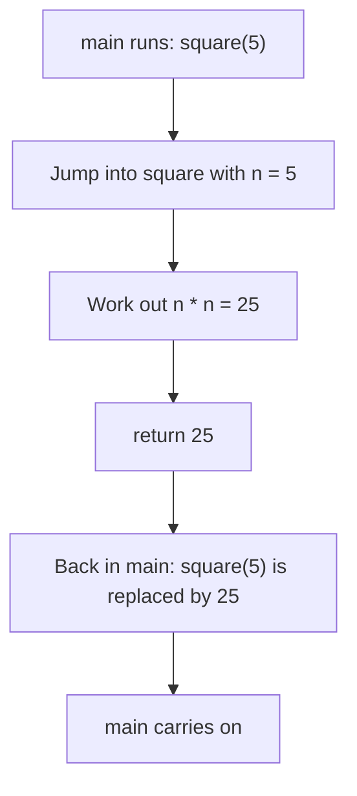
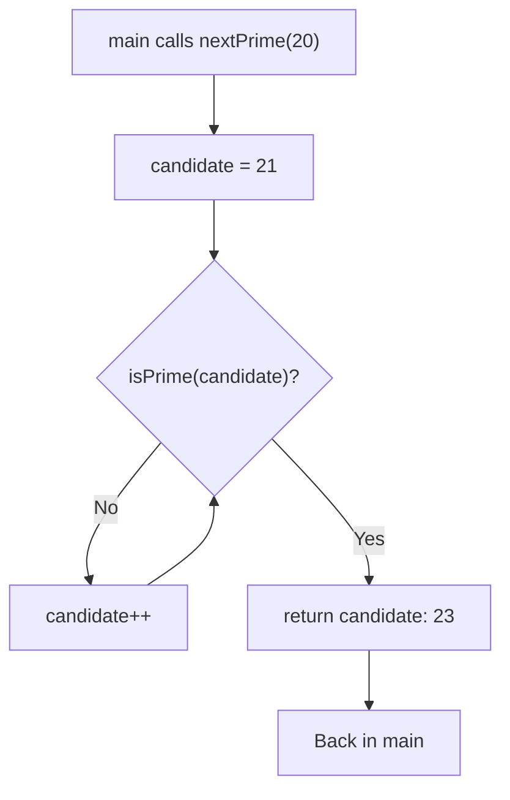
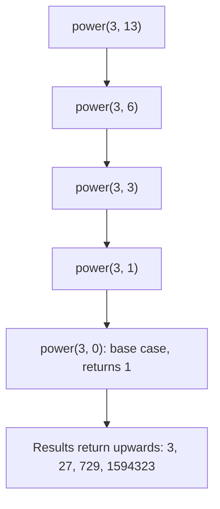

# new

## explanation

### Why functions

As programs grow, the same piece of work appears again and again: work out an area, print a divider line. A **function** gives that piece of work a name. You write it once, then **call** it by name whenever you need it. `main` itself is a function: the one the program starts in.

### Writing a function

```cpp
int square(int n) {
    return n * n;
}
```

- `int` before the name is the **return type**: the kind of value the function gives back.
- `square` is the function's name.
- `(int n)` is the **parameter** list: the inputs the function needs, each with a type and a name.
- The body, in braces, does the work. `return` gives back the result and ends the function straight away.

### Calling a function

`square(5)` runs the body with `n` set to 5, and the call is replaced by the result, 25. You can use a call anywhere a value fits: `std::cout << square(5);` or `int big = square(3) + square(4);`. The values you pass in the call are the **arguments**.

### Functions that give nothing back

When a function just does something, like printing, its return type is `void`. It needs no `return` value:

```cpp
void printLine(int length) { ... }
```

### Parameters are copies

When you call `square(a)`, the function gets a **copy** of `a`'s value. Changing `n` inside the function doesn't change `a` outside it.

### Local variables

Variables made inside a function belong to that function. They are created when it's called and disappear when it returns. Two functions can each have their own `i` without any clash.

### Order in the file

C++ reads the file from top to bottom, so a function must be written, or at least **declared**, above the place where it's called. For now, write your functions above `main`.

## diagram



## example

```cpp
#include <iostream>

// A function that gives back a value.
int square(int n) {
    return n * n;
}

// A function with two parameters.
double rectangleArea(double width, double height) {
    return width * height;
}

// A void function does something but gives nothing back.
void printLine(int length) {
    for (int i = 0; i < length; i++) {
        std::cout << '-';
    }
    std::cout << '\n';
}

int main() {
    std::cout << "5 squared is " << square(5) << '\n';
    int big = square(3) + square(4);
    std::cout << "3^2 + 4^2 = " << big << '\n';
    printLine(10);
    std::cout << "Room: " << rectangleArea(3.5, 4) << " m2\n";
    printLine(10);
}
```

```text
5 squared is 25
3^2 + 4^2 = 25
----------
Room: 14 m2
----------
```

1. The program starts in `main`. `square(5)` runs `square` with `n = 5`, and the call becomes `25`.
2. `square(3) + square(4)` calls the function twice, getting 9 and 16, and stores `25` in `big`.
3. `printLine(10)` runs the loop inside `printLine`, printing ten dashes. It returns nothing, so it stands on its own line.
4. `rectangleArea(3.5, 4)` gets `width = 3.5` and `height = 4`, and returns `14`.
5. The same `printLine` is called again: written once, used twice.

## mistakes

- **Forgetting `return`.** A function with a return type like `int` must return a value on every path. Leaving it out compiles, often with only a warning, but the result is garbage.
- **Calling a function written below `main`.** The compiler hasn't seen it yet and reports an error. Put the function above `main`.
- **Expecting a function to change its argument.** `twice(a)` gets a copy of `a`; changing the copy doesn't change `a`. Use the returned value: `a = twice(a);`.
- **Arguments in the wrong order.** `rectangleArea(height, width)` happens to give the same answer, but for most functions the order matters. The first argument goes to the first parameter.
- **Ignoring the result.** `square(5);` on its own line calculates 25 and throws it away. Store it or print it.

## check

```cpp
#include <iostream>

int twice(int x) {
    x = x * 2;
    return x;
}

int main() {
    int a = 5;
    int b = twice(a);
    std::cout << a << ' ' << b << '\n';
    std::cout << twice(twice(1)) << '\n';
}
```

```text
5 10
4
```

`twice(a)` gets a copy of `5`. It doubles its own `x` to `10` and returns it, so `b` is `10`, but `a` stays `5`. In `twice(twice(1))`, the inner call runs first and gives `2`, and the outer call doubles that to `4`.

# building

## explanation

### A quick recap

A function has a return type, a name, parameters and a body. Calling it runs the body with copies of the arguments, and `return` gives back the result. `void` functions return nothing. Now let's design functions well.

### Design before you write

For each function, answer three questions:

1. **What does it need?** Those are the parameters, with their types.
2. **What does it give back?** That's the return type, or `void`.
3. **What is its one job?** If you need "and" to describe it, it's probably two functions.

Name functions after what they do or answer: `nextPrime`, `isPrime`, `printBanner`. A function that answers yes or no should return `bool` and start with `is` or `has`.

### Return early for special cases

A function can have several `return` statements. Handle the special cases at the top and return straight away, so the main logic below doesn't need to be nested inside `if`s:

```cpp
if (n < 2) return false;
```

Every path through a non-`void` function must reach a `return`.

### Functions using functions

`nextPrime` can call `isPrime` in a loop. Small functions that call each other are easier to test and to read than one long `main`.

### Declarations

A **declaration** is a function's first line followed by a semicolon: `bool isPrime(int n);`. It tells the compiler the function exists, so you can call it before its full **definition** appears further down the file.

### Overloading

Several functions can share a name if their parameter lists differ: `describe(int)` and `describe(double)`. The compiler picks the one that best fits the arguments in each call.

### Default arguments

A parameter can have a default value: `void banner(int width, char symbol = '*')`. Callers may then leave that argument out. Defaults must come at the end of the parameter list.

## diagram



## example

```cpp
#include <iostream>

bool isPrime(int n);  // declared here, defined after main

// Overloads: same name, different parameter types.
void describe(int value) { std::cout << "whole number " << value << '\n'; }
void describe(double value) { std::cout << "decimal " << value << '\n'; }

// A default argument is used when the caller leaves it out.
void banner(int width, char symbol = '*') {
    for (int i = 0; i < width; i++) std::cout << symbol;
    std::cout << '\n';
}

// One job per function, and one function can use another.
int nextPrime(int from) {
    int candidate = from + 1;
    while (!isPrime(candidate)) {
        candidate++;
    }
    return candidate;
}

int main() {
    banner(6);
    describe(7);
    describe(7.5);
    std::cout << "next prime after 20: " << nextPrime(20) << '\n';
    banner(6, '=');
}

bool isPrime(int n) {
    if (n < 2) return false;  // early return for the special cases
    for (int d = 2; d * d <= n; d++) {
        if (n % d == 0) return false;
    }
    return true;
}
```

```text
******
whole number 7
decimal 7.5
next prime after 20: 23
======
```

1. `isPrime` is declared at the top, so `nextPrime` and `main` can call it even though its body comes last.
2. `banner(6)` leaves out `symbol`, so the default `'*'` is used. `banner(6, '=')` passes its own.
3. `describe(7)` matches the `int` version and `describe(7.5)` the `double` one.
4. `nextPrime(20)` tries 21 (3 × 7), then 22 (2 × 11), then 23, which `isPrime` accepts.
5. `isPrime` returns early for numbers below 2, and only tests divisors up to the square root: if `n` had a larger divisor, it would also have a smaller one.

## mistakes

- **A path with no `return`.** In `int sign(int x) { if (x > 0) return 1; if (x < 0) return -1; }`, the value 0 reaches the end without a return, and the result is garbage. Make sure every path returns.
- **Ambiguous overloads.** With `larger(int, int)` and `larger(double, double)`, the call `larger(3, 4.5)` fits both equally badly, so the compiler refuses. Make the arguments the same type.
- **Defaults in the wrong place.** Parameters with defaults must come last, and the default is written once, in the declaration if there is one.
- **Calling before declaring.** If a function is defined below its first use, add a declaration above.
- **One function doing everything.** A 60-line function is hard to test. Split it into named steps, each with one job.

## check

```cpp
#include <iostream>

int f(int x) { return x + 1; }
double f(double x) { return x * 2; }
int g(int a, int b = 10) { return a * b; }

int main() {
    int n = 3;
    std::cout << f(n) << ' ' << f(2.5) << ' ' << g(2) << ' ' << g(2, 3) << '\n';
    std::cout << f(f(n)) << '\n';
}
```

```text
4 5 20 6
5
```

`f(n)` passes an `int`, so the `int` version adds one: `4`. `f(2.5)` passes a `double`, so the other version doubles it: `5`. `g(2)` uses the default `b = 10`, giving `20`, and `g(2, 3)` gives `6`. In `f(f(n))`, the inner call returns the `int` 4, so the outer call is the `int` version again: `5`.

# strong

## explanation

### The call stack

Every call gets its own **frame** on the call stack, holding its parameters and local variables. Calling pushes a new frame; returning pops it, and the locals are gone. That's why each call of a function has its own fresh locals, and why two functions can use the same names.

### Recursion

A function may call itself, as long as each call works on a smaller problem and a **base case** stops it. Fast power is a good example: `power(b, 13)` needs `power(b, 6)`, which needs `power(b, 3)`, and so on, about log₂(n) calls instead of n multiplications.

Each recursive call adds a frame. The default stack on Linux is usually 8 MB, enough for tens of thousands of simple frames, but a recursion a million levels deep will usually crash. When depth grows with the input size, consider a loop.

### `static` local variables

A `static` local is created once, the first time the function runs, and keeps its value between calls. It's handy for counters, but it hides state: the same call can return different results.

### How an overload is chosen

The compiler ranks each candidate per argument: an **exact match** beats a **promotion** (such as `char` to `int`, or `float` to `double`), which beats a **conversion** (such as `int` to `long long` or `int` to `double`). The best candidate must be at least as good on every argument; if no single candidate wins, the call is ambiguous. Overloads cannot differ only in their return type.

### Work done at compile time

A `constexpr` function can be evaluated while compiling when its arguments are constants, so `constexpr int v = cube(4);` costs nothing at run time.

### Evaluation order of arguments

In `f(a(), b())` the two calls may run in either order. In a `<<` chain, since C++17, the left side is always evaluated first, so `std::cout << next() << next()` prints in order.

### Passing big things

Passing by value copies the argument. That's free for an `int`, but copying a large container on every call is slow. The next skill, references, fixes that.

## diagram



## example

```cpp
#include <iostream>

// Recursion: halve the problem until the base case.
long long power(long long base, int exp) {
    if (exp == 0) return 1;
    long long half = power(base, exp / 2);
    return exp % 2 == 0 ? half * half : half * half * base;
}

// A static local keeps its value between calls.
int nextTicket() {
    static int counter = 100;
    return ++counter;
}

// Overload resolution: an exact match or a promotion beats a conversion.
void show(int) { std::cout << "int version\n"; }
void show(long long) { std::cout << "long long version\n"; }

// constexpr: can be worked out while compiling.
constexpr int cube(int x) { return x * x * x; }

int depth(int n) { return n == 0 ? 0 : 1 + depth(n - 1); }

int main() {
    std::cout << "3^13 = " << power(3, 13) << '\n';
    std::cout << nextTicket() << ' ' << nextTicket() << ' ' << nextTicket() << '\n';
    show(5);
    show(5LL);
    char c = 'A';
    show(c);
    constexpr int volume = cube(4);
    std::cout << "cube(4) = " << volume << '\n';
    std::cout << "depth: " << depth(1000) << '\n';
}
```

```text
3^13 = 1594323
101 102 103
int version
long long version
int version
cube(4) = 64
depth: 1000
```

1. `power(3, 13)` recurses through exponents 6, 3, 1 and 0. On the way back: 1, then 3, then 27, then 729, and finally 729 × 729 × 3 = 1,594,323.
2. `counter` starts at 100 once and keeps its value, so three calls give 101, 102 and 103. Since C++17 a `<<` chain runs left to right, so they print in that order.
3. `show(5)` is an exact match for `int`, and `show(5LL)` for `long long`. For the `char`, promotion to `int` beats conversion to `long long`.
4. `cube(4)` is worked out at compile time, because the result initialises a `constexpr` variable.
5. `depth(1000)` makes 1,001 nested calls, which the stack handles easily.

## mistakes

- **Recursion without a reachable base case.** It keeps adding frames until the stack overflows and the program crashes. Check that every call gets closer to the base case.
- **Deep recursion on large input.** Even a correct recursion a million levels deep can overflow the stack. Use a loop when depth grows with the input.
- **Relying on argument order.** In `f(next(), next())` the calls may run in either order, so the two arguments can swap between compilers. Call them on separate lines.
- **Overloads that differ only in return type.** `int parse(int)` and `double parse(int)` cannot both exist: the call alone can't choose. Change a parameter, or the name.
- **Hidden state in `static` locals.** Results then depend on every earlier call, which makes bugs hard to reproduce. Prefer passing state in and out explicitly.

## check

```cpp
#include <iostream>

int calls = 0;
int fib(int n) {
    calls++;
    return n < 2 ? n : fib(n - 1) + fib(n - 2);
}
void pick(double) { std::cout << "double "; }
void pick(int) { std::cout << "int "; }

int main() {
    std::cout << fib(6) << ' ' << calls << '\n';
    pick('x');
    pick(2.5f);
    std::cout << '\n';
}
```

```text
8 25
int double
```

`fib(6)` is 8, but the plain recursion recomputes the same values again and again: it makes 25 calls in all (1, 1, 3, 5, 9, 15, 25 for n = 0 to 6). Since C++17 the `<<` chain evaluates `fib(6)` before reading `calls`, so `calls` is already 25. A `char` promotes to `int`, and a `float` promotes to `double`, so each call picks the promoted match.
