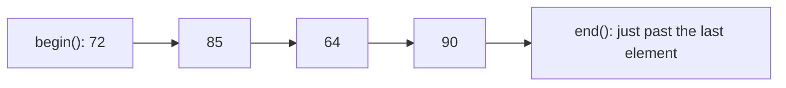
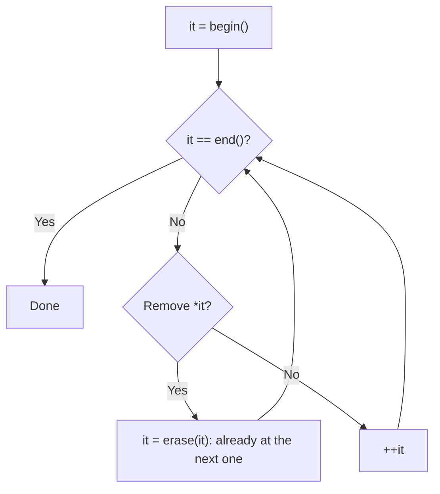
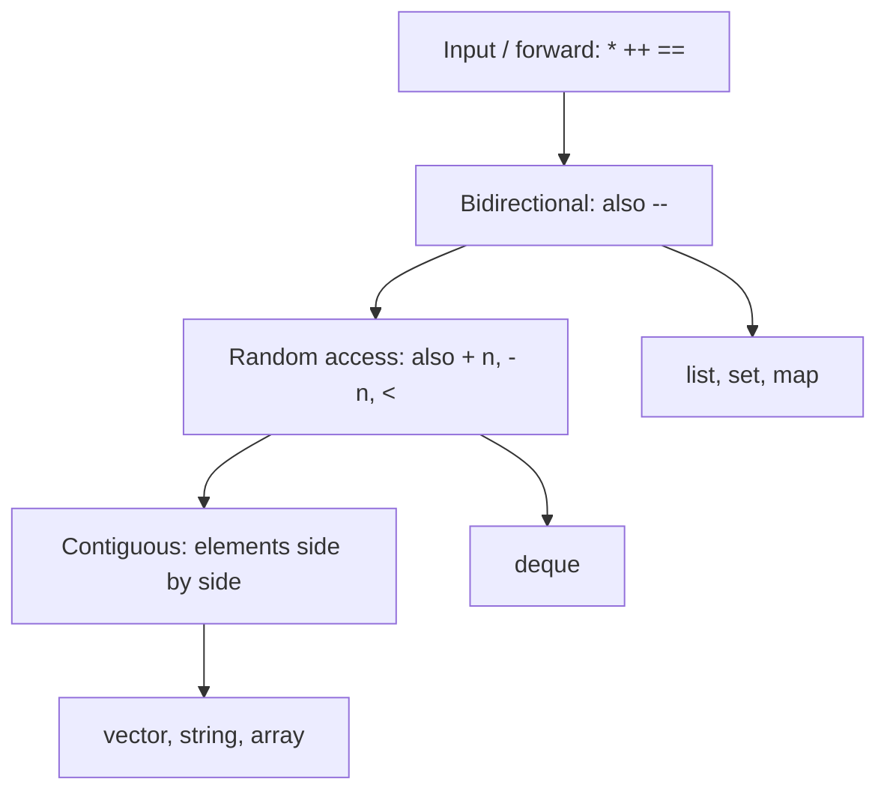

# new

## explanation

### A position in a container

An **iterator** marks a position inside a container, such as a vector or a string. It works like a bookmark: it tells you where you are, and you can move it along.

- `v.begin()` is an iterator to the first element.
- `v.end()` is an iterator to the position **just after** the last element. It's a marker, not an element.
- `*it` gives the element at the iterator's position, and `++it` moves it to the next one.

### Walking a container

Start at `begin()` and keep moving until you reach `end()`:

```cpp
for (auto pos = marks.begin(); pos != marks.end(); ++pos) {
    std::cout << *pos << ' ';
}
```

`auto` lets the compiler work out the iterator's long type name, `std::vector<int>::iterator`, for you. The loop stops **at** `end()`, never reading it.

### The range-based `for` loop

Because this walk is so common, C++ has a shorter form that does it for you:

```cpp
for (int m : marks) {
    std::cout << m << ' ';
}
```

Read it as "for each `m` in `marks`". Each pass, `m` is a **copy** of the next element. To change the elements themselves, add `&`:

```cpp
for (int& m : marks) {
    m += 5;
}
```

### Why iterators?

Indexes like `v[i]` only work for containers that keep elements in a row. Iterators work the same way for every container in the standard library, including ones with no indexes at all, and the standard algorithms, like sorting and searching, all take iterators. One loop style fits everything.

### Strings too

A `std::string` has `begin()` and `end()` as well, so `for (char c : word)` visits each character.

## diagram



## example

```cpp
#include <iostream>
#include <string>
#include <vector>

int main() {
    std::vector<int> marks = {72, 85, 64, 90};

    // An iterator marks a position; * reads the element there.
    std::vector<int>::iterator it = marks.begin();
    std::cout << "first: " << *it << '\n';
    ++it;
    std::cout << "second: " << *it << '\n';

    // Walk from begin() up to, but not including, end().
    for (auto pos = marks.begin(); pos != marks.end(); ++pos) {
        std::cout << *pos << ' ';
    }
    std::cout << '\n';

    // The range-based for loop does the same walk for you.
    for (int& m : marks) {
        m += 5;  // & lets the loop change each element
    }
    for (int m : marks) {
        std::cout << m << ' ';
    }
    std::cout << '\n';

    // Strings have iterators too.
    std::string word = "loop";
    for (char c : word) {
        std::cout << c << '-';
    }
    std::cout << '\n';
}
```

```text
first: 72
second: 85
72 85 64 90
77 90 69 95
l-o-o-p-
```

1. `marks.begin()` points at 72, and `*it` reads it. `++it` moves the iterator on to 85.
2. The loop moves `pos` from `begin()` until it equals `end()`, printing each element on the way.
3. `int& m` is a reference to each element in turn, so `m += 5` changes the vector itself.
4. The next loop uses plain `int m`, copies, which is fine for reading.
5. The string's characters are visited the same way.

## mistakes

- **Reading `end()`.** `*marks.end()` is not an element. Stop the loop when the iterator equals `end()`.
- **Changing copies in a range-for.** `for (int m : marks) m += 5;` changes each copy and leaves the vector unchanged. Write `int& m`.
- **Adding elements while looping.** `push_back` inside a range-for over the same vector can move its elements in memory, and the loop then reads freed memory. Don't change a container's size while walking it.
- **Comparing iterators from different containers.** `a.begin() != b.end()` is meaningless. Both ends of a walk must come from the same container.
- **Moving past the end.** `++it` when `it` is already `end()` goes out of the container. Check before moving.

## check

```cpp
#include <iostream>
#include <vector>

int main() {
    std::vector<int> v = {3, 6, 9};
    auto it = v.begin();
    *it = 4;
    ++it;
    int total = 0;
    for (int x : v) total += x;
    for (int x : v) x = 0;
    std::cout << *it << ' ' << total << ' ' << v[0] << '\n';
}
```

```text
6 19 4
```

`*it = 4` changes the first element through the iterator, and `++it` moves it to 6. The first loop adds 4 + 6 + 9 = 19. The second loop sets copies to 0, so the vector is unchanged and `v[0]` is still 4.

# building

## explanation

### A quick recap

`begin()` points at the first element and `end()` just past the last. `*it` reads, `++it` moves on, and a range-for walks the whole container. `&` in a range-for lets you change elements.

### Reading without copying

`for (auto n : names)` copies every string. For anything bigger than a number, write `for (const auto& n : names)` to read, or `for (auto& n : names)` to change.

### Arithmetic on vector and string iterators

Vectors and strings keep their elements in a row, so their iterators can jump:

- `v.begin() + 2` points at index 2.
- `it - v.begin()` gives the index of `it`.
- `v.end() - v.begin()` is the number of elements.

### Walking backwards

`rbegin()` points at the last element and `rend()` just before the first. `++` on a reverse iterator moves towards the front, so the same loop shape walks backwards.

### Containers without indexes

A `std::list` stores each element separately, linked to its neighbours. It has no `[i]`, and you can't jump with `+ 2`. Iterators are the way in: `++it`, or `std::next(it, 2)` to move several steps.

### Erasing while you walk

`erase(it)` removes the element at `it`, and `it` is no longer valid afterwards. But `erase` returns an iterator to the next element, so the safe pattern is:

```cpp
for (auto it = c.begin(); it != c.end();) {
    if (shouldRemove(*it)) it = c.erase(it);
    else ++it;
}
```

Only move on with `++it` when you didn't erase. This works for vectors and lists alike.

## diagram



## example

```cpp
#include <iostream>
#include <list>
#include <string>
#include <vector>

int main() {
    std::vector<std::string> names = {"Ira", "Dev", "Noor", "Sam"};

    // const auto&: read each name without copying it.
    for (const auto& n : names) std::cout << n << ' ';
    std::cout << '\n';

    // Vector iterators can jump, and subtracting gives a distance.
    auto third = names.begin() + 2;
    std::cout << *third << " is at index " << (third - names.begin()) << " of " << (names.end() - names.begin()) << '\n';

    // Reverse iterators walk from the back.
    for (auto r = names.rbegin(); r != names.rend(); ++r) std::cout << *r << ' ';
    std::cout << '\n';

    // A list has no [i]; iterators are the way in.
    std::list<int> waiting = {5, 12, 7, 20, 3};
    for (auto it = waiting.begin(); it != waiting.end();) {
        if (*it > 10) {
            it = waiting.erase(it);  // erase returns the next position
        } else {
            ++it;
        }
    }
    for (int x : waiting) std::cout << x << ' ';
    std::cout << '\n';
}
```

```text
Ira Dev Noor Sam
Noor is at index 2 of 4
Sam Noor Dev Ira
5 7 3
```

1. `const auto&` reads each string where it is, with no copies.
2. `begin() + 2` jumps straight to "Noor". Subtracting `begin()` gives its index, and `end() - begin()` the size.
3. `rbegin()` starts at "Sam", and `++r` moves towards the front.
4. In the list, 12 and 20 are erased. Each `erase` hands back the next position, so no element is skipped and no invalid iterator is used.

## mistakes

- **`++it` after `erase(it)`.** The erased iterator is invalid, and moving it is undefined. Use `it = c.erase(it);` and skip the `++` on that pass.
- **Copying in a range-for.** `for (auto s : names)` copies every string. Use `const auto&` to read and `auto&` to change.
- **Jumping on a list.** `waiting.begin() + 2` doesn't compile for a `std::list`. Use `std::next(waiting.begin(), 2)`.
- **Jumping past the end.** `names.begin() + 10` on a 4-element vector goes out of the container. Check the size first.
- **Keeping a vector iterator across `push_back`.** If the vector grows into a new block, old iterators point at freed memory. Get a fresh iterator after adding.

## check

```cpp
#include <iostream>
#include <iterator>
#include <list>
#include <vector>

int main() {
    std::vector<int> v = {2, 4, 6, 8, 10};
    auto a = v.begin() + 1;
    auto b = v.end() - 1;
    std::list<int> l = {1, 2, 3, 4};
    for (auto it = l.begin(); it != l.end();) it = (*it % 2 == 0) ? l.erase(it) : std::next(it);
    std::cout << *a + *b << ' ' << (b - a) << ' ' << *v.rbegin() << ' ' << l.size() << '\n';
}
```

```text
14 3 10 2
```

`a` points at 4 and `b` at the last element, 10, so `*a + *b` is 14 and they are 3 positions apart. `rbegin()` is the last element, 10. The list loop erases the even numbers, using the returned iterator, and moves on with `std::next` otherwise, leaving 1 and 3.

# strong

## explanation

### Iterator categories

Not every iterator can do everything. The standard library sorts them by what they support:

- **Input/forward**: `*`, `++` and `==`/`!=`. One direction only.
- **Bidirectional**: also `--`. `std::list`, `std::set` and `std::map` give these.
- **Random access**: also `+ n`, `- n`, `<` and subtraction, all in constant time. `std::vector`, `std::deque` and `std::string` give these.
- **Contiguous** (C++20): random access, with the elements guaranteed side by side in memory, as in `vector` and `string`.

Algorithms state what they need: `std::sort` needs random access, so it can't sort a `std::list` (which has its own `sort()` member). Helpers like `std::next` and `std::distance` work on any category, but are linear for anything below random access.

### Half-open ranges

Every range is `[first, last)`: `first` included, `last` excluded. That makes the empty range simply `first == last`, the length `last - first`, and splitting easy: `[begin, mid)` and `[mid, end)` cover everything with no overlap and no gap.

### Invalidation rules

- `vector`/`string`: anything that reallocates (`push_back` past the capacity, `insert`, `reserve`) invalidates **all** iterators; `erase` invalidates those at and after the erased position.
- `list`, `set`, `map`: only iterators to erased elements become invalid; everything else stays valid through inserts.

### Reverse iterators

A reverse iterator wraps a normal one that points **one place to the right**: `r.base()` for `rbegin()` is `end()`. To erase the element a reverse iterator `r` refers to, call `v.erase(std::next(r).base())`.

### Your own iterable types

A range-for only needs `begin()` and `end()` returning things that support `*`, prefix `++` and `!=`. Provide those, and your own types work in range-for loops. Full compatibility with the standard algorithms needs a few more type declarations.

### C++20 ranges

`std::ranges::sort(v)` takes the whole container instead of two iterators, and views like `std::views::reverse` let you describe a walk without copying the data. They are built on the same iterator ideas.

## diagram



## example

```cpp
#include <iostream>
#include <iterator>
#include <list>
#include <vector>

// The smallest thing a range-for needs: begin(), end(), and an iterator with *, ++ and !=.
class Countdown {
public:
    explicit Countdown(int from) : from_(from) {}
    struct Iter {
        int value;
        int operator*() const { return value; }
        Iter& operator++() { --value; return *this; }
        bool operator!=(const Iter& other) const { return value != other.value; }
    };
    Iter begin() const { return Iter{from_}; }
    Iter end() const { return Iter{0}; }
private:
    int from_;
};

int main() {
    for (int n : Countdown(5)) std::cout << n << ' ';
    std::cout << '\n';

    // Random access jumps in one step; a list's std::next walks.
    std::vector<int> vec = {1, 2, 3, 4, 5, 6};
    std::list<int> lst(vec.begin(), vec.end());  // any container from an iterator range
    auto v4 = vec.begin() + 4;
    auto l4 = std::next(lst.begin(), 4);
    std::cout << *v4 << ' ' << *l4 << ' ' << std::distance(lst.begin(), lst.end()) << '\n';

    // A reverse iterator's base() points one place to the right.
    auto r = vec.rbegin();  // refers to 6
    std::cout << *r << ' ' << (r.base() == vec.end()) << '\n';

    // Half-open ranges: [first, last) splits with no overlap or gap.
    auto mid = vec.begin() + vec.size() / 2;
    int left = 0, right = 0;
    for (auto it = vec.begin(); it != mid; ++it) left += *it;
    for (auto it = mid; it != vec.end(); ++it) right += *it;
    std::cout << left << " + " << right << '\n';
}
```

```text
5 4 3 2 1
5 5 6
6 1
6 + 15
```

1. `Countdown` provides `begin()` at 5 and `end()` at 0. Its iterator counts down on `++`, so the range-for prints 5 to 1 and stops when the value reaches the end marker.
2. The list is built from the vector's iterator range. `begin() + 4` is one step for the vector; `std::next` walks four links for the list. `std::distance` counts the list's 6 elements by walking.
3. `rbegin()` refers to 6, but its `base()` is `end()`, one place to the right.
4. `mid` splits six elements into `[begin, mid)`, which sums to 6, and `[mid, end)`, which sums to 15.

## mistakes

- **Assuming iterators survive changes.** In a vector, a reallocation invalidates every iterator, and an `erase` invalidates those from the erase point on. Re-fetch iterators after changing a vector; lists and maps are more forgiving.
- **`std::distance` or `std::next` in a loop over a list.** Each call walks the list, so the loop becomes quadratic. Carry the iterator along instead.
- **Erasing through a reverse iterator.** `v.erase(r.base())` erases the element after the one `r` shows. Use `v.erase(std::next(r).base())`.
- **`it < last` on a non-random-access iterator.** It doesn't compile for lists or maps. Use `!=`, which works for every category.
- **Calling `std::sort` on a list.** It needs random access. Use `lst.sort()` instead.

## check

```cpp
#include <iostream>
#include <iterator>
#include <vector>

int main() {
    std::vector<int> v = {1, 2, 3, 4, 5};
    auto r = v.rbegin() + 1;
    auto f = r.base();
    std::vector<int> half(v.begin(), v.begin() + 2);
    int steps = static_cast<int>(std::distance(v.begin(), f));
    std::cout << *r << ' ' << *f << ' ' << steps << ' ' << half.back() << '\n';
}
```

```text
4 5 4 2
```

`rbegin()` refers to 5, and `+ 1` moves one place towards the front, to 4. Its `base()` points one place to the right of that, at 5, which is index 4. `half` is built from the range `[begin, begin + 2)`, so it holds 1 and 2.
