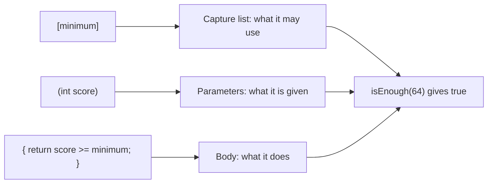
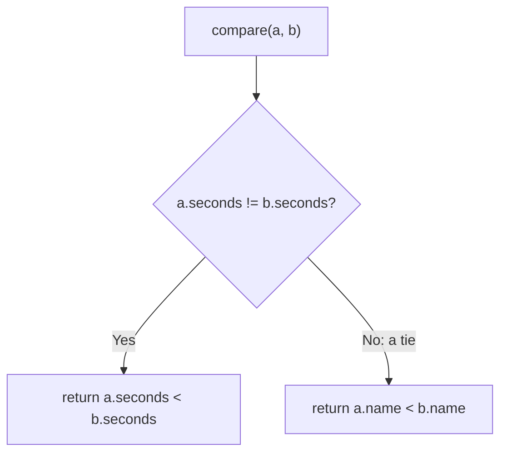
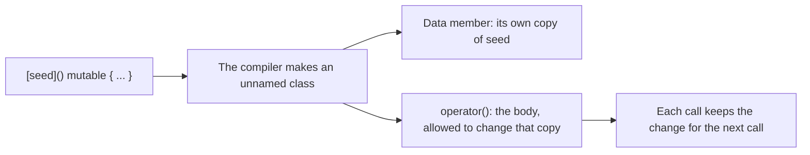

# new

## explanation

### A function written where you need it

Sometimes you need a tiny function just once, for example to tell `std::sort` how to order things. Writing a full named function far away from where it's used is clumsy. A **lambda** is a small unnamed function written right in place:

```cpp
auto addTax = [](double price) { return price * 1.18; };
```

- `[]` starts the lambda. It's the **capture list**, explained below.
- `(double price)` is the parameter list, as in any function.
- `{ return price * 1.18; }` is the body.

`auto` stores the lambda in a variable, and you call it like a function: `addTax(100)`.

### Using outside variables: captures

A lambda can't see the local variables around it unless it **captures** them in the square brackets:

- `[minimum]` captures by **value**: the lambda gets its own copy of `minimum`, taken when the lambda is made.
- `[&total]` captures by **reference**: the lambda uses `total` itself, so it can change it, and it sees later changes.

```cpp
int minimum = 50;
auto isEnough = [minimum](int score) { return score >= minimum; };
```

### Lambdas as arguments

The most common use is handing a lambda to another function. `std::sort` (from `<algorithm>`) sorts from lowest to highest by default. Give it a lambda that says when `a` should come before `b`, and it sorts your way:

```cpp
std::sort(times.begin(), times.end(), [](int a, int b) { return a > b; });
```

This **comparator** says "`a` goes first when it's bigger", so the result is highest first.

### When to use one

Use a lambda for short, one-off pieces of logic, especially ones you pass to another function. If the logic is long, or needed in several places, a named function is clearer.

## diagram



## example

```cpp
#include <algorithm>
#include <iostream>
#include <vector>

int main() {
    // A lambda is a function written right where you need it.
    auto addTax = [](double price) { return price * 1.18; };
    std::cout << "with tax: " << addTax(100) << '\n';

    // [minimum] copies minimum into the lambda, so the lambda can use it.
    int minimum = 50;
    auto isEnough = [minimum](int score) { return score >= minimum; };
    std::cout << isEnough(64) << ' ' << isEnough(31) << '\n';

    // [&total] lets the lambda change total itself.
    int total = 0;
    auto addUp = [&total](int amount) { total += amount; };
    addUp(30);
    addUp(12);
    std::cout << "total: " << total << '\n';

    // A lambda as a comparator: sort from highest to lowest.
    std::vector<int> times = {42, 17, 88, 5};
    std::sort(times.begin(), times.end(), [](int a, int b) { return a > b; });
    for (int t : times) std::cout << t << ' ';
    std::cout << '\n';
}
```

```text
with tax: 118
1 0
total: 42
88 42 17 5
```

1. `addTax` is called like a function: 100 × 1.18 prints as 118.
2. `isEnough` has its own copy of `minimum`, 50. 64 is enough and 31 isn't.
3. `addUp` captures `total` by reference, so each call changes the real `total`: 30, then 42.
4. The comparator tells `std::sort` to put bigger numbers first.

## mistakes

- **Using a variable you didn't capture.** `[](int s) { return s >= minimum; }` doesn't compile: `minimum` isn't in the capture list. Add it: `[minimum]`.
- **Expecting a value capture to change the outside variable.** `[total]` gives the lambda a copy. To change `total`, capture `[&total]`.
- **Forgetting to call it.** `std::cout << addTax;` doesn't print a price. Call it with an argument: `addTax(100)`.
- **Missing the semicolon.** A lambda stored in a variable is a statement: `auto f = [](int x) { return x; };`, with `;` at the very end.
- **Writing a long lambda.** Twenty lines inside an argument list are hard to read. Give long logic a named function.

## check

```cpp
#include <iostream>

int main() {
    int bonus = 5;
    auto withBonus = [bonus](int x) { return x + bonus; };
    bonus = 100;
    int count = 0;
    auto tick = [&count]() { count++; };
    tick();
    tick();
    std::cout << withBonus(10) << ' ' << count << '\n';
}
```

```text
15 2
```

`withBonus` copied `bonus` when it was made, while it was still 5. Changing `bonus` to 100 later doesn't affect the copy, so `withBonus(10)` is 15. `tick` captures `count` by reference, so two calls make the real `count` 2.

# building

## explanation

### A quick recap

A lambda is `[captures](parameters) { body }`. A capture by value copies a variable when the lambda is made; a capture by reference uses the variable itself. Lambdas are often passed to functions like `std::sort`.

### Choosing captures

- List exactly what you use: `[limit]` or `[&total]`. It documents what the lambda depends on.
- `[=]` copies everything used and `[&]` references everything used. They're convenient for short lambdas used on the spot, but hide what the lambda depends on.
- Capture by reference when the lambda must change something, or when copying would be expensive and the lambda is used straight away.
- Capture by value when the lambda might be kept and called later, after the local variables are gone.

### Writing a good comparator

A comparator answers one question: **should `a` come before `b`?** It must return `true` only when `a` strictly comes first. For equal elements, it must return `false` both ways. So use `<` or `>`, never `<=`. For a tie-break, compare the first key, and only if it's equal compare the second:

```cpp
if (a.seconds != b.seconds) return a.seconds < b.seconds;
return a.name < b.name;
```

### Predicates

A lambda that returns `bool` about one element is a **predicate**. Functions like `std::count_if` and `std::find_if` take one: `std::count_if(v.begin(), v.end(), underLimit)` counts the elements for which `underLimit` says yes.

### Storing lambdas: `std::function`

Every lambda has its own unique type, so two different lambdas can't go in the same `auto` variable. `std::function<int(int)>` from `<functional>` can hold any callable that takes an `int` and returns an `int`, which lets you choose a lambda at run time.

### Return types

Normally the return type is worked out from the `return` statements. If they return different types, name it yourself: `[](int x) -> double { ... }`.

## diagram



## example

```cpp
#include <algorithm>
#include <functional>
#include <iostream>
#include <string>
#include <vector>

struct Runner {
    std::string name;
    int seconds;
};

int main() {
    std::vector<Runner> runners = {{"Zoya", 312}, {"Arun", 298}, {"Mira", 312}, {"Dev", 340}};

    // Comparator: fastest first; equal times in name order.
    std::sort(runners.begin(), runners.end(), [](const Runner& a, const Runner& b) {
        if (a.seconds != b.seconds) return a.seconds < b.seconds;
        return a.name < b.name;
    });
    for (const auto& r : runners) std::cout << r.name << ' ' << r.seconds << '\n';

    // A predicate that captures a limit.
    int limit = 320;
    auto underLimit = [limit](const Runner& r) { return r.seconds < limit; };
    std::cout << "under " << limit << ": " << std::count_if(runners.begin(), runners.end(), underLimit) << '\n';

    // std::function can hold any of several lambdas with the same shape.
    std::function<int(int)> step;
    bool warmUp = true;
    if (warmUp) step = [](int s) { return s + 30; };
    else step = [](int s) { return s; };
    std::cout << "with warm-up: " << step(runners.front().seconds) << '\n';
}
```

```text
Arun 298
Mira 312
Zoya 312
Dev 340
under 320: 3
with warm-up: 328
```

1. The comparator orders by time; Mira and Zoya tie at 312, so their names decide, and Mira comes first.
2. `underLimit` copies `limit` and answers yes or no for one runner. `std::count_if` calls it on each runner and counts the yeses: 3.
3. `step` is a `std::function<int(int)>`, so either lambda fits in it. With `warmUp` true it adds 30 to the fastest time: 328.

## mistakes

- **`<=` in a comparator.** It says an element comes before itself, which breaks `std::sort`'s rules. The result can be wrongly ordered, or worse. Use `<`.
- **Comparing only the first key when ties matter.** Equal times end up in no particular order. Add a second key for ties.
- **`[&]` in a lambda that is kept.** If it's called after the captured locals are gone, it reads freed memory. Capture by value when the lambda outlives the current scope.
- **Copying something big by value.** `[bigVector]` copies the whole vector into the lambda. If the lambda is used immediately, capture `[&bigVector]`.
- **Different return types in one lambda.** `return 1;` in one branch and `return 1.5;` in another doesn't compile. Make them the same type, or write `-> double`.

## check

```cpp
#include <algorithm>
#include <iostream>
#include <string>
#include <vector>

int main() {
    std::vector<std::string> w = {"kiwi", "fig", "apple", "date"};
    std::sort(w.begin(), w.end(), [](const std::string& a, const std::string& b) {
        return a.size() != b.size() ? a.size() < b.size() : a < b;
    });
    int n = 4;
    auto longer = [&n](const std::string& s) { return static_cast<int>(s.size()) > n; };
    n = 3;
    std::cout << w[0] << ' ' << w[1] << ' ' << w[3] << ' ' << std::count_if(w.begin(), w.end(), longer) << '\n';
}
```

```text
fig date apple 3
```

The comparator sorts by length first, then alphabetically for equal lengths: fig, date, kiwi, apple. `longer` captures `n` by reference, so it uses the value at the time of the call, 3, not 4. Three words are longer than 3 letters: date, kiwi and apple.

# strong

## explanation

### What a lambda really is

The compiler turns each lambda into an unnamed class with an `operator()`: a **closure type**. Captured variables become its data members, copied or referenced when the lambda object is created. Calling the lambda calls `operator()`. That's why every lambda has its own unique type, and why a lambda with no captures costs nothing beyond a normal function call: the compiler can usually inline it completely.

### `mutable`

`operator()` is `const` by default, so by-value captures can't be changed inside the body. Adding `mutable` allows it. The change affects the lambda's **own copy**, and persists between calls of that same lambda object; the original variable is untouched.

### Init-captures

`[limit = base * 2]` or `[items = std::move(list)]` (C++14) create a new member initialised by any expression. This lets you compute a value once, or move something expensive into the lambda instead of copying it.

### Generic lambdas

A parameter declared `auto` makes the lambda work for any type its body supports: `[](auto x) { return x + x; }` works on `int`, `double` and `std::string`. Each type used creates its own version at compile time.

### Immediately invoked lambdas

`const auto label = [&]() { ... }();` defines a lambda and calls it at once. It's a neat way to initialise a `const` variable with logic that needs several statements.

### `std::function` versus `auto`

`std::function` can hold any callable with a given signature, but it hides the type ("type erasure"): every call goes through an indirection the compiler usually can't inline, and storing a large closure may allocate memory. Keep lambdas in `auto` variables, or pass them to templates such as the standard algorithms, unless you really need to store different callables in one place.

### Lifetimes

A closure holding references dangles once the referenced variables are gone. The classic case is returning a lambda that captured locals by `&`. In member functions, `[=]` captures the `this` pointer, not a copy of the object, so the lambda also dangles if the object dies; C++20 deprecates that implicit capture and wants `[=, this]` written out.

## diagram



## example

```cpp
#include <algorithm>
#include <cstdlib>
#include <iostream>
#include <string>
#include <utility>
#include <vector>

int main() {
    // A generic lambda: auto parameters work for any type the body supports.
    auto twice = [](auto x) { return x + x; };
    std::cout << twice(21) << ' ' << twice(std::string("ab")) << ' ' << twice(1.25) << '\n';

    // Init-capture: a new member made inside the lambda, computed or moved in.
    int base = 5;
    std::vector<int> list = {4, 8, 15};
    auto check = [limit = base * 2, items = std::move(list)](int x) { return x < limit && items.size() == 3; };
    std::cout << check(9) << ' ' << check(10) << '\n';

    // By-value captures are const unless the lambda is mutable.
    int seed = 7;
    auto scramble = [seed]() mutable { seed = seed * 31 % 100; return seed; };
    int first = scramble();
    int second = scramble();
    std::cout << first << ' ' << second << ' ' << seed << '\n';

    // Immediately invoked: set up a const with several steps of logic.
    const std::string label = [&]() {
        if (first > 50) return std::string("high");
        return std::string("low");
    }();
    std::cout << label << '\n';

    // A comparator on a computed key.
    std::vector<int> v = {-7, 3, -2, 9, 0};
    std::sort(v.begin(), v.end(), [](int a, int b) { return std::abs(a) < std::abs(b); });
    for (int x : v) std::cout << x << ' ';
    std::cout << '\n';
}
```

```text
42 abab 2.5
1 0
17 27 7
low
0 -2 3 -7 9
```

1. `twice` gets a separate compiled version for `int`, `std::string` and `double`; `+` means addition for numbers and joining for strings.
2. `check` holds two members made by init-capture: `limit` computed as 10, and `items`, the vector moved in rather than copied.
3. `mutable` lets `scramble` change its own copy of `seed`: 7 × 31 % 100 = 17, then 17 × 31 % 100 = 27. The outer `seed` is still 7.
4. The immediately invoked lambda chooses the `const` string's value once, with ordinary `if` logic.
5. The comparator sorts by distance from zero: 0, -2, 3, -7, 9.

## mistakes

- **Returning a lambda that captured locals by reference.** The locals die at the return, and every later call reads freed memory. Capture by value, or use an init-capture.
- **`[=]` in a member function.** It captures `this`, not a copy of the object, so the lambda breaks if the object is destroyed first. Write `[=, this]` deliberately, or capture `[*this]` for a copy.
- **Expecting `mutable` to change the original.** It changes the lambda's own copy only.
- **`std::function` in hot code.** Each call is indirect and may not be inlined, and storing a big closure can allocate. Prefer `auto` or a template parameter.
- **Assuming two identical lambdas share a type.** Each lambda expression has its own unique type, so one can't be assigned to a variable holding the other. Use `std::function` or a template if you need to mix them.

## check

```cpp
#include <iostream>

int main() {
    int a = 1;
    auto byValue = [a]() mutable { a += 10; return a; };
    auto byRef = [&a]() { a *= 3; return a; };
    int r1 = byValue();
    int r2 = byRef();
    int r3 = byValue();
    auto pick = [](auto x, auto y) { return x > y ? x : y; };
    std::cout << r1 << ' ' << r2 << ' ' << r3 << ' ' << a << ' ' << pick(2.5, 2) << '\n';
}
```

```text
11 3 21 3 2.5
```

`byValue` holds its own copy of `a`, made while `a` was 1; `mutable` lets it grow to 11, then 21 on the second call. `byRef` changes the real `a` from 1 to 3, which the copy never sees. In `pick(2.5, 2)`, `? :` converts both sides to `double`, the common type, and returns 2.5.
