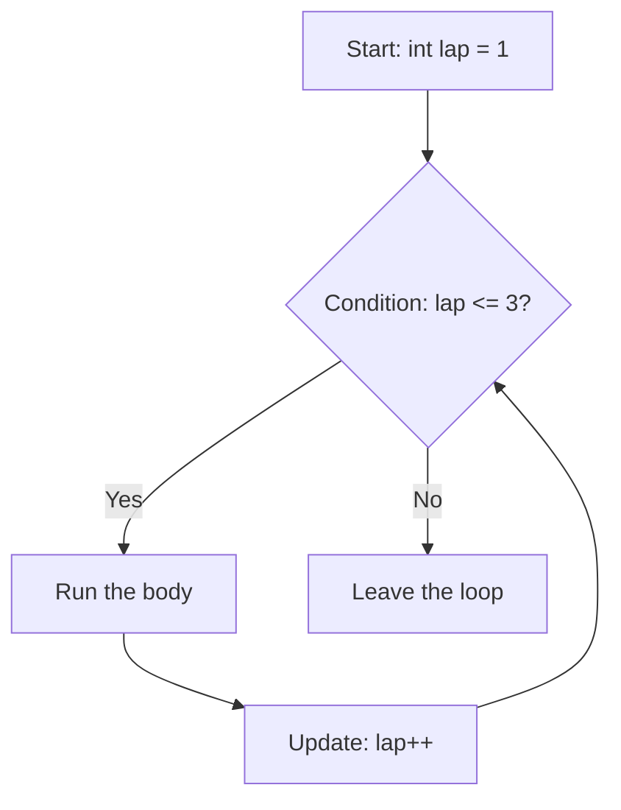
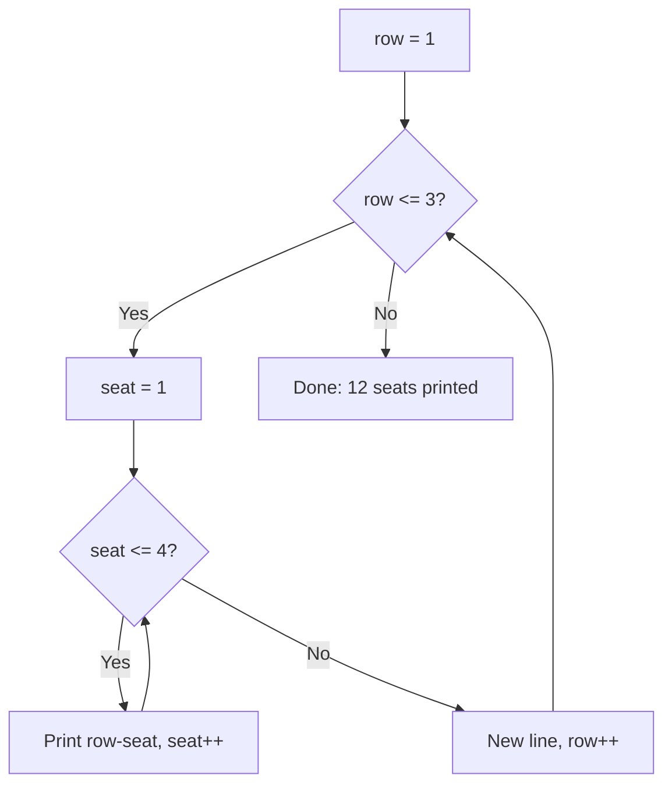
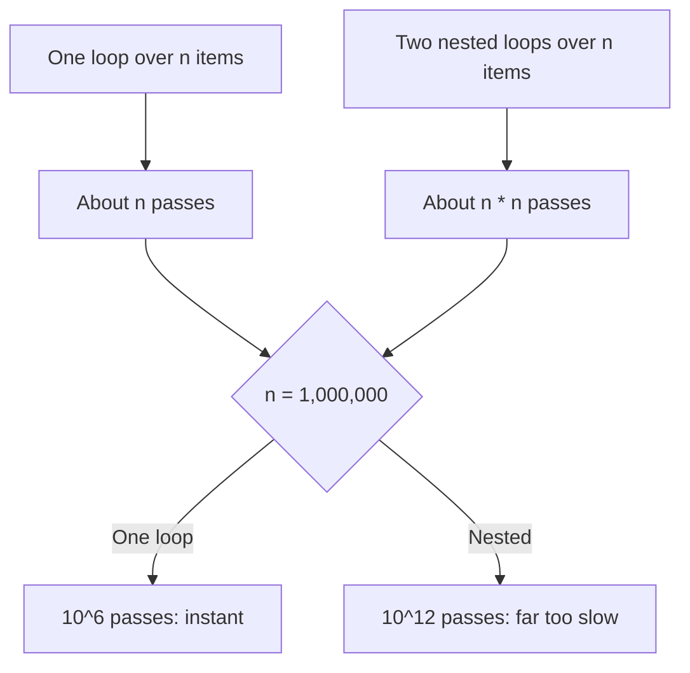

# new

## explanation

### Why loops

Printing "Lap done" three times is easy with three lines. Printing it a thousand times isn't. A **loop** repeats a block of statements for you, as many times as needed.

### `while`: repeat while a condition holds

```cpp
while (savings < 2000) {
    savings = savings + 400;
}
```

Before each pass, the condition is checked. If it's true, the block runs, and then the check happens again. As soon as it's false, the loop ends and the program continues after it. If the condition is false from the start, the block never runs at all.

Something inside the loop must change the condition, here `savings`. Otherwise the loop runs forever.

### `for`: repeat a counted number of times

```cpp
for (int lap = 1; lap <= 3; lap++) {
    std::cout << "Lap " << lap << '\n';
}
```

The parentheses hold three parts, separated by semicolons:

1. **Start**: `int lap = 1` runs once, before anything else.
2. **Condition**: `lap <= 3` is checked before every pass.
3. **Update**: `lap++` runs after every pass.

So `lap` takes the values 1, 2 and 3, and the loop stops when it becomes 4. A variable made in the start part, like `lap`, only exists inside the loop.

Counting from 0 is very common in C++: `for (int i = 0; i < 3; i++)` also runs three times, with `i` being 0, 1 and 2.

### `do ... while`: at least once

`do { ... } while (condition);` runs the block first and checks afterwards, so the block always runs at least once.

### `break` and `continue`

- `break` ends the loop straight away.
- `continue` skips the rest of this pass and moves on to the next one.

### Which loop to use

Use `for` when you know how many times to repeat, `while` when you repeat until something changes, and `do ... while` when the block must run at least once.

## diagram



## example

```cpp
#include <iostream>

int main() {
    // for: count a known number of times
    for (int lap = 1; lap <= 3; lap++) {
        std::cout << "Lap " << lap << " done\n";
    }

    // while: repeat until something changes
    int savings = 500;
    int months = 0;
    while (savings < 2000) {
        savings = savings + 400;
        months++;
    }
    std::cout << "Reached " << savings << " after " << months << " months\n";

    // break and continue
    for (int n = 1; n <= 10; n++) {
        if (n % 3 == 0) {
            continue;  // skip multiples of 3
        }
        if (n > 7) {
            break;  // stop the whole loop
        }
        std::cout << n << ' ';
    }
    std::cout << '\n';
}
```

```text
Lap 1 done
Lap 2 done
Lap 3 done
Reached 2100 after 4 months
1 2 4 5 7
```

1. The `for` loop starts `lap` at 1, prints, adds one, and stops once `lap` is 4.
2. The `while` loop adds 400 each month: 900, 1300, 1700, 2100. At 2100 the condition `savings < 2000` is false, so it stops after 4 months.
3. In the last loop, 3 and 6 are skipped by `continue`. At 8, `n > 7` is true, so `break` ends the loop before 8 is printed; 9 and 10 never come.

## mistakes

- **Off by one.** `for (int i = 1; i < 10; i++)` runs 9 times, not 10. Check the first and last values: does it need `<` or `<=`?
- **A `while` that never ends.** If nothing in the body changes the condition, the loop runs forever. Make sure every pass moves towards the end.
- **A semicolon after the loop.** `for (int i = 0; i < 3; i++);` has an empty body. The block after it runs only once, after the loop.
- **Using the counter after a `for` loop.** A variable made in the `for`'s start part, like `int i`, is gone after the loop. Declare it before the loop if you need it afterwards.
- **Changing the counter inside the body.** Adding to `i` inside a `for` loop as well as in the update makes the count hard to follow. Let the update part do it.

## check

```cpp
#include <iostream>

int main() {
    for (int i = 0; i < 4; i++) {
        std::cout << i * 2 << ' ';
    }
    std::cout << '\n';
    int x = 1;
    while (x < 20) {
        x = x * 3;
    }
    std::cout << x << '\n';
}
```

```text
0 2 4 6
27
```

`i` goes 0, 1, 2, 3, and stops at 4 because `4 < 4` is false, so the loop prints double each one. In the `while` loop, `x` goes 1, 3, 9, 27. After 27, `27 < 20` is false, so the loop stops: it overshoots 20 rather than stopping at it.

# building

## explanation

### A quick recap

`for` repeats a counted number of times, `while` repeats until its condition is false, and `do ... while` always runs at least once. `break` leaves the loop and `continue` skips to the next pass.

### Designing a loop

Answer three questions before writing it:

1. **What changes each pass?** A counter, a running total, a value being reduced.
2. **When does it stop?** Write the exact condition, and check the first and last pass.
3. **What moves it towards stopping?** Something in each pass must bring the condition closer to false.

Then trace two or three passes on paper, writing each variable's value after every pass. Tracing finds most loop bugs.

### Accumulators

A variable that collects a result across passes is an **accumulator**: a running total, a count, or the largest value so far. Give it a starting value **before** the loop, update it inside, and use it after. Starting it inside the loop resets it every pass.

### Nested loops

A loop inside another loop runs **completely** for every single pass of the outer one. With 3 rows and 4 seats, the inner loop runs 4 times per row, 12 times in all. Give each loop its own counter name, like `row` and `seat`. If the inner loop declares `int i` while the outer one also uses `i`, the inner `i` is a separate variable that hides the outer one inside the inner loop. The outer count carries on unchanged, but the code is confusing to read. The real bug is writing `for (i = 0; ...)` without `int` inside a loop over `i`: that reuses and resets the outer counter.

`break` and `continue` only affect the loop they are directly in. A `break` in the inner loop ends that inner loop, and the outer loop carries on with its next pass.

### `continue` in a `while` loop

In a `for` loop, `continue` jumps to the update part, so the counter still moves on. In a `while` loop, the update is just a statement in the body. If `continue` skips past it, the counter never changes and the loop never ends. Update first, or use a `for` loop.

### `do ... while` when the first pass is certain

If the body must run before the condition makes sense, such as asking for input and then checking it, `do ... while` says so directly.

## diagram



## example

```cpp
#include <iostream>

int main() {
    // Nested loops: the inner loop runs fully for every pass of the outer one.
    for (int row = 1; row <= 3; row++) {
        for (int seat = 1; seat <= 4; seat++) {
            std::cout << row << '-' << seat << ' ';
        }
        std::cout << '\n';
    }

    // Accumulators: a step count and the highest value so far.
    int n = 6;
    int steps = 0;
    int highest = n;
    while (n != 1) {
        if (n % 2 == 0) {
            n = n / 2;
        } else {
            n = 3 * n + 1;
        }
        steps++;
        if (n > highest) {
            highest = n;
        }
    }
    std::cout << "steps: " << steps << ", highest: " << highest << '\n';

    // do-while runs once even though the condition is false from the start.
    int stock = 5;
    do {
        stock -= 2;
    } while (stock > 10);
    std::cout << "stock: " << stock << '\n';
}
```

```text
1-1 1-2 1-3 1-4
2-1 2-2 2-3 2-4
3-1 3-2 3-3 3-4
steps: 8, highest: 16
stock: 3
```

1. For each `row`, the inner loop prints all four seats, then the outer loop ends the line. That's 3 × 4 = 12 prints.
2. The `while` loop halves even numbers and turns odd ones into `3n + 1`: 6, 3, 10, 5, 16, 8, 4, 2, 1. That's 8 steps, and the highest value seen is 16. Both accumulators start before the loop.
3. `stock > 10` is false from the start, but `do ... while` runs the body once anyway, so `stock` becomes 3. A plain `while` would have left it at 5.

## mistakes

- **`continue` skipping the update in a `while`.** If the counter changes at the bottom of the body, `continue` jumps past it and the loop never ends. Change the counter before any `continue`, or use `for`.
- **Resetting the outer counter.** Inside `for (int i = ...)`, writing `for (i = 0; ...)` without `int` reuses the outer `i` and resets it, so the outer loop may never finish. Use a different name for each loop.
- **Starting an accumulator inside the loop.** `int total = 0;` inside the body sets it back to 0 on every pass. Declare it before the loop.
- **Expecting `break` to leave every loop.** It leaves only the innermost loop it's in. To stop both, use a `bool` flag that the outer loop also checks.
- **Inner bounds that depend on the outer counter.** `for (int b = a; ...)` starts at a different place on each outer pass. That's often intended, but trace it: it changes how many passes run.

## check

```cpp
#include <iostream>

int main() {
    int total = 0;
    for (int a = 1; a <= 3; a++) {
        for (int b = a; b <= 3; b++) {
            if (b == 2) continue;
            total += b;
        }
    }
    int k = 10;
    while (k > 0) {
        k -= 4;
    }
    std::cout << total << ' ' << k << '\n';
}
```

```text
10 -2
```

For `a = 1`, `b` runs 1, 2, 3, skipping 2, so it adds 1 and 3. For `a = 2`, `b` runs 2 and 3, adding only 3. For `a = 3`, it adds 3. In total: 1 + 3 + 3 + 3 = 10. `k` goes 10, 6, 2, then -2, and only then is `k > 0` false.

# strong

## explanation

### How much work a loop does

Count the passes. One loop over `n` items does about `n` passes; two nested loops over `n` items do `n × n`. A rough guide is around 10^8 simple steps per second. So a single loop over a million items is instant, but nested loops over 100,000 items, 10^10 passes, would take minutes. Before writing nested loops over large data, look for a way to do it in one pass.

### Loop invariants

An **invariant** is something true before and after every pass, such as "`highest` is the largest value seen so far". Stating it makes a loop easy to check: it must hold at the start, each pass must keep it, and when the loop ends it must give the answer.

### Leaving nested loops

`break` leaves one loop. To stop two at once, set a flag and test it in the outer condition (`a <= 9 && !found`), or put the loops in a function and `return` from it. The function version is often the clearest.

### Counting down with unsigned values

`for (unsigned i = n - 1; i >= 0; i--)` never ends: an unsigned value is always `>= 0`, and `0 - 1` wraps to about 4.29 billion. With `n == 0`, `n - 1` wraps before the loop even starts. A safe pattern tests first and subtracts after: `for (unsigned i = n; i-- > 0;)` runs `i` = `n-1` down to 0.

### Don't count with decimals

`0.1` has no exact binary form, so adding it ten times gives 0.9999999999999999, not 1. A loop like `while (x < 1.0) x += 0.1;` therefore runs 11 times, and `x != 1.0` as a condition would never stop. Count with an `int`, and compute the decimal from it: `double x = k / 10.0;`.

### What the condition costs

The condition runs before every pass. If it calls something slow, every pass pays for it. Work out an unchanging value once, before the loop.

### Shadowing in nested loops

If both loops declare `int i`, the inner one is a separate variable that **shadows** the outer one: inside the inner loop, `i` means the inner counter, and the outer `i` keeps counting normally. It's legal and harmless to the count, just hard to read, and compilers can warn about it (`-Wshadow`).

## diagram



## example

```cpp
#include <iostream>

int main() {
    // Leave two loops at once with a flag.
    bool found = false;
    int fa = 0, fb = 0;
    for (int a = 2; a <= 9 && !found; a++) {
        for (int b = a + 1; b <= 20; b++) {
            if (a * b == 36) {
                fa = a;
                fb = b;
                found = true;
                break;
            }
        }
    }
    std::cout << fa << " x " << fb << '\n';

    // Count down with an unsigned counter: test, then subtract.
    for (unsigned int i = 3; i-- > 0;) {
        std::cout << i << ' ';
    }
    std::cout << '\n';

    // Adding 0.1 ten times gives 0.9999999999999999, so this runs 11 times.
    double x = 0.0;
    int passes = 0;
    while (x < 1.0) {
        x += 0.1;
        passes++;
    }
    std::cout << "passes: " << passes << '\n';

    // Nested loops over n items do n * n passes.
    long long work = 0;
    int n = 1000;
    for (int i = 0; i < n; i++) {
        for (int j = 0; j < n; j++) {
            work++;
        }
    }
    std::cout << "nested passes: " << work << '\n';
}
```

```text
2 x 18
2 1 0
passes: 11
nested passes: 1000000
```

1. The first pair found is `a = 2`, `b = 18`. The `break` ends the inner loop, and `!found` in the outer condition ends the outer one.
2. `i-- > 0` compares first and subtracts after, so the body sees 2, 1 and 0, and the loop ends cleanly without ever testing a wrapped value.
3. After ten additions `x` is just below 1.0, so an eleventh pass runs.
4. 1,000 × 1,000 inner passes: a million. With 100,000 items it would be ten billion.

## mistakes

- **`i >= 0` with an unsigned counter.** It's always true, so the loop never ends, and `n - 1` wraps when `n` is 0. Use `for (unsigned i = n; i-- > 0;)` or a signed counter.
- **Decimal loop counters.** Comparing a running `double` with `==` or `!=` may never match. Count with an `int` and compute the decimal.
- **Nested loops on big input.** Two nested loops over 100,000 items is about 10^10 passes, far beyond what runs in a second. Look for a one-pass method first.
- **Slow work in the condition.** `i < expensiveCount()` calls it on every pass. Compute it once before the loop.
- **Expecting `break` to leave all loops.** It leaves only the innermost one. Use a flag, or move the loops into a function and `return`.

## check

```cpp
#include <iostream>

int main() {
    int count = 0;
    for (int i = 0; i < 5; i++) {
        for (int i = 0; i < 3; i++) {
            count++;
        }
    }
    int j = 0;
    for (; j * j < 50; j += 2) {}
    unsigned int u = 2;
    while (u-- > 0) count += 100;
    std::cout << count << ' ' << j << ' ' << u << '\n';
}
```

```text
215 8 4294967295
```

The inner `int i` is a separate variable that shadows the outer one, so the outer loop still runs 5 times and the inner one 3 times each: `count` is 15. `j` goes 0, 2, 4, 6, 8, and stops because `8 * 8 = 64` is not below 50. The `while` loop adds 100 twice; on the third test `u` is 0, so the test fails, but `u--` still runs and wraps it to 4,294,967,295. That makes `count` 215.
