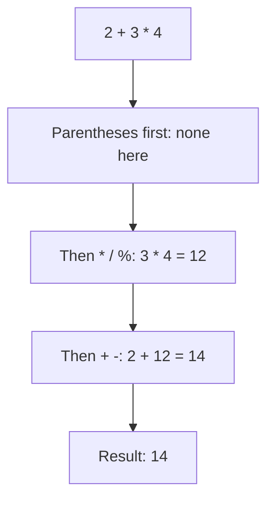
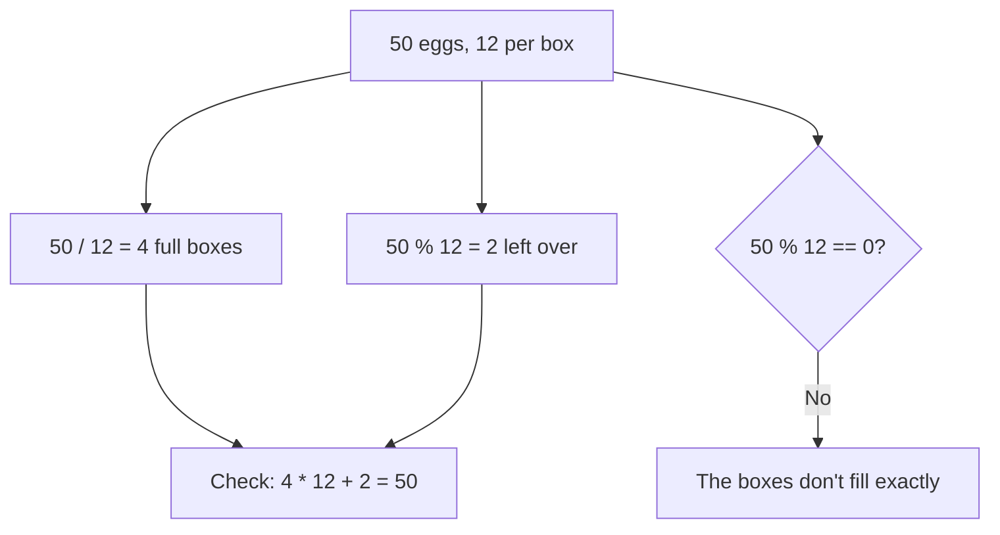
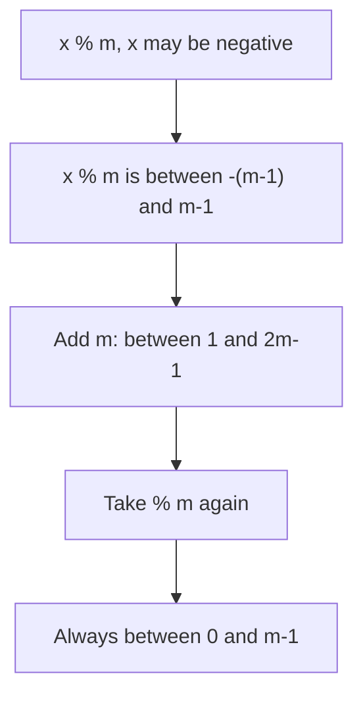

# new

## explanation

### Arithmetic

C++ does maths with these **operators**:

- `+` add, `-` subtract, `*` multiply, `/` divide.
- `%` gives the **remainder** after dividing whole numbers: `17 % 5` is `2`, because 17 is three fives with 2 left over.

### Whole-number division drops the remainder

When both sides of `/` are whole numbers, the answer is a whole number too, and the part after the decimal point is thrown away: `17 / 5` is `3`, not `3.4`. If either side is a decimal, you get the decimal answer: `17.0 / 5` is `3.4`.

`/` and `%` work as a pair. For 135 minutes, `135 / 60` gives the whole hours (2) and `135 % 60` gives the minutes left over (15).

### Which operator goes first

Just like in maths, `*`, `/` and `%` are done before `+` and `-`. So `2 + 3 * 4` is `14`. Operators of the same rank go left to right. Use parentheses to choose the order yourself: `(2 + 3) * 4` is `20`. When in doubt, add parentheses: they never hurt.

### Comparing

These compare two values and give a `bool`, `true` or `false` (printed as `1` or `0`):

- `==` equal to, `!=` not equal to
- `<` less than, `>` greater than, `<=` at most, `>=` at least

Notice that "equal to" is **two** equals signs. A single `=` stores a value.

### Combining conditions

- `&&` means **and**: true only when both sides are true.
- `||` means **or**: true when at least one side is true.
- `!` means **not**: it flips true and false.

`age >= 13 && age <= 19` checks that `age` is between 13 and 19, both included.

### Shortcuts for changing a variable

- `score += 5;` is the same as `score = score + 5;`. There are also `-=`, `*=`, `/=` and `%=`.
- `count++;` adds one, and `count--;` subtracts one.

## diagram



## example

```cpp
#include <iostream>

int main() {
    int totalMinutes = 135;
    int hours = totalMinutes / 60;
    int minutes = totalMinutes % 60;
    std::cout << totalMinutes << " minutes is " << hours << " h " << minutes << " min\n";

    std::cout << "17 / 5 = " << 17 / 5 << '\n';
    std::cout << "17.0 / 5 = " << 17.0 / 5 << '\n';
    std::cout << "2 + 3 * 4 = " << 2 + 3 * 4 << '\n';
    std::cout << "(2 + 3) * 4 = " << (2 + 3) * 4 << '\n';

    int age = 20;
    bool canVote = age >= 18;
    bool isTeen = age >= 13 && age <= 19;
    std::cout << "can vote: " << canVote << ", teen: " << isTeen << '\n';
}
```

```text
135 minutes is 2 h 15 min
17 / 5 = 3
17.0 / 5 = 3.4
2 + 3 * 4 = 14
(2 + 3) * 4 = 20
can vote: 1, teen: 0
```

1. `135 / 60` divides whole numbers, so it gives `2` full hours. `135 % 60` gives what's left over: `15` minutes.
2. `17 / 5` drops the remainder and gives `3`. With `17.0`, a decimal is involved, so the answer keeps its decimals: `3.4`.
3. `*` goes before `+`, so `2 + 3 * 4` is `2 + 12`. The parentheses in the next line make the addition happen first.
4. `age >= 18` is true, so `canVote` is `1`. For `isTeen`, `age <= 19` is false, and `&&` needs both sides true, so it's `0`.

## mistakes

- **One `=` instead of two.** `if (age = 18)` doesn't compare: it stores 18 in `age`. Use `==` to compare.
- **Expecting decimals from whole numbers.** `7 / 2` is `3`. Write `7.0 / 2` when you need `3.5`.
- **Forgetting that `*` goes first.** `10 - 2 * 3` is `4`, not `24`. Add parentheses to make your meaning clear.
- **`%` with decimals.** `7.5 % 2` doesn't compile; `%` is only for whole numbers.
- **Writing a range like in maths.** `1 < x < 10` doesn't check a range: it compares `1 < x` first, gets `0` or `1`, and that is always less than 10. Write `x > 1 && x < 10`.

## check

```cpp
#include <iostream>

int main() {
    int a = 23;
    int b = 4;
    std::cout << a / b << ' ' << a % b << '\n';
    std::cout << a - b * 2 << '\n';
    std::cout << (a > 20 && b > 5) << ' ' << (a > 20 || b > 5) << '\n';
    a += 7;
    std::cout << a << '\n';
}
```

```text
5 3
15
0 1
30
```

23 holds five 4s with 3 left over, so `a / b` is `5` and `a % b` is `3`. `b * 2` happens before the subtraction: `23 - 8` is `15`. `a > 20` is true but `b > 5` is false, so `&&` gives `0` and `||` gives `1`. Finally `a += 7` makes `a` equal to `30`.

# building

## explanation

### A quick recap

`+ - * /` do arithmetic, and `%` gives the remainder. Dividing two whole numbers drops the remainder. `*`, `/` and `%` go before `+` and `-`. Comparisons give `true` or `false`, and `&&`, `||` and `!` combine them. Now let's use them correctly on real tasks.

### `/` and `%` together

Many tasks split a quantity into groups. With 50 eggs and boxes of 12, `50 / 12` is the number of full boxes (4) and `50 % 12` is the number left over (2). The two always fit back together: `4 * 12 + 2` is `50`.

`%` also answers "does it divide exactly?": `n % k == 0` is true when `k` divides `n` with nothing left. The most common case is even numbers: `n % 2 == 0`.

### Order inside a calculation

When whole-number division is involved, the order of `*` and `/` changes the answer. For a percentage, `part / whole * 100` divides first: with `part = 3` and `whole = 8` that's `0 * 100`, which is `0`. Multiplying first, `part * 100 / whole`, gives `37`. Or use a `double` and keep the decimals.

### Prefix and postfix `++`

On a line of its own, `n++` and `++n` both add one. Inside a bigger expression they differ:

- `++n` adds one first, and the expression's value is the new number.
- `n++` adds one too, but the expression's value is the **old** number.

So with `n = 5`, `int a = n++;` stores 5 in `a` and leaves `n` at 6. Keep `++` on its own line unless you really need the value.

### Negative numbers

Whole-number division rounds toward zero: `-7 / 2` is `-3`, not `-4`. The remainder takes the sign of the left side: `-7 % 2` is `-1`. This matters when you test for odd numbers (see the mistakes below).

### Step by step

1. Write the formula in words first: "full boxes, then what's left".
2. Decide whether you need whole numbers or decimals. If decimals, make one side a `double`.
3. Check the order: add parentheses wherever you rely on it.
4. Try a small example by hand, including a case where the division isn't exact.

## diagram



## example

```cpp
#include <iostream>

int main() {
    int eggs = 50;
    int perBox = 12;
    int fullBoxes = eggs / perBox;
    int leftOver = eggs % perBox;
    std::cout << fullBoxes << " full boxes, " << leftOver << " eggs left\n";

    bool isEven = eggs % 2 == 0;
    bool fillsExactly = eggs % perBox == 0;
    std::cout << "even: " << isEven << ", fills exactly: " << fillsExactly << '\n';

    int stock = 10;
    stock -= 3;
    stock *= 2;
    std::cout << "stock: " << stock << '\n';

    int n = 5;
    int a = n++;
    int b = ++n;
    std::cout << "a=" << a << " b=" << b << " n=" << n << '\n';

    std::cout << "-7 / 2 = " << -7 / 2 << ", -7 % 2 = " << -7 % 2 << '\n';
}
```

```text
4 full boxes, 2 eggs left
even: 1, fills exactly: 0
stock: 14
a=5 b=7 n=7
-7 / 2 = -3, -7 % 2 = -1
```

1. `50 / 12` is `4` full boxes and `50 % 12` is the `2` eggs left over.
2. `50 % 2` is `0`, so 50 is even. `50 % 12` is `2`, not `0`, so the boxes don't fill exactly.
3. `stock -= 3` makes it `7`, then `stock *= 2` makes it `14`.
4. `n++` gives the old value `5` to `a` and leaves `n` at `6`. `++n` adds one first, so `b` and `n` are both `7`.
5. Division rounds toward zero, so `-7 / 2` is `-3`, and the remainder keeps the left side's sign: `-1`.

## mistakes

- **Testing odd numbers with `% 2 == 1`.** For `-3`, `-3 % 2` is `-1`, so the test says "not odd". Use `n % 2 != 0` instead.
- **Dividing before multiplying.** `part / whole * 100` is `0` whenever `part` is smaller than `whole`. Multiply first, or work in `double`.
- **Using `++` twice in one expression.** Something like `n++ + n++` has no defined result in C++. Change a variable at most once per expression.
- **Storing when you meant to compare.** `stock = 0` inside a condition sets `stock` to 0 and counts as false. Use `stock == 0`.
- **Forgetting that `%` needs a non-zero right side.** `n % 0`, like `n / 0`, is an error with no defined result and usually crashes the program. Make sure the divisor can't be zero.

## check

```cpp
#include <iostream>

int main() {
    int p = 7;
    int q = 3;
    std::cout << p / q * q + p % q << '\n';
    std::cout << p * 100 / 8 << ' ' << p / 8 * 100 << '\n';
    int r = 10;
    r %= 4;
    r += p++;
    std::cout << r << ' ' << p << '\n';
    std::cout << (-p % q) << '\n';
}
```

```text
7
87 0
9 8
-2
```

`p / q * q + p % q` is `2 * 3 + 1`, which rebuilds `7`: division and remainder always fit back together. `700 / 8` is `87`, but `7 / 8` is `0` before the multiplication, so the second number is `0`. `r %= 4` leaves `2`, and `r += p++` adds the old `p`, `7`, giving `9` while `p` becomes `8`. `-8 % 3` takes the sign of the left side: `-2`.

# strong

## explanation

### What integer division guarantees

Since C++11, whole-number division **truncates toward zero**: `-17 / 5` is `-3`. The remainder is defined so that `(a / b) * b + a % b == a` always holds, which is why `-17 % 5` is `-2`: the remainder takes the sign of `a`.

Two cases have no defined result: dividing or taking `%` by zero, and `INT_MIN / -1`, whose true answer is one more than `int` can hold. On most machines the first crashes the program. Guard against both before you divide.

### A remainder for wrap-around

Wrap-around problems, like days of the week, clock hours or positions in a circle, need a remainder in the range `0` to `m - 1`, even for negative values. `x % m` can be negative, so add `m` and take the remainder again: `((x % m) + m) % m`.

### Precedence versus order of evaluation

Precedence decides how an expression is **grouped**, not the order in which its parts are **run**. In `f() + g() * h()`, the multiplication groups first, but the three calls can run in any order. So don't write expressions whose parts change the same variable, or depend on each other's side effects.

### Short-circuiting

`&&` stops as soon as the left side is false, and `||` stops as soon as the left side is true. The right side is then never run. That makes guards safe: in `count != 0 && total / count > 5`, the division only happens when `count` isn't zero. Put the cheap or protective test first.

### Compound assignment converts back

`x op= y` works out `x op y` in the wider type, then converts the result back to `x`'s type. With `int x = 5;`, `x *= 1.5` calculates `7.5` as a `double` and stores `7`. No warning appears, so be careful when mixing types this way.

### A note on speed

Addition, subtraction and multiplication are fast. Division and `%` are several times slower on most processors. Compilers turn division by a constant, like `/ 8`, into cheaper steps, but in a very hot loop it can still pay to avoid dividing by a value that changes every time.

## diagram



## example

```cpp
#include <iostream>

int main() {
    // Integer division truncates toward zero, and (a / b) * b + a % b == a always.
    int a = -17;
    int b = 5;
    std::cout << a / b << ' ' << a % b << ' ' << (a / b) * b + a % b << '\n';

    // A remainder that is never negative, for wrap-around such as days of the week.
    int day = 2;          // Wednesday, counting Monday as 0
    int back = day - 10;  // ten days earlier
    int wrapped = (back % 7 + 7) % 7;
    std::cout << "ten days before day 2 is day " << wrapped << '\n';

    // Short-circuit: the division never runs when count is 0.
    int count = 0;
    int total = 40;
    bool high = count != 0 && total / count > 5;
    std::cout << "high: " << high << '\n';

    // Compound assignment converts back to the variable's type.
    int x = 5;
    x *= 1.5;
    std::cout << "x: " << x << '\n';
}
```

```text
-3 -2 -17
ten days before day 2 is day 6
high: 0
x: 7
```

1. `-17 / 5` truncates toward zero to `-3`. The remainder must make `-3 * 5 + r == -17`, so `r` is `-2`, and the identity prints `-17`.
2. `back` is `-8`. `-8 % 7` is `-1`; adding 7 gives `6`, and `6 % 7` is `6`: Sunday, ten days before a Wednesday.
3. `count != 0` is false, so `&&` stops there and the division by zero never runs.
4. `x * 1.5` is `7.5` as a `double`, and storing it back into an `int` cuts it to `7`.

## mistakes

- **Relying on evaluation order.** In `f() + g()` either call may run first. If both print or change the same variable, the output can differ between compilers. Split them into separate statements.
- **Using `x % m` as an index for wrap-around.** When `x` can be negative, the result can be negative too, and indexing with it is out of bounds. Use `((x % m) + m) % m`.
- **Putting the guard second.** `total / count > 5 && count != 0` divides before checking. With `&&` and `||`, the protective test must come first.
- **Overflow in an intermediate step.** `part * 100 / whole` can pass the `int` limit when `part` is large, even though the final answer is small. Do the calculation in `long long`.
- **Mixing types in compound assignment.** `int k = 9; k /= 2.0;` quietly stores `4`. If you meant decimals, `k` must be a `double`.

## check

```cpp
#include <iostream>

int main() {
    int m = 7;
    std::cout << (-3 % m + m) % m << ' ' << -3 % m << '\n';
    int n = 0;
    bool ok = n == 0 || 10 / n > 1;
    std::cout << ok << '\n';
    int k = 9;
    k *= 0.5;
    std::cout << k << ' ' << 9 / 2 * 2 << ' ' << 9 * 2 / 2 << '\n';
}
```

```text
4 -3
1
4 8 9
```

`-3 % 7` is `-3`, because the remainder keeps the left side's sign; adding 7 and taking `% 7` again gives `4`. In `ok`, `n == 0` is already true, so `||` stops and `10 / n` never runs. `k *= 0.5` calculates `4.5` and stores `4`. `9 / 2 * 2` divides first, `4 * 2 = 8`, while `9 * 2 / 2` multiplies first, `18 / 2 = 9`.
