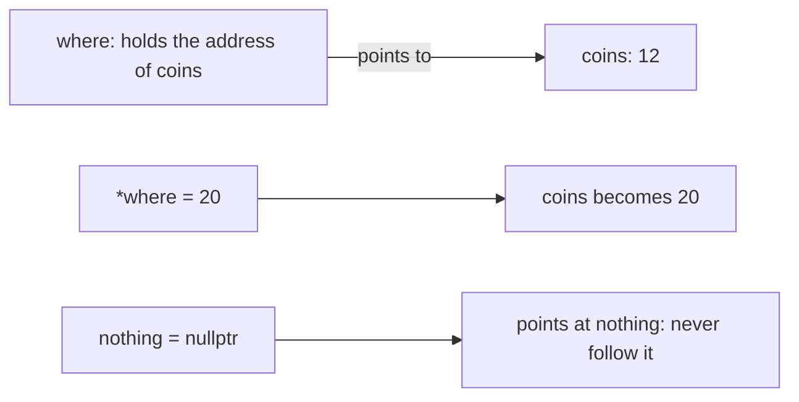
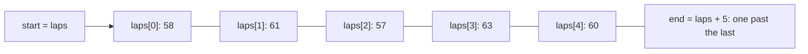
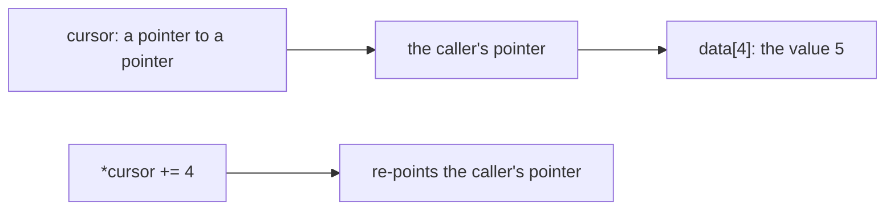

# new

## explanation

### Every variable lives at an address

Memory is a long row of numbered slots. Each variable sits at a position in that row, its **address**. `&coins` gives the address of `coins`.

### A pointer holds an address

A **pointer** is a variable whose value is an address. Its type says what kind of value lives there:

```cpp
int coins = 12;
int* where = &coins;
```

`int*` means "pointer to an `int`". Now `where` holds the address of `coins`: it **points to** `coins`.

### Following the pointer

`*where` means "the value at the address in `where`". This is called **dereferencing**:

- `std::cout << *where;` prints 12, the value of `coins`.
- `*where = 20;` changes `coins` to 20, through the pointer.

So `*` has two jobs: in a declaration (`int* where`) it makes a pointer type; in an expression (`*where`) it follows the pointer.

### Pointing somewhere else

Unlike a reference, a pointer can be changed to point at a different variable: `where = &gems;`. After that, `*where` means `gems`.

### Pointing nowhere: `nullptr`

A pointer that points at nothing holds `nullptr`. Following it, `*nothing`, is an error that usually crashes the program. So before you follow a pointer that might be empty, check it: `if (p != nullptr)`.

### Don't print addresses

`std::cout << where;` prints the address itself, a long number that changes every time the program runs. You almost always want `*where`, the value.

### Pointers or references?

Both let you reach a variable through another name. A reference always names the same variable and can't be empty. A pointer can change targets and can be `nullptr`. When you don't need those two extras, a reference is simpler.

## diagram



## example

```cpp
#include <iostream>

int main() {
    int coins = 12;
    int* where = &coins;  // where holds the address of coins

    std::cout << "coins: " << *where << '\n';  // follow the address
    *where = 20;                               // change coins through the pointer
    std::cout << "coins now: " << coins << '\n';

    int gems = 3;
    where = &gems;  // a pointer can point somewhere else
    *where += 1;
    std::cout << "gems: " << gems << ", coins: " << coins << '\n';

    int* nothing = nullptr;  // points nowhere
    if (nothing == nullptr) {
        std::cout << "nothing points nowhere\n";
    }
    std::cout << (where == &gems) << '\n';
}
```

```text
coins: 12
coins now: 20
gems: 4, coins: 20
nothing points nowhere
1
```

1. `where` gets the address of `coins`, so `*where` reads 12.
2. `*where = 20` writes through the pointer, so `coins` itself becomes 20.
3. `where = &gems` points it at `gems` instead. `*where += 1` now changes `gems` to 4, and `coins` stays 20.
4. `nothing` is `nullptr`, and the program checks that before doing anything with it.
5. `where` holds the same address as `&gems`, so the comparison is true.

## mistakes

- **Following `nullptr`.** `*p` when `p` is `nullptr` usually crashes. Check before you follow a pointer that may be empty.
- **A pointer with no starting value.** `int* p;` holds a random address, and `*p = 5;` writes somewhere unknown. Start pointers at an address or at `nullptr`.
- **Mixing up `p` and `*p`.** `p = 5;` doesn't compile, and `p = q;` re-points `p` instead of copying the value. To change the value, write `*p = 5;`.
- **Declaring two pointers on one line.** `int* a, b;` makes `a` a pointer but `b` a plain `int`. Declare one per line.
- **Printing the pointer instead of the value.** `std::cout << p;` prints an address. Write `*p` to print what it points to.

## check

```cpp
#include <iostream>

int main() {
    int a = 5;
    int b = 9;
    int* p = &a;
    *p = *p + 1;
    p = &b;
    *p = *p * 2;
    std::cout << a << ' ' << b << ' ' << (*p == b) << '\n';
}
```

```text
6 18 1
```

`p` first points to `a`, so `*p = *p + 1` makes `a` 6. Then `p` is re-pointed to `b`, and `*p = *p * 2` doubles `b` to 18. `p` still points to `b`, so `*p == b` is true.

# building

## explanation

### A quick recap

`&x` gives `x`'s address, an `int*` holds one, and `*p` follows it to read or change the value. A pointer can be re-pointed, and `nullptr` means it points nowhere.

### Pointers and arrays

An array's name turns into a pointer to its first element when used in an expression: `int* start = laps;` points at `laps[0]`. Adding to a pointer moves it by **elements**, not bytes: `start + 2` points at `laps[2]`, and `*(start + 2)` is `laps[2]`. In fact `start[2]` is just shorthand for `*(start + 2)`.

Subtracting two pointers into the same array gives the number of elements between them: if `hit` points at `laps[3]`, then `hit - start` is 3.

### Walking a range

A common pattern uses two pointers: one to the first element and one **one past the last**. The loop moves a pointer from the first until it reaches the end marker:

```cpp
for (int* at = from; at != to; at++) { ... }
```

The end pointer is a marker only; it never points at a real element, so never follow it.

### "Found it, or nothing"

A search function can return a pointer to what it found, or `nullptr` when there is nothing. The caller checks before using it, and can also change the found element through the pointer.

### Pointer parameters

A function taking `int* total` can change the caller's variable through `*total`, like a reference parameter. The difference is that the caller may pass `nullptr` to mean "no target", so the function must check. If "nothing" is never a valid choice, use a reference instead.

### `const` and pointers

- `const int* p`: you may re-point `p`, but not change the value through it. Good for read-only access.
- `int* const p`: `p` always points at the same place, but the value may change.

Read the declaration from right to left: "`p` is a const pointer to `int`" versus "`p` is a pointer to a const `int`".

## diagram



## example

```cpp
#include <iostream>

// Returns a pointer to the first element equal to target, or nullptr.
int* findValue(int* from, int* to, int target) {
    for (int* at = from; at != to; at++) {
        if (*at == target) return at;
    }
    return nullptr;
}

// A pointer parameter can change its target; nullptr means "no target".
void addPoints(int* total, int points) {
    if (total == nullptr) return;
    *total += points;
}

int main() {
    int laps[5] = {58, 61, 57, 63, 60};
    int* start = laps;    // the array turns into a pointer to laps[0]
    int* end = laps + 5;  // one past the last element
    std::cout << *(start + 2) << ' ' << start[3] << '\n';

    int* hit = findValue(start, end, 63);
    if (hit != nullptr) {
        std::cout << "found 63 at index " << (hit - start) << '\n';
        *hit = 62;  // change the element through the pointer
    }
    std::cout << "laps[3] is now " << laps[3] << '\n';
    std::cout << "found 99? " << (findValue(start, end, 99) != nullptr) << '\n';

    int score = 10;
    addPoints(&score, 5);
    addPoints(nullptr, 5);  // safely ignored
    std::cout << "score " << score << '\n';

    const int* readOnly = &score;  // may look, may not change
    std::cout << *readOnly + 1 << '\n';
}
```

```text
57 63
found 63 at index 3
laps[3] is now 62
found 99? 0
score 15
16
```

1. `start + 2` points two elements along, at 57, and `start[3]` is the same as `*(start + 3)`: 63.
2. `findValue` walks from `start` to `end` and returns a pointer to the 63. Subtracting `start` gives its index, 3, and writing through `hit` changes the array.
3. 99 isn't there, so `findValue` returns `nullptr`, and the comparison prints 0.
4. `addPoints(&score, 5)` changes `score` through the pointer. The `nullptr` call is caught by the check and does nothing.
5. `readOnly` can read `score` but not change it: `*readOnly = 0;` would not compile.

## mistakes

- **Following the end pointer.** `laps + 5` marks the end; there's no element there. Stop the loop at `at != to` and never read `*to`.
- **Using a search result without checking it.** If `findValue` returns `nullptr`, `*hit` crashes. Always check first.
- **Mixing up `const int*` and `int* const`.** The first protects the value, the second protects the pointer. Read right to left.
- **Subtracting pointers into different arrays.** The result means nothing. Only subtract pointers into the same array.
- **Returning the address of a local variable.** `int* make() { int x = 5; return &x; }` returns an address that is no longer valid once the function ends.

## check

```cpp
#include <iostream>

int main() {
    int v[4] = {7, 3, 9, 4};
    int* p = v + 1;
    int* q = &v[3];
    *p += *q;
    p++;
    std::cout << *p << ' ' << q - p << ' ' << v[1] << ' ' << p[-2] << '\n';
}
```

```text
9 1 7 7
```

`p` starts at `v[1]` and `q` at `v[3]`, so `*p += *q` turns the 3 into 7. `p++` moves `p` on to `v[2]`, which is 9, and `q` is now one element after it. `p[-2]` counts back two elements from `v[2]`, to `v[0]`, which is 7.

# strong

## explanation

### What pointer arithmetic is allowed to do

`p + n` moves by `n` elements, so the compiler multiplies by the element size for you. It is only defined while the result stays inside the same array, or exactly one past its end. Forming a pointer further out is undefined even if you never dereference it. Comparing two pointers with `<` only means something within one array; for unrelated objects, use `std::less` if you need an ordering.

### Pointers to pointers

To let a function re-point the **caller's** pointer, pass a pointer to it: `const int** cursor`. Inside, `*cursor` is the caller's pointer and `**cursor` the value it points to. (A reference to a pointer, `const int*& cursor`, does the same job more readably.)

### Function pointers

A function has an address too. `int (*fn)(int)` is a pointer to a function taking an `int` and returning an `int`. Passing one lets you hand behaviour to another function: `applyAll(twice, ...)`. Lambdas, which come later, generalise this idea.

### `const` in both places

`const int* const p` is a pointer that can't be re-pointed, to a value that can't be changed through it. Use `const` on the pointee for read-only parameters: it documents intent and lets the function accept `const` data.

### Dangling and wild pointers

A pointer doesn't keep its target alive. When the target goes out of scope, or its memory is freed, the pointer **dangles**: following it is undefined behaviour and may seem to work for a while. An uninitialised pointer is **wild**: it points at a random place. Both bugs are hard to find; AddressSanitizer catches many of them.

### Type punning

Reading an object through a pointer to an unrelated type, such as treating an `int`'s memory as a `float` via a cast, breaks the aliasing rules: the optimiser assumes it can't happen. Use `std::memcpy` or C++20's `std::bit_cast` to reinterpret bytes.

### When to use a raw pointer

Use a reference for "always refers to something". Use a raw pointer for "may be absent" or "can change target", without ownership. Ownership of heap memory belongs to smart pointers, a later skill.

## diagram



## example

```cpp
#include <iostream>

// A pointer to a pointer lets a function re-point the caller's pointer.
void advance(const int** cursor, int steps) {
    *cursor += steps;
}

// Function pointers: pass behaviour as a value.
int twice(int x) { return 2 * x; }
int squareOf(int x) { return x * x; }
int applyAll(int (*fn)(int), const int* from, const int* to) {
    int sum = 0;
    for (const int* at = from; at != to; ++at) sum += fn(*at);
    return sum;
}

int main() {
    const int data[6] = {1, 2, 3, 4, 5, 6};
    const int* cursor = data;
    advance(&cursor, 4);
    std::cout << "cursor at " << *cursor << ", index " << (cursor - data) << '\n';

    std::cout << applyAll(twice, data, data + 3) << ' ' << applyAll(squareOf, data, data + 3) << '\n';

    // Pointer arithmetic counts elements, not bytes.
    const double prices[3] = {9.5, 12.25, 3.0};
    const double* p = prices;
    std::cout << *(p + 1) << ' ' << (&prices[2] - p) << '\n';

    // const on either side of *: what it protects.
    int level = 1, other = 7;
    int* const fixedTarget = &level;  // can't re-point, can change level
    *fixedTarget = 2;
    const int* lookOnly = &level;  // can re-point, can't change through it
    lookOnly = &other;
    std::cout << level << ' ' << *lookOnly << '\n';

    int* maybe = nullptr;
    std::cout << (maybe ? *maybe : -1) << '\n';
}
```

```text
cursor at 5, index 4
12 14
12.25 2
2 7
-1
```

1. `advance` gets the address of `main`'s `cursor` and moves it four elements on, to the 5.
2. `applyAll` calls whichever function it's given on the first three elements: doubled they sum to 12, squared to 14.
3. `p + 1` moves one `double` along, to 12.25. The distance from `p` to `&prices[2]` is 2 elements, whatever their size in bytes.
4. `fixedTarget` can change `level` but not be re-pointed; `lookOnly` can be re-pointed but not write. So `level` is 2 and `lookOnly` ends up at `other`.
5. A pointer in a condition means "is it not null?". `maybe` is null, so the `? :` gives -1 without ever following it.

## mistakes

- **Dangling pointers.** A pointer to a local that has gone out of scope, or to freed memory, may still "work" until something reuses that memory. Never keep a pointer longer than its target lives.
- **Arithmetic beyond one past the end.** `data + 7` on a 6-element array is undefined even if you never read through it. Keep pointers in range.
- **Ordering unrelated pointers with `<`.** It has no defined meaning for separate objects. Use `std::less` or compare indexes instead.
- **Reading memory as the wrong type.** `*reinterpret_cast<float*>(&i)` breaks the aliasing rules and may be miscompiled. Use `std::memcpy` or `std::bit_cast`.
- **A pointer where a reference would do.** If a parameter can never be null and never changes target, a pointer only adds a case to check. Use a reference.

## check

```cpp
#include <iostream>

int inc(int x) { return x + 1; }
int neg(int x) { return -x; }

int main() {
    int a[5] = {10, 20, 30, 40, 50};
    int* p = a;
    int** pp = &p;
    *pp += 2;
    int (*f)(int) = inc;
    int r = f(*p);
    f = neg;
    std::cout << r << ' ' << f(p[1]) << ' ' << (p - a) << ' ' << **pp << '\n';
}
```

```text
31 -40 2 30
```

`pp` points to `p`, so `*pp += 2` moves `p` itself to `a[2]`, the 30. `f` first points to `inc`, giving `r = 31`. After `f = neg`, `f(p[1])` negates `a[3]`, giving -40. `p` is two elements from the start, and `**pp` follows both pointers to 30.
