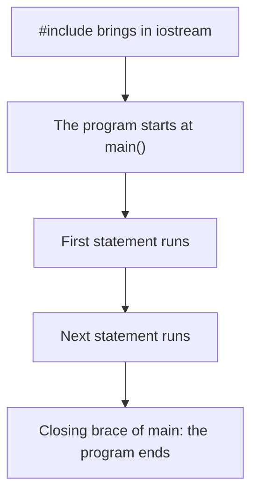
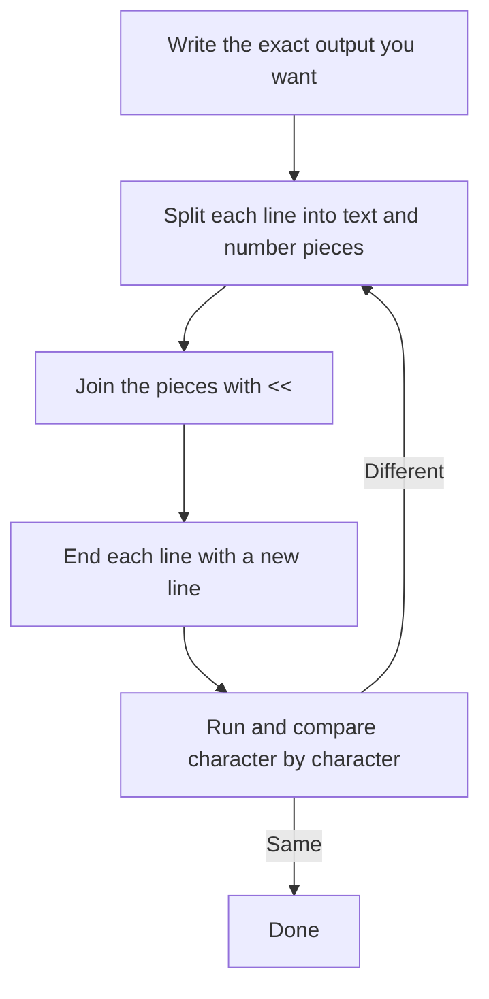
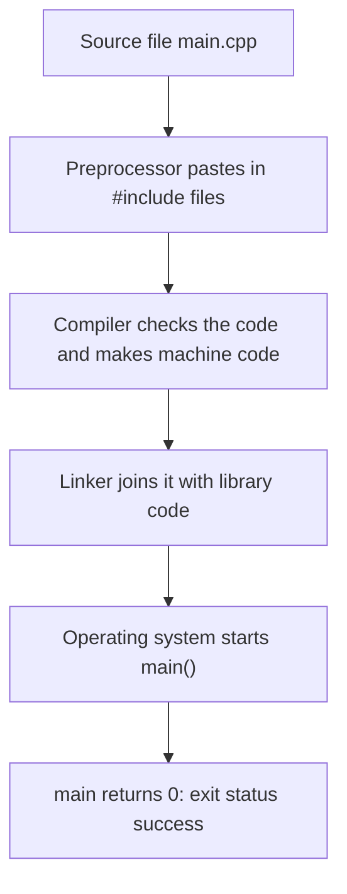

# new

## explanation

### What a program is

A program is a list of instructions the computer follows in order, from top to bottom. You write the instructions as text in a file. A tool called the **compiler** turns that text into something the computer can run.

Every C++ program you write in this course has the same small frame:

```cpp
#include <iostream>

int main() {
    std::cout << "Hi\n";
}
```

### The parts, one by one

- `#include <iostream>` brings in the part of C++ that handles input and output. Without it, the compiler doesn't know what `std::cout` is.
- `int main()` is where your program starts. The computer always begins at `main`, whatever else is in the file. There must be exactly one `main`.
- The curly braces `{` and `}` mark where `main` begins and ends. Everything between them is the **body** of `main`.
- `std::cout << "Hi\n";` is a **statement**: one instruction. It sends the text `Hi` to the screen. `cout` means "character output", and `std::` says it comes from the standard library.
- The semicolon `;` ends a statement, like a full stop ends a sentence. Forgetting it is the most common first error.

### Printing text and numbers

Text goes inside double quotes: `"Good morning"`. A piece of text in quotes is called a **string**. Numbers don't need quotes, and C++ works out sums for you:

```cpp
std::cout << 4 + 5;   // prints 9
std::cout << "4 + 5"; // prints 4 + 5
```

You can chain several pieces with `<<`, and they print one after another with no spaces added: `std::cout << "Age: " << 20;` prints `Age: 20`.

### Ending a line

The screen keeps writing on the same line until you tell it to move down. `"\n"` means "new line". You can also use `std::endl`, which does the same and also makes sure the text appears straight away. Inside quotes, `\n` is one special character, not a backslash and an `n`.

### Comments

Anything after `//` on a line is a **comment**. The compiler ignores it. Comments are notes for people reading your code.

### Order matters

Statements run in the order they are written. If you swap two `std::cout` lines, their output swaps too. When `main` reaches its closing brace, the program ends.

## diagram



## example

```cpp
#include <iostream>

int main() {
    // Each statement ends with a semicolon.
    std::cout << "Today's plan\n";
    std::cout << "1. Read the lesson\n";
    std::cout << "2. Try the exercise\n";
    std::cout << "Minutes needed: " << 15 + 10 << " in total\n";
    return 0;
}
```

```text
Today's plan
1. Read the lesson
2. Try the exercise
Minutes needed: 25 in total
```

1. The program starts at `main`. The comment line is skipped.
2. The first statement prints `Today's plan`, and `\n` moves to the next line.
3. The next two statements print the two numbered steps, each on its own line.
4. The last print has three pieces chained with `<<`: the text `Minutes needed: `, the result of `15 + 10`, which is `25`, and the text ` in total` with a new line. The spaces around `25` come from inside the quotes.
5. `return 0;` ends `main` and tells the computer the program finished without problems.

## mistakes

- **Forgetting the semicolon.** Every statement needs `;` at the end. Without it the compiler reports an error, often on the *next* line, which is confusing. Check the line above the error first.
- **Text without a new line.** `std::cout << "Hi"; std::cout << "Bye";` prints `HiBye` on one line. Add `\n` wherever you want the output to move down.
- **Leaving out `std::`.** Writing just `cout` gives an error, because `cout` lives in the standard library, called `std`. Write `std::cout`.
- **Single quotes for text.** `'Hello'` is not a string. Single quotes are for one character, like `'A'`. Use double quotes for text: `"Hello"`.
- **Misspelling `main`.** C++ cares about capital letters, so `Main` is a different name, and the program won't build without `main`.

## check

```cpp
#include <iostream>

int main() {
    std::cout << "A";
    std::cout << "B\n";
    // std::cout << "C\n";
    std::cout << 2 + 3 << " is a sum\n";
    std::cout << "2 + 3 is text\n";
}
```

```text
AB
5 is a sum
2 + 3 is text
```

`A` has no `\n` after it, so `B` prints on the same line, giving `AB`. The line printing `C` is a comment, so it never runs. `2 + 3` without quotes is a sum, so it prints `5`. Inside quotes, `2 + 3` is just text, so it prints exactly as written.

# building

## explanation

### A quick recap

A program starts at `main`, runs its statements from top to bottom, and ends at the closing brace. `std::cout <<` prints, `\n` ends a line, and `;` ends each statement. Now let's write output that looks exactly the way you want.

### Plan the output first

Before typing code, write down the exact lines you want to see, spaces included. Then build each line from pieces. Text pieces go in quotes, number pieces don't, and `<<` joins them:

```cpp
std::cout << "Lions " << 3 << " - " << 1 << " Tigers\n";
```

C++ never adds spaces for you. If the output needs a space between two pieces, put that space inside one of the quotes.

### Special characters with a backslash

Some characters can't be typed straight into a string, so you write them with a backslash first. This is called an **escape sequence**:

- `\n`: a new line.
- `\"`: a double quote inside a string. `"She said \"yes\""` prints `She said "yes"`.
- `\\`: one backslash. `"C:\\code"` prints `C:\code`.

A backslash followed by any other character either means something special or makes the compiler warn you. To print a backslash, always write two.

### `\n` or `std::endl`?

Both end the line. `std::endl` also **flushes** the output, which means it pushes the text to the screen straight away. That's slower, and usually not needed, so `\n` is the everyday choice. Use `std::endl` when output must appear at once, for example just before a program might crash.

### Sums inside output

You can put a calculation straight into a print: `std::cout << 3 - 1;` prints `2`. C++ works the sum out first, then prints the result. To print the sum itself as text, put it in quotes.

### `return 0`

`main` gives back a number to the operating system when it ends. `return 0;` means "everything went fine". In `main` only, you may leave it out and C++ returns 0 for you, but writing it makes the end of the program clear.

### Step by step

1. Write the exact output you want, line by line.
2. For each line, split it into text pieces and number pieces.
3. Join the pieces with `<<`, and end the line with `\n`.
4. Check every space, quote and backslash.
5. Run it and compare the output to your plan, character by character.

## diagram



## example

```cpp
#include <iostream>

int main() {
    std::cout << "Match report\n";
    std::cout << "Lions " << 3 << " - " << 1 << " Tigers\n";
    std::cout << "Lions won by " << 3 - 1 << " goals\n";
    std::cout << "Coach said: \"Well played!\"\n";
    std::cout << "Saved to C:\\reports\\match.txt" << std::endl;
    return 0;
}
```

```text
Match report
Lions 3 - 1 Tigers
Lions won by 2 goals
Coach said: "Well played!"
Saved to C:\reports\match.txt
```

1. The first line is plain text followed by a new line.
2. The second line joins five pieces. The spaces come from inside the quotes: `"Lions "` ends with a space and `" - "` has one on each side.
3. `3 - 1` has no quotes, so C++ calculates it and prints `2`.
4. `\"` puts a double quote inside the string without ending it, so the quotes around `Well played!` appear in the output.
5. Each `\\` prints one backslash. `std::endl` ends the last line and flushes the output.

## mistakes

- **Missing spaces between pieces.** `std::cout << "Score:" << 5;` prints `Score:5`. C++ adds nothing between pieces, so put the space inside the quotes: `"Score: "`.
- **A lone backslash in a path.** `"C:\new"` contains `\n`, which is a new line, so the path breaks in two. Write `"C:\\new"`.
- **Ending a string early.** `"He said "hi""` stops the string at the second quote and doesn't compile. Use `\"` for quotes inside a string.
- **`std::endl` everywhere.** Each `std::endl` flushes the output. In a program that prints thousands of lines, that is noticeably slow. Use `\n` unless you need the flush.
- **Quotes around a sum.** `"3 - 1"` prints the characters `3 - 1`, not `2`. Leave the quotes off when you want the result.

## check

```cpp
#include <iostream>

int main() {
    std::cout << "x" << 1 + 2 << "y\n";
    std::cout << "1" << "2" << 3 + 4 << "!\n";
    std::cout << "a\\nb\n";
    std::cout << "end";
    std::cout << "?\n";
}
```

```text
x3y
127!
a\nb
end?
```

`1 + 2` is calculated, so the first line is `x3y`. The second line prints the text `1`, the text `2`, the sum `7` and `!`, with no spaces between them: `127!`. In `"a\\nb"`, the `\\` is one backslash followed by a normal `n`, so it prints `a\nb` and does not break the line. `end` has no new line, so `?` lands right after it.

# strong

## explanation

### What happens before `main` runs

Building a C++ program has three stages:

1. **Preprocessing.** Lines starting with `#` are handled first. `#include <iostream>` pastes in the declarations for input and output.
2. **Compiling.** Your code is checked against the rules of C++ and turned into machine code. Most errors you meet happen here.
3. **Linking.** Your machine code is joined with the library code, such as the code behind `std::cout`, into one program you can run.

Then the operating system starts the program at `main`. `int main()` returns an `int`, the **exit status**: 0 means success, anything else signals a problem to whatever started the program. Only `main` may leave out its `return`, in which case it returns 0.

### How `<<` chains

`std::cout << a << b` is read as `(std::cout << a) << b`. Each `<<` prints one value and gives back the stream itself, so the next `<<` prints to the same stream. That's why you can chain as many pieces as you like.

Precedence matters here. `+`, `-`, `*` and `/` bind more tightly than `<<`, so `std::cout << 2 + 3` prints `5`. But comparisons bind more loosely: `std::cout << 7 > 5` is read as `(std::cout << 7) > 5`, which doesn't compile. Put comparisons in parentheses: `std::cout << (7 > 5)`.

### How values print

- A `bool` prints as `1` or `0`. After `std::cout << std::boolalpha`, it prints as `true` or `false`, and stays that way for later prints.
- `'\n'` (one character) and `"\n"` (a string) print the same thing. The character is a little cheaper, and both are common.
- Numbers print with no padding, so `std::cout << 1 << 2 << 3` prints `123`.

### Output is buffered

`std::cout` may collect text in a **buffer** and write it out in batches, because writing one piece at a time is slow. `std::endl` and `std::flush` always force a write; a plain `\n` doesn't promise one. When output goes to a file, flushing on every line can make a program much slower. Error messages often go to `std::cerr`, which is not buffered, so they appear at once even if the program crashes right after.

### `using namespace std;`

This line lets you write `cout` instead of `std::cout`. It is fine in a small practice program, but in larger code it pulls every standard name into your code, and those names can clash with your own. Writing `std::` is clearer and avoids surprises.

### Edge cases worth knowing

- Two `main` functions in two different files each compile fine on their own, then fail at the link stage, when the linker finds both.
- Comments with `/* ... */` can span lines but cannot be nested.
- `#include <iostream>` must come before the first use of `std::cout`, because the compiler reads top to bottom.

## diagram



## example

```cpp
#include <iostream>

// main returns an int: 0 tells the operating system that all went well.
int main() {
    std::cout << "Building " << "with " << "chained output\n";
    std::cout << (2 + 3) * 4 << '\n';
    std::cout << (7 > 5) << ' ' << (7 < 5) << '\n';
    std::cout << std::boolalpha << (7 > 5) << '\n';
    std::cout << 1 << 2 << 3 << '\n';
    (std::cout << "same") << " stream\n";
    return 0;
}
```

```text
Building with chained output
20
1 0
true
123
same stream
```

1. Three strings are chained. Each `<<` returns the stream, so they print one after another.
2. The parentheses make `2 + 3` happen first, giving `5 * 4 = 20`.
3. The comparisons are in parentheses, so they compile. As plain `bool` values they print `1` and `0`. The `' '` is a single space character.
4. `std::boolalpha` switches bool printing to words, so `(7 > 5)` prints `true`.
5. Numbers get no spaces between them, so `1`, `2` and `3` print as `123`.
6. `std::cout << "same"` gives back the stream, and `<< " stream\n"` continues on it. This is exactly what every chain does.

## mistakes

- **Comparisons without parentheses.** `std::cout << a > b;` is read as `(std::cout << a) > b` and fails to compile. Write `std::cout << (a > b);`.
- **`std::endl` in a big loop.** Every `std::endl` flushes the buffer. Printing 100,000 lines to a file with it can take far longer than with `'\n'`. Flush only when the output must appear immediately.
- **Expecting `boolalpha` to switch off by itself.** It stays on for every later bool on that stream until you write `std::noboolalpha`.
- **`using namespace std;` in larger code.** Names like `count` or `distance` can then clash with standard ones and cause confusing errors. Prefer `std::`.
- **Relying on the missing `return` outside `main`.** Only `main` gets an automatic `return 0`. Any other function that should return a value must say so.

## check

```cpp
#include <iostream>

int main() {
    std::cout << 3 << 4 << "\n";
    std::cout << (3 << 4) << "\n";
    std::cout << '\n' << "after a blank line\n";
}
```

```text
34
48

after a blank line
```

The first line prints `3` and then `4` with nothing between them: `34`. In the second line, the parentheses make `3 << 4` an operation on two numbers, not printing. For whole numbers, `<<` is the left **shift**: it multiplies 3 by 2 four times, giving 48. The same symbol means "print" only when the left side is a stream. In the last line, `'\n'` ends the line straight away, so an empty line appears before the text.
