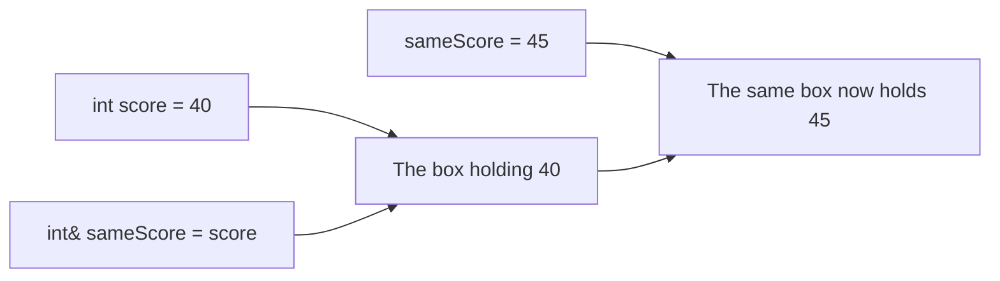
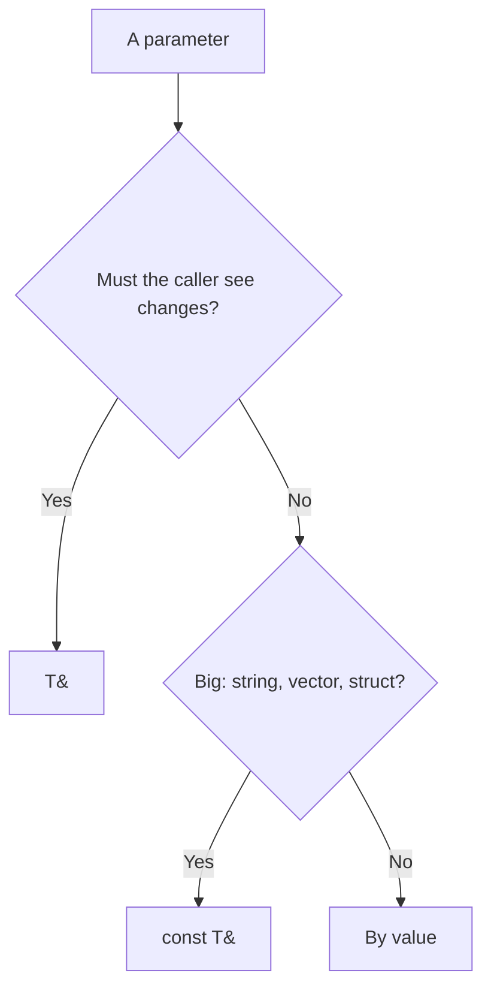
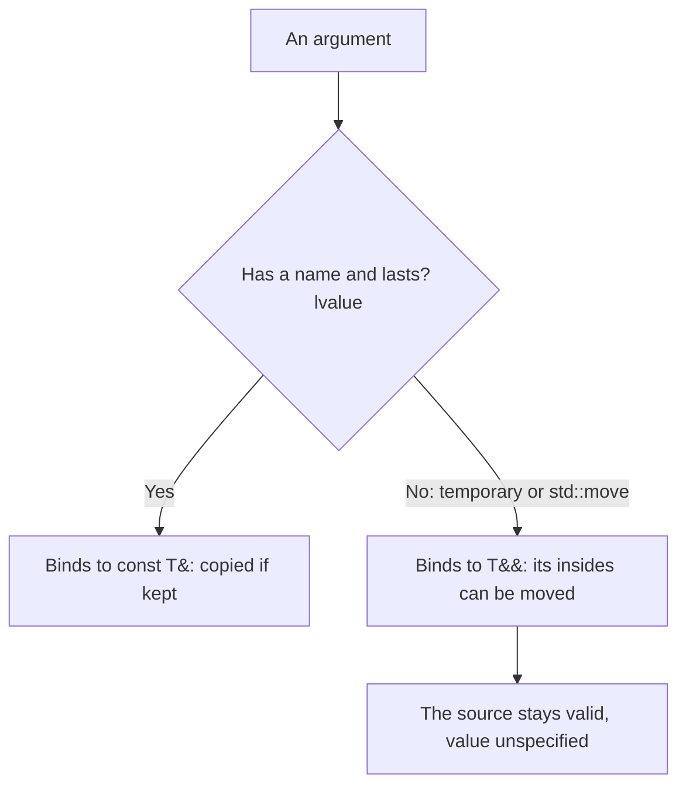

# new

## explanation

### A second name for a variable

A **reference** is another name for a variable that already exists. You make one by putting `&` after the type:

```cpp
int score = 40;
int& sameScore = score;
```

`sameScore` is not a new box with a copy of 40. It **is** `score`, under a second name. Writing `sameScore = 45;` changes `score`, and reading either name gives the same value.

### Rules for references

- A reference must be set up when it's made: `int& r;` on its own doesn't compile.
- Once set up, it always names the same variable. Writing `r = other;` doesn't make `r` name `other`; it copies `other`'s value into the variable `r` already names.
- A plain `int&` must name a real variable. `int& r = 5;` doesn't compile, because 5 is not a variable.

### Why references matter: functions

Normally a function gets a **copy** of each argument, so it can't change the caller's variables:

```cpp
void addBonusCopy(int points, int bonus) { points += bonus; }  // changes only the copy
```

With `&` on the parameter, the parameter becomes a reference to the caller's variable, and the change sticks:

```cpp
void addBonus(int& points, int bonus) { points += bonus; }  // changes the caller's variable
```

The call looks the same either way: `addBonus(score, 10);`. Only the function's parameter list shows that `score` may change.

### `const` references

Sometimes you want a function to **read** a big value, like a long string or vector, without copying it. A `const` reference does that: `const std::string& text` gives the function the original, and `const` promises it won't change it. A `const` reference can also take a literal, like `"hello"`.

### When to use which

- **By value** (`int n`): small values the function only reads or works on as its own copy.
- **By reference** (`int& n`): the function's job is to change the caller's variable.
- **By const reference** (`const std::string& s`): big values the function only reads.

## diagram



## example

```cpp
#include <iostream>

void addBonus(int& points, int bonus) {  // points is the caller's variable
    points += bonus;
}

void addBonusCopy(int points, int bonus) {  // points is only a copy
    points += bonus;
}

int main() {
    int score = 40;
    int& sameScore = score;  // a second name for score
    sameScore = 45;
    std::cout << "score: " << score << '\n';

    addBonusCopy(score, 10);
    std::cout << "after copy version: " << score << '\n';

    addBonus(score, 10);
    std::cout << "after reference version: " << score << '\n';
}
```

```text
score: 45
after copy version: 45
after reference version: 55
```

1. `sameScore` is another name for `score`, so setting it to 45 changes `score`.
2. `addBonusCopy` gets a copy of 45 and adds 10 to the copy. The copy disappears when the function returns, and `score` is still 45.
3. `addBonus` takes `int& points`, so `points` **is** `score` during the call. Adding 10 changes `score` to 55.

## mistakes

- **Forgetting the `&`.** Without it, the function changes a copy, and the caller sees nothing. If a function is meant to change an argument, check its parameter has `&`.
- **A reference with nothing to name.** `int& r;` doesn't compile. Set it up straight away: `int& r = x;`.
- **Expecting `r = y` to re-point the reference.** It copies `y`'s value into the variable `r` names. A reference names the same variable forever.
- **Passing a literal to an `int&` parameter.** `addBonus(40, 10)` doesn't compile, because 40 isn't a variable the function could change.
- **Copying big values for no reason.** Passing a long `std::string` or `std::vector` by value copies it on every call. If the function only reads it, take a `const` reference.

## check

```cpp
#include <iostream>

void bump(int& n) { n = n + 1; }
void keep(int n) { n = n + 100; }

int main() {
    int a = 3;
    int& b = a;
    bump(b);
    keep(a);
    b = b * 2;
    std::cout << a << ' ' << b << '\n';
}
```

```text
8 8
```

`b` is another name for `a`. `bump(b)` takes a reference, so it changes `a` to 4. `keep(a)` only changes its own copy. `b = b * 2` doubles the one variable to 8, and both names show it.

# building

## explanation

### A quick recap

A reference is another name for an existing variable. A reference parameter (`int& n`) lets a function change the caller's variable; a `const` reference (`const T& x`) lets it read a big value without copying.

### Choosing how to pass each parameter

Go through a function's parameters one by one:

1. **Will the function change it, and should the caller see the change?** Use `T&`.
2. **Is it big, like a string, a vector or a struct, and only read?** Use `const T&`.
3. **Is it small, like an `int`, `double`, `char` or `bool`?** Pass by value. A copy is as cheap as a reference.

The parameter list then documents the function: `const` means "I only look", a plain `&` means "I will change this".

### References to elements

`int& v = values[i];` gives a short name to one element. Changing `v` changes the element. This keeps loop bodies readable when you touch the same element several times. Without the `&`, `int v = values[i];` is a copy, and changes to it are lost.

### More than one result

A function can only `return` one value, but it can fill in several reference parameters. These are sometimes called **out-parameters**:

```cpp
void lowAndHigh(const std::vector<int>& values, int& low, int& high);
```

Set every out-parameter on every path through the function, so the caller never reads a value you forgot to write. Later you'll see another option: returning a small struct.

### Don't return a reference to a local

A function's local variables are destroyed when it returns. Returning `int&` to one of them hands the caller a name for something that no longer exists. Return locals by value.

## diagram



## example

```cpp
#include <iostream>
#include <string>
#include <vector>

// const reference: reads a big vector without copying it.
int countAbove(const std::vector<int>& values, int limit) {
    int count = 0;
    for (std::size_t i = 0; i < values.size(); i++) {
        if (values[i] > limit) count++;
    }
    return count;
}

// Reference: changes the caller's vector in place.
void capAt(std::vector<int>& values, int cap) {
    for (std::size_t i = 0; i < values.size(); i++) {
        int& v = values[i];  // a name for this element
        if (v > cap) v = cap;
    }
}

// Two results through reference parameters.
void lowAndHigh(const std::vector<int>& values, int& low, int& high) {
    low = values[0];
    high = values[0];
    for (std::size_t i = 1; i < values.size(); i++) {
        if (values[i] < low) low = values[i];
        if (values[i] > high) high = values[i];
    }
}

void shout(const std::string& word) { std::cout << word << "!\n"; }

int main() {
    std::vector<int> speeds = {42, 75, 60, 98, 51};
    std::cout << "above 55: " << countAbove(speeds, 55) << '\n';
    int low = 0, high = 0;
    lowAndHigh(speeds, low, high);
    std::cout << "low " << low << ", high " << high << '\n';
    capAt(speeds, 70);
    std::cout << speeds[1] << ' ' << speeds[3] << '\n';
    shout("done");
}
```

```text
above 55: 3
low 42, high 98
70 70
done!
```

1. `countAbove` reads `speeds` through a `const` reference: no copy, no changes. Three speeds are above 55.
2. `lowAndHigh` fills in the caller's `low` and `high`, which are references inside the function.
3. `capAt` takes a plain reference, so it changes the caller's vector. `int& v` names each element in turn, and the 75 and 98 become 70.
4. `shout` takes a `const std::string&`, which can accept the literal `"done"`. A plain `std::string&` could not.

## mistakes

- **Read-only big parameters passed by value.** `int countAbove(std::vector<int> values, ...)` copies the whole vector on every call. Make it `const std::vector<int>&`.
- **Leaving out `const` on a read-only reference.** Then the function can't take literals or temporary values, and nothing stops it changing the caller's data by accident.
- **Copying an element you meant to change.** `int v = values[i]; v = cap;` changes the copy only. Write `int& v = values[i];`.
- **Out-parameters left unset on some path.** If `values` might be empty, `lowAndHigh` above would read `values[0]`, which doesn't exist. Decide what happens in that case before writing the function.
- **Returning a reference to a local variable.** The local is destroyed at the return, so the caller's reference names nothing. Return by value.

## check

```cpp
#include <iostream>
#include <vector>

void twice(std::vector<int>& v) { for (std::size_t i = 0; i < v.size(); i++) v[i] *= 2; }
int first(const std::vector<int>& v) { return v[0]; }

int main() {
    std::vector<int> a = {1, 2, 3};
    std::vector<int> b = a;
    twice(a);
    int copy = a[2];
    int& ref = b[2];
    ref += 10;
    copy += 10;
    std::cout << a[2] << ' ' << b[2] << ' ' << copy << ' ' << first(a) << '\n';
}
```

```text
6 13 16 2
```

`b` is a separate copy of `a`, so `twice(a)` doubles only `a`, making it 2, 4, 6. `copy` holds its own 6; adding 10 makes it 16 but leaves `a[2]` at 6. `ref` names `b[2]`, so `ref += 10` turns that 3 into 13. `first(a)` reads the doubled first element, 2.

# strong

## explanation

### What a reference is underneath

A reference is usually implemented as an address, like a pointer, but the language hides that: it can't be null, can't be re-seated, and you never write `*` to use it. That's why references are the default way to pass things that must not be copied or must be changed.

### Lifetime: references don't keep things alive

A reference is only valid while the thing it names exists. Classic ways to break that:

- returning a reference to a local variable;
- keeping a reference to a vector element across a `push_back` that reallocates;
- keeping a reference into a temporary.

The one exception: binding a temporary directly to a **local** `const T&` (or `T&&`) extends the temporary's life to match the reference. `const std::string& label = makeLabel(7);` is safe. It doesn't work through function returns or class members.

### Aliasing

Two references can name the same object. In `void addTwice(int& target, const int& amount)`, calling `addTwice(y, y)` makes `amount` change when `target` does, even though `amount` is `const`: `const` only means "not changed **through this name**". Code that takes several references must either handle aliasing or copy the value first.

### Lvalues, rvalues and `&&`

An **lvalue** has a name and lasts beyond the expression, like `name`. An **rvalue** is a temporary, like `s + "!"` or a function's returned value. `T&&` is an **rvalue reference**: it binds only to temporaries, or to what `std::move` produces. Overloading on `const T&` and `T&&` lets a function copy from lvalues but steal the insides of temporaries. That is **move semantics**, which makes returning and inserting big objects cheap.

`std::move(x)` moves nothing by itself. It only casts `x` to an rvalue, saying "you may take its insides". The move happens only if a function taking `T&&` actually does it. After a move, `x` is valid but its value is unspecified: assign it or let it be destroyed, but don't rely on what it holds.

### Returning by value is cheap

Returning a local by value usually costs nothing: the compiler builds the result directly in the caller's variable (copy elision), and otherwise moves it. Don't "optimise" by returning references to locals.

## diagram



## example

```cpp
#include <iostream>
#include <string>
#include <utility>
#include <vector>

// Aliasing: target and amount may be the same variable.
void addTwice(int& target, const int& amount) {
    target += amount;
    target += amount;  // if amount aliases target, it has already changed
}

std::string makeLabel(int n) { return "item-" + std::to_string(n); }

// Overloads on how the argument arrives: a named value or a temporary.
void take(const std::string& s) { std::cout << "copied from " << s << '\n'; }
void take(std::string&& s) { std::cout << "moved from " << s << '\n'; }

int main() {
    int x = 3, y = 3;
    addTwice(x, y);
    addTwice(y, y);
    std::cout << x << ' ' << y << '\n';

    const std::string& label = makeLabel(7);  // the temporary lives as long as label
    std::cout << label << '\n';

    std::string name = "kept";
    take(name);
    take(makeLabel(8));
    take(std::move(name));  // std::move only casts; take decides what happens

    std::vector<std::string> list;
    std::string big(20, 'z');
    list.push_back(std::move(big));  // moves the characters into the vector
    std::cout << list[0].size() << '\n';
}
```

```text
9 12
item-7
copied from kept
moved from item-8
moved from kept
20
```

1. `addTwice(x, y)` adds 3 twice: 9. In `addTwice(y, y)`, both names are `y`: the first `+=` makes it 6, so the second adds 6, giving 12.
2. The temporary returned by `makeLabel(7)` would normally die at the end of the line, but binding it to a local `const` reference keeps it alive.
3. `name` is an lvalue, so the `const&` overload is chosen. `makeLabel(8)` is a temporary, so `&&` wins. `std::move(name)` casts `name` to an rvalue, so `&&` wins again, although this `take` only prints and doesn't actually move.
4. `push_back(std::move(big))` lets the vector take `big`'s characters instead of copying them. After that, `big` must not be relied on.

## mistakes

- **Returning a reference to a local.** `const std::string& name() { std::string s = "x"; return s; }` returns a name for a destroyed object. Return `std::string` by value.
- **References into a growing vector.** A `push_back` that reallocates leaves every reference to the old elements dangling. Keep indexes, or reserve first.
- **Forgetting about aliasing.** A `const T&` parameter can still change if another parameter, or the function itself, changes the same object. Copy the value first when it matters.
- **Thinking `std::move` moves.** It only casts. If nothing takes an rvalue, the value is copied or left alone.
- **Using a moved-from object.** Its value is unspecified. Assign it a new value before reading it again.

## check

```cpp
#include <iostream>
#include <string>
#include <utility>
void f(const std::string&) { std::cout << "L"; }
void f(std::string&&) { std::cout << "R"; }
int main() {
    std::string s = "hi";
    std::string& r = s;
    f(s);
    f(r);
    f(s + "!");
    f(std::move(r));
    int a = 1;
    int& b = a;
    int c = b;
    b = 5;
    std::cout << ' ' << a << c << '\n';
}
```

```text
LLRR 51
```

`s` is a named variable, and so is `r`, even though it's a reference: both choose the `const&` overload. `s + "!"` is a temporary, so `&&` wins, and `std::move(r)` turns `r` into an rvalue, so `&&` wins again. `c` is a copy made while `a` was 1; `b = 5` then changes `a`, but not `c`.
