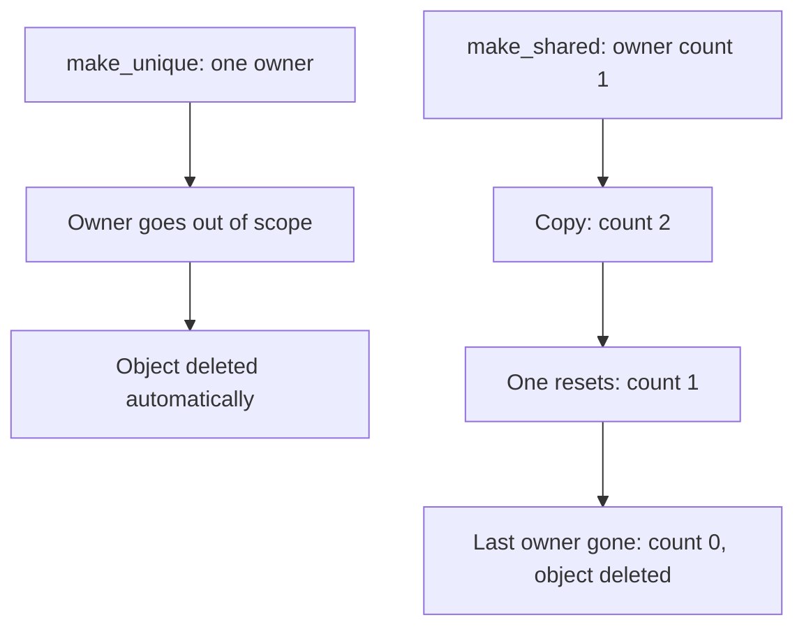
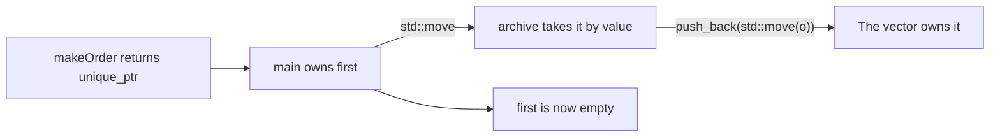

# new

## explanation

### The problem with `new` and `delete`

With raw `new` and `delete`, you must remember to `delete` exactly once, on every path out of the code, including early returns. Forget, and memory leaks; do it twice, and the program may crash. **Smart pointers** do the `delete` for you. They live in `<memory>`.

### `std::unique_ptr`: one owner

A `unique_ptr` **owns** one heap object. When the `unique_ptr` is destroyed, for example at the end of its block, it deletes the object automatically:

```cpp
std::unique_ptr<Lamp> desk = std::make_unique<Lamp>("study");
```

`std::make_unique<Lamp>(...)` creates the `Lamp` on the heap, passing the arguments to its constructor, and wraps it straight away. You use it like a pointer: `*desk` or `desk->room`.

There can only be one owner, so a `unique_ptr` **can't be copied**. You can hand ownership to another `unique_ptr` with `std::move`; the old one is left empty (`nullptr`).

### `std::shared_ptr`: several owners

Sometimes several parts of a program share one object, and none of them knows who will finish with it last. A `shared_ptr` keeps a count of its owners:

```cpp
std::shared_ptr<Lamp> hall = std::make_shared<Lamp>("hall");
std::shared_ptr<Lamp> alsoHall = hall;  // now 2 owners
```

Copying a `shared_ptr` adds an owner, and `use_count()` tells you how many there are. When the **last** owner goes away, the object is deleted.

### Letting go early

`p.reset()` makes `p` let go of its object now, instead of waiting for the end of its block.

### Which one?

Start with `unique_ptr`: it's simpler and costs nothing extra. Use `shared_ptr` only when ownership really is shared. And when a plain local variable or a `std::vector` does the job, you need neither.

## diagram



## example

```cpp
#include <iostream>
#include <memory>
#include <string>

struct Lamp {
    std::string room;
    explicit Lamp(std::string r) : room(r) { std::cout << "lamp on in " << room << '\n'; }
    ~Lamp() { std::cout << "lamp off in " << room << '\n'; }
};

int main() {
    {
        std::unique_ptr<Lamp> desk = std::make_unique<Lamp>("study");
        std::cout << "reading by the " << desk->room << " lamp\n";
    }  // desk goes out of scope: the Lamp is deleted for us

    std::shared_ptr<Lamp> hall = std::make_shared<Lamp>("hall");
    std::shared_ptr<Lamp> alsoHall = hall;  // a second owner
    std::cout << "owners: " << hall.use_count() << '\n';
    hall.reset();  // one owner lets go
    std::cout << "owners: " << alsoHall.use_count() << '\n';
    std::cout << "end of main\n";
}
```

```text
lamp on in study
reading by the study lamp
lamp off in study
lamp on in hall
owners: 2
owners: 1
end of main
lamp off in hall
```

1. `make_unique` creates the study lamp; its constructor prints. `desk->room` reads a member through the smart pointer.
2. At the inner block's closing brace, `desk` is destroyed and deletes the lamp: its destructor prints. No `delete` was written.
3. `alsoHall = hall` copies a `shared_ptr`, so the hall lamp has two owners.
4. `hall.reset()` lets one go, leaving one owner, so the lamp stays on.
5. When `main` ends, `alsoHall`, the last owner, is destroyed, and only then is the hall lamp deleted.

## mistakes

- **Copying a `unique_ptr`.** `auto b = a;` doesn't compile, because there may only be one owner. Move it instead: `auto b = std::move(a);`.
- **Using a `unique_ptr` after moving from it.** After `std::move(a)`, `a` is empty, and `*a` crashes. Only use the new owner.
- **Mixing in a manual `delete`.** `delete desk.get();` deletes an object the smart pointer will delete again. Never `delete` what a smart pointer owns.
- **Dereferencing an empty smart pointer.** A default-made or reset one holds `nullptr`. Check `if (p)` before `*p` when it might be empty.
- **Using `new` directly.** `std::unique_ptr<Lamp> p(new Lamp("x"));` works, but `std::make_unique` is shorter and safer. Prefer `make_unique` and `make_shared`.

## check

```cpp
#include <iostream>
#include <memory>

int main() {
    auto a = std::make_unique<int>(5);
    *a += 2;
    auto s = std::make_shared<int>(10);
    auto t = s;
    *t = *t + *a;
    std::cout << *a << ' ' << *s << ' ' << s.use_count() << '\n';
}
```

```text
7 17 2
```

`*a += 2` changes the `int` the `unique_ptr` owns to 7. `t` is a copy of `s`, so both share **one** `int`: setting `*t` to 10 + 7 changes what `s` sees too, and there are two owners.

# building

## explanation

### A quick recap

`unique_ptr` is the only owner of its object and deletes it automatically; it can be moved, not copied. `shared_ptr` counts its owners and deletes the object when the last one goes. Create them with `make_unique` and `make_shared`.

### Ownership in the types

Smart pointers make ownership visible in the code:

- `std::unique_ptr<T>`: "I own this, alone."
- `std::shared_ptr<T>`: "I own this, together with others."
- `T&`, `const T&` or a raw `T*`: "I only use this. Someone else owns it."

### Functions and ownership

- A function that only **uses** an object should take `const T&` or `T&` (or `T*` if it may be absent), not a smart pointer. Callers pass `*p`.
- A function that **creates** an object for the caller returns `std::unique_ptr<T>`. Returning it moves it out automatically, and the caller becomes the owner.
- A function that **takes ownership** takes `std::unique_ptr<T>` by value. The caller must write `std::move(p)`, which makes the hand-over obvious at the call site.

### Containers of owners

`std::vector<std::unique_ptr<T>>` owns a collection of heap objects. Adding one moves it in: `v.push_back(std::move(p))`. When the vector is destroyed, every object is deleted. Moving a `unique_ptr` moves only the pointer; the object itself stays where it is.

### Non-owning looks: `.get()`

`p.get()` gives a raw pointer to the object without affecting ownership. It's only valid as long as some owner keeps the object alive.

### Step by step

1. For each heap object, decide who owns it.
2. One owner: `unique_ptr`. Truly shared: `shared_ptr`.
3. Functions that only use it take a reference.
4. Hand ownership over with `std::move`, and never use the moved-from pointer again.

## diagram



## example

```cpp
#include <iostream>
#include <memory>
#include <string>
#include <utility>
#include <vector>

struct Order {
    int id;
    std::string item;
};

// A factory: the caller becomes the owner of what it returns.
std::unique_ptr<Order> makeOrder(int id, const std::string& item) {
    return std::make_unique<Order>(Order{id, item});
}

// Only uses the order: a reference, no ownership involved.
void print(const Order& o) { std::cout << "#" << o.id << ' ' << o.item << '\n'; }

// Takes ownership: the caller must hand it over with std::move.
void archive(std::vector<std::unique_ptr<Order>>& store, std::unique_ptr<Order> o) {
    store.push_back(std::move(o));
}

int main() {
    std::vector<std::unique_ptr<Order>> archived;
    auto first = makeOrder(1, "chai");
    auto second = makeOrder(2, "dosa");
    print(*first);

    archive(archived, std::move(first));  // ownership moves into the vector
    std::cout << "first is now " << (first ? "set" : "empty") << '\n';

    Order* peek = second.get();  // a non-owning look
    archive(archived, std::move(second));
    std::cout << "peek still sees " << peek->item << '\n';

    for (const auto& o : archived) print(*o);
    std::cout << archived.size() << " archived\n";
}
```

```text
#1 chai
first is now empty
peek still sees dosa
#1 chai
#2 dosa
2 archived
```

1. `makeOrder` creates each order on the heap and returns a `unique_ptr`, so `main` owns both.
2. `print` takes `const Order&`: it only reads, so it doesn't care how the order is owned. `*first` passes the object.
3. `archive` takes its `unique_ptr` by value, so `main` must write `std::move(first)`. Afterwards `first` is empty.
4. `peek` is a raw, non-owning pointer. Moving `second` moves only the pointer, not the order, so `peek` still points at a living object, now owned by the vector.
5. When `archived` is destroyed at the end of `main`, both orders are deleted.

## mistakes

- **A smart pointer parameter for a function that only reads.** `void print(const std::unique_ptr<Order>& o)` forces every caller to have a `unique_ptr`. Take `const Order&` instead.
- **Forgetting `std::move` when handing over.** `archive(archived, first);` doesn't compile, because it would copy a `unique_ptr`. The `std::move` is the visible hand-over.
- **Keeping a `.get()` pointer longer than the owner.** Once the owner is destroyed or reset, the raw pointer dangles.
- **`release()` by mistake.** `p.release()` gives up ownership **without** deleting. Unless you immediately hand the pointer to a new owner, it leaks. Use `std::move` to transfer ownership.
- **`shared_ptr` everywhere "to be safe".** It hides who really owns what, and its counting has a cost. Default to `unique_ptr`.

## check

```cpp
#include <iostream>
#include <memory>
#include <utility>
#include <vector>

int main() {
    std::vector<std::unique_ptr<int>> v;
    auto p = std::make_unique<int>(4);
    int* raw = p.get();
    v.push_back(std::move(p));
    v.push_back(std::make_unique<int>(9));
    *raw += 1;
    std::cout << *v[0] << ' ' << (p == nullptr) << ' ' << v.size() << '\n';
}
```

```text
5 1 2
```

`raw` points at the `int` holding 4. Moving `p` into the vector moves only ownership: the `int` stays put, now owned by `v[0]`, so `*raw += 1` makes `v[0]` 5. A moved-from `unique_ptr` is guaranteed to be empty, so `p == nullptr` is true. The vector holds two owners.

# strong

## explanation

### What they cost

A `unique_ptr` with the default deleter is the same size as a raw pointer, and its operations compile to what you would have written by hand: it's free. A `shared_ptr` holds two pointers: one to the object and one to a **control block** with the owner count, a weak count and the deleter. Copying it updates the count **atomically**, so it's safe across threads but slower than a plain increment. `make_shared` allocates the object and its control block together, one allocation instead of two.

### Cycles and `weak_ptr`

If two objects own each other through `shared_ptr`s, neither count can reach zero, and both leak. Break such cycles with `std::weak_ptr`: a non-owning reference to an object managed by `shared_ptr`. It doesn't keep the object alive. To use it, call `lock()`, which returns a `shared_ptr` that owns the object for as long as you hold it, or an empty one if the object is already gone. `expired()` checks without locking. Typical uses: back-pointers to a parent, observers and caches.

### Custom deleters

A smart pointer can run any clean-up, not just `delete`: closing a file handle or releasing a C library object. For `unique_ptr`, the deleter's type is part of the pointer's type: `std::unique_ptr<int, decltype(closer)>`. For `shared_ptr`, it's stored in the control block, so the type stays `shared_ptr<T>`.

### Other details

- `std::unique_ptr<T[]>` owns an array and calls `delete[]`; usually a `std::vector` is the better choice.
- Never create two separate smart pointers from the same raw pointer: each will delete it.
- An object that needs a `shared_ptr` to itself, from inside a member function, should inherit from `std::enable_shared_from_this`.
- Pass `shared_ptr` by `const&`, or pass the object itself, unless the function really stores a new owner; every copy costs two atomic operations.
- With `make_shared`, the object's memory is only released once the last `weak_ptr` is gone too, because it shares a block with the control block.

## diagram


## example

```cpp
#include <iostream>
#include <memory>
#include <string>

struct Team;
struct Member {
    std::string name;
    std::weak_ptr<Team> team;  // a non-owning link back: breaks the cycle
    ~Member() { std::cout << "member " << name << " freed\n"; }
};
struct Team {
    std::string title;
    std::shared_ptr<Member> lead;  // the team owns its lead
    ~Team() { std::cout << "team " << title << " freed\n"; }
};

int main() {
    {
        auto team = std::make_shared<Team>();
        team->title = "infra";
        team->lead = std::make_shared<Member>();
        team->lead->name = "Isha";
        team->lead->team = team;  // weak: does not add an owner

        std::cout << "team owners: " << team.use_count() << '\n';
        if (auto t = team->lead->team.lock()) {  // a temporary owner, or empty
            std::cout << team->lead->name << " leads " << t->title << '\n';
        }
    }  // both freed: no shared_ptr cycle keeps them alive

    // A custom deleter runs your clean-up instead of plain delete.
    auto closer = [](int* handle) {
        std::cout << "closing handle " << *handle << '\n';
        delete handle;
    };
    {
        std::unique_ptr<int, decltype(closer)> handle(new int(42), closer);
        std::cout << "using handle " << *handle << '\n';
    }
    std::cout << "done\n";
}
```

```text
team owners: 1
Isha leads infra
team infra freed
member Isha freed
using handle 42
closing handle 42
done
```

1. The member's link back to the team is a `weak_ptr`, so the team has only one owner, `team`.
2. `lock()` gives a temporary `shared_ptr` while the team exists, so the message prints. That temporary is destroyed at the end of the `if`.
3. At the block's end, `team`'s count drops to zero: `~Team` runs, then its members are destroyed, which drops the member's count to zero too. Had the back-link been a `shared_ptr`, neither would ever be freed.
4. The `unique_ptr` with a custom deleter calls `closer` instead of `delete` when it goes out of scope.

## mistakes

- **`shared_ptr` cycles.** Parent and child owning each other never reach a count of zero, so both leak. Make one direction a `weak_ptr`.
- **Two smart pointers from one raw pointer.** `std::shared_ptr<T> a(raw), b(raw);` creates two control blocks, and the object is deleted twice. Create the first owner once, then copy it.
- **`shared_ptr` from `this`.** `std::shared_ptr<T>(this)` inside a member function makes a second, separate owner. Use `enable_shared_from_this` and `shared_from_this()`.
- **Copying `shared_ptr` into every function.** Each copy does two atomic count updates. Pass `const std::shared_ptr<T>&`, or just `T&`, unless the function keeps an owner.
- **Using a `weak_ptr` without `lock()`.** You can't dereference a `weak_ptr` directly, and checking `expired()` then using it separately isn't safe between threads. Call `lock()` and test the result.

## check

```cpp
#include <iostream>
#include <memory>

int main() {
    std::weak_ptr<int> watch;
    {
        auto owner = std::make_shared<int>(8);
        watch = owner;
        auto second = owner;
        std::cout << owner.use_count() << ' ' << watch.use_count() << ' ';
    }
    std::cout << watch.expired() << ' ' << (watch.lock() == nullptr) << '\n';
}
```

```text
2 2 1 1
```

`owner` and `second` are the two owners; the `weak_ptr` adds none, and its `use_count()` reports the same two owners. At the block's end both owners are destroyed, so the `int` is deleted. `watch` is now expired, and `lock()` returns an empty `shared_ptr`.
