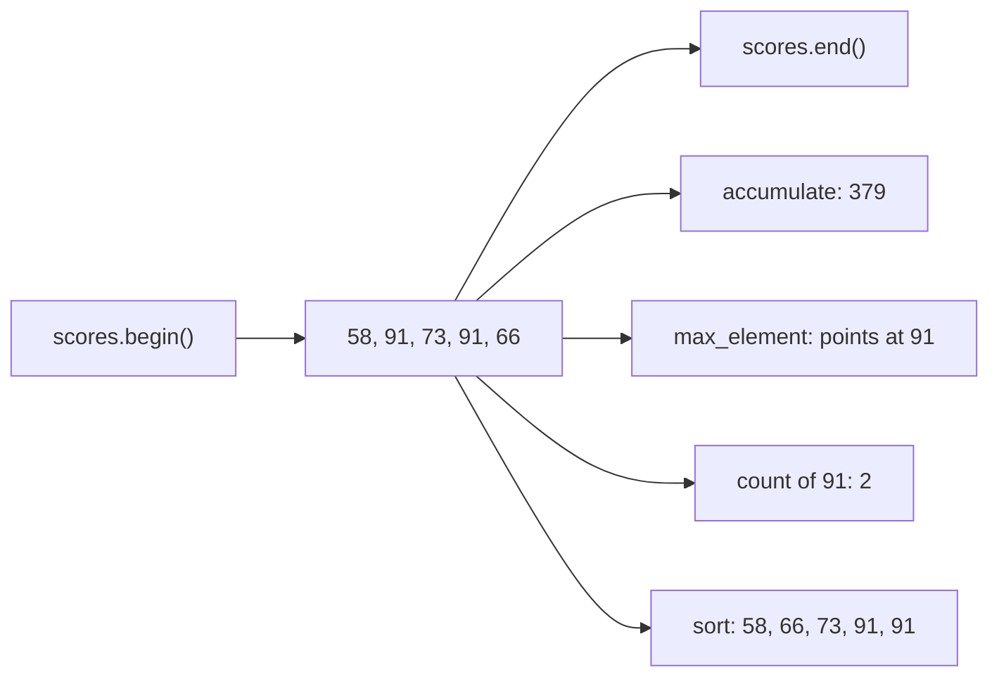
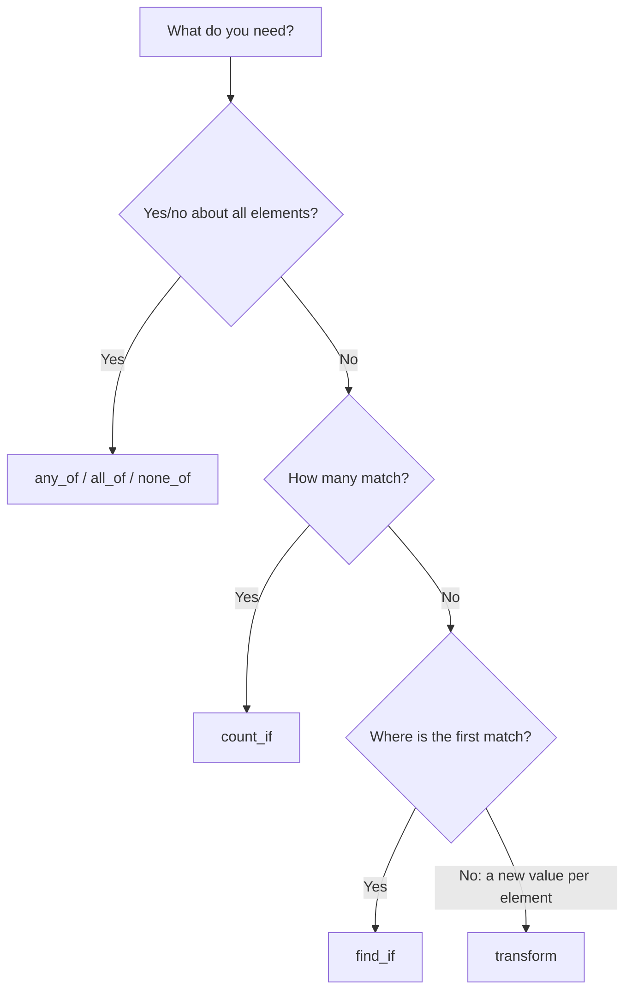
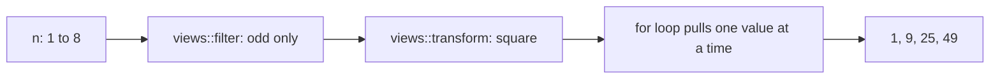

# new

## explanation

### Ready-made loops

Many loops you write do the same jobs again and again: add up, find, count, sort. The standard library has these as ready-made, tested functions called **algorithms**, in `<algorithm>` (and a few, like `accumulate`, in `<numeric>`).

### They work on ranges

An algorithm doesn't take a container. It takes a **range**: an iterator to the first element and one to just past the last, usually `nums.begin()` and `nums.end()`. That's why the same `std::sort` works on a vector, a string or an array.

### A first set to know

- `std::sort(nums.begin(), nums.end())` puts the elements in increasing order.
- `std::reverse(nums.begin(), nums.end())` reverses their order.
- `std::find(nums.begin(), nums.end(), x)` returns an iterator to the first `x`, or `nums.end()` if there isn't one.
- `std::count(nums.begin(), nums.end(), x)` counts how many elements equal `x`.
- `std::min_element` and `std::max_element` return an iterator to the smallest or largest element; use `*` to read it.
- `std::accumulate(nums.begin(), nums.end(), 0)` adds everything to a starting value, here 0.

### Why use them

An algorithm's name says what the loop does, so `std::count(...)` is quicker to read than ten lines of counting. They're also tested and fast, and they avoid off-by-one mistakes in hand-written loops.

### Results that are iterators

`find`, `min_element` and `max_element` return **positions**, not values. Subtracting `nums.begin()` from a position gives its index. Compare a `find` result with `nums.end()` before using it, because `end()` means "not found".

## diagram



## example

```cpp
#include <algorithm>
#include <iostream>
#include <numeric>
#include <vector>

int main() {
    std::vector<int> scores = {58, 91, 73, 91, 66};

    int total = std::accumulate(scores.begin(), scores.end(), 0);
    std::cout << "total " << total << '\n';

    auto best = std::max_element(scores.begin(), scores.end());
    auto worst = std::min_element(scores.begin(), scores.end());
    std::cout << "best " << *best << ", worst " << *worst << '\n';

    std::cout << "91 appears " << std::count(scores.begin(), scores.end(), 91) << " times\n";

    auto where = std::find(scores.begin(), scores.end(), 73);
    if (where != scores.end()) {
        std::cout << "73 is at index " << (where - scores.begin()) << '\n';
    }

    std::sort(scores.begin(), scores.end());
    for (int s : scores) std::cout << s << ' ';
    std::cout << '\n';
}
```

```text
total 379
best 91, worst 58
91 appears 2 times
73 is at index 2
58 66 73 91 91
```

1. `accumulate` starts at 0 and adds every score: 379.
2. `max_element` and `min_element` return positions; `*` reads the values there.
3. `count` finds both 91s.
4. `find` returns the position of 73. It isn't `end()`, so it's safe to use, and its distance from `begin()` is the index, 2.
5. `sort` reorders the vector itself, from smallest to largest.

## mistakes

- **Using `find`'s result without checking.** If the value is missing, `find` returns `end()`, and `*end()` is not an element. Compare with `end()` first.
- **The wrong starting value in `accumulate`.** `std::accumulate(prices.begin(), prices.end(), 0)` on `double` prices adds in `int` and loses the decimals. Start from `0.0`.
- **Printing a position instead of a value.** `max_element` returns an iterator. Write `*std::max_element(...)`.
- **Forgetting the include.** Most algorithms need `<algorithm>`; `accumulate` needs `<numeric>`.
- **Not expecting `sort` to change your data.** It reorders the container in place. Sort a copy if you still need the original order.

## check

```cpp
#include <algorithm>
#include <iostream>
#include <numeric>
#include <vector>

int main() {
    std::vector<int> nums = {4, 9, 2, 9, 7};
    std::reverse(nums.begin(), nums.end());
    int sum = std::accumulate(nums.begin(), nums.end(), 10);
    auto it = std::find(nums.begin(), nums.end(), 9);
    std::cout << nums[0] << ' ' << sum << ' ' << (it - nums.begin()) << ' ' << *std::min_element(nums.begin(), nums.end()) << '\n';
}
```

```text
7 41 1 2
```

After `reverse`, `nums` is 7, 9, 2, 9, 4. `accumulate` starts from 10, not 0, so the sum is 10 + 31 = 41. `find` stops at the **first** 9, which is now at index 1. The smallest element is 2.

# building

## explanation

### A quick recap

Algorithms take a range, `begin()` to `end()`, and do one job: `sort`, `find`, `count`, `accumulate`, `min_element`, `max_element`, `reverse`. Positions come back as iterators.

### Algorithms with a condition

Many algorithms have an `_if` form that takes a **predicate**, a function (usually a lambda) that answers yes or no for one element:

- `std::count_if(b, e, pred)` counts the yeses.
- `std::find_if(b, e, pred)` returns the first yes, or `e`.
- `std::any_of`, `std::all_of` and `std::none_of` answer a yes/no question about the whole range.

### Changing every element: `transform`

`std::transform(b, e, out, f)` calls `f` on each element and writes the results starting at `out`. The destination must already have room for every result, so size it first.

### Sorting your way

`std::sort(b, e, comp)` takes a comparator that says when one element should come first: `std::greater<int>()` from `<functional>` sorts largest first. The comparator must use a strict comparison, like `<` or `>`, never `<=`.

### Searching sorted data

Once a range is sorted, searching it is much faster:

- `std::binary_search(b, e, x)` says whether `x` is there.
- `std::lower_bound(b, e, x)` returns the first position whose element is not less than `x`.

They halve the range at each step, so a million elements take about 20 steps. On unsorted data they give wrong answers without any warning.

### C++20 ranges

The `std::ranges` versions accept a whole container: `std::ranges::sort(prices)` instead of `std::sort(prices.begin(), prices.end())`. They're harder to misuse, because you can't mix the `begin` of one container with the `end` of another.

## diagram



## example

```cpp
#include <algorithm>
#include <functional>
#include <iostream>
#include <vector>

int main() {
    std::vector<int> prices = {120, 45, 300, 80, 45, 210};

    // Yes/no questions about the whole range, with predicates.
    bool anyOver250 = std::any_of(prices.begin(), prices.end(), [](int p) { return p > 250; });
    bool allPositive = std::all_of(prices.begin(), prices.end(), [](int p) { return p > 0; });
    auto cheap = std::count_if(prices.begin(), prices.end(), [](int p) { return p < 100; });
    std::cout << anyOver250 << ' ' << allPositive << ' ' << cheap << '\n';

    // The first element that matches a condition.
    auto firstBig = std::find_if(prices.begin(), prices.end(), [](int p) { return p > 150; });
    std::cout << "first over 150: " << *firstBig << " at " << (firstBig - prices.begin()) << '\n';

    // transform: one result per element, written into a range with room for it.
    std::vector<int> discounted(prices.size());
    std::transform(prices.begin(), prices.end(), discounted.begin(), [](int p) { return p - p / 10; });
    std::cout << "discounted first: " << discounted[0] << '\n';

    // Sorted data allows fast searching.
    std::sort(prices.begin(), prices.end());
    bool has80 = std::binary_search(prices.begin(), prices.end(), 80);
    auto firstAtLeast100 = std::lower_bound(prices.begin(), prices.end(), 100);
    std::cout << has80 << ' ' << *firstAtLeast100 << '\n';

    // C++20 ranges: pass the whole container.
    std::ranges::sort(prices, std::greater<int>());
    std::cout << "highest " << prices.front() << '\n';
}
```

```text
1 1 3
first over 150: 300 at 2
discounted first: 108
1 120
highest 300
```

1. 300 is over 250, every price is positive, and three prices (45, 80, 45) are under 100.
2. `find_if` stops at the first price over 150: 300, at index 2. 210 is never reached.
3. `discounted` is made the same size first, then `transform` fills it: 120 minus a tenth is 108.
4. After sorting (45, 45, 80, 120, 210, 300), `binary_search` finds 80 and `lower_bound(100)` lands on 120.
5. `std::ranges::sort` takes the vector itself; with `std::greater`, the highest price comes first.

## mistakes

- **Binary search on unsorted data.** `binary_search` and `lower_bound` assume the range is sorted. On unsorted data they give wrong answers, with no error. Sort first.
- **`transform` into an empty vector.** It writes to positions that don't exist. Size the destination first, or write the results back over the source.
- **Using `find_if`'s result without checking.** If nothing matches, it returns `end()`. Compare before using `*`.
- **`>=` in a comparator.** It breaks `sort`'s rules and can misorder or crash. Use `>` or `std::greater`.
- **Mixing two containers in one range.** `std::sort(a.begin(), b.end())` is undefined. The `std::ranges` versions prevent this.

## check

```cpp
#include <algorithm>
#include <iostream>
#include <vector>

int main() {
    std::vector<int> vals = {5, 12, 3, 18, 7};
    auto n = std::count_if(vals.begin(), vals.end(), [](int k) { return k % 2 == 1; });
    auto f = std::find_if(vals.begin(), vals.end(), [](int k) { return k > 10; });
    std::sort(vals.begin(), vals.end());
    auto lb = std::lower_bound(vals.begin(), vals.end(), 6);
    std::cout << n << ' ' << *f << ' ' << *lb << ' ' << std::none_of(vals.begin(), vals.end(), [](int k) { return k > 20; }) << '\n';
}
```

```text
3 5 7 1
```

5, 3 and 7 are odd, so `count_if` gives 3. `find_if` returns the position of the first element over 10: index 1, where 12 is. But `*f` is only read after `sort`, and an iterator marks a position, not a value: index 1 now holds 5. After sorting (3, 5, 7, 12, 18), the first element not less than 6 is 7. No element is over 20, so `none_of` is true.

# strong

## explanation

### What the library guarantees

Algorithms come with complexity guarantees: `std::sort` is O(n log n) (typically introsort), `find` and `count` are linear, `binary_search` and `lower_bound` are logarithmic on random-access ranges. Reaching for the right algorithm often matters more than any micro-optimisation.

### Stability

`std::sort` doesn't keep equal elements in their original order. `std::stable_sort` does, at a small extra cost. That's useful when you sort by one key and want an earlier ordering to survive among ties.

### Projections

`std::ranges` algorithms accept a **projection**: a function applied to each element before comparing. `std::ranges::sort(cities, {}, &City::population)` sorts by one member without writing a comparator; `{}` means "the default comparison", `std::ranges::less`. A projection can also be a lambda.

### Algorithms that don't erase

`std::remove`, `std::remove_if` and `std::unique` can't change a container's size: they only see iterators. They move the kept elements to the front and return where the kept part ends; what lies after it is leftover. You must then erase that tail from the container yourself. `std::unique` also only removes **adjacent** repeats, so sort first. C++20 adds `std::erase` and `std::erase_if` as one-step versions for the standard containers.

### `<numeric>`

Beyond `accumulate`: `std::iota` fills a range with consecutive values, `std::partial_sum` produces running totals, and `std::reduce` is like `accumulate` but allows the additions in any order, so it can run in parallel.

### Views: lazy pipelines

`std::views::filter` and `std::views::transform`, combined with `|`, describe a pipeline over a range **without copying it**: each element is computed only when the loop asks for it. A view refers to its source, so the source must outlive the view.

## diagram



## example

```cpp
#include <algorithm>
#include <iostream>
#include <numeric>
#include <ranges>
#include <string>
#include <vector>

struct Town {
    std::string name;
    int population;
};

int main() {
    // iota fills 1 to 8; partial_sum turns it into running totals.
    std::vector<int> n(8);
    std::iota(n.begin(), n.end(), 1);
    std::vector<int> running(n.size());
    std::partial_sum(n.begin(), n.end(), running.begin());
    std::cout << running.back() << '\n';

    // A projection: sort by one member without writing a comparator.
    std::vector<Town> towns = {{"Riverton", 7276}, {"Hillside", 2119}, {"Lakeview", 8331}, {"Oakpur", 2203}};
    std::ranges::sort(towns, {}, &Town::population);
    std::cout << towns.front().name << ' ' << towns.back().name << '\n';

    // stable_sort keeps equal elements in their earlier order.
    std::vector<std::string> words = {"bb", "a", "cc", "d", "ee"};
    std::ranges::stable_sort(words, {}, [](const std::string& w) { return w.size(); });
    for (const auto& w : words) std::cout << w << ' ';
    std::cout << '\n';

    // Views are lazy: each value is computed only when the loop reads it.
    auto squaresOfOdds = n | std::views::filter([](int k) { return k % 2 == 1; })
                           | std::views::transform([](int k) { return k * k; });
    for (int s : squaresOfOdds) std::cout << s << ' ';
    std::cout << '\n';

    // unique only removes neighbouring repeats, and returns the leftover tail.
    std::vector<int> codes = {7, 3, 7, 1, 3, 3};
    std::ranges::sort(codes);
    auto tail = std::ranges::unique(codes);
    codes.erase(tail.begin(), tail.end());
    std::cout << codes.size() << " distinct\n";
}
```

```text
36
Hillside Lakeview
a d bb cc ee
1 9 25 49
3 distinct
```

1. `iota` writes 1 to 8, and `partial_sum` makes each position the sum so far; the last is 1 + … + 8 = 36.
2. The projection `&Town::population` compares towns by population, smallest first: Hillside to Lakeview.
3. `stable_sort` by length keeps "a" before "d" and "bb", "cc", "ee" in their original order.
4. The pipeline filters 1 to 8 down to the odd numbers and squares them, with no intermediate vector.
5. After sorting, the repeats are neighbours. `unique` keeps 1, 3, 7 at the front and returns the leftover tail, which `erase` removes.

## mistakes

- **Expecting `std::sort` to keep ties in order.** It may reorder equal elements. Use `std::stable_sort` when that order matters.
- **Calling `remove` or `unique` and stopping there.** The container keeps its size, with leftovers at the end. Erase the returned tail, or use C++20's `std::erase_if`.
- **`unique` on unsorted data.** It only removes repeats that sit next to each other. Sort first if repeats can be anywhere.
- **A view outliving its source.** A view of a temporary vector, or of one that has since changed size, refers to elements that are gone. Keep the source alive and unchanged while using the view.
- **Swapping the comparator and the projection.** In `std::ranges::sort(r, comp, proj)`, the comparator comes first. Pass `{}` for the default comparator when you only want a projection.

## check

```cpp
#include <algorithm>
#include <iostream>
#include <numeric>
#include <ranges>
#include <vector>

int main() {
    std::vector<int> vals(5);
    std::iota(vals.begin(), vals.end(), 3);
    auto evens = vals | std::views::filter([](int k) { return k % 2 == 0; });
    int sum = 0;
    for (int k : evens) sum += k;
    std::vector<int> d = {4, 4, 2, 4, 2};
    std::ranges::sort(d);
    auto rest = std::ranges::unique(d);
    std::cout << sum << ' ' << (rest.begin() - d.begin()) << ' ' << d.size() << '\n';
}
```

```text
10 2 5
```

`iota` fills 3, 4, 5, 6, 7, and the view yields only the even ones, 4 and 6: sum 10. Sorted, `d` is 2, 2, 4, 4, 4; `unique` moves the two distinct values to the front and returns the tail starting at index 2. Nothing was erased, so `d` still holds 5 elements.
