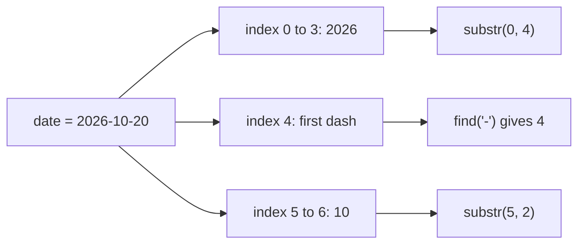
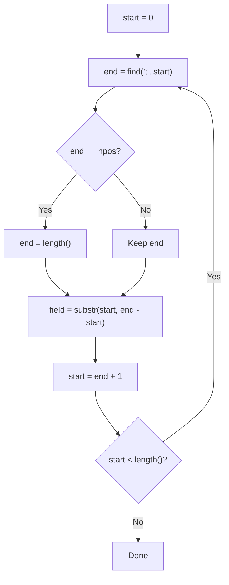
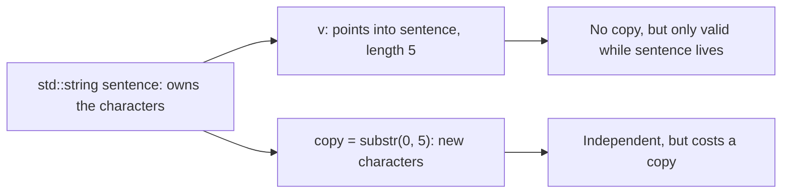

# new

## explanation

### Text in a variable

A `char` holds one character. For words and sentences, C++ has `std::string`, from `#include <string>`:

```cpp
std::string first = "Asha";
```

A string is a sequence of characters that can be as long or short as you need, and it grows by itself.

### Joining strings

`+` joins strings: `first + " " + last` gives `"Asha Verma"`. You can also add to the end of one with `+=`.

### Length and characters

- `s.length()` (or `s.size()`, the same thing) gives the number of characters.
- `s[i]` is the character at index `i`. Like arrays, indexes start at 0, so the last character is `s[s.length() - 1]`.
- You can change a character: `s[0] = 'U';`. A single character uses single quotes.

### Taking part of a string

`s.substr(start, count)` gives a new string of `count` characters, starting at index `start`. For `"2026-10-20"`, `substr(0, 4)` is `"2026"` and `substr(5, 2)` is `"10"`. The second number is how many characters, not where to stop.

### Finding

`s.find('-')` gives the index of the first `-`. It works with longer text too: `s.find("10")`. When the text isn't there, `find` returns a special value, `std::string::npos`, meaning "not found".

### Comparing

`==` and `!=` check whether two strings hold exactly the same characters. `<` and `>` compare in dictionary order, letter by letter: `"Asha" < "Verma"` is true because `A` comes before `V`. Capital letters matter: `"asha"` and `"Asha"` are different strings.

### Going through every character

A loop over the indexes visits each character:

```cpp
for (int i = 0; i < s.length(); i++) {
    std::cout << s[i] << ' ';
}
```

### Printing

`std::cout << s;` prints the whole string, with no quotes around it.

## diagram



## example

```cpp
#include <iostream>
#include <string>

int main() {
    std::string first = "Asha";
    std::string last = "Verma";
    std::string full = first + " " + last;
    std::cout << full << " has " << full.length() << " characters\n";

    std::cout << "First letter: " << full[0] << '\n';
    full[0] = 'U';
    std::cout << "Changed: " << full << '\n';

    std::string date = "2026-10-20";
    std::string year = date.substr(0, 4);
    std::string month = date.substr(5, 2);
    std::cout << "Year " << year << ", month " << month << '\n';

    std::cout << "Dash at index " << date.find('-') << '\n';
    std::cout << (first == "Asha") << ' ' << (first < last) << '\n';
}
```

```text
Asha Verma has 10 characters
First letter: A
Changed: Usha Verma
Year 2026, month 10
Dash at index 4
1 1
```

1. `first + " " + last` joins three pieces into `"Asha Verma"`. The space counts, so the length is 10.
2. `full[0]` is the first character, `A`. Replacing it with `'U'` changes the string to `Usha Verma`.
3. `substr(0, 4)` takes 4 characters from index 0, the year. `substr(5, 2)` takes 2 characters from index 5, the month.
4. `find('-')` returns the index of the first dash, `4`.
5. `first == "Asha"` is true, and `"Asha" < "Verma"` is true because `A` comes before `V`.

## mistakes

- **Forgetting `#include <string>`.** Sometimes the program builds anyway, by luck, and then fails elsewhere. Always include it when you use `std::string`.
- **Joining two quoted texts with `+`.** `"Hello" + " there"` doesn't compile: neither side is a `std::string`. Make one side a string variable, or just write `"Hello there"`.
- **Reading past the end.** The last character is `s[s.length() - 1]`. Indexes beyond the end are out of bounds, just as with arrays.
- **Treating `substr`'s second number as an end.** `s.substr(5, 7)` means 7 characters starting at 5, not "up to index 7".
- **Forgetting that capitals matter.** `"Pune" == "pune"` is false. Uppercase letters also sort before all lowercase ones, so `"Zebra" < "apple"` is true.

## check

```cpp
#include <iostream>
#include <string>

int main() {
    std::string s = "code";
    std::string t = s + "r";
    t[0] = 'C';
    std::cout << t << ' ' << t.length() << '\n';
    std::cout << s.substr(1, 2) << ' ' << s.find('d') << '\n';
}
```

```text
Coder 5
od 2
```

`t` is a new string, `"coder"`, and changing its first character makes it `"Coder"`, 5 characters long. `s` is untouched. `substr(1, 2)` takes 2 characters starting at index 1: `od`. In `code`, `d` is at index 2.

# building

## explanation

### A quick recap

`std::string` holds text. `+` and `+=` join, `.length()` counts characters, `s[i]` reads or changes one, `.substr(start, count)` copies a part, and `.find()` returns an index or `std::string::npos`.

### Always check `find`'s answer

`find` returns `std::string::npos` when the text is missing. Using that value as an index, or adding 1 to it, gives nonsense. Compare first:

```cpp
std::size_t at = s.find(';');
if (at == std::string::npos) { /* not found */ }
```

Store positions in `std::size_t`, the type `find` and `length` use, not `int`.

### Splitting text into fields

To split `"name=Ravi;city=Pune"` into fields, repeat four steps:

1. From the current `start`, find the next `;`.
2. If there is none, the field runs to the end of the string.
3. Take `substr(start, end - start)`.
4. Move `start` to just after the `;` and repeat.

`end - start` is the field's length, which is what `substr` wants.

### Building a new string

Start with an empty string and add to it with `+=` as you go through the characters. `+=` adds to the end in place; `s = s + c` builds a whole new string every time, which gets slow.

### Changing case

`std::toupper(c)` and `std::tolower(c)` from `<cctype>` convert one character. They take and return an `int`, so cast the result back to `char`. Pass the character as `unsigned char`, because a negative `char` value, which some non-English characters have, isn't allowed.

### Converting between text and numbers

- `std::stoi("31")` turns text into an `int`, and `std::stod` into a `double`. Text that isn't a number makes them throw an error.
- `std::to_string(32)` turns a number into text, ready to join with `+`.

## diagram



## example

```cpp
#include <cctype>
#include <iostream>
#include <string>

int main() {
    std::string record = "name=Ravi Kumar;city=Pune;age=31";

    // Split on ';' with find and substr, one field at a time.
    std::size_t start = 0;
    while (start < record.length()) {
        std::size_t end = record.find(';', start);
        if (end == std::string::npos) end = record.length();
        std::string field = record.substr(start, end - start);
        std::size_t eq = field.find('=');
        std::cout << field.substr(0, eq) << " -> " << field.substr(eq + 1) << '\n';
        start = end + 1;
    }

    // Build a new string character by character.
    std::string name = "ravi kumar";
    std::string initials = "";
    for (std::size_t i = 0; i < name.length(); i++) {
        bool startsWord = i == 0 || name[i - 1] == ' ';
        if (startsWord) initials += static_cast<char>(std::toupper(static_cast<unsigned char>(name[i])));
    }
    std::cout << "initials: " << initials << '\n';

    // Text to number and back.
    int age = std::stoi("31");
    std::string next = "next year: " + std::to_string(age + 1);
    std::cout << next << '\n';
}
```

```text
name -> Ravi Kumar
city -> Pune
age -> 31
initials: RK
next year: 32
```

1. The loop finds each `;` from the current `start`. For the last field there is no `;`, so `find` returns `npos` and `end` becomes the string's length.
2. Each field is split at its `=`: the part before is the key, and `substr(eq + 1)` with no count takes everything after it.
3. A character starts a word if it's the first one or follows a space. Those become uppercase and are added to `initials` with `+=`.
4. `std::stoi` turns the text `"31"` into the number 31. `std::to_string` turns 32 back into text so it can be joined with `+`.

## mistakes

- **Using `find`'s result without checking.** If the text is missing, `find` returns `npos`, and `npos + 1` wraps around to 0, quietly giving wrong results. Compare with `std::string::npos` first.
- **Storing positions in an `int`.** `npos` doesn't fit, so the comparison with `npos` stops working. Use `std::size_t`.
- **Passing an end index to `substr`.** `substr(start, end)` takes `end` characters, not "up to `end`". Pass the length: `end - start`.
- **`s = s + c` in a loop.** Each pass copies the whole string so far. Use `s += c`.
- **Converting text that isn't a number.** `std::stoi("abc")` throws an error and stops the program unless it's handled. Make sure the text holds a number first.

## check

```cpp
#include <iostream>
#include <string>

int main() {
    std::string path = "docs/notes/today.txt";
    std::size_t slash = path.find('/');
    std::size_t dot = path.find('.');
    std::string out = path.substr(slash + 1, dot - slash - 1);
    out += '!';
    std::cout << out << ' ' << (path.find('#') == std::string::npos) << ' ' << std::stoi("7") * 2 << '\n';
}
```

```text
notes/today! 1 14
```

The first `/` is at index 4 and the `.` at index 16. `substr(5, 11)` takes the 11 characters between them: `notes/today`. `find` only stops at the first `/`, so the second one stays inside the result. `+=` adds `!`. There is no `#`, so `find` returns `npos` and the comparison prints `1`. `std::stoi("7")` is the number 7, doubled to 14.

# strong

## explanation

### What a `std::string` is

A `std::string` owns a block of characters and keeps its length and its **capacity**, the room it has before it must grow. When it grows past its capacity, it moves to a bigger block, usually about twice as big, so adding characters one at a time with `+=` costs constant time on average. `reserve(n)` sets aside room up front. Most implementations also keep short strings, around 15 characters, inside the object itself, so they need no separate block at all.

### Costs to know

- `s[i]`, `size()` and `+=`: constant time.
- `substr`, copying and `s = s + t`: they build a new string, so they cost time proportional to its length.
- `insert` and `erase` in the middle shift everything after the position.
- `find` scans from the start; repeated searches over long text add up.

### `std::string_view`

`std::string_view` (C++17, `<string_view>`) is a read-only window onto characters that someone else owns: just a pointer and a length. Passing one to a function, or taking its `substr`, copies nothing. That makes it ideal for parameters that only read text. The catch: it doesn't keep the characters alive. A view of a temporary string, or of a string that is later changed in size or destroyed, points at freed memory.

### Comparison is by character codes

`<` compares character codes position by position, and the first difference decides. All uppercase letters (65 to 90) come before all lowercase ones (97 to 122). A string that is a prefix of another is smaller: `"app" < "apple"`.

### Bytes, not letters

A `std::string` holds bytes. Text in UTF-8, the usual encoding, uses one byte for English letters but two to four for most other scripts: each Devanagari character takes 3 bytes. So `size()` counts bytes, and `s[i]` may be part of a character. Counting what a reader sees as letters needs a Unicode library.

## diagram



## example

```cpp
#include <iostream>
#include <string>
#include <string_view>

// string_view: a read-only window onto characters someone else owns.
std::string_view firstWord(std::string_view text) {
    std::size_t space = text.find(' ');
    return text.substr(0, space);  // a view into the same characters
}

int main() {
    std::string sentence = "views avoid copies";
    std::cout << '[' << firstWord(sentence) << "]\n";

    // reserve once, then += never has to move the characters while growing.
    std::string line;
    line.reserve(64);
    for (int i = 0; i < 5; i++) {
        line += std::to_string(i * i);
        line += ',';
    }
    line.pop_back();  // drop the last comma
    std::cout << line << " (" << line.size() << " chars)\n";

    // Comparison is by character codes: uppercase comes before lowercase.
    std::cout << (std::string("Zebra") < "apple") << ' ' << (std::string("apple") < "apricot") << '\n';

    // A std::string holds bytes. In UTF-8, each Devanagari character takes 3 bytes.
    std::string hindi = "नमस्ते";
    std::cout << "bytes: " << hindi.size() << '\n';

    // erase and insert shift everything after the position.
    std::string code = "AB-1234";
    code.erase(2, 1);
    code.insert(0, "IN");
    std::cout << code << '\n';
}
```

```text
[views]
0,1,4,9,16 (10 chars)
1 1
bytes: 18
INAB1234
```

1. `firstWord` gets a view of `sentence` and returns a smaller view of its first 5 characters. No characters are copied, and the result is valid because `sentence` is still alive.
2. With 64 characters reserved, the five `+=` rounds never need to move the string. `pop_back` removes the final comma.
3. `'Z'` is 90 and `'a'` is 97, so `"Zebra"` sorts first. `"apple"` and `"apricot"` first differ at index 2, where `p` comes before `r`.
4. `नमस्ते` is 6 Unicode characters, each 3 bytes in UTF-8: 18 bytes.
5. `erase(2, 1)` removes the dash and `insert(0, "IN")` puts two characters in front; both shift the rest of the string.

## mistakes

- **A view that outlives its string.** `std::string_view v = std::string("hi") + "!";` points into a temporary that's destroyed at the end of the line. Only view strings that live longer than the view.
- **Expecting `size()` to count letters.** For non-English text it counts bytes. Don't cut UTF-8 text at arbitrary byte positions either: you may split a character in two.
- **Building strings with `s = s + x` in a loop.** Each pass copies everything so far, so the loop is quadratic. Use `+=`, and `reserve` when you know the size.
- **`substr` in a hot loop.** Each call allocates a new string. Compare in place with `s.compare(pos, len, other)`, or use a `string_view`.
- **Passing `view.data()` to code that expects a terminating `'\0'`.** A view has a length, not an end marker, so such code may read past the view.

## check

```cpp
#include <iostream>
#include <string>
#include <string_view>

int main() {
    std::string s = "power-up";
    std::string_view v = s;
    v.remove_prefix(6);
    s[6] = 'U';
    std::string t = s;
    t.erase(0, t.find('-') + 1);
    std::cout << v << ' ' << t << ' ' << s.size() << ' ' << (std::string("b") > "abc") << '\n';
}
```

```text
Up Up 8 1
```

`v` views `s`, and `remove_prefix(6)` moves the window to the last two characters. `s[6] = 'U'` changes the shared characters, so `v` now shows `Up`: a view sees changes to the string it looks at. `t` is a real copy; erasing up to and including the `-` leaves `Up` there too. `s` still has 8 characters, and `"b" > "abc"` because `b` comes after `a`.
