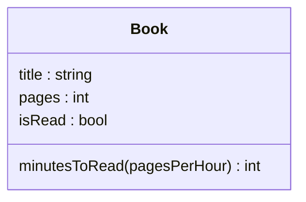
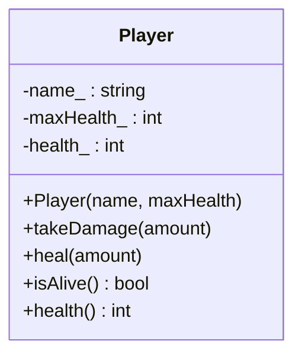
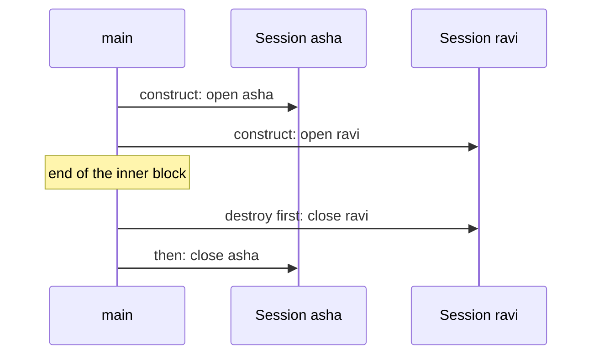

# new

## explanation

### Your own types

A book has a title, a page count and whether you've read it. Keeping those in three separate variables works for one book, but not for a shelf of them. A **struct** groups related values into one new type:

```cpp
struct Book {
    std::string title;
    int pages = 0;
    bool isRead = false;
};
```

Each value inside is a **member**. Note the semicolon after the closing brace: it's required. `= 0` and `= false` are default values, used when nothing else is given.

### Making and using objects

A variable of type `Book` is an **object**. You reach its members with a dot:

```cpp
Book second;
second.title = "Small Steps";
second.pages = 90;
```

Or set them all at once, in the order they're declared: `Book first{"Rain on the Hills", 240};`. Members you leave out keep their defaults.

### Member functions

A struct can also hold functions that work on its members. Inside a member function, the members can be used directly, without a dot:

```cpp
int minutesToRead(int pagesPerHour) const {
    return pages * 60 / pagesPerHour;
}
```

You call it on an object: `first.minutesToRead(40)`. The `const` after the parameter list promises that the function only reads the object and doesn't change it.

### Objects in functions

Pass objects like other big values: by `const` reference to read them, by reference to change them. `void describe(const Book& b)` reads a book without copying it.

### Copies

`Book copy = first;` copies every member. Changing `copy` afterwards doesn't touch `first`.

### `struct` and `class`

`class` is the same idea. The only difference is the default: members of a `struct` are open to everyone (**public**) unless you say otherwise, while members of a `class` are hidden (**private**). Many programmers use `struct` for simple bundles of data and `class` when the type protects its data.

## diagram



## example

```cpp
#include <iostream>
#include <string>

struct Book {
    std::string title;
    int pages = 0;
    bool isRead = false;

    // A member function can use the members directly.
    int minutesToRead(int pagesPerHour) const {
        return pages * 60 / pagesPerHour;
    }
};

void describe(const Book& b) {
    std::cout << b.title << ": " << b.pages << " pages, " << (b.isRead ? "read" : "not read") << '\n';
}

int main() {
    Book first{"Rain on the Hills", 240};
    Book second;
    second.title = "Small Steps";
    second.pages = 90;
    second.isRead = true;

    describe(first);
    describe(second);
    std::cout << "Minutes for the first at 40 pages an hour: " << first.minutesToRead(40) << '\n';

    Book copy = first;  // a copy, member by member
    copy.isRead = true;
    std::cout << "first read? " << first.isRead << ", copy read? " << copy.isRead << '\n';
}
```

```text
Rain on the Hills: 240 pages, not read
Small Steps: 90 pages, read
Minutes for the first at 40 pages an hour: 360
first read? 0, copy read? 1
```

1. `first` is set up with a title and page count in declaration order; `isRead` keeps its default, `false`.
2. `second` starts with all defaults, then each member is set with a dot.
3. `describe` reads each book through a `const` reference, so nothing is copied or changed.
4. `first.minutesToRead(40)` uses `first`'s own `pages`: 240 × 60 / 40 = 360.
5. `copy` is a separate object. Marking it read leaves `first` unread.

## mistakes

- **Forgetting the semicolon after the struct.** `struct Book { ... }` without `;` gives a confusing error on the next line.
- **Members with no default.** With `int pages;` and no `= 0`, a `Book` made with `Book b;` holds a garbage page count. Give members defaults.
- **Changing a copy by mistake.** A function taking `Book b` by value changes its own copy. To change the caller's book, take `Book& b`.
- **Using a member without its object.** Outside the struct, `pages` alone means nothing: write `first.pages`.
- **Comparing objects with `==`.** Two `Book`s can't be compared with `==` until the type says how. Compare the members you care about.

## check

```cpp
#include <iostream>

struct Point {
    int x = 0;
    int y = 0;
    int sum() const { return x + y; }
};

int main() {
    Point a{3, 4};
    Point b = a;
    b.x = 10;
    Point c;
    std::cout << a.x << ' ' << b.sum() << ' ' << c.sum() << '\n';
}
```

```text
3 14 0
```

`b` is a copy of `a`, so changing `b.x` leaves `a.x` at 3. `b` is now 10 and 4, so its `sum()` is 14. `c` was made with no values, so both members keep their defaults of 0.

# building

## explanation

### A quick recap

A struct or class groups members into one type. You reach members with a dot, member functions work on the object's own members, and `const` member functions only read.

### Protect the data: private members

Some objects have rules that must always hold, called **invariants**: a player's health is never below 0 or above the maximum. If every part of the program can change `health` directly, one careless line breaks the rule. So make the data **private** and offer **public** member functions that keep the rule:

```cpp
class Player {
public:
    void takeDamage(int amount);  // keeps health at 0 or above
private:
    int health_;
};
```

Code outside the class can call `takeDamage`, but can't touch `health_`. A trailing `_` is a common way to mark private members.

### Constructors

A **constructor** is a member function with the class's name and no return type. It runs when an object is created and sets it up correctly from the start. Set members in the **member initialiser list**, after a colon:

```cpp
Player(const std::string& name, int maxHealth)
    : name_(name), maxHealth_(maxHealth), health_(maxHealth) {}
```

Members are always initialised in the order they're **declared** in the class, whatever order the list uses. Keep the list in the same order to avoid surprises.

### Getters

Small `const` functions like `int health() const` let outside code read private data without changing it. Mark every function that doesn't change the object `const`, so it can be called on `const` objects and through `const` references.

### Designing a class, step by step

1. List the data the object needs.
2. Write down its invariants.
3. Make the data private.
4. Write a constructor that starts the object in a valid state.
5. Add public functions for each action; each must leave the invariants true.

## diagram



## example

```cpp
#include <iostream>
#include <string>

class Player {
public:
    Player(const std::string& name, int maxHealth)
        : name_(name), maxHealth_(maxHealth), health_(maxHealth) {}

    void takeDamage(int amount) {
        health_ -= amount;
        if (health_ < 0) health_ = 0;  // health never goes below 0
    }

    void heal(int amount) {
        health_ += amount;
        if (health_ > maxHealth_) health_ = maxHealth_;  // or above the maximum
    }

    bool isAlive() const { return health_ > 0; }
    int health() const { return health_; }
    const std::string& name() const { return name_; }

private:
    std::string name_;
    int maxHealth_;
    int health_;
};

int main() {
    Player hero("Kiran", 100);
    hero.takeDamage(30);
    hero.heal(50);
    std::cout << hero.name() << ": " << hero.health() << '\n';
    hero.takeDamage(250);
    std::cout << hero.name() << ": " << hero.health() << ", alive " << hero.isAlive() << '\n';
}
```

```text
Kiran: 100
Kiran: 0, alive 0
```

1. The constructor sets all three members in the initialiser list, so a `Player` starts at full health.
2. 30 damage leaves 70. Healing 50 would make 120, but `heal` caps it at the maximum, 100.
3. 250 damage would make -150; `takeDamage` stops at 0. Outside code has no way to set `health_` to anything else.
4. `name()`, `health()` and `isAlive()` are `const` getters: they read the private members and change nothing.

## mistakes

- **Public data with a rule attached.** If `health` is public, any line can set it to -500. Make it private and change it only through functions that keep the rule.
- **Initialiser list in a different order from the members.** Members are initialised in declaration order. If one depends on another declared later, it reads garbage. Keep both orders the same.
- **Getters without `const`.** Then they can't be called on a `const Player&`. Mark every read-only member function `const`.
- **Setting members in the constructor body instead of the list.** It works for simple types but initialises twice, and doesn't compile for `const` or reference members. Use the initialiser list.
- **Handing out a non-const reference to private data.** `int& health() { return health_; }` lets callers change it freely, which undoes the protection.

## check

```cpp
#include <iostream>

class Meter {
public:
    explicit Meter(int start) : value_(start) {}
    void add(int n) { value_ = value_ + n > 99 ? 99 : value_ + n; }
    int value() const { return value_; }
private:
    int value_;
};

int main() {
    Meter m(90);
    m.add(5);
    Meter n = m;
    n.add(20);
    std::cout << m.value() << ' ' << n.value() << '\n';
}
```

```text
95 99
```

`m` starts at 90 and `add(5)` makes 95. `n` is a copy, so it also starts at 95. `95 + 20` is over 99, so `add` caps `n` at 99, while `m` stays 95: copies have their own members.

# strong

## explanation

### Object lifetime and destructors

A **destructor**, `~Session()`, runs automatically when an object's lifetime ends: at the end of its scope for a local, or when `delete` frees it. Locals are destroyed in the **reverse** order of their creation. Pair a constructor that acquires something (memory, a file, a lock, a count) with a destructor that releases it, and the release happens on every path out of the scope, including early returns and exceptions. This is **RAII**.

### The rule of zero, three and five

If a class owns a resource through a raw handle, the compiler's default copy just copies the handle, and two objects then release the same resource: a double free. So a class that writes a destructor usually needs its copy constructor and copy assignment too (rule of three), plus the move versions (rule of five). Either define them, or forbid copying with `= delete`. Better still, hold resources in members that already manage themselves, such as `std::string`, `std::vector` and `std::unique_ptr`, and write none of the five: the **rule of zero**.

### `explicit` constructors

A constructor taking one argument also acts as an implicit conversion: with `Meter(int)`, a function taking a `Meter` would accept `5`. Mark single-argument constructors `explicit` unless you want that.

### Operators

C++20's `auto operator<=>(const T&) const = default;` generates all six comparisons, comparing members in declaration order, so put the most significant member first. To print with `std::cout`, write `operator<<` as a free function that takes `std::ostream&` and returns it, so chains keep working.

### `static` members

A `static` data member belongs to the class, not to any one object: every object shares it. `static inline int open_ = 0;` (C++17) defines it inside the class. A `static` member function can be called without an object, as `Session::openCount()`.

### Moves

A class gets a move constructor automatically when it declares no copy operations or destructor. Moving transfers members like strings cheaply instead of copying their contents. `user_(std::move(user))` takes a parameter by value and moves it into place: one cheap step for both lvalue and temporary arguments.

## diagram



## example

```cpp
#include <compare>
#include <iostream>
#include <string>
#include <utility>

struct Version {
    int major = 0;
    int minor = 0;
    // C++20: one line gives ==, !=, <, <=, >, >= comparing members in order.
    auto operator<=>(const Version&) const = default;
};
std::ostream& operator<<(std::ostream& out, const Version& v) {
    return out << v.major << '.' << v.minor;
}
// RAII: the constructor takes a resource, the destructor gives it back.
class Session {
public:
    explicit Session(std::string user) : user_(std::move(user)) {
        ++open_;
        std::cout << "open " << user_ << '\n';
    }
    ~Session() {
        --open_;
        std::cout << "close " << user_ << '\n';
    }
    Session(const Session&) = delete;  // one owner only
    Session& operator=(const Session&) = delete;
    static int openCount() { return open_; }
private:
    std::string user_;
    static inline int open_ = 0;  // shared by every Session
};

int main() {
    Version a{1, 4}, b{1, 10};
    std::cout << a << " < " << b << ": " << (a < b) << '\n';
    {
        Session s1("asha");
        Session s2("ravi");
        std::cout << "open now: " << Session::openCount() << '\n';
    }  // destructors run here, in reverse order
    std::cout << "open now: " << Session::openCount() << '\n';
}
```

```text
1.4 < 1.10: 1
open asha
open ravi
open now: 2
close ravi
close asha
open now: 0
```

1. The defaulted `<=>` compares `major` first, then `minor`. Both majors are 1 and 4 < 10, so `1.4 < 1.10` is true, unlike a comparison of the text "1.4" and "1.10".
2. The free `operator<<` returns the stream, so `std::cout << a << " < " << b` keeps chaining.
3. Each `Session` constructor bumps the shared static counter; the deleted copy operations mean a session can't be duplicated by accident.
4. At the inner block's closing brace, `s2` is destroyed first and `s1` second, in reverse order of creation, and each destructor gives its count back.

## mistakes

- **A destructor without copy rules.** If a class frees a raw resource in its destructor but keeps the default copy, two copies free it twice. Delete or define the copy operations, or hold the resource in a `std::unique_ptr` or `std::vector`.
- **Implicit conversions from single-argument constructors.** Without `explicit`, `void show(Meter m)` accepts `show(5)`. Mark them `explicit`.
- **`operator<<` as a member function.** A member's left side is the object, so it would read `obj << std::cout`. Write it as a free function taking `std::ostream&`.
- **Members in the wrong order for `<=>`.** The defaulted comparison follows declaration order. Declaring `minor` before `major` would rank 2.1 below 1.9.
- **Relying on members being set up in initialiser-list order.** They are always set up in declaration order, and destroyed in reverse. Don't let one member's initialiser read a member declared after it.

## check

```cpp
#include <iostream>

struct Tracer {
    int id;
    explicit Tracer(int i) : id(i) { std::cout << "+" << id; }
    ~Tracer() { std::cout << "-" << id; }
};

int main() {
    Tracer a(1);
    {
        Tracer b(2);
        Tracer c(3);
    }
    Tracer d(4);
    std::cout << '\n';
}
```

```text
+1+2+3-3-2+4
-4-1
```

`a`, `b` and `c` are constructed in order. At the inner closing brace, `c` and `b` are destroyed in reverse order. Then `d` is built and the new line printed. Only when `main` returns are `d` and `a` destroyed, again in reverse, so `-4-1` comes after the line break.
