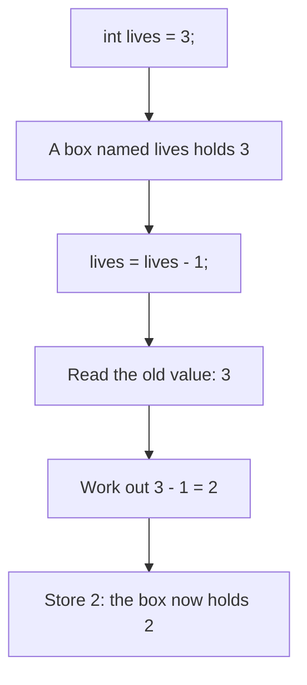
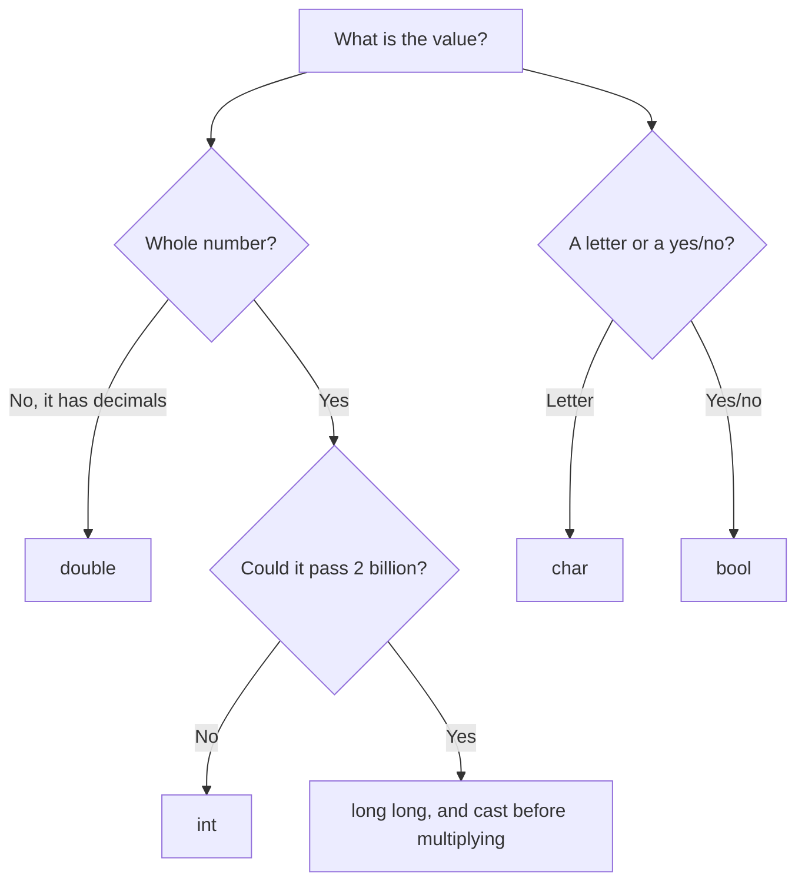
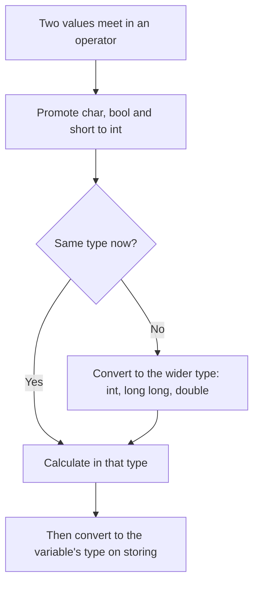

# new

## explanation

### What a variable is

A **variable** is a named place in memory that holds one value. You create it by writing its type, its name and a starting value:

```cpp
int lives = 3;
```

This line means: make a box for a whole number, call it `lives`, and put `3` in it. Later, the name `lives` stands for whatever is in the box.

### The basic types

The type says what kind of value the box can hold:

- `int`: a whole number, such as `-5`, `0` or `42`. It holds values up to about 2.1 billion either side of zero.
- `long long`: also a whole number, but far bigger, up to about 9.2 billion billion.
- `double`: a number with a decimal point, such as `2.5` or `-0.75`.
- `char`: one character, written in single quotes: `'A'`, `'7'` or `'?'`.
- `bool`: a yes-or-no value, `true` or `false`.

### Changing a value

Once a variable exists, write its name, `=` and a new value to replace what's inside. You don't repeat the type:

```cpp
lives = 2;          // the box now holds 2
lives = lives - 1;  // read 2, subtract 1, store 1
```

The second line looks odd in maths, but in C++ `=` means "store", not "is equal to". The right side is worked out first, using the old value, and then the result goes into the box.

### Copies, not links

`int saved = lives;` copies the value that `lives` has at that moment. If `lives` changes later, `saved` keeps its own copy.

### Always start with a value

`int count;` without a value makes a box with whatever happened to be in that memory. Reading it gives a random-looking number. Always write a starting value: `int count = 0;`.

### Names

A name may use letters, digits and `_`, but it can't start with a digit or contain spaces. Capital letters matter, so `score` and `Score` are two different variables. Choose names that say what the value means, like `lives` or `price`, not `x`.

### Putting one type into another

A whole number fits safely into a `double`: `double d = 4;` stores `4.0`, which prints as `4`. Going the other way loses the decimals: `int whole = 9.8;` stores `9`. It doesn't round; it just cuts off everything after the point.

## diagram



## example

```cpp
#include <iostream>

int main() {
    int lives = 3;
    double speed = 2.5;
    char grade = 'A';
    bool isRunning = true;

    std::cout << "Lives: " << lives << '\n';
    lives = lives - 1;
    std::cout << "Lives after a fall: " << lives << '\n';
    std::cout << "Speed: " << speed << '\n';
    std::cout << "Grade: " << grade << '\n';
    std::cout << "Running: " << isRunning << '\n';
}
```

```text
Lives: 3
Lives after a fall: 2
Speed: 2.5
Grade: A
Running: 1
```

1. Four variables are made, each with a type and a starting value.
2. The first print shows `lives`, which is `3`. The `'\n'` in single quotes is the new-line character, the same as `\n` inside text.
3. `lives = lives - 1;` reads `3`, subtracts one and stores `2`, so the next print shows `2`.
4. `speed` is a `double`, so it keeps its decimal part: `2.5`. `grade` is a `char` and prints as the letter `A`.
5. `isRunning` is a `bool`. When printed, `true` shows as `1` and `false` as `0`.

## mistakes

- **Reading a variable before giving it a value.** `int total; std::cout << total;` prints whatever was in memory. Always start with a value, even if it's `0`.
- **Putting a decimal into an `int`.** `int price = 99.99;` stores `99`: the decimals are cut off, not rounded. Use a `double` when you need the decimal part.
- **Double quotes for a `char`.** `char letter = "A";` doesn't compile, because `"A"` is text. A `char` takes one character in single quotes: `'A'`.
- **Expecting `true` to print as a word.** A `bool` prints as `1` or `0`. That's normal, not a bug.
- **Repeating the type to change a value.** `int lives = 2;` a second time in the same block tries to make a new variable with the same name, which is an error. To change it, write `lives = 2;`.

## check

```cpp
#include <iostream>

int main() {
    int a = 7;
    int b = a;
    a = 2;
    double d = 4;
    int n = 9.8;
    std::cout << a << ' ' << b << '\n';
    std::cout << d << ' ' << n << '\n';
}
```

```text
2 7
4 9
```

`b` copies the `7` that `a` holds at that moment. Changing `a` to `2` afterwards doesn't touch `b`. `d` stores `4.0`, and a `double` with nothing after the point prints as `4`. `n` is an `int`, so `9.8` loses its decimals and becomes `9`, not `10`.

# building

## explanation

### A quick recap

A variable has a type, a name and a value. `=` stores a new value. Whole numbers go in `int` or `long long`, decimals in `double`, single characters in `char`, and yes-or-no values in `bool`. Now let's choose types well and convert between them safely.

### Choosing the right type

Ask what the value is:

- Counting things (people, steps, pages): `int`.
- A count that could pass about 2 billion (milliseconds, money in paise across many accounts, products of big numbers): `long long`.
- Measuring things (distance, weight, an average): `double`.
- A yes-or-no answer: `bool`. A single letter or symbol: `char`.

### Overflow: when a number doesn't fit

An `int` holds at most 2,147,483,647. If a calculation goes past that, it **overflows**, and the result is wrong. For `int`, C++ doesn't even promise what you'll get: the program may print a negative number, or something stranger.

The trap is that C++ picks the type of a calculation from its pieces, not from where you store it. In `long long big = a * b;` with two `int`s, the multiplication happens in `int` first and overflows before the result reaches `big`. Make one piece `long long` before the calculation, then the whole calculation happens in `long long`:

```cpp
long long area = static_cast<long long>(width) * height;
long long ms = 1000LL * 60 * 60;   // LL makes 1000 a long long
```

### Converting on purpose with `static_cast`

`static_cast<type>(value)` converts a value to another type, and makes it clear to the reader that you meant it:

- `static_cast<int>(7.9)` gives `7`. Decimals are cut off, never rounded.
- `static_cast<double>(7)` gives `7.0`, so `static_cast<double>(7) / 2` is `3.5`. Without the cast, `7 / 2` divides two whole numbers and gives `3`.

### A `char` is a small number

Every character is stored as a number code. `'A'` is 65, `'B'` is 66 and so on, and the digits `'0'` to `'9'` are 48 to 57. So `'C' - 1` is the code for `'B'`, and `static_cast<int>('C')` shows `67`.

### Step by step

1. For each value, decide what it is: a count, a big count, a measurement, a letter or a yes/no.
2. Pick the type, and give every variable a starting value.
3. Before multiplying or adding big numbers, check whether the result could pass about 2 billion. If so, make the first piece `long long`.
4. When you need decimals from whole numbers, cast one of them to `double` before dividing.

## diagram



## example

```cpp
#include <iostream>

int main() {
    // A month of milliseconds is past int's limit of 2147483647,
    // so the calculation starts as long long (the LL) and stays long long.
    long long msInMonth = 1000LL * 60 * 60 * 24 * 30;
    std::cout << "Milliseconds in 30 days: " << msInMonth << '\n';

    int pages = 7;
    int days = 2;
    double perDay = static_cast<double>(pages) / days;
    std::cout << "Pages per day: " << perDay << '\n';

    double price = 149.99;
    int rupees = static_cast<int>(price);
    std::cout << "Whole rupees: " << rupees << '\n';

    char grade = 'C';
    char better = grade - 1;
    std::cout << "From " << grade << " up to " << better << '\n';
    std::cout << "Code of " << grade << ": " << static_cast<int>(grade) << '\n';
}
```

```text
Milliseconds in 30 days: 2592000000
Pages per day: 3.5
Whole rupees: 149
From C up to B
Code of C: 67
```

1. `1000LL` is a `long long`, so every multiplication after it is done in `long long`. The result, 2,592,000,000, would not fit in an `int`.
2. `static_cast<double>(pages)` turns `7` into `7.0` before dividing, so the division keeps its decimals: `3.5`.
3. `static_cast<int>(149.99)` cuts off the decimals, giving `149`.
4. `grade - 1` works on the character's code: 67 minus 1 is 66, the code for `'B'`.
5. Casting the `char` to `int` prints its code, `67`, instead of the letter.

## mistakes

- **Storing a big product in `long long` too late.** `long long total = a * b;` with `int`s still overflows, because `a * b` is worked out as an `int` first. Convert before multiplying: `static_cast<long long>(rows) * cols`.
- **Expecting overflow to wrap neatly.** Going past an `int`'s limit doesn't reliably give a negative number. C++ treats it as an error with no defined result, and an optimising compiler may produce surprising behaviour. Prevent it instead of detecting it afterwards.
- **Expecting a cast to round.** `static_cast<int>(2.99)` is `2`. To round to the nearest whole number, use `std::round` from `<cmath>` first.
- **Dividing whole numbers when you wanted decimals.** `double half = 9 / 2;` stores `4.0`, because `9 / 2` is already `4` before it reaches the `double`. Cast one side first.
- **Treating a digit character as its number.** `'7'` is the code 55, not 7. To get the number, subtract `'0'`: `'7' - '0'` is `7`.

## check

```cpp
#include <iostream>

int main() {
    int a = 5;
    int b = 2;
    double x = a / b;
    double y = static_cast<double>(a) / b;
    int z = static_cast<int>(y * 3);
    char c = 'a' + 2;
    std::cout << x << ' ' << y << ' ' << z << ' ' << c << '\n';
}
```

```text
2 2.5 7 c
```

`a / b` divides two `int`s, so it gives `2`, and only then becomes the `double` `2.0`, which prints as `2`. For `y`, `a` becomes `5.0` first, so the result is `2.5`. `y * 3` is `7.5`, and the cast to `int` cuts it to `7`. `'a' + 2` moves two codes along from `'a'`, giving `'c'`.

# strong

## explanation

### Sizes and ranges on our compiler

C++ only promises minimum sizes, but on the compiler used here (clang on 64-bit Linux):

- `int` is 32 bits: −2,147,483,648 to 2,147,483,647. `std::numeric_limits<int>::max()` from `<limits>` gives the exact limit.
- `long long` is 64 bits: about ±9.22 × 10^18.
- `double` is 64 bits, with about 15–16 significant decimal digits.
- `char` is 8 bits. Whether a plain `char` is signed depends on the platform, so don't do arithmetic on it beyond small offsets.

### Signed versus unsigned

`unsigned int` holds 0 to 4,294,967,295. Its arithmetic is defined to **wrap around**: `0u - 1` is 4,294,967,295. Signed overflow is different: it is **undefined behaviour**. The compiler may assume it never happens, so a check like `if (x + 1 < x)` can be removed entirely at `-O2`.

Mixing the two is a classic trap. In `-1 < 1u`, the `-1` is converted to `unsigned`, becoming 4,294,967,295, so the comparison is false. Container sizes such as `v.size()` are unsigned, which is why `i < v.size() - 1` misbehaves on an empty container: `0 - 1` wraps to a huge number. C++20's `std::ssize(v)` gives a signed size.

### How C++ picks a calculation's type

Before arithmetic, small types (`char`, `bool`, `short`) are **promoted** to `int`. Then, if the two sides differ, the "wider" type wins: `int` with `double` becomes `double`, and `int` with `long long` becomes `long long`. The type of the variable receiving the result plays no part. That's why `1000LL * 60 * 60 * 24 * 30` works and `1000 * 60 * 60 * 24 * 30` overflows.

### Literals have types too

`7` is an `int`, `7LL` a `long long`, `7u` an `unsigned int`, `7.0` a `double` and `7.0f` a `float`. A whole-number literal too big for `int` quietly takes a wider type.

### `auto` and braces

`auto` takes the type of its starting value: `auto n = 5;` is an `int`, `auto r = 5 / 2.0;` is a `double`, and `auto q = 1 / 3;` is the `int` `0`. Brace initialisation refuses lossy conversions at compile time: `int n{9.8};` is an error, while `int n = 9.8;` silently stores `9`. Braces are a cheap safety net.

### Floating-point is approximate

`double` stores binary fractions, and most decimals, such as `0.1`, have no exact binary form. So `0.1 + 0.2 == 0.3` is false. Compare with a tolerance instead, and keep money as a whole number of paise in a `long long`.

## diagram



## example

```cpp
#include <iostream>
#include <limits>

int main() {
    std::cout << "int max: " << std::numeric_limits<int>::max() << '\n';

    unsigned int counter = 0;
    counter = counter - 1;  // unsigned arithmetic wraps: well defined
    std::cout << "0u - 1 = " << counter << '\n';

    int negative = -1;
    unsigned int one = 1;
    std::cout << "-1 < 1u? " << (negative < one) << '\n';

    auto whole = 7;          // int
    auto ratio = whole / 2.0;  // double, because 2.0 is a double
    std::cout << "ratio: " << ratio << '\n';

    double sum = 0.1 + 0.2;
    std::cout << "0.1 + 0.2 == 0.3? " << (sum == 0.3) << '\n';
    std::cout << "close enough? " << (sum - 0.3 < 1e-9 && 0.3 - sum < 1e-9) << '\n';
}
```

```text
int max: 2147483647
0u - 1 = 4294967295
-1 < 1u? 0
ratio: 3.5
0.1 + 0.2 == 0.3? 0
close enough? 1
```

1. `std::numeric_limits<int>::max()` reports the largest `int` on this compiler.
2. Subtracting 1 from an unsigned 0 wraps to the largest `unsigned int`. This is defined behaviour, unlike signed overflow.
3. In `negative < one`, `-1` is converted to unsigned, becoming 4,294,967,295, so the answer is false: `0`.
4. `whole / 2.0` mixes `int` and `double`, so it's calculated in `double`: `3.5`.
5. `0.1 + 0.2` is really 0.30000000000000004, so `==` says no. Checking that the gap is tiny in both directions says yes.

## mistakes

- **Comparing signed and unsigned values.** `if (i < v.size() - 1)` with an empty `v` compares against a huge number. Use `std::ssize(v)`, or rearrange to `i + 1 < v.size()`.
- **Relying on signed overflow.** It's undefined behaviour, not a wrap. Checks written after the overflow, like `if (a + b < a)`, may be optimised away. Check the limits before you calculate.
- **Silent narrowing.** `int n = someDouble;` loses the decimals without a word. Writing `int n{someDouble};` makes the compiler stop you, which catches the mistake early.
- **`auto` picking a type you didn't mean.** `auto third = 1 / 3;` is the `int` `0`. Write `1.0 / 3` when you want a `double`.
- **Money in a `double`.** Rounding errors pile up over many additions. Store whole paise in a `long long` and only format it as rupees when printing.

## check

```cpp
#include <iostream>

int main() {
    unsigned int u = 3;
    int i = -4;
    std::cout << (u + i) << '\n';
    char c = '7';
    int digit = c - '0';
    std::cout << digit * 2 << ' ' << c * 1 << '\n';
    auto r = 7 / 2 * 2.0;
    std::cout << r << '\n';
}
```

```text
4294967295
14 55
6
```

In `u + i`, the `int` `-4` is converted to unsigned, which wraps it to 4,294,967,292; adding 3 gives 4,294,967,295. `'7' - '0'` is the number `7`, so `digit * 2` is `14`. `c * 1` promotes the `char` to `int`, so it prints the code of `'7'`, which is `55`. In `7 / 2 * 2.0`, the division happens first and in `int`, giving `3`; then `3 * 2.0` is `6.0`, printed as `6`.
