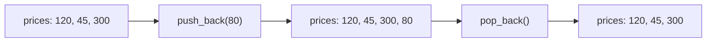
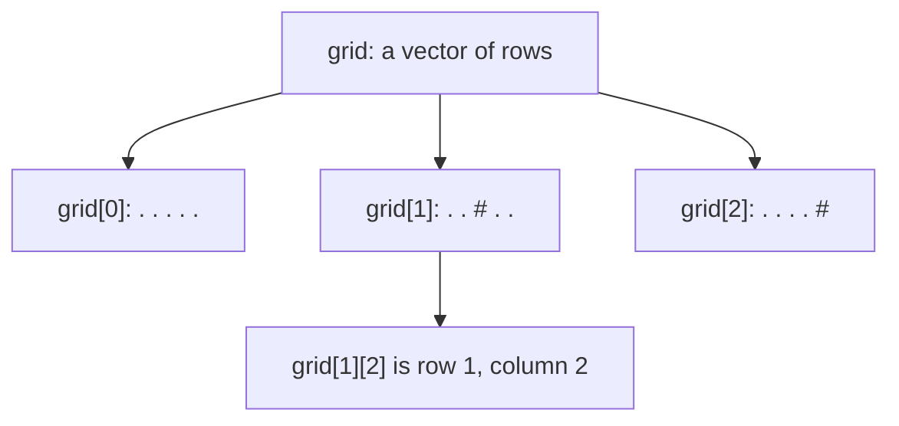
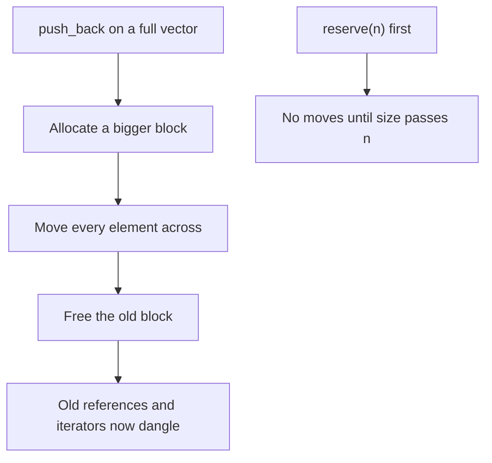

# new

## explanation

### An array that can grow

An array's size is fixed when you write the program. Often you don't know in advance how many values there will be. `std::vector`, from `#include <vector>`, is a list that grows and shrinks as you go:

```cpp
std::vector<int> prices = {120, 45, 300};
```

The type in the angle brackets, `<int>`, is the type of every element. You can make a vector of `double`, `char`, `std::string` and so on.

### Adding and removing at the end

- `prices.push_back(80);` adds 80 as a new last element.
- `prices.pop_back();` removes the last element.

### Size and elements

- `prices.size()` is the number of elements right now.
- `prices[i]` reads or changes element `i`. Indexes start at 0, as with arrays.
- `prices.front()` is the first element and `prices.back()` the last.
- `prices.empty()` is true when the vector has no elements.

### Making a vector

- `std::vector<int> v;` starts empty.
- `std::vector<int> v = {4, 8, 15};` starts with those three values.
- `std::vector<int> v(3, 10);` makes three elements, each 10. With round brackets the first number is a count.

### Looping over a vector

```cpp
for (std::size_t i = 0; i < prices.size(); i++) {
    std::cout << prices[i] << ' ';
}
```

`size()` gives a `std::size_t`, a whole-number type that is never negative, so the counter uses that type too.

### Staying in bounds

A vector checks nothing when you use `[i]`, just like an array. On an empty vector, `v[0]` and `v.back()` are out of bounds. To add an element, use `push_back`, not an index.

## diagram



## example

```cpp
#include <iostream>
#include <vector>

int main() {
    std::vector<int> prices = {120, 45, 300};
    prices.push_back(80);  // add to the end
    std::cout << "items: " << prices.size() << '\n';
    std::cout << "first " << prices[0] << ", last " << prices.back() << '\n';

    int bill = 0;
    for (std::size_t i = 0; i < prices.size(); i++) {
        bill += prices[i];
    }
    std::cout << "bill: " << bill << '\n';

    prices.pop_back();  // remove the last
    prices[1] = 50;     // change one
    for (std::size_t i = 0; i < prices.size(); i++) {
        std::cout << prices[i] << ' ';
    }
    std::cout << '\n';

    std::vector<int> scores(3, 10);  // three elements, each 10
    std::cout << "scores: " << scores[0] << ' ' << scores[1] << ' ' << scores[2] << '\n';
    std::vector<int> nothing;
    std::cout << "empty? " << nothing.empty() << '\n';
}
```

```text
items: 4
first 120, last 80
bill: 545
120 50 300
scores: 10 10 10
empty? 1
```

1. The vector starts with three prices, and `push_back(80)` makes it four.
2. `prices[0]` is the first price and `back()` the last, the 80 just added.
3. The loop runs while `i < prices.size()`, so it visits every element and adds them up: 545.
4. `pop_back()` removes the 80, and `prices[1] = 50` changes the second price. Three prices are left.
5. `scores(3, 10)` makes three elements of 10. A vector made with no values is empty, so `empty()` is true.

## mistakes

- **Using an index to add.** On an empty vector, `v[0] = 5;` writes to an element that doesn't exist. Use `v.push_back(5);`.
- **Round versus curly brackets.** `std::vector<int> v(3);` is three zeros; `std::vector<int> v{3};` is one element, 3.
- **Reading past the end.** Valid indexes are 0 to `size() - 1`. `v[v.size()]` is out of bounds.
- **`back()` on an empty vector.** There is no last element, so the result is undefined. Check `empty()` first.
- **Forgetting `#include <vector>`.** Add it whenever you use `std::vector`.

## check

```cpp
#include <iostream>
#include <vector>

int main() {
    std::vector<int> v = {4, 8};
    v.push_back(15);
    v.push_back(16);
    v.pop_back();
    v[0] = v[1] + v[2];
    std::cout << v.size() << ' ' << v[0] << ' ' << v.back() << '\n';
}
```

```text
3 23 15
```

After two `push_back`s the vector is 4, 8, 15, 16, and `pop_back` removes the 16. `v[1] + v[2]` is `8 + 15 = 23`, which replaces the 4. Three elements remain, and the last is 15.

# building

## explanation

### A quick recap

`std::vector<T>` is a growable list. `push_back` adds at the end, `pop_back` removes the last, `size()` counts, and `v[i]` reads or changes. Round brackets give a count, curly brackets give the values.

### Building a vector in a loop

Many tasks produce a list of results whose length you only know at the end. Start with an empty vector and `push_back` each result. A function can build one and `return` it: returning a vector doesn't copy all its elements, it hands the whole vector over.

### Removing and inserting in the middle

`v.erase(v.begin() + i)` removes the element at index `i`, and `v.insert(v.begin() + i, x)` puts `x` before index `i`. `v.begin()` marks the first element, and `+ i` moves along `i` places; you'll see more of this with iterators. Both shift every later element by one place.

If you erase inside a loop over the indexes, don't step forward after an erase: the next element has just moved into position `i`.

### Two-dimensional grids

A vector can hold vectors. `std::vector<std::vector<char>> grid(rows, std::vector<char>(cols, '.'));` makes `rows` rows, each a vector of `cols` dots. `grid[r][c]` is row `r`, column `c`. `grid.size()` is the number of rows and `grid[r].size()` the length of row `r`. Unlike a 2D array, rows can have different lengths, so only rely on `grid[0].size()` when you built every row the same.

### Passing vectors to functions

Passing a vector by value copies every element. For small vectors that's fine; for big ones it's slow. The references skill shows how to pass one without copying.

### Step by step

1. Decide what goes in the vector and what type the elements are.
2. Choose how it starts: empty, a fixed count, or listed values.
3. Fill it with `push_back`, or change elements with `[i]`.
4. Loop with `i < v.size()`, and never index an element that isn't there.

## diagram



## example

```cpp
#include <iostream>
#include <vector>

// Returns a new vector: the squares of 1 to count.
std::vector<int> squaresUpTo(int count) {
    std::vector<int> squares;
    for (int k = 1; k <= count; k++) {
        squares.push_back(k * k);
    }
    return squares;
}

int main() {
    std::vector<int> sq = squaresUpTo(5);
    for (std::size_t i = 0; i < sq.size(); i++) std::cout << sq[i] << ' ';
    std::cout << '\n';

    // Remove the element at index 1, then insert 99 at the front.
    sq.erase(sq.begin() + 1);
    sq.insert(sq.begin(), 99);
    for (std::size_t i = 0; i < sq.size(); i++) std::cout << sq[i] << ' ';
    std::cout << '\n';

    // A 2D grid: a vector of rows, each a vector of cells.
    int rows = 3, cols = 5;
    std::vector<std::vector<char>> board(rows, std::vector<char>(cols, '.'));
    board[1][2] = '#';
    board[2][4] = '#';
    for (int row = 0; row < rows; row++) {
        for (int col = 0; col < cols; col++) std::cout << board[row][col];
        std::cout << '\n';
    }
    std::cout << "rows " << board.size() << ", cols " << board.front().size() << '\n';
}
```

```text
1 4 9 16 25
99 1 9 16 25
.....
..#..
....#
rows 3, cols 5
```

1. `squaresUpTo` starts with an empty vector, adds each square, and returns the whole vector to `main`.
2. `erase(sq.begin() + 1)` removes index 1, the 4, and the later elements shift left. `insert(sq.begin(), 99)` puts 99 in front and shifts everything right.
3. `board` has 3 rows of 5 dots. Two cells are changed, then nested loops print it row by row.
4. `board.size()` counts rows and `board.front().size()` counts the cells in the first row.

## mistakes

- **Stepping forward after an erase.** In an index loop, `erase(v.begin() + i)` moves the next element into position `i`. If you then do `i++`, you skip it. Only move on when you didn't erase.
- **Writing `v[i]` to grow a vector.** An index can only change existing elements. Grow with `push_back`, or make it big enough first.
- **Assuming every row has the same length.** In a vector of vectors, each row is its own vector. Check `grid[r].size()` if rows were built differently.
- **Copying big vectors without meaning to.** Passing one by value, or writing `auto copy = v;`, copies every element. Fine for small data, slow for large.
- **`i < v.size() - 1` on an empty vector.** `size()` is unsigned, so `0 - 1` wraps to a huge number and the loop runs out of bounds. Write `i + 1 < v.size()`.

## check

```cpp
#include <iostream>
#include <vector>

int main() {
    std::vector<int> v(3);
    v.push_back(7);
    std::vector<int> w{4};
    std::vector<std::vector<int>> g(2, std::vector<int>(3, 1));
    g[1][2] = 5;
    v.erase(v.begin());
    std::cout << v.size() << ' ' << w.size() << ' ' << w[0] << ' ' << g[1][2] + g[0][0] << '\n';
}
```

```text
3 1 4 6
```

`v(3)` is three zeros; `push_back(7)` makes four, and erasing the first leaves three. `w{4}` uses curly brackets, so it's one element, 4. `g` is 2 rows of three 1s; after the change, `g[1][2] + g[0][0]` is `5 + 1 = 6`.

# strong

## explanation

### Size and capacity

A vector keeps its elements in one block of memory. `size()` is how many elements it holds; `capacity()` is how many fit before it needs a bigger block. When `push_back` finds the block full, the vector allocates a larger one, typically about double, moves every element across and frees the old block. Because the block grows by a factor, the moves average out: `push_back` costs constant time on average, even though a single one occasionally costs time proportional to the size.

`reserve(n)` allocates room for `n` elements up front, so filling up to `n` never reallocates. It creates no elements: `v[0]` after `reserve` is still out of bounds. `resize(n)` changes the size, adding default elements or removing them.

### Reallocation invalidates

When the block moves, every reference, pointer and iterator to an element points at freed memory. Never keep one across a `push_back` or `insert` that might reallocate, unless you have reserved enough room.

### Costs of the operations

- `[i]`, `back()`, `push_back`, `pop_back`: constant (amortised for `push_back`).
- `insert` and `erase` in the middle or at the front: they shift every later element, so they cost time proportional to how many follow. Erasing the first element of a big vector, over and over, is quadratic.
- If order doesn't matter, remove index `i` in constant time by moving the last element into its place and calling `pop_back` ("swap and pop").

### `emplace_back`

`emplace_back(args...)` builds the new element directly inside the vector from its constructor's arguments, instead of building a temporary and moving it in. For simple types it makes no difference; for heavy ones it can save work.

### Grids: nested or flat

A `vector<vector<T>>` allocates every row separately, so rows are scattered in memory. For a large fixed-size grid, a single `vector<T>` of `rows * cols` elements, indexed `r * cols + c`, keeps everything in one block and is usually faster.

### `vector<bool>` is different

`std::vector<bool>` stores each value as a single bit to save memory. Its elements aren't real `bool` objects, so `bool& b = flags[0];` doesn't compile, and some code that works for other vectors fails for it.

## diagram



## example

```cpp
#include <iostream>
#include <utility>
#include <vector>

int main() {
    // reserve: room for 1000 up front, so filling it never reallocates.
    std::vector<int> v;
    v.reserve(1000);
    std::size_t reserved = v.capacity();
    for (int n = 0; n < 1000; n++) v.push_back(n);
    std::cout << "size " << v.size() << ", capacity unchanged: " << (v.capacity() == reserved) << '\n';

    // Swap and pop: remove index 2 in constant time when order doesn't matter.
    std::vector<int> ids = {10, 20, 30, 40, 50};
    ids[2] = ids.back();
    ids.pop_back();
    for (std::size_t i = 0; i < ids.size(); i++) std::cout << ids[i] << ' ';
    std::cout << '\n';

    // emplace_back builds the element in place from its constructor's arguments.
    std::vector<std::pair<int, int>> points;
    points.emplace_back(3, 4);
    points.push_back({5, 12});
    std::cout << points[1].first << ',' << points[1].second << '\n';

    // A flat vector as a 2D grid: one block of memory, index r * cols + c.
    int rows = 3, cols = 4;
    std::vector<int> flat(rows * cols, 0);
    flat[2 * cols + 1] = 7;  // row 2, column 1
    std::cout << "flat[9] = " << flat[9] << '\n';

    // Erasing at the front shifts every other element.
    std::vector<int> line = {1, 2, 3};
    line.erase(line.begin());
    std::cout << line.front() << ' ' << line.size() << '\n';
}
```

```text
size 1000, capacity unchanged: 1
10 20 50 40
5,12
flat[9] = 7
2 2
```

1. After `reserve(1000)`, a thousand `push_back`s fit in the reserved block, so the capacity never changes and no element is ever moved.
2. The last element, 50, overwrites index 2, and `pop_back` drops the old last slot: one copy instead of shifting two elements.
3. `emplace_back(3, 4)` constructs the pair inside the vector; `push_back({5, 12})` builds a pair and moves it in. Both end up as elements.
4. Row 2, column 1 of a 3 × 4 grid is index `2 * 4 + 1 = 9` in the flat vector.
5. Erasing the first element shifts the other two left, so `front()` is now 2.

## mistakes

- **Keeping a reference across `push_back`.** `int& first = v[0]; v.push_back(x);` may move the block, leaving `first` pointing at freed memory. Reserve enough room first, or keep an index instead.
- **Confusing `reserve` and `resize`.** `reserve(10)` makes room but no elements, so `v[0]` is still out of bounds. `resize(10)` makes ten elements.
- **Removing from the front in a loop.** Each `erase(v.begin())` shifts the rest, so emptying a big vector this way is quadratic. Walk an index forward instead, or use `std::deque`.
- **Treating `vector<bool>` like other vectors.** Its elements are packed bits, so you can't take a `bool&` to one. Use `vector<char>` when you need real elements.
- **Vectors of vectors for large grids.** Each row is a separate allocation, which costs memory and speed. Use one flat vector indexed `r * cols + c`.

## check

```cpp
#include <iostream>
#include <vector>

int main() {
    std::vector<int> v;
    v.reserve(10);
    std::vector<int> w;
    w.resize(3);
    w.push_back(4);
    v.push_back(1);
    v.insert(v.begin(), 2);
    std::cout << v.size() << ' ' << (v.capacity() >= 10) << ' ' << w.size() << ' ' << w[0] + w[3] << ' ' << v[0] << '\n';
}
```

```text
2 1 4 4 2
```

`reserve(10)` makes room but no elements; after `push_back(1)` and inserting 2 at the front, `v` is 2, 1: size 2, and the capacity is still at least 10. `resize(3)` gives `w` three zeros, and `push_back(4)` adds a fourth element, so `w[0] + w[3]` is `0 + 4`. The first element of `v` is the inserted 2.
