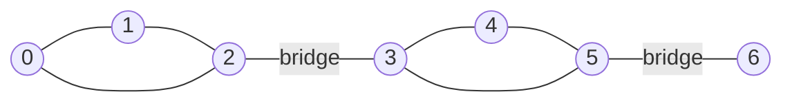
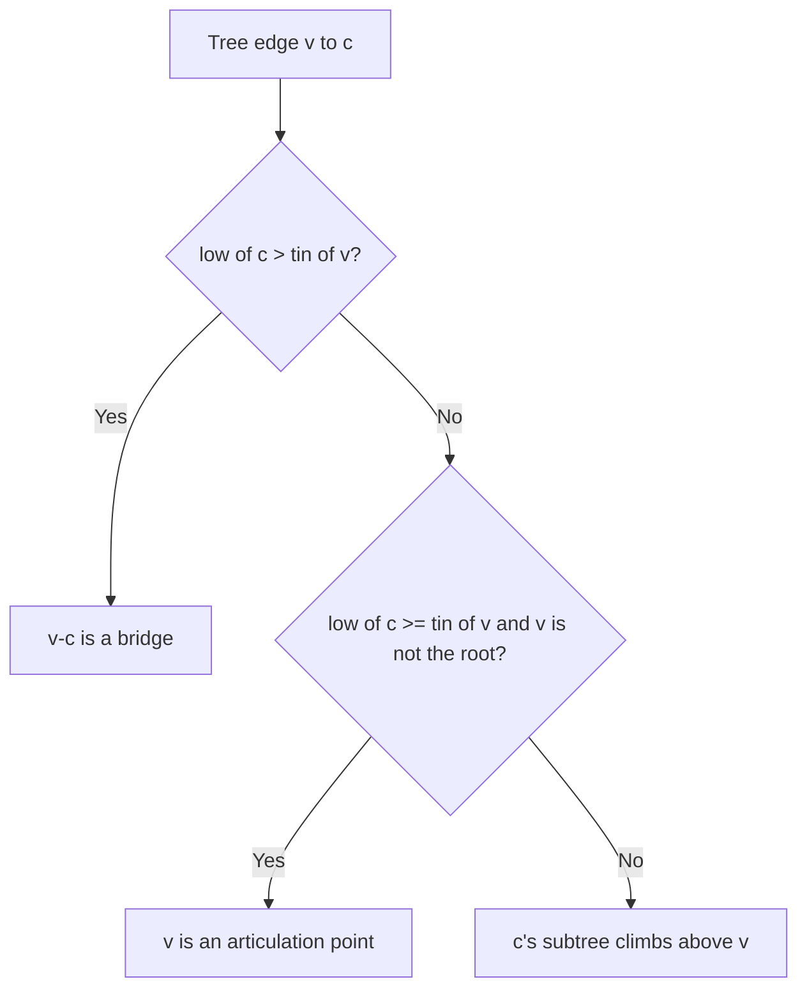
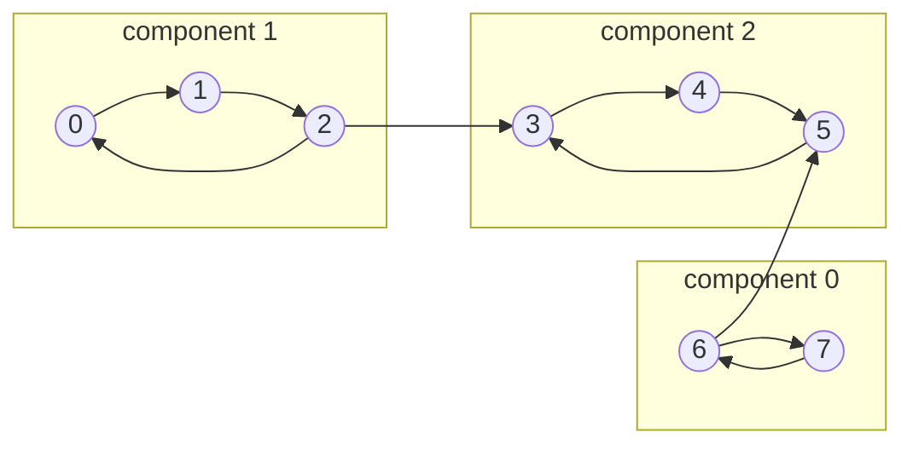

# new

## explanation

### The weak links of a network

In a road or computer network, some single failures split it into pieces:

- a **bridge** is an edge whose removal disconnects the graph, such as the only road to an island;
- an **articulation point** (or cut vertex) is a vertex whose removal disconnects what's left, such as a router that two halves of a network both depend on.

Finding them shows where a network needs a backup link.

### What makes an edge a bridge

An edge u–v is a bridge exactly when it lies on **no cycle**. If there's a cycle through it, the rest of the cycle is a second way round. If not, u–v is the only connection between the two sides.

So in a tree every edge is a bridge, while in a ring none is.

### A first, slow method

The definition gives a direct test. For each edge:

1. count the connected components of the graph without that edge;
2. if there are more than with it, it's a bridge.

Articulation points work the same way, removing one vertex (and its edges) at a time. Each test is one DFS, O(V + E). Doing it for every edge costs O(E · (V + E)), which is fine for a few hundred edges but too slow for big graphs. A single clever DFS, at the next level, finds them all in O(V + E).

### Directed graphs: mutual reachability

In directed graphs the question is different: which vertices can **all reach each other**? Such a group is a strongly connected component, and it's the topic of the last level.

## diagram



## example

```cpp
#include <iostream>
#include <utility>
#include <vector>

// Count connected components, leaving out one edge (skipEdge) or one vertex (skipVertex); -1 skips nothing.
int components(int n, const std::vector<std::pair<int, int>>& edges, int skipEdge, int skipVertex) {
    std::vector<std::vector<int>> adj(n);
    for (int i = 0; i < (int)edges.size(); i++) {
        auto [u, v] = edges[i];
        if (i == skipEdge || u == skipVertex || v == skipVertex) continue;
        adj[u].push_back(v);
        adj[v].push_back(u);
    }
    std::vector<bool> seen(n, false);
    int count = 0;
    for (int s = 0; s < n; s++) {
        if (s == skipVertex || seen[s]) continue;
        count++;
        std::vector<int> stack = {s};
        seen[s] = true;
        while (!stack.empty()) {
            int u = stack.back();
            stack.pop_back();
            for (int w : adj[u]) if (!seen[w]) { seen[w] = true; stack.push_back(w); }
        }
    }
    return count;
}

int main() {
    // Two triangles joined by the single link 2-3, and vertex 6 hanging off 5.
    const int n = 7;
    std::vector<std::pair<int, int>> edges = {{0, 1}, {1, 2}, {2, 0}, {2, 3}, {3, 4}, {4, 5}, {5, 3}, {5, 6}};
    int base = components(n, edges, -1, -1);
    std::cout << "bridges:";
    for (int i = 0; i < (int)edges.size(); i++)
        if (components(n, edges, i, -1) > base) std::cout << ' ' << edges[i].first << '-' << edges[i].second;
    std::cout << "\narticulation points:";
    for (int v = 0; v < n; v++)
        if (components(n, edges, -1, v) > base) std::cout << ' ' << v;
    std::cout << '\n';
}
```

```text
bridges: 2-3 5-6
articulation points: 2 3 5
```

1. Every edge inside a triangle has a way round, so removing it changes nothing.
2. 2-3 is the only link between the triangles, and 5-6 the only link to 6, so both are bridges.
3. Removing 2 or 3 separates the triangles, and removing 5 cuts off 6. Removing 6 itself leaves the rest connected.
4. This made one full search per edge and per vertex: 16 searches for a graph this small.

## mistakes

- **Counting the removed vertex as a component.** When testing a vertex, leave it out of the count as well as its edges.
- **Comparing with 1 instead of the original count.** If the graph starts in several pieces, compare with its own component count.
- **Thinking only edges to dead ends are bridges.** Any edge on no cycle is a bridge, like 2-3 here between two triangles.
- **Confusing the two ideas.** An articulation point needn't touch a bridge (one vertex shared by two triangles), and the ends of a bridge needn't be articulation points (the ends of a single edge).
- **The brute force on big inputs.** For 10⁵ edges it's about 10¹⁰ steps. Use the low-link method instead.

## check

```cpp
#include <iostream>
#include <vector>

std::vector<std::vector<int>> adj = {{1, 2}, {0, 2, 3, 4}, {0, 1}, {1, 4}, {1, 3}};  // two triangles sharing 1
std::vector<bool> seen;
void dfs(int v) {
    seen[v] = true;
    for (int w : adj[v]) if (!seen[w]) dfs(w);
}
int partsWithout(int removed) {
    seen.assign(5, false);
    seen[removed] = true;
    int parts = 0;
    for (int v = 0; v < 5; v++) if (!seen[v]) { parts++; dfs(v); }
    return parts;
}
int main() { std::cout << partsWithout(1) << ' ' << partsWithout(0) << '\n'; }
```

```text
2 1
```

Marking a vertex as seen in advance removes it from the search. Without 1, the triangles {0, 2} and {3, 4} fall apart, so 1 is an articulation point. Without 0, everything is still connected through 1. Every edge here lies on a triangle, so the graph has no bridges.

# building

## explanation

### A quick recap

A bridge is an edge on no cycle, and an articulation point is a vertex whose removal disconnects the graph. Testing each one with a fresh search works, but costs O(E · (V + E)).

### One DFS is enough

Run a DFS and record `tin[v]`, the time v was first entered. The DFS forms a tree. Every other edge is a **back edge** that joins a vertex to one of its ancestors. In an undirected DFS, no edge can cross between unrelated branches.

Define `low[v]` as the smallest `tin` reachable from v's subtree using tree edges downwards plus **at most one back edge**:

`low[v] = min(tin[v], tin[w] for back edges v–w, low[c] for children c)`

`low[c]` says how high c's subtree can climb without using the tree edge to its parent.

### The two tests

For a tree edge v → c:

- **bridge** if `low[c] > tin[v]`: nothing in c's subtree can get back to v or above, except through this edge;
- v is an **articulation point** if `low[c] >= tin[v]`: c's subtree can't get past v, so removing v cuts it off.

The DFS root is a special case: it's an articulation point exactly when it has **two or more** children in the DFS tree, since nothing lies above it.

### Details

- Skip the edge back to the parent by its **edge id**, not by the parent vertex, so parallel edges are handled correctly: a doubled edge is not a bridge.
- The whole thing is one DFS: O(V + E).
- Removing all bridges leaves the **2-edge-connected components**: groups that stay connected after losing any one edge.

## diagram



## example

```cpp
#include <algorithm>
#include <iostream>
#include <utility>
#include <vector>

// One DFS finds every bridge and articulation point. tin[v]: when v was entered.
// low[v]: the smallest tin that v's subtree can reach with at most one back edge.
struct CutFinder {
    std::vector<std::vector<std::pair<int, int>>> adj;  // (neighbour, edge id)
    std::vector<int> tin, low;
    std::vector<bool> cut;
    std::vector<std::pair<int, int>> bridges;
    int timer = 0;
    explicit CutFinder(int n) : adj(n), tin(n, -1), low(n, -1), cut(n, false) {}
    void dfs(int v, int parentEdge) {
        tin[v] = low[v] = timer++;
        int children = 0;
        for (auto [w, id] : adj[v]) {
            if (id == parentEdge) continue;
            if (tin[w] >= 0) { low[v] = std::min(low[v], tin[w]); continue; }  // a back edge
            dfs(w, id);
            children++;
            low[v] = std::min(low[v], low[w]);
            if (low[w] > tin[v]) bridges.push_back({v, w});          // w's subtree can't reach v or above
            if (parentEdge >= 0 && low[w] >= tin[v]) cut[v] = true;  // w's subtree can't get past v
        }
        if (parentEdge < 0 && children > 1) cut[v] = true;  // a root with two or more subtrees
    }
};

int main() {
    const int n = 7;
    int edges[][2] = {{0, 1}, {1, 2}, {2, 0}, {2, 3}, {3, 4}, {4, 5}, {5, 3}, {5, 6}};
    CutFinder f(n);
    for (int i = 0; i < 8; i++) { f.adj[edges[i][0]].push_back({edges[i][1], i}); f.adj[edges[i][1]].push_back({edges[i][0], i}); }
    for (int v = 0; v < n; v++) if (f.tin[v] < 0) f.dfs(v, -1);
    std::cout << "bridges:";
    for (auto [u, v] : f.bridges) std::cout << ' ' << u << '-' << v;
    std::cout << "\narticulation points:";
    for (int v = 0; v < n; v++) if (f.cut[v]) std::cout << ' ' << v;
    std::cout << "\nlow:";
    for (int l : f.low) std::cout << ' ' << l;
    std::cout << '\n';
}
```

```text
bridges: 5-6 2-3
articulation points: 2 3 5
low: 0 0 0 3 3 3 6
```

1. The DFS walks 0 → 1 → 2 → 3 → 4 → 5 → 6, so each vertex's tin is its own number. The back edges 2–0 and 5–3 let each triangle climb to its top vertex, so low is 0 for the first triangle and 3 for the second.
2. At 5, the child 6 has low 6 > tin 5: 5-6 is a bridge, and 5 is a cut vertex. The bridge is found first because the DFS finishes 6 first.
3. At 2, the child 3 has low 3 > tin 2: 2-3 is a bridge too. With it, 2 and 3 are articulation points.
4. The root 0 has only one DFS child, so it isn't an articulation point. One search found all of this, against 16 for the brute force.

## mistakes

- **Using `low[w]` for back edges.** For an already-visited w, take `tin[w]`; `low[w]` can carry information from w's other branches and break the articulation test.
- **Skipping the parent vertex instead of the parent edge.** With a doubled edge between v and its parent, the second copy is a real way back. Skip only the edge you came along.
- **Applying the `>=` rule to the root.** The root needs the separate "two or more children" test.
- **Confusing `>` and `>=`.** `>` is for bridges and `>=` for articulation points. Swapping them gives wrong answers on cycles.
- **Deep recursion.** Large graphs can produce long DFS paths; convert to an explicit stack if depth may reach 10⁵ or more.

## check

```cpp
#include <algorithm>
#include <iostream>
#include <vector>

std::vector<std::vector<int>> adj = {{1}, {0, 2, 3, 4}, {1, 3}, {2, 1}, {1}};
std::vector<int> tin(5, -1), low(5);
int timer = 0;
void dfs(int v, int parent) {
    tin[v] = low[v] = timer++;
    for (int w : adj[v]) {
        if (w == parent) continue;
        if (tin[w] >= 0) low[v] = std::min(low[v], tin[w]);
        else { dfs(w, v); low[v] = std::min(low[v], low[w]); }
    }
}
int main() {
    dfs(0, -1);
    for (int v = 0; v < 5; v++) std::cout << low[v] << (v < 4 ? ' ' : '\n');
}
```

```text
0 1 1 1 4
```

The DFS enters 0, 1, 2, 3 and 4 at times 0 to 4. The back edge 3–1 lets 3, and so 2, climb to tin 1, which is 1 itself. 4 has no back edge, so its low stays 4. Two edges pass the bridge test: 0-1 (low 1 > tin 0) and 1-4 (low 4 > tin 1).

# strong

## explanation

### Strongly connected components

In a directed graph, a **strongly connected component** (SCC) is a largest group of vertices where every vertex can reach every other. A cycle is the simplest example. Every directed graph splits into SCCs. If each SCC is shrunk to a single vertex, the result, the **condensation**, is always a DAG, since a cycle between components would merge them.

### Kosaraju's algorithm: two passes

1. Run DFS on the graph and record vertices in order of **finish time**.
2. **Reverse** every edge. Take vertices in decreasing finish time; each DFS from an unlabelled vertex in the reversed graph labels exactly one SCC.

Why it works: the vertex that finishes last lies in a "source" component of the condensation. In the reversed graph, that component has no way out to unlabelled components, so the DFS can't leak out of it. Removing it, the argument repeats. As a bonus, the components come out in **topological order** of the condensation.

### Tarjan's algorithm: one pass

Tarjan's algorithm finds SCCs in one DFS. It uses the same `tin`/`low` idea as for bridges, plus a stack of vertices still waiting for a component. When a vertex v ends with `low[v] == tin[v]`, it's the first vertex of its SCC: pop the stack down to v, and those vertices form the component. Both algorithms are O(V + E). Kosaraju's is easier to get right, while Tarjan's avoids building the reversed graph.

### What SCCs are used for

- **Dependency cycles**: modules that import each other in a loop.
- **2-SAT**: deciding whether a set of "a or b" constraints on true/false variables can all be satisfied. It's unsatisfiable exactly when x and not-x share an SCC.
- **Making a graph strongly connected**: if the condensation has s source components and t sink components (and more than one component), the fewest edges to add is max(s, t).

## diagram



## example

```cpp
#include <iostream>
#include <set>
#include <utility>
#include <vector>

using Graph = std::vector<std::vector<int>>;

void order(const Graph& g, std::vector<bool>& seen, std::vector<int>& out, int v) {
    seen[v] = true;
    for (int w : g[v]) if (!seen[w]) order(g, seen, out, w);
    out.push_back(v);  // v finishes
}
void label(const Graph& rg, std::vector<int>& comp, int v, int c) {
    comp[v] = c;
    for (int w : rg[v]) if (comp[w] < 0) label(rg, comp, w, c);
}

int main() {
    const int n = 8;
    int edges[][2] = {{0, 1}, {1, 2}, {2, 0}, {2, 3}, {3, 4}, {4, 5}, {5, 3}, {6, 5}, {6, 7}, {7, 6}};
    Graph g(n), rg(n);  // the graph and its reverse
    for (auto& e : edges) { g[e[0]].push_back(e[1]); rg[e[1]].push_back(e[0]); }
    // Kosaraju: finish order on g, then DFS on the reversed graph from the latest finisher down.
    std::vector<bool> seen(n, false);
    std::vector<int> fin;
    for (int v = 0; v < n; v++) if (!seen[v]) order(g, seen, fin, v);
    std::vector<int> comp(n, -1);
    int count = 0;
    for (int i = n - 1; i >= 0; i--) if (comp[fin[i]] < 0) label(rg, comp, fin[i], count++);
    for (int c = 0; c < count; c++) {
        std::cout << "component " << c << ':';
        for (int v = 0; v < n; v++) if (comp[v] == c) std::cout << ' ' << v;
        std::cout << '\n';
    }
    std::set<std::pair<int, int>> dag;  // the condensation: one vertex per component
    for (auto& e : edges) if (comp[e[0]] != comp[e[1]]) dag.insert({comp[e[0]], comp[e[1]]});
    std::cout << "condensation edges:";
    for (auto [a, b] : dag) std::cout << ' ' << a << "->" << b;
    std::cout << '\n';
}
```

```text
component 0: 6 7
component 1: 0 1 2
component 2: 3 4 5
condensation edges: 0->2 1->2
```

1. The first pass finishes 5, 4, 3, 2, 1, 0, then 7, 6. Vertex 6 finishes last, so it's in a source component of the condensation.
2. On the reversed graph, the DFS from 6 reaches only 7. Vertex 5 is not reached, because the edge 6 → 5 now points the other way. So {6, 7} is one component.
3. Next, 0 labels {0, 1, 2}, and then 3 labels {3, 4, 5}; their edges to already-labelled vertices are ignored.
4. The condensation has the edges 0→2 and 1→2, a DAG, and the component numbers already follow a topological order.

## mistakes

- **The second pass on the original graph.** It must run on the reversed graph, or a DFS leaks into other components.
- **Taking vertices in increasing finish time.** The second pass needs the latest finisher first.
- **Using undirected bridge logic on directed graphs.** Bridges and articulation points are for undirected graphs; SCCs are the directed counterpart.
- **Duplicate condensation edges.** Many original edges can join the same two components. Use a set, or deduplicate.
- **Forgetting the single-component case.** If the whole graph is one SCC, no edges need adding, even though it is both its own source and its own sink.

## check

```cpp
#include <algorithm>
#include <iostream>
#include <vector>

int main() {
    int dagEdges[][2] = {{0, 2}, {1, 2}, {2, 3}};  // the condensation of some graph, 4 components
    std::vector<int> in(4, 0), out(4, 0);
    for (auto& e : dagEdges) out[e[0]]++, in[e[1]]++;
    int sources = 0, sinks = 0;
    for (int c = 0; c < 4; c++) sources += in[c] == 0, sinks += out[c] == 0;
    std::cout << sources << ' ' << sinks << ' ' << std::max(sources, sinks) << '\n';
}
```

```text
2 1 2
```

Components 0 and 1 have no incoming edges, so they're sources, and component 3 has no outgoing edges, so it's the only sink. To make the whole graph strongly connected, max(2, 1) = 2 new edges are enough. For example, 3 → 0 and 3 → 1 let everything reach everything.
