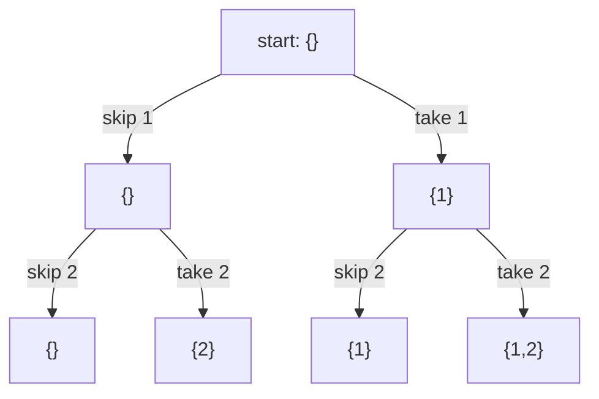
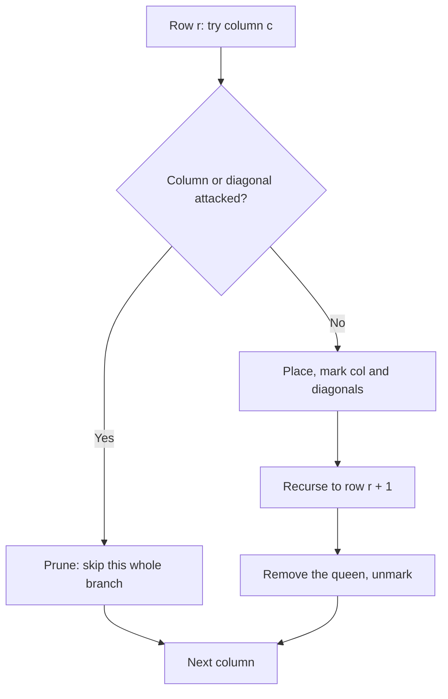
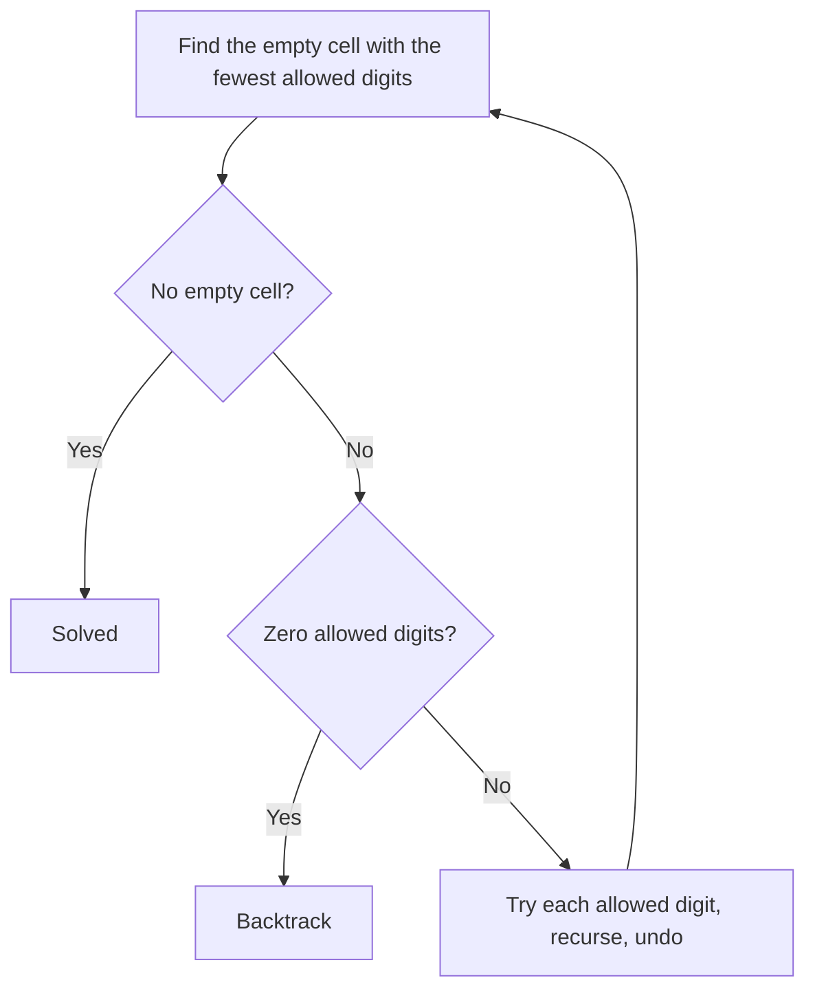

# new

## explanation

### Trying every possibility, tidily

Some problems ask for **all** the arrangements of something: every subset of a set, every ordering of some letters, every way to place pieces on a board. **Backtracking** builds each answer one decision at a time and explores the decisions like a tree:

1. **choose**: make one decision and record it;
2. **explore**: recurse to make the remaining decisions;
3. **un-choose**: undo the decision, so the next option starts from the same state.

The third step is what makes it "backtracking". After exploring one branch, you step back to where you were and try the next.

### Subsets

For each item there are two decisions: leave it out, or take it. Recurse on the next item each time. When every item has been decided, the chosen items are one subset. n items give 2ⁿ subsets.

### Permutations

To order n letters, fill position 1 with any unused letter, then position 2 with any letter still unused, and so on. A `used` array remembers which letters are taken. n letters give n! orderings.

### Shared state

Usually a single `chosen` vector is shared by every call: push before recursing, pop after. That avoids copying the partial answer at every step. Forgetting the pop is the classic bug: the next branch then starts with a stray item in it.

### Cost

Backtracking visits every leaf of the decision tree, so listing all subsets is O(2ⁿ · n) and all permutations O(n! · n). That's fine for n up to about 20 for subsets, or 10 for permutations. Beyond that, either **prune** the tree, as the next levels do, or use a cleverer method.

## diagram



## example

```cpp
#include <iostream>
#include <string>
#include <vector>

// Subsets: for each item, first leave it out, then take it.
void subsets(const std::vector<int>& items, std::size_t i, std::vector<int>& chosen) {
    if (i == items.size()) {
        std::cout << " {";
        for (std::size_t k = 0; k < chosen.size(); k++) std::cout << (k ? "," : "") << chosen[k];
        std::cout << '}';
        return;
    }
    subsets(items, i + 1, chosen);  // leave items[i] out
    chosen.push_back(items[i]);     // choose
    subsets(items, i + 1, chosen);  // explore with it
    chosen.pop_back();              // un-choose, so the caller sees chosen as it was
}
// Permutations: fill each position with a letter not used yet.
void permutations(const std::string& letters, std::string& current, std::vector<bool>& used) {
    if (current.size() == letters.size()) { std::cout << ' ' << current; return; }
    for (std::size_t k = 0; k < letters.size(); k++) {
        if (used[k]) continue;
        used[k] = true, current.push_back(letters[k]);   // choose
        permutations(letters, current, used);            // explore
        used[k] = false, current.pop_back();             // un-choose
    }
}

int main() {
    std::vector<int> chosen;
    std::cout << "subsets:";
    subsets({1, 2, 3}, 0, chosen);
    std::string current;
    std::vector<bool> used(3, false);
    std::cout << "\npermutations:";
    permutations("abc", current, used);
    std::cout << '\n';
}
```

```text
subsets: {} {3} {2} {2,3} {1} {1,3} {1,2} {1,2,3}
permutations: abc acb bac bca cab cba
```

1. Each call decides one item, leaving it out before taking it, so the empty set comes first and {1,2,3} last.
2. 3 items give 2³ = 8 subsets, one for each leaf of the decision tree.
3. For permutations, the first position tries a, b and c in turn, and the rest are filled from what's left: 3! = 6 orders.
4. Every push is undone by a pop after the recursive call, so each branch starts from a clean state.

## mistakes

- **Forgetting to un-choose.** Without the `pop_back`, later branches inherit items from earlier ones.
- **Copying the partial answer on every call.** Passing `chosen` by value works but copies it at every step. Share it by reference and undo.
- **Not marking used items in permutations.** Without the `used` array, the same letter is placed twice.
- **No base case.** Every path must end when all decisions are made, or the recursion runs forever.
- **Listing everything when you only need a count or the best one.** The full tree is exponential; often pruning or dynamic programming is needed.

## check

```cpp
#include <iostream>

int leaves = 0, calls = 0;
void pick(int i, int n) {  // decide, for each of n items, whether it's in or out
    calls++;
    if (i == n) { leaves++; return; }
    pick(i + 1, n);
    pick(i + 1, n);
}
int main() {
    pick(0, 4);
    std::cout << leaves << ' ' << calls << '\n';
}
```

```text
16 31
```

Each of the 4 decisions doubles the branches, giving 2⁴ = 16 leaves, the subsets. Counting the calls level by level gives 1 + 2 + 4 + 8 + 16 = 31: a full decision tree has one call fewer inside it than twice its leaves.

# building

## explanation

### A quick recap

Backtracking makes one decision at a time, recurses, and undoes the decision before trying the next. Without pruning, it visits every leaf of the decision tree.

### Pruning

**Prune** a branch as soon as it can't lead to a valid answer. Then nothing below it is explored. Checking a constraint early, at the moment a decision is made, can shrink the search enormously.

### N-Queens

Place n queens on an n × n board so that no two attack each other: no shared row, column or diagonal.

- Decide **one row at a time**, so rows can't clash.
- Before placing a queen in column c, check that the column and both diagonals through it are free.

Keep three boolean arrays so that each check is O(1):

- `col[c]`;
- `diag[row − c + n − 1]`: on one diagonal, row − c stays the same;
- `anti[row + c]`: on the other, row + c stays the same.

Set all three when placing, clear them when removing. An attacked square skips its whole subtree at once.

### Sums without repeats

"Which multisets of coins make 10?" Picking coins in any order would count 2 + 3 + 5 and 5 + 3 + 2 separately. To avoid that, only allow coins **from the current index onwards**. Each combination is then built in one order only, smallest first. Sorting the coins also allows an early stop: once a coin is too big, all later ones are too.

### Counting and finding

Backtracking can stop at the first solution (return `true` up the calls), count all solutions, or keep the best one found so far.

## diagram



## example

```cpp
#include <iostream>
#include <string>
#include <vector>

// One queen per row. An attacked column or diagonal prunes that whole branch at once.
struct Queens {
    int n, solutions = 0;
    long long tried = 0;
    std::vector<bool> col, diag, anti;  // diag index: row - c + n - 1; anti index: row + c
    std::vector<int> where, first;
    explicit Queens(int n) : n(n), col(n), diag(2 * n - 1), anti(2 * n - 1), where(n) {}
    void place(int row) {
        tried++;
        if (row == n) { if (solutions++ == 0) first = where; return; }
        for (int c = 0; c < n; c++) {
            if (col[c] || diag[row - c + n - 1] || anti[row + c]) continue;  // attacked: prune
            col[c] = diag[row - c + n - 1] = anti[row + c] = true;
            where[row] = c;
            place(row + 1);
            col[c] = diag[row - c + n - 1] = anti[row + c] = false;  // undo
        }
    }
};

int main() {
    for (int n = 4; n <= 8; n++) {
        Queens q(n);
        q.place(0);
        std::cout << n << " queens: " << q.solutions << " solutions, " << q.tried << " positions visited\n";
    }
    Queens six(6);
    six.place(0);
    for (int c : six.first) std::cout << std::string(c, '.') + 'Q' + std::string(5 - c, '.') << '\n';
}
```

```text
4 queens: 2 solutions, 17 positions visited
5 queens: 10 solutions, 54 positions visited
6 queens: 4 solutions, 153 positions visited
7 queens: 40 solutions, 552 positions visited
8 queens: 92 solutions, 2057 positions visited
.Q....
...Q..
.....Q
Q.....
..Q...
....Q.
```

1. Each row tries the columns from left to right, and attacked squares are skipped before any recursion.
2. The number of solutions grows irregularly: 2, 10, 4, 40, 92.
3. For 8 queens the search visits only 2,057 positions, while placing one queen per row with no checks would try 8⁸ = 16,777,216 complete boards.
4. The first 6-queens solution found is printed row by row; every row, column and diagonal has at most one queen.

## mistakes

- **Wrong diagonal indexes.** `row − c` can be negative; add n − 1 so it fits in an array of size 2n − 1.
- **Forgetting to clear the marks.** After the recursive call, every mark set for the queen must be cleared, or later branches see ghost queens.
- **Checking constraints only at the end.** Validating a full board wastes the whole subtree below the first conflict. Check when placing.
- **Counting the same combination in several orders.** For multisets, only choose from the current index onwards.
- **Not sorting before an early break.** "Stop when the coin is too big" is only correct if the coins are sorted.

## check

```cpp
#include <iostream>
#include <vector>

std::vector<int> coins = {2, 3, 5};  // sorted; each coin can be used any number of times
int ways = 0;
void fill(std::size_t from, int left) {
    if (left == 0) { ways++; return; }
    for (std::size_t i = from; i < coins.size() && coins[i] <= left; i++)
        fill(i, left - coins[i]);  // i, not i + 1: the same coin may come again, but never an earlier one
}
int main() {
    fill(0, 10);
    std::cout << ways << '\n';
}
```

```text
4
```

The combinations of 2, 3 and 5 that make 10 are 2+2+2+2+2, 2+2+3+3, 2+3+5 and 5+5. Each is built only in non-decreasing order, so none is counted twice.

# strong

## explanation

### Search trees are exponential

Backtracking's worst case is the full decision tree, exponential in the input. In practice, how fast it runs depends on how much of the tree it avoids. Four techniques do most of the work:

- **Constraint pruning**: reject a partial answer the moment it breaks a rule, as in N-Queens.
- **Choosing what to decide next**: decide the most constrained item first, the one with the **fewest remaining options**. A wrong guess there is discovered sooner, and an item with one option needs no guess at all.
- **Fast state**: keep the used digits or colours as **bitmasks**, so that "what's still allowed?" is one OR and one NOT, and counting options is a popcount.
- **Bounding** (branch and bound): in optimisation problems, drop a branch when even its best possible result can't beat the best answer found so far.

### Sudoku

Each empty cell needs a digit that isn't already in its row, column or 3 × 3 box. With a 9-bit mask for each row, column and box, a cell's allowed digits are `~(row | col | box) & 0x1FF`. Always fill the empty cell with the fewest allowed digits. Most puzzles then need few or no wrong guesses. A cell with zero options means the current branch is impossible, so backtrack at once.

### Graph colouring

Colour each vertex with one of k colours so that neighbours differ. Try colours vertex by vertex, rejecting any colour a neighbour already has. Deciding whether k colours suffice is NP-hard in general, so no fast exact method is known. Backtracking with good ordering is the practical approach for small graphs.

### Backtracking or dynamic programming?

If different branches keep reaching the **same situation** (the same remaining amount, the same set of used items), the tree repeats work. Remembering results by situation turns backtracking into dynamic programming. Backtracking stays the right tool when situations rarely repeat, or when you need the actual arrangements.

## diagram



## example

```cpp
#include <bit>
#include <iostream>
#include <string>
#include <utility>
#include <vector>

// Rows, columns and boxes each keep a bitmask of the digits they already contain.
// Always fill the empty cell with the fewest allowed digits, so wrong guesses fail fast.
struct Sudoku {
    std::vector<std::string> g;
    int row[9] = {}, col[9] = {}, box[9] = {};
    long long guesses = 0;
    explicit Sudoku(std::vector<std::string> grid) : g(std::move(grid)) {
        for (int r = 0; r < 9; r++) for (int c = 0; c < 9; c++) if (g[r][c] != '.') flip(r, c, g[r][c] - '1');
    }
    void flip(int r, int c, int d) { row[r] ^= 1 << d, col[c] ^= 1 << d, box[r / 3 * 3 + c / 3] ^= 1 << d; }
    bool solve() {
        int br = -1, bc = -1, bestFree = 0, bestCount = 10;
        for (int r = 0; r < 9; r++)
            for (int c = 0; c < 9; c++) {
                if (g[r][c] != '.') continue;
                int allowed = ~(row[r] | col[c] | box[r / 3 * 3 + c / 3]) & 0x1FF;
                int count = std::popcount(unsigned(allowed));
                if (count < bestCount) br = r, bc = c, bestFree = allowed, bestCount = count;
            }
        if (br < 0) return true;  // no empty cell left
        for (int d = 0; d < 9; d++) {
            if (!(bestFree >> d & 1)) continue;
            guesses++;
            g[br][bc] = char('1' + d), flip(br, bc, d);
            if (solve()) return true;
            g[br][bc] = '.', flip(br, bc, d);  // undo, try the next digit
        }
        return false;  // nothing fits here: backtrack
    }
};

int main() {
    Sudoku s({"53..7....", "6..195...", ".98....6.", "8...6...3", "4..8.3..1", "7...2...6", ".6....28.", "...419..5", "....8..79"});
    std::cout << (s.solve() ? "solved" : "no solution") << " after " << s.guesses << " placements\n";
    for (const auto& line : s.g) std::cout << line << '\n';
}
```

```text
solved after 51 placements
534678912
672195348
198342567
859761423
426853791
713924856
961537284
287419635
345286179
```

1. The masks make every "which digits are allowed here?" check a few bit operations.
2. Each step fills the most constrained empty cell. For this puzzle there is always a cell with exactly one allowed digit, so it is solved without a single wrong guess: 51 placements for 51 empty cells.
3. If a cell ever had zero allowed digits, `solve` would return `false`, and the caller would undo its last digit and try the next one.

## mistakes

- **Filling cells in reading order.** It works, but it may guess in a wide-open cell while a forced one waits further on. Pick the cell with the fewest options.
- **Undoing only part of the state.** The grid **and** all three masks must be restored, or later checks use stale information.
- **Box index mistakes.** The box for (r, c) is `r / 3 * 3 + c / 3`, with integer division.
- **XOR to set a digit that's already set.** Flipping a bit twice clears it. Only flip digits you know are absent, or use separate set and clear operations.
- **Ignoring repeated situations.** If many branches lead to the same state, remember results by state; that's dynamic programming.

## check

```cpp
#include <iostream>
#include <vector>

std::vector<std::vector<int>> adj = {{1, 2, 3}, {0, 2}, {0, 1, 3}, {0, 2}};
std::vector<int> colour(4, -1);
int count(int v, int k) {  // ways to colour vertices v, v+1, ... with k colours, neighbours different
    if (v == 4) return 1;
    int ways = 0;
    for (int c = 0; c < k; c++) {
        bool ok = true;
        for (int w : adj[v]) if (colour[w] == c) ok = false;
        if (!ok) continue;
        colour[v] = c;
        ways += count(v + 1, k);
        colour[v] = -1;
    }
    return ways;
}
int main() { std::cout << count(0, 2) << ' ' << count(0, 3) << '\n'; }
```

```text
0 6
```

The graph is two triangles sharing the edge 0–2. A triangle needs three colours, so with 2 there's no valid colouring. With 3, vertices 0 and 2 can be coloured in 3 × 2 = 6 ways, and then 1 and 3 must each take the one colour left.
