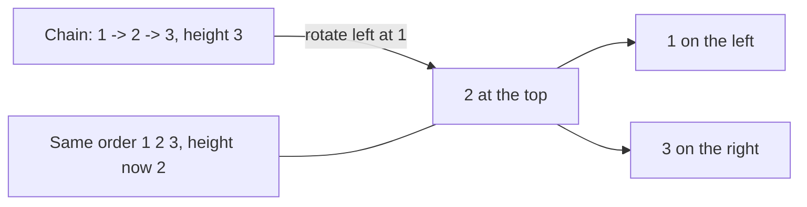
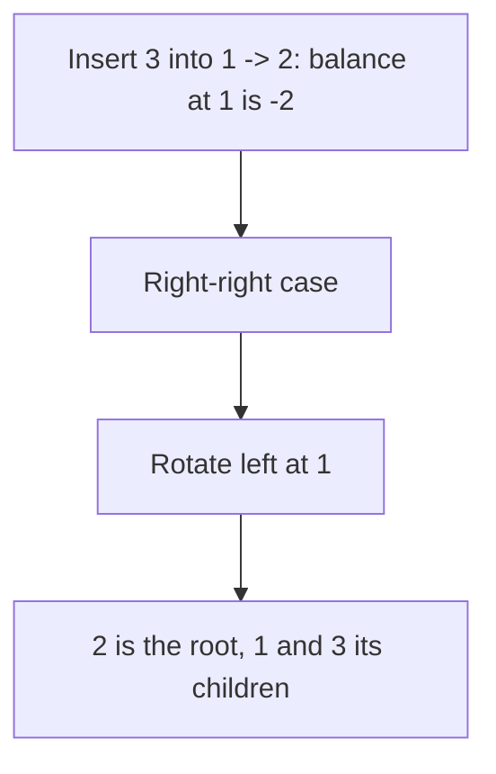
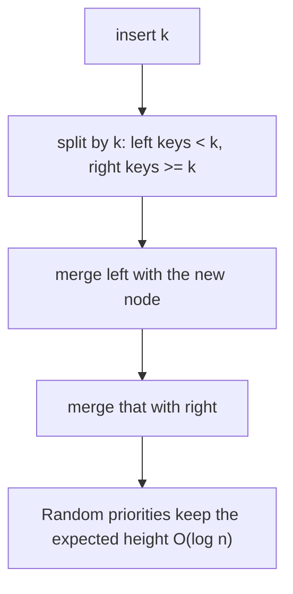

# new

## explanation

### Why balance matters

A binary search tree is fast only while it's **short**. Its cost is its height: about log₂ n for a bushy tree, but n for a tree built from sorted keys, which is just a chain. A million keys means 20 steps in the first case and a million in the second.

### Balanced trees fix their own shape

A **balanced** search tree checks its shape after every insert and delete, and repairs it with small local moves called **rotations**, so the height always stays O(log n). Search, insert and delete are then O(log n) in the **worst** case, whatever order the keys arrive in.

### A rotation in one picture

A rotation turns a parent and one of its children around: the child moves up, the parent moves down to the other side, and one subtree changes owner. The left-to-right order of all the keys stays exactly the same, so it's still a valid search tree, just with a different shape. Each rotation changes only a few pointers: O(1).

### You already have one

`std::set` and `std::map` are balanced search trees (usually red-black trees). They give you, all in O(log n):

- `insert`, `erase`, `count` / `contains`;
- `lower_bound(x)`: the first key ≥ x; `upper_bound(x)`: the first key > x;
- the smallest key (`*s.begin()`) and the largest (`*s.rbegin()`);
- walking the keys in sorted order.

So for "ordered" questions such as nearest key, keys in a range, or next bigger, a set or map is usually the right tool.

### What sets don't do

They keep each key once (use `std::multiset` for repeats), and they have no `s[i]`: getting the i-th smallest means walking i steps. Keys can't be changed in place; erase and re-insert instead.

## diagram



## example

```cpp
#include <iostream>
#include <iterator>
#include <set>

int main() {
    // std::set is a balanced search tree: even sorted inserts keep it about log2(n) high.
    std::set<int> s;
    for (int x = 1; x <= 100000; x++) s.insert(x);
    std::cout << "size " << s.size() << ", smallest " << *s.begin() << ", largest " << *s.rbegin() << '\n';

    s.erase(500);
    std::cout << "after erasing 500, the first key >= 500 is " << *s.lower_bound(500) << '\n';
    std::cout << "keys in [10, 20): " << std::distance(s.lower_bound(10), s.lower_bound(20)) << '\n';

    // Nearest key: compare the first key at or above x with the one just before it.
    std::set<int> stops = {10, 25, 40, 70};
    int x = 33;
    auto above = stops.lower_bound(x);
    auto below = std::prev(above);
    int nearest = (*above - x < x - *below) ? *above : *below;
    std::cout << "nearest stop to " << x << ": " << nearest << '\n';
}
```

```text
size 100000, smallest 1, largest 100000
after erasing 500, the first key >= 500 is 501
keys in [10, 20): 10
nearest stop to 33: 40
```

1. A hundred thousand sorted inserts would turn a plain search tree into a chain; the set rebalances itself, so each insert stays O(log n).
2. `begin()` and `rbegin()` are the smallest and largest keys.
3. After erasing 500, the first key at or above 500 is 501. Counting the keys from 10 up to, but not including, 20 gives 10.
4. For the nearest stop, `lower_bound(33)` finds 40 and the key just before it is 25. 40 is 7 away and 25 is 8 away, so 40 is nearest.

## mistakes

- **Expecting insertion order.** A set always keeps its keys sorted. If you need arrival order, use a vector or a list.
- **Losing duplicates.** Inserting an existing key into a `std::set` does nothing. Use `std::multiset` when repeats matter.
- **`std::lower_bound(s.begin(), s.end(), x)` on a set.** The free function can't jump inside a tree and walks it linearly. Call `s.lower_bound(x)`.
- **`std::prev` of `begin()`.** If x is below every key, there's no key before `lower_bound(x)`. Check `above != s.begin()` first, and check `above != s.end()` before reading it.
- **Changing a key in place.** Keys are const inside a set, because changing one could break the order. Erase it and insert the new value.

## check

```cpp
#include <iostream>
#include <iterator>
#include <set>

int main() {
    std::set<int> s = {40, 10, 30, 20, 10};
    auto it = s.upper_bound(20);  // the first key > 20
    s.insert(25);
    std::cout << s.size() << ' ' << *it << ' ' << *std::prev(s.lower_bound(25)) << '\n';
}
```

```text
5 30 20
```

The repeated 10 is kept once, so the set starts as 10 20 30 40, and inserting 25 makes 5 keys. `it` was found before the insert and still points at 30: inserting into a set doesn't invalidate other iterators. The key just before 25 is 20.

# building

## explanation

### A quick recap

Search trees are fast only when short. Balanced trees repair their shape with rotations after every change, keeping the height O(log n). `std::set` and `std::map` are balanced trees ready to use.

### AVL trees

An **AVL tree** keeps every node's two subtrees within 1 of each other in height. Each node stores its height. After a normal insert, walk back up the path, updating heights; at the first node whose **balance** (left height − right height) reaches +2 or −2, fix it with rotations:

- **Left-left** (the new key went into the left child's left side): one right rotation at the node.
- **Right-right**: one left rotation.
- **Left-right** (into the left child's right side): first rotate the left child left, which turns it into the left-left case, then rotate the node right.
- **Right-left**: the mirror image.

After the fix, that subtree has the same height as before the insert, so nothing above it needs changing.

### Rotations, precisely

A right rotation at y, whose left child is x: x becomes the subtree's root, y becomes x's right child, and x's old right subtree becomes y's left subtree. Keys smaller than x stay left of x, keys between x and y move under y, keys bigger than y stay right of y: the in-order sequence is unchanged. Update y's height first (it's now lower), then x's.

### What it buys

An AVL tree's height is at most about 1.44 log₂ n, so even sorted input stays shallow. Writing your own is rarely needed in practice, but it shows exactly what `std::set` does for you, and the same rotations appear in many other trees.

## diagram



## example

```cpp
#include <algorithm>
#include <iostream>

struct Node { int key; int height = 1; Node* left = nullptr; Node* right = nullptr; };

int h(const Node* n) { return n ? n->height : 0; }
void update(Node* n) { n->height = 1 + std::max(h(n->left), h(n->right)); }
Node* rotateRight(Node* y) {  // y's left child x becomes the subtree's root
    Node* x = y->left;
    y->left = x->right, x->right = y;
    update(y), update(x);
    return x;
}
Node* rotateLeft(Node* x) {  // x's right child y becomes the subtree's root
    Node* y = x->right;
    x->right = y->left, y->left = x;
    update(x), update(y);
    return y;
}
Node* insert(Node* n, int key) {  // a normal insert, then fix any node whose sides differ by 2
    if (!n) return new Node{key};
    if (key < n->key) n->left = insert(n->left, key);
    else n->right = insert(n->right, key);
    update(n);
    int balance = h(n->left) - h(n->right);
    if (balance > 1) {                                          // the left side is too tall
        if (key > n->left->key) n->left = rotateLeft(n->left);  // left-right case: straighten it first
        return rotateRight(n);
    }
    if (balance < -1) {                                            // the right side is too tall
        if (key < n->right->key) n->right = rotateRight(n->right);  // right-left case
        return rotateLeft(n);
    }
    return n;
}
void destroy(Node* n) { if (n) { destroy(n->left); destroy(n->right); delete n; } }
int main() {
    Node* root = nullptr;
    for (int k = 1; k <= 7; k++) root = insert(root, k);
    std::cout << "root " << root->key << ", height " << root->height << '\n';
    for (int k = 8; k <= 1000; k++) root = insert(root, k);
    std::cout << "1000 sorted keys: height " << root->height << '\n';
    destroy(root);
}
```

```text
root 4, height 3
1000 sorted keys: height 10
```

1. Inserting 1, 2, 3 makes the root's balance −2, a right-right case, so one left rotation puts 2 on top. The same happens again as 4 to 7 arrive.
2. After seven sorted inserts, the tree is perfectly shaped: root 4, height 3. A plain search tree would be a chain of height 7.
3. With 1000 sorted keys, the AVL tree has height 10, the smallest possible for 1000 keys (2¹⁰ − 1 = 1023). A plain search tree would have height 1000.
4. Every rotation is a few pointer changes, so each insert stays O(log n).

## mistakes

- **Updating heights in the wrong order.** After a rotation, the lowered node's height must be updated before the raised node's, because the raised node depends on it.
- **Missing the double-rotation cases.** A single rotation can't fix left-right or right-left imbalance; it just moves it. Straighten the child first.
- **Forgetting to return the new subtree root.** After a rotation, the parent must point at the node that moved up.
- **Recomputing heights recursively.** Calling a full `height()` at every step makes each insert O(n). Store the height in each node and update it in O(1).
- **Writing your own when a library tree fits.** `std::set`, `std::map` and their multi versions are tested and fast. Write an AVL tree when you need something they lack.

## check

```cpp
#include <iostream>

struct Node { int key; Node* left = nullptr; Node* right = nullptr; };

Node* rotateLeft(Node* x) {
    Node* y = x->right;
    x->right = y->left;
    y->left = x;
    return y;
}
void inorder(const Node* n) { if (n) { inorder(n->left); std::cout << n->key; inorder(n->right); } }

int main() {
    Node c{3}, b{2, nullptr, &c}, a{1, nullptr, &b};  // a chain 1 -> 2 -> 3
    Node* root = rotateLeft(&a);
    inorder(root);
    std::cout << ' ' << root->key << root->left->key << root->right->key << '\n';
}
```

```text
123 213
```

The rotation lifts 2 to the top, with 1 as its left child and 3 still as 2's right child. The height drops from 3 to 2, but the in-order sequence is still 1 2 3: rotations change the shape, never the order.

# strong

## explanation

### Red-black trees

`std::set` and `std::map` are usually **red-black trees**. Each node is red or black; the root is black; a red node has no red child; and every path from a node down to an empty spot passes the same number of black nodes. Those rules keep the longest path at most twice the shortest, so the height is at most 2 log₂(n + 1). Red-black trees are a little less strictly balanced than AVL trees (slightly slower searches), but they need fewer rotations per insert and delete, at most 2 or 3, which is why libraries prefer them.

### Treaps: balance by chance

A **treap** gives every node a random priority, and keeps the tree a search tree by key and a heap by priority (each parent's priority above its children's). With random priorities, the shape is that of a randomly built search tree: expected height O(log n), whatever order the keys arrive in.

Treaps are easiest with two operations:

- **split(t, k)**: cut a treap into keys < k and keys ≥ k;
- **merge(a, b)**: join two treaps where every key in a is smaller than every key in b, putting the higher priority on top.

Insert is split, then merge the pieces with the new node in between. Erase is two splits, to isolate the key, and one merge. Both are O(log n) expected, and split and merge also give range operations: cut out a whole range, reverse it, or move it elsewhere.

### Choosing in practice

- Ordered keys with insert, erase, bounds: `std::set` or `std::map`.
- Also the k-th key or a key's rank: a balanced tree with subtree sizes, such as an augmented treap.
- Mostly reads, few changes: a sorted vector with binary search is smaller and faster to search.

## diagram



## example

```cpp
#include <algorithm>
#include <iostream>
#include <random>

// A treap: a search tree by key and a heap by random priority. Random priorities keep it shallow.
std::mt19937 rng(42);
struct Node { int key; unsigned prio = rng(); Node* left = nullptr; Node* right = nullptr; };

// split: keys < k go to l, keys >= k go to r.
void split(Node* t, int k, Node*& l, Node*& r) {
    if (!t) { l = r = nullptr; return; }
    if (t->key < k) { split(t->right, k, t->right, r); l = t; }
    else { split(t->left, k, l, t->left); r = t; }
}
// merge: every key in a is smaller than every key in b; the higher priority becomes the root.
Node* merge(Node* a, Node* b) {
    if (!a || !b) return a ? a : b;
    if (a->prio > b->prio) { a->right = merge(a->right, b); return a; }
    b->left = merge(a, b->left);
    return b;
}
Node* insert(Node* t, int key) {
    Node *l, *r;
    split(t, key, l, r);
    return merge(merge(l, new Node{key}), r);
}
Node* erase(Node* t, int key) {
    Node *l, *mid, *r;
    split(t, key, l, mid);
    split(mid, key + 1, mid, r);  // mid now holds only `key`
    delete mid;
    return merge(l, r);
}
int height(const Node* n) { return n ? 1 + std::max(height(n->left), height(n->right)) : 0; }
void destroy(Node* n) { if (n) { destroy(n->left); destroy(n->right); delete n; } }

int main() {
    Node* t = nullptr;
    for (int k = 1; k <= 100000; k++) t = insert(t, k);  // sorted input: the worst case for a plain tree
    std::cout << "height " << height(t) << " for 100000 sorted keys\n";
    for (int k = 1; k <= 100000; k += 2) t = erase(t, k);
    std::cout << "after erasing the odd keys: height " << height(t) << '\n';
    destroy(t);
}
```

```text
height 42 for 100000 sorted keys
after erasing the odd keys: height 41
```

1. Each node gets a random priority from a seeded generator, so the run is repeatable.
2. Inserting sorted keys would make a plain search tree 100,000 deep; the treap's random priorities keep it at 42, about 2.5 × log₂ 100,000 ≈ 17, as expected for a randomly built tree.
3. Erasing splits out exactly one key (keys ≥ k and < k + 1), deletes it, and merges the rest back.
4. After erasing half the keys, the height is 41: still logarithmic.

## mistakes

- **Using a predictable priority.** Priorities from a counter, or a fixed seed known to an attacker, can be forced into a chain. Use a good random source for untrusted input.
- **Merging pieces in the wrong order.** `merge(a, b)` assumes every key in a is smaller than every key in b. Swap them and the search-tree order breaks.
- **Erasing with duplicates present.** If equal keys are allowed, the middle piece may hold several nodes; `delete mid` would leak the others. Delete the whole piece, or remove one node from it.
- **Comparing treaps to `std::set` on raw speed.** The library tree is usually faster for plain insert and search. Treaps earn their place with split, merge and range operations.
- **Deep recursion on bad shapes.** Recursive split and merge assume the expected logarithmic height. With broken priorities, they can overflow the stack.

## check

```cpp
#include <cmath>
#include <iostream>

int main() {
    // A red-black tree's height is at most 2 log2(n + 1); a perfectly balanced tree needs about log2(n + 1).
    for (int n : {1000, 1000000}) {
        double lg = std::log2(n + 1.0);
        std::cout << n << ": balanced " << static_cast<int>(std::ceil(lg)) << ", red-black at most " << static_cast<int>(2 * lg) << '\n';
    }
}
```

```text
1000: balanced 10, red-black at most 19
1000000: balanced 20, red-black at most 39
```

A perfectly balanced tree of 1000 keys needs 10 levels; the red-black guarantee allows up to 19. For a million keys the numbers are 20 and 39. Either way, a search takes a few dozen steps, against a million for a chain.
