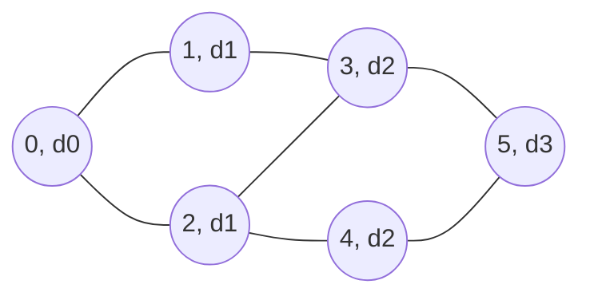
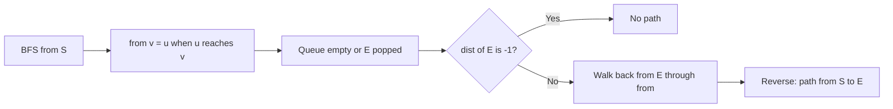

# new

## explanation

### Exploring in rings

**Breadth-first search** (BFS) explores a graph outwards from a starting vertex, one ring at a time:

- first the start itself (distance 0);
- then all its neighbours (distance 1);
- then their unvisited neighbours (distance 2), and so on.

Like ripples on a pond, it finishes each ring before starting the next.

### A queue does the ordering

1. Mark the start as reached with distance 0 and push it into a queue.
2. While the queue isn't empty, take the vertex u from the front.
3. For each neighbour v of u that hasn't been reached: set dist[v] = dist[u] + 1, and push v to the back.

A queue is first in, first out, so every vertex at distance d is taken out before any at distance d + 1. That's what keeps the rings in order.

### Shortest paths for free

When every edge counts as one step, the first time BFS reaches a vertex is along a **shortest path**. A shorter path would have reached it in an earlier ring. So `dist[v]` is the fewest edges from the start to v, and vertices never reached keep −1: there is no path to them.

### Cost

Each vertex enters the queue at most once, and each edge is looked at once from each end. So BFS is **O(V + E)** with an adjacency list.

### Mark when you push

Mark a vertex as reached at the moment you push it, not when you pop it. Otherwise the same vertex can be pushed many times by different neighbours before it's processed.

## diagram



## example

```cpp
#include <iostream>
#include <queue>
#include <vector>

int main() {
    const int n = 8;
    std::vector<std::vector<int>> adj(n);
    int edges[][2] = {{0, 1}, {0, 2}, {1, 3}, {2, 3}, {2, 4}, {3, 5}, {4, 5}, {6, 7}};
    for (auto& e : edges) { adj[e[0]].push_back(e[1]); adj[e[1]].push_back(e[0]); }

    // BFS from 0. dist[v] == -1 means v hasn't been reached yet.
    std::vector<int> dist(n, -1);
    std::queue<int> q;
    dist[0] = 0;
    q.push(0);
    std::cout << "visit order:";
    while (!q.empty()) {
        int u = q.front();
        q.pop();
        std::cout << ' ' << u;
        for (int v : adj[u])
            if (dist[v] == -1) {  // mark on push, so no vertex enters the queue twice
                dist[v] = dist[u] + 1;
                q.push(v);
            }
    }
    std::cout << "\ndistances:";
    for (int d : dist) std::cout << ' ' << d;
    std::cout << '\n';
}
```

```text
visit order: 0 1 2 3 4 5
distances: 0 1 1 2 2 3 -1 -1
```

1. 0's neighbours 1 and 2 are reached first, at distance 1.
2. Popping 1 reaches 3. Popping 2 finds 3 already marked and reaches 4. Both are at distance 2.
3. 5 is reached from 3 at distance 3; when 4 later looks at 5, it's already marked.
4. 6 and 7 are in a separate component, so they keep −1: no path leads there from 0.

## mistakes

- **Marking when popping instead of pushing.** A vertex can then be pushed by several neighbours and processed several times.
- **Using a stack.** That gives a depth-first order, and the distances are no longer shortest.
- **Forgetting the start.** Set `dist[start] = 0` before the loop, or the start can be "reached" again through a neighbour.
- **Using `0` as "not visited".** The start has distance 0. Use −1, or a separate visited array.
- **BFS on weighted edges.** With different edge costs, fewest edges isn't cheapest. That needs Dijkstra's algorithm.

## check

```cpp
#include <iostream>
#include <queue>
#include <vector>

int main() {
    std::vector<std::vector<int>> adj = {{1, 2, 3}, {4}, {4, 5}, {}, {6}, {6}, {}};  // directed
    std::vector<int> dist(7, -1);
    std::queue<int> q;
    dist[0] = 0;
    q.push(0);
    while (!q.empty()) {
        int u = q.front();
        q.pop();
        for (int v : adj[u]) if (dist[v] < 0) { dist[v] = dist[u] + 1; q.push(v); }
    }
    std::cout << dist[4] << ' ' << dist[6] << ' ' << dist[5] << '\n';
}
```

```text
2 3 2
```

From 0, the vertices 1, 2 and 3 are one step away. 4 is reached first through 1 and 5 through 2, both at distance 2. 6 is reached from 4, at distance 3. When 2 and 5 later see 4 and 6, they're already marked.

# building

## explanation

### A quick recap

BFS takes vertices from a queue in order of distance from the start, marking each one as it's pushed. With unit-cost edges, `dist[v]` is the fewest steps to v, found in O(V + E).

### Getting the path itself

Distances tell you *how far*; often you need *the way*. When BFS reaches v from u, record `from[v] = u`. Afterwards, walk back from the target: target, from[target], from[from[target]], …, until the start. Reverse that list to get the path from the start. Each vertex records the vertex that discovered it, so the walk-back follows a shortest path.

### Mazes and grids

A grid maze is a graph where each open cell is joined to its open neighbours, generated with direction arrays `dr` and `dc`. BFS from the start cell gives the fewest moves to every cell. Common details:

- store `dist` and `from` in arrays indexed by the cell id `r · cols + c`, or in 2D arrays;
- skip a neighbour if it's outside the grid, a wall, or already reached;
- stop early when the target is popped, if only its distance matters.

### When there is no path

If the target's distance is still −1 when the queue empties, it's unreachable. Check this before walking back through `from`, which would otherwise start from −1.

### Diagonal moves and other rules

Eight directions, knight's jumps, or "slide until a wall" all keep the same BFS. Only the neighbour generator changes. As long as each move costs 1, BFS still gives the fewest moves.

## diagram



## example

```cpp
#include <iostream>
#include <queue>
#include <string>
#include <vector>

int main() {
    std::vector<std::string> maze = {
        "S.#.....",
        ".##.###.",
        "....#...",
        "##.####.",
        "......#E",
    };
    const int rows = 5, cols = 8, dr[] = {-1, 1, 0, 0}, dc[] = {0, 0, -1, 1};
    // BFS over cell ids r * cols + c; from[id] is the cell that first reached id.
    std::vector<int> dist(rows * cols, -1), from(rows * cols, -1);
    std::queue<int> q;
    dist[0] = 0;
    q.push(0);
    while (!q.empty()) {
        int id = q.front();
        q.pop();
        int r = id / cols, c = id % cols;
        for (int k = 0; k < 4; k++) {
            int nr = r + dr[k], nc = c + dc[k];
            if (nr < 0 || nr >= rows || nc < 0 || nc >= cols || maze[nr][nc] == '#') continue;
            int next = nr * cols + nc;
            if (dist[next] >= 0) continue;
            dist[next] = dist[id] + 1;
            from[next] = id;
            q.push(next);
        }
    }
    int end = 4 * cols + 7;
    if (dist[end] < 0) { std::cout << "no path\n"; return 0; }
    std::cout << "shortest path: " << dist[end] << " steps\n";
    for (int at = from[end]; at != 0; at = from[at]) maze[at / cols][at % cols] = '*';
    for (const auto& row : maze) std::cout << row << '\n';
}
```

```text
shortest path: 15 steps
S.#*****
*##*###*
****#..*
##.####*
......#E
```

1. BFS spreads from S in rings. The open cell to the right of S is a dead end, so the route goes down first.
2. The lower-left area also ends in a dead end, so the shortest way runs up through column 3, along the top row, and down the right edge: 15 moves.
3. Walking back from E through `from` marks the 14 cells between S and E with `*`.
4. If E had been walled off, its distance would stay −1 and the program would print "no path" instead.

## mistakes

- **Walking back without checking for −1.** For an unreachable target, `from` leads nowhere. Check the distance first.
- **Forgetting to reverse.** The walk-back produces the path from target to start.
- **Bounds checked after indexing.** Test row and column limits before reading `maze[nr][nc]`.
- **Recording `from` on every visit.** Record it only when the cell is first reached, along with its distance; later overwrites can break the shortest path.
- **A visited set of strings or pairs in a big grid.** Arrays indexed by cell id are much faster than `std::set<std::pair<int, int>>`.

## check

```cpp
#include <algorithm>
#include <iostream>
#include <vector>

int main() {
    std::vector<int> from = {-1, 0, 0, 1, 2, 3, 4};  // filled in by a BFS that started at 0
    std::vector<int> path;
    for (int v = 6; v != -1; v = from[v]) path.push_back(v);
    std::reverse(path.begin(), path.end());
    for (std::size_t i = 0; i < path.size(); i++) std::cout << path[i] << (i + 1 < path.size() ? ' ' : '\n');
    std::cout << path.size() - 1 << '\n';
}
```

```text
0 2 4 6
3
```

Walking back from 6 gives 6, from[6] = 4, from[4] = 2 and from[2] = 0, whose `from` is −1, the start's marker. Reversed, the path is 0 2 4 6, which has 3 edges.

# strong

## explanation

### Why BFS is correct

Claim: vertices leave the queue in non-decreasing order of distance, and the queue only ever holds distances d and d + 1. The start goes in at 0; popping a vertex at d pushes only d + 1. So no vertex at d + 1 leaves before every vertex at d. When v is first reached from u, any shorter path would pass through a vertex at an earlier distance, which would have reached v earlier. So `dist[v]` is the true distance.

### Many starting points at once

"How far is each cell from the *nearest* hospital?" Running BFS from every hospital costs O(k · (V + E)). **Multi-source BFS** pushes every source at distance 0 before starting. The rings then grow from all sources together, and each vertex is reached first by its nearest source, in one O(V + E) run. It's equivalent to adding a super-source joined to every source.

### BFS over states

Sometimes the position alone isn't enough to describe where you are. In a maze with keys and doors, "cell (3, 4) holding key A" and "cell (3, 4) holding nothing" are different situations. Make each **state** a vertex, such as (row, column, set of keys as a bitmask), and its moves the edges. BFS on states gives the fewest moves, at a cost of O(number of states). Keep the state as small as the problem allows, since it multiplies.

### Meeting in the middle

When the graph grows quickly, as with puzzle states, BFS from the start and from the target at the same time, and stop when they meet. Each search goes only half as deep. With b choices per step and a distance of d, that's about 2 · b^(d/2) states instead of b^d.

### When BFS is not enough

With weights 0 and 1, use **0-1 BFS** (a deque). With general non-negative weights, use **Dijkstra's algorithm**. Both are covered with shortest paths.

## diagram


## example

```cpp
#include <algorithm>
#include <iostream>
#include <queue>
#include <string>
#include <utility>
#include <vector>

int main() {
    // Distance from every open cell to the nearest hospital H: one BFS that starts from all of them.
    std::vector<std::string> city = {"H....", ".##..", "....H", "#...."};
    const int rows = 4, cols = 5, dr[] = {-1, 1, 0, 0}, dc[] = {0, 0, -1, 1};
    std::vector<std::vector<int>> dist(rows, std::vector<int>(cols, -1));
    std::queue<std::pair<int, int>> q;
    for (int r = 0; r < rows; r++)
        for (int c = 0; c < cols; c++)
            if (city[r][c] == 'H') { dist[r][c] = 0; q.push({r, c}); }
    int farthest = 0;
    while (!q.empty()) {
        auto [r, c] = q.front();
        q.pop();
        farthest = std::max(farthest, dist[r][c]);
        for (int k = 0; k < 4; k++) {
            int nr = r + dr[k], nc = c + dc[k];
            if (nr < 0 || nr >= rows || nc < 0 || nc >= cols || city[nr][nc] == '#' || dist[nr][nc] >= 0) continue;
            dist[nr][nc] = dist[r][c] + 1;
            q.push({nr, nc});
        }
    }
    for (int r = 0; r < rows; r++) {
        for (int c = 0; c < cols; c++) std::cout << (city[r][c] == '#' ? '#' : char('0' + dist[r][c]));
        std::cout << '\n';
    }
    std::cout << "farthest from any hospital: " << farthest << '\n';
}
```

```text
01232
1##21
23210
#4321
farthest from any hospital: 4
```

1. Both hospitals go into the queue at distance 0 before the search starts, so the rings grow around both at once.
2. Each cell is first reached by its nearest hospital. The top-right cells are closer to the hospital at (2, 4), and the left side is closer to (0, 0).
3. The wall cells in the middle force a detour, so (3, 1) ends up 4 steps from both hospitals.
4. The whole map took one O(V + E) pass, not one BFS per hospital.

## mistakes

- **One BFS per source.** For k sources that's k times the work. Push them all at distance 0 and run once.
- **Pushing sources at different times.** If one source starts a ring later, its area gets wrong distances. All sources must be in the queue before the first pop.
- **A state that leaves something out.** If keys matter, a visited array over cells alone forbids returning to a cell with a new key. Include everything that changes future moves.
- **A state that includes too much.** Storing the whole path or step count in the state blows up the search. Keep only what affects the moves ahead.
- **No limit on an unbounded state space.** Number puzzles can grow forever; bound the values you allow.

## check

```cpp
#include <iostream>
#include <queue>
#include <vector>

int main() {
    const int limit = 100;  // states are numbers; a move doubles one or adds 3
    std::vector<int> dist(limit + 1, -1);
    std::queue<int> q;
    dist[2] = 0;
    q.push(2);
    while (!q.empty()) {
        int x = q.front();
        q.pop();
        for (int y : {x * 2, x + 3})
            if (y <= limit && dist[y] < 0) { dist[y] = dist[x] + 1; q.push(y); }
    }
    std::cout << dist[25] << ' ' << dist[3] << '\n';
}
```

```text
5 -1
```

BFS over numbers finds the shortest way to 25 in 5 moves: 2 → 4 → 8 → 11 → 22 → 25. Both moves only make the number bigger, and the smallest numbers one move from 2 are 4 and 5. So 3 is never reached and stays −1.
