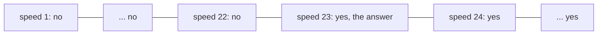
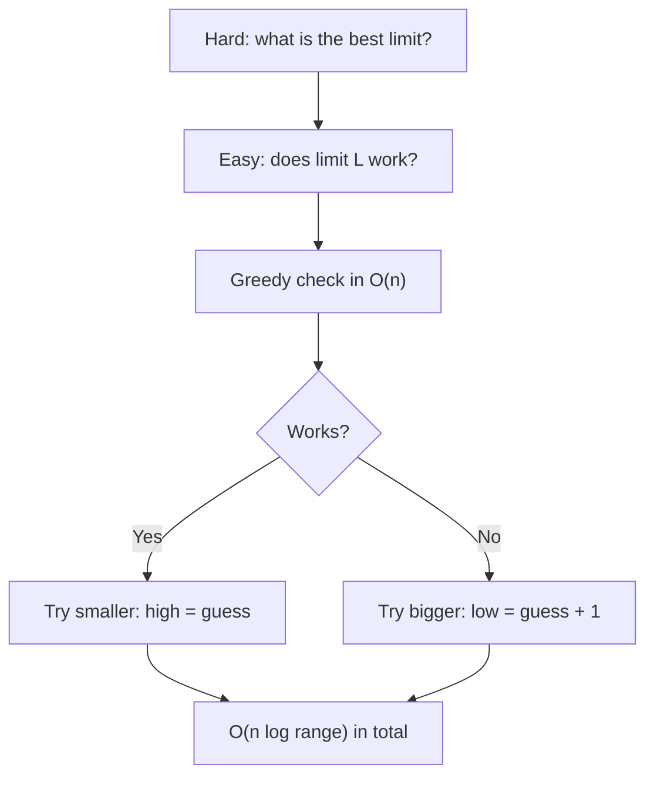
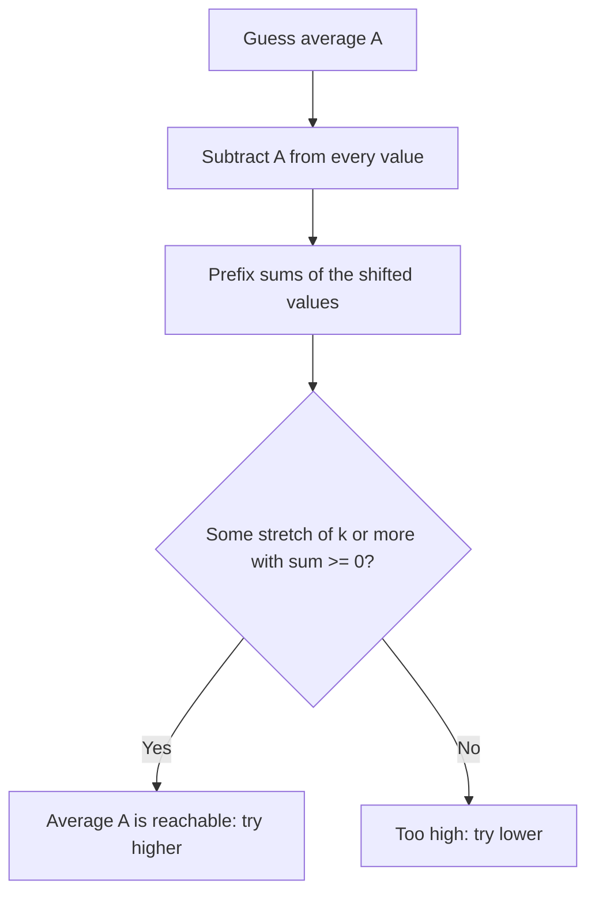

# new

## explanation

### Searching for a number you don't know yet

Binary search isn't only for finding items in a sorted list. It can find an **answer**, as long as you can check any guess with a yes-or-no question, and the answers to that question never flip back.

Example: you have 5 chapters to read in 6 days, and each day you read at a fixed speed in pages per day. What is the **slowest** speed that finishes in time?

- Ask "can I finish in 6 days at speed s?" for s = 1, 2, 3, ….
- Slow speeds say **no**. From some speed on, every faster speed says **yes**.
- So the answers look like: no, no, no, …, no, yes, yes, yes. We want the first yes.

### Why binary search works here

Because the answers switch from no to yes exactly once, you can test the middle of the range of possible speeds:

- If the middle speed works, the answer is that speed or a slower one: keep the left half, including the middle.
- If it doesn't, the answer is faster: keep the right half, excluding the middle.

Each test halves the range, so even a range of a billion possible answers needs only about 30 checks.

### The recipe

1. Decide what the answer is: a speed, a size, a limit.
2. Find a range `low..high` that surely contains it.
3. Write a check `ok(x)` that answers yes or no for one guess.
4. Make sure `ok` only flips once.
5. Binary search for the first `x` where `ok(x)` is yes.

The check is usually simple: a loop over the input that simulates "what if the answer were x?". The total cost is (number of checks) × (cost of one check), for example O(n log(range)).

### Integer square roots

"The largest x with x × x ≤ n" is the same idea the other way round: yes, yes, …, yes, no, no. There you want the **last** yes.

## diagram



## example

```cpp
#include <iostream>
#include <vector>

// Largest x with x * x <= n: "x * x <= n" is yes for small x, then no forever after.
long long integerSqrt(long long n) {
    long long low = 0, high = n;  // the answer is somewhere in [low, high]
    while (low < high) {
        long long guess = low + (high - low + 1) / 2;  // round up, so low = guess always moves
        if (guess <= n / guess) low = guess;            // guess * guess <= n, written to avoid overflow
        else high = guess - 1;
    }
    return low;
}

// Days needed to read every chapter at `speed` pages a day; a chapter never shares a day.
long long daysNeeded(const std::vector<int>& chapters, long long speed) {
    long long days = 0;
    for (int pages : chapters) days += (pages + speed - 1) / speed;  // pages / speed, rounded up
    return days;
}

int main() {
    std::cout << integerSqrt(50) << ' ' << integerSqrt(81) << ' ' << integerSqrt(1'000'000'000'000LL) << '\n';
    std::vector<int> chapters = {30, 11, 23, 4, 20};
    int deadline = 6;
    long long low = 1, high = 30;  // speed 30 always works: one day per chapter
    while (low < high) {
        long long guess = low + (high - low) / 2;
        if (daysNeeded(chapters, guess) <= deadline) high = guess;  // fast enough: try slower
        else low = guess + 1;                                    // too slow
    }
    std::cout << "slowest speed that meets " << deadline << " days: " << low << " pages a day\n";
}
```

```text
7 9 1000000
slowest speed that meets 6 days: 23 pages a day
```

1. `integerSqrt` searches for the last x where x × x ≤ n. It compares `guess <= n / guess` instead of `guess * guess <= n`, so even huge n can't overflow. The square root of 10¹² is found in about 40 steps.
2. `daysNeeded` is the check: it simulates reading at one speed and counts the days.
3. The speed search looks for the first speed that's fast enough. At 23 pages a day, the chapters take 2 + 1 + 1 + 1 + 1 = 6 days; at 22, the 23-page chapter needs two days, making 7.
4. Searching speeds 1 to 30 took only 5 checks; trying every speed would have taken up to 30.

## mistakes

- **A check that flips more than once.** If the answers go yes, no, yes, binary search may land on the wrong one. Convince yourself that once a guess works, every bigger (or every smaller) guess works too.
- **A range that doesn't contain the answer.** If `high` is too small, the search returns `high` even though it fails the check. Pick `high` so that it surely works.
- **Endless loops from rounding.** When the code does `low = guess`, `guess` must round **up**, or a range of two values never shrinks. When it does `high = guess`, round down.
- **Overflow in the check.** `guess * guess` overflows for large `guess`. Compare `guess <= n / guess`, or use a wider type.
- **Looking for the wrong boundary.** "Slowest speed that works" is the first yes; "largest square root" is the last yes. Decide which one before writing the loop.

## check

```cpp
#include <iostream>

int main() {
    int low = 1, high = 100, tries = 0;
    while (low < high) {
        int guess = low + (high - low) / 2;
        tries++;
        if (guess * guess * guess >= 300) high = guess; else low = guess + 1;
    }
    std::cout << low << ' ' << tries << '\n';
}
```

```text
7 6
```

The loop finds the first number whose cube is at least 300. 6³ = 216 is too small and 7³ = 343 is enough, so the answer is 7. The range shrinks 1–100, 1–50, 1–25, 1–13, 1–7, 5–7 and finally 7–7: six checks.

# building

## explanation

### A quick recap

When a yes/no check on a guessed answer flips only once, binary search finds the boundary in O(log range) checks. You need a range containing the answer, a check, and to know whether you want the first yes or the last yes.

### Two templates

**First yes** (answers go no…no, yes…yes), for "the smallest value that works":

```cpp
while (low < high) {
    long long guess = low + (high - low) / 2;
    if (ok(guess)) high = guess; else low = guess + 1;
}
```

**Last yes** (answers go yes…yes, no…no), for "the largest value that works":

```cpp
while (low < high) {
    long long guess = low + (high - low + 1) / 2;
    if (ok(guess)) low = guess; else high = guess - 1;
}
```

Both end with `low == high`, the answer.

### Two classic shapes

- **Minimise the maximum.** Split jobs among workers, in order, so the busiest worker has the least work. Guess a limit L and check greedily: give each worker jobs until the next one would pass L, then start a new worker. If that needs no more workers than you have, L works, and any bigger L works too.
- **Maximise the minimum.** Place routers at positions so the closest pair is as far apart as possible. Guess a gap G and check greedily: put one at the first position, then the next at the first position at least G further on, and so on. If that places them all, G works, and any smaller G works too.

In both, the hard optimisation question ("what's the best split?") becomes an easy feasibility question ("does this limit work?"). The greedy checks are correct because taking the earliest possible place never hurts later choices.

### Choosing the range

- For a limit on sums: from the largest single item (anything less can't even hold it) up to the total.
- For a gap: from 0 up to the distance between the extremes.

A range that's too wide only costs a few extra checks; one that's too narrow gives a wrong answer.

## diagram



## example

```cpp
#include <iostream>
#include <numeric>
#include <vector>

// Can the jobs, in order, be split into at most `workers` runs, each totalling <= limit?
bool fitsInRuns(const std::vector<int>& jobs, int workers, long long limit) {
    int runs = 1;
    long long current = 0;
    for (int j : jobs) {
        if (j > limit) return false;
        if (current + j > limit) { runs++; current = 0; }
        current += j;
    }
    return runs <= workers;
}

// Can `routers` be placed at the given spots (sorted) with every gap at least `gap`?
bool spreadsOut(const std::vector<int>& spots, int routers, int gap) {
    int placed = 1, last = spots[0];
    for (std::size_t i = 1; i < spots.size(); i++)
        if (spots[i] - last >= gap) { placed++; last = spots[i]; }
    return placed >= routers;
}

int main() {
    // Smallest workload limit that works: the first yes.
    std::vector<int> jobs = {7, 2, 5, 10, 8};
    long long low = 1, high = std::accumulate(jobs.begin(), jobs.end(), 0LL);
    while (low < high) {
        long long guess = low + (high - low) / 2;
        if (fitsInRuns(jobs, 2, guess)) high = guess; else low = guess + 1;
    }
    std::cout << "busiest worker does " << low << '\n';

    // Largest gap that works: the last yes, so guess rounds up.
    std::vector<int> spots = {1, 2, 4, 8, 9};
    int a = 0, b = spots.back() - spots.front();
    while (a < b) {
        int guess = a + (b - a + 1) / 2;
        if (spreadsOut(spots, 3, guess)) a = guess; else b = guess - 1;
    }
    std::cout << "3 routers, widest spacing " << a << '\n';
}
```

```text
busiest worker does 18
3 routers, widest spacing 3
```

1. `fitsInRuns` hands out jobs in order and starts a new worker only when the next job would push past the limit. With limit 18, the jobs split as 7 + 2 + 5 = 14 and 10 + 8 = 18: two workers. With 17, a third worker is needed.
2. The first search finds the smallest limit that two workers can manage: 18.
3. `spreadsOut` places routers at the earliest spots that keep the gap. With gap 3 it uses spots 1, 4 and 8; with gap 4 it can only place two.
4. The second search wants the largest gap that works, so it rounds `guess` up and moves `low` to `guess` on success.

## mistakes

- **A check that isn't monotone.** "Exactly k workers" isn't monotone; "at most k workers" is. Phrase the check so that once a guess works, all easier guesses work too.
- **Rounding the wrong way.** With `low = guess`, round `guess` up; with `high = guess`, round down. The other combination can loop forever on a range of two.
- **Forgetting impossible single items.** If one job is bigger than the limit, no split works. The check must say no, not quietly start a run that's already over the limit.
- **A lower bound that's too high.** Starting `low` above the true answer returns `low` without ever testing smaller values. Start at a value that's surely too small, or surely the minimum.
- **Unsorted positions in a gap check.** The greedy placement assumes the spots are in order. Sort them first.

## check

```cpp
#include <iostream>

int main() {
    const long long coins = 20;  // row r of a staircase needs r coins: how many full rows can be built?
    long long low = 0, high = coins;
    while (low < high) {
        long long rows = low + (high - low + 1) / 2;
        if (rows * (rows + 1) / 2 <= coins) low = rows; else high = rows - 1;
    }
    std::cout << low << '\n';
}
```

```text
5
```

Building r full rows takes 1 + 2 + … + r = r(r + 1) / 2 coins. 5 rows take 15 coins, and 6 would take 21, more than 20. More rows always need more coins, so the check flips once. This is a last yes, so the guess rounds up, and the answer is 5.

# strong

## explanation

### Why it's correct

Binary search on the answer rests on one fact: the check is **monotone**. Prove it before trusting the method. For "minimise the maximum": if every run fits under L, it also fits under L + 1, so ok(L) implies ok(L + 1). For "maximise the minimum": a placement with gaps of at least G also has gaps of at least G − 1. Then binary search returns exactly the boundary, and the boundary is the optimum.

### Cost

The total is O(log(range) × cost of the check). Since only the logarithm of the range matters, an answer between 0 and 10¹⁸ costs about 60 checks. The check itself is where the problem-specific work lives: a greedy pass, a BFS on a graph, a DP, or even another binary search.

### Real-valued answers

When the answer is a real number, there's no "next" value. Instead, run a fixed number of halvings: each one halves the uncertainty, so 60 iterations shrink any reasonable range below `double` precision. Comparing `lo` and `hi` with a tolerance works too, but a fixed count can't loop forever.

### Turning a ratio into a check

Some objectives aren't monotone at first sight, like "the stretch of at least k days with the **highest average**". Binary search the average A instead and ask "is there a stretch of at least k days with average ≥ A?". Subtracting A from every value turns that into "is there a stretch of at least k values with sum ≥ 0?", which prefix sums answer in O(n): keep the smallest prefix sum that ends at least k positions earlier. This **parametric search** trick works for many ratio objectives.

### The library version

C++20's `std::ranges::partition_point` searches any range whose predicate is true then false, including a range of numbers made with `std::views::iota`. That gives a binary search on the answer in one call, with the boundaries handled for you.

## diagram



## example

```cpp
#include <algorithm>
#include <iomanip>
#include <iostream>
#include <ranges>
#include <vector>

// Is there a stretch of at least k values whose average is >= avg?
// Subtract avg from every value: then we need a stretch with sum >= 0.
bool averageReachable(const std::vector<int>& v, std::size_t k, double avg) {
    std::vector<double> prefix(v.size() + 1, 0.0);
    for (std::size_t i = 0; i < v.size(); i++) prefix[i + 1] = prefix[i] + v[i] - avg;
    double smallestBefore = 0.0;  // the smallest prefix[j] with j <= i - k
    for (std::size_t i = k; i <= v.size(); i++) {
        smallestBefore = std::min(smallestBefore, prefix[i - k]);
        if (prefix[i] - smallestBefore >= 0) return true;
    }
    return false;
}

int main() {
    std::vector<int> sales = {1, 12, -5, -6, 50, 3};
    double lo = -6, hi = 50;
    for (int it = 0; it < 60; it++) {  // real-valued: a fixed number of halvings
        double mid = (lo + hi) / 2;
        (averageReachable(sales, 4, mid) ? lo : hi) = mid;
    }
    std::cout << std::fixed << std::setprecision(4) << "best average over 4+ days: " << lo << '\n';

    // C++20: partition_point over a range of numbers finds the first "no" directly.
    auto candidates = std::views::iota(0LL, 1'000'000LL);
    auto firstTooBig = std::ranges::partition_point(candidates, [](long long x) { return x * x <= 123456789; });
    std::cout << "isqrt(123456789) = " << *firstTooBig - 1 << '\n';
}
```

```text
best average over 4+ days: 12.7500
isqrt(123456789) = 11111
```

1. The answer lies between the smallest and largest value, −6 and 50. Sixty halvings narrow that range far below the four decimals printed.
2. For each guess, `averageReachable` shifts the values by the guess and asks whether some stretch of at least 4 has a non-negative sum, in one O(n) pass over the prefix sums.
3. The best stretch is 12, −5, −6, 50: 51 / 4 = 12.75. Any longer stretch averages less.
4. `partition_point` binary searches the numbers 0 to 999,999 for the first x with x² > 123,456,789, which is 11,112, so the integer square root is 11,111.

## mistakes

- **Skipping the monotonicity proof.** Most wrong answers come from checks that aren't monotone after all, such as "exactly k groups" instead of "at most k". Write down why ok(x) implies ok(x + 1).
- **Comparing real numbers until they're equal.** `while (lo != hi)` on doubles may never end. Use a fixed number of iterations.
- **A slow check.** If the check is O(n²), the whole search is O(n² log range). Make the check as fast as you can; it runs dozens of times.
- **Overflow inside the check.** Sums of large values times a guessed limit can pass 2⁶³. Bound intermediate values, or stop the check early once the answer is clear.
- **Feeding `partition_point` an inverted predicate.** It needs true first, then false. "x * x > n" is the wrong way round and returns nonsense.

## check

```cpp
#include <algorithm>
#include <iostream>
#include <ranges>

int main() {
    auto xs = std::views::iota(1, 101);
    auto it = std::ranges::partition_point(xs, [](int x) { return 100 / x >= 7; });
    int lo = 1, hi = 100, calls = 0;
    while (lo < hi) { int mid = lo + (hi - lo) / 2; calls++; if (100 / mid < 7) hi = mid; else lo = mid + 1; }
    std::cout << *it << ' ' << lo << ' ' << calls << '\n';
}
```

```text
15 15 7
```

`100 / x` (whole-number division) is at least 7 for x up to 14 and drops to 6 at 15, so the predicate is true, then false, and `partition_point` returns 15. The hand-written loop searches for the first x where `100 / x < 7`: the same boundary, 15, after 7 checks.
