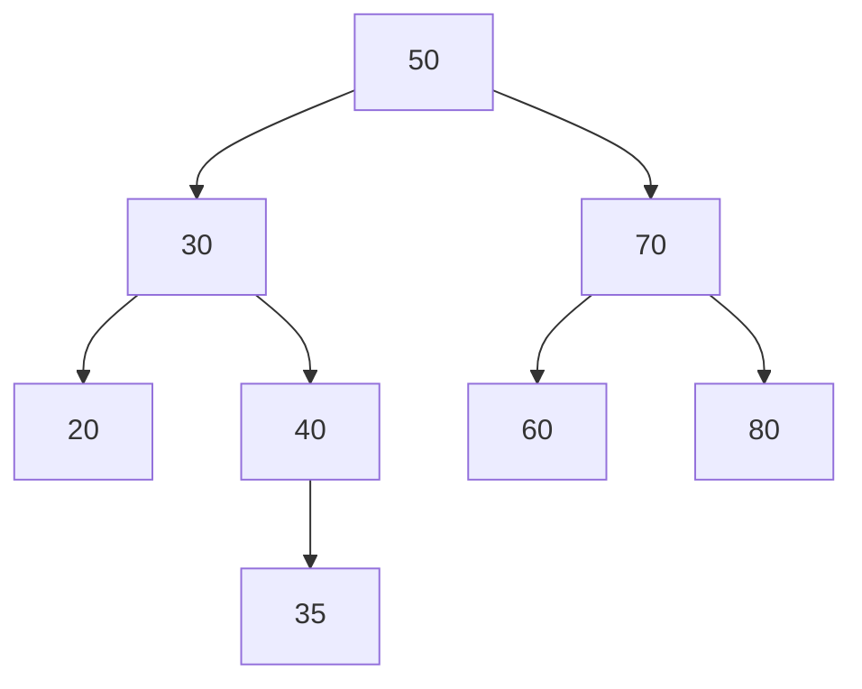
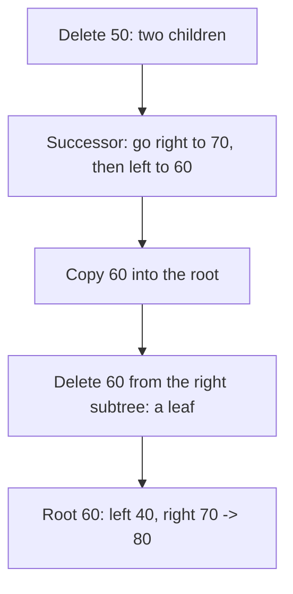
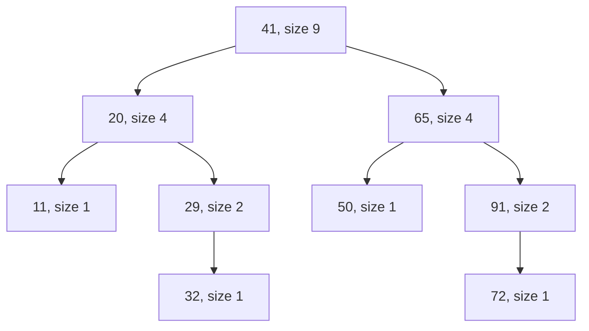

# new

## explanation

### A tree that keeps keys in order

A **binary search tree** (BST) follows one rule at every node: every key in its **left** subtree is smaller, and every key in its **right** subtree is bigger. That rule turns the tree into a sorted structure you can search like a binary search.

### Searching

Start at the root. If the key is smaller than the node's key, go left; if bigger, go right; if equal, you've found it. Each step goes down one level and ignores the whole other side. The cost is the tree's **height**: about log₂ n steps when the tree is well shaped, so a million keys need about 20.

### Inserting

Search for the key; where the search falls off the tree (a `nullptr`), that's exactly where the new key belongs. Attach a new node there. The rule still holds everywhere.

### Sorted order for free

An **inorder** traversal (left, node, right) of a BST visits the keys from smallest to largest. The smallest key is the leftmost node: keep going left. The largest is the rightmost.

### The catch: shape

The cost depends on the height, and the height depends on the order of insertion. Inserting keys that are already sorted, 1, 2, 3, …, sends every new key to the right of the last: the "tree" becomes a chain of n nodes, and searching becomes O(n). Balanced trees, a later skill, fix this.

### Duplicates

Decide what to do with equal keys: ignore them (a set), count them in the node, or always send them to one side. The code must be consistent about it.

## diagram



## example

```cpp
#include <iostream>

struct Node { int key; Node* left = nullptr; Node* right = nullptr; };

// Insert: go left for smaller keys, right for bigger, and attach where the path ends.
Node* insert(Node* root, int key) {
    if (!root) return new Node{key};
    if (key < root->key) root->left = insert(root->left, key);
    else if (key > root->key) root->right = insert(root->right, key);
    return root;  // equal keys are ignored: this tree is a set
}

// Search: one comparison per level, never visiting the other side.
bool contains(const Node* n, int key, int& steps) {
    while (n) {
        steps++;
        if (key == n->key) return true;
        n = key < n->key ? n->left : n->right;
    }
    return false;
}

void inorder(const Node* n) {
    if (!n) return;
    inorder(n->left);
    std::cout << n->key << ' ';
    inorder(n->right);
}
void destroy(Node* n) { if (n) { destroy(n->left); destroy(n->right); delete n; } }

int main() {
    Node* root = nullptr;
    for (int k : {50, 30, 70, 20, 40, 60, 80, 35}) root = insert(root, k);
    inorder(root);
    std::cout << '\n';
    int s1 = 0, s2 = 0;
    bool has35 = contains(root, 35, s1), has65 = contains(root, 65, s2);
    std::cout << "35: " << has35 << " in " << s1 << " steps; 65: " << has65 << " in " << s2 << " steps\n";
    destroy(root);
}
```

```text
20 30 35 40 50 60 70 80
35: 1 in 4 steps; 65: 0 in 3 steps
```

1. Each key walks down from the root and is attached where the path ends: 35 goes left of 50, right of 30, left of 40.
2. The inorder traversal prints the keys sorted, whatever order they were inserted in.
3. Finding 35 visits 50, 30, 40 and 35: four steps out of eight keys.
4. Looking for 65 goes 50 → 70 → 60, then right of 60 is empty: not there, after three steps.

## mistakes

- **Not returning the root from `insert`.** The recursive insert must return the (possibly new) subtree root, and callers must store it: `root = insert(root, k)`.
- **Inserting sorted data.** It builds a chain, and every operation becomes O(n). Shuffle the input, or use a balanced tree such as `std::set`.
- **No rule for duplicates.** Without one, equal keys may end up on both sides and searches miss them. Decide: ignore, count, or always one side.
- **Searching both subtrees.** That throws away the whole point. Go to one side only.
- **Forgetting to free the nodes.** A BST built with `new` must be destroyed, children first.

## check

```cpp
#include <iostream>

struct Node { int key; Node* left = nullptr; Node* right = nullptr; };

int main() {
    Node a{10}, b{25}, c{20, &a, &b}, d{40}, root{30, &c, &d};
    const Node* n = &root;
    int smallest = 0;
    while (n) { smallest = n->key; n = n->left; }
    n = &root;
    int path = 0;
    while (n && n->key != 25) { path++; n = 25 < n->key ? n->left : n->right; }
    std::cout << smallest << ' ' << path << '\n';
}
```

```text
10 2
```

The smallest key is the leftmost node: 30 → 20 → 10. Searching for 25 goes left at 30 (25 < 30), then right at 20 (25 > 20), and finds it: two moves.

# building

## explanation

### A quick recap

In a BST, left keys are smaller and right keys bigger at every node. Search and insert follow one path down, costing O(height); inorder gives sorted order.

### Deleting a key

Find the node, then:

1. **A leaf**: remove it.
2. **One child**: replace the node with that child; the child's whole subtree moves up one level and the order is kept.
3. **Two children**: the node can't simply disappear. Find its **successor**, the smallest key in its right subtree (go right once, then left as far as possible). Copy that key into the node, then delete the successor from the right subtree. The successor has no left child, so that deletion is case 1 or 2.

The order of keys is preserved in every case, and the cost is O(height).

### Checking that a tree is a valid BST

Comparing each node only with its own children isn't enough: a key deep in the left subtree must be smaller than **every** ancestor it sits to the left of. Pass down limits: the root may be anything; going left, the node's key becomes the upper limit; going right, it becomes the lower limit. Every key must lie strictly between its inherited limits. Use a wider type, such as `long long`, for the limits, so they can start beyond any `int` key.

Another way: a binary search tree's inorder walk is strictly increasing, and only a valid one's is. Walk it and compare each key with the one before.

### The k-th smallest

An inorder walk visits keys in sorted order, so the k-th key visited is the k-th smallest. Stop as soon as you reach it: O(height + k).

## diagram



## example

```cpp
#include <iostream>
struct Node { int key; Node* left = nullptr; Node* right = nullptr; };
Node* insert(Node* r, int key) {
    if (!r) return new Node{key};
    if (key < r->key) r->left = insert(r->left, key);
    else if (key > r->key) r->right = insert(r->right, key);
    return r;
}
// Delete: no child or one child takes the node's place; two children: copy in the successor, delete it.
Node* erase(Node* r, int key) {
    if (!r) return nullptr;
    if (key < r->key) r->left = erase(r->left, key);
    else if (key > r->key) r->right = erase(r->right, key);
    else if (!r->left || !r->right) {
        Node* child = r->left ? r->left : r->right;
        delete r;
        return child;
    } else {
        Node* next = r->right;  // the successor: right once, then left all the way
        while (next->left) next = next->left;
        r->key = next->key;
        r->right = erase(r->right, next->key);
    }
    return r;
}
bool increasing(const Node* t, const Node*& prev) {  // valid exactly when the inorder walk only goes up
    if (!t) return true;
    if (!increasing(t->left, prev) || (prev && prev->key >= t->key)) return false;
    prev = t;
    return increasing(t->right, prev);
}
void inorder(const Node* n) { if (n) { inorder(n->left); std::cout << n->key << ' '; inorder(n->right); } }
void destroy(Node* n) { if (n) { destroy(n->left); destroy(n->right); delete n; } }
int main() {
    Node* root = nullptr;
    for (int k : {50, 30, 70, 20, 40, 60, 80}) root = insert(root, k);
    root = erase(root, 20);  // a leaf
    root = erase(root, 30);  // one child left (40)
    root = erase(root, 50);  // two children: 60 takes its place
    inorder(root);
    const Node* prev = nullptr;
    std::cout << "| root " << root->key << ", valid " << increasing(root, prev) << '\n';
    destroy(root);
}
```

```text
40 60 70 80 | root 60, valid 1
```

1. Deleting 20, a leaf, just removes it. Deleting 30, which now has only the child 40, lets 40 take its place.
2. Deleting 50 needs its successor: one step right to 70, then left to 60. 60 is copied into the root, and the old 60, a leaf, is deleted from the right subtree.
3. `increasing` walks the tree in order and checks that each key is bigger than the one before it, which is the search-tree rule seen from the side: still valid.

## mistakes

- **Deleting a two-child node directly.** Its two subtrees would be orphaned. Replace its key with the successor's (or the predecessor's) and delete that node instead.
- **Forgetting to return the new subtree root.** After `erase`, the parent must store the result, or it still points at a freed node.
- **Validating with only parent-child comparisons.** A key can satisfy its parent and still break the rule with a grandparent. Pass limits down, or check that the inorder walk only goes up.
- **`int` limits for validation.** Starting at `INT_MIN` or `INT_MAX` wrongly rejects trees containing those very keys. Use `long long`, or optional limits.
- **Walking the whole inorder for the k-th key.** Stop after k visits.

## check

```cpp
#include <iostream>
struct Node { int key; Node* left = nullptr; Node* right = nullptr; };
bool increasing(const Node* t, const Node*& prev) {
    if (!t) return true;
    if (!increasing(t->left, prev) || (prev && prev->key >= t->key)) return false;
    prev = t;
    return increasing(t->right, prev);
}
bool onlyParents(const Node* t) {  // checks each node against its own children only: not enough
    if (!t) return true;
    if ((t->left && t->left->key >= t->key) || (t->right && t->right->key <= t->key)) return false;
    return onlyParents(t->left) && onlyParents(t->right);
}
int main() {
    Node a{5}, b{16}, c{10, &a, &b}, d{20}, root{15, &c, &d};
    const Node* prev = nullptr;
    std::cout << onlyParents(&root) << increasing(&root, prev) << '\n';
}
```

```text
10
```

16 sits to the right of 10, which is fine locally, so the parent-only check says yes. But 16 is inside 15's **left** subtree, where every key must be below 15. The inorder walk catches it: it reads 5 10 16 15 20, and 16 followed by 15 is a step down.

# strong

## explanation

### Augmenting with subtree sizes

Store in every node the **size of its subtree**, kept up to date on insert and delete. Then order questions take O(height) instead of O(n):

- **The k-th smallest**: if k ≤ size(left), it's in the left subtree; if k = size(left) + 1, it's this node; otherwise look for the (k − size(left) − 1)-th in the right subtree.
- **Rank** (how many keys are smaller than x): walking down, whenever you go right, everything in the left subtree plus the node itself is smaller.

This is called an **order-statistic tree**. Other augmentations (subtree sums, minimums, maximums) work the same way, as long as each node's value can be recomputed from its children's.

### Successor without parent pointers

The next key after x is the smallest key greater than x. Walk down from the root: whenever the node's key is greater than x, it's a candidate; remember it and go left to look for a smaller candidate. Otherwise go right. The last candidate remembered is the answer. One path, O(height).

### Shape is everything

Inserting n keys in random order gives an expected height of about 2.99 log₂ n, close to balanced. Inserting them sorted gives height n. Adversarial or real-world data is often sorted or nearly so. Balanced trees guarantee O(log n) height with rotations; treaps, random binary search trees and skip lists get it with randomness.

### In the standard library

`std::set` and `std::map` are balanced BSTs with `lower_bound`, `upper_bound` and in-order iteration, but no k-th element or rank. For those, GCC's policy-based `tree` or your own augmented tree is needed.

## diagram



## example

```cpp
#include <iostream>

// Each node also stores the size of its subtree, so order questions take O(height).
struct Node { int key; int size = 1; Node* left = nullptr; Node* right = nullptr; };

int sizeOf(const Node* n) { return n ? n->size : 0; }
Node* insert(Node* n, int key) {
    if (!n) return new Node{key};
    if (key < n->key) n->left = insert(n->left, key);
    else n->right = insert(n->right, key);
    n->size++;
    return n;
}
// The k-th smallest (counting from 1): the left subtree holds the sizeOf(left) smallest keys.
int kth(const Node* n, int k) {
    int leftSize = sizeOf(n->left);
    if (k <= leftSize) return kth(n->left, k);
    if (k == leftSize + 1) return n->key;
    return kth(n->right, k - leftSize - 1);
}
// How many keys are smaller than x.
int rankOf(const Node* n, int x) {
    if (!n) return 0;
    if (x <= n->key) return rankOf(n->left, x);
    return sizeOf(n->left) + 1 + rankOf(n->right, x);
}
// The next key after x: remember every key bigger than x on the way down, then go left.
int successor(const Node* n, int x) {
    int best = -1;
    while (n) {
        if (n->key > x) { best = n->key; n = n->left; }
        else n = n->right;
    }
    return best;
}
void destroy(Node* n) { if (n) { destroy(n->left); destroy(n->right); delete n; } }

int main() {
    Node* root = nullptr;
    for (int k : {41, 20, 65, 11, 29, 50, 91, 32, 72}) root = insert(root, k);
    std::cout << "3rd smallest " << kth(root, 3) << ", median " << kth(root, 5) << ", keys below 60: " << rankOf(root, 60)
              << ", after 32: " << successor(root, 32) << ", after 91: " << successor(root, 91) << '\n';
    destroy(root);
}
```

```text
3rd smallest 29, median 41, keys below 60: 6, after 32: 41, after 91: -1
```

1. Every insert adds 1 to the size of each node on its path, so sizes stay correct with no extra pass.
2. For the 3rd smallest, the root's left subtree (20, 11, 29, 32) has 4 keys, so the answer is in it; inside, 11 is first, 20 second, and 29 third.
3. The median of 9 keys is the 5th: the root's left subtree holds exactly 4, so it's the root, 41.
4. Counting keys below 60: going right at 41 adds 4 + 1; then at 65 going left; then at 50 going right adds 1: 6.
5. The successor walk from the root remembers 41 when it goes left of it, and nothing bigger than 32 is found below, so the answer is 41. Nothing comes after 91: −1.

## mistakes

- **Forgetting to update sizes on delete.** Every node on the deleted key's path loses 1. Stale sizes give wrong ranks silently.
- **Off-by-one in k.** Decide whether k counts from 0 or 1; this code counts from 1, so the left subtree's size plus one is the node itself.
- **Asking for the k-th of more than size keys.** `kth` would follow a null pointer. Check `1 <= k <= size` first.
- **Assuming random-looking data is random.** Real inputs are often sorted. Without balancing, the height, and every operation, can degrade to O(n).
- **Augmenting with values that can't be recomputed locally.** A node's extra field must depend only on its children's fields and its own key, or updates need more than one path.

## check

```cpp
#include <algorithm>
#include <iostream>

struct Node { int key; Node* left = nullptr; Node* right = nullptr; };
Node* insert(Node* n, int key) {
    if (!n) return new Node{key};
    if (key < n->key) n->left = insert(n->left, key);
    else n->right = insert(n->right, key);
    return n;
}
int height(const Node* n) { return n ? 1 + std::max(height(n->left), height(n->right)) : 0; }
int main() {
    Node* sorted = nullptr;
    Node* mixed = nullptr;
    for (int k = 1; k <= 7; k++) sorted = insert(sorted, k);
    for (int k : {4, 2, 6, 1, 3, 5, 7}) mixed = insert(mixed, k);
    std::cout << height(sorted) << ' ' << height(mixed) << '\n';  // the program ends; the OS frees the nodes
}
```

```text
7 3
```

The same seven keys make very different trees. Inserted in sorted order, each key goes to the right of the previous one, so the "tree" is a chain of height 7. Inserted middle-first, they form a perfect tree of height 3, so searches need at most 3 steps instead of 7.
