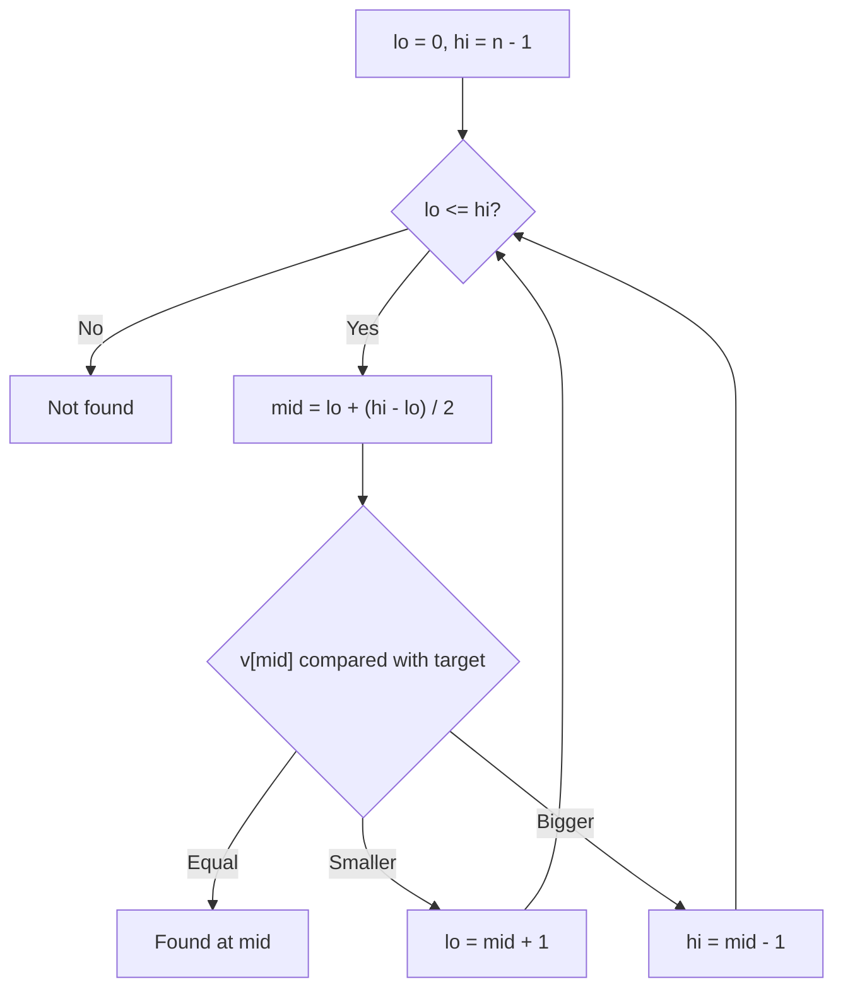
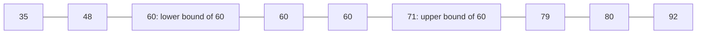
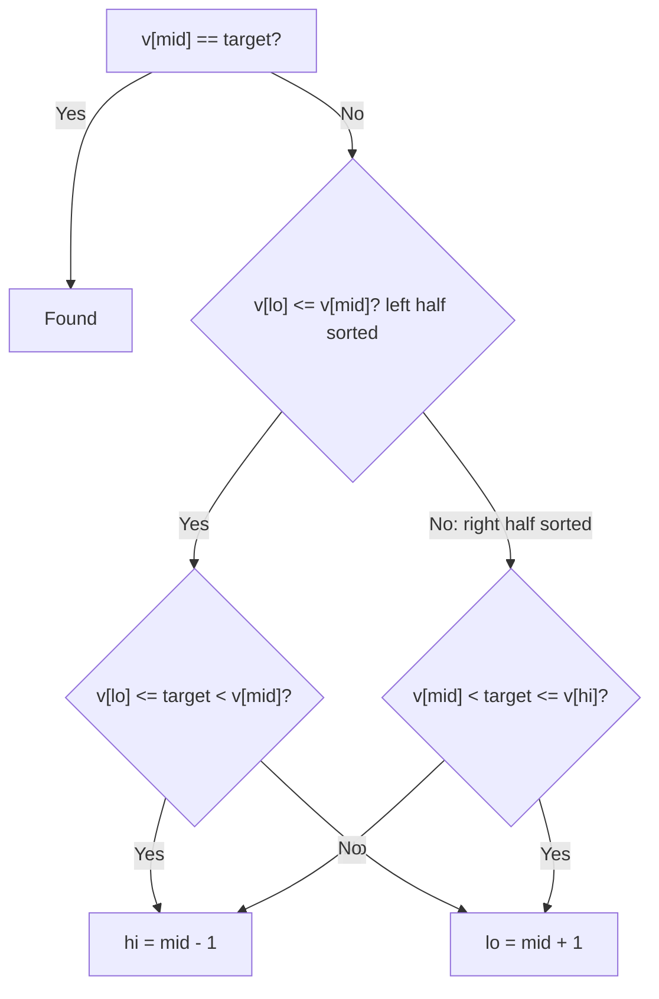

# new

## explanation

### Linear search

The simplest way to find something in a list is to look at every item in turn until you find it. That's **linear search**. It works on any list, sorted or not, but in the worst case (the item is last, or missing) it checks all n items: O(n).

### Binary search: halve the list each time

If the list is **sorted**, there's a much faster way. Think of finding a word in a dictionary: you open it in the middle, see whether your word comes before or after that page, and throw away the half that can't contain it. Then you repeat with the half that's left.

**Binary search** does exactly that:

1. Look at the middle item.
2. If it's the target, you're done.
3. If it's smaller than the target, the target can only be in the **right** half.
4. If it's bigger, the target can only be in the **left** half.
5. Repeat on the remaining half until it's found or nothing is left.

### Why it's so fast

Each step halves what's left. A million items become 500,000, then 250,000, and so on: about 20 steps reach a single item. Binary search is O(log n). Doubling the list adds just one step.

### The code

Keep two indexes, `lo` and `hi`, marking the part still possible. While `lo <= hi`, look at `mid`, and move `lo` past it or `hi` before it. If they cross, the target isn't there.

Write `mid = lo + (hi - lo) / 2` rather than `(lo + hi) / 2`: it's the same value, but `lo + hi` can overflow when the indexes are huge.

### The one condition

Binary search only works on sorted data. On an unsorted list it doesn't fail loudly; it just gives wrong answers. If you search many times, sorting once (O(n log n)) and then binary searching (O(log n) each) quickly pays off.

## diagram



## example

```cpp
#include <iostream>
#include <vector>

// Linear search: check every item until we find it. Returns the index, or -1.
int linearSearch(const std::vector<int>& v, int target, int& steps) {
    for (std::size_t i = 0; i < v.size(); i++) {
        steps++;
        if (v[i] == target) return static_cast<int>(i);
    }
    return -1;
}

// Binary search on sorted data: look at the middle, keep the half that can hold the target.
int binarySearch(const std::vector<int>& v, int target, int& steps) {
    int lo = 0, hi = static_cast<int>(v.size()) - 1;
    while (lo <= hi) {
        steps++;
        int mid = lo + (hi - lo) / 2;
        if (v[mid] == target) return mid;
        if (v[mid] < target) lo = mid + 1;  // target is to the right
        else hi = mid - 1;                  // target is to the left
    }
    return -1;
}

int main() {
    std::vector<int> pages;
    for (int p = 1; p <= 1000; p++) pages.push_back(p * 3);  // 3, 6, ..., 3000: sorted
    int a = 0, b = 0;
    int at1 = linearSearch(pages, 2400, a);
    int at2 = binarySearch(pages, 2400, b);
    std::cout << "found at " << at1 << " and " << at2 << '\n';
    std::cout << "steps: linear " << a << ", binary " << b << '\n';
    int c = 0;
    std::cout << "missing 1001: " << binarySearch(pages, 1001, c) << " after " << c << " steps\n";
}
```

```text
found at 799 and 799
steps: linear 800, binary 8
missing 1001: -1 after 10 steps
```

1. The list holds 3, 6, …, 3000, in order. 2400 is 3 × 800, so it sits at index 799.
2. Linear search checks items one by one and needs 800 steps to reach it.
3. Binary search halves the range each time: 0–999, then 500–999, then 750–999, and so on. It finds 2400 in 8 steps.
4. 1001 isn't a multiple of 3. After 10 halvings, `lo` passes `hi`, so binary search reports -1. That's about log₂ 1000 steps: missing items cost the most, but still only ten.

## mistakes

- **Binary search on unsorted data.** It throws away halves based on order. If there's no order, it throws away the wrong half and silently answers wrong. Sort first.
- **`lo < hi` instead of `lo <= hi`.** With the inclusive `hi` used here, `<` stops one step early and misses a target sitting at the last remaining position.
- **Forgetting to move past `mid`.** `lo = mid` instead of `lo = mid + 1` can leave the range unchanged, so the loop never ends.
- **`(lo + hi) / 2` on huge indexes.** The sum can overflow an `int`. `lo + (hi - lo) / 2` never does.
- **Returning 0 for "not found".** 0 is a real index. Return -1, or the size of the list, and say which in a comment.

## check

```cpp
#include <iostream>
#include <vector>

int main() {
    std::vector<int> v = {2, 5, 8, 12, 16, 23, 38, 56};
    int lo = 0, hi = 7, looks = 0;
    while (lo <= hi) {
        int mid = lo + (hi - lo) / 2;
        looks++;
        if (v[mid] == 23) { std::cout << mid << ' ' << looks << '\n'; break; }
        if (v[mid] < 23) lo = mid + 1; else hi = mid - 1;
    }
}
```

```text
5 2
```

The first middle is index 3, holding 12. That's smaller than 23, so the search continues in 4–7. The new middle is index 5, which holds 23: found on the second look.

# building

## explanation

### A quick recap

Binary search works on sorted data: compare with the middle, keep the half that can still hold the target, repeat. It takes O(log n) steps instead of O(n).

### Beyond "is it there?": lower and upper bounds

Often the question isn't whether a value exists but **where** it is or **where it would go**:

- The **lower bound** of `x` is the first position whose value is **≥ x**. If `x` is in the list, it's the first copy; if not, it's where `x` would be inserted to keep the list sorted.
- The **upper bound** of `x` is the first position whose value is **> x**.

These two answer many questions in O(log n):

- How many copies of `x`? `upper − lower`.
- How many values in the range [a, b)? `lower(b) − lower(a)`.
- Where to insert `x`? At `lower(x)`.

### Writing lower bound yourself

Use a **half-open** range `[lo, hi)`, with `hi` starting at `v.size()`, so "after the last element" is a possible answer:

```cpp
while (lo < hi) {
    int mid = lo + (hi - lo) / 2;
    if (v[mid] < x) lo = mid + 1;
    else hi = mid;
}
```

If `v[mid]` is too small, the answer is after it. Otherwise `mid` might be the answer, so keep it in the range with `hi = mid`. The loop ends with `lo == hi`, the answer.

### The standard library versions

`std::lower_bound`, `std::upper_bound` and `std::binary_search` take a sorted range, and `std::equal_range` gives both bounds at once. They return iterators; subtract `begin()` to get an index. The result can be `end()`, so check before dereferencing it.

### Searching sorted containers

`std::set` and `std::map` have their own `lower_bound` and `upper_bound` members. Use those: the free `std::lower_bound` can't jump inside a tree and ends up walking it linearly.

## diagram



## example

```cpp
#include <algorithm>
#include <iostream>
#include <vector>

// First index whose value is >= x, in a sorted vector. Half-open range [lo, hi).
int lowerBound(const std::vector<int>& v, int x) {
    int lo = 0, hi = static_cast<int>(v.size());
    while (lo < hi) {
        int mid = lo + (hi - lo) / 2;
        if (v[mid] < x) lo = mid + 1;  // mid is too small: the answer is after it
        else hi = mid;                 // mid might be the answer: keep it
    }
    return lo;  // v.size() when every value is smaller than x
}

int main() {
    std::vector<int> marks = {35, 48, 60, 60, 60, 71, 79, 80, 92};
    std::cout << "first 60 at " << lowerBound(marks, 60) << '\n';
    std::cout << "65 would go at " << lowerBound(marks, 65) << '\n';
    std::cout << "100 would go at " << lowerBound(marks, 100) << '\n';

    // The standard versions: lower_bound is the first >= x, upper_bound the first > x.
    auto first60 = std::lower_bound(marks.begin(), marks.end(), 60);
    auto after60 = std::upper_bound(marks.begin(), marks.end(), 60);
    std::cout << "how many 60s: " << (after60 - first60) << '\n';

    // Values in [60, 80): from the first >= 60 to the first >= 80.
    auto from = std::lower_bound(marks.begin(), marks.end(), 60);
    auto to = std::lower_bound(marks.begin(), marks.end(), 80);
    std::cout << "marks from 60 to 79: " << (to - from) << '\n';
    std::cout << "is 71 there? " << std::binary_search(marks.begin(), marks.end(), 71) << '\n';
}
```

```text
first 60 at 2
65 would go at 5
100 would go at 9
how many 60s: 3
marks from 60 to 79: 5
is 71 there? 1
```

1. `lowerBound(marks, 60)` finds the **first** of the three 60s, at index 2, not just any of them.
2. 65 isn't in the list; its lower bound, index 5, is where it would be inserted to keep the order.
3. 100 is bigger than everything, so the answer is the size, 9: "after the end".
4. Upper bound minus lower bound counts the 60s: 5 − 2 = 3.
5. Two lower bounds count a whole range: the values from 60 up to, but not including, 80 are at indexes 2 to 6, which makes 5.

## mistakes

- **Stopping at any match when you need the first.** A plain binary search returns whichever copy it hits. For the first or last copy, use lower or upper bound.
- **Mixing range styles.** Half-open `[lo, hi)` goes with `hi = size`, `while (lo < hi)` and `hi = mid`. Inclusive `[lo, hi]` goes with `hi = size - 1`, `while (lo <= hi)` and `hi = mid - 1`. Mixing them gives off-by-one errors or endless loops.
- **Dereferencing an `end()` result.** `*std::lower_bound(...)` crashes when every value is smaller than `x`. Compare with `end()` first.
- **Sorted one way, searched another.** If the data is sorted largest first, pass the same comparator, `std::greater<int>()`, to `lower_bound`, or the results are wrong.
- **`std::lower_bound` on a `std::set`.** It walks the tree linearly. Call `s.lower_bound(x)` instead.

## check

```cpp
#include <algorithm>
#include <iostream>
#include <vector>

int main() {
    std::vector<int> v = {1, 3, 3, 3, 7, 9};
    auto lo = std::lower_bound(v.begin(), v.end(), 3) - v.begin();
    auto up = std::upper_bound(v.begin(), v.end(), 3) - v.begin();
    auto at5 = std::lower_bound(v.begin(), v.end(), 5) - v.begin();
    auto big = std::upper_bound(v.begin(), v.end(), 9) - v.begin();
    std::cout << lo << ' ' << up << ' ' << at5 << ' ' << big << '\n';
}
```

```text
1 4 4 6
```

The first 3 is at index 1 and the first value greater than 3 is the 7 at index 4, so there are three 3s. 5 isn't present; it would go before the 7, at index 4. Nothing is greater than 9, so its upper bound is the end, index 6.

# strong

## explanation

### Binary search is about a yes/no boundary

Underneath, binary search finds where a yes/no test changes. In a sorted list, "is `v[i] < x`?" is yes for a prefix and no for the rest; lower bound is the first "no". Any sequence where a test is true up to some point and false after it can be searched this way. `std::partition_point(b, e, pred)` returns exactly that boundary. This view also powers binary search on the answer, the next skill.

### Invariants make it correct

For lower bound on `[lo, hi)`: everything before `lo` is known to be `< x`, and everything from `hi` on is known to be `≥ x`. Each step keeps this true and shrinks `hi − lo`. When `lo == hi`, the boundary is found. Writing the invariant first is the reliable way to get the `+ 1`s right.

### Not quite sorted, still searchable

- **Rotated sorted arrays** (like 40, 50, 60, 10, 20, 30): around any `mid`, at least one half is sorted. Check whether the target lies inside that sorted half's range, and keep that half or the other.
- **A list that rises then falls**: compare `v[mid]` with `v[mid + 1]`. If it's still rising, the peak is to the right; otherwise it's at `mid` or to the left.

### Real numbers

On real values there's no "next" value, so instead of `lo <= hi`, run a fixed number of halvings. Each one halves the error, so 60 iterations shrink an interval of size 1 below 10⁻¹⁸, beyond `double` precision.

### Costs beyond the step count

Binary search makes about log₂ n + 1 comparisons, but each jumps to a far-away position, which the processor cache handles poorly on huge arrays. Layouts that keep the search path close in memory, and branch-free implementations, can be several times faster in practice. For a few dozen elements, a linear scan is often just as fast.

## diagram



## example

```cpp
#include <iostream>
#include <vector>

// Search a sorted array that was rotated, like {40, 50, 60, 10, 20, 30}.
// One half around mid is always sorted; check whether the target lies in it.
int searchRotated(const std::vector<int>& v, int target) {
    int lo = 0, hi = static_cast<int>(v.size()) - 1;
    while (lo <= hi) {
        int mid = lo + (hi - lo) / 2;
        if (v[mid] == target) return mid;
        if (v[lo] <= v[mid]) {  // left half lo..mid is sorted
            if (v[lo] <= target && target < v[mid]) hi = mid - 1;
            else lo = mid + 1;
        } else {  // right half mid..hi is sorted
            if (v[mid] < target && target <= v[hi]) lo = mid + 1;
            else hi = mid - 1;
        }
    }
    return -1;
}

// A peak in a list that rises then falls: compare mid with its right neighbour.
int peakIndex(const std::vector<int>& v) {
    int lo = 0, hi = static_cast<int>(v.size()) - 1;
    while (lo < hi) {
        int mid = lo + (hi - lo) / 2;
        if (v[mid] < v[mid + 1]) lo = mid + 1;  // still rising: the peak is to the right
        else hi = mid;
    }
    return lo;
}

int main() {
    std::vector<int> rotated = {40, 50, 60, 10, 20, 30};
    std::cout << searchRotated(rotated, 20) << ' ' << searchRotated(rotated, 50) << ' ' << searchRotated(rotated, 35) << '\n';
    std::vector<int> hill = {1, 4, 9, 15, 12, 6, 2};
    std::cout << "peak at " << peakIndex(hill) << '\n';
}
```

```text
4 1 -1
peak at 3
```

1. Searching for 20: the middle is 60, and the left half 40, 50, 60 is sorted but can't hold 20, so the search moves right and finds 20 at index 4.
2. Searching for 50: 50 lies within the sorted left half's range 40 to 60, so the search stays left and finds it at index 1.
3. 35 lies in neither sorted half's range at any step, so the range empties: -1.
4. For the hill, `v[3] < v[4]` is false (15 > 12), so the peak is at 3 or to its left; earlier middles were still rising, which pushed `lo` up to 3.

## mistakes

- **Writing the loop before the invariant.** Most binary search bugs are `+ 1`s in the wrong place. Decide what `lo` and `hi` mean, inclusive or exclusive, and check that every branch keeps that meaning.
- **Using `<` where the rotated-array test needs `<=`.** With `v[lo] < v[mid]`, a range of two elements where `lo == mid` is classified wrongly. The `<=` covers that case.
- **Comparing real numbers until they're equal.** `while (lo != hi)` on `double`s may never stop. Run a fixed number of iterations, or stop when the gap is below your tolerance.
- **Assuming any monotone-looking data is searchable.** The yes/no test must change only once. With duplicates, the rotated-array trick can't tell which half is sorted (as in 3, 3, 1, 3) and may need a linear step.
- **Binary searching tiny arrays.** For a handful of elements, a simple scan is as fast and harder to get wrong.

## check

```cpp
#include <algorithm>
#include <iostream>
#include <vector>

int main() {
    std::vector<int> t = {3, 5, 8, 13, 21, 34, 55};
    auto p = std::partition_point(t.begin(), t.end(), [](int x) { return x * x < 200; });
    int lo = 0, hi = 1000, steps = 0;
    while (lo < hi) {
        int mid = lo + (hi - lo) / 2;
        steps++;
        if (mid * mid * mid < 500) lo = mid + 1; else hi = mid;
    }
    std::cout << (p - t.begin()) << ' ' << *p << ' ' << lo << ' ' << steps << '\n';
}
```

```text
4 21 8 10
```

The test `x * x < 200` is true for 3, 5, 8 and 13 (169) and false from 21 (441) on, so `partition_point` returns index 4, holding 21. The loop is a lower bound over the numbers 0 to 1000 for the test "cube ≥ 500": 7³ = 343 is too small and 8³ = 512 is enough, so it ends at 8. Halving a range of 1000 takes 10 steps.
