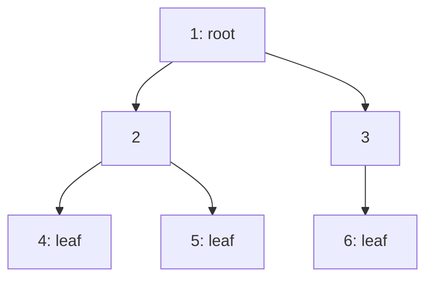
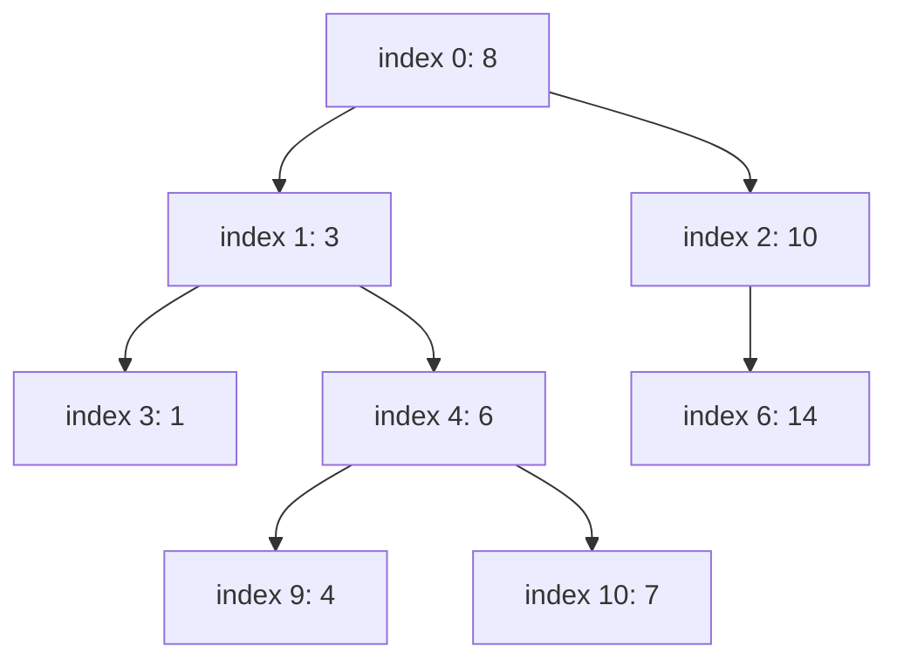
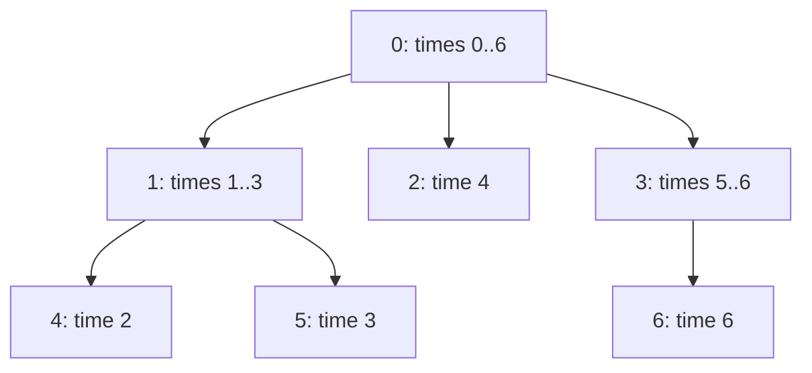

# new

## explanation

### Data that branches

Lists are lines: each item has one next item. Many things branch instead: a family tree, a company's reporting lines, folders inside folders, the choices in a game. A **tree** captures that. In a **binary tree**, each node has at most two children, a **left** and a **right**:

```cpp
struct Node {
    int value;
    Node* left = nullptr;
    Node* right = nullptr;
};
```

### Words to know

- The **root** is the top node; the whole tree is reached from it.
- A node's **children** hang below it; it is their **parent**.
- A **leaf** has no children.
- A node with all its descendants forms a **subtree**.
- The **height** is the number of nodes on the longest path from the root down to a leaf.

### Trees are recursive

A tree is a root plus a left subtree plus a right subtree, and each subtree is itself a tree (possibly empty). So most tree code is recursive: handle the empty tree (`nullptr`), then combine the answers for the two subtrees. The size of a tree is 1 + the size of the left subtree + the size of the right one.

### Four ways to visit every node

- **Preorder**: the node, then its left subtree, then its right subtree.
- **Inorder**: left subtree, then the node, then right subtree.
- **Postorder**: left subtree, right subtree, then the node.
- **Level order**: row by row from the top, using a queue.

Each visits every node once: O(n). They differ only in **when** each node is handled relative to its children, and that choice matters: preorder suits copying a tree, postorder suits deleting one (children first), and inorder gives sorted order in a binary search tree.

## diagram



## example

```cpp
#include <algorithm>
#include <iostream>
#include <queue>

struct Node { int value; Node* left = nullptr; Node* right = nullptr; };

void preorder(const Node* t) {  // the node, then its left subtree, then its right subtree
    if (!t) return;
    std::cout << t->value << ' ';
    preorder(t->left);
    preorder(t->right);
}
void inorder(const Node* t) {  // left subtree, the node, right subtree
    if (!t) return;
    inorder(t->left);
    std::cout << t->value << ' ';
    inorder(t->right);
}
int height(const Node* t) { return t ? 1 + std::max(height(t->left), height(t->right)) : 0; }
int size(const Node* t) { return t ? 1 + size(t->left) + size(t->right) : 0; }

int main() {
    Node n4{4}, n5{5}, n6{6};
    Node n2{2, &n4, &n5}, n3{3, nullptr, &n6};
    Node root{1, &n2, &n3};
    preorder(&root); std::cout << '\n';
    inorder(&root); std::cout << '\n';
    std::cout << "size " << size(&root) << ", height " << height(&root) << '\n';

    // Level order: a queue visits the tree row by row.
    std::queue<const Node*> line;
    line.push(&root);
    while (!line.empty()) {
        const Node* at = line.front();
        line.pop();
        std::cout << at->value << ' ';
        for (const Node* child : {at->left, at->right})
            if (child) line.push(child);  // a missing child is never queued
    }
    std::cout << '\n';
}
```

```text
1 2 4 5 3 6
4 2 5 1 3 6
size 6, height 3
1 2 3 4 5 6
```

1. The nodes live on the stack and are linked by address, so nothing needs freeing.
2. Preorder prints a node before going down: 1, then all of 2's subtree (2 4 5), then 3's (3 6).
3. Inorder goes as far left as possible first: 4, then its parent 2, then 5, then the root 1, then 3 and 6.
4. `size` and `height` each combine the answers of the two subtrees: 6 nodes, and the longest path (1 → 2 → 4) has 3 nodes.
5. The queue prints row by row: 1, then 2 3, then 4 5 6.

## mistakes

- **Forgetting the empty tree.** Every recursive function must handle `nullptr` first, or it follows a null pointer.
- **Mixing up the traversal orders.** Pre, in and post refer to where the **node** is handled: before, between or after its two subtrees.
- **Two meanings of height.** Some count nodes on the longest path, others count edges (one less). Say which you use.
- **Very deep recursion.** A tree where every node has only a right child is really a list; recursion on it goes n levels deep and can overflow the stack.
- **Checking children only for null.** In level order, push a child only if it exists, or the queue fills with null pointers.

## check

```cpp
#include <iostream>

struct Node { int value; Node* left = nullptr; Node* right = nullptr; };

void post(const Node* t) {
    if (!t) return;
    post(t->left);
    post(t->right);
    std::cout << t->value;
}
int leaves(const Node* t) { return !t ? 0 : (!t->left && !t->right) ? 1 : leaves(t->left) + leaves(t->right); }

int main() {
    Node d{4}, e{5}, b{2, &d, &e}, c{3};
    Node a{1, &b, &c};
    post(&a);
    std::cout << ' ' << leaves(&a) << '\n';
}
```

```text
45231 3
```

Postorder handles both children before the node: 4 and 5 before 2, then 3, and the root 1 last. The leaves are the nodes with no children: 4, 5 and 3.

# building

## explanation

### A quick recap

A binary tree is a root with a left and a right subtree. Recursive functions handle `nullptr` first, then combine the two subtrees' answers. Pre-, in- and postorder differ in when the node is handled; level order uses a queue.

### Building and freeing trees on the heap

Real trees are built with `new`. A compact way to describe a tree is a **level-order array**: the root at index 0, and the children of index i at 2i + 1 and 2i + 2, with a marker such as −1 for "no node". Recursion builds it directly.

Free a tree in **postorder**: delete both subtrees, then the node. Deleting the node first would lose the pointers to its children.

### The pattern behind most tree problems

"Answer for the left subtree, answer for the right subtree, combine with the node." Sum of values, height, number of leaves, the largest root-to-leaf path sum: all follow it, each in O(n). Decide what to return for an empty subtree so the combining step works without special cases.

### Traversals without recursion

A skewed tree can be deep enough to overflow the call stack. An explicit stack avoids that. For inorder:

1. Go left as far as possible, pushing every node on the way.
2. Pop a node and visit it.
3. Continue from its right child.

### Level by level

To handle a tree row by row, for example to find the width of each level, read `q.size()` at the start of a row: exactly that many nodes belong to the current level, and everything pushed while processing them belongs to the next.

## diagram



## example

```cpp
#include <iostream>
#include <queue>
#include <stack>
#include <vector>

struct Node { int value; Node* left = nullptr; Node* right = nullptr; };

// Build from a level-order array where the children of index i sit at 2i+1 and 2i+2; -1 means no node.
Node* build(const std::vector<int>& v, std::size_t i = 0) {
    if (i >= v.size() || v[i] == -1) return nullptr;
    return new Node{v[i], build(v, 2 * i + 1), build(v, 2 * i + 2)};
}
// Free in postorder: both children before the node itself.
void destroy(Node* n) { if (n) { destroy(n->left); destroy(n->right); delete n; } }
// Most tree problems have this shape: answer for the left, answer for the right, combine.
long long sum(const Node* n) { return n ? n->value + sum(n->left) + sum(n->right) : 0; }

int main() {
    Node* root = build({8, 3, 10, 1, 6, -1, 14, -1, -1, 4, 7});
    std::cout << "sum " << sum(root) << '\n';
    // Inorder without recursion: go left as far as possible, visit, then turn right.
    std::stack<Node*> st;
    for (Node* cur = root; cur || !st.empty();) {
        while (cur) { st.push(cur); cur = cur->left; }
        cur = st.top(); st.pop();
        std::cout << cur->value << ' ';
        cur = cur->right;
    }
    std::cout << '\n';
    // Level by level: the queue's size at the start of a row is that row's width.
    std::queue<Node*> q;
    q.push(root);
    while (!q.empty()) {
        std::size_t width = q.size();
        std::cout << width << ' ';
        for (std::size_t k = 0; k < width; k++) {
            Node* n = q.front(); q.pop();
            if (n->left) q.push(n->left);
            if (n->right) q.push(n->right);
        }
    }
    std::cout << '\n';
    destroy(root);
}
```

```text
sum 53
1 3 4 6 7 8 10 14
1 2 3 2
```

1. `build` turns the array into eight heap nodes: 8 at the root, 3 and 10 below it, and so on. The −1 entries mark missing children.
2. `sum` adds each node to the sums of its two subtrees: 53.
3. The stack-based inorder goes down the left side (8, 3, 1), visits 1, climbs to 3, turns right into 6's subtree, and so on, without any recursion.
4. Reading the queue's size per row gives the level widths 1, 2, 3, 2. Finally, `destroy` frees every node, children first.

## mistakes

- **Freeing a parent before its children.** After `delete n`, reading `n->left` uses freed memory. Free in postorder.
- **Forgetting to free at all.** Every `new Node` needs a `delete`. A tree built on the heap must be destroyed.
- **Wrong child indexes.** For a level-order array starting at 0, the children of i are 2i + 1 and 2i + 2. Starting at 1, they're 2i and 2i + 1. Don't mix the two.
- **Choosing the wrong value for an empty subtree.** For a maximum path sum, returning 0 for an empty side lets a path stop at a node that isn't a leaf. Decide what "empty" must mean for the question.
- **Mixing rows in level order.** Without reading `q.size()` at the start of each row, you can't tell where one level ends and the next begins.

## check

```cpp
#include <algorithm>
#include <iostream>

struct Node { int value; Node* left = nullptr; Node* right = nullptr; };

int maxPath(const Node* n) {  // largest sum on a path from n down to the bottom
    if (!n) return 0;
    return n->value + std::max(maxPath(n->left), maxPath(n->right));
}

int main() {
    Node d{4}, e{-2}, f{9};
    Node b{2, &d, &e}, c{-1, nullptr, &f};
    Node a{5, &b, &c};
    std::cout << maxPath(&a) << ' ' << maxPath(&b) << '\n';
}
```

```text
13 6
```

Below 2, the better path goes to 4: 2 + 4 = 6. Below −1, the left side is empty (0) and the right side is 9, so the path goes right: −1 + 9 = 8. At the root, 5 + max(6, 8) = 13, via −1 and 9.

# strong

## explanation

### Traversal memory

Recursive traversals use O(height) stack: O(log n) for a balanced tree, but O(n) for a skewed one. An explicit stack moves that memory to the heap. **Morris traversal** does inorder in O(1) extra memory: before going into a left subtree, it links that subtree's rightmost node back to the current node, uses the link to return, and then removes it. The tree is temporarily modified but fully restored.

### Other ways to store trees

- **Array of children**: for trees with any number of children per node (general trees), store `children[v]` as a vector. Most tree problems on graphs use this.
- **Parent array**: `parent[v]` only, compact and enough for walking up.
- **Implicit**: complete binary trees (heaps, segment trees) need no pointers at all: the children of i are at fixed indexes.

### The Euler tour

A depth-first walk that records when each node is **entered** and **left** turns every subtree into a contiguous range of entry times: node v's subtree is exactly the nodes with entry time in [tin[v], tout[v]). That gives:

- **ancestor checks** in O(1): a is an ancestor of b exactly when b's entry time falls in a's range;
- **subtree size** as tout[v] − tin[v];
- **subtree queries** as range queries on an array ordered by entry time, which segment and Fenwick trees then answer quickly.

### Recursion depth in practice

Trees built from real input can be skewed: a path of 10⁵ nodes is a valid "tree". Recursive DFS on it can overflow the default stack. Use an explicit stack, or raise the stack size where the platform allows it.

## diagram



## example

```cpp
#include <iostream>
#include <vector>

struct Node { int value; Node* left = nullptr; Node* right = nullptr; };

// Morris inorder: O(1) extra memory. Link each left subtree's rightmost node back to the current
// node, use the link to come back, then remove it.
void morrisInorder(Node* cur) {
    while (cur) {
        if (!cur->left) { std::cout << cur->value << ' '; cur = cur->right; continue; }
        Node* pred = cur->left;
        while (pred->right && pred->right != cur) pred = pred->right;
        if (!pred->right) { pred->right = cur; cur = cur->left; }  // first visit: make the way back
        else { pred->right = nullptr; std::cout << cur->value << ' '; cur = cur->right; }  // second: undo it
    }
    std::cout << '\n';
}

// A general tree as lists of children. Euler tour: entry and exit times make every subtree a range.
std::vector<std::vector<int>> children;
std::vector<int> tin, tout;
int timer = 0;
void tour(int v) {
    tin[v] = timer++;
    for (int c : children[v]) tour(c);
    tout[v] = timer;  // the subtree of v is exactly the nodes with tin in [tin[v], tout[v])
}
bool isAncestor(int a, int b) { return tin[a] <= tin[b] && tin[b] < tout[a]; }

int main() {
    Node n1{1}, n4{4}, n7{7}, n14{14};
    Node n6{6, &n4, &n7}, n3{3, &n1, &n6}, n10{10, nullptr, &n14};
    Node root{8, &n3, &n10};
    morrisInorder(&root);
    std::cout << "links restored: " << (n1.right == nullptr && n7.right == nullptr) << '\n';

    children = {{1, 2, 3}, {4, 5}, {}, {6}, {}, {}, {}};  // node 0 is the root
    tin.assign(7, 0);
    tout.assign(7, 0);
    tour(0);
    std::cout << "subtree of 1 spans times " << tin[1] << ".." << tout[1] - 1 << "; ";
    std::cout << isAncestor(1, 5) << isAncestor(1, 6) << isAncestor(0, 6) << '\n';
}
```

```text
1 3 4 6 7 8 10 14
links restored: 1
subtree of 1 spans times 1..3; 101
```

1. Morris visits the tree in order using only two pointers. Each temporary link (from 1 back to 3, from 4 back to 6, from 7 back to 8) is created on the way down and removed on the way back.
2. Checking the leaves afterwards confirms the tree is exactly as it was.
3. The Euler tour gives node 1 the entry times 1 to 3, covering itself and its children 4 and 5.
4. So 1 is an ancestor of 5 (time 3 is in its range) but not of 6 (time 6 isn't), and the root is an ancestor of everything.

## mistakes

- **Stopping a Morris traversal early.** If the loop exits before the second visit, a temporary link stays in the tree and corrupts it. Always run it to the end.
- **Recursive DFS on input-built trees.** A path of 10⁵ nodes overflows the default stack. Use an explicit stack for untrusted shapes.
- **Off-by-one in Euler ranges.** With tout recorded after the children, the range is half-open: [tin, tout). Mixing in inclusive ends breaks ancestor tests.
- **Using pointer trees where arrays would do.** For complete trees (heaps, segment trees), index arithmetic is faster and needs no allocation.
- **Reusing global tour state.** Reset the timer and arrays before touring a new tree, or old times leak into the new answers.

## check

```cpp
#include <iostream>
#include <vector>

std::vector<std::vector<int>> kids = {{1, 2}, {3}, {4, 5}, {}, {}, {}};
std::vector<int> tin(6), tout(6), depth(6);
int timer = 0;
void dfs(int v, int d) {
    tin[v] = timer++;
    depth[v] = d;
    for (int c : kids[v]) dfs(c, d + 1);
    tout[v] = timer;
}

int main() {
    dfs(0, 0);
    std::cout << tin[4] << ' ' << tout[2] - tin[2] << ' ' << depth[5] << '\n';
}
```

```text
4 3 2
```

The tour enters 0, 1, 3, 2, 4, 5 at times 0 to 5, so node 4 is entered at time 4. Node 2's subtree (2, 4, 5) spans times 3 to 5: size 6 − 3 = 3. Node 5 is two levels below the root.
