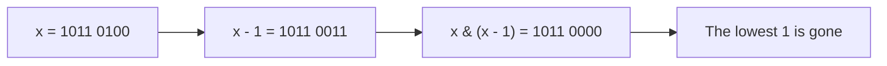
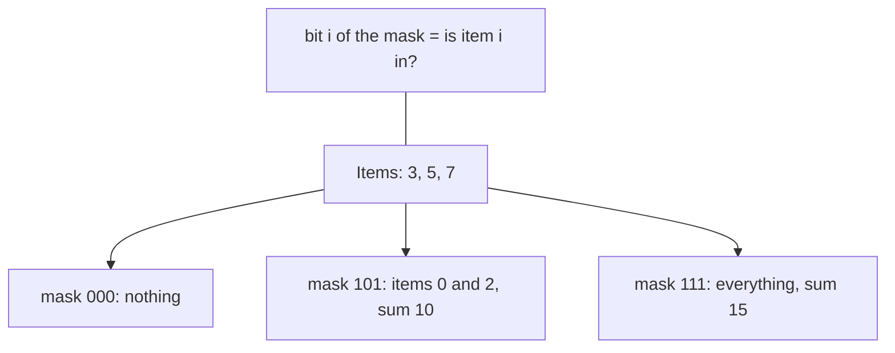
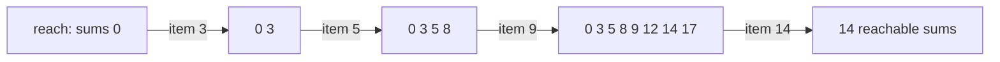

# new

## explanation

### Bits as a tool

You know the bitwise operators from C++ basics. In algorithms they become tools: a whole set of yes/no flags fits in one number, and a single operation can test, combine or count them.

### The four basic moves on bit k

With `1u << k`, a number with only bit k set:

- **Test**: `(x >> k) & 1` is 1 if bit k is set.
- **Set**: `x |= 1u << k`.
- **Clear**: `x &= ~(1u << k)`.
- **Flip**: `x ^= 1u << k`.

Each is O(1), whatever the bit.

### Two classic tricks

- `x & (x - 1)` removes the **lowest** set bit. Subtracting 1 turns the lowest 1 into 0 and every 0 below it into 1; the AND then clears them all. Repeating it until x is 0 counts the set bits in as many steps as there are 1s.
- A power of two has exactly one bit set, so `x & (x - 1)` is 0 for it. That gives a one-line test: `x != 0 && (x & (x - 1)) == 0`.

### Odd or even

The lowest bit decides: `x & 1` is 1 for odd numbers. It's the same as `x % 2` for non-negative values.

### Why use bits?

They're compact (32 or 64 flags in one number), fast (one machine instruction per operation), and they turn some set operations into arithmetic: "both have", "either has" and "differ" are `&`, `|` and `^`.

Use unsigned types for bit work: shifts and `~` then behave like plain bit patterns.

## diagram



## example

```cpp
#include <bitset>
#include <iostream>

int main() {
    unsigned x = 0b10110100;  // 180
    std::cout << std::bitset<8>(x) << " = " << x << '\n';
    std::cout << "bit 2 is " << ((x >> 2) & 1u) << ", bit 3 is " << ((x >> 3) & 1u) << '\n';

    x |= 1u << 0;     // set bit 0
    x &= ~(1u << 7);  // clear bit 7
    x ^= 1u << 4;     // flip bit 4
    std::cout << std::bitset<8>(x) << " = " << x << '\n';

    // Count the 1 bits: y & (y - 1) removes the lowest 1 bit each time.
    int ones = 0;
    for (unsigned y = x; y != 0; y &= y - 1) ones++;
    std::cout << ones << " bits set\n";

    for (unsigned n : {64u, 96u}) std::cout << n << ((n & (n - 1)) == 0 ? " is" : " is not") << " a power of two\n";
}
```

```text
10110100 = 180
bit 2 is 1, bit 3 is 0
00100101 = 37
3 bits set
64 is a power of two
96 is not a power of two
```

1. Shifting right by k and keeping the lowest bit reads bit k: bit 2 is 1, bit 3 is 0.
2. Setting bit 0, clearing bit 7 and flipping bit 4 (which was 1) gives 00100101, which is 37.
3. The counting loop runs once per 1 bit: three times, not eight.
4. 64 is 1000000 in binary, a single 1, so the test passes; 96 is 1100000 and fails.

## mistakes

- **Precedence.** `x & 1 == 0` means `x & (1 == 0)`. Always wrap bit operations in parentheses before comparing.
- **`1 << 31` and beyond with `int`.** Shifting a signed 1 into or past the top bit is a trap. Use `1u << k` for up to 31, and `1ull << k` beyond.
- **Forgetting that 0 passes the power-of-two trick.** `0 & (0 - 1)` is 0. Test `x != 0` as well.
- **`&` versus `&&`.** `if (x && mask)` is true whenever both are non-zero. To test bits, use `(x & mask) != 0`.
- **Signed numbers.** `~` and right shifts on negative `int`s behave differently from plain bit patterns. Keep bit work in unsigned types.

## check

```cpp
#include <iostream>

int main() {
    unsigned a = 13;  // 1101
    unsigned lowest = a & (~a + 1);
    unsigned cleared = a & (a - 1);
    std::cout << lowest << ' ' << cleared << ' ' << (a ^ a) << ' ' << (a & 1u) << '\n';
}
```

```text
1 12 0 1
```

`~a + 1` is −a in two's complement, and `a & -a` keeps only the lowest set bit: 1. `a & (a − 1)` removes that bit: 1100, which is 12. Any number XOR itself is 0. 13 is odd, so its lowest bit is 1.

# building

## explanation

### A quick recap

Test, set, clear and flip bit k with shifts and masks. `x & (x − 1)` drops the lowest set bit, and `x & -x` keeps only it. Work in unsigned types.

### XOR cancels pairs

XOR has three useful properties: `a ^ a = 0`, `a ^ 0 = a`, and order doesn't matter. So XOR-ing a list where every value appears twice except one leaves exactly that one, in O(n) time and O(1) memory. The same idea finds the number missing from 0..n: XOR every index and every value together; everything present cancels.

### Sets as masks

When the possible items are few, like 26 letters or up to 20 or so items, a set fits in one number: bit i means "item i is in". Then:

- union is `a | b`, intersection is `a & b`, difference is `a & ~b`;
- "do they share anything?" is `(a & b) != 0`;
- "is a inside b?" is `(a & b) == a`;
- the size of the set is the number of set bits.

A word's letters as a 26-bit mask make "do these words share a letter?" a single AND.

### Every subset

With n items, the numbers 0 to 2ⁿ − 1 are exactly the 2ⁿ subsets. Loop over them, and for each, check bit i to decide whether item i is in. That's a simple way to try every combination: about a million for n = 20.

### Submasks

To visit every subset of a given mask m, without the items outside it:

```cpp
for (unsigned s = m; s > 0; s = (s - 1) & m) { ... }
```

Subtracting 1 and AND-ing with m steps down through the submasks in decreasing order. (Handle the empty set separately if you need it.)

## diagram



## example

```cpp
#include <iostream>
#include <string>
#include <vector>

int main() {
    // XOR cancels pairs: the one value without a partner survives.
    std::vector<int> v = {4, 9, 2, 9, 4};
    int alone = 0;
    for (int x : v) alone ^= x;
    std::cout << "unpaired: " << alone << '\n';

    // The number missing from 0..n: XOR all indexes and all values together.
    std::vector<int> have = {0, 1, 3, 4, 5};
    int missing = static_cast<int>(have.size());
    for (int i = 0; i < static_cast<int>(have.size()); i++) missing ^= i ^ have[i];
    std::cout << "missing: " << missing << '\n';

    // A word's letters as a 26-bit mask: two words share no letter when their masks don't overlap.
    auto mask = [](const std::string& w) {
        unsigned m = 0;
        for (char c : w) m |= 1u << (c - 'a');
        return m;
    };
    std::cout << "cat/dog share none: " << ((mask("cat") & mask("dog")) == 0) << ", cat/act same letters: " << (mask("cat") == mask("act")) << '\n';

    // Every subset of {3, 5, 7}: bit i of the mask says whether item i is in.
    std::vector<int> items = {3, 5, 7};
    for (unsigned m = 0; m < (1u << items.size()); m++) {
        int sum = 0;
        for (std::size_t i = 0; i < items.size(); i++) if (m >> i & 1u) sum += items[i];
        std::cout << sum << ' ';
    }
    std::cout << '\n';
}
```

```text
unpaired: 2
missing: 2
cat/dog share none: 1, cat/act same letters: 1
0 3 5 8 7 10 12 15
```

1. The two 4s and the two 9s cancel, leaving 2.
2. Starting from n = 5 and XOR-ing in every index 0–4 and every value, every number from 0 to 5 appears twice except the missing 2.
3. "cat" and "dog" use disjoint letters, so their masks don't overlap; "cat" and "act" use the same letters, so their masks are equal.
4. The 8 masks 000 to 111 list every subset of the three items, and the inner loop adds the chosen ones.

## mistakes

- **Expecting a letter mask to count repeats.** "aab" and "ab" have the same mask. A mask records which letters appear, not how often.
- **Using XOR tricks when values can appear three times.** The pairs-cancel trick needs every other value to appear an even number of times.
- **Enumerating subsets of too many items.** 2³⁰ is about a billion. Bitmask enumeration suits small n; larger n needs a smarter method, such as dynamic programming.
- **`1 << (c - 'a')` for characters that aren't lowercase letters.** Capitals or spaces give negative or oversized shifts. Validate the characters first.
- **Losing the empty submask.** The submask loop stops before s = 0. Handle the empty set separately if it counts.

## check

```cpp
#include <iostream>

int main() {
    unsigned set = 0b1011, sub = 0b0011, other = 0b0110;
    bool subIn = (sub & set) == sub;
    bool otherIn = (other & set) == other;
    int count = 0;
    for (unsigned m = set; m > 0; m = (m - 1) & set) count++;
    std::cout << subIn << otherIn << ' ' << count << '\n';
}
```

```text
10 7
```

Every bit of 0011 is also in 1011, so it's a subset. 0110 has bit 2, which 1011 lacks, so it isn't. 1011 has three bits set, so it has 2³ = 8 submasks; the loop visits the 7 non-empty ones.

# strong

## explanation

### Built-in bit operations

C++20's `<bit>` gives the common operations as functions that compile to single instructions on modern processors: `std::popcount` (number of 1 bits), `std::countr_zero` (zeros below the lowest 1), `std::countl_zero`, `std::bit_width` (bits needed), `std::bit_floor` (the largest power of two not above x) and `std::rotl`/`std::rotr` (rotations). They all take unsigned types.

### Bitsets as fast boolean arrays

`std::bitset<N>` packs N flags into machine words, and operations like `|`, `&` and shifts work on 64 flags per instruction. That speeds up some problems by a factor of about 64. Subset sum is the classic: let bit s mean "sum s is reachable"; for each item w, `reach |= reach << w` adds every way to include w. That's n × S / 64 word operations instead of n × S.

### Counting submask work

Looping over every mask of n bits and every submask of each visits 3ⁿ pairs in total, not 4ⁿ, because each item is independently "outside the mask", "in the mask but not the submask", or "in both". For n = 15, 3ⁿ is about 14 million: fine. This bound is what makes "DP over subsets of subsets" practical.

### Gray codes

`i ^ (i >> 1)` gives the i-th **Gray code**: a sequence of all n-bit values where consecutive ones differ in exactly one bit. It's used to visit all subsets changing one item at a time, and in hardware where several bits changing at once can be misread.

### The lowest bit as a size

`x & -x` (the lowest set bit) is the heart of the Fenwick tree: each index is responsible for a range whose length is its lowest set bit. You'll meet it again there.

## diagram



## example

```cpp
#include <bit>
#include <bitset>
#include <iostream>
#include <vector>

int main() {
    // Subset sums with a bitset: bit s set means "sum s is reachable". Each item is one shift and OR.
    std::vector<int> weights = {3, 5, 9, 14};
    std::bitset<64> reach;
    reach[0] = 1;
    for (int w : weights) reach |= reach << w;
    std::cout << reach.count() << " reachable sums; 22? " << reach[22] << ", 21? " << reach[21] << '\n';

    // Gray code: consecutive values differ in exactly one bit.
    for (unsigned i = 0; i < 8; i++) std::cout << std::bitset<3>(i ^ (i >> 1)) << ' ';
    std::cout << '\n';

    // All submasks of all masks of n bits: 3^n pairs in total, not 4^n.
    int n = 4;
    long long pairs = 0;
    for (unsigned m = 0; m < (1u << n); m++)
        for (unsigned s = m;; s = (s - 1) & m) { pairs++; if (s == 0) break; }
    std::cout << "mask/submask pairs for n=4: " << pairs << '\n';

    unsigned x = 0b0101'1000u;
    std::cout << std::popcount(x) << ' ' << std::countr_zero(x) << ' ' << std::bit_floor(x) << ' ' << std::rotl(x, 4) << '\n';
}
```

```text
14 reachable sums; 22? 1, 21? 0
000 001 011 010 110 111 101 100
mask/submask pairs for n=4: 81
3 3 64 1408
```

1. Each item shifts the whole set of reachable sums by its weight and merges it in. The 16 subsets of {3, 5, 9, 14} make 14 different sums; 22 is 3 + 5 + 14, and nothing makes 21.
2. The Gray codes for 0 to 7 change one bit at a time, including from the last back to the first.
3. Counting every (mask, submask) pair for 4 bits gives 3⁴ = 81. This loop form also visits the empty submask.
4. 01011000 is 88: three 1 bits, three zeros below the lowest, 64 as the largest power of two within it, and 88 × 16 = 1408 after rotating left by 4.

## mistakes

- **A bitset too small for the sums.** `reach << w` silently drops bits shifted past the end. Size the bitset for the largest possible sum.
- **Estimating submask loops as 4ⁿ or 2ⁿ.** The total is 3ⁿ. That's fine for n ≤ 15 or so, and far too much for n = 25.
- **`<bit>` functions on signed values.** They only accept unsigned types; convert first.
- **Assuming `bitset` sizes can vary at run time.** N is fixed when compiling. For a size known only at run time, use `std::vector<bool>` or a vector of 64-bit words.
- **Clever bit code without names.** `x & -x` and `(s − 1) & m` are idioms; give them a named helper or a comment so reviewers can check them.

## check

```cpp
#include <bit>
#include <iostream>

int main() {
    unsigned g5 = 5 ^ (5 >> 1), g6 = 6 ^ (6 >> 1);
    int differ = std::popcount(g5 ^ g6);
    unsigned v = 40;
    unsigned low = v & (~v + 1);
    std::cout << g5 << ' ' << g6 << ' ' << differ << ' ' << low << ' ' << std::bit_width(v) << '\n';
}
```

```text
7 5 1 8 6
```

The Gray codes of 5 and 6 are 5 ^ 2 = 7 (111) and 6 ^ 3 = 5 (101). They differ in exactly one bit, as consecutive Gray codes must. 40 is 101000: its lowest set bit is 8, and it needs 6 bits.
