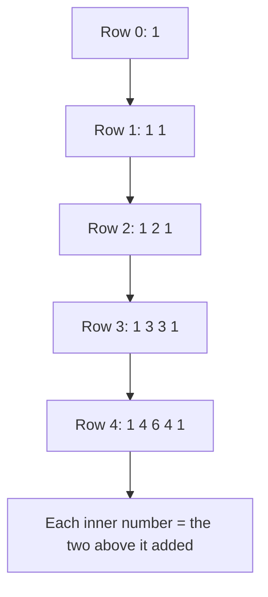
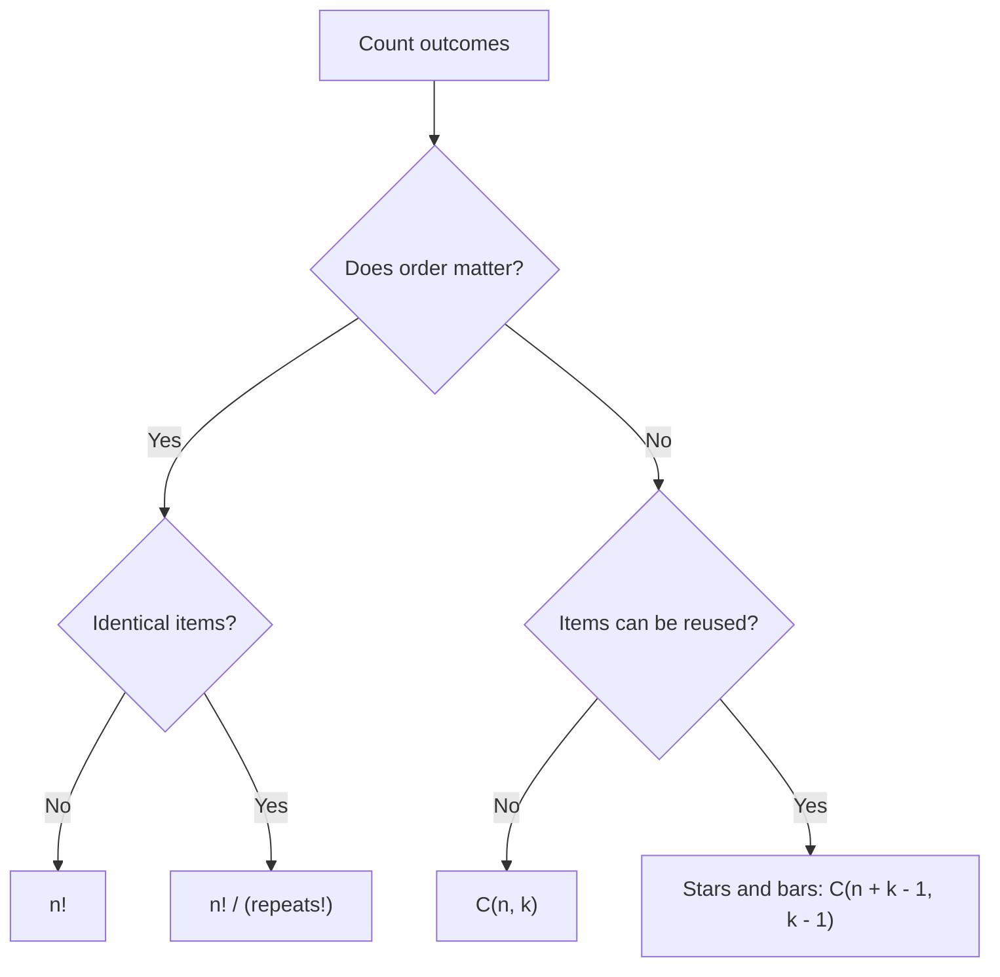
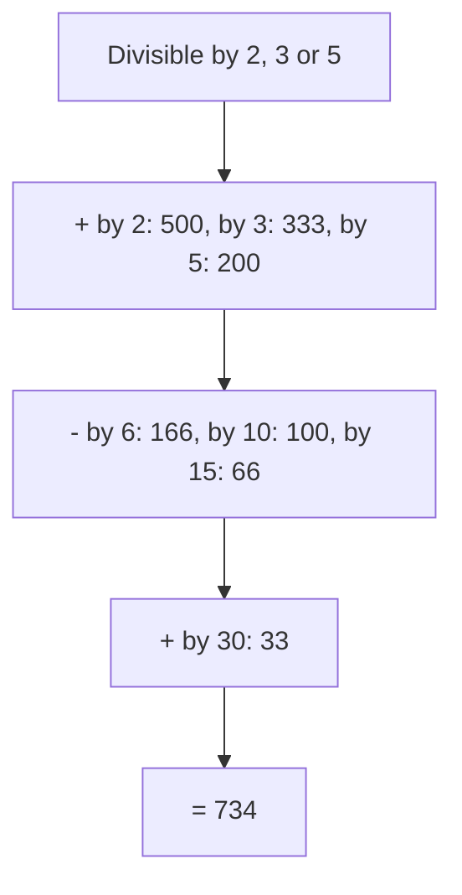

# new

## explanation

### Counting without listing

"How many ways can 5 people stand in a row?" You could write them all out, but there are 120. For 15 people there are over a trillion. **Combinatorics** counts arrangements and choices with formulas instead of listing them.

### Orders: factorials

For the first place in the row there are 5 choices, then 4 for the second, and so on: 5 × 4 × 3 × 2 × 1 = **5!** ("5 factorial") = 120. In general, n distinct things can be ordered in n! ways. Factorials grow extremely fast: 20! still fits in a `long long`, but 21! doesn't.

### Choices: combinations

"How many teams of 2 can be picked from 5 people?" Here the order inside the team doesn't matter: {Asha, Ravi} is the same team as {Ravi, Asha}. That's a **combination**, written C(5, 2) and read "5 choose 2":

> C(n, k) = n! / (k! × (n − k)!)

C(5, 2) = 10. Ask yourself every time: does order matter? If yes, you're counting arrangements; if no, combinations.

### Pascal's triangle

Combinations satisfy a simple rule: to choose k from n, either the last item is chosen (then choose k − 1 from the other n − 1) or it isn't (choose k from n − 1). So

> C(n, k) = C(n − 1, k − 1) + C(n − 1, k)

Building a table row by row with this rule is **Pascal's triangle**. It only adds, never divides, so it's exact and avoids huge factorials.

### Listing when you really need to

`std::next_permutation` rearranges a range into the next order alphabetically, and returns false after the last. Starting from the sorted order, a `do … while` loop visits every arrangement exactly once, and it automatically skips repeats when some items are equal.

## diagram



## example

```cpp
#include <algorithm>
#include <iostream>
#include <string>
#include <vector>

int main() {
    // Pascal's triangle: C(n, k) = C(n-1, k-1) + C(n-1, k).
    std::vector<std::vector<long long>> C(7, std::vector<long long>(7, 0));
    for (int n = 0; n < 7; n++) {
        C[n][0] = 1;
        for (int k = 1; k <= n; k++) C[n][k] = C[n - 1][k - 1] + C[n - 1][k];
    }
    for (int k = 0; k <= 6; k++) std::cout << C[6][k] << ' ';
    std::cout << '\n';

    // 5 people in a row: 5! orders. Choose 2 of them for a team: C(5, 2).
    long long orders = 1;
    for (int i = 2; i <= 5; i++) orders *= i;
    std::cout << "orders " << orders << ", teams of 2: " << C[5][2] << '\n';

    // List every arrangement of a short word, in alphabetical order.
    std::string s = "abc";
    int count = 0;
    do { std::cout << s << ' '; count++; } while (std::next_permutation(s.begin(), s.end()));
    std::cout << "| " << count << '\n';
}
```

```text
1 6 15 20 15 6 1
orders 120, teams of 2: 10
abc acb bac bca cab cba | 6
```

1. Row 6 of Pascal's triangle gives every C(6, k): there are 20 ways to choose 3 items from 6, for example. The table only adds numbers.
2. 5! = 120 orders for five people; C(5, 2) = 10 two-person teams, read from the table.
3. `next_permutation` starts from the sorted "abc" and steps through all 3! = 6 arrangements, in alphabetical order.

## mistakes

- **Counting orders when order doesn't matter.** Picking a team of 2 from 5 is 10, not 20. Ask whether swapping two choices gives something different.
- **Overflowing factorials.** 21! is bigger than any `long long`. Compute combinations with Pascal's triangle, or step by step, or modulo a prime (building level).
- **Computing C(n, k) as n! / (k! (n − k)!) directly.** Even when the answer is small, the factorials overflow first.
- **Starting `next_permutation` from an unsorted string.** It only visits the arrangements that come after the starting one. Sort first to get them all.
- **Forgetting that C(n, k) is 0 when k > n.** You can't choose 5 from 3. Handle it, rather than reading outside the table.

## check

```cpp
#include <algorithm>
#include <iostream>
#include <string>

int main() {
    std::string s = "aab";
    int count = 0;
    do count++; while (std::next_permutation(s.begin(), s.end()));
    long long c = 1;
    for (int i = 1; i <= 3; i++) c = c * (8 - i + 1) / i;  // C(8, 3), kept whole at every step
    std::cout << count << ' ' << c << '\n';
}
```

```text
3 56
```

"aab" has only 3 different arrangements, aab, aba and baa, because swapping the two a's changes nothing, and `next_permutation` skips such repeats. The second loop builds C(8, 3) step by step: 8, then 8 × 7 / 2 = 28, then 28 × 6 / 3 = 56. Each step's result is itself a whole C(n, i), so every division is exact.

# building

## explanation

### A quick recap

n! counts orders, C(n, k) counts choices when order doesn't matter, and Pascal's rule builds combinations by addition. Ask "does order matter?" every time.

### Combinations modulo a prime

Real counts are astronomically large, so problems ask for them modulo a prime p, usually 10⁹ + 7. Division isn't allowed directly under a modulus, but multiplying by an **inverse** is (the number theory skill). Precompute once, up to the largest n you need:

1. `fact[i] = i! mod p` for every i.
2. `inv[n] = fact[n]^(p−2) mod p` (Fermat), then walk down: `inv[i − 1] = inv[i] × i`, because 1/(i − 1)! = i × 1/i!.

Then C(n, k) = fact[n] × inv[k] × inv[n − k] mod p, in O(1) per query, after O(n) setup.

### Models that turn into combinations

- **Grid paths**: moving only right and down through an r × c grid takes r downs and c rights, in any order: C(r + c, r).
- **Stars and bars**: sharing n identical sweets among k children (some may get none) is arranging n stars and k − 1 dividers: C(n + k − 1, k − 1).
- **Arrangements with repeats**: the letters of BANANA (3 A's, 2 N's, 1 B) can be arranged in 6! / (3! × 2!) ways, dividing out the swaps of identical letters.

### Step by step

1. Describe one outcome precisely.
2. Decide whether order matters and whether items can repeat.
3. Match it to a model: orders, choices, grid paths, stars and bars, repeated letters.
4. Compute modulo p when the count is large, with precomputed factorials.
5. Check with a tiny case you can list by hand.

## diagram



## example

```cpp
#include <iostream>
#include <vector>

const long long MOD = 1'000'000'007;

long long power(long long b, long long e) {
    long long r = 1;
    for (b %= MOD; e > 0; e >>= 1, b = b * b % MOD) if (e & 1) r = r * b % MOD;
    return r;
}

// Factorials and their inverses once, then any C(n, k) mod p in O(1).
struct Binomial {
    std::vector<long long> fact, inv;
    explicit Binomial(int n) : fact(n + 1, 1), inv(n + 1, 1) {
        for (int i = 1; i <= n; i++) fact[i] = fact[i - 1] * i % MOD;
        inv[n] = power(fact[n], MOD - 2);                           // Fermat: MOD is prime
        for (int i = n; i > 0; i--) inv[i - 1] = inv[i] * i % MOD;  // 1/(i-1)! = i x 1/i!
    }
    long long C(int n, int k) const {
        if (k < 0 || k > n) return 0;
        return fact[n] * inv[k] % MOD * inv[n - k] % MOD;
    }
};

int main() {
    Binomial b(200000);
    std::cout << "C(10, 3) = " << b.C(10, 3) << '\n';
    std::cout << "paths through a 3 x 4 grid: " << b.C(3 + 4, 3) << '\n';         // 3 downs among 7 moves
    std::cout << "10 sweets among 4 children: " << b.C(10 + 4 - 1, 4 - 1) << '\n';  // stars and bars
    std::cout << "arrangements of BANANA: " << b.fact[6] * b.inv[3] % MOD * b.inv[2] % MOD << '\n';
    std::cout << "C(200000, 100000) mod p = " << b.C(200000, 100000) << '\n';
}
```

```text
C(10, 3) = 120
paths through a 3 x 4 grid: 35
10 sweets among 4 children: 286
arrangements of BANANA: 60
C(200000, 100000) mod p = 879467333
```

1. The constructor computes 200,001 factorials and their inverses with a single exponentiation, so every later query is three multiplications.
2. A path through a 3 × 4 grid is 7 moves, 3 of them down: C(7, 3) = 35.
3. Ten sweets among four children is ten stars and three bars: C(13, 3) = 286.
4. BANANA's 6! = 720 orders, divided by 3! for the A's and 2! for the N's, gives 60.
5. C(200000, 100000) has about 60,000 digits; modulo the prime it's simply 879,467,333.

## mistakes

- **Dividing under the modulus.** `fact[n] / (fact[k] * fact[n - k]) % MOD` is wrong once the values are reduced. Multiply by inverse factorials.
- **Computing every inverse with its own exponentiation.** That's O(n log p). One exponentiation plus the walk down is O(n).
- **Sizing the tables too small.** Stars and bars uses n + k − 1, not n. Precompute up to the largest value any formula needs.
- **Stars and bars when each child must get at least one.** Then give everyone one sweet first: C(n − 1, k − 1). Read the condition carefully.
- **Applying C(n, k) when items are distinct and order matters.** That's n! / (n − k)!, the number of ordered selections.

## check

```cpp
#include <iostream>

int main() {
    long long fact[12] = {1};
    for (int i = 1; i < 12; i++) fact[i] = fact[i - 1] * i;
    long long word = fact[11] / (fact[4] * fact[4] * fact[2]);  // MISSISSIPPI: 4 I, 4 S, 2 P, 1 M
    long long paths = fact[5] / (fact[2] * fact[3]);             // a 2 x 3 grid: 2 downs among 5 moves
    std::cout << word << ' ' << paths << '\n';
}
```

```text
34650 10
```

MISSISSIPPI has 11 letters: 4 I's, 4 S's, 2 P's and 1 M. Dividing 11! = 39,916,800 by 4! × 4! × 2! = 1152 removes the swaps of identical letters: 34,650. A 2 × 3 grid path is 5 moves with 2 downs: C(5, 2) = 10. Both fit in a `long long` here, so plain division is fine.

# strong

## explanation

### Inclusion-exclusion

To count things with **at least one** of several properties, add the counts for each property, subtract those with two (counted twice), add back those with three, and so on. For "numbers up to N divisible by 2, 3 or 5": N/2 + N/3 + N/5 − N/6 − N/10 − N/15 + N/30. Over k properties that's 2ᵏ − 1 terms, conveniently enumerated with bitmasks. The intersection of "divisible by a" and "divisible by b" is "divisible by lcm(a, b)", not a × b, unless they share no factor.

### Derangements

Arrangements where **no** item stays in its own place: letters in the wrong envelopes. By inclusion-exclusion, or by the recurrence D(n) = (n − 1)(D(n − 1) + D(n − 2)), with D(0) = 1 and D(1) = 0. The fraction D(n)/n! approaches 1/e ≈ 0.368.

### Catalan numbers

Balanced bracket strings with n pairs, binary trees with n nodes, ways to triangulate a polygon: all are counted by the **Catalan numbers**, 1, 1, 2, 5, 14, 42, …. Split at where the first bracket closes: Cat(n) = Σ Cat(i) × Cat(n − 1 − i), or directly C(2n, n)/(n + 1).

### The k-th arrangement directly

Arrangements of n items come in blocks of (n − 1)! for each first item. So the k-th arrangement (counting from 0) has, as its first item, the one at index k / (n − 1)! of the remaining pool; then continue with k mod (n − 1)! on the rest. That's the **factorial number system**, and it finds arrangement k in O(n²) without listing the k before it.

### Large n, small prime

When n ≥ p, n! is 0 mod p and the factorial method breaks. **Lucas's theorem** computes C(n, k) mod p from the base-p digits of n and k, each pair needing only a small C(nᵢ, kᵢ).

## diagram



## example

```cpp
#include <iostream>
#include <string>
#include <vector>

int main() {
    // Inclusion-exclusion: numbers up to N divisible by 2, 3 or 5.
    long long N = 1000;
    std::vector<long long> primes = {2, 3, 5};
    long long total = 0;
    for (int mask = 1; mask < 8; mask++) {
        long long product = 1;
        int bits = 0;
        for (int i = 0; i < 3; i++) if (mask >> i & 1) { product *= primes[i]; bits++; }
        total += (bits % 2 == 1 ? 1 : -1) * (N / product);  // add odd-sized groups, subtract even-sized
    }
    std::cout << "divisible by 2, 3 or 5: " << total << '\n';

    // Derangements: nobody gets their own item. D(n) = (n - 1)(D(n-1) + D(n-2)).
    std::vector<long long> D(11, 0);
    D[0] = 1;
    for (int n = 2; n <= 10; n++) D[n] = (n - 1) * (D[n - 1] + D[n - 2]);
    std::cout << "derangements of 4: " << D[4] << ", of 10: " << D[10] << '\n';

    // Catalan numbers count balanced bracket strings: Cat(n) = sum of Cat(i) * Cat(n-1-i).
    std::vector<long long> cat(11, 0);
    cat[0] = 1;
    for (int n = 1; n <= 10; n++)
        for (int i = 0; i < n; i++) cat[n] += cat[i] * cat[n - 1 - i];
    std::cout << "balanced strings of 3 pairs: " << cat[3] << ", of 10 pairs: " << cat[10] << '\n';

    // The k-th permutation directly, with the factorial number system (k counted from 0).
    std::string pool = "abcd", out;
    long long k = 13, f = 6;  // 3! permutations start with each letter
    for (int left = 3; left >= 0; left--) {
        out += pool[k / f];
        pool.erase(k / f, 1);
        k %= f;
        if (left > 0) f /= left;
    }
    std::cout << "permutation 13 of abcd: " << out << '\n';
}
```

```text
divisible by 2, 3 or 5: 734
derangements of 4: 9, of 10: 1334961
balanced strings of 3 pairs: 5, of 10 pairs: 16796
permutation 13 of abcd: cadb
```

1. The masks 1 to 7 are the non-empty groups of {2, 3, 5}; odd-sized groups are added and even-sized ones subtracted: 500 + 333 + 200 − 166 − 100 − 66 + 33 = 734. These are primes, so each product is the lcm.
2. Four letters in four envelopes, none correct: 9 ways. For 10 it's 1,334,961, about 36.8% of 10!.
3. The Catalan recurrence gives 5 balanced strings of 3 pairs (((())), (()()), (())(), ()(()), ()()()) and 16,796 for 10 pairs.
4. Arrangement 13: 13 / 3! = 2 picks 'c' with remainder 1, then 1 / 2! = 0 picks 'a', then 1 / 1! = 1 picks 'd', then 'b': "cadb", without listing the 13 before it.

## mistakes

- **Using products instead of lcms in inclusion-exclusion.** "Divisible by 4 and by 6" is "divisible by 12", not 24. Only for numbers with no common factor is the lcm the product.
- **Getting the signs wrong.** Groups of odd size are added, groups of even size subtracted. A wrong sign silently gives a plausible-looking but wrong number.
- **Exponentially many inclusion-exclusion terms.** 2ᵏ terms is fine for k up to about 20. Beyond that, look for structure, such as a DP over the properties.
- **Off-by-one in the k-th permutation.** The factorial number system counts from 0. "The 14th arrangement" is k = 13.
- **Factorial formulas when n ≥ p.** n! mod p is 0 once n reaches p, so inverse factorials don't exist. Use Lucas's theorem for small primes.

## check

```cpp
#include <iostream>

int main() {
    long long N = 100, total = 0;
    long long d[2] = {4, 6};
    total = N / d[0] + N / d[1] - N / 12;  // lcm(4, 6) = 12, not 24
    long long wrong = N / d[0] + N / d[1] - N / 24;
    std::cout << total << ' ' << wrong << '\n';
}
```

```text
33 37
```

There are 25 multiples of 4 and 16 multiples of 6 up to 100. Numbers divisible by both are the multiples of 12, of which there are 8, so the correct count is 25 + 16 − 8 = 33. Subtracting the multiples of 24 (4 of them) instead removes too few and gives 37.
