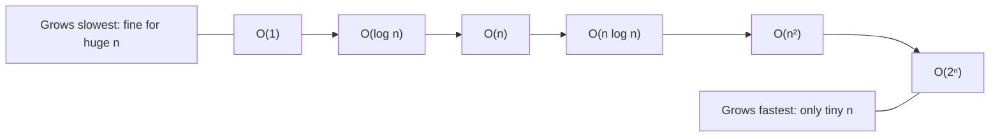
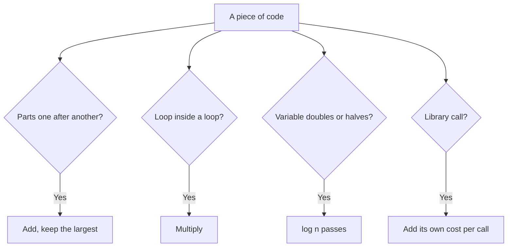
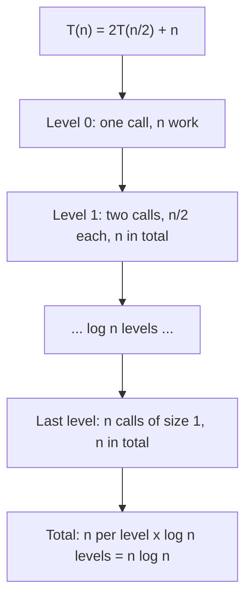

# new

## explanation

### Why speed needs a measure

Two programs can give the same answer, and one can still take a second while the other takes an hour. The difference shows when the input grows: ten items are fast either way, ten million are not. **Complexity analysis** describes how the work grows as the input grows, without timing anything.

### Count steps, not seconds

Seconds depend on the computer. Steps don't. We count the basic steps a program takes, such as a comparison, an addition or a loop pass, as a formula in **n**, the size of the input. A loop that visits each of n items once takes about n steps. Two nested loops over n items take about n × n.

### Big-O: keep the part that grows fastest

For large n, only the fastest-growing part of the formula matters. 3n² + 5n + 20 behaves like n² once n is big, so we write **O(n²)**: "grows like n squared". Big-O drops constant factors and smaller terms.

### The common classes, slowest-growing first

- **O(1)**, constant: the same work whatever n is. Reading `v[5]`.
- **O(log n)**, logarithmic: n is halved each step. A million items need only about 20 halvings.
- **O(n)**, linear: one pass over the input.
- **O(n log n)**: a pass of log n rounds, typical of good sorting.
- **O(n²)**, quadratic: every item compared with every other.
- **O(2ⁿ)**, exponential: trying every subset. Hopeless beyond about 25 items.

### From limits to a plan

A computer does very roughly 10⁸ simple steps per second. So the input limits in a problem tell you which classes can work in time:

- n up to about 20: even O(2ⁿ) is fine.
- n up to about 5,000: O(n²) is fine.
- n up to about 10⁶: you need O(n log n) or O(n).
- n up to about 10⁸: only O(n) or better.

### Memory counts too

The same idea measures memory: an extra array of n items is O(n) extra space; a few variables are O(1).

## diagram



## example

```cpp
#include <iostream>

// Each function returns how many basic steps it takes for n items.
long long constantSteps(long long) { return 1; }

long long halvingSteps(long long n) {
    long long steps = 0;
    for (long long i = n; i > 1; i /= 2) steps++;
    return steps;
}

long long linearSteps(long long n) {
    long long steps = 0;
    for (long long i = 0; i < n; i++) steps++;
    return steps;
}

long long quadraticSteps(long long n) {
    long long steps = 0;
    for (long long i = 0; i < n; i++)
        for (long long j = 0; j < n; j++) steps++;
    return steps;
}

int main() {
    for (long long n : {10LL, 100LL, 1000LL}) {
        std::cout << "n=" << n << ": O(1) " << constantSteps(n) << ", O(log n) " << halvingSteps(n)
                  << ", O(n) " << linearSteps(n) << ", O(n^2) " << quadraticSteps(n) << '\n';
    }
}
```

```text
n=10: O(1) 1, O(log n) 3, O(n) 10, O(n^2) 100
n=100: O(1) 1, O(log n) 6, O(n) 100, O(n^2) 10000
n=1000: O(1) 1, O(log n) 9, O(n) 1000, O(n^2) 1000000
```

1. The constant function does one step whatever n is.
2. The halving loop divides `i` by 2 until it reaches 1: only 3, 6 and 9 steps. Making n ten times bigger adds just a few steps.
3. The single loop grows exactly with n: ten times the input, ten times the work.
4. The nested loop grows with n × n: ten times the input means a **hundred** times the work. At n = 1000 it is already a million steps; at n = 100,000 it would be ten billion.

## mistakes

- **Adding when you should multiply.** Two loops one after the other cost n + n, which is still O(n). One loop inside another costs n × n. Look at how the loops are arranged, not just how many there are.
- **Missing hidden loops.** A single line can hide a whole pass: `v.erase(v.begin())`, searching a vector with `std::find`, or `s = s + c` on a long string each cost O(n). Inside a loop, that makes the loop O(n²).
- **Thinking Big-O is the whole story.** It describes growth. For small inputs, a simple O(n²) method can beat a complicated O(n log n) one. For big inputs, the class always wins.
- **Only checking the easy case.** A search that finds its target first is fast, but you must plan for the worst case: the target is last, or missing.
- **Ignoring the limits.** If n can be a million, an O(n²) idea will time out however neatly it's written. Read the limits before choosing an approach.

## check

```cpp
#include <iostream>

int main() {
    int n = 8;
    int a = 0, b = 0, c = 0;
    for (int i = 0; i < n; i++) a++;
    for (int i = 0; i < n; i++) b++;
    for (int i = 0; i < n; i++)
        for (int j = i; j < n; j++) c++;
    std::cout << a + b << ' ' << c << '\n';
}
```

```text
16 36
```

The first two loops run one after the other, so their steps add up: 8 + 8 = 16, which is 2n, still O(n). The nested loops start `j` at `i`, so the inner loop runs 8, then 7, down to 1 times: 8 + 7 + … + 1 = 36, which is n(n + 1)/2. Halving the work doesn't change the class: it is still O(n²).

# building

## explanation

### A quick recap

Complexity counts steps as a formula in n and keeps only the fastest-growing part: O(1), O(log n), O(n), O(n log n), O(n²), O(2ⁿ). Around 10⁸ simple steps run in a second, so the input limits tell you which classes are fast enough.

### Analysing code, step by step

1. **Sequential parts add.** A loop followed by another loop: O(n) + O(n) = O(n). Keep the biggest.
2. **Nested parts multiply.** A loop of n passes, each doing O(m) work, is O(n × m).
3. **A variable that doubles or halves gives log.** `for (i = 1; i < n; i *= 2)` runs about log₂ n times.
4. **Library calls have costs.** Count them like loops:
   - `v[i]`, `push_back`, `pop_back`: O(1).
   - `std::find` on a vector, `insert` or `erase` at the front: O(n).
   - `std::sort`: O(n log n).
   - `std::map` and `std::set` operations: O(log n).
   - `std::unordered_map` and `std::unordered_set`: O(1) on average.
5. **Recursion: number of calls × work per call** (the strong level gives a better tool).

### Best, average and worst case

A linear search can stop at the first element (best case) or check them all (worst case). Unless told otherwise, analyse the **worst case**: it's the one that decides whether your program passes on every input.

### Same question, different classes

Asking "is any value repeated?" shows how much the method matters:

- Compare every pair: O(n²).
- Sort first, then repeats sit next to each other: O(n log n) for the sort, then O(n).
- Remember what you've seen in a hash set: O(n) on average, using O(n) extra memory.

Trading memory for time like this is one of the most common moves in algorithm design.

### Space

Count extra memory the same way: a copy of the input is O(n), a hash set of everything seen is O(n), and a recursion n levels deep is O(n) stack.

## diagram



## example

```cpp
#include <algorithm>
#include <iostream>
#include <unordered_set>
#include <vector>

// Three ways to ask "is any value repeated?", each counting its basic steps.
bool repeatedNested(const std::vector<int>& vals, long long& steps) {
    for (std::size_t pos = 0; pos < vals.size(); pos++)
        for (std::size_t other = pos + 1; other < vals.size(); other++) {
            steps++;
            if (vals[pos] == vals[other]) return true;
        }
    return false;
}

bool repeatedSorted(std::vector<int> vals, long long& steps) {  // a copy: we may reorder it
    std::sort(vals.begin(), vals.end());
    for (std::size_t pos = 1; pos < vals.size(); pos++) {
        steps++;
        if (vals[pos] == vals[pos - 1]) return true;
    }
    return false;
}

bool repeatedHashed(const std::vector<int>& vals, long long& steps) {
    std::unordered_set<int> seen;
    for (int x : vals) {
        steps++;
        if (!seen.insert(x).second) return true;
    }
    return false;
}

int main() {
    std::vector<int> vals;
    for (int pos = 0; pos < 2000; pos++) vals.push_back(pos * 7 % 2003);  // 2000 distinct values: the worst case
    long long a = 0, b = 0, c = 0;
    std::cout << repeatedNested(vals, a) << repeatedSorted(vals, b) << repeatedHashed(vals, c) << '\n';
    std::cout << "nested " << a << ", after sorting " << b << " (+ the sort), hashed " << c << '\n';
}
```

```text
000
nested 1999000, after sorting 1999 (+ the sort), hashed 2000
```

1. The values `pos * 7 % 2003` are all different, so every method must look at everything before answering "no": the worst case.
2. Comparing every pair takes 2000 × 1999 / 2 = 1,999,000 steps.
3. After sorting, repeats would be neighbours, so one pass of 1,999 comparisons is enough. The sort itself costs about n log n, roughly 22,000 comparisons here.
4. The hash set checks each value once: 2,000 steps, at the price of storing up to 2,000 values.

## mistakes

- **Forgetting the cost of a library call inside a loop.** `while (!v.empty()) v.erase(v.begin());` looks like one loop, but each erase shifts the rest: O(n²).
- **Leaving out the sort.** "Sort, then one pass" is O(n log n), not O(n). The sort is part of the cost.
- **Treating hash tables as always O(1).** It's the average. With a poor hash or crafted inputs, every key can collide and each operation becomes O(n).
- **Analysing the friendly case.** A method that is fast when the answer comes early can still be slow on an input with no answer. Plan for the worst case.
- **Forgetting memory limits.** A method that stores every pair of items uses O(n²) memory: for n = 100,000 that's ten billion entries, far too many even if time allowed it.

## check

```cpp
#include <iostream>

int main() {
    long long n = 1024, s1 = 0, s2 = 0, s3 = 0;
    for (long long pos = 1; pos < n; pos *= 2) s1++;
    for (long long pos = 0; pos < n; pos++)
        for (long long other = 1; other < n; other *= 2) s2++;
    for (long long pos = 0; pos < n; pos += 64) s3++;
    std::cout << s1 << ' ' << s2 << ' ' << s3 << '\n';
}
```

```text
10 10240 16
```

`i` doubles from 1 until it reaches 1024: 1, 2, 4, …, 512 is 10 passes, which is log₂ n. The nested loops do those 10 passes for each of the 1024 values of `i`: 10,240, which is n log n. The last loop jumps 64 at a time, so it runs 1024 / 64 = 16 times. It does less work, but it's still O(n), because 64 is a constant.

# strong

## explanation

### O, Ω and Θ

Big-O is an **upper bound**: f(n) = O(g(n)) means f grows no faster than g, up to a constant. **Ω** is a lower bound and **Θ** means both. "Merge sort is Θ(n log n)" is a precise claim; "it's O(n³)" is true too, but useless. When you state a complexity, aim for the tight bound.

### Recurrences

Recursive algorithms are described by recurrences. Three patterns cover most of them:

- **T(n) = T(n/2) + O(1)**: one half is kept, so the depth is log n. Binary search: Θ(log n).
- **T(n) = 2T(n/2) + O(n)**: two halves plus linear work to combine them. Each of the log n levels does n work in total: Θ(n log n). Merge sort.
- **T(n) = T(n−1) + T(n−2) + O(1)**: two calls on almost the same size, so the call count roughly doubles each level: exponential. Naive Fibonacci.

The general rule for T(n) = aT(n/b) + f(n) (the master theorem) compares f(n) with n^(log_b a): whichever grows faster dominates, and when they match you gain a factor of log n. For example, three calls on halves give n^(log₂ 3) ≈ n^1.58.

### Amortised cost

Some operations are usually cheap and occasionally expensive. `vector::push_back` sometimes reallocates and copies everything, but because capacity doubles, the copies over n pushes add up to less than 2n: O(1) **amortised** per push. Amortised means "averaged over any sequence of operations", not "every single one is fast". A single push can still pause for O(n).

### Size in bits, and pseudo-polynomial time

Complexity is measured against the size of the input. For a number N, the size is its number of digits, about log N. So trial division up to √N, or a knapsack table of n × W cells, is **pseudo-polynomial**: fast when the numbers are small, exponential in their length.

### Lower bounds

Any sort that only compares items needs Ω(n log n) comparisons in the worst case, because there are n! possible orders and each comparison halves the possibilities at best. Beating it requires extra structure, such as small integer keys (counting sort).

### Constants and memory still matter

Within one class, constants decide. Walking memory in order is far faster than jumping around it, because of caches. An O(n log n) algorithm on contiguous arrays often beats one with the same class on linked nodes.

## diagram



## example

```cpp
#include <iostream>

long long calls = 0;

// T(n) = 2T(n/2) + n: two halves, then n work to combine them.
long long splitAndMerge(long long n) {
    if (n <= 1) return 0;
    return splitAndMerge(n / 2) + splitAndMerge(n - n / 2) + n;  // the work done
}

// T(n) = T(n/2) + 1: keeps one half only.
long long halve(long long n) { return n <= 1 ? 0 : 1 + halve(n / 2); }

// T(n) = T(n-1) + T(n-2) + 1: two calls on almost the same size.
long long naiveFib(int n) {
    calls++;
    return n < 2 ? n : naiveFib(n - 1) + naiveFib(n - 2);
}

int main() {
    std::cout << "split-and-merge work " << splitAndMerge(1024) << " = n log2 n = " << 1024 * 10 << '\n';
    std::cout << "halving depth " << halve(1'000'000) << '\n';
    naiveFib(25);
    std::cout << "naive fib(25) calls " << calls << '\n';

    // Amortised: doubling the capacity copies fewer than 2n elements in total.
    long long capacity = 1, copies = 0;
    for (long long size = 1; size <= 1'000'000; size++) {
        if (size > capacity) {
            copies += capacity;
            capacity *= 2;
        }
    }
    std::cout << "copies for 1e6 push_backs " << copies << '\n';
}
```

```text
split-and-merge work 10240 = n log2 n = 10240
halving depth 19
naive fib(25) calls 242785
copies for 1e6 push_backs 1048575
```

1. For n = 1024, each of the 10 levels of the recursion does 1024 units of combining work: 10,240 in total, exactly n log₂ n.
2. Halving a million down to 1 takes 19 steps: the depth of a binary search over a million items.
3. Naive Fibonacci makes 242,785 calls for n = 25, and the count grows by about 1.6 times for each step of n: exponential.
4. Growing the capacity 1, 2, 4, … up to 2²⁰ copies 1 + 2 + … + 2¹⁹ = 1,048,575 elements for a million pushes: just over one copy per push on average, under the 2n limit.

## mistakes

- **Stating loose bounds.** Calling merge sort O(n²) is technically true and tells the reader nothing. Give tight bounds, and say whether you mean worst, average or amortised.
- **Treating amortised as worst case per operation.** A push that triggers a reallocation can take O(n) on its own. For real-time limits on every single operation, amortised costs aren't enough.
- **Calling pseudo-polynomial algorithms polynomial.** An O(n × W) table looks polynomial, but W can be a 9-digit number. Check the size of the numbers, not just the count of items.
- **Applying the master theorem to uneven splits.** It assumes equal-sized subproblems. Splits like n/3 and 2n/3, or n−1 and 0 (a bad quicksort pivot), need a recursion tree drawn by hand.
- **Ignoring constants inside a class.** Two O(n log n) methods can differ several times in speed because of memory access patterns. Measure when it matters.

## check

```cpp
#include <iostream>

long long c = 0;
void f(int n) {
    c++;
    if (n <= 1) return;
    f(n / 2);
    f(n / 2);
    f(n / 2);
}

int main() {
    f(16);
    long long cap = 1, moved = 0;
    for (int s = 1; s <= 100; s++) if (s > cap) { moved += cap; cap *= 2; }
    std::cout << c << ' ' << moved << ' ' << cap << '\n';
}
```

```text
121 127 128
```

Each call on n makes three calls on n/2: T(n) = 3T(n/2) + 1, so T(1) = 1, T(2) = 4, T(4) = 13, T(8) = 40 and T(16) = 121, growing like n^(log₂ 3) ≈ n^1.58. The capacity doubles at sizes 2, 3, 5, 9, 17, 33 and 65, copying 1 + 2 + 4 + … + 64 = 127 elements and ending at 128: fewer copies than twice the 100 pushes.
