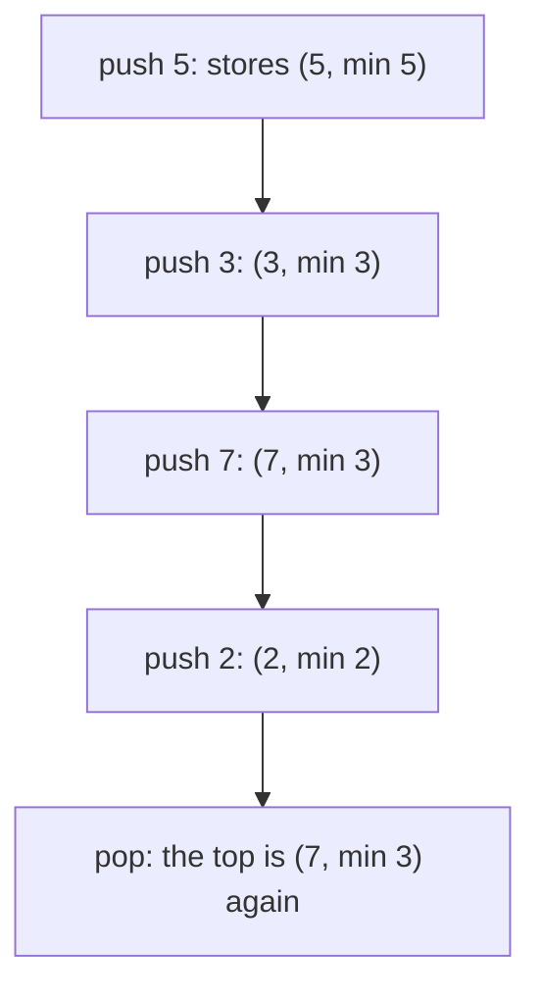
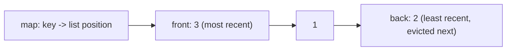
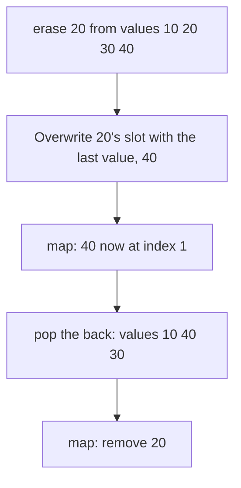

# new

## explanation

### When no single structure is enough

Sometimes you need operations that no ready-made container offers at the speed you want: "a stack that can tell me its smallest item instantly", "a cache that forgets the item used longest ago", "a set I can pick a random item from". The answer is usually to **combine** simple structures, each doing the part it's good at, and keep them consistent.

### A stack that knows its minimum

Finding the smallest item in a stack by scanning is O(n). Instead, store with every entry **the minimum of that entry and everything below it**. Pushing x stores `min(x, the minimum stored on top)`; popping removes the entry along with its stored minimum, so the entry below still holds the correct minimum for what's left. Every operation stays O(1).

A single "current minimum" variable doesn't work: after popping the minimum, you'd have no way to know the next smallest without scanning.

### The design process

1. **List the operations** the structure must support, and the cost each must have.
2. **Pick pieces** that are fast for each operation: a vector for random access, a hash map for lookup, a list for O(1) moves, a stack for "most recent".
3. **Decide what each piece stores**, and what must always be true between them (the invariant).
4. **Make every operation keep the invariant**, updating all the pieces it affects.

### Common building blocks

- **Stack**: undo, most recent first.
- **Queue**: arrival order.
- **Hash map**: find by key in O(1).
- **Linked list**: move or remove a known item in O(1).
- **Vector**: random access by position.

## diagram



## example

```cpp
#include <algorithm>
#include <iostream>
#include <stack>
#include <utility>

// A stack that also knows its minimum in O(1): each entry remembers the minimum at the time it was pushed.
class MinStack {
public:
    void push(int x) { s_.push({x, s_.empty() ? x : std::min(x, s_.top().second)}); }
    void pop() { s_.pop(); }
    int top() const { return s_.top().first; }
    int min() const { return s_.top().second; }
private:
    std::stack<std::pair<int, int>> s_;  // (value, minimum of this entry and everything below it)
};

int main() {
    MinStack s;
    for (int x : {5, 3, 7, 2, 8}) {
        s.push(x);
        std::cout << "push " << x << " -> min " << s.min() << '\n';
    }
    s.pop();
    s.pop();
    std::cout << "after two pops: top " << s.top() << ", min " << s.min() << '\n';
}
```

```text
push 5 -> min 5
push 3 -> min 3
push 7 -> min 3
push 2 -> min 2
push 8 -> min 2
after two pops: top 7, min 3
```

1. Each push stores the value and the smaller of it and the minimum stored below. Pushing 7 keeps the minimum at 3.
2. `min()` just reads the top entry's stored minimum: no scanning, whatever the size.
3. Popping 8 and then 2 removes their entries. The entry for 7 still says 3, which is correct for 5, 3, 7.

## mistakes

- **One variable for the minimum.** It can't recover after the minimum is popped. Store the minimum per entry, or keep a second stack of minimums.
- **Scanning to answer quickly-needed questions.** A scan is O(n) per call. If an operation must be O(1), its answer has to be kept up to date as items change.
- **Updating one piece and forgetting another.** When a design combines structures, every operation must update all of them, or they disagree.
- **Calling `min()` on an empty stack.** There's no top entry. Check first, or document that callers must.
- **Over-designing.** If the costs aren't actually needed, a plain container is simpler and less error-prone.

## check

```cpp
#include <algorithm>
#include <iostream>
#include <stack>
#include <utility>

int main() {
    std::stack<std::pair<int, int>> s;
    auto push = [&](int x) { s.push({x, s.empty() ? x : std::max(x, s.top().second)}); };
    for (int x : {4, 9, 2, 9}) push(x);
    s.pop();
    s.pop();
    push(1);
    std::cout << s.top().first << ' ' << s.top().second << ' ' << s.size() << '\n';
}
```

```text
1 9 3
```

This is the same idea for the maximum. The entries are (4, 4), (9, 9), (2, 9), (9, 9). Two pops leave (4, 4) and (9, 9); pushing 1 stores (1, 9), because 9 is still the largest below it. Three entries remain.

# building

## explanation

### A quick recap

Combine simple structures to get the costs you need, and keep them consistent: list the operations, pick a piece for each, define what must always hold between them, and update every piece in every operation.

### An LRU cache

A cache holds a limited number of items. When it's full and a new item arrives, it evicts the item **least recently used**. Both reading and writing must be O(1).

- A **linked list** keeps entries in order of use: most recent at the front, least recent at the back. Moving an entry to the front is O(1) with `splice`, which relinks nodes without copying.
- A **hash map** from key to the entry's position (a list iterator) finds any entry in O(1).

Operations:

- **get(key)**: look up the iterator; if found, splice that node to the front and return its value.
- **put(key, value)**: if the key exists, update it and move it to the front. Otherwise, if the cache is full, erase the back entry from **both** the list and the map, then add the new entry at the front and store its iterator.

List iterators stay valid when other nodes are added, removed or spliced, which is exactly why a list, not a vector, holds the order.

### Keeping the pieces in sync

The invariant: every key in the map points at its own node in the list, and every node in the list has a map entry. Each operation must preserve both directions. Most bugs in combined structures are one-sided updates, such as evicting from the list but not the map.

## diagram



## example

```cpp
#include <iostream>
#include <iterator>
#include <list>
#include <unordered_map>

// The first value seen exactly once so far, in O(1) per value: a list holds the values seen once, in arrival
// order, and a hash map finds each value's node, so a value seen again leaves the list without a search.
class FirstUnique {
public:
    void add(int x) {
        auto it = node_.find(x);
        if (it == node_.end()) {  // first time: joins the back of the line
            onceOnly_.push_back(x);
            node_[x] = std::prev(onceOnly_.end());
        } else if (it->second != onceOnly_.end()) {  // second time: leaves the line for good
            onceOnly_.erase(it->second);
            it->second = onceOnly_.end();  // end() marks "repeated"; a list's end() never moves
        }
    }
    int first() const { return onceOnly_.empty() ? -1 : onceOnly_.front(); }

private:
    std::list<int> onceOnly_;
    std::unordered_map<int, std::list<int>::iterator> node_;
};

int main() {
    FirstUnique stream;
    std::cout << "first unique after each value:";
    for (int x : {2, 3, 5, 2, 3, 7, 5}) {
        stream.add(x);
        std::cout << ' ' << x << ':' << stream.first();
    }
    std::cout << '\n';
}
```

```text
first unique after each value: 2:2 3:2 5:2 2:3 3:5 7:5 5:7
```

1. 2, 3 and 5 each arrive once and join the line in that order, so the first unique value stays 2.
2. The second 2 is found in the map, and its node is erased from the list in O(1): no search through the line. 3 is now first.
3. The map entry of a repeated value points at the list's `end()`, which never moves, so any later copy is recognised and changes nothing.
4. This is the same pairing as the LRU cache: a list keeps the order, and a hash map of list iterators reaches any node at once. Each `add` is one lookup and at most one list change, O(1) however long the stream is.

## mistakes

- **Evicting from one structure only.** Removing the list node but not the map entry leaves a key pointing at a freed node. Evict from both.
- **A vector for the order.** Moving an item to the front of a vector is O(n), and its iterators break when it grows. A list makes the move O(1) and keeps iterators valid.
- **Updating a value without marking it used.** A put on an existing key is a use too: move it to the front.
- **Storing the value twice.** If the map holds a copy of the value as well as the list, the two can drift apart. Store it once, in the list node.
- **Ignoring a capacity of 0.** Then `put` would evict from an empty list. Decide what a zero-size cache means and handle it.

## check

```cpp
#include <iostream>
#include <iterator>
#include <list>

int main() {
    std::list<int> order = {1, 2, 3};  // front = most recent
    auto at3 = std::next(order.begin(), 2);
    order.splice(order.begin(), order, at3);  // use 3
    order.pop_back();                         // evict the least recent
    order.push_front(4);
    for (int x : order) std::cout << x;
    std::cout << ' ' << *at3 << '\n';
}
```

```text
431 3
```

Using 3 splices it to the front: 3 1 2. Evicting the least recent removes 2 from the back. Adding 4 at the front gives 4 3 1. The iterator to 3 was never invalidated by the splice, the eviction or the insert, so it still reads 3.

# strong

## explanation

### O(1) insert, erase and random pick

A set where you can insert, erase **and pick a uniformly random member**, all in O(1):

- A **vector** of the values gives O(1) random access, so a random index picks a random member.
- A **hash map** from value to its index in the vector gives O(1) lookup.

Erasing from the middle of a vector is normally O(n). The trick: overwrite the erased value's slot with the **last** value, update that value's index in the map, then pop the back. Order doesn't matter in a set, so this is allowed, and erase becomes O(1).

### Designing for amortised versus worst case

Many combined structures are O(1) **amortised**: a two-stack queue occasionally moves everything; a hash map occasionally rehashes. If every single operation must be fast (real-time systems, latency limits), choose pieces with worst-case guarantees, or spread the occasional big job across many small steps.

### More combinations worth knowing

- **Queue with maximum**: a normal queue plus a monotonic deque of candidates. The deque's front is the maximum; when the queue pops a value equal to that front, the deque pops it too.
- **LFU cache** (evict the least **frequently** used): a map from key to node, plus lists grouped by use count, plus the current smallest count. Every operation is still O(1).
- **Median of a stream**: two heaps, a max-heap for the lower half and a min-heap for the upper half, kept balanced.

### Testing a design

Combined structures fail in edge cases: the only element, the last element, a value erased and re-inserted, eviction when full. Test those directly, and if possible check the invariants after every operation in debug builds.

## diagram



## example

```cpp
#include <iostream>
#include <random>
#include <unordered_map>
#include <vector>

// A set with O(1) insert, erase and random pick: the values sit in a vector (for random access),
// plus a map from each value to its position. Erase moves the last value into the hole, then pops.
class RandomizedSet {
public:
    bool insert(int x) {
        if (pos_.contains(x)) return false;
        pos_[x] = values_.size();
        values_.push_back(x);
        return true;
    }
    bool erase(int x) {
        auto it = pos_.find(x);
        if (it == pos_.end()) return false;
        int last = values_.back();
        values_[it->second] = last;  // the last value fills the hole
        pos_[last] = it->second;
        values_.pop_back();
        pos_.erase(x);
        return true;
    }
    int pick(std::mt19937& rng) const { return values_[rng() % values_.size()]; }
    const std::vector<int>& values() const { return values_; }
private:
    std::vector<int> values_;
    std::unordered_map<int, std::size_t> pos_;
};

int main() {
    RandomizedSet s;
    for (int x : {10, 20, 30, 40}) s.insert(x);
    s.erase(20);
    std::cout << "stored:";
    for (int v : s.values()) std::cout << ' ' << v;
    std::cout << " | insert 10 again: " << s.insert(10) << " | erase 99: " << s.erase(99) << '\n';
    std::mt19937 rng(1);  // fixed seed: the same picks every run
    std::cout << "picks:";
    for (int i = 0; i < 6; i++) std::cout << ' ' << s.pick(rng);
    std::cout << '\n';
}
```

```text
stored: 10 40 30 | insert 10 again: 0 | erase 99: 0
picks: 40 30 10 30 40 40
```

1. Erasing 20 moves 40 into its slot and pops the back, so the vector holds 10, 40, 30, and the map now says 40 is at index 1.
2. Inserting an existing value or erasing a missing one is refused in O(1) by the map lookup.
3. `pick` chooses a random index into the vector. With a fixed seed the picks repeat on every run; each of the three values is equally likely.
4. If the erased value is itself the last one, `pos_[last] = it->second` rewrites its own entry, and the following `pos_.erase(x)` removes it, so that case works too.

## mistakes

- **Erasing from the middle of the vector.** `values_.erase(...)` is O(n) and shifts every later index, which the map would then have wrong. Swap with the last and pop.
- **Forgetting to update the moved value's index.** After moving the last value into the hole, its map entry must point at the new slot.
- **`rand() % n` for picks.** It's biased and weak. Use a seeded `std::mt19937` (and `std::uniform_int_distribution` when exact uniformity matters).
- **Treating amortised O(1) as a hard bound.** The map's rehash or a vector's growth occasionally costs O(n). Reserve sizes up front if latency matters.
- **Testing only typical cases.** Erase the only element, the last element, then re-insert it: these are where combined structures break.

## check

```cpp
#include <deque>
#include <iostream>
#include <queue>

int main() {
    std::queue<int> items;
    std::deque<int> best;  // candidates for the maximum, decreasing
    auto push = [&](int x) {
        items.push(x);
        while (!best.empty() && best.back() < x) best.pop_back();
        best.push_back(x);
    };
    auto pop = [&] { if (items.front() == best.front()) best.pop_front(); items.pop(); };
    for (int x : {5, 1, 4, 1, 3}) push(x);
    int first = best.front();
    pop(); pop(); pop();
    std::cout << first << ' ' << best.front() << ' ' << items.size() << '\n';
}
```

```text
5 3 2
```

The candidate deque ends up as 5, 4, 3: the later 1s are dropped as soon as something bigger arrives. The maximum is 5. Popping 5 removes it from both; popping 1 leaves the deque alone; popping 4 removes 4 from the deque. The queue holds 1 and 3, and its maximum is 3.
