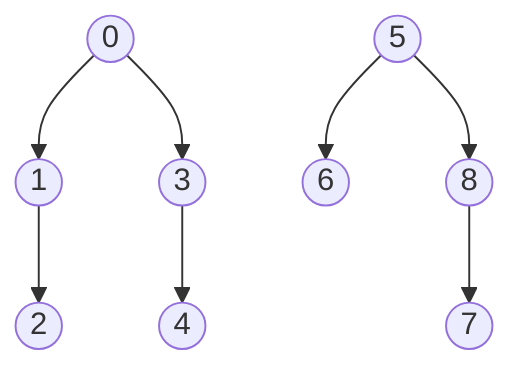
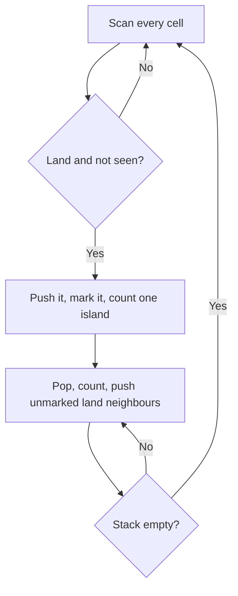
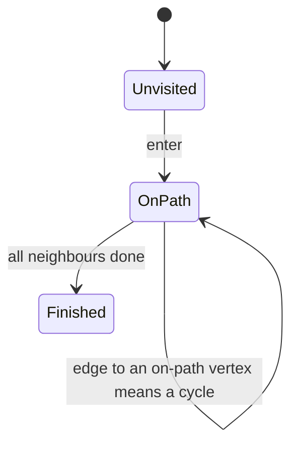

# new

## explanation

### Go deep, then back up

**Depth-first search** (DFS) explores a graph the way you'd explore a maze with a piece of chalk: keep walking into unvisited passages, and only when you hit a dead end, back up to the last junction with an unexplored way.

From a vertex v:

1. mark v as visited;
2. for each neighbour w of v that isn't visited yet, explore from w, all the way, before looking at v's next neighbour.

Recursion does the backing-up for you: when the call for w returns, you're back at v, ready to try its next neighbour.

### Connected components

One DFS from v visits exactly the vertices reachable from v. In an undirected graph, that's v's **connected component**. To find all the components:

- go through the vertices in order;
- whenever one isn't visited yet, start a new DFS from it and label everything it reaches with a new component number.

Afterwards, "are a and b connected?" is just `comp[a] == comp[b]`.

### Cost

Every vertex is visited once, and every edge is looked at from both ends: **O(V + E)**, the same as BFS.

### BFS or DFS?

Both visit everything reachable. BFS goes ring by ring and gives shortest paths in unit-cost graphs. DFS goes deep first, and its order of entering and leaving vertices reveals structure: components, cycles, dependency orders. When you just need "everything reachable", either works, and DFS is often shorter to write.

## diagram



## example

```cpp
#include <iostream>
#include <vector>

using Graph = std::vector<std::vector<int>>;

// Label v and everything reachable from it, going as deep as possible before backing up.
void dfs(const Graph& adj, std::vector<int>& comp, int v, int id) {
    comp[v] = id;
    std::cout << ' ' << v;
    for (int w : adj[v])
        if (comp[w] == -1) dfs(adj, comp, w, id);
}

int main() {
    const int n = 9;
    Graph adj(n);
    int edges[][2] = {{0, 1}, {1, 2}, {0, 3}, {3, 4}, {5, 6}, {7, 8}, {8, 5}};
    for (auto& e : edges) { adj[e[0]].push_back(e[1]); adj[e[1]].push_back(e[0]); }
    std::vector<int> comp(n, -1);  // component of each vertex, -1 while unvisited
    int count = 0;
    for (int v = 0; v < n; v++)
        if (comp[v] == -1) {
            std::cout << "component " << count << ':';
            dfs(adj, comp, v, count++);
            std::cout << '\n';
        }
    std::cout << "components: " << count << ", 2 and 4 together? " << (comp[2] == comp[4]) << ", 4 and 6? " << (comp[4] == comp[6]) << '\n';
}
```

```text
component 0: 0 1 2 3 4
component 1: 5 6 8 7
components: 2, 2 and 4 together? 1, 4 and 6? 0
```

1. The DFS from 0 dives 0 → 1 → 2, reaches a dead end, backs up to 0 and then dives 0 → 3 → 4.
2. Vertex 5 is the first one still unvisited, so a second DFS starts there: 5 → 6, back, then 5 → 8 → 7.
3. 2 and 4 got the same label through 0, while 4 and 6 are in different components, so no path joins them.

## mistakes

- **Marking after the recursive calls.** Mark v as visited the moment you enter it, or two neighbours can lead back into v forever.
- **Starting only one DFS.** A single DFS covers only the start's component. Loop over every vertex and start again from each unvisited one.
- **Expecting shortest paths.** The order DFS reaches vertices says nothing about distance. Use BFS for that.
- **Copying the graph on every call.** Pass the adjacency list by `const&`; a copy per call costs O(V + E) each time.
- **Very deep recursion.** A path of a million vertices can overflow the call stack. Use an explicit stack for graphs that deep.

## check

```cpp
#include <iostream>
#include <vector>

std::vector<std::vector<int>> adj = {{1, 4}, {2, 3}, {}, {}, {5}, {}};  // a tree, so no visited array

void dfs(int v) {
    std::cout << v << (v == 5 ? '\n' : ' ');
    for (int w : adj[v]) dfs(w);
}

int main() { dfs(0); }
```

```text
0 1 2 3 4 5
```

DFS finishes everything below 1 (namely 2 and 3) before it moves on to 0's next child, 4, and then 5. BFS on the same tree would print 0 1 4 2 3 5, ring by ring.

# building

## explanation

### A quick recap

DFS marks a vertex, then fully explores each unvisited neighbour before moving on. Starting one from every unvisited vertex labels all the connected components in O(V + E).

### Flood fill

Counting islands on a map, filling an area in a paint program, and finding connected regions in an image are all DFS on a grid. Each cell joins its same-coloured neighbours. For every unvisited land cell, start a fill, count the cells it reaches, and that's one island and its size.

### Without recursion

Recursion depth equals the length of the deepest path explored. A 1000 × 1000 grid that is all land can need a million nested calls, far more than the default stack allows. An **explicit stack** fixes this:

1. push the start and mark it;
2. while the stack isn't empty, pop a cell and push its unmarked neighbours, marking each as it's pushed.

That's the BFS loop with a stack instead of a queue. The order differs from recursive DFS, but for "what's reachable" and "how big", it doesn't matter.

### Cycles in an undirected graph

During a DFS from v, every neighbour w is either:

- unvisited: explore it, with v as its parent;
- the parent: that's just the edge we came along, ignore it;
- visited and not the parent: there's another way to reach w, so the graph has a **cycle**.

A connected undirected graph with no cycle is a tree, which has exactly V − 1 edges, so edge counting gives a quick cross-check.

## diagram



## example

```cpp
#include <iostream>
#include <stack>
#include <string>
#include <utility>
#include <vector>

int main() {
    std::vector<std::string> map = {
        "##..#...",
        "#...##..",
        "..#.....",
        ".###..##",
        "......#.",
    };
    const int rows = 5, cols = 8, dr[] = {-1, 1, 0, 0}, dc[] = {0, 0, -1, 1};
    std::vector<std::vector<bool>> seen(rows, std::vector<bool>(cols, false));
    int islands = 0;
    std::cout << "island sizes:";
    for (int r = 0; r < rows; r++)
        for (int c = 0; c < cols; c++) {
            if (map[r][c] != '#' || seen[r][c]) continue;
            // Flood fill with an explicit stack, so a huge island can't overflow the call stack.
            std::stack<std::pair<int, int>> todo;
            todo.push({r, c});
            seen[r][c] = true;
            int size = 0;
            while (!todo.empty()) {
                auto [cr, cc] = todo.top();
                todo.pop();
                size++;
                for (int k = 0; k < 4; k++) {
                    int nr = cr + dr[k], nc = cc + dc[k];
                    if (nr < 0 || nr >= rows || nc < 0 || nc >= cols || map[nr][nc] != '#' || seen[nr][nc]) continue;
                    seen[nr][nc] = true;
                    todo.push({nr, nc});
                }
            }
            islands++;
            std::cout << ' ' << size;
        }
    std::cout << "\nislands: " << islands << '\n';
}
```

```text
island sizes: 3 3 4 3
islands: 4
```

1. The scan meets the top-left land cell first; the fill reaches its 3 connected cells and marks them, so the scan won't start there again.
2. The single `#` in row 2 joins the three below it, so that island has 4 cells. Diagonal cells don't count as neighbours.
3. Each cell is pushed at most once, because it's marked when pushed. The whole map takes O(rows × cols).

## mistakes

- **Marking when popped with an explicit stack.** A cell can then be pushed by several neighbours and counted twice. Mark when pushing.
- **Recursion on big grids.** A million-cell island means a million nested calls. Use an explicit stack.
- **Treating the parent edge as a cycle.** In an undirected graph, every neighbour list contains the vertex you came from. Skip it once.
- **Parallel edges and the parent check.** If the input has the same edge twice, that is a real cycle of length 2, but skipping every edge to the parent hides it. Skip the parent by edge id instead.
- **Forgetting diagonals, or adding them.** Whether diagonal cells touch is part of the problem; read it carefully.

## check

```cpp
#include <iostream>
#include <vector>

std::vector<std::vector<int>> adj = {{1}, {0, 2, 3}, {1}, {1}};  // a tree: 0-1, 1-2, 1-3
std::vector<bool> seen(4);
bool hasCycle(int v, int parent) {
    seen[v] = true;
    for (int w : adj[v]) {
        if (!seen[w]) { if (hasCycle(w, v)) return true; }
        else if (w != parent) return true;  // reached a visited vertex another way
    }
    return false;
}
int main() {
    std::cout << hasCycle(0, -1);
    adj[2].push_back(3), adj[3].push_back(2);  // add the edge 2-3
    seen.assign(4, false);
    std::cout << ' ' << hasCycle(0, -1) << '\n';
}
```

```text
0 1
```

The first graph is a tree: every visited neighbour that DFS meets is the parent. After adding 2–3, DFS goes 0 → 1 → 2 → 3, and from 3 it sees 1, which is visited and isn't 3's parent (2). That closes the cycle 1–2–3.

# strong

## explanation

### Cycles in a directed graph

In a directed graph, meeting a visited vertex doesn't mean a cycle. In 0 → 1 → 3 and 0 → 2 → 3, vertex 3 is reached twice, with no cycle. DFS needs three states:

- **0, unvisited**;
- **1, on the current path**: entered, not yet finished;
- **2, finished**: everything below it has been explored.

An edge to a vertex in state 1 points back up the current path: that's a **cycle**. An edge to a finished vertex is harmless.

### Two-colouring: bipartite graphs

A graph is **bipartite** if its vertices split into two sides with every edge going across, such as people and the jobs they can do. Colour the start 0, its neighbours 1, their neighbours 0, and so on. If an edge ever joins two vertices of the same colour, the graph isn't bipartite. That happens exactly when the graph has a cycle of **odd** length: going round it, the colours can't alternate and return to the start.

### Entry and finish times

Number the moments DFS enters and leaves each vertex with one counter. The intervals [in, out] **nest** like brackets: u's interval lies inside v's exactly when u was explored below v. Two uses:

- "is u a descendant of v in the DFS tree?" is an O(1) comparison;
- in a graph with no cycles, sorting vertices by finish time, latest first, gives an order where every edge points forward: a **topological order**.

### Deep recursion

Each recursive call uses stack memory, and the default stack is often 1–8 MB. A path of 10⁵ to 10⁶ vertices can crash the program. The fix is an explicit stack that stores, for each vertex, how far through its neighbour list it has got, so "finish" happens at the right moment.

## diagram



## example

```cpp
#include <iostream>
#include <vector>

using Graph = std::vector<std::vector<int>>;

// 0 = unvisited, 1 = on the current path, 2 = finished. An edge to an on-path vertex closes a cycle.
bool cycleFrom(const Graph& g, std::vector<int>& state, int v) {
    state[v] = 1;
    for (int w : g[v]) {
        if (state[w] == 1) return true;
        if (state[w] == 0 && cycleFrom(g, state, w)) return true;
    }
    state[v] = 2;
    return false;
}
bool hasDirectedCycle(const Graph& g) {
    std::vector<int> state(g.size(), 0);
    for (std::size_t v = 0; v < g.size(); v++)
        if (state[v] == 0 && cycleFrom(g, state, (int)v)) return true;
    return false;
}
// Bipartite: neighbours get the other colour; two neighbours with the same colour mean an odd cycle.
bool colour(const Graph& g, std::vector<int>& side, int v, int c) {
    side[v] = c;
    for (int w : g[v]) {
        if (side[w] == c) return false;
        if (side[w] == -1 && !colour(g, side, w, 1 - c)) return false;
    }
    return true;
}
bool bipartite(const Graph& g) {
    std::vector<int> side(g.size(), -1);
    for (std::size_t v = 0; v < g.size(); v++)
        if (side[v] == -1 && !colour(g, side, (int)v, 0)) return false;
    return true;
}
int main() {
    Graph diamond = {{1, 2}, {3}, {3}, {}};           // 0->1->3 and 0->2->3
    Graph loop = {{1}, {2}, {0}};                     // 0->1->2->0
    Graph square = {{1, 3}, {0, 2}, {1, 3}, {2, 0}};  // undirected cycle of 4
    Graph triangle = {{1, 2}, {0, 2}, {0, 1}};        // undirected cycle of 3
    std::cout << "directed cycle: diamond " << hasDirectedCycle(diamond) << ", loop " << hasDirectedCycle(loop) << '\n';
    std::cout << "bipartite: square " << bipartite(square) << ", triangle " << bipartite(triangle) << '\n';
}
```

```text
directed cycle: diamond 0, loop 1
bipartite: square 1, triangle 0
```

1. In the diamond, 3 is reached a second time through 2, but by then it's finished (state 2), so there's no cycle. A plain visited flag would have wrongly reported one.
2. In the loop, the edge 2 → 0 leads to 0 while 0 is still on the path (state 1): a cycle.
3. The square's colours alternate 0, 1, 0, 1 around the cycle, so it's bipartite.
4. In the triangle, vertex 2 is a neighbour of both 0 and 1, which have different colours, so it clashes with one of them: an odd cycle.

## mistakes

- **A plain visited flag for directed cycles.** Reaching a finished vertex again isn't a cycle. Use the three states.
- **Not resetting to "finished".** If a vertex stays "on path" after its call returns, later edges to it look like cycles.
- **Colouring only one component.** A graph is bipartite only if every component is. Start a colouring from each uncoloured vertex.
- **Undirected cycle checks on directed graphs, or the reverse.** The parent rule is for undirected graphs, and the three states are for directed ones.
- **Trusting recursion on deep graphs.** A long chain can overflow the stack. Switch to an explicit stack with a neighbour index per vertex.

## check

```cpp
#include <iostream>
#include <vector>

std::vector<std::vector<int>> g = {{1, 2}, {3}, {3}, {}};
std::vector<int> in(4, -1), out(4, -1);
int timer = 0;
void dfs(int v) {
    in[v] = timer++;
    for (int w : g[v]) if (in[w] < 0) dfs(w);
    out[v] = timer++;
}
int main() {
    dfs(0);
    for (int v = 0; v < 4; v++) std::cout << in[v] << '-' << out[v] << (v < 3 ? ' ' : '\n');
}
```

```text
0-7 1-4 5-6 2-3
```

DFS enters 0, then 1, then 3, finishes 3 and then 1, enters and finishes 2, and finishes 0 last. Every interval nests inside 0's [0, 7]. Sorting by finish time, latest first, gives 0, 2, 1, 3: an order where every edge points forward.
