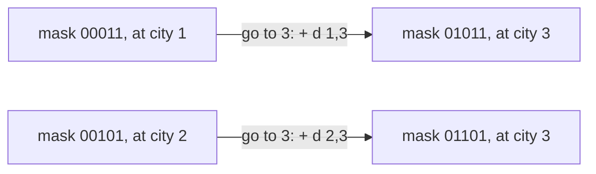
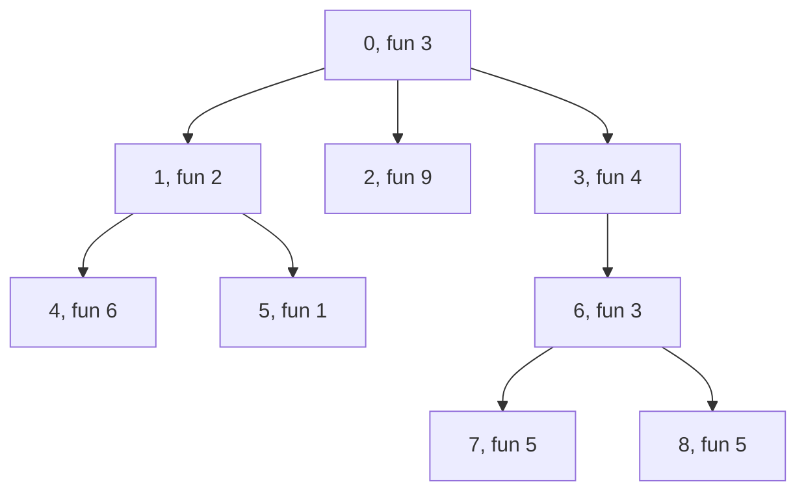
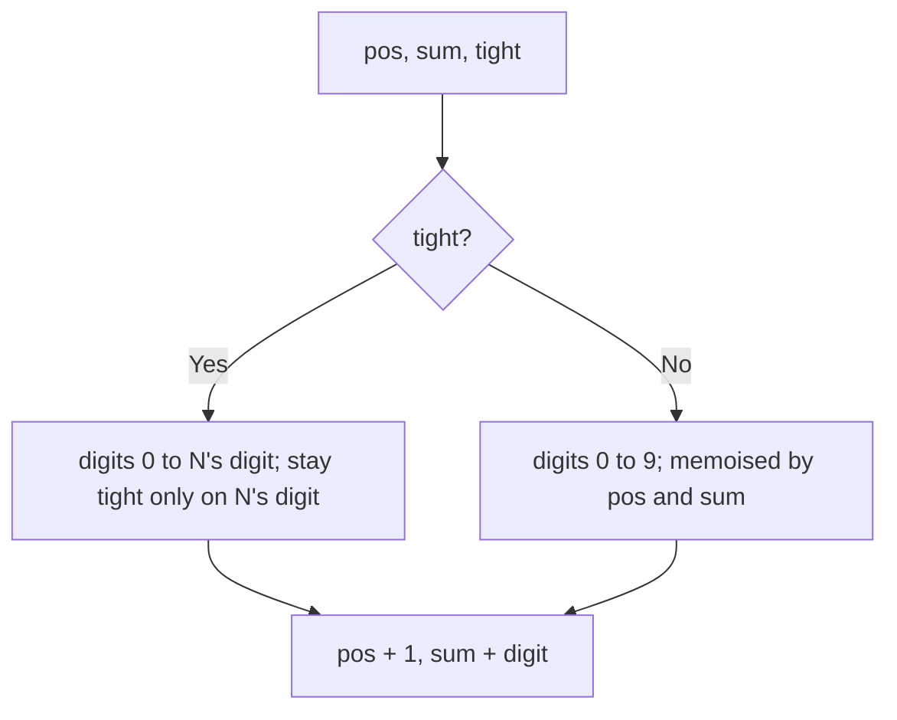

# new

## explanation

### Remembering which items are used

Some problems care about **which** items have been used so far, not just how many. The classic is the **travelling salesman**: visit every city once, return to the start, and travel as little as possible. Trying every order of n cities costs (n − 1)!, which is already 1.2 · 10¹⁷ for 20 cities.

The key observation: when extending a partial route, only two things matter. Which cities have been visited (not in what order), and where you are now. That's a much smaller state.

### Sets as bits

Number the items 0 to n − 1, and store a set of them as an integer **mask**: bit i is 1 if item i is in the set.

- `mask >> i & 1`: is i in the set?
- `mask | 1 << i`: add i.
- `std::popcount(mask)`: how many are in the set.

There are 2ⁿ masks, so n up to about 20 is practical.

### DP over subsets: Held–Karp

Let `best[mask][v]` = the shortest route that starts at city 0, visits exactly the cities in mask, and ends at v. From each state, extend to any unvisited city w:

`best[mask | 1 << w][w] = min(…, best[mask][v] + d[v][w])`

Adding a city makes the mask bigger, so going through masks in increasing order always handles a state before the states it leads to. The tour is the best `best[all][v] + d[v][0]`.

That's 2ⁿ · n states, each extended in n ways: **O(2ⁿ · n²)**. For 20 cities that's about 4 · 10⁸ simple steps, compared with 10¹⁷ orders.

## diagram



## example

```cpp
#include <algorithm>
#include <climits>
#include <iostream>
#include <vector>

int main() {
    // Travel times between 5 places; start at 0, visit each place once and return.
    const int n = 5;
    int d[n][n] = {{0, 3, 4, 2, 7}, {3, 0, 4, 6, 3}, {4, 4, 0, 5, 8}, {2, 6, 5, 0, 6}, {7, 3, 8, 6, 0}};
    const int FULL = 1 << n, INF = INT_MAX / 2;
    // best[mask][v]: the shortest route from 0 that visits exactly the places in mask and ends at v.
    std::vector<std::vector<int>> best(FULL, std::vector<int>(n, INF));
    best[1][0] = 0;
    for (int mask = 1; mask < FULL; mask++)
        for (int v = 0; v < n; v++) {
            if (best[mask][v] == INF) continue;
            for (int w = 0; w < n; w++)
                if (!(mask >> w & 1)) {  // w isn't visited yet
                    int next = mask | 1 << w;
                    best[next][w] = std::min(best[next][w], best[mask][v] + d[v][w]);
                }
        }
    int tour = INF;
    for (int v = 1; v < n; v++) tour = std::min(tour, best[FULL - 1][v] + d[v][0]);
    std::vector<int> order = {1, 2, 3, 4};  // check against every order of the other places
    int brute = INF, tried = 0;
    do {
        int len = d[0][order[0]] + d[order.back()][0];
        for (int i = 0; i + 1 < (int)order.size(); i++) len += d[order[i]][order[i + 1]];
        brute = std::min(brute, len);
        tried++;
    } while (std::next_permutation(order.begin(), order.end()));
    std::cout << "bitmask DP: " << tour << " using " << FULL * n << " states; all " << tried << " orders: " << brute << '\n';
}
```

```text
bitmask DP: 19 using 160 states; all 24 orders: 19
```

1. The start state is "only place 0 visited, standing at 0", with mask 1.
2. Each state is extended to every unvisited place. Masks only grow, so the increasing loop finishes a mask before anything built from it.
3. The full mask holds the best route ending at each place, and adding the trip back to 0 gives the shortest tour.
4. Both methods find the same shortest tour, 19. For 5 places, trying all 24 orders is quicker. The DP's advantage shows at 15 to 20 places, where the orders number in the trillions.

## mistakes

- **Forgetting the start state.** `best[1][0] = 0` means "only place 0 visited, standing at 0"; without it, nothing is reachable.
- **Operator precedence with bits.** `mask >> w & 1` is `(mask >> w) & 1`, but `mask & 1 << w == 0` compares first. Add brackets when unsure.
- **Revisiting places.** Only extend to w whose bit is 0, or routes visit a place twice.
- **Forgetting the way back.** The tour must add the return trip `d[v][0]`.
- **Bitmask DP for n = 30.** 2³⁰ · 30 states is far too many; it suits n up to about 20.

## check

```cpp
#include <bit>
#include <iostream>

int main() {
    int mask = 0;
    for (int city : {0, 2, 3}) mask |= 1 << city;  // cities 0, 2 and 3 are visited
    std::cout << mask << ' ' << (mask >> 2 & 1) << ' ' << (mask >> 1 & 1) << ' ' << std::popcount(unsigned(mask)) << ' ' << (mask | 1 << 1) << '\n';
}
```

```text
13 1 0 3 15
```

Bits 0, 2 and 3 make 1 + 4 + 8 = 13. Bit 2 is set and bit 1 isn't, and three cities are in the set. Adding city 1 sets bit 1, giving 15, the set of all four.

# building

## explanation

### A quick recap

Bitmask DP stores a set of used items as the bits of an integer, so that "which items so far" can be part of the state. The travelling salesman becomes O(2ⁿ · n²) instead of (n − 1)!.

### DP on a tree

On a rooted tree, the answer for a node usually depends only on the answers for its **children**. Compute children first, which is a post-order DFS, and combine their results at the parent. Each node is handled once: O(n).

### Several values per node

Often one number per node isn't enough, because the parent needs to know a **choice** made at the child. Planning a party where no one comes together with their direct boss is the standard example. For each person v, keep two values:

- `with[v]` = the best total in v's subtree if v comes: v's own value plus `without[c]` for every child c (they can't come);
- `without[v]` = the best total if v doesn't come: the sum of `max(with[c], without[c])` over the children.

The answer is the better of the root's two values. This is the maximum-weight **independent set** on a tree.

### Other tree DPs

- **Subtree sizes**: `size[v] = 1 + the sum of size[c]`.
- **Minimum vertex cover** (the fewest guards so that every edge has one at an end): if v has no guard, every child must have one.
- **Diameter** (the longest path): at each node, combine the two deepest child depths.
- **Answers for every root** (rerooting): a second pass from the top passes each parent's information down to its children, so all n roots take O(n) in total.

## diagram



## example

```cpp
#include <algorithm>
#include <iostream>
#include <utility>
#include <vector>

std::vector<std::vector<int>> kids;  // kids[v]: the people who report directly to v
std::vector<int> fun, teamSize;

// For person v: (the best total if v comes, the best total if v doesn't). A guest's direct reports stay home.
std::pair<long long, long long> party(int v) {
    long long with = fun[v], without = 0;
    teamSize[v] = 1;
    for (int c : kids[v]) {
        auto [cWith, cWithout] = party(c);
        with += cWithout;                      // v comes, so c can't
        without += std::max(cWith, cWithout);  // v stays home, so c may come or not
        teamSize[v] += teamSize[c];
    }
    return {with, without};
}

int main() {
    kids = {{1, 2, 3}, {4, 5}, {}, {6}, {}, {}, {7, 8}, {}, {}};  // 0 is the head of the company
    fun = {3, 2, 9, 4, 6, 1, 3, 5, 5};
    teamSize.assign(9, 0);
    auto [with, without] = party(0);
    std::cout << "best party: " << std::max(with, without) << " (head comes: " << with << ", head stays home: " << without << ")\n";
    std::cout << "team sizes:";
    for (int s : teamSize) std::cout << ' ' << s;
    std::cout << '\n';
}
```

```text
best party: 30 (head comes: 20, head stays home: 30)
team sizes: 9 3 1 4 1 1 3 1 1
```

1. Leaves only have their own value if they come, and 0 if not.
2. Person 6 is worth 3 alone, while their two reports together are worth 10. So `without[6] = 10` beats `with[6] = 3`.
3. Person 3 is worth 4, plus 10 from below if 3 comes and 6 stays home. That's 14.
4. If the head comes, 1, 2 and 3 must stay home, giving 20. If the head stays home, 4 and 5, then 2, then 3 with 7 and 8 can come: 30.
5. The same pass adds up team sizes: the whole company has 9 people, and 3's team has 4.

## mistakes

- **Combining before the children are done.** The parent needs every child's results; recurse first, then combine.
- **One value when two are needed.** If the parent's choice depends on the child's choice, keep a value per choice.
- **Letting a guest's report come.** In `with[v]`, only the children's `without` values may be used.
- **Recursion on a path-shaped tree.** A chain of 10⁵ people makes 10⁵ nested calls. Use an explicit order (for example BFS order, processed backwards) for deep trees.
- **Treating an unrooted tree as rooted without care.** For an edge list, pick a root and skip the parent when visiting neighbours.

## check

```cpp
#include <algorithm>
#include <iostream>
#include <utility>
#include <vector>

std::vector<std::vector<int>> kids = {{1, 2}, {3, 4}, {5}, {}, {}, {}};
std::pair<int, int> cover(int v) {  // (guards below if v has one, if not); each edge needs one at an end
    int with = 1, without = 0;
    for (int c : kids[v]) {
        auto [cWith, cWithout] = cover(c);
        with += std::min(cWith, cWithout);
        without += cWith;  // no guard at v, so every child needs one
    }
    return {with, without};
}
int main() {
    auto [w, wo] = cover(0);
    std::cout << w << ' ' << wo << ' ' << std::min(w, wo) << '\n';
}
```

```text
3 2 2
```

With a guard at the root, its children are free to choose, and covering everything takes 3 guards. Without one, both children 1 and 2 need guards. Those two cover every edge, since 1 and 2 touch all five, so 2 is the minimum.

# strong

## explanation

### Counting numbers digit by digit

"How many numbers up to 10¹⁸ have digits adding up to 100?" Looping over them is impossible. **Digit DP** builds the number one digit at a time, from the left, and counts.

The state is:

- **pos**: which digit is being chosen;
- **tight**: whether the digits so far equal N's digits exactly. If so, the next digit can't exceed N's digit at this position. Otherwise any digit 0–9 is allowed;
- whatever the condition needs, here **the sum of the digits so far**.

Leading zeros just count as zeros, which is fine for digit sums. For conditions such as "no two neighbouring digits equal", add a `started` flag. When tight, the number of choices is limited. Only the non-tight states repeat, so only they are memoised. The work is (number of digits) × (extra state) × 10.

### Ranges

To count in [L, R], compute f(R) − f(L − 1), where f(N) counts in [0, N].

### More bitmask techniques

- **Every subset of a mask**: `for (sub = mask; ; sub = (sub − 1) & mask)`, stopping after 0. Doing this for every mask costs 3ⁿ in total, not 4ⁿ, because each item is either outside the mask, in the mask but not in the subset, or in both.
- **Sums over subsets**: for every mask, add up a value over all its subsets. One pass per bit gives O(2ⁿ · n) instead of 3ⁿ.

### Choosing the state

Advanced DP problems are mostly about finding a state that's small enough: a set as a mask when n ≤ 20, a subtree and a choice per node on trees, position plus tight plus a little information for digits. If the state is too big, look for the part of the history that the future actually depends on.

## diagram



## example

```cpp
#include <iostream>
#include <string>
#include <vector>

// How many numbers in [0, N] have digits adding up to exactly S? Choose digits from the left.
// tight: the digits so far equal N's, so the next digit can't go above N's digit there.
std::string N;
int S;
std::vector<std::vector<long long>> memo;  // memo[pos][sum], for states that aren't tight
long long count(std::size_t pos, int sum, bool tight) {
    if (sum > S) return 0;
    if (pos == N.size()) return sum == S;
    if (!tight && memo[pos][sum] >= 0) return memo[pos][sum];
    long long total = 0;
    int limit = tight ? N[pos] - '0' : 9;
    for (int d = 0; d <= limit; d++) total += count(pos + 1, sum + d, tight && d == limit);
    if (!tight) memo[pos][sum] = total;
    return total;
}
long long solve(long long n, int s) {
    N = std::to_string(n), S = s;
    memo.assign(N.size(), std::vector<long long>(s + 1, -1));
    return count(0, 0, true);
}
int digitSum(long long x) { int s = 0; for (; x > 0; x /= 10) s += x % 10; return s; }

int main() {
    long long brute = 0;
    for (long long x = 0; x <= 1000000; x++) brute += digitSum(x) == 25;
    std::cout << "up to 1000000 with digit sum 25: digit DP " << solve(1000000, 25) << ", brute force " << brute << '\n';
    std::cout << "up to 10^18 with digit sum 100: " << solve(1000000000000000000LL, 100) << '\n';
}
```

```text
up to 1000000 with digit sum 25: digit DP 53262, brute force 53262
up to 10^18 with digit sum 100: 9869362547411187
```

1. Only the leading path stays tight; once a smaller digit is chosen, the rest is free and memoised by (position, sum).
2. For numbers up to a million, the digit DP agrees with checking every number one by one: 53,262.
3. For 10¹⁸ the brute force would take far too long, while the DP has 19 positions × 101 sums × 10 digits: about 20,000 steps, to count almost 10¹⁶ numbers.

## mistakes

- **Memoising tight states.** A tight state's choices depend on N's remaining digits, so its count isn't reusable in general. Memoise non-tight states only, or include `tight` in the key.
- **Staying tight on every digit.** Tight continues only when the chosen digit **equals** N's digit at that position.
- **Forgetting zero.** Counting in [0, N] includes 0; for [1, N], subtract it if it qualifies.
- **Off-by-one in ranges.** [L, R] is f(R) − f(L − 1), not f(R) − f(L).
- **The wrong stop for submasks.** The loop must handle `sub = 0` and then stop, or it either skips the empty set or runs forever.

## check

```cpp
#include <iostream>

int main() {
    int mask = 0b1011, count = 0;
    for (int sub = mask;; sub = (sub - 1) & mask) {  // every subset of mask's bits, largest first
        std::cout << sub << ' ';
        count++;
        if (sub == 0) break;
    }
    std::cout << count << '\n';
}
```

```text
11 10 9 8 3 2 1 0 8
```

Mask 1011 has 3 bits, so it has 2³ = 8 subsets. Subtracting 1 and then keeping only the mask's bits steps to the next smaller subset each time, from 11 (1011) down to 0, skipping numbers such as 7 that use bit 2, which isn't in the mask.
