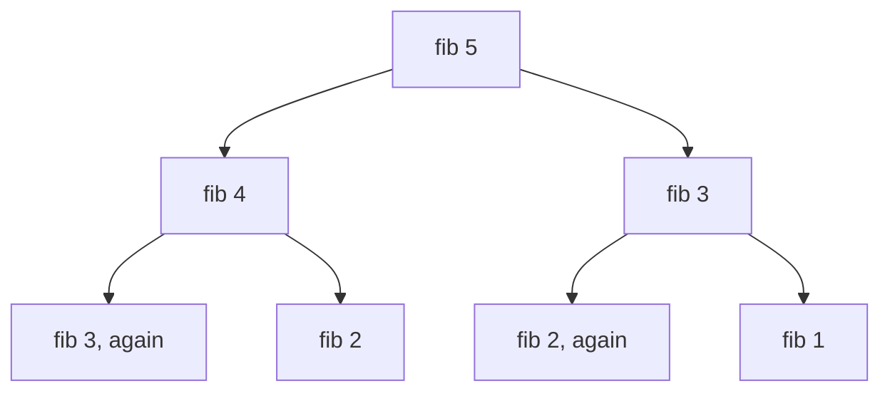
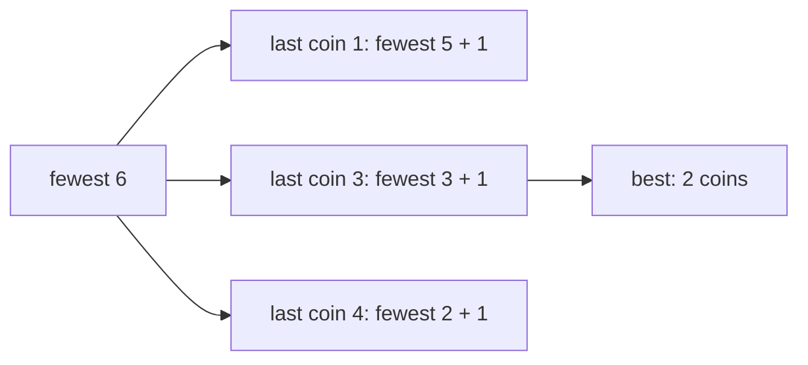
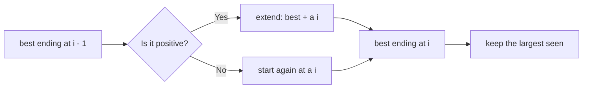

# new

## explanation

### The same question, asked again and again

The Fibonacci numbers are 0, 1, 1, 2, 3, 5, 8, …, each the sum of the two before. The direct recursive code `fib(n) = fib(n − 1) + fib(n − 2)` is correct but painfully slow. `fib(30)` asks for `fib(29)` and `fib(28)`. But `fib(29)` asks for `fib(28)` again, and so on, so the same values are recomputed millions of times. The number of calls grows exponentially.

**Dynamic programming** (DP) is the fix: when a problem breaks into smaller problems that **overlap**, solve each smaller problem **once** and remember the answer.

### Two ways to remember

- **Memoisation (top-down).** Keep the recursive code, but store each result in a table the first time it's computed, and check the table before computing.
- **Tabulation (bottom-up).** Fill a table from the smallest cases upwards with a loop, so every value needed is already there.

Both turn `fib(n)` from exponential into O(n). Tabulation avoids recursion entirely; memoisation computes only the values actually needed.

### Spotting a DP problem

Two signs:

1. **Overlapping subproblems**: a plain recursive solution would ask the same question many times.
2. **Optimal substructure**: the best answer to the whole is built from best answers to the parts.

### A first DP: climbing stairs

In how many ways can you climb n stairs taking 1 or 2 steps at a time? Look at the **last move**. Either you came from step n − 1 with a 1-step, or from step n − 2 with a 2-step. So `ways[n] = ways[n − 1] + ways[n − 2]`, with `ways[0] = ways[1] = 1`. Asking "what was the last move?" is how most DP formulas are found.

## diagram



## example

```cpp
#include <iostream>
#include <vector>

long long calls = 0;
long long fibSlow(int n) {  // recomputes the same values again and again
    calls++;
    return n < 2 ? n : fibSlow(n - 1) + fibSlow(n - 2);
}
std::vector<long long> memo;
long long fibMemo(int n) {  // top-down: remember each answer the first time it's found
    calls++;
    if (n < 2) return n;
    if (memo[n] >= 0) return memo[n];
    return memo[n] = fibMemo(n - 1) + fibMemo(n - 2);
}

int main() {
    const int n = 30;
    std::cout << "plain recursion: fib(30) = " << fibSlow(n) << " in " << calls << " calls\n";
    calls = 0;
    memo.assign(n + 1, -1);
    std::cout << "memoised: fib(30) = " << fibMemo(n) << " in " << calls << " calls\n";
    std::vector<long long> table(n + 1);  // bottom-up: fill from the smallest case upwards
    table[0] = 0, table[1] = 1;
    for (int i = 2; i <= n; i++) table[i] = table[i - 1] + table[i - 2];
    std::cout << "table: fib(30) = " << table[n] << " after " << n - 1 << " additions\n";
    // Climbing 10 stairs, 1 or 2 at a time: the last move was either 1 step or 2 steps.
    std::vector<long long> ways(11);
    ways[0] = 1, ways[1] = 1;
    for (int i = 2; i <= 10; i++) ways[i] = ways[i - 1] + ways[i - 2];
    std::cout << "ways to climb 10 stairs: " << ways[10] << '\n';
}
```

```text
plain recursion: fib(30) = 832040 in 2692537 calls
memoised: fib(30) = 832040 in 59 calls
table: fib(30) = 832040 after 29 additions
ways to climb 10 stairs: 89
```

1. Plain recursion makes over 2.6 million calls for one answer, because the same smaller values are recomputed again and again.
2. With memoisation, each value from 2 to 30 is computed once; its second call finds the answer stored. That's 59 calls in all.
3. The table needs no recursion: 29 additions, each using two values already filled in.
4. The stairs follow the same rule as Fibonacci, so 10 stairs can be climbed in 89 ways.

## mistakes

- **Using 0 as "not computed" in the memo.** If 0 is a real answer, it gets recomputed every time. Use −1 or a separate flag.
- **Filling the table in the wrong order.** Each entry must come after the entries it depends on.
- **Forgetting the base cases.** `ways[0]` and `ways[1]` must be set before the loop, or everything is 0.
- **`int` for counts.** Fibonacci-like counts pass the `int` limit after about 46 terms; use `long long`, or a modulus if the problem asks for one.
- **Memoising a function whose answer depends on more than its arguments.** The table key must capture everything the answer depends on.

## check

```cpp
#include <iostream>
#include <vector>

int main() {
    std::vector<long long> ways(8, 0);  // stairs climbed 1, 2 or 3 at a time
    ways[0] = 1;
    for (int i = 1; i <= 7; i++)
        for (int step : {1, 2, 3})
            if (i >= step) ways[i] += ways[i - step];
    std::cout << ways[4] << ' ' << ways[7] << '\n';
}
```

```text
7 44
```

The last move was 1, 2 or 3 steps, so each entry is the sum of the three before it: 1, 1, 2, 4, 7, 13, 24, 44. Four stairs can be climbed in 7 ways, and seven stairs in 44.

# building

## explanation

### A quick recap

DP solves each overlapping subproblem once and stores the answer, either top-down with a memo or bottom-up with a table. The formula usually comes from asking "what was the last step?".

### The recipe

1. **State**: what does one table entry mean? For example, `fewest[a]` = the fewest coins that make the amount a.
2. **Transition**: how is an entry built from smaller ones? Here, `fewest[a] = 1 + min(fewest[a − c])` over every coin c ≤ a.
3. **Base case**: `fewest[0] = 0`.
4. **Order**: fill a = 1, 2, …, so smaller amounts are ready first.
5. **Answer**: `fewest[amount]`.

The cost is the number of states times the work per state: here O(amount × coins).

### Getting the choices back

The table holds only numbers. To show *which* coins were used, record the choice that gave each best value (`last[a] = c`). Then walk back from the answer: amount, amount − last[amount], and so on.

### Counting: does order matter?

Two different questions, with almost the same code:

- **Sets of coins** (1 + 3 and 3 + 1 count once): put the **coins in the outer loop**. Each coin is added on top of all ways that use only earlier coins, so every set is built in one order.
- **Ordered sequences** (1 + 3 and 3 + 1 are different): put the **amount in the outer loop** and try every coin as the last one.

Swapping the loops changes the question, so be sure which one is asked.

### Choices that rule out neighbours

When picking items from a row where two neighbours can't both be picked, keep two values per position: the best if this item is picked, and the best if it isn't. Each depends only on the previous position.

## diagram



## example

```cpp
#include <iostream>
#include <vector>

int main() {
    std::vector<int> coins = {1, 3, 4};
    const int amount = 6, INF = 1e9;
    // fewest[a]: the fewest coins that make a. Try every coin as the last one paid.
    std::vector<int> fewest(amount + 1, INF), last(amount + 1, -1);
    fewest[0] = 0;
    for (int a = 1; a <= amount; a++)
        for (int c : coins)
            if (c <= a && fewest[a - c] + 1 < fewest[a]) { fewest[a] = fewest[a - c] + 1; last[a] = c; }
    std::cout << "fewest coins for 6: " << fewest[amount] << " (";
    for (int a = amount; a > 0; a -= last[a]) std::cout << last[a] << (a - last[a] > 0 ? " + " : ")\n");
    std::cout << "table:";
    for (int a = 0; a <= amount; a++) std::cout << ' ' << fewest[a];
    std::cout << '\n';

    // Counting: coins in the outer loop counts sets; amount in the outer loop counts orders.
    std::vector<long long> sets(amount + 1, 0), orders(amount + 1, 0);
    sets[0] = orders[0] = 1;
    for (int c : coins)
        for (int a = c; a <= amount; a++) sets[a] += sets[a - c];
    for (int a = 1; a <= amount; a++)
        for (int c : coins) if (c <= a) orders[a] += orders[a - c];
    std::cout << "ways to make 6: " << sets[amount] << " as sets of coins, " << orders[amount] << " as ordered sequences\n";
}
```

```text
fewest coins for 6: 2 (3 + 3)
table: 0 1 2 1 1 2 2
ways to make 6: 4 as sets of coins, 9 as ordered sequences
```

1. Greedy would pay 6 as 4 + 1 + 1. The DP tries every last coin for every amount and finds 3 + 3.
2. `last` remembers the coin that gave each best value. Walking back from 6 gives 3, then 3 again.
3. The table shows the best for every amount up to 6. For example, 5 needs 2 coins (4 + 1).
4. The 4 sets are 1+1+1+1+1+1, 1+1+1+3, 1+1+4 and 3+3. Counted as ordered sequences, these become 9, such as 1+1+4, 1+4+1 and 4+1+1.

## mistakes

- **Adding 1 to "impossible".** If `fewest[a − c]` is ∞, adding 1 may overflow or look valid. Pick an ∞ well below the type's limit, or skip unreachable entries.
- **Reporting ∞ as an answer.** If the amount can't be made, say so rather than printing a huge number.
- **Mixing up the loop orders.** Coins outside counts sets; amount outside counts orders. Decide which the problem wants.
- **Rebuilding the choices without recording them.** Store the choice (`last[a]`) as you fill the table, or recompute it on the way back.
- **A table for a huge range.** An amount of 10⁹ can't have a table entry per value. That needs a different idea.

## check

```cpp
#include <algorithm>
#include <iostream>
#include <vector>

int main() {
    std::vector<int> box = {2, 7, 9, 3, 1, 5};  // coins in boxes in a row; never open two neighbours
    int take = 0, skip = 0;  // the best so far if the last box was opened / not opened
    for (int m : box) {
        int newTake = skip + m;
        skip = std::max(skip, take);
        take = newTake;
    }
    std::cout << std::max(take, skip) << '\n';
}
```

```text
16
```

Opening a box is allowed only if the previous one stayed shut, so `take` builds on `skip`. Skipping keeps the better of the two. The best choice opens 2, 9 and 5 (the 1st, 3rd and 6th boxes) for 16, beating 7 + 3 + 5 = 15.

# strong

## explanation

### Designing a DP

Most of the work is choosing the **state**. A good state:

- captures **everything** the rest of the problem depends on (if two situations with the same state could have different futures, add what tells them apart);
- has as **few** possible values as possible, since the cost is states × transitions.

Then write the transition by asking "what was the last decision?", fix the base cases, choose an order where dependencies come first, and decide where the answer sits.

### Shrinking the memory

If each row or entry depends only on the last one or two, keep just those. Fibonacci needs two variables, not a table, and many 2D DPs need only two rows. That turns O(n) memory into O(1), or O(n · m) into O(m). You lose the ability to walk back through the choices, so keep the full table when they're needed.

### The best subarray: Kadane's algorithm

The state `best[i]` = the largest sum of a subarray **ending at i**. Such a subarray either is just `a[i]`, or extends the best one ending at i − 1:

`best[i] = a[i] + max(0, best[i − 1])`

The answer is the largest `best[i]`. Only the previous value matters, so it's one pass with one variable: O(n) time, O(1) memory. Recording where the current run started gives the subarray itself. If every number is negative, the answer is the largest single element, not 0, unless the problem allows an empty subarray.

### Top-down or bottom-up?

- **Top-down** is easier to write from a recursive idea and computes only the states needed, but has call overhead and recursion-depth limits.
- **Bottom-up** is faster and needs no stack, but needs a valid fill order and computes every state.

## diagram



## example

```cpp
#include <algorithm>
#include <climits>
#include <iostream>
#include <random>
#include <vector>

struct Best { long long sum; int from, to; };
// Kadane: the best subarray ending at i is a[i] plus the best ending at i - 1, if that is positive.
Best kadane(const std::vector<int>& a) {
    Best best = {LLONG_MIN, 0, 0};
    long long here = 0;
    int start = 0;
    for (int i = 0; i < (int)a.size(); i++) {
        if (here <= 0) here = a[i], start = i;  // a run that isn't positive only hurts: start again here
        else here += a[i];
        if (here > best.sum) best = {here, start, i};
    }
    return best;
}

int main() {
    std::vector<int> a = {-2, 1, -3, 4, -1, 2, 1, -5, 4};
    Best b = kadane(a);
    std::cout << "best sum " << b.sum << " from index " << b.from << " to " << b.to << '\n';
    std::cout << "all negative: " << kadane({-8, -3, -6}).sum << '\n';
    std::mt19937 rng(9);
    int wrong = 0;
    for (int t = 0; t < 300; t++) {
        std::vector<int> v(1 + rng() % 40);
        for (int& x : v) x = int(rng() % 21) - 10;
        long long brute = LLONG_MIN;
        for (std::size_t i = 0; i < v.size(); i++) {
            long long s = 0;
            for (std::size_t j = i; j < v.size(); j++) { s += v[j]; brute = std::max(brute, s); }
        }
        if (brute != kadane(v).sum) wrong++;
    }
    std::cout << "300 random arrays against brute force: " << wrong << " wrong\n";
}
```

```text
best sum 6 from index 3 to 6
all negative: -3
300 random arrays against brute force: 0 wrong
```

1. The run restarts at index 3 (value 4), because everything before it sums to at most 0. It then grows through −1, 2 and 1 to 6.
2. Adding −5 drops the run to 1, still positive, so it continues. It never beats 6, which the subarray 4 −1 2 1 gives.
3. With only negative numbers, every run restarts, and the best single element, −3, is the answer.
4. The O(n) answer agrees with the O(n²) brute force on 300 random arrays.

## mistakes

- **Starting the best at 0.** For an all-negative array that wrongly reports 0. Start at the smallest possible value, or at the first element.
- **A state that forgets something.** If two situations with the same state could continue differently, the DP gives wrong answers. Add the missing information to the state.
- **A state with too many values.** Including the whole path or a large set in the state makes the table exponential. Keep only what the future depends on.
- **Shrinking memory, then needing the choices.** Rolling arrays discard the history; keep the full table if you must reconstruct.
- **Deep recursion in top-down DP.** For 10⁶ states, memoised recursion can overflow the stack. Fill a table bottom-up instead.

## check

```cpp
#include <iostream>
#include <string>
#include <vector>

int main() {
    std::string s = "2263";  // letters are coded A=1 ... Z=26; how many ways can this be read back?
    std::vector<long long> ways(s.size() + 1, 0);
    ways[0] = 1;  // the empty prefix can be read in one way
    for (std::size_t i = 1; i <= s.size(); i++) {
        if (s[i - 1] != '0') ways[i] += ways[i - 1];  // the last digit on its own
        if (i >= 2 && (s[i - 2] == '1' || (s[i - 2] == '2' && s[i - 1] <= '6'))) ways[i] += ways[i - 2];  // the last two
    }
    std::cout << ways[s.size()] << '\n';
}
```

```text
3
```

The last letter is either the last digit alone or the last two digits, if they form 10 to 26. "2263" reads as 2-2-6-3, 22-6-3 or 2-26-3. The final 63 is above 26, so the 3 must stand alone.
