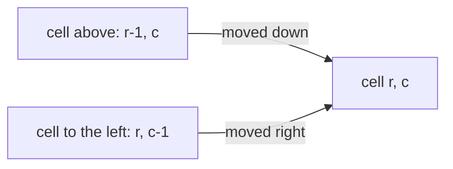
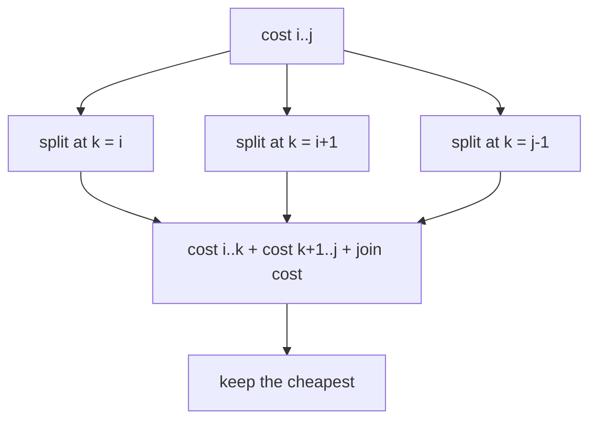
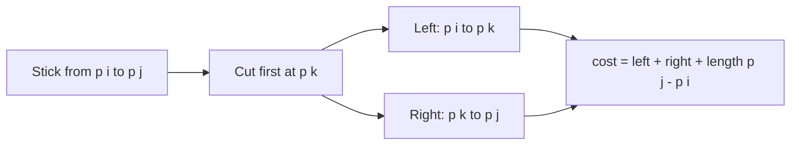

# new

## explanation

### Moving through a grid

A robot starts at the top-left cell of a grid and may only move **right** or **down** until it reaches the bottom-right. Typical questions:

- how many different routes are there?
- if each cell has a cost, which route is cheapest?
- if some cells are blocked, how many routes avoid them?

Because moves only go right or down, every cell can be reached only **from above** or **from the left**. That gives the DP directly.

### The table

Let `cost[r][c]` be the cheapest way to reach cell (r, c):

`cost[r][c] = grid[r][c] + min(cost[r − 1][c], cost[r][c − 1])`

The first row can only be reached from the left, and the first column only from above, so they're running sums. Filling the table row by row, left to right, always has the two neighbours ready. To **count** routes, add instead of taking the minimum: `ways[r][c] = ways[r − 1][c] + ways[r][c − 1]`. A blocked cell has 0 ways.

### Reading the route back

From the bottom-right corner, step to whichever of the two possible previous cells (above or left) is cheaper, until reaching the start. Marking the cells on the way shows the route.

### Cost

One entry per cell, each O(1): **O(rows × columns)** time. Since each row needs only the row above, memory can shrink to one row if the route itself isn't needed.

## diagram



## example

```cpp
#include <algorithm>
#include <iostream>
#include <string>
#include <vector>

int main() {
    // Move from the top-left to the bottom-right, only right or down; each cell costs its number.
    std::vector<std::vector<int>> g = {{1, 3, 1, 2}, {1, 5, 1, 9}, {4, 2, 1, 3}, {7, 1, 8, 1}};
    const int R = 4, C = 4;
    // cost[r][c]: the cheapest way to reach (r, c). The last move came from above or from the left.
    std::vector<std::vector<int>> cost(R, std::vector<int>(C));
    for (int r = 0; r < R; r++)
        for (int c = 0; c < C; c++) {
            if (r == 0 && c == 0) cost[r][c] = g[0][0];
            else if (r == 0) cost[r][c] = cost[r][c - 1] + g[r][c];
            else if (c == 0) cost[r][c] = cost[r - 1][c] + g[r][c];
            else cost[r][c] = std::min(cost[r - 1][c], cost[r][c - 1]) + g[r][c];
        }
    // Walk back from the corner, always to the cheaper of the two cells it could have come from.
    std::vector<std::string> mark(R, std::string(C, '.'));
    for (int r = R - 1, c = C - 1;;) {
        mark[r][c] = '#';
        if (r == 0 && c == 0) break;
        if (c == 0 || (r > 0 && cost[r - 1][c] <= cost[r][c - 1])) r--; else c--;
    }
    std::cout << "cheapest path costs " << cost[R - 1][C - 1] << '\n';
    for (const auto& row : mark) std::cout << row << '\n';
}
```

```text
cheapest path costs 11
###.
..#.
..##
...#
```

1. The first row and column are running sums, since each of their cells has only one way in.
2. Every other cell adds its own cost to the cheaper of the cell above and the cell to its left.
3. The cheapest route costs 1 + 3 + 1 + 1 + 1 + 3 + 1 = 11. It avoids the 5 and the 9 by going along the top and down through the column of 1s.
4. Walking back from the bottom-right corner, always to the cheaper neighbour, retraces exactly that route.

## mistakes

- **Treating row 0 or column 0 like the rest.** They have only one neighbour to come from; reading `cost[−1][c]` is out of bounds.
- **Adding the cell's cost twice, or forgetting it.** Each cell's own cost is added exactly once, when it's reached.
- **Counting routes through blocked cells.** A blocked cell must have 0 ways, and nothing may build on it.
- **Moves in more directions.** If the robot may also move up or left, the table has no valid fill order; that's a shortest-path problem.
- **`int` for route counts.** The number of routes in a 30 × 30 grid is about 3 · 10¹⁶; use `long long` or a modulus.

## check

```cpp
#include <iostream>
#include <string>
#include <vector>

int main() {
    std::vector<std::string> g = {"....", ".#..", "...."};  // '#' is blocked
    std::vector<std::vector<long long>> ways(3, std::vector<long long>(4, 0));
    for (int r = 0; r < 3; r++)
        for (int c = 0; c < 4; c++) {
            if (g[r][c] == '#') continue;
            if (r == 0 && c == 0) { ways[r][c] = 1; continue; }
            ways[r][c] = (r > 0 ? ways[r - 1][c] : 0) + (c > 0 ? ways[r][c - 1] : 0);
        }
    std::cout << ways[2][3] << ' ' << ways[1][2] << '\n';
}
```

```text
4 1
```

Without the block, a 3 × 4 grid has 10 routes. The blocked cell has 0 ways, so the cell to its right can only be reached from above: 1 way. Adding up row by row gives 1 1 1 1, then 1 0 1 2, then 1 1 2 4, so 4 routes reach the corner.

# building

## explanation

### A quick recap

Grid DP fills one entry per cell from the cells it can be reached from (above and left), in an order where those are always ready. The same pattern works whenever each state depends on a fixed set of earlier states.

### DP over intervals

Some problems are about a **range** of items, and the best way to handle the range depends on where it is **split**. Let `cost[i][j]` be the best answer for items i to j. Then try every split point k:

`cost[i][j] = min over k of cost[i][k] + cost[k + 1][j] + (the cost of joining the two parts)`

Fill the table **by length**: all ranges of length 1, then 2, and so on, so both parts of any split are already known. There are O(n²) ranges and O(n) splits each, so it's **O(n³)**.

### Matrix-chain multiplication

Multiplying a p × q matrix by a q × r matrix takes p · q · r multiplications. For a chain A · B · C · D the result is the same in any bracketing, but the cost isn't: one order can be several times cheaper than another. With `dims` giving the sizes (matrix i is dims[i] × dims[i + 1]):

`cost[i][j] = min over k of cost[i][k] + cost[k + 1][j] + dims[i] · dims[k + 1] · dims[j + 1]`

Record the best k for each range in `split[i][j]`, then rebuild the bracketing recursively.

### Palindromes as intervals

The longest palindromic subsequence of s[i..j] depends on its two ends:

- if s[i] == s[j], both can wrap a palindrome of the inside: `lps[i + 1][j − 1] + 2`;
- otherwise drop one end: `max(lps[i + 1][j], lps[i][j − 1])`.

## diagram



## example

```cpp
#include <climits>
#include <iostream>
#include <string>
#include <vector>

std::vector<std::vector<int>> split;
std::string order(int i, int j) {  // the best bracketing of matrices i..j
    if (i == j) return std::string(1, char('A' + i));
    return "(" + order(i, split[i][j]) + order(split[i][j] + 1, j) + ")";
}

int main() {
    // Matrix i is dims[i] x dims[i + 1]. Multiplying p x q by q x r costs p * q * r.
    std::vector<long long> dims = {40, 20, 30, 10, 30};
    const int n = dims.size() - 1;
    // cost[i][j]: the cheapest way to multiply matrices i..j; k is where the last multiplication splits them.
    std::vector<std::vector<long long>> cost(n, std::vector<long long>(n, 0));
    split.assign(n, std::vector<int>(n, 0));
    for (int len = 2; len <= n; len++)  // shorter ranges first: they are the parts of longer ones
        for (int i = 0; i + len - 1 < n; i++) {
            int j = i + len - 1;
            cost[i][j] = LLONG_MAX;
            for (int k = i; k < j; k++) {
                long long c = cost[i][k] + cost[k + 1][j] + dims[i] * dims[k + 1] * dims[j + 1];
                if (c < cost[i][j]) cost[i][j] = c, split[i][j] = k;
            }
        }
    long long leftToRight = 0;
    for (int k = 1; k < n; k++) leftToRight += dims[0] * dims[k] * dims[k + 1];
    std::cout << "best: " << order(0, n - 1) << " with " << cost[0][n - 1] << " multiplications\n";
    std::cout << "left to right: " << leftToRight << '\n';
}
```

```text
best: ((A(BC))D) with 26000 multiplications
left to right: 48000
```

1. The four matrices are 40×20, 20×30, 30×10 and 10×30.
2. Multiplying B and C first costs 20·30·10 = 6000 and leaves a small 20×10 result. A times that costs 40·20·10 = 8000, and the final step 40·10·30 = 12000.
3. Left to right, A·B creates a large 40×30 matrix first, so every later step is expensive: 48,000 in total, nearly double.
4. `split` remembers the best k for every range, and `order` rebuilds the bracketing from it.

## mistakes

- **Filling ranges in the wrong order.** Both parts of a split must be finished first; go by increasing length.
- **Off-by-one in the dimensions.** Matrix i is dims[i] × dims[i + 1], so the chain i..j joins at dims[k + 1].
- **Allowing k = j.** The right part would be empty. k goes from i to j − 1.
- **Overflow.** Products of three dimensions add up fast; use `long long`.
- **The palindrome table read before it's filled.** `lps[i + 1][j − 1]` needs i going downwards, or filling by length.

## check

```cpp
#include <algorithm>
#include <iostream>
#include <string>
#include <vector>

int main() {
    std::string s = "character";
    const int n = s.size();
    std::vector<std::vector<int>> lps(n, std::vector<int>(n, 0));  // lps[i][j]: in s[i..j]
    for (int i = n - 1; i >= 0; i--) {
        lps[i][i] = 1;
        for (int j = i + 1; j < n; j++)
            lps[i][j] = s[i] == s[j] ? lps[i + 1][j - 1] + 2 : std::max(lps[i + 1][j], lps[i][j - 1]);
    }
    std::cout << lps[0][n - 1] << '\n';
}
```

```text
5
```

The two c's at positions 0 and 5 wrap the inside "hara", whose longest palindromic subsequence is "ara". Together they give "carac", 5 letters. Going i downwards guarantees that `lps[i + 1][…]` is filled before it's used.

# strong

## explanation

### The interval pattern

Many problems share one shape: a range is solved by choosing one point inside it, which leaves two independent smaller ranges.

- **Cutting a stick** at given marks, where each cut costs the length of the piece being cut: choose which mark is cut **first** in the range.
- **Merging adjacent piles**, where each merge costs the combined size: choose where the **last** merge splits the range.
- **Optimal binary search trees**: choose the **root** of each range of keys.
- **Bursting balloons**: choose the balloon burst **last** in a range, so that its neighbours are the range's fixed ends.

Picking "first" or "last" decides what the parts know about each other. Choose whichever makes the two sides independent.

### Making it faster

The plain interval DP is O(n³). For some cost functions, the best split point moves monotonically: `split[i][j − 1] ≤ split[i][j] ≤ split[i + 1][j]`. Searching only between those bounds (**Knuth's optimisation**) gives O(n²). It applies to optimal search trees and pile merging, but it must be justified for each problem.

### More grid ideas

- **Squares and rectangles**: the largest all-1 square with its corner at (r, c) is 1 + the smallest of the three neighbours above, left and diagonal.
- **Two walkers at once** (collecting items on the way there and back): move both together and index by step and both rows, `dp[step][r1][r2]`, since the columns follow from the step.
- **Rolling rows**: when a row needs only the previous one, keep two rows, for O(columns) memory.

### Checking a DP

Interval and grid DPs are easy to get subtly wrong. For small inputs, compare against a brute force that tries every choice. Disagreement on any random case points straight to the bug.

## diagram



## example

```cpp
#include <algorithm>
#include <climits>
#include <iostream>
#include <vector>

int main() {
    // A stick of length 10 is cut at the marks 2, 3, 7 and 8; each cut costs the length of the piece cut.
    std::vector<int> cuts = {2, 3, 7, 8};
    const int length = 10;
    std::vector<int> p = {0};  // the ends and the marks, in order
    p.insert(p.end(), cuts.begin(), cuts.end());
    p.push_back(length);
    const int m = p.size();
    // cost[i][j]: the cheapest way to make every cut strictly between p[i] and p[j]; p[k] is cut first.
    std::vector<std::vector<long long>> cost(m, std::vector<long long>(m, 0));
    for (int gap = 2; gap < m; gap++)
        for (int i = 0; i + gap < m; i++) {
            int j = i + gap;
            cost[i][j] = LLONG_MAX;
            for (int k = i + 1; k < j; k++) cost[i][j] = std::min(cost[i][j], cost[i][k] + cost[k][j] + (p[j] - p[i]));
        }
    std::vector<int> order = cuts;  // check against every order of cutting
    long long best = LLONG_MAX, worst = 0;
    do {
        std::vector<int> made = {0, length};
        long long total = 0;
        for (int c : order) {
            auto it = std::upper_bound(made.begin(), made.end(), c);
            total += *it - *(it - 1);  // the piece that contains c
            made.insert(it, c);
        }
        best = std::min(best, total);
        worst = std::max(worst, total);
    } while (std::next_permutation(order.begin(), order.end()));
    std::cout << "interval DP: " << cost[0][m - 1] << "; all 24 orders: best " << best << ", worst " << worst << '\n';
}
```

```text
interval DP: 23; all 24 orders: best 23, worst 30
```

1. Each range between two marks is solved by trying every mark inside it as the first cut. The first cut always costs the length of the whole range.
2. Ranges are filled by gap, so both pieces of any first cut are already solved.
3. The brute force tries all 4! = 24 cutting orders and agrees with the DP: 23, for example cutting at 3, then 2, 7 and 8 (10 + 3 + 7 + 3). The order 2, 3, 8, 7 costs 10 + 8 + 7 + 5 = 30.

## mistakes

- **Choosing "first" when the parts depend on each other.** For bursting balloons, the balloon burst *last* keeps the parts independent; the first one doesn't.
- **Forgetting the range's own cost.** In the stick problem every split adds `p[j] − p[i]`, the length of the piece.
- **Including the ends as cut points.** The ends 0 and length are boundaries, not cuts; k runs strictly between i and j.
- **Using Knuth's optimisation without checking it applies.** It needs a special property of the cost; otherwise it can skip the true best split.
- **No brute-force check.** Small random tests against trying every choice catch most interval DP bugs.

## check

```cpp
#include <algorithm>
#include <iostream>
#include <string>
#include <vector>

int main() {
    std::vector<std::string> g = {"10111", "10111", "11111", "10010"};
    int best = 0;
    std::vector<std::vector<int>> side(4, std::vector<int>(5, 0));  // the largest all-1 square ending at (r, c)
    for (int r = 0; r < 4; r++)
        for (int c = 0; c < 5; c++) {
            if (g[r][c] == '0') continue;
            side[r][c] = (r && c) ? 1 + std::min({side[r - 1][c], side[r][c - 1], side[r - 1][c - 1]}) : 1;
            best = std::max(best, side[r][c]);
        }
    std::cout << best << ' ' << best * best << '\n';
}
```

```text
3 9
```

A square of side s can end at a cell only if squares of side s − 1 end above it, to its left and diagonally above-left. The three right-hand columns of the top three rows are all 1, so the largest square has side 3 and area 9.
