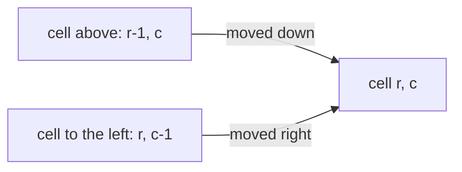
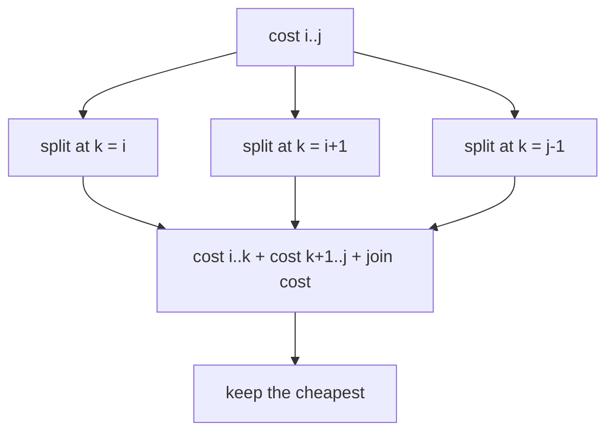
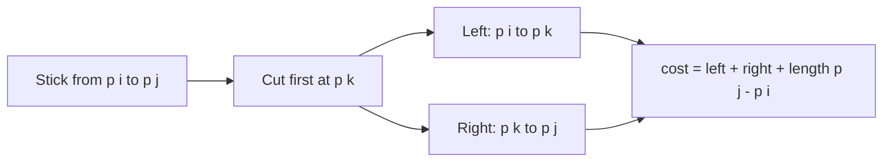

# new

## explanation

### Moving through a grid

A robot starts at the top-left cell of a grid and may only move **right** or **down** until it reaches the bottom-right. Typical questions:

- how many different routes are there?
- if each cell has a cost, which route is cheapest?
- if some cells are blocked, how many routes avoid them?

Because moves only go right or down, every cell can be reached only **from above** or **from the left**. That gives the DP directly.

### The table

Let `cost[r][c]` be the cheapest way to reach cell (r, c):

`cost[r][c] = grid[r][c] + min(cost[r − 1][c], cost[r][c − 1])`

The first row can only be reached from the left, and the first column only from above, so they're running sums. Filling the table row by row, left to right, always has the two neighbours ready. To **count** routes, add instead of taking the minimum: `ways[r][c] = ways[r − 1][c] + ways[r][c − 1]`. A blocked cell has 0 ways.

### Reading the route back

From the bottom-right corner, step to whichever of the two possible previous cells (above or left) is cheaper, until reaching the start. Marking the cells on the way shows the route.

### Cost

One entry per cell, each O(1): **O(rows × columns)** time. Since each row needs only the row above, memory can shrink to one row if the route itself isn't needed.

## diagram



## example

```cpp
#include <algorithm>
#include <iostream>
#include <string>
#include <vector>

int main() {
    // Move from the top-left to the bottom-right, only right or down; each cell costs its number.
    std::vector<std::vector<int>> g = {{1, 3, 1, 2}, {1, 5, 1, 9}, {4, 2, 1, 3}, {7, 1, 8, 1}};
    const int R = 4, C = 4;
    // cost[r][c]: the cheapest way to reach (r, c). The last move came from above or from the left.
    std::vector<std::vector<int>> cost(R, std::vector<int>(C));
    for (int r = 0; r < R; r++)
        for (int c = 0; c < C; c++) {
            if (r == 0 && c == 0) cost[r][c] = g[0][0];
            else if (r == 0) cost[r][c] = cost[r][c - 1] + g[r][c];
            else if (c == 0) cost[r][c] = cost[r - 1][c] + g[r][c];
            else cost[r][c] = std::min(cost[r - 1][c], cost[r][c - 1]) + g[r][c];
        }
    // Walk back from the corner, always to the cheaper of the two cells it could have come from.
    std::vector<std::string> mark(R, std::string(C, '.'));
    for (int r = R - 1, c = C - 1;;) {
        mark[r][c] = '#';
        if (r == 0 && c == 0) break;
        if (c == 0 || (r > 0 && cost[r - 1][c] <= cost[r][c - 1])) r--; else c--;
    }
    std::cout << "cheapest path costs " << cost[R - 1][C - 1] << '\n';
    for (const auto& row : mark) std::cout << row << '\n';
}
```

```text
cheapest path costs 11
###.
..#.
..##
...#
```

1. The first row and column are running sums, since each of their cells has only one way in.
2. Every other cell adds its own cost to the cheaper of the cell above and the cell to its left.
3. The cheapest route costs 1 + 3 + 1 + 1 + 1 + 3 + 1 = 11. It avoids the 5 and the 9 by going along the top and down through the column of 1s.
4. Walking back from the bottom-right corner, always to the cheaper neighbour, retraces exactly that route.

## mistakes

- **Treating row 0 or column 0 like the rest.** They have only one neighbour to come from; reading `cost[−1][c]` is out of bounds.
- **Adding the cell's cost twice, or forgetting it.** Each cell's own cost is added exactly once, when it's reached.
- **Counting routes through blocked cells.** A blocked cell must have 0 ways, and nothing may build on it.
- **Moves in more directions.** If the robot may also move up or left, the table has no valid fill order; that's a shortest-path problem.
- **`int` for route counts.** The number of routes in a 30 × 30 grid is about 3 · 10¹⁶; use `long long` or a modulus.

## check

```cpp
#include <iostream>
#include <string>
#include <vector>

int main() {
    std::vector<std::string> g = {"....", ".#..", "...."};  // '#' is blocked
    std::vector<std::vector<long long>> ways(3, std::vector<long long>(4, 0));
    for (int r = 0; r < 3; r++)
        for (int c = 0; c < 4; c++) {
            if (g[r][c] == '#') continue;
            if (r == 0 && c == 0) { ways[r][c] = 1; continue; }
            ways[r][c] = (r > 0 ? ways[r - 1][c] : 0) + (c > 0 ? ways[r][c - 1] : 0);
        }
    std::cout << ways[2][3] << ' ' << ways[1][2] << '\n';
}
```

```text
4 1
```

Without the block, a 3 × 4 grid has 10 routes. The blocked cell has 0 ways, so the cell to its right can only be reached from above: 1 way. Adding up row by row gives 1 1 1 1, then 1 0 1 2, then 1 1 2 4, so 4 routes reach the corner.

# building

## explanation

### A quick recap

Grid DP fills one entry per cell from the cells it can be reached from (above and left), in an order where those are always ready. The same pattern works whenever each state depends on a fixed set of earlier states.

### DP over intervals

Some problems are about a **range** of items, and the best way to handle the range depends on where it is **split**. Let best(i, j) be the best answer for items i to j. Then try every split point k:

best(i, j) = min over k of best(i, k) + best(k + 1, j) + (the cost of joining the two parts)

Fill the table **by length**: all ranges of length 1, then 2, and so on, so both parts of any split are already known. There are O(n²) ranges and O(n) splits each, so it's **O(n³)**.

### Matrix-chain multiplication

Multiplying a p × q matrix by a q × r matrix takes p · q · r multiplications. For a chain A · B · C · D the result is the same in any bracketing, but the cost isn't: one order can be several times cheaper than another. With d giving the sizes (matrix i is d(i) × d(i + 1)):

best(i, j) = min over k of best(i, k) + best(k + 1, j) + d(i) · d(k + 1) · d(j + 1)

Record the best k for each range in `split[i][j]`, then rebuild the bracketing recursively.

### Palindromes as intervals

The longest palindromic subsequence of s[i..j] depends on its two ends:

- if s[i] == s[j], both can wrap a palindrome of the inside: `lps[i + 1][j − 1] + 2`;
- otherwise drop one end: `max(lps[i + 1][j], lps[i][j − 1])`.

## diagram



## example

```cpp
#include <climits>
#include <iostream>
#include <string>
#include <vector>

std::vector<int> piles = {4, 5, 9, 4};
std::vector<std::vector<int>> split;
std::string order(int lo, int hi) {  // the best way to merge piles lo..hi, as brackets
    if (lo == hi) return std::to_string(piles[lo]);
    return "(" + order(lo, split[lo][hi]) + " " + order(split[lo][hi] + 1, hi) + ")";
}

int main() {
    // Merging two neighbouring piles costs their total, so joining lo..mid with mid+1..hi costs every stone in lo..hi.
    const int n = piles.size();
    std::vector<long long> prefix(n + 1, 0);
    for (int lo = 0; lo < n; lo++) prefix[lo + 1] = prefix[lo] + piles[lo];
    // least[lo][hi]: the cheapest way to merge piles lo..hi into one; the last merge joins lo..mid with mid+1..hi.
    std::vector<std::vector<long long>> least(n, std::vector<long long>(n, 0));
    split.assign(n, std::vector<int>(n, 0));
    for (int len = 2; len <= n; len++)  // shorter ranges first: they are the parts of longer ones
        for (int lo = 0; lo + len - 1 < n; lo++) {
            int hi = lo + len - 1;
            least[lo][hi] = LLONG_MAX;
            for (int mid = lo; mid < hi; mid++)
                if (least[lo][mid] + least[mid + 1][hi] < least[lo][hi]) least[lo][hi] = least[lo][mid] + least[mid + 1][hi], split[lo][hi] = mid;
            least[lo][hi] += prefix[hi + 1] - prefix[lo];  // the same for every mid, so it's added once the best mid is known
        }
    long long leftToRight = 0, pile = piles[0];
    for (int mid = 1; mid < n; mid++) pile += piles[mid], leftToRight += pile;
    std::cout << "best: " << order(0, n - 1) << " costs " << least[0][n - 1] << '\n';
    std::cout << "left to right: " << leftToRight << '\n';
}
```

```text
best: ((4 5) (9 4)) costs 44
left to right: 49
```

1. Merging 4 and 5 costs 9, and 9 and 4 costs 13. The last merge moves all 22 stones: 9 + 13 + 22 = 44.
2. Left to right, the growing pile is paid for again at every step: 9 + 18 + 22 = 49.
3. The joining cost of a range is its total, the same whichever k is chosen, so it's added after the best k is found, read from prefix sums in O(1).
4. This is the same table as matrix-chain multiplication, filled by length and split at k; only the cost of joining the two parts differs. `split` remembers the best k for every range, and `order` rebuilds the brackets from it.

## mistakes

- **Filling ranges in the wrong order.** Both parts of a split must be finished first; go by increasing length.
- **Off-by-one in the dimensions.** Matrix i is d(i) × d(i + 1), so the chain i..j joins at d(k + 1).
- **Allowing k = j.** The right part would be empty. k goes from i to j − 1.
- **Overflow.** Products of three dimensions add up fast; use `long long`.
- **The palindrome table read before it's filled.** `lps[i + 1][j − 1]` needs i going downwards, or filling by length.

## check

```cpp
#include <algorithm>
#include <iostream>
#include <string>
#include <vector>

int main() {
    std::string s = "character";
    const int n = s.size();
    std::vector<std::vector<int>> lps(n, std::vector<int>(n, 0));  // lps[lo][hi]: in s[lo..hi]
    for (int lo = n - 1; lo >= 0; lo--) {
        lps[lo][lo] = 1;
        for (int hi = lo + 1; hi < n; hi++)
            lps[lo][hi] = s[lo] == s[hi] ? lps[lo + 1][hi - 1] + 2 : std::max(lps[lo + 1][hi], lps[lo][hi - 1]);
    }
    std::cout << lps[0][n - 1] << '\n';
}
```

```text
5
```

The two c's at positions 0 and 5 wrap the inside "hara", whose longest palindromic subsequence is "ara". Together they give "carac", 5 letters. Going `lo` downwards guarantees that `lps[lo + 1][…]` is filled before it's used.

# strong

## explanation

### The interval pattern

Many problems share one shape: a range is solved by choosing one point inside it, which leaves two independent smaller ranges.

- **Cutting a stick** at given marks, where each cut costs the length of the piece being cut: choose which mark is cut **first** in the range.
- **Merging adjacent piles**, where each merge costs the combined size: choose where the **last** merge splits the range.
- **Optimal binary search trees**: choose the **root** of each range of keys.
- **Bursting balloons**: choose the balloon burst **last** in a range, so that its neighbours are the range's fixed ends.

Picking "first" or "last" decides what the parts know about each other. Choose whichever makes the two sides independent.

### Making it faster

The plain interval DP is O(n³). For some cost functions, the best split point moves monotonically: `split[i][j − 1] ≤ split[i][j] ≤ split[i + 1][j]`. Searching only between those bounds (**Knuth's optimisation**) gives O(n²). It applies to optimal search trees and pile merging, but it must be justified for each problem.

### More grid ideas

- **Squares and rectangles**: the largest all-1 square with its corner at (r, c) is 1 + the smallest of the three neighbours above, left and diagonal.
- **Two walkers at once** (collecting items on the way there and back): move both together and index by step and both rows, `dp[step][r1][r2]`, since the columns follow from the step.
- **Rolling rows**: when a row needs only the previous one, keep two rows, for O(columns) memory.

### Checking a DP

Interval and grid DPs are easy to get subtly wrong. For small inputs, compare against a brute force that tries every choice. Disagreement on any random case points straight to the bug.

## diagram



## example

```cpp
#include <algorithm>
#include <climits>
#include <iostream>
#include <string>
#include <vector>

// Keys in sorted order and how often each is searched for. A search costs one step per level it goes down,
// so the best tree puts the frequent keys near the root.
std::vector<std::string> key = {"ant", "bee", "cat", "dog", "eel"};
std::vector<int> freq = {4, 2, 6, 3, 1};

int total(int lo, int hi) {  // searches for keys lo..hi
    int s = 0;
    for (int t = lo; t <= hi; t++) s += freq[t];
    return s;
}
// Brute force: try every key as the root of every range, recursively; no table, so it rebuilds every subtree.
long long tryAll(int lo, int hi) {
    if (lo > hi) return 0;
    long long best = LLONG_MAX;
    for (int r = lo; r <= hi; r++) best = std::min(best, tryAll(lo, r - 1) + tryAll(r + 1, hi));
    return best + total(lo, hi);  // one level deeper for every key in the range
}

int main() {
    const int n = key.size();
    // table[lo][hi]: the best tree for keys lo..hi, and root[lo][hi] its root.
    std::vector<std::vector<long long>> table(n + 1, std::vector<long long>(n + 1, 0));
    std::vector<std::vector<int>> root(n, std::vector<int>(n, 0));
    for (int width = 1; width <= n; width++)
        for (int lo = 0; lo + width <= n; lo++) {
            int hi = lo + width - 1;
            long long best = LLONG_MAX;
            for (int r = lo; r <= hi; r++) {
                long long left = r > lo ? table[lo][r - 1] : 0, right = r < hi ? table[r + 1][hi] : 0;
                if (left + right < best) best = left + right, root[lo][hi] = r;
            }
            table[lo][hi] = best + total(lo, hi);
        }
    std::cout << "best tree costs " << table[0][n - 1] << " steps, root " << key[root[0][n - 1]] << "; trying every tree: " << tryAll(0, n - 1) << '\n';
}
```

```text
best tree costs 29 steps, root cat; trying every tree: 29
```

1. cat, searched 6 times, goes at the root, one step away. Below it, ant (4 searches) roots the left side with bee under it, and dog roots the right side with eel under it.
2. The cost is cat 6 × 1, ant 4 × 2, dog 3 × 2, bee 2 × 3 and eel 1 × 3: 6 + 8 + 6 + 6 + 3 = 29.
3. Each range tries every key as its root. Whichever root is chosen, every key in the range sits one level deeper than in its own subtree, so the range's total searches are added once.
4. The brute force tries every root of every range without remembering anything, which visits all 42 possible tree shapes, and agrees: 29.

## mistakes

- **Choosing "first" when the parts depend on each other.** For bursting balloons, the balloon burst *last* keeps the parts independent; the first one doesn't.
- **Forgetting the range's own cost.** In the stick problem every split adds `p[j] − p[i]`, the length of the piece.
- **Including the ends as cut points.** The ends 0 and length are boundaries, not cuts; k runs strictly between i and j.
- **Using Knuth's optimisation without checking it applies.** It needs a special property of the cost; otherwise it can skip the true best split.
- **No brute-force check.** Small random tests against trying every choice catch most interval DP bugs.

## check

```cpp
#include <algorithm>
#include <iostream>
#include <string>
#include <vector>

int main() {
    std::vector<std::string> g = {"10111", "10111", "11111", "10010"};
    int best = 0;
    std::vector<std::vector<int>> side(4, std::vector<int>(5, 0));  // the largest all-1 square ending at (r, c)
    for (int r = 0; r < 4; r++)
        for (int c = 0; c < 5; c++) {
            if (g[r][c] == '0') continue;
            side[r][c] = (r && c) ? 1 + std::min({side[r - 1][c], side[r][c - 1], side[r - 1][c - 1]}) : 1;
            best = std::max(best, side[r][c]);
        }
    std::cout << best << ' ' << best * best << '\n';
}
```

```text
3 9
```

A square of side s can end at a cell only if squares of side s − 1 end above it, to its left and diagonally above-left. The three right-hand columns of the top three rows are all 1, so the largest square has side 3 and area 9.
