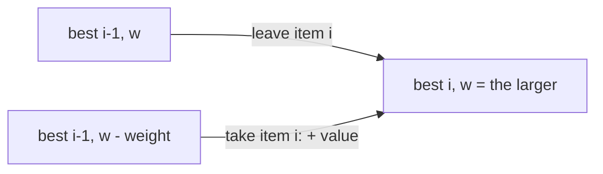
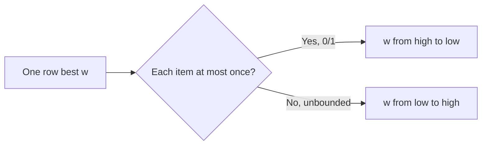
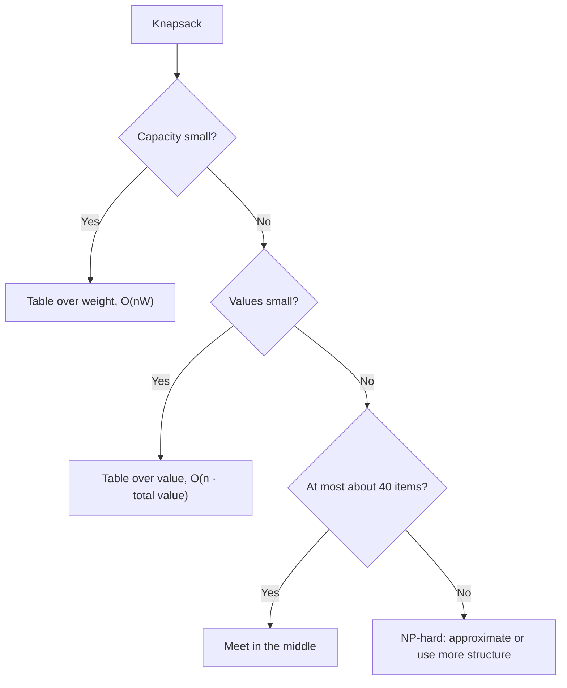

# new

## explanation

### Packing a bag

A bag holds at most W kilos. Each item has a weight and a value, and you either take an item whole or leave it: no cutting, no second copies. Which items give the most value without going over W? This is the **0/1 knapsack** problem. The same shape appears in choosing projects within a budget, or ads within a time slot.

Greedy by value per kilo fails here. A good item that's slightly too heavy can leave space that a different combination would fill better. Trying all 2ⁿ subsets is too slow beyond about 25 items.

### The table

Let `best[i][w]` = the most value using only the **first i items** with total weight **at most w**. For item i there are two choices:

- **leave it**: `best[i − 1][w]`;
- **take it** (if it fits): its value plus the best for the first i − 1 items in the remaining space, `best[i − 1][w − weight] + value`.

Take the larger. Row 0 is all 0: no items, no value. The answer is `best[n][W]`.

### Which items?

Walk back from `best[n][W]`. If `best[i][w]` differs from `best[i − 1][w]`, item i must have been taken: record it and subtract its weight from w. Then move to row i − 1.

### Cost

n × W entries, each O(1): **O(n · W)**. That's fast when W is a few thousand or million. It isn't truly polynomial, though: the time grows with the *size* of W, not the number of its digits. A capacity of 10¹² would need a different method.

### Subset sum

"Can some of these numbers add up to exactly S?" is the same table with true/false entries. A sum s is reachable after a number x if it was reachable before, or s − x was.

## diagram



## example

```cpp
#include <algorithm>
#include <iostream>
#include <string>
#include <vector>

struct Item { std::string name; int weight, value; };

int main() {
    std::vector<Item> items = {{"tent", 5, 60}, {"stove", 3, 50}, {"food", 4, 70}, {"book", 2, 30}, {"lamp", 1, 10}};
    const int n = items.size(), cap = 8;
    // best[i][w]: the most value from the first i items with total weight at most w.
    std::vector<std::vector<int>> best(n + 1, std::vector<int>(cap + 1, 0));
    for (int i = 1; i <= n; i++)
        for (int w = 0; w <= cap; w++) {
            const Item& it = items[i - 1];
            best[i][w] = best[i - 1][w];  // leave the item
            if (it.weight <= w) best[i][w] = std::max(best[i][w], best[i - 1][w - it.weight] + it.value);  // or take it
        }
    std::cout << "best value " << best[n][cap] << ", packing:";
    for (int i = n, w = cap; i > 0; i--)  // an item was taken if leaving it out gives a different value
        if (best[i][w] != best[i - 1][w]) { std::cout << ' ' << items[i - 1].name; w -= items[i - 1].weight; }
    std::cout << "\nbest value for each capacity:";
    for (int w = 0; w <= cap; w++) std::cout << ' ' << best[n][w];
    std::cout << '\n';
}
```

```text
best value 130, packing: lamp food stove
best value for each capacity: 0 10 30 50 70 80 100 120 130
```

1. Food has the best value per kilo (17.5), then stove (16.7), but the tent's 12 per kilo is what greedy would try after them. The table compares every combination instead.
2. The best packing fills all 8 kilos with food, stove and lamp: 70 + 50 + 10 = 130.
3. The walk back starts with the last item, so the names come out in reverse order: the lamp first.
4. The last row answers every capacity at once. For example, 5 kilos gives 80, from stove and book or from food and lamp.

## mistakes

- **Using the current row for "take".** `best[i][w − weight]` would let the same item be taken again. 0/1 knapsack must look at row i − 1.
- **Greedy by value per kilo.** It's right only when items can be cut. For whole items, use the table.
- **Forgetting the "leave it" copy.** Every entry must start from `best[i − 1][w]`, or capacities that skip the item end up 0.
- **Walking back without updating w.** After taking an item, continue from `w − weight`.
- **A huge capacity.** With W = 10⁹, the table can't be built. Look for small values instead, as later levels show.

## check

```cpp
#include <iostream>
#include <vector>

int main() {
    std::vector<int> nums = {3, 34, 4, 12, 5, 2};
    const int limit = 13;
    std::vector<bool> can(limit + 1, false);  // can[amt]: some of the numbers so far add up to amt
    can[0] = true;
    for (int item : nums)
        for (int amt = limit; amt >= item; amt--)  // downwards, so each number is used at most once
            if (can[amt - item]) can[amt] = true;
    std::cout << can[9] << ' ' << can[11] << ' ' << can[13] << '\n';
}
```

```text
1 1 0
```

9 = 4 + 5 and 11 = 4 + 5 + 2. Without 34 and 12, which are too big or leave a remainder of 1, the small numbers 3, 4, 5 and 2 add up to 14 at most. No subset of them makes 13.

# building

## explanation

### A quick recap

`best[i][w]` is the best value from the first i items within weight w. Each item is either left (`best[i − 1][w]`) or taken (`best[i − 1][w − weight] + value`). It costs O(n · W).

### One row is enough

Row i only reads row i − 1. So keep a single array `best[w]` and update it in place for each item, **going through w from high to low**. At the moment `best[w]` is updated, `best[w − weight]` hasn't been touched yet for this item, so it still means "without this item". Memory drops from O(n · W) to O(W).

### Unbounded knapsack

If every item can be taken **any number of times**, run the same loop **from low to high**. Now `best[w − weight]` may already include this item, which is exactly what allows taking it again. The direction of one loop is the whole difference between 0/1 and unbounded.

### Exists, best, or how many

The same table answers different questions, depending on how entries are combined:

- **can some subset reach s?** OR the two choices together (true/false);
- **the best value**: take the max;
- **how many subsets reach s?** Add the two counts.

### Equal partition

"Can these numbers be split into two groups with equal sums?" If the total is odd, no. Otherwise, ask whether some subset reaches **half the total**; the rest forms the other group. Counting the subsets that reach half counts each split twice, once from each side, unless the half is 0.

## diagram



## example

```cpp
#include <algorithm>
#include <iostream>
#include <numeric>
#include <vector>

int main() {
    std::vector<int> w = {5, 3, 4, 2, 1}, v = {60, 50, 70, 30, 10};
    const int cap = 8;
    // 0/1: capacities downwards, so once[c - w] still means "without this item".
    std::vector<int> once(cap + 1, 0), many(cap + 1, 0);
    for (std::size_t i = 0; i < w.size(); i++)
        for (int c = cap; c >= w[i]; c--) once[c] = std::max(once[c], once[c - w[i]] + v[i]);
    // Unbounded: capacities upwards, so many[c - w] may already include this item, and it can be taken again.
    for (std::size_t i = 0; i < w.size(); i++)
        for (int c = w[i]; c <= cap; c++) many[c] = std::max(many[c], many[c - w[i]] + v[i]);
    std::cout << "capacity 8: each item once " << once[cap] << ", any number of times " << many[cap] << '\n';

    // Equal partition: does some subset reach exactly half the total?
    std::vector<int> nums = {1, 5, 11, 5};
    int total = std::accumulate(nums.begin(), nums.end(), 0);
    std::vector<long long> ways(total / 2 + 1, 0);  // ways[amt]: how many subsets add up to amt
    ways[0] = 1;
    for (int item : nums)
        for (int amt = total / 2; amt >= item; amt--) ways[amt] += ways[amt - item];
    std::cout << "1 5 11 5: total " << total << ", subsets reaching " << total / 2 << ": " << ways[total / 2] << '\n';
}
```

```text
capacity 8: each item once 130, any number of times 140
1 5 11 5: total 22, subsets reaching 11: 2
```

1. The one-row 0/1 version gives the same 130 as the full table.
2. Going upwards allows repeats, and two portions of food (4 kilos, 70 each) fill the bag for 140.
3. The total 22 is even, and two subsets reach 11: {11} and {1, 5, 5}. They're the two halves of the same split.

## mistakes

- **The wrong loop direction.** Upwards in 0/1 knapsack quietly allows repeats; downwards in unbounded knapsack forbids them.
- **Starting the inner loop below the weight.** `c − w[i]` would be negative. Start at `w[i]` (upwards) or stop there (downwards).
- **Forgetting the odd-total check.** An odd total can never split into two equal integer halves.
- **Counting each partition twice without noticing.** The subsets reaching half come in complementary pairs.
- **Using max when the question is "how many".** Counting adds the two choices; best-value takes the max.

## check

```cpp
#include <iostream>
#include <vector>

int main() {
    std::vector<int> down(8, 0), up(8, 0);
    down[0] = up[0] = 1;
    for (int item : {2, 3}) {
        for (int amt = 7; amt >= item; amt--) down[amt] += down[amt - item];
        for (int amt = item; amt <= 7; amt++) up[amt] += up[amt - item];
    }
    std::cout << down[5] << ' ' << down[6] << ' ' << up[6] << '\n';
}
```

```text
1 0 2
```

Downwards, each of 2 and 3 is used at most once, so the only sums are 0, 2, 3 and 5. One subset makes 5, and nothing makes 6. Upwards, numbers can repeat, so 6 can be made as 2 + 2 + 2 or as 3 + 3, giving 2 ways.

# strong

## explanation

### Pseudo-polynomial time

O(n · W) looks polynomial, but W is a number, not a length. Writing it needs only about log W digits, so the running time is exponential in the input's size. Knapsack is NP-hard. The DP is fast only because W is usually small. When it isn't, change what the table is indexed by.

### Faster subset sums with bitsets

For true/false subset sums, store the whole row as a `std::bitset`: bit s means "s is reachable". Adding a number x is one line, `reach |= reach << x`, which processes 64 sums per machine word. O(n · S) becomes O(n · S / 64), often fast enough for S in the millions.

### Huge weights, small values

If weights are up to 10⁹ but values are small, index by **value** instead: `lightest[v]` = the least total weight that gets value exactly v. The transition is the same 0/1 loop with min. The answer is the largest v with `lightest[v] ≤ W`. The cost is O(n · total value).

### Limited copies

If item i has c copies, don't add c separate items. **Split** them into bundles of 1, 2, 4, …, plus a remainder. Every count from 0 to c is a sum of distinct bundles, so the 0/1 algorithm still covers every choice, with O(log c) items instead of c.

### Few items, huge everything

With n ≤ 40 and large weights and values, use **meet in the middle**. List all subsets of each half (2²⁰ each), sort one list by weight keeping the best value per weight, and binary search it for each subset of the other half. That's O(2^(n/2) · n).

## diagram



## example

```cpp
#include <algorithm>
#include <bitset>
#include <climits>
#include <iostream>
#include <random>
#include <vector>

int main() {
    // Subset sums with a bitset: bit s means "s is reachable"; adding x is one shift and one OR.
    std::mt19937 rng(2);
    std::bitset<100001> reach;
    reach[0] = 1;
    long long sum = 0;
    for (int i = 0; i < 200; i++) { int x = 1 + int(rng() % 500); sum += x; reach |= reach << x; }
    std::cout << "200 numbers up to 500, total " << sum << ": " << reach.count() << " different subset sums\n";

    // Huge weights, small values: lightest[v] is the least weight that gets value exactly v.
    std::vector<long long> weight = {4000000000LL, 3000000000LL, 2500000000LL, 1000000000LL};
    std::vector<int> value = {9, 7, 6, 2};
    const long long cap = 6000000000LL;
    const int maxValue = 24;  // the sum of all values
    std::vector<long long> lightest(maxValue + 1, LLONG_MAX);
    lightest[0] = 0;
    for (std::size_t i = 0; i < weight.size(); i++)
        for (int v = maxValue; v >= value[i]; v--)
            if (lightest[v - value[i]] != LLONG_MAX) lightest[v] = std::min(lightest[v], lightest[v - value[i]] + weight[i]);
    int bestValue = 0;
    for (int v = 0; v <= maxValue; v++) if (lightest[v] <= cap) bestValue = v;
    std::cout << "capacity 6000000000: best value " << bestValue << '\n';
}
```

```text
200 numbers up to 500, total 50016: 50017 different subset sums
capacity 6000000000: best value 13
```

1. Each of the 200 numbers updates all 100,001 bits with a single shift and OR, 64 bits at a time.
2. With this many numbers, every total from 0 to 50,016 can be reached: 50,017 sums in all.
3. A weight table for a capacity of 6 billion is impossible. Indexed by value, the table has just 25 entries.
4. The best fit is the items worth 7 and 6, weighing 5.5 billion together, for a value of 13. Adding the item worth 2 would go over.

## mistakes

- **A bitset that's too small.** Bits shifted past the end are lost silently. Size it for the largest sum you care about.
- **Indexing by value without a "can't reach" marker.** Adding a weight to ∞ overflows. Skip entries that are still unreachable.
- **Splitting copies into 1, 2, 4, … without the remainder.** For 13 copies, the bundles are 1, 2, 4 and 6, not 1, 2, 4 and 8, which would allow 15.
- **Calling O(n · W) polynomial.** For W = 10¹⁸ it's hopeless; check the limits before choosing the table.
- **Meet in the middle with n = 60.** 2³⁰ subsets per half is too many. It only suits n up to about 40.

## check

```cpp
#include <algorithm>
#include <iostream>
#include <vector>

int main() {
    int copies = 13;  // split 13 copies of one item into bundles of 1, 2, 4, ... plus the rest
    std::vector<int> bundles;
    for (int k = 1; copies > 0; k *= 2) { int take = std::min(k, copies); bundles.push_back(take); copies -= take; }
    std::vector<bool> can(14, false);
    can[0] = true;
    for (int b : bundles) for (int s = 13; s >= b; s--) if (can[s - b]) can[s] = true;
    int reachable = 0;
    for (bool c : can) reachable += c;
    for (int b : bundles) std::cout << b << ' ';
    std::cout << reachable << '\n';
}
```

```text
1 2 4 6 14
```

The bundles are 1, 2 and 4, and then the remaining 6. Taking any set of distinct bundles gives every count from 0 to 13, all 14 of them. So 4 bundle items replace 13 separate copies in a 0/1 knapsack.
