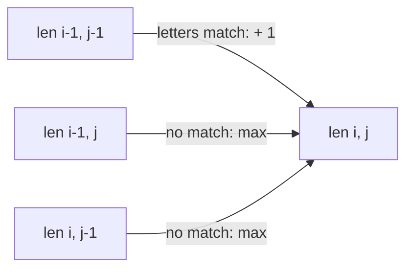
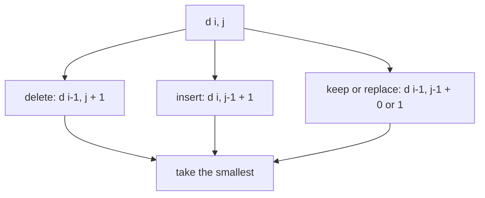
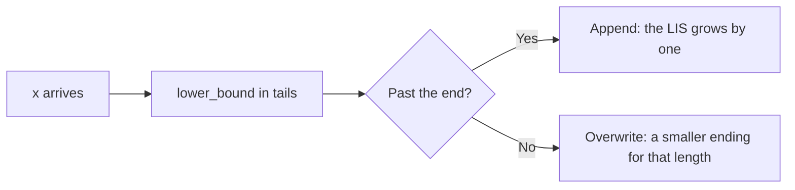

# new

## explanation

### What two sequences have in common

A **subsequence** keeps some letters of a string in their original order, possibly with gaps: "ACE" is a subsequence of "ABCDE". (A substring has no gaps.) The **longest common subsequence** (LCS) of two strings is the longest sequence that is a subsequence of both. It measures how similar they are. File comparison tools, DNA alignment and spell checkers all build on this idea.

Trying every subsequence is hopeless: a string of length 30 has about a billion. DP makes it O(n · m).

### The table

Let `len[i][j]` be the LCS length of the first i letters of a and the first j letters of b. Look at the **last** letters, a[i − 1] and b[j − 1]:

- if they **match**, they can end the common subsequence: `len[i][j] = len[i − 1][j − 1] + 1`;
- if not, at least one of them isn't used, so drop one and take the better: `len[i][j] = max(len[i − 1][j], len[i][j − 1])`.

Row 0 and column 0 are 0: an empty prefix shares nothing. Fill the table row by row; the answer is `len[n][m]`.

### Reading the subsequence back

Start at the bottom-right corner and walk back:

- if the letters match, that letter is in the LCS: take it and move diagonally;
- otherwise move to whichever neighbour (up or left) holds the same value.

The letters are collected backwards, so reverse them at the end. There may be several LCSs of the same length; the walk finds one.

### Cost

(n + 1) × (m + 1) entries, each in O(1): **O(n · m)** time and memory. Two strings of 5000 letters need 25 million entries, which is fine.

## diagram



## example

```cpp
#include <algorithm>
#include <iostream>
#include <string>
#include <vector>

int main() {
    std::string a = "ABCBDAB", b = "BDCABA";
    const int n = a.size(), m = b.size();
    // len[i][j]: the LCS length of the first i letters of a and the first j letters of b.
    std::vector<std::vector<int>> len(n + 1, std::vector<int>(m + 1, 0));
    for (int i = 1; i <= n; i++)
        for (int j = 1; j <= m; j++)
            len[i][j] = a[i - 1] == b[j - 1] ? len[i - 1][j - 1] + 1                // the last letters match: use both
                                             : std::max(len[i - 1][j], len[i][j - 1]);  // otherwise drop one of them
    std::string lcs;  // walk back from the corner to read one longest common subsequence
    for (int i = n, j = m; i > 0 && j > 0;) {
        if (a[i - 1] == b[j - 1]) lcs += a[i - 1], i--, j--;
        else if (len[i - 1][j] >= len[i][j - 1]) i--;
        else j--;
    }
    std::reverse(lcs.begin(), lcs.end());
    std::cout << "length " << len[n][m] << ", one of them: " << lcs << "\ntable:\n";
    for (int i = 0; i <= n; i++)
        for (int j = 0; j <= m; j++) std::cout << len[i][j] << (j < m ? ' ' : '\n');
}
```

```text
length 4, one of them: BCBA
table:
0 0 0 0 0 0 0
0 0 0 0 1 1 1
0 1 1 1 1 2 2
0 1 1 2 2 2 2
0 1 1 2 2 3 3
0 1 2 2 2 3 3
0 1 2 2 3 3 4
0 1 2 2 3 4 4
```

1. Each entry looks only at its three neighbours above and to the left, so filling row by row always has them ready.
2. The bottom-right entry is the answer: 4.
3. The walk back takes a letter on every diagonal step and otherwise follows the equal value. Reversed, it gives BCBA, which appears in order in both ABCBDAB and BDCABA. BDAB is another LCS of the same length.

## mistakes

- **Mixing up subsequence and substring.** An LCS may skip letters; the longest common *substring* is a different DP, which resets to 0 on a mismatch.
- **Off-by-one between table and string indexes.** Row i is about the first i letters, so the last of them is `a[i − 1]`.
- **Forgetting row and column 0.** They stand for empty prefixes and must be 0.
- **Walking back without reversing.** The letters come out last first.
- **Expecting one particular LCS.** Ties can be broken either way; any common subsequence of maximum length is correct.

## check

```cpp
#include <algorithm>
#include <iostream>
#include <string>
#include <vector>

int lcs(const std::string& a, const std::string& b) {
    std::vector<std::vector<int>> len(a.size() + 1, std::vector<int>(b.size() + 1, 0));
    for (std::size_t i = 1; i <= a.size(); i++)
        for (std::size_t j = 1; j <= b.size(); j++)
            len[i][j] = a[i - 1] == b[j - 1] ? len[i - 1][j - 1] + 1 : std::max(len[i - 1][j], len[i][j - 1]);
    return len[a.size()][b.size()];
}

int main() { std::cout << lcs("PROGRAM", "PROBLEM") << ' ' << lcs("abc", "xyz") << ' ' << lcs("TREE", "TERRACE") << '\n'; }
```

```text
4 0 3
```

PROGRAM and PROBLEM share P, R, O and M in order. abc and xyz share nothing. TREE and TERRACE share T, R, E in order, but not a second E after that, so 3.

# building

## explanation

### A quick recap

The LCS table `len[i][j]` compares prefixes of two strings: a match extends the diagonal entry by one, and a mismatch takes the better of dropping a letter from either string. It costs O(n · m), and walking back from the corner recovers the subsequence.

### Edit distance

How many single-letter edits turn one word into another? The allowed edits are **insert** a letter, **delete** a letter, and **replace** a letter. This is the **edit distance** (Levenshtein distance). Spell checkers use it to suggest "sitting" for "siting".

Let `d[i][j]` be the fewest edits turning the first i letters of a into the first j letters of b. Again, look at the last letters:

- **delete** a[i − 1]: `d[i − 1][j] + 1`;
- **insert** b[j − 1] at the end: `d[i][j − 1] + 1`;
- **keep or replace**: `d[i − 1][j − 1]`, plus 1 if the letters differ.

Take the smallest. The base cases are different from LCS: turning i letters into nothing takes i deletions (`d[i][0] = i`), and turning nothing into j letters takes j insertions.

### Listing the edits

Walk back from `d[n][m]`. At each cell, find which of the three options produced its value, record that edit, and move to that cell.

### Palindromes

- The longest palindromic **subsequence** of s is the LCS of s and its reverse.
- The longest palindromic **substring** doesn't need a table. Every palindrome has a centre, either a letter or the gap between two letters. Expand outwards from each of the 2n − 1 centres while the letters match: O(n²) time and O(1) memory.

## diagram



## example

```cpp
#include <algorithm>
#include <iostream>
#include <string>
#include <vector>

int main() {
    std::string a = "kitten", b = "sitting";
    const int n = a.size(), m = b.size();
    // d[i][j]: the fewest edits turning the first i letters of a into the first j letters of b.
    std::vector<std::vector<int>> d(n + 1, std::vector<int>(m + 1));
    for (int i = 0; i <= n; i++) d[i][0] = i;  // delete everything
    for (int j = 0; j <= m; j++) d[0][j] = j;  // insert everything
    for (int i = 1; i <= n; i++)
        for (int j = 1; j <= m; j++)
            d[i][j] = std::min({d[i - 1][j] + 1,                              // delete a[i-1]
                                d[i][j - 1] + 1,                              // insert b[j-1]
                                d[i - 1][j - 1] + (a[i - 1] != b[j - 1])});   // keep or replace
    std::cout << "edit distance " << d[n][m] << '\n';
    std::vector<std::string> steps;  // walk back from the corner to list the edits
    for (int i = n, j = m; i > 0 || j > 0;) {
        if (i > 0 && j > 0 && d[i][j] == d[i - 1][j - 1] + (a[i - 1] != b[j - 1])) {
            if (a[i - 1] != b[j - 1]) steps.push_back(std::string("replace ") + a[i - 1] + " with " + b[j - 1]);
            i--, j--;
        } else if (i > 0 && d[i][j] == d[i - 1][j] + 1) steps.push_back(std::string("delete ") + a[--i]);
        else steps.push_back(std::string("insert ") + b[--j]);
    }
    for (auto it = steps.rbegin(); it != steps.rend(); ++it) std::cout << *it << '\n';
}
```

```text
edit distance 3
replace k with s
replace e with i
insert g
```

1. The first row and column are the costs of building from, or reducing to, an empty prefix.
2. Matching letters (i, t, t, n) cost nothing; the diagonal carries their value straight through.
3. The walk back finds the three edits that make up the distance: two replacements and one insertion at the end.

## mistakes

- **LCS base cases for edit distance.** Row 0 and column 0 are i and j here, not 0.
- **Charging for matching letters.** The diagonal move costs 0 when the letters are equal.
- **Walking back with the wrong test.** Check which option actually produced `d[i][j]`; guessing can list impossible edits.
- **Running off the table's edge.** At i = 0 only insertions remain, and at j = 0 only deletions; check bounds before looking left or up.
- **Expanding palindromes from letters only.** Even-length palindromes such as "abba" are centred between two letters; try both kinds of centre.

## check

```cpp
#include <iostream>
#include <string>

int main() {
    std::string s = "xabacabay";
    int bestFrom = 0, bestLen = 1;
    for (int center = 0; center < (int)s.size(); center++)
        for (int odd = 0; odd < 2; odd++) {  // odd = 1: centred on a letter; odd = 0: between two letters
            int l = center, r = center + 1 - odd;
            while (l >= 0 && r < (int)s.size() && s[l] == s[r]) l--, r++;
            if (r - l - 1 > bestLen) bestLen = r - l - 1, bestFrom = l + 1;
        }
    std::cout << s.substr(bestFrom, bestLen) << ' ' << bestLen << '\n';
}
```

```text
abacaba 7
```

Expanding around the centre letter c, the matching pairs a-a, b-b and a-a extend the palindrome to "abacaba". At x and y the letters differ, so it stops at length 7. No other centre grows longer.

# strong

## explanation

### Longest increasing subsequence

In a sequence of numbers, find the longest subsequence that keeps increasing. The direct DP is: `lis[i]` = the longest increasing subsequence **ending at i** = 1 + the largest `lis[j]` over earlier j with a[j] < a[i]. That's O(n²), fine up to about 10⁴ numbers.

### O(n log n) with "tails"

Keep an array `tails`, where `tails[k]` is the **smallest possible last value** of an increasing subsequence of length k + 1 seen so far. A smaller last value is always at least as good, since more numbers can follow it. `tails` stays sorted, so for each new number x:

- find the first entry ≥ x with `lower_bound`;
- if there is none, x extends the longest subsequence: append it;
- otherwise, x is a smaller ending for that length: overwrite it.

The length of `tails` is the LIS length. `tails` itself is **not** a valid subsequence; it mixes endings from different candidates. To recover a real one, store for each element the index of the element before it (the current tail one length shorter), and walk back from the last tail.

### Strict or not

`lower_bound` gives a strictly increasing subsequence. For a non-decreasing one, where equal values may repeat, use `upper_bound`.

### Problems in disguise

- **Nesting boxes or envelopes** (both sides must grow): sort by width ascending and, for equal widths, height **descending**; then take the LIS of the heights.
- **LCS of two permutations**: map each value to its position in the second permutation; the LCS becomes the LIS of those positions, in O(n log n) instead of O(n²).
- **The fewest increasing subsequences** that cover a sequence relates to the longest non-increasing one.

## diagram



## example

```cpp
#include <algorithm>
#include <iostream>
#include <random>
#include <vector>

int lisSlow(const std::vector<int>& a) {  // O(n^2): the longest ending at i, from every earlier j
    std::vector<int> lis(a.size(), 1);
    for (std::size_t i = 0; i < a.size(); i++)
        for (std::size_t j = 0; j < i; j++) if (a[j] < a[i]) lis[i] = std::max(lis[i], lis[j] + 1);
    return a.empty() ? 0 : *std::max_element(lis.begin(), lis.end());
}
// O(n log n): tails[k] is the smallest last value of an increasing subsequence of length k + 1.
std::vector<int> lisFast(const std::vector<int>& a) {
    std::vector<int> tails, tailAt, before(a.size(), -1);  // tailAt[k]: the index in a of tails[k]
    for (int i = 0; i < (int)a.size(); i++) {
        int k = int(std::lower_bound(tails.begin(), tails.end(), a[i]) - tails.begin());
        if (k == (int)tails.size()) tails.push_back(a[i]), tailAt.push_back(i);
        else tails[k] = a[i], tailAt[k] = i;
        if (k > 0) before[i] = tailAt[k - 1];  // the element this one extends
    }
    std::vector<int> seq;
    for (int i = tailAt.empty() ? -1 : tailAt.back(); i >= 0; i = before[i]) seq.push_back(a[i]);
    std::reverse(seq.begin(), seq.end());
    return seq;
}

int main() {
    std::vector<int> a = {10, 9, 2, 5, 3, 7, 101, 18, 4, 20};
    std::cout << "a longest increasing subsequence:";
    for (int x : lisFast(a)) std::cout << ' ' << x;
    std::cout << "\nlength " << lisSlow(a) << " the slow way\n";
    std::mt19937 rng(4);
    int wrong = 0;
    for (int t = 0; t < 200; t++) {
        std::vector<int> v(rng() % 60);
        for (int& x : v) x = int(rng() % 50);
        if ((int)lisFast(v).size() != lisSlow(v)) wrong++;
    }
    std::cout << "200 random arrays: " << wrong << " disagreements\n";
}
```

```text
a longest increasing subsequence: 2 3 7 18 20
length 5 the slow way
200 random arrays: 0 disagreements
```

1. 10, 9 and 2 each replace the length-1 ending, since a smaller start is better. 5 and then 3 give length 2, and 7 gives length 3.
2. 101 extends to length 4, but 18 then replaces it as a smaller ending for that length, which lets 20 extend to length 5 later.
3. 4 overwrites the length-3 ending (7). At the end, `tails` is 2 3 4 18 20, which is not a subsequence of the input. The `before` links still lead back to the real one: 2 3 7 18 20.
4. Both methods agree on 200 random arrays, with lengths and values chosen at random.

## mistakes

- **Printing `tails` as the answer.** Its length is right, but its contents mix different subsequences. Walk back through the stored links.
- **`upper_bound` for a strictly increasing LIS.** That allows equal neighbours. Use `lower_bound` for strict and `upper_bound` for non-decreasing.
- **Sorting envelopes with equal widths ascending by height.** Two envelopes of the same width would then count as nested. Sort heights descending for equal widths.
- **O(n²) on 10⁵ numbers.** That's 10¹⁰ steps. Use the tails method.
- **Forgetting the empty input.** The answer is 0, and the reconstruction must handle no tails at all.

## check

```cpp
#include <algorithm>
#include <iostream>
#include <vector>

int main() {
    std::vector<int> a = {3, 3, 1, 3, 2, 2, 4};
    std::vector<int> strict, nondec;
    for (int x : a) {
        auto s = std::lower_bound(strict.begin(), strict.end(), x);
        if (s == strict.end()) strict.push_back(x); else *s = x;
        auto w = std::upper_bound(nondec.begin(), nondec.end(), x);
        if (w == nondec.end()) nondec.push_back(x); else *w = x;
    }
    std::cout << strict.size() << ' ' << nondec.size() << '\n';
}
```

```text
3 4
```

The longest strictly increasing subsequence has 3 numbers, such as 1 3 4 or 1 2 4. If equal neighbours are allowed, 3 3 3 4 or 1 2 2 4 reach 4. `upper_bound` lets an equal value extend a run instead of replacing it.
