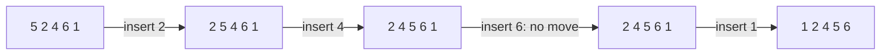
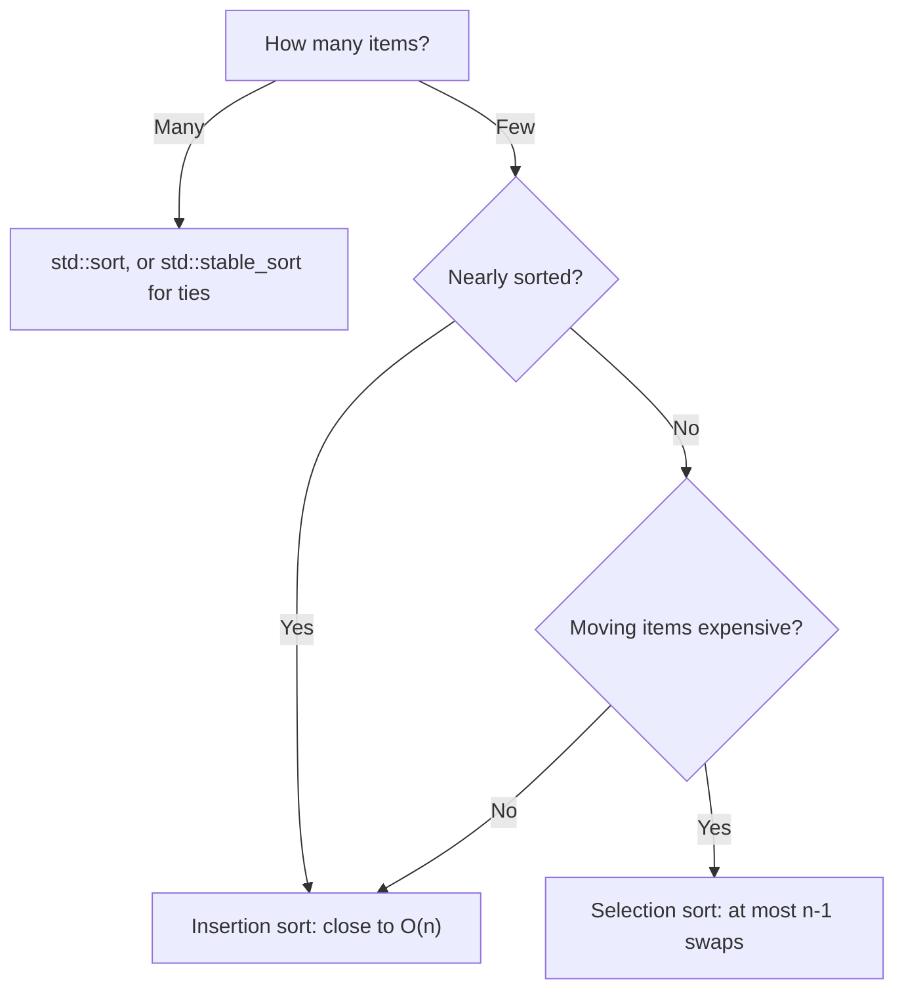
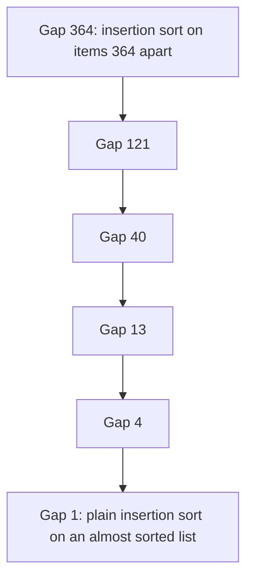

# new

## explanation

### Why learn simple sorts?

`std::sort` sorts for you, so why write your own? Because the simple sorts show the ideas every faster sort builds on, they are what you reach for when you must sort by hand, and one of them, insertion sort, is still used inside real sorting libraries for small pieces of data.

### Selection sort

Find the **smallest** item and swap it to the front. Then find the smallest of the rest and swap it into second place, and so on. After pass `i`, the first `i + 1` positions hold the smallest items, in order.

### Bubble sort

Walk along the list comparing **neighbours**, swapping any pair that's in the wrong order. After one pass, the largest item has "bubbled" to the end. Repeat passes until a pass makes no swaps.

### Insertion sort

This is how most people sort playing cards in their hand. Take the next card and slide it left past every bigger card until it fits. The left part of the list is always sorted; each step grows it by one card.

### What they cost

All three compare items in pairs and can need about n²/2 comparisons, so they are O(n²). That's fine for a few hundred items and far too slow for a million, where `std::sort`'s O(n log n) is needed.

But they differ in useful ways:

- Selection sort makes at most n − 1 swaps: good when moving items is expensive.
- Bubble sort with an early stop finishes in one pass on a list that's already sorted.
- Insertion sort is fast on lists that are **almost** sorted, because each card only slides a short way.

### Stable sorting

A sort is **stable** if items that compare equal keep their original order. Sorting students by marks with a stable sort keeps students with the same mark in their earlier order (say, alphabetical). Insertion and bubble sort are stable; selection sort is not, because its long swaps can jump an item past an equal one.

## diagram



## example

```cpp
#include <iostream>
#include <utility>
#include <vector>

void print(const std::vector<int>& v) {
    for (int x : v) std::cout << x << ' ';
    std::cout << '\n';
}

// Selection sort: find the smallest of the unsorted part, swap it to the front of that part.
void selectionSort(std::vector<int>& v) {
    for (std::size_t i = 0; i + 1 < v.size(); i++) {
        std::size_t smallest = i;
        for (std::size_t j = i + 1; j < v.size(); j++)
            if (v[j] < v[smallest]) smallest = j;
        std::swap(v[i], v[smallest]);
    }
}

// Insertion sort: take the next card and slide it left into place among the sorted ones.
void insertionSort(std::vector<int>& v) {
    for (std::size_t i = 1; i < v.size(); i++) {
        int card = v[i];
        std::size_t j = i;
        while (j > 0 && v[j - 1] > card) {
            v[j] = v[j - 1];  // shift the bigger one right
            j--;
        }
        v[j] = card;
        print(v);
    }
}

int main() {
    std::vector<int> a = {29, 10, 14, 37, 13};
    selectionSort(a);
    print(a);
    std::vector<int> b = {5, 2, 4, 6, 1};
    insertionSort(b);
}
```

```text
10 13 14 29 37
2 5 4 6 1
2 4 5 6 1
2 4 5 6 1
1 2 4 5 6
```

1. Selection sort swaps 10 to the front, then 13 into second place, then 14, and so on: one swap per position.
2. Insertion sort then prints the list after each card is placed. First 2 slides left past 5.
3. Next, 4 slides past 5 and stops at 2, which is smaller.
4. 6 is already bigger than everything before it, so nothing moves: on sorted data, insertion sort barely works at all.
5. Finally, 1 slides past every other card to the front.

## mistakes

- **Checking `v[j - 1]` before `j > 0`.** With `std::size_t j`, `j - 1` at 0 wraps to a huge number. Test `j > 0` first; `&&` then skips the comparison.
- **Using `>=` in insertion sort.** `v[j - 1] >= card` slides a card past equal ones, which breaks stability. Use `>`.
- **Bubble sort without an early stop.** If a pass makes no swaps, the list is sorted. Without that check, bubble sort always does all n passes.
- **Using an O(n²) sort on big data.** At 100,000 items, n² is ten billion steps. Use `std::sort` or `std::stable_sort`.
- **Off-by-one in the loops.** Selection sort's outer loop can stop one before the end: the last item is already in place once all the others are.

## check

```cpp
#include <iostream>
#include <utility>
#include <vector>

int main() {
    std::vector<int> v = {4, 3, 7, 1};
    int swaps = 0;
    for (std::size_t j = 0; j + 1 < v.size(); j++) {
        if (v[j] > v[j + 1]) { std::swap(v[j], v[j + 1]); swaps++; }
    }
    for (int x : v) std::cout << x << ' ';
    std::cout << swaps << '\n';
}
```

```text
3 4 1 7 2
```

This is one pass of bubble sort. 4 and 3 swap; 4 and 7 are in order; 7 and 1 swap. Two swaps in all, and the largest value, 7, has reached the end. The 1 has moved only one place left: small items travel slowly in bubble sort, so more passes are needed.

# building

## explanation

### A quick recap

Selection sort picks the smallest remaining item each pass; bubble sort swaps neighbours; insertion sort slides each item left into a sorted prefix. All are O(n²) in the worst case; insertion and bubble sort are stable.

### Choosing between them

They have the same worst case, but behave very differently on real data:

- **Selection sort** always does about n²/2 comparisons, whatever the input, but at most n − 1 swaps.
- **Insertion sort** does one comparison per item, plus one per slide. On sorted data that's n − 1 comparisons, O(n); on reversed data it's about n²/2.
- **Bubble sort** with an early stop is O(n) on sorted data, but small items far to the right move only one step per pass, so it's usually the slowest.

So for small arrays, or arrays that are nearly sorted (a few items out of place), insertion sort is the best simple choice. That's why fast library sorts switch to insertion sort for small pieces.

### Stability in practice

When you sort records by one key, stability decides the order of ties. Sorting `(mark, name)` pairs by mark with a stable sort, after they were in name order, gives equal marks in name order. `std::sort` is not stable; `std::stable_sort` is.

### Shell sort, briefly

Insertion sort is slow when items must travel far, one step at a time. **Shell sort** first runs insertion sort on items a big gap apart, letting them jump far, then shrinks the gap, finishing with gap 1, plain insertion sort on an almost sorted list. With good gaps it is much faster than O(n²), and it still needs no extra memory.

### Step by step: picking a sort

1. Is the data big? Use `std::sort`, or `std::stable_sort` if ties must keep their order.
2. Is it tiny, or nearly sorted? Insertion sort is simple and fast.
3. Are moves expensive and comparisons cheap? Selection sort keeps swaps to n − 1.

## diagram



## example

```cpp
#include <iostream>
#include <utility>
#include <vector>

// Insertion sort, counting comparisons: about n on sorted input, n^2/2 on reversed.
long long insertionComparisons(std::vector<int> v) {
    long long count = 0;
    for (std::size_t i = 1; i < v.size(); i++) {
        int card = v[i];
        std::size_t j = i;
        while (j > 0) {
            count++;
            if (v[j - 1] <= card) break;
            v[j] = v[j - 1];
            j--;
        }
        v[j] = card;
    }
    return count;
}

// Selection sort always scans the whole unsorted part.
long long selectionComparisons(std::vector<int> v) {
    long long count = 0;
    for (std::size_t i = 0; i + 1 < v.size(); i++) {
        std::size_t smallest = i;
        for (std::size_t j = i + 1; j < v.size(); j++) {
            count++;
            if (v[j] < v[smallest]) smallest = j;
        }
        std::swap(v[i], v[smallest]);
    }
    return count;
}

int main() {
    std::vector<int> sorted, reversed, nearly;
    for (int i = 0; i < 100; i++) { sorted.push_back(i); reversed.push_back(100 - i); nearly.push_back(i); }
    std::swap(nearly[10], nearly[11]);
    std::swap(nearly[50], nearly[52]);
    std::cout << "insertion: " << insertionComparisons(sorted) << ' ' << insertionComparisons(nearly) << ' ' << insertionComparisons(reversed) << '\n';
    std::cout << "selection: " << selectionComparisons(sorted) << ' ' << selectionComparisons(nearly) << ' ' << selectionComparisons(reversed) << '\n';
}
```

```text
insertion: 99 103 4950
selection: 4950 4950 4950
```

1. On sorted data, each insertion compares once and stops: 99 comparisons for 100 items.
2. The nearly sorted list has four pairs out of order (one from the first swap, three from the second), and each costs one extra comparison: 103.
3. On reversed data, every item slides all the way to the front: 1 + 2 + … + 99 = 4950.
4. Selection sort does 4950 comparisons every time, because it must scan the rest of the list to be sure it found the smallest. It can't take advantage of order that's already there.

## mistakes

- **Selection sort on nearly sorted data.** It does the full n²/2 comparisons anyway. Insertion sort would finish in close to n.
- **Assuming `std::sort` keeps ties in order.** It doesn't. If the order of equal items matters, use `std::stable_sort`.
- **Bubble sort as a default.** It's usually the slowest of the three in practice. Prefer insertion sort.
- **Counting the wrong thing.** Comparisons and moves are separate costs. Selection sort is cheap on moves but never on comparisons.
- **Shell sort with poor gaps.** Gaps that are all powers of two compare the same groups over and over and can stay close to quadratic. Use a tested sequence, such as 1, 4, 13, 40, … (each 3 × the last + 1).

## check

```cpp
#include <iostream>
#include <string>
#include <utility>
#include <vector>

int main() {
    std::vector<std::pair<int, std::string>> v = {{2, "a"}, {1, "b"}, {2, "c"}, {1, "d"}};
    for (std::size_t i = 1; i < v.size(); i++) {
        auto card = v[i];
        std::size_t j = i;
        while (j > 0 && v[j - 1].first > card.first) { v[j] = v[j - 1]; j--; }
        v[j] = card;
    }
    for (const auto& [k, s] : v) std::cout << k << s << ' ';
    std::cout << '\n';
}
```

```text
1b 1d 2a 2c
```

Insertion sort orders the pairs by their number only. A card never slides past an equal key, because the test is `>`, not `>=`. So the two 1s stay in their original order, b before d, and so do the two 2s, a before c: the sort is stable.

# strong

## explanation

### Inversions

An **inversion** is a pair of positions `i < j` with `v[i] > v[j]`. A sorted list has none; a reversed one has n(n − 1)/2. Swapping two **neighbours** that are out of order removes exactly one inversion. So any sort that only swaps neighbours, such as bubble sort or insertion sort, must make at least as many moves as there are inversions. On random data that's about n²/4, so these sorts are Θ(n²) on average, not just in the worst case.

Insertion sort's running time is Θ(n + I), where I is the number of inversions: excellent when I is small, which is exactly what "nearly sorted" means.

### Beating the neighbour limit

To do better, items must jump over many others at once. Shell sort does this with gapped insertion sorts: one move with gap h can remove many inversions. With the 3x + 1 gaps (1, 4, 13, 40, 121, …) it runs in about O(n^1.5) in the worst case; better gap sequences do better still in practice. Merge sort and quick sort get to O(n log n) by a different route, divide and conquer.

### Other refinements

- **Binary insertion sort** finds each item's place by binary search: O(n log n) comparisons, but the shifting is still O(n²) moves.
- **Cocktail sort** runs bubble passes in both directions, so small items near the end (the "turtles") travel faster. It's still O(n²).
- Selection sort's n − 1 swaps are the minimum any sort needs in the worst case, which matters when writing is far costlier than reading.

### Inside real library sorts

`std::sort` is typically **introsort**: quick sort that falls back to heap sort if the recursion gets too deep, and that finishes small ranges, a few dozen items or fewer, with insertion sort, because for tiny inputs its low overhead beats everything else. Knowing the simple sorts explains why that design works.

## diagram



## example

```cpp
#include <iostream>
#include <vector>

// Gapped insertion sort; gap 1 is plain insertion sort. Returns how many elements it moved.
long long gappedInsertion(std::vector<int>& v, std::size_t gap) {
    long long moves = 0;
    for (std::size_t i = gap; i < v.size(); i++) {
        int card = v[i];
        std::size_t j = i;
        while (j >= gap && v[j - gap] > card) {
            v[j] = v[j - gap];
            j -= gap;
            moves++;
        }
        v[j] = card;
    }
    return moves;
}

int main() {
    // A fixed pseudo-random list, so the output is the same on every run.
    std::vector<int> base;
    unsigned seed = 12345;
    for (int i = 0; i < 2000; i++) {
        seed = seed * 1103515245u + 12345u;
        base.push_back(static_cast<int>(seed >> 16) % 10000);
    }

    std::vector<int> a = base;
    long long plain = gappedInsertion(a, 1);  // equals the number of inversions

    std::vector<int> b = base;
    std::vector<std::size_t> gaps;
    for (std::size_t g = 1; g < b.size() / 3; g = 3 * g + 1) gaps.push_back(g);  // 1, 4, 13, 40, ...
    long long shell = 0;
    for (auto it = gaps.rbegin(); it != gaps.rend(); ++it) shell += gappedInsertion(b, *it);

    std::cout << "gaps used: " << gaps.size() << ", largest " << gaps.back() << '\n';
    std::cout << "insertion moves " << plain << ", shell moves " << shell << '\n';
    std::cout << "same result: " << (a == b) << '\n';
}
```

```text
gaps used: 6, largest 364
insertion moves 1010641, shell moves 21085
same result: 1
```

1. The list is 2,000 pseudo-random values made by a fixed formula, so every run sees the same data.
2. Plain insertion sort moves each item one place at a time, so its moves equal the number of inversions: about a million, close to n²/4 = 1,000,000.
3. Shell sort uses gaps 364, 121, 40, 13, 4 and 1. The big gaps let items jump far early, so the final gap-1 pass has very little left to do: about 21,000 moves in total, roughly 48 times fewer.
4. Both end with exactly the same sorted list.

## mistakes

- **Expecting neighbour-swapping sorts to be fast on average.** Random data has about n²/4 inversions, and each neighbour swap removes only one. They are Θ(n²) on typical data, not only in rare worst cases.
- **Calling binary insertion sort O(n log n).** It saves comparisons, but the elements still shift one place at a time: O(n²) moves.
- **Forgetting the final gap of 1.** Shell sort is only guaranteed to finish sorted if its last pass is plain insertion sort.
- **Claiming selection sort is stable.** Swapping the smallest item to the front can carry another item past its equals: in 2a, 2b, 1, the first swap moves 2a behind 2b.
- **Writing your own sort for production data.** Library sorts combine several algorithms and are heavily tuned. Write your own only when you need special behaviour, such as counting inversions.

## check

```cpp
#include <iostream>
#include <vector>

int main() {
    std::vector<int> v = {3, 1, 2, 5, 4};
    int inversions = 0;
    for (std::size_t i = 0; i < v.size(); i++)
        for (std::size_t j = i + 1; j < v.size(); j++)
            if (v[i] > v[j]) inversions++;
    std::vector<int> w = v;
    int moves = 0;
    for (std::size_t i = 1; i < w.size(); i++) {
        int card = w[i];
        std::size_t j = i;
        while (j > 0 && w[j - 1] > card) { w[j] = w[j - 1]; j--; moves++; }
        w[j] = card;
    }
    std::cout << inversions << ' ' << moves << '\n';
}
```

```text
3 3
```

The pairs out of order are (3, 1), (3, 2) and (5, 4): three inversions. Insertion sort shifts 3 right twice (for 1 and then for 2) and 5 right once (for 4): three moves. Each move removes exactly one inversion, so the two counts always match.
