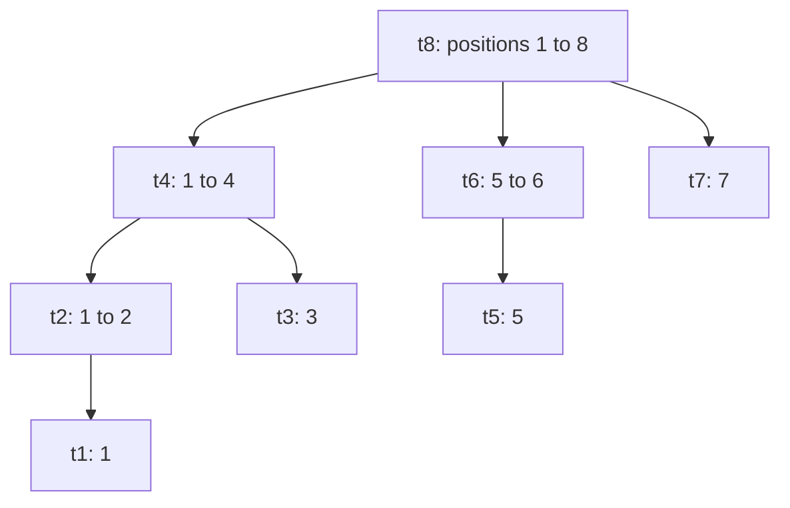
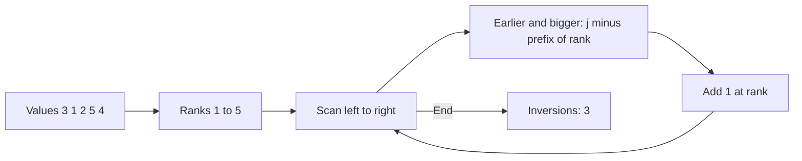
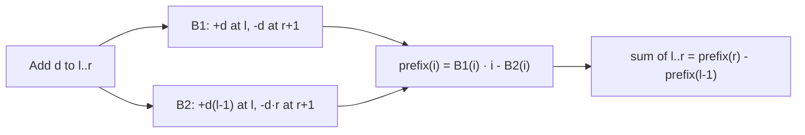

# new

## explanation

### Prefix sums that can change

A prefix-sum array answers "sum of positions l to r" in O(1), but changing one value means rebuilding it: O(n). A plain array is the opposite: O(1) updates, O(n) sums. A **Fenwick tree** (also called a binary indexed tree) does both in **O(log n)**, in about ten lines of code.

### What each cell holds

Positions start at 1. Cell `t[i]` holds the sum of a block of items **ending at position i**. The block's length is the lowest set bit of i, which C++ computes as `i & -i`:

- t[6]: 6 is 110 in binary, lowest bit 2, so it covers positions 5 and 6;
- t[7]: lowest bit 1, so only position 7;
- t[8]: lowest bit 8, so positions 1 to 8.

### Reading a prefix sum

To get a[1] + … + a[i], add t[i], then jump back past its block with `i -= i & -i`, and repeat until i is 0. For i = 7: t[7] + t[6] + t[4]. Each jump clears one set bit, so there are at most log₂ n steps.

### Changing one value

To add d to a[i], update every cell whose block contains i: start at i and move with `i += i & -i`. For i = 5 on 8 positions, that's t[5], t[6] and t[8]. Again at most log₂ n steps.

### Any range

The sum of positions l to r is `prefix(r) − prefix(l − 1)`, two O(log n) walks.

## diagram



## example

```cpp
#include <iostream>
#include <vector>

// A Fenwick tree with positions 1..n: t_[i] holds the sum of the (i & -i) items ending at position i.
class Fenwick {
public:
    explicit Fenwick(int n) : t_(n + 1, 0) {}
    void add(int i, long long delta) {  // a[i] += delta: update every block that contains i
        for (; i < (int)t_.size(); i += i & -i) t_[i] += delta;
    }
    long long prefix(int i) const {  // a[1] + ... + a[i]: jump back one block at a time
        long long s = 0;
        for (; i > 0; i -= i & -i) s += t_[i];
        return s;
    }
    long long range(int l, int r) const { return prefix(r) - prefix(l - 1); }
private:
    std::vector<long long> t_;
};

int main() {
    std::vector<int> a = {0, 5, 2, 9, 4, 7, 1, 3, 8};  // a[0] is unused: positions start at 1
    Fenwick f(8);
    for (int i = 1; i <= 8; i++) f.add(i, a[i]);
    std::cout << "sum of 1..8: " << f.prefix(8) << ", sum of 3..6: " << f.range(3, 6) << '\n';
    f.add(4, 10);
    std::cout << "after a[4] += 10, sum of 3..6: " << f.range(3, 6) << '\n';
    std::cout << "cells updated by add(5):";
    for (int i = 5; i <= 8; i += i & -i) std::cout << ' ' << i;
    std::cout << "\ncells read by prefix(7):";
    for (int i = 7; i > 0; i -= i & -i) std::cout << ' ' << i;
    std::cout << '\n';
}
```

```text
sum of 1..8: 39, sum of 3..6: 21
after a[4] += 10, sum of 3..6: 31
cells updated by add(5): 5 6 8
cells read by prefix(7): 7 6 4
```

1. Each value goes in with `add`, so the tree is ready after n updates.
2. The sum of 3..6 is prefix(6) − prefix(2) = 9 + 4 + 7 + 1 = 21.
3. One `add` changes position 4, and the next range sum already includes it: 31.
4. Position 5 lies in the blocks of t[5], t[6] and t[8]. The prefix up to 7 is t[7] + t[6] + t[4], three blocks that cover 1..7 exactly.

## mistakes

- **Using position 0.** `0 & -0` is 0, so `add(0, d)` loops forever. Fenwick positions start at 1; shift 0-based input by one.
- **Range sums with prefix(l) instead of prefix(l − 1).** That leaves out a[l].
- **Setting a value with `add`.** `add` adds. To set a[i] to x, add `x − a[i]`, and keep a plain copy of the array to know a[i].
- **Sizing the vector n instead of n + 1.** Position n then falls outside the vector.
- **`int` sums.** Many large values overflow; store `long long`.

## check

```cpp
#include <iostream>

int main() {
    std::cout << (6 & -6) << ' ' << (12 & -12) << ' ' << (7 & -7) << ' ' << (16 & -16) << '\n';
    int steps = 0;
    for (int i = 13; i > 0; i -= i & -i) steps++;
    std::cout << steps << '\n';
}
```

```text
2 4 1 16
3
```

`i & -i` keeps only the lowest set bit: 6 is 110, giving 2; 12 is 1100, giving 4; 7 ends in 1; 16 is a single bit. Reading prefix(13) clears one set bit per step, and 13 is 1101, which has three: t[13], t[12], t[8].

# building

## explanation

### A quick recap

A Fenwick tree keeps block sums in `t[1..n]`, where t[i] covers the `i & -i` positions ending at i. `add` walks up with `i += i & -i`, `prefix` walks down with `i -= i & -i`; both are O(log n).

### Building in O(n)

Calling `add` for every item costs O(n log n). Instead, copy the array into t, then go through i = 1 to n once and pass each t[i] up to the cell just above it, `i + (i & -i)`, if that exists. When you reach i, everything below it has already been added in, so t[i] is complete before it's passed on.

### Counting with a Fenwick tree

Use the positions as **values**, and store how many times each value has been seen. Then `prefix(x)` is "how many seen values are at most x", in O(log n), while new values keep arriving.

**Inversions** are pairs i < j with v[i] > v[j]; they measure how far an array is from sorted. Scan left to right. Before adding v[j], the earlier values bigger than it number j − prefix(v[j]). Add that up: O(n log n) in total.

### Coordinate compression

Values like 10⁹ are too big to use as positions. Only their order matters, so sort the distinct values and replace each value by its rank, 1 to k. A Fenwick tree of size k then does the counting.

### What a Fenwick tree can't do

Range sums work because subtraction undoes addition: `prefix(r) − prefix(l − 1)`. For minimums or maximums over a range there is no such undo, so use a segment tree instead.

## diagram



## example

```cpp
#include <algorithm>
#include <iostream>
#include <vector>

struct Fenwick {
    std::vector<long long> t;
    explicit Fenwick(int n) : t(n + 1, 0) {}
    // Build from a[1..n] in O(n): each cell passes its finished total up to the next cell covering it.
    explicit Fenwick(const std::vector<long long>& a) : t(a) {
        for (std::size_t i = 1; i < t.size(); i++)
            if (std::size_t up = i + (i & -i); up < t.size()) t[up] += t[i];
    }
    void add(int i, long long d) { for (; i < (int)t.size(); i += i & -i) t[i] += d; }
    long long prefix(int i) const { long long s = 0; for (; i > 0; i -= i & -i) s += t[i]; return s; }
};

// Pairs i < j with v[i] > v[j]: for each value, count the earlier values that are bigger.
long long inversions(const std::vector<int>& v) {
    std::vector<int> sorted = v;
    std::sort(sorted.begin(), sorted.end());
    sorted.erase(std::unique(sorted.begin(), sorted.end()), sorted.end());
    Fenwick seen((int)sorted.size());
    long long count = 0;
    for (std::size_t j = 0; j < v.size(); j++) {
        int rank = int(std::lower_bound(sorted.begin(), sorted.end(), v[j]) - sorted.begin()) + 1;
        count += (long long)j - seen.prefix(rank);  // earlier values minus those not bigger
        seen.add(rank, 1);
    }
    return count;
}

int main() {
    Fenwick f(std::vector<long long>{0, 5, 2, 9, 4, 7, 1, 3, 8});
    std::cout << "prefix(8) = " << f.prefix(8) << ", t[4] = " << f.t[4] << ", t[6] = " << f.t[6] << '\n';
    for (const auto& v : {std::vector<int>{3, 1, 2, 5, 4}, std::vector<int>{8, 4, 2, 1}, std::vector<int>{7, 7, 3, 7}})
        std::cout << "inversions: " << inversions(v) << '\n';
}
```

```text
prefix(8) = 39, t[4] = 20, t[6] = 8
inversions: 3
inversions: 6
inversions: 2
```

1. The O(n) build gives the same cells as adding the items one by one: t[4] covers positions 1..4 (5 + 2 + 9 + 4 = 20) and t[6] covers 5..6 (7 + 1 = 8).
2. In 3 1 2 5 4 the inversions are (3, 1), (3, 2) and (5, 4).
3. 8 4 2 1 is fully reversed, so all 4 × 3 / 2 = 6 pairs are inversions.
4. In 7 7 3 7, equal values aren't inversions. `prefix(rank)` counts earlier values that are equal or smaller, so only the two pairs (7, 3) count.

## mistakes

- **Passing a cell up before it's complete.** The O(n) build must go from i = 1 upwards, so every cell has received its lower parts before passing its total on.
- **Counting equal values as inversions.** Subtract `prefix(rank)`, which includes equal values, not `prefix(rank − 1)`.
- **Values as positions without compression.** A value of 10⁹ would need a 10⁹-cell tree. Compress to ranks first.
- **Ranks starting at 0.** `lower_bound` gives 0 for the smallest value; add 1, since Fenwick positions start at 1.
- **Expecting range minimums.** Minimums can't be subtracted away, so `prefix` tricks don't give the minimum of l..r.

## check

```cpp
#include <iostream>
#include <vector>

int main() {
    std::vector<int> t(9, 0);
    for (int pos : {3, 3, 6})
        for (int i = pos; i <= 8; i += i & -i) t[i]++;
    for (int i = 1; i <= 8; i++) std::cout << t[i] << (i < 8 ? ' ' : '\n');
    long long s = 0;
    for (int i = 5; i > 0; i -= i & -i) s += t[i];
    std::cout << s << '\n';
}
```

```text
0 0 2 2 0 1 0 3
2
```

Adding at 3 touches cells 3, 4 and 8, twice; adding at 6 touches 6 and 8. Reading prefix(5) adds t[5] + t[4] = 0 + 2: two of the added positions are at most 5.

# strong

## explanation

### Why the blocks fit together

Cell i covers (i − lowbit(i), i]. Clearing the lowest bit, as `prefix` does, lands exactly on the end of the next block to the left, so the blocks visited tile 1..i with no gaps or overlaps. Adding the lowest bit, as `add` does, moves to the next larger block that contains i. Both walks change one bit level per step: O(log n).

### Range updates, point queries

Store the **difference array** in the tree instead of the values. Adding d to a[l..r] becomes `add(l, d)` and `add(r + 1, −d)`, and a[i] is `prefix(i)`. Both are O(log n).

### Range updates and range sums

Use two trees, B1 and B2. To add d to a[l..r]:

- B1: add d at l and −d at r + 1;
- B2: add d · (l − 1) at l and −d · r at r + 1.

Then a[1] + … + a[i] = B1.prefix(i) · i − B2.prefix(i). The first term counts each update as if it covered all of 1..i, and B2 removes the part outside the update's range.

### Searching inside the tree

To find the smallest i with prefix(i) ≥ k, when all values are non-negative, don't binary search over `prefix` (O(log² n)). Walk down the powers of two: from pos = 0, try pos + step for step = the largest power of two ≤ n down to 1. If t[pos + step] < k, move there and subtract it from k. The answer is pos + 1, found in O(log n). With counts as values, this finds the k-th smallest item of a changing multiset.

### More dimensions

A 2D Fenwick tree nests the loops, one per dimension. It gives rectangle sums with point updates in O(log² n).

## diagram



## example

```cpp
#include <iostream>
#include <random>
#include <utility>
#include <vector>

struct Fenwick {
    std::vector<long long> t;
    explicit Fenwick(int n) : t(n + 1, 0) {}
    void add(int i, long long d) { for (; i < (int)t.size(); i += i & -i) t[i] += d; }
    long long prefix(int i) const { long long s = 0; for (; i > 0; i -= i & -i) s += t[i]; return s; }
};
// Range add and range sum with two trees: a[1] + ... + a[i] = B1(i) * i - B2(i).
struct RangeFenwick {
    Fenwick b1, b2;
    explicit RangeFenwick(int n) : b1(n), b2(n) {}
    void addRange(int l, int r, long long d) {
        b1.add(l, d), b1.add(r + 1, -d);
        b2.add(l, d * (l - 1)), b2.add(r + 1, -d * r);
    }
    long long prefix(int i) const { return b1.prefix(i) * i - b2.prefix(i); }
};

int main() {
    const int n = 1000;
    RangeFenwick rf(n);
    std::vector<long long> plain(n + 1, 0);  // the same updates done the slow way, to compare
    std::mt19937 rng(3);
    int wrong = 0;
    for (int op = 0; op < 5000; op++) {
        int l = int(rng() % n) + 1, r = int(rng() % n) + 1, q = int(rng() % n) + 1;
        if (l > r) std::swap(l, r);
        long long d = int(rng() % 21) - 10;
        rf.addRange(l, r, d);
        for (int i = l; i <= r; i++) plain[i] += d;
        long long expect = 0;
        for (int i = 1; i <= q; i++) expect += plain[i];
        if (rf.prefix(q) != expect) wrong++;
    }
    std::cout << "5000 range adds, each followed by a prefix sum: " << wrong << " wrong\n";
    std::cout << "total of all positions: " << rf.prefix(n) << " (plain array: ";
    long long total = 0;
    for (int i = 1; i <= n; i++) total += plain[i];
    std::cout << total << ")\n";
}
```

```text
5000 range adds, each followed by a prefix sum: 0 wrong
total of all positions: 334654 (plain array: 334654)
```

1. Each range add makes four walks of O(log n), instead of changing up to 1000 positions one by one.
2. After every update, the two-tree prefix sum matches the slow array at a random position: 0 wrong answers in 5000 checks.
3. The final totals agree too. Updates that reach position n add at r + 1 = n + 1, outside the tree, so `add` does nothing there, which is exactly right.

## mistakes

- **Getting B2's terms backwards.** It's d · (l − 1) at l and −d · r at r + 1. Test against a plain array on random data, as the example does.
- **`int` products.** `b1.prefix(i) * i` overflows quickly; keep everything `long long`.
- **The tree search with negative values.** The walk down assumes prefix sums only grow. With negative values, "smallest i with prefix(i) ≥ k" isn't monotone, and the walk can skip the answer.
- **Starting the search at the wrong step.** Start at the largest power of two that is at most n, not at n itself.
- **Forgetting the r + 1 cancel.** Without the second update, the added d continues past r to the end of the array.

## check

```cpp
#include <iostream>
#include <vector>

int main() {
    const int n = 8;
    std::vector<int> t(n + 1, 0);
    for (int v : {2, 5, 5, 7, 3})  // a multiset of values 1..8, counted in a Fenwick tree
        for (int i = v; i <= n; i += i & -i) t[i]++;
    for (long long k : {1, 3, 5}) {
        int pos = 0;
        long long left = k;
        for (int step = 8; step > 0; step /= 2)
            if (pos + step <= n && t[pos + step] < left) { pos += step; left -= t[pos]; }
        std::cout << pos + 1 << (k < 5 ? ' ' : '\n');
    }
}
```

```text
2 5 7
```

The multiset sorted is 2 3 5 5 7. The walk down the powers of two finds the smallest value whose count reaches k: the 1st is 2, the 3rd is 5 and the 5th is 7, each in four steps instead of a binary search over `prefix`.
