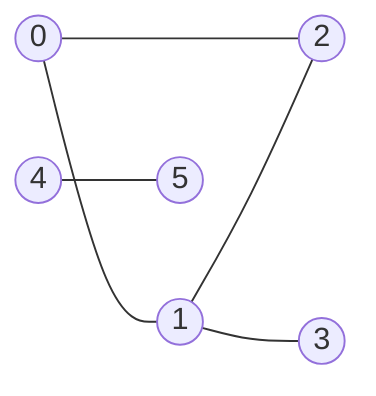
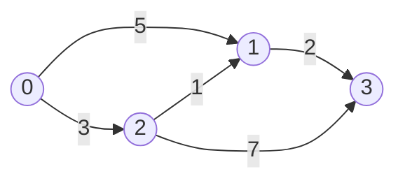
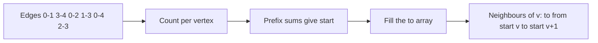

# new

## explanation

### Things and the links between them

A **graph** is a set of **vertices** (also called nodes) and **edges** that join pairs of them. Cities and roads, people and friendships, web pages and links, tasks and "must happen before" are all graphs. Once a problem is seen as a graph, a whole toolbox of algorithms applies to it.

### Kinds of graphs

- **Undirected**: an edge joins two vertices both ways, like a friendship.
- **Directed**: an edge goes from u to v only, like a one-way street or "follows".
- **Weighted**: each edge has a number, such as a distance or a cost.

The **degree** of a vertex is the number of edges touching it. In an undirected graph, every edge adds one to the degree of each of its two ends. So the sum of all degrees is exactly twice the number of edges.

### Storing a graph: the adjacency list

Number the vertices 0 to n − 1. For each vertex, keep a list of its neighbours: `std::vector<std::vector<int>> adj(n)`.

- An undirected edge {u, v} goes into **both** lists: `adj[u]` gets v and `adj[v]` gets u.
- A directed edge u → v goes only into `adj[u]`.

The memory is O(V + E), and visiting a vertex's neighbours takes time proportional to how many it has. Almost every graph algorithm starts by building this list from the input's list of edges.

### Vocabulary for later

- A **path** is a sequence of vertices, each joined to the next by an edge.
- A **cycle** is a path that returns to its start.
- A graph is **connected** if there's a path between every pair of vertices. Otherwise it splits into **components**.

## diagram



## example

```cpp
#include <iostream>
#include <utility>
#include <vector>

int main() {
    // 6 people, numbered 0 to 5, and who is friends with whom: an undirected graph as a list of edges.
    const int n = 6;
    std::vector<std::pair<int, int>> edges = {{0, 1}, {0, 2}, {1, 2}, {1, 3}, {4, 5}};

    // Adjacency list: adj[v] holds v's neighbours. An undirected edge goes into both lists.
    std::vector<std::vector<int>> adj(n);
    for (auto [u, v] : edges) {
        adj[u].push_back(v);
        adj[v].push_back(u);
    }
    for (int v = 0; v < n; v++) {
        std::cout << v << " (degree " << adj[v].size() << "):";
        for (int w : adj[v]) std::cout << ' ' << w;
        std::cout << '\n';
    }
    std::size_t degreeSum = 0;
    for (const auto& list : adj) degreeSum += list.size();
    std::cout << "edges " << edges.size() << ", sum of degrees " << degreeSum << '\n';
}
```

```text
0 (degree 2): 1 2
1 (degree 3): 0 2 3
2 (degree 2): 0 1
3 (degree 1): 1
4 (degree 1): 5
5 (degree 1): 4
edges 5, sum of degrees 10
```

1. Each edge such as {0, 1} is added to both lists, so 0 appears among 1's neighbours and 1 among 0's.
2. The degree of a vertex is just the size of its list: 1 has three friends.
3. 5 edges give a degree sum of 10, twice the number of edges, because every edge is counted from both ends.
4. Vertices 4 and 5 have no path to the others: the graph has two components.

## mistakes

- **Adding an undirected edge only once.** Then you can walk from u to v but not back. Push into both lists.
- **Adding a directed edge twice.** A one-way edge u → v belongs only in `adj[u]`.
- **Vertices numbered from 1.** Many inputs number vertices 1 to n. Subtract 1 when reading, or size the list n + 1.
- **Sizing the list by the number of edges.** The outer vector needs one entry per vertex, `adj(n)`.
- **Assuming the graph is connected.** Isolated vertices and separate components are common; algorithms must still visit them.

## check

```cpp
#include <iostream>
#include <vector>

int main() {
    std::vector<std::vector<int>> adj(4);
    int edges[][2] = {{0, 1}, {0, 2}, {2, 1}, {3, 0}, {1, 3}};
    for (auto& e : edges) adj[e[0]].push_back(e[1]);  // directed: only from -> to
    std::vector<int> in(4, 0);
    for (int u = 0; u < 4; u++) for (int v : adj[u]) in[v]++;
    std::cout << adj[0].size() << ' ' << in[1] << ' ' << adj[1][0] << '\n';
}
```

```text
2 2 3
```

The graph is directed, so each edge goes into one list only. Vertex 0 has two outgoing edges, to 1 and 2. Two edges come into 1, from 0 and from 2. The only edge leaving 1 goes to 3.

# building

## explanation

### A quick recap

A graph is vertices plus edges, which may be directed and may have weights. The adjacency list keeps, for each vertex, the vertices its edges lead to.

### Weighted adjacency lists

Store each edge's weight next to its destination: `std::vector<std::vector<Edge>>`, with `struct Edge { int to, weight; };`, or `std::pair<int, int>`. Shortest-path and spanning-tree algorithms read the weight as they walk the neighbours.

### The adjacency matrix

An n × n table where `matrix[u][v]` is the weight of the edge u → v, or a marker such as −1 when there's none. For an undirected graph the matrix is symmetric.

### List or matrix?

| Question | List | Matrix |
|---|---|---|
| Memory | O(V + E) | O(V²) |
| Is there an edge u → v? | O(degree of u) | O(1) |
| Loop over u's neighbours | O(degree of u) | O(V) |

Most real graphs are **sparse**: far fewer edges than V². A road network of 100,000 junctions has a few hundred thousand roads, while its matrix would need 10¹⁰ cells. Use a matrix when the graph is small (a few thousand vertices at most) or **dense**, or when an algorithm such as Floyd–Warshall works on the table directly.

### Out-degree and in-degree

In a directed graph, a vertex's out-degree is the size of its list. Its in-degree, the number of edges coming in, takes one pass over all lists. Topological sorting needs it.

## diagram



## example

```cpp
#include <iostream>
#include <string>
#include <vector>

struct Edge { int to, weight; };

int main() {
    const int n = 4;
    int input[][3] = {{0, 1, 5}, {0, 2, 3}, {2, 1, 1}, {1, 3, 2}, {2, 3, 7}};  // from, to, weight

    std::vector<std::vector<int>> matrix(n, std::vector<int>(n, -1));  // -1 means no edge
    std::vector<std::vector<Edge>> adj(n);                             // only the edges that exist
    for (auto& e : input) {
        matrix[e[0]][e[1]] = e[2];
        adj[e[0]].push_back({e[1], e[2]});
    }
    std::cout << "matrix:\n";
    for (int u = 0; u < n; u++)
        for (int v = 0; v < n; v++)
            std::cout << (matrix[u][v] < 0 ? std::string(".") : std::to_string(matrix[u][v])) << (v + 1 < n ? ' ' : '\n');
    std::cout << "list:\n";
    for (int u = 0; u < n; u++) {
        std::cout << u << ':';
        for (auto [to, w] : adj[u]) std::cout << ' ' << to << '(' << w << ')';
        std::cout << '\n';
    }
    std::cout << "edge 2->1? " << (matrix[2][1] >= 0) << ", edge 1->2? " << (matrix[1][2] >= 0) << '\n';
    long long v = 100000, e = 200000;
    std::cout << "for " << v << " vertices and " << e << " edges: matrix " << v * v << " cells, list " << e << " entries\n";
}
```

```text
matrix:
. 5 3 .
. . . 2
. 1 . 7
. . . .
list:
0: 1(5) 2(3)
1: 3(2)
2: 1(1) 3(7)
3:
edge 2->1? 1, edge 1->2? 0
for 100000 vertices and 200000 edges: matrix 10000000000 cells, list 200000 entries
```

1. Both structures hold the same 5 weighted, directed edges.
2. The matrix answers "is there an edge 2 → 1?" with one lookup. The edge is one-way, so 1 → 2 is absent.
3. The list stores only existing edges, each with its weight. Vertex 3 has no outgoing edges, so its list is empty.
4. For a large sparse graph, the matrix would need 10 billion cells against 200,000 list entries.

## mistakes

- **A matrix for a large sparse graph.** 100,000 vertices means 10¹⁰ cells, far more memory than any machine gives a program.
- **Using 0 as "no edge" when 0 is a valid weight.** Pick a marker that can't be a weight, or keep a separate "exists" flag.
- **Forgetting both directions in an undirected matrix.** Set `matrix[u][v]` and `matrix[v][u]`.
- **Looping over a whole matrix row to find neighbours in a sparse graph.** That's O(V) per vertex and O(V²) overall, even with few edges.
- **Losing parallel edges.** A matrix cell holds one weight. If the input can repeat an edge with different weights, keep the smallest, or use a list.

## check

```cpp
#include <iostream>
#include <vector>

int main() {
    std::vector<std::vector<int>> m = {{0, 1, 1, 0}, {1, 0, 1, 1}, {1, 1, 0, 0}, {0, 1, 0, 0}};
    int ones = 0;
    bool symmetric = true;
    for (int u = 0; u < 4; u++)
        for (int v = 0; v < 4; v++) {
            ones += m[u][v];
            if (m[u][v] != m[v][u]) symmetric = false;
        }
    std::cout << ones << ' ' << ones / 2 << ' ' << symmetric << '\n';
}
```

```text
8 4 1
```

This is the matrix of an undirected graph: every edge appears as two 1s, at [u][v] and [v][u], so the matrix is symmetric. The 8 ones are 4 edges: 0–1, 0–2, 1–2 and 1–3.

# strong

## explanation

### Graphs without an edge list

Many graphs are never written down. They're **implicit**: a rule says which vertices are neighbours.

- **Grids.** Each open cell is a vertex, joined to its open neighbours above, below, left and right. Two small arrays, `dr = {−1, 1, 0, 0}` and `dc = {0, 0, −1, 1}`, generate them. A cell (r, c) can be numbered `r · cols + c` to fit array-based algorithms.
- **States.** In a puzzle, each arrangement is a vertex and each legal move is an edge. "Position plus the keys already collected" is a vertex in a maze with doors. Shortest-path algorithms then run on states.

Generating neighbours on the fly saves memory and keeps the code close to the problem.

### Other representations

- **Edge list.** Just the (u, v, weight) triples. It suits algorithms that process edges in sorted order (Kruskal) or repeatedly sweep all of them (Bellman–Ford).
- **Compressed adjacency (CSR).** All neighbour lists packed into one array `to`, with `start[v]` marking where v's neighbours begin. It's built with a count, a prefix sum and a fill, the same steps as counting sort. Two flat arrays use less memory than a vector per vertex and are faster to scan, which matters for millions of edges.

### Details that cause bugs

- **Self-loops** (u, u) and **parallel edges** appear in real input. Decide whether they matter: a self-loop adds 2 to an undirected degree, and parallel edges change counts but not reachability.
- **Bounds in grids.** Check `0 ≤ r < rows` and `0 ≤ c < cols` before reading a neighbour, or use a border of blocked cells.
- **Ids in grids.** Adding 1 to an id moves right, except in the last column, where it wraps to the start of the next row.

## diagram



## example

```cpp
#include <iostream>
#include <string>
#include <vector>

int main() {
    // A grid as a graph: each open cell is a vertex, joined to its open neighbours.
    std::vector<std::string> grid = {"..#.", ".##.", "...."};
    const int rows = 3, cols = 4;
    const int dr[] = {-1, 1, 0, 0}, dc[] = {0, 0, -1, 1};
    int cells = 0, links = 0;
    for (int r = 0; r < rows; r++)
        for (int c = 0; c < cols; c++) {
            if (grid[r][c] == '#') continue;
            cells++;
            for (int k = 0; k < 4; k++) {
                int nr = r + dr[k], nc = c + dc[k];
                if (nr >= 0 && nr < rows && nc >= 0 && nc < cols && grid[nr][nc] != '#') links++;
            }
        }
    std::cout << "open cells " << cells << ", edges " << links / 2 << '\n';

    // Compressed adjacency: every neighbour list in one array; start[v] is where v's list begins.
    const int n = 5;
    int edges[][2] = {{0, 1}, {3, 4}, {0, 2}, {1, 3}, {0, 4}, {2, 3}};  // directed
    std::vector<int> start(n + 1, 0), to(6);
    for (auto& e : edges) start[e[0] + 1]++;               // count each vertex's edges
    for (int v = 0; v < n; v++) start[v + 1] += start[v];  // prefix sums turn counts into starts
    std::vector<int> next(start.begin(), start.end() - 1);
    for (auto& e : edges) to[next[e[0]]++] = e[1];
    for (int v = 0; v < n; v++) {
        std::cout << v << ':';
        for (int i = start[v]; i < start[v + 1]; i++) std::cout << ' ' << to[i];
        std::cout << '\n';
    }
}
```

```text
open cells 9, edges 8
0: 1 2 4
1: 3
2: 3
3: 4
4:
```

1. The grid has 9 open cells. Each pair of open neighbours is found once from each side, so the count is halved: 8 edges, with no edge list ever built.
2. The bounds check comes first in the condition, so `grid[nr][nc]` is never read outside the grid.
3. For the compressed form, vertex 0 has 3 edges and the others 1 or 0. The prefix sums make start = 0 3 4 5 6 6.
4. Filling places each edge at its vertex's next free slot, so 0's neighbours keep their input order: 1, 2, 4.

## mistakes

- **Reading a neighbour before the bounds check.** `grid[-1][c]` is undefined behaviour. Check bounds first, and rely on `&&` stopping early.
- **Moving right with id + 1 in the last column.** It wraps to the next row's first cell. Work with (row, column) and convert at the end.
- **Building an edge list for a huge implicit graph.** A million-cell grid needs no stored edges; generate the neighbours as you go.
- **Off-by-one in the compressed form.** `start` needs n + 1 entries, so the last vertex's list ends at `start[n]`.
- **Ignoring self-loops and repeated edges.** Decide early whether to drop or keep them, since they change degrees and counts.

## check

```cpp
#include <iostream>

int main() {
    const int cols = 7;
    int id = 3 * cols + 6;
    int next = id + 1;
    std::cout << id << ' ' << id / cols << ' ' << id % cols << ' ' << next / cols << ' ' << next % cols << '\n';
}
```

```text
27 3 6 4 0
```

Cell (3, 6) of a 7-column grid has id 3 · 7 + 6 = 27, and dividing by 7 gives the row and column back. It's in the last column, so id + 1 = 28 is not its right neighbour: it's (4, 0), the first cell of the next row.
