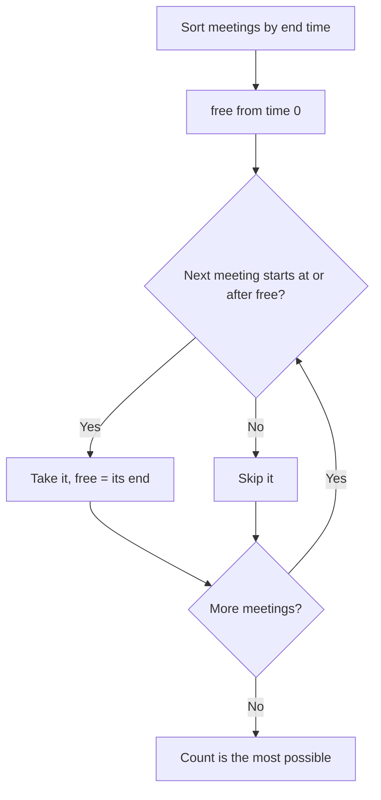
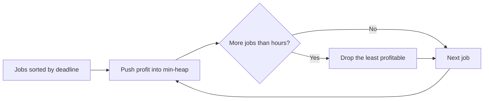
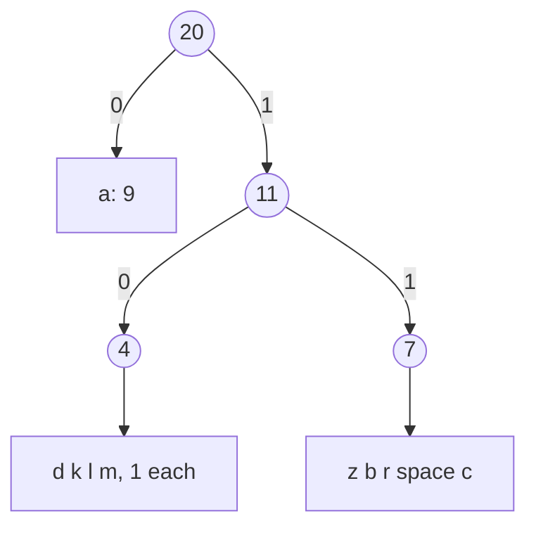

# new

## explanation

### The best choice now, never undone

A **greedy algorithm** builds an answer one step at a time, always taking the choice that looks best at that moment and never going back. When it works, it's usually the simplest and fastest solution: often just a sort and one pass, O(n log n).

The catch is that it doesn't always work. Picking the best-looking piece now can rule out a better whole later. A greedy solution needs a reason why its choices are safe, or at least careful testing.

### Example: fitting in the most meetings

One room, many requested meetings, each with a start and an end. Choose as many as possible that don't overlap. Some tempting rules:

- the earliest start: a long meeting starting at 0 can block everything;
- the shortest meeting: a short meeting in the middle can block two that would both fit;
- **the earliest end**: this one works.

Taking the meeting that **ends first** leaves the room free as early as possible, and so leaves the most room for the rest. Sort by end time, then take each meeting that starts after the last one taken ends.

### Why the earliest end is safe

Suppose some best schedule starts with a different meeting. Swap it for the one that ends earliest: that ends no later, so it can't clash with anything after it. The schedule is still valid and just as big. Repeating the swap turns any best schedule into the greedy one, so greedy is also best. This kind of proof is called an **exchange argument**.

### When greedy fails

Paying an amount with the fewest coins works greedily for coins like 1, 2, 5 and 10: always take the largest coin that fits. For coins 1, 3 and 4, paying 6 greedily gives 4 + 1 + 1 (three coins), while 3 + 3 uses two. Problems like that need dynamic programming.

## diagram



## example

```cpp
#include <algorithm>
#include <iostream>
#include <vector>

struct Meeting { int start, end; };  // the room is busy over [start, end)

int earliestEndFirst(std::vector<Meeting> m) {
    std::sort(m.begin(), m.end(), [](const Meeting& a, const Meeting& b) { return a.end < b.end; });
    int freeAt = 0, count = 0;
    for (const Meeting& x : m)
        if (x.start >= freeAt) { freeAt = x.end; count++; }
    return count;
}
int shortestFirst(std::vector<Meeting> m) {  // a tempting rule, for comparison
    std::stable_sort(m.begin(), m.end(), [](const Meeting& a, const Meeting& b) { return a.end - a.start < b.end - b.start; });
    std::vector<Meeting> taken;
    for (const Meeting& x : m) {
        bool clash = false;
        for (const Meeting& t : taken) if (x.start < t.end && t.start < x.end) clash = true;
        if (!clash) taken.push_back(x);
    }
    return (int)taken.size();
}

int main() {
    std::vector<Meeting> requests = {{1, 4}, {3, 5}, {0, 6}, {5, 7}, {3, 9}, {5, 9}, {6, 10}, {8, 11}, {8, 12}, {2, 14}, {12, 16}};
    std::vector<Meeting> trap = {{0, 5}, {4, 6}, {5, 10}};
    std::cout << "11 requests: earliest end " << earliestEndFirst(requests) << ", shortest first " << shortestFirst(requests) << '\n';
    std::cout << "[0,5) [4,6) [5,10): earliest end " << earliestEndFirst(trap) << ", shortest first " << shortestFirst(trap) << '\n';
}
```

```text
11 requests: earliest end 4, shortest first 4
[0,5) [4,6) [5,10): earliest end 2, shortest first 1
```

1. Sorted by end, the greedy takes [1,4), [5,7), [8,11) and [12,16), 4 meetings, and no schedule fits more.
2. On these requests the shortest-first rule happens to find 4 as well. A rule that works on one example isn't proven.
3. In the trap, the short meeting [4,6) overlaps both others. Shortest-first takes it and gets 1. Earliest-end takes [0,5) and then [5,10), and gets 2.

## mistakes

- **Trusting a greedy rule because it works on the sample.** Try to break it with small cases, or prove it with an exchange argument.
- **Sorting by the wrong key.** For the most meetings, sort by **end** time, not start time or length.
- **Off-by-one on touching intervals.** With [start, end), a meeting starting exactly when another ends doesn't clash; use `>=`.
- **Greedy coins for any coin system.** Largest-coin-first is only right for some coin sets; for others, use dynamic programming.
- **Changing an earlier choice.** If you find yourself going back to fix a choice, the problem probably isn't greedy.

## check

```cpp
#include <iostream>
#include <vector>

int greedyCoins(const std::vector<int>& coins, int amount) {  // coins listed from largest to smallest
    int used = 0;
    for (int c : coins) while (amount >= c) amount -= c, used++;
    return used;
}

int main() { std::cout << greedyCoins({10, 5, 2, 1}, 18) << ' ' << greedyCoins({4, 3, 1}, 6) << '\n'; }
```

```text
4 3
```

With coins 10, 5, 2 and 1, greedy pays 18 as 10 + 5 + 2 + 1, and 4 coins is the best possible. With 4, 3 and 1, greedy pays 6 as 4 + 1 + 1, 3 coins, but 3 + 3 needs only 2. Taking the largest coin first is not safe for every coin set.

# building

## explanation

### A quick recap

A greedy algorithm makes the locally best choice at each step and never revisits it. It's correct only when an argument shows that the choice can't hurt, such as taking the meeting that ends earliest.

### Fractional knapsack

A bag holds W kilos. Each item has a weight and a value, and items **can be cut**: half an item gives half its value. Sort by **value per kilo** and take the best items whole, then a fraction of the next one to fill the bag. Any kilo spent on a worse item could be swapped for a kilo of a better one, so greedy is optimal.

If items **can't** be cut (0/1 knapsack), this fails. A heavy item with the best ratio can waste space that two other items would fill better. That version needs dynamic programming.

### Job sequencing with deadlines

Each job takes one hour, has a deadline and earns a profit if done by then. Choose jobs to maximise profit:

1. sort the jobs by deadline;
2. go through them, adding each one's profit to a **min-heap** of kept jobs;
3. if the heap holds more jobs than the current deadline allows, drop the least profitable one.

At every point, the heap is the best set of jobs that fits in the hours so far. O(n log n).

### Rooms for all meetings

The opposite question: how many rooms are needed so that **every** meeting gets one? Sort by start time and keep a min-heap of the times busy rooms become free. If the room freeing earliest is free by the next start, reuse it; otherwise open a new one. The largest the heap gets is the answer, which equals the most meetings happening at the same moment.

## diagram



## example

```cpp
#include <algorithm>
#include <functional>
#include <iostream>
#include <queue>
#include <string>
#include <utility>
#include <vector>

struct Item { double weight, value; };
struct Job { char name; int deadline, profit; };

int main() {
    // Fractional knapsack: items can be cut, so take the best value per kilo first.
    std::vector<Item> items = {{10, 60}, {20, 100}, {30, 120}};
    std::sort(items.begin(), items.end(), [](const Item& a, const Item& b) { return a.value / a.weight > b.value / b.weight; });
    double room = 50, total = 0;
    for (const Item& it : items) {
        double take = std::min(room, it.weight);
        total += take * it.value / it.weight;
        room -= take;
    }
    std::cout << "fractional knapsack, capacity 50: value " << total << '\n';

    // Job sequencing: each job takes one hour and must be done by its deadline.
    std::vector<Job> jobs = {{'a', 2, 100}, {'b', 1, 19}, {'c', 2, 27}, {'d', 1, 25}, {'e', 3, 15}};
    std::sort(jobs.begin(), jobs.end(), [](const Job& x, const Job& y) { return x.deadline < y.deadline; });
    std::priority_queue<std::pair<int, char>, std::vector<std::pair<int, char>>, std::greater<>> kept;  // (profit, name)
    for (const Job& j : jobs) {
        kept.push({j.profit, j.name});
        if ((int)kept.size() > j.deadline) kept.pop();  // more jobs than hours: drop the least profitable
    }
    int profit = 0;
    std::string names;
    while (!kept.empty()) { profit += kept.top().first; names += kept.top().second; kept.pop(); }
    std::cout << "jobs kept, least profitable first: " << names << ", profit " << profit << '\n';
}
```

```text
fractional knapsack, capacity 50: value 240
jobs kept, least profitable first: eca, profit 142
```

1. The value per kilo is 6, 5 and 4. The first two items go in whole (160), and the last 20 kilos are two thirds of the third item (80): 240.
2. Jobs b and d both have deadline 1, so only one fits; the heap keeps d (25) and drops b.
3. With deadline 2, a (100) and c (27) arrive. Three jobs don't fit in two hours, so d is dropped.
4. e fits in the third hour. The kept jobs, e, c and a, earn 142.

## mistakes

- **Fractional greedy for items that can't be cut.** For 0/1 knapsack the ratio rule is wrong; use dynamic programming.
- **Integer division for ratios.** `60 / 10` is fine, but `100 / 30` as integers loses the fraction. Compare `a.value * b.weight` with `b.value * a.weight`, or use `double`.
- **A max-heap for the kept jobs.** The one to drop is the *least* profitable, so the heap must have the smallest on top.
- **Sorting jobs by profit and placing them in the latest free slot without a structure.** That works, but finding the slot naively is O(n²); the heap version is O(n log n).
- **Counting rooms by total length.** Rooms depend on how many meetings overlap at one moment, not on total busy time.

## check

```cpp
#include <algorithm>
#include <functional>
#include <iostream>
#include <queue>
#include <utility>
#include <vector>

int main() {
    std::vector<std::pair<int, int>> m = {{0, 30}, {5, 10}, {15, 20}, {10, 15}, {25, 35}};  // [start, end)
    std::sort(m.begin(), m.end());
    std::priority_queue<int, std::vector<int>, std::greater<int>> ends;  // when each busy room frees up
    for (auto [s, e] : m) {
        if (!ends.empty() && ends.top() <= s) ends.pop();  // reuse the room that frees up first
        ends.push(e);
    }
    std::cout << ends.size() << '\n';
}
```

```text
2
```

The long meeting [0, 30) keeps one room busy. Every other meeting fits in a second room, one after another, because each starts just as the previous one ends. Only [25, 35) overlaps [0, 30), and by then the second room is free again.

# strong

## explanation

### Proving a greedy algorithm

Two standard arguments:

- **Exchange argument.** Take any optimal solution that differs from the greedy one. Swap in the greedy choice and show the result is still valid and no worse. Repeating this turns the optimal solution into the greedy one.
- **Greedy stays ahead.** Show that after each step, the greedy partial solution is at least as good as any other, measured the right way. For example, after taking k meetings, greedy's k-th meeting ends no later than any other schedule's k-th.

If neither argument can be made, look for a small counterexample before trusting the rule.

### Huffman coding

Some letters appear much more often than others, so giving frequent letters **shorter** codes saves space. Codes must be **prefix-free**: no code is the start of another, so a stream of bits decodes in only one way. Such codes are the leaves of a binary tree: left is 0, right is 1.

Huffman's greedy algorithm builds the best tree:

1. put every letter in a min-heap, keyed by frequency;
2. take out the two **rarest** groups, merge them under a new node whose frequency is their sum, and put that back;
3. repeat until one tree remains.

Why it's safe: in some best tree, the two rarest letters are siblings at the deepest level. Swapping a deeper, more frequent letter with a rarer one can only reduce the total. Merging them reduces the problem by one letter, and the argument repeats. The total length in bits is the sum of all merged frequencies. With a heap, that's O(n log n).

### Choices that change later options

Greedy fails when one choice changes what's possible later, in a way the local rule can't see: 0/1 knapsack, coins like 1, 3 and 4, longest paths. Those need dynamic programming, which considers every choice and remembers the results.

## diagram



## example

```cpp
#include <functional>
#include <iostream>
#include <map>
#include <queue>
#include <string>
#include <utility>
#include <vector>

struct Node { long long freq; char ch; int left = -1, right = -1; };

int main() {
    std::string text = "abracadabra alakazam";
    std::map<char, long long> freq;
    for (char c : text) freq[c]++;
    // Huffman: keep merging the two rarest groups; each merge adds one bit to every letter inside it.
    std::vector<Node> nodes;
    using Item = std::pair<long long, int>;  // (frequency, node index)
    std::priority_queue<Item, std::vector<Item>, std::greater<Item>> pq;
    for (auto [c, f] : freq) { nodes.push_back({f, c}); pq.push({f, (int)nodes.size() - 1}); }
    while (pq.size() > 1) {
        auto [fa, a] = pq.top(); pq.pop();
        auto [fb, b] = pq.top(); pq.pop();
        nodes.push_back({fa + fb, 0, a, b});
        pq.push({fa + fb, (int)nodes.size() - 1});
    }
    // Read the codes off the tree: going left adds a 0, going right adds a 1.
    std::map<char, std::string> code;
    std::vector<std::pair<int, std::string>> todo = {{pq.top().second, ""}};
    while (!todo.empty()) {
        auto [i, bits] = todo.back();
        todo.pop_back();
        if (nodes[i].left < 0) { code[nodes[i].ch] = bits.empty() ? "0" : bits; continue; }
        todo.push_back({nodes[i].left, bits + '0'});
        todo.push_back({nodes[i].right, bits + '1'});
    }
    long long total = 0;
    for (auto [c, f] : freq) {
        std::cout << '\'' << c << "' x" << f << ": " << code[c] << '\n';
        total += f * (long long)code[c].size();
    }
    std::cout << "total " << total << " bits, against " << 4 * text.size() << " with 4 bits per letter\n";
}
```

```text
' ' x1: 11110
'a' x9: 0
'b' x2: 1101
'c' x1: 11111
'd' x1: 1000
'k' x1: 1001
'l' x1: 1010
'm' x1: 1011
'r' x2: 1110
'z' x1: 1100
total 55 bits, against 80 with 4 bits per letter
```

1. The text has 20 letters and 10 different symbols: a appears 9 times, b and r twice, and the other seven once each.
2. The heap first pairs up the letters that appear once, then the small groups, so rare letters end up deep in the tree: the space and c get 5-bit codes.
3. a, the most frequent letter, sits right below the root and gets a 1-bit code.
4. The total is 55 bits, the sum of every merged frequency, against 80 for a fixed 4 bits per symbol.

## mistakes

- **Merging the two most frequent groups.** Huffman merges the two **rarest**, so frequent letters stay near the root.
- **A single distinct letter.** The tree is just one leaf with an empty code. Give it the code "0", as the example does.
- **Codes that aren't prefix-free.** If one code is the start of another, decoding is ambiguous; building codes from a tree's leaves avoids this.
- **Forgetting ties don't matter for the total.** Different tie-breaking gives different codes, but every Huffman tree has the same total length.
- **Applying greedy to 0/1 choices without proof.** When a choice limits later choices, as in 0/1 knapsack, switch to dynamic programming.

## check

```cpp
#include <functional>
#include <iostream>
#include <queue>
#include <vector>

int main() {
    // Joining two ropes costs the sum of their lengths. Join them all as cheaply as possible.
    std::priority_queue<int, std::vector<int>, std::greater<int>> ropes;
    for (int len : {4, 3, 2, 6}) ropes.push(len);
    int cost = 0;
    while (ropes.size() > 1) {
        int a = ropes.top(); ropes.pop();
        int b = ropes.top(); ropes.pop();
        cost += a + b;
        ropes.push(a + b);
    }
    std::cout << cost << '\n';
}
```

```text
29
```

This is Huffman's merging in another form. Join 2 and 3 for 5, then 4 and 5 for 9, then 6 and 9 for 15, so the cost is 5 + 9 + 15 = 29. Joining the shortest ropes first keeps the long ones out of the repeated sums, just as frequent letters stay near the root.
