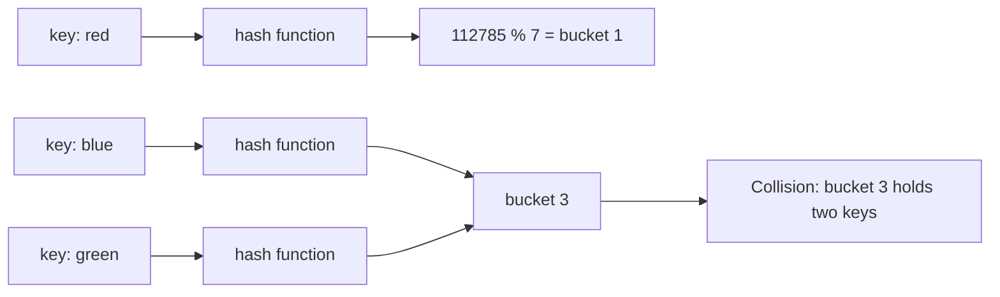
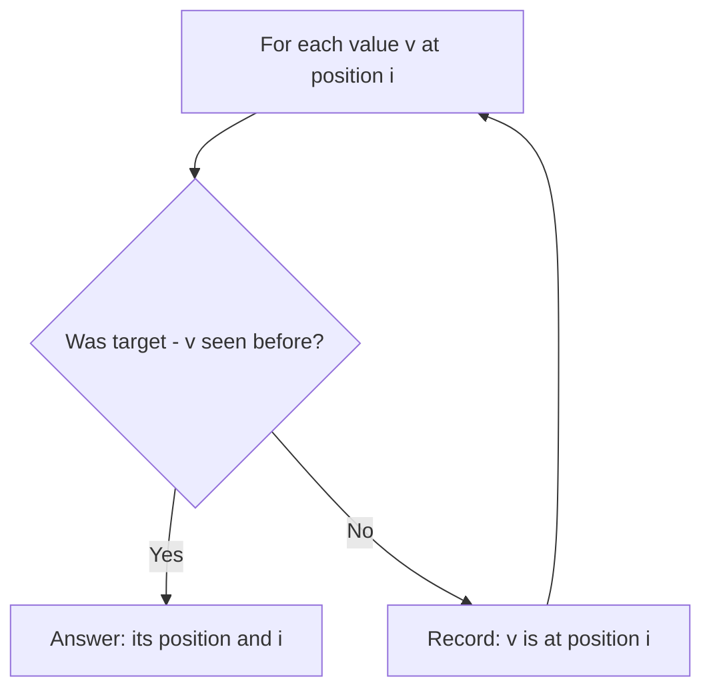
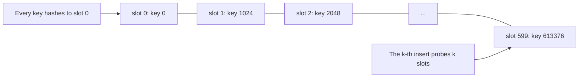

# new

## explanation

### Finding things without searching

To find a word in a list, you search. A **hash table** avoids searching: it turns the key itself into the position where it's stored.

### The hash function

A **hash function** turns a key, such as a word or a number, into a big number. Taking that number modulo the table size gives a **bucket**: one of the table's slots. To store "red", compute its bucket and put it there. To look "red" up later, compute the same bucket and look only there.

A good hash function is fast, always gives the same answer for the same key, and spreads different keys evenly over the buckets.

### Collisions

Different keys can land in the same bucket: that's a **collision**, and it's unavoidable when there are more possible keys than buckets. Tables handle it by keeping a short list in each bucket, or by trying the next free slot. As long as keys spread evenly, each bucket holds only a few, so adding, finding and removing take **O(1) on average**.

### Using hash tables in C++

You rarely write one yourself. C++ gives you:

- `std::unordered_set<T>`: "have I seen this?"
- `std::unordered_map<K, V>`: "what's stored for this key?"

The three everyday jobs:

- **Count**: `count[word]++` for each word.
- **Look up**: `m.contains(key)` or `m.find(key)`.
- **Group**: `groups[key].push_back(item)`.

### Hash table or sorted map?

`std::map` keeps keys in order and costs O(log n). `std::unordered_map` has no order, but O(1) on average. When you only need lookups, the hash table is usually faster; when you need sorted output or "the next key above x", use `std::map`.

## diagram



## example

```cpp
#include <iostream>
#include <string>
#include <unordered_map>
#include <vector>

// A tiny hash function: turn a word into a number, then into one of `buckets` slots.
std::size_t bucketOf(const std::string& word, std::size_t buckets) {
    std::size_t h = 0;
    for (char c : word) h = h * 31 + static_cast<unsigned char>(c);
    return h % buckets;
}

int main() {
    std::vector<std::string> words = {"red", "blue", "red", "green", "blue", "red"};
    for (const auto& w : std::vector<std::string>{"red", "blue", "green"})
        std::cout << w << " -> bucket " << bucketOf(w, 7) << '\n';

    // unordered_map does the hashing for you: count each word in O(1) on average.
    std::unordered_map<std::string, int> count;
    for (const auto& w : words) count[w]++;
    std::cout << "red " << count["red"] << ", blue " << count["blue"] << ", green " << count["green"] << '\n';
    std::cout << "has purple? " << count.contains("purple") << '\n';
}
```

```text
red -> bucket 1
blue -> bucket 3
green -> bucket 3
red 3, blue 2, green 1
has purple? 0
```

1. `bucketOf` mixes each character into a running number, then takes the remainder by 7: "red" becomes 112,785, which lands in bucket 1.
2. "blue" and "green" both land in bucket 3: a collision. A real table keeps both there and compares the keys to tell them apart.
3. `std::unordered_map` hashes each word for you, so counting six words takes six quick steps, with no searching.
4. `contains` checks for "purple" without adding it.

## mistakes

- **Using `[]` to check.** `if (count["purple"] > 0)` adds "purple" with 0. Use `contains` or `find` when you only want to look.
- **Expecting an order.** An `unordered_map` lists its keys in an order that depends on hashing and can change. Use `std::map`, or sort the keys, when order matters.
- **Thinking a hash identifies a key.** Different keys can share a hash. Tables always compare the actual keys too.
- **Your own type as a key without a hash.** `std::unordered_map<Point, int>` doesn't compile until you provide a hash function and `==` for `Point`.
- **Assuming O(1) always.** It's the average. If many keys share a bucket, operations slow down; the strong level shows how.

## check

```cpp
#include <iostream>
#include <string>
#include <unordered_map>
#include <unordered_set>

int main() {
    std::unordered_set<int> seen;
    int repeats = 0;
    for (int x : {4, 7, 4, 1, 7, 4}) {
        if (seen.contains(x)) repeats++;
        else seen.insert(x);
    }
    std::unordered_map<char, int> letters;
    for (char c : std::string("banana")) letters[c]++;
    std::cout << seen.size() << ' ' << repeats << ' ' << letters['a'] << letters['n'] << '\n';
}
```

```text
3 3 32
```

The set keeps each value once: 4, 7 and 1. The second 4, the second 7 and the third 4 are already there, so `repeats` is 3. Counting "banana" gives three a's and two n's, printed side by side as 32.

# building

## explanation

### A quick recap

A hash table turns a key into a bucket, so adding and finding take O(1) on average. In C++, use `std::unordered_set` and `std::unordered_map` for counting, looking up and grouping.

### Pattern: count, then answer

Many questions need two passes: first count everything in a map, then use the counts. "The first character that appears only once" counts all characters, then scans the text again and stops at the first with count 1. Each pass is O(n).

### Pattern: group by a key

To group words that are anagrams of each other, give each word a **key** that's the same for every word in a group: its letters in sorted order ("listen" and "silent" both become "eilnst"). Then `groups[key].push_back(word)`. The trick is choosing a key that captures exactly what the group shares.

### Pattern: look up while you scan

"Which two positions hold values adding to the target?" on an **unsorted** list: walk once, and for each value v ask the map whether `target − v` was seen earlier, and where. If not, record v's position. One pass, O(n), no sorting. Check **before** recording, or a value could pair with itself.

### Inside: buckets and load factor

`std::unordered_map` keeps an array of buckets, each holding a short list of entries. The **load factor** is entries ÷ buckets. When it passes the limit (1.0 by default), the table **rehashes**: it allocates more buckets and moves every entry, an O(n) step that keeps later operations fast. If you know roughly how many entries are coming, `reserve(n)` sizes the table once.

### Step by step

1. Decide what the key is: the value, a sorted word, a pair, a remainder.
2. Decide what to store with it: a count, a position, a list.
3. Decide whether you look up before or after storing the current item.

## diagram



## example

```cpp
#include <algorithm>
#include <iostream>
#include <string>
#include <unordered_map>
#include <vector>

int main() {
    // Grouping: words with the same letters share a key, their letters sorted.
    std::vector<std::string> words = {"listen", "stone", "silent", "notes", "enlist", "rat"};
    std::unordered_map<std::string, std::vector<std::string>> groups;
    for (const auto& w : words) {
        std::string key = w;
        std::sort(key.begin(), key.end());
        groups[key].push_back(w);
    }
    std::cout << groups.size() << " groups; listen's group has " << groups["eilnst"].size() << '\n';

    // Counting, then a second pass: the first character that appears once.
    std::string s = "swiss cheese";
    std::unordered_map<char, int> freq;
    for (char c : s) freq[c]++;
    for (char c : s) if (freq[c] == 1) { std::cout << "first unique: " << c << '\n'; break; }

    // Look-up while scanning: two positions whose values add to the target, unsorted input, O(n).
    std::vector<int> v = {8, 3, 11, 5, 7};
    int target = 12;
    std::unordered_map<int, int> indexOf;
    for (int i = 0; i < static_cast<int>(v.size()); i++) {
        if (auto it = indexOf.find(target - v[i]); it != indexOf.end()) {
            std::cout << "positions " << it->second << " and " << i << '\n';
            break;
        }
        indexOf[v[i]] = i;
    }
}
```

```text
3 groups; listen's group has 3
first unique: w
positions 3 and 4
```

1. Sorting each word's letters gives "eilnst" for listen, silent and enlist, "enost" for stone and notes, and "art" for rat: three groups.
2. In "swiss cheese", s appears four times and e three; scanning in order, w is the first with count 1.
3. The scan records 8, 3, 11 and 5 with their positions. At 7, it finds that 12 − 7 = 5 was seen at position 3.

## mistakes

- **Recording before checking.** If `indexOf[v[i]] = i` comes first, a value equal to half the target pairs with itself. Look up first, then record.
- **A key that's too loose or too strict.** Grouping anagrams by length would merge unrelated words; by the word itself would never group anything. The key must be equal exactly when items belong together.
- **Iterating an unordered map when the order matters.** "The first unique character" must scan the original text, not the map, whose order is unrelated to the text.
- **Rehashing in a hot loop.** Filling a big table without `reserve` triggers several O(n) rehashes. Reserve when you know the size.
- **Keeping iterators across inserts.** A rehash invalidates every iterator into the table. Look items up again after inserting.

## check

```cpp
#include <iostream>
#include <unordered_map>
#include <vector>

int main() {
    std::vector<int> v = {2, 9, 2, 5, 9, 2};
    std::unordered_map<int, int> count;
    for (int x : v) count[x]++;
    int best = v[0];
    for (int x : v) if (count[x] > count[best]) best = x;
    std::cout << best << ' ' << count[best] << ' ' << count.size() << '\n';
}
```

```text
2 3 3
```

The counts are 2 → 3, 9 → 2 and 5 → 1. The second loop keeps the value with the highest count, scanning in the original order, so it ends with 2, seen 3 times. There are 3 distinct values.

# strong

## explanation

### Two ways to handle collisions

- **Separate chaining**: each bucket holds a list of entries. `std::unordered_map` works this way, with one heap node per entry. It's simple and robust, but walking scattered nodes is cache-unfriendly.
- **Open addressing**: every entry lives directly in one array. On a collision, **probe** other slots: the next one (linear probing), or ones further away. Linear probing is very cache-friendly, but keys that collide form **clusters**, and any key that hashes into a cluster must probe to its end. Deletion needs "tombstones" so later searches don't stop early.

### Load factor

With chaining, the expected cost is O(1 + load factor). With linear probing, the expected probes grow like 1/(1 − α)² as the load α approaches 1, so open-addressing tables are kept well below full, often at most half to three quarters.

### When O(1) breaks

Expected O(1) assumes keys spread evenly. Patterned keys with a weak hash, such as multiples of the table size, all land in one bucket, and every operation becomes O(n). That can happen by accident, or on purpose: crafted inputs against a known hash function can slow a program down enormously. The defence is a **well-mixing hash**, such as splitmix64, ideally with a random seed fixed when the program starts.

### Tuning `std::unordered_map`

- `reserve(n)` allocates enough buckets for n entries up front.
- `max_load_factor(f)` sets the rehash threshold.
- A custom hash type is the third template argument: `std::unordered_map<K, V, MyHash>`.

### Good keys

Equal keys must produce equal hashes. To hash a pair, combine both parts' hashes with mixing; simply adding them makes (1, 2) and (2, 1) collide.

## diagram



## example

```cpp
#include <cstdint>
#include <iostream>
#include <unordered_map>
#include <vector>

// Open addressing with linear probing: on a collision, try the next slot.
struct ProbingSet {
    std::vector<long long> slots;
    std::vector<bool> used;
    long long probes = 0;
    explicit ProbingSet(std::size_t capacity) : slots(capacity), used(capacity, false) {}
    void insert(long long key) {
        std::size_t i = static_cast<std::size_t>(key) % slots.size();
        while (used[i] && slots[i] != key) { i = (i + 1) % slots.size(); probes++; }
        used[i] = true;
        slots[i] = key;
    }
};

// A mixing hash (splitmix64): nearby or patterned keys still spread over all buckets.
struct Mixed {
    std::size_t operator()(std::uint64_t x) const {
        x += 0x9e3779b97f4a7c15ULL;
        x = (x ^ (x >> 30)) * 0xbf58476d1ce4e5b9ULL;
        x = (x ^ (x >> 27)) * 0x94d049bb133111ebULL;
        return x ^ (x >> 31);
    }
};

int main() {
    // The same number of keys in two tables of 1024 slots, load factor about 0.6.
    ProbingSet spread(1024), clustered(1024);
    for (long long k = 0; k < 600; k++) spread.insert(k * 7919);     // keys land all over the table
    for (long long k = 0; k < 600; k++) clustered.insert(k * 1024);  // every key hashes to slot 0
    std::cout << "extra probes: spread " << spread.probes << ", clustered " << clustered.probes << '\n';

    std::unordered_map<std::uint64_t, int, Mixed> counts;
    counts.reserve(1000);  // room up front: no rehashing while filling
    for (std::uint64_t k = 0; k < 1000; k++) counts[k << 20]++;
    std::cout << counts.size() << " keys, load factor below 1: " << (counts.load_factor() < 1.0f) << '\n';
}
```

```text
extra probes: spread 0, clustered 179700
1000 keys, load factor below 1: 1
```

1. Multiplying by the odd number 7919 sends the 600 keys to 600 different slots, so no insert ever probes.
2. Multiples of 1024 all hash to slot 0 in a 1024-slot table. Each new key must walk past every earlier one: 0 + 1 + … + 599 = 179,700 extra probes. Same table, same load, but each insert costs O(n).
3. Keys of the form k × 2²⁰ are just as patterned, but the splitmix64 mixer scrambles their bits so they spread over the buckets.
4. `reserve(1000)` sized the table before filling it, so the load factor stays below 1 and no rehash happened along the way.

## mistakes

- **Weak hashes on patterned keys.** Identity-like hashes with keys that share a pattern pile into a few buckets. Use a mixing hash for integer keys you don't control.
- **Filling an open-addressing table too far.** Above about 0.7, probe sequences get long fast. Grow the table well before it's full.
- **Deleting by clearing a slot.** In open addressing, an emptied slot breaks the probe chain for keys inserted after it. Mark it as a tombstone instead.
- **Combining hashes by adding.** `hash(a) + hash(b)` makes swapped pairs collide and loses information. Mix one into the other.
- **Trusting O(1) on adversarial input.** Inputs crafted against the default hash can turn a fast program into a timeout. Use a seeded, well-mixing hash, or a `std::map` with guaranteed O(log n).

## check

```cpp
#include <iostream>
#include <vector>

int main() {
    std::vector<int> table(8, -1);
    int probes = 0;
    for (int key : {3, 11, 19, 4}) {
        int i = key % 8;
        while (table[i] != -1) { i = (i + 1) % 8; probes++; }
        table[i] = key;
    }
    std::cout << table[3] << ' ' << table[5] << ' ' << table[6] << ' ' << probes << '\n';
}
```

```text
3 19 4 5
```

3, 11 and 19 all hash to slot 3, so they fill slots 3, 4 and 5, with 1 and 2 extra probes. Key 4 hashes to slot 4, which isn't its own collision group, but the cluster is in the way: it probes slots 4 and 5 before landing in 6. That's 5 extra probes in total. Clusters slow down even keys that never collided directly.
