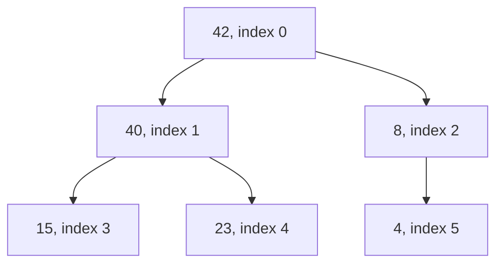
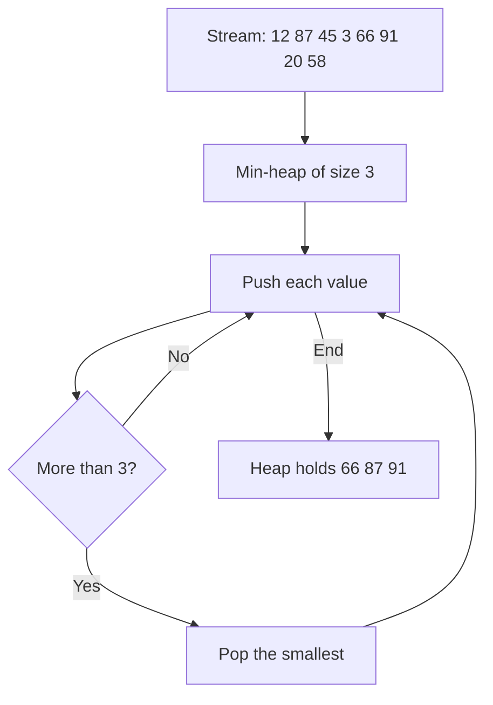
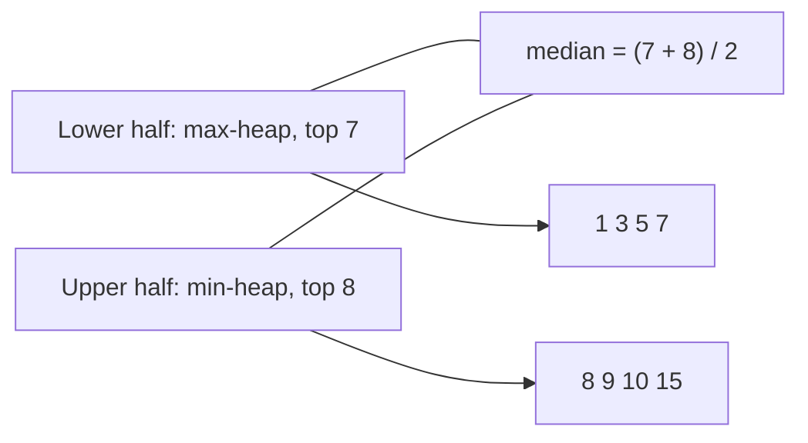

# new

## explanation

### Always knowing the biggest

Some programs repeatedly need "the most urgent task", "the cheapest option", "the largest value so far", while new items keep arriving. Sorting after every arrival is wasteful. A **heap** keeps the largest (or smallest) item instantly available, with O(log n) insert and remove.

### The heap rule

A **max-heap** is a binary tree where every parent is **at least as big as its children**. So the largest item is always at the root. It is not sorted otherwise: siblings and cousins can be in any order. A min-heap is the same with "smallest".

### Stored in a plain array

A heap is a **complete** tree: every level is full except possibly the last, which fills from the left. That shape fits an array exactly, with no pointers:

- the root is at index 0;
- the children of index i are at 2i + 1 and 2i + 2;
- the parent of index i is at (i − 1) / 2.

### Adding: sift up

Put the new item at the end of the array (the next free spot in the last level). While it's bigger than its parent, swap them. It climbs at most the tree's height: O(log n).

### Removing the top: sift down

Take the root. Move the last item into the root's place, then, while it's smaller than its bigger child, swap it with that child. Again O(log n).

### In C++

`std::priority_queue<int>` is a max-heap with `push`, `top` and `pop`. For a min-heap, write `std::priority_queue<int, std::vector<int>, std::greater<int>>`.

## diagram



## example

```cpp
#include <iostream>
#include <utility>
#include <vector>

// A max-heap in a vector: the children of i are 2i+1 and 2i+2, and every parent is >= its children.
class MaxHeap {
public:
    void push(int x) {
        a_.push_back(x);
        for (std::size_t i = a_.size() - 1; i > 0 && a_[(i - 1) / 2] < a_[i]; i = (i - 1) / 2)
            std::swap(a_[i], a_[(i - 1) / 2]);  // sift up: swap with the parent while bigger
    }
    int pop() {
        int top = a_[0];
        a_[0] = a_.back();
        a_.pop_back();
        for (std::size_t i = 0;;) {  // sift down: swap with the bigger child while smaller
            std::size_t big = i, l = 2 * i + 1, r = 2 * i + 2;
            if (l < a_.size() && a_[l] > a_[big]) big = l;
            if (r < a_.size() && a_[r] > a_[big]) big = r;
            if (big == i) break;
            std::swap(a_[i], a_[big]);
            i = big;
        }
        return top;
    }
    bool empty() const { return a_.empty(); }
    const std::vector<int>& raw() const { return a_; }
private:
    std::vector<int> a_;
};

int main() {
    MaxHeap h;
    for (int x : {15, 40, 8, 23, 42, 4}) h.push(x);
    std::cout << "array:";
    for (int x : h.raw()) std::cout << ' ' << x;
    std::cout << "\npopped:";
    while (!h.empty()) std::cout << ' ' << h.pop();
    std::cout << '\n';
}
```

```text
array: 42 40 8 15 23 4
popped: 42 40 23 15 8 4
```

1. 40 arrives after 15 and sifts up past it; later 42 sifts all the way to the root.
2. The array 42 40 8 15 23 4 follows the heap rule at every parent, but it isn't sorted: 8 sits before 15 and 23.
3. Each pop takes the root, moves the last item to the top and sifts it down, so the values come out largest first.
4. Each push and pop touched at most the tree's height, about log₂ 6 levels.

## mistakes

- **Wrong index arithmetic.** With the root at 0, the children are 2i + 1 and 2i + 2, and the parent is (i − 1) / 2. Formulas for a 1-based array differ.
- **Expecting the array to be sorted.** Only the root is guaranteed to be the largest. Pop repeatedly to get sorted output.
- **Swapping with the smaller child when sifting down.** The parent must swap with its **bigger** child, or the heap rule breaks on the other side.
- **Popping an empty heap.** Check `empty()` before `pop()` or `top()`.
- **Forgetting the default.** `std::priority_queue` is a max-heap. For smallest-first, pass `std::greater`.

## check

```cpp
#include <iostream>
#include <vector>

int main() {
    std::vector<int> heap = {50, 30, 40, 10, 20, 35};
    int i = 4;
    std::cout << heap[(i - 1) / 2] << ' ' << heap[2 * 2 + 1] << ' ' << heap[2 * 1 + 2] << '\n';
    bool valid = true;
    for (int c = 1; c < 6; c++) if (heap[(c - 1) / 2] < heap[c]) valid = false;
    std::cout << valid << '\n';
}
```

```text
30 35 20
1
```

The parent of index 4 is index 1, which holds 30. The left child of index 2 is index 5 (35), and the right child of index 1 is index 4 (20). Every value is at most its parent's, so this array is a valid max-heap.

# building

## explanation

### A quick recap

A heap keeps the largest (or smallest) item at the root of a complete tree stored in an array. Push sifts up, pop sifts down, both O(log n). `std::priority_queue` is the ready-made version.

### The k largest of a stream

To keep the k largest values of a long stream, keep a **min-heap** of size k. Push each value; if the heap grows past k, pop its top, the smallest of the candidates. At the end the heap holds exactly the k largest. That's O(n log k) time and O(k) memory, without storing the whole stream: far better than sorting everything when k is small.

### Building a heap fast

Pushing n items one by one costs O(n log n). Turning an existing array into a heap **bottom-up** is faster: sift down every parent, starting from the last one and moving towards the root. Most nodes are near the bottom and sift down only a little, so the total is O(n). `std::make_heap` does this.

### Heap sort

1. Build a max-heap in place: O(n).
2. Repeatedly swap the root (the largest) with the last item of the heap part, shrink the heap by one, and sift the new root down. The sorted part grows from the end.

That's O(n log n) in every case, with O(1) extra memory. `std::pop_heap` does step 2 once, and `std::sort_heap` does all of it. Heap sort isn't stable, and in practice it's slower than quick sort, but its guaranteed worst case is why introsort falls back on it.

## diagram



## example

```cpp
#include <algorithm>
#include <iostream>
#include <queue>
#include <vector>

int main() {
    // The 3 largest values of a stream: a min-heap of size 3; its top is the smallest of the best.
    // The comparator says when a comes after b; "after the larger" puts the smallest on top.
    auto smallestOnTop = [](int a, int b) { return a > b; };
    std::priority_queue<int, std::vector<int>, decltype(smallestOnTop)> best(smallestOnTop);
    for (int x : {12, 87, 45, 3, 66, 91, 20, 58}) {
        best.push(x);
        if (best.size() > 3) best.pop();  // drop the smallest of the four
    }
    std::cout << "top 3 (smallest first):";
    while (!best.empty()) { std::cout << ' ' << best.top(); best.pop(); }
    std::cout << '\n';

    // Heap sort with the library: build a heap in O(n), then move the largest to the end, n times.
    std::vector<int> v = {9, 4, 7, 1, 8, 2, 6};
    std::make_heap(v.begin(), v.end());
    std::cout << "after make_heap the largest is first: " << v.front() << '\n';
    for (auto end = v.end(); end != v.begin(); --end) std::pop_heap(v.begin(), end);
    for (int x : v) std::cout << x << ' ';
    std::cout << '\n';
}
```

```text
top 3 (smallest first): 66 87 91
after make_heap the largest is first: 9
1 2 4 6 7 8 9
```

1. The min-heap never holds more than 4 values; each time it does, the smallest leaves. What remains at the end are the three largest: 66, 87 and 91.
2. `make_heap` rearranges the vector into a max-heap in O(n), so 9 is at the front.
3. Each `pop_heap` swaps the largest into the last place of the shrinking heap and repairs the rest. After seven rounds the vector is sorted, using no extra memory.

## mistakes

- **A max-heap for the k largest.** Its top is the largest, which is exactly the one you want to keep. Use a min-heap of size k, so the smallest candidate is the one that leaves.
- **Sorting everything to get the top k.** O(n log n) and O(n) memory, when O(n log k) and O(k) would do.
- **Pushing n items when they're all available.** Building with `make_heap` is O(n), not O(n log n).
- **Calling `pop_heap` without shrinking the range.** It moves the largest to the end of the range you pass. The next call must use a range one shorter.
- **Expecting heap sort to be stable.** Equal items can change order. Use `std::stable_sort` when that matters.

## check

```cpp
#include <iostream>
#include <queue>

int main() {
    std::priority_queue<int> maxH, negatives;  // a max-heap of negated values behaves as a min-heap
    for (int x : {5, 1, 9, 3}) { maxH.push(x); negatives.push(-x); }
    maxH.pop();
    negatives.pop();
    std::cout << maxH.top() << ' ' << -negatives.top() << ' ' << maxH.size() + negatives.size() << '\n';
}
```

```text
5 3 6
```

The max-heap receives 5, 1, 9 and 3, pops its largest, 9, and has 5 on top. The other heap receives −5, −1, −9 and −3. Its largest is −1, so it pops the smallest original value, 1, and has −3 on top, which prints as 3. Each holds 3 values.

# strong

## explanation

### Why bottom-up heapify is O(n)

Sifting a node down costs at most its height above the leaves. About half the nodes are leaves (height 0), a quarter have height 1, an eighth height 2, and so on. The total, n × (0/2 + 1/4 + 2/8 + 3/16 + …), is at most n. Pushing items one by one costs up to log₂ n per item, because each new item can climb to the root, which happens on increasing input.

### The running median

To report the median after every new value, keep two heaps:

- a **max-heap** with the lower half of the values;
- a **min-heap** with the upper half.

Insert into the lower half if the value is at most its top, otherwise into the upper half. Then rebalance so their sizes differ by at most one, by moving a top across. The median is the lower half's top (odd count), or the average of both tops (even count). Each new value costs O(log n).

### What heaps can't do

A heap can't search for an arbitrary item, can't change an item's priority, and can't remove anything but the top, unless you also track positions (an **indexed heap**) or use lazy deletion. When you need ordered access beyond the top, a balanced search tree (`std::set`) does more, at a higher constant cost.

### Variations

- **d-ary heaps** give each node d children: a shallower tree, cheaper pushes, slightly costlier pops. They suit algorithms such as Dijkstra's with many priority decreases.
- **Pairing and Fibonacci heaps** make some operations O(1) amortised; they matter in theory more than in typical code.

## diagram



## example

```cpp
#include <iostream>
#include <utility>
#include <vector>

// Bottom-up heapify: sift down every parent, from the last one to the root. O(n) in total.
long long heapify(std::vector<int>& a) {
    long long swaps = 0;
    for (std::size_t s = a.size() / 2; s-- > 0;) {
        for (std::size_t i = s;;) {
            std::size_t big = i, l = 2 * i + 1, r = l + 1;
            if (l < a.size() && a[l] > a[big]) big = l;
            if (r < a.size() && a[r] > a[big]) big = r;
            if (big == i) break;
            std::swap(a[i], a[big]);
            i = big;
            swaps++;
        }
    }
    return swaps;
}
// Building by pushing one at a time: each new item sifts up. O(n log n) in the worst case.
long long pushAll(const std::vector<int>& in) {
    std::vector<int> a;
    long long swaps = 0;
    for (int x : in) {
        a.push_back(x);
        for (std::size_t i = a.size() - 1; i > 0 && a[(i - 1) / 2] < a[i]; i = (i - 1) / 2) {
            std::swap(a[i], a[(i - 1) / 2]);
            swaps++;
        }
    }
    return swaps;
}

int main() {
    std::vector<int> rising(1 << 16);
    for (int i = 0; i < (1 << 16); i++) rising[i] = i;  // each new item is the largest so far: the worst case
    std::vector<int> copy = rising;
    std::cout << "swaps for 65536 items: one by one " << pushAll(rising) << ", bottom-up " << heapify(copy) << '\n';
}
```

```text
swaps for 65536 items: one by one 917522, bottom-up 65521
```

1. On rising input, every pushed item is the largest so far and climbs all the way to the root: 917,522 swaps, about 14 per item, close to log₂ 65536 = 16.
2. Bottom-up heapify on the same data sifts each parent down at most its height: 65,521 swaps in total, fewer than n.
3. Both build valid max-heaps; only the amount of work differs.

## mistakes

- **Starting heapify at the root.** Sifting down only works when both subtrees are already heaps, so go from the last parent (index n/2 − 1) back to the root.
- **Unbalanced halves in the running median.** After every insert, move a top across if the sizes differ by more than one, or the tops stop being the middle values.
- **Integer division for an even median.** `(a + b) / 2` drops the .5. Divide by `2.0`, or keep the two middle values.
- **Trying to update an item's priority in place.** A plain heap can't find it. Push the new version and skip stale ones when popped, or use an indexed heap.
- **A heap when you need order.** If you need the k-th item, a range, or deletions of arbitrary items, use a balanced tree instead.

## check

```cpp
#include <functional>
#include <iostream>
#include <queue>
#include <vector>

int main() {
    std::priority_queue<int> low;                                       // the lower half, largest on top
    std::priority_queue<int, std::vector<int>, std::greater<int>> high;  // the upper half, smallest on top
    for (int x : {5, 15, 1, 3, 8, 7, 9, 10}) {
        if (low.empty() || x <= low.top()) low.push(x); else high.push(x);
        if (low.size() > high.size() + 1) { high.push(low.top()); low.pop(); }
        else if (high.size() > low.size()) { low.push(high.top()); high.pop(); }
    }
    std::cout << low.top() << ' ' << high.top() << ' ' << (low.top() + high.top()) / 2.0 << '\n';
}
```

```text
7 8 7.5
```

After all eight values, the lower half holds 1, 3, 5, 7 and the upper half 8, 9, 10, 15, kept within one of each other in size. With an even count, the median is the average of the two tops: (7 + 8) / 2 = 7.5.
